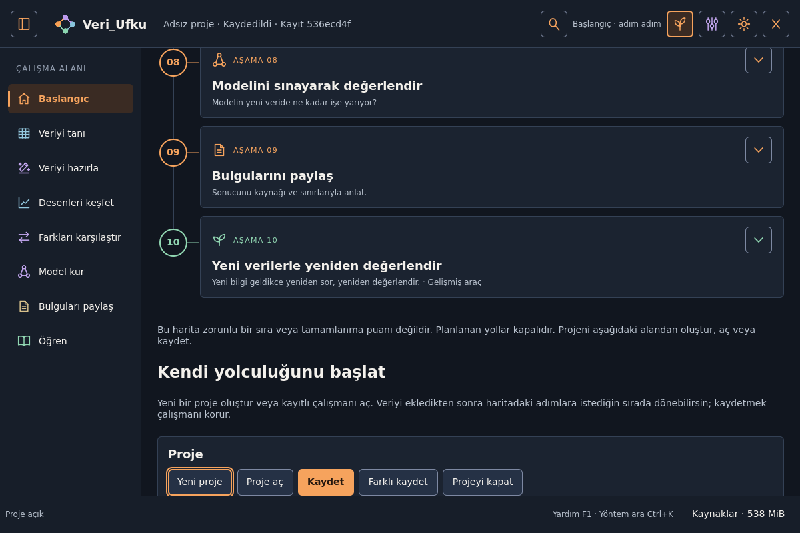

<div align="center">
  
  <h1>Veri_Ufku</h1>
  <p><strong>Veriyi tanı. Sorular sor. Bulgularını anlaşılır ve izlenebilir hâle getir.</strong></p>
  <p>Linux için yerel, öğrenme odaklı veri bilimi masaüstü uygulaması.</p>
  <p>
    <a href="#kurulum">Kurulum</a> ·
    <a href="#ilk-projen">İlk proje</a> ·
    <a href="docs/PRO_CAPABILITY_MATRIX.md">Yetenek matrisi</a> ·
    <a href="docs/INSTALL_EN.md">English installation</a> ·
    <a href="CONTRIBUTING.md">Katkıda bulun</a>
  </p>
</div>

> **Sürüm durumu: 0.1.0 — deneysel teknik önizleme.** Çalışan ve test edilmiş
> yollar vardır; bütün yöntemler, isteğe bağlı bağımlılıklar ve Linux dağıtımları
> için üretim doğrulaması tamamlanmış değildir. Güncel kapsam ve açık işler
> [yetenek matrisinde](docs/PRO_CAPABILITY_MATRIX.md) ve
> [sürüm kapsamında](docs/RELEASE_SCOPE_0_1.md) ayrı tutulur.


## Neden Veri_Ufku?

Veri bilimine başlarken yalnızca bir grafik çizmek veya bir model çalıştırmak
çoğu zaman yeterli değildir. Önce verinin neyi temsil ettiğini, hangi soruyu
sorduğunu, hangi işlemin neden gerekli olduğunu ve sonucun nerede geçerli
olduğunu anlamak gerekir.

**Veri_Ufku'nun amacı, öğrenme ile gerçek veri üzerinde çalışmayı aynı masaüstü
ortamında birleştirmektir.** Dosyayı içe aktarmaktan bulguları raporlamaya kadar
verinin yolculuğunu görünür kılar. Kullanıcı bir aracı kullanırken ilgili kavramı
öğrenebilir; deneyim kazandığında aynı çalışma üzerinde daha ayrıntılı araçlara
geçebilir.

Projenin merkezinde üç fikir bulunur:

- **Anlayarak çalışmak:** Soruyu, yöntemi, varsayımı ve yorum sınırını birlikte görmek.
- **Kendi bilgisayarında çalışmak:** Temel iş akışları için bulut hesabı veya sürekli
  internet bağlantısı gerektirmemek.
- **Çalışmanın izini korumak:** Kaynağı, veri sürümünü, işlemleri, model değerlendirmesini
  ve rapor bağlantılarını proje içinde takip etmek.

## Kimler için?

- **Yeni başlayanlar:** Veriyi tanıma, eksik değer, dağılım, karşılaştırma ve modelleme
  kavramlarını adım adım öğrenmek isteyenler.
- **Öğrenciler ve eğitmenler:** Küçük örnekler ve çevrimdışı açıklamalarla analiz
  adımlarını incelemek isteyenler.
- **Analistler ve araştırmacılar:** Yerel dosyalardan başlayarak keşif, hazırlama,
  seçilmiş istatistiksel yöntemler ve raporlama yapmak isteyenler.
- **Deneyimli kullanıcılar ve geliştiriciler:** Gelişmiş yöntemleri, işlem tariflerini,
  çalışma kayıtlarını ve genişletilebilir altyapıyı değerlendirmek isteyenler.

## Bir uygulama, iki çalışma düzeyi

### Başlangıç: verinin yolculuğunu takip et

İlk kullanım **Başlangıç** düzeyindedir. Ana sayfadaki Veri Bilimi Yol Haritası
ilgili çalışma alanlarına götürür. Haritanın sonunda proje oluşturma, açma ve
kaydetme alanı bulunur.

| Çalışma alanı | Sorduğun soru |
|---|---|
| Veriyi tanı | Her satır neyi temsil ediyor? Sütunların türü ve anlamı ne? |
| Veriyi hazırla | Eksik, tekrar veya tutarsız değerlerle nasıl çalışmalıyım? |
| Desenleri keşfet | Dağılımlar, gruplar ve zaman içindeki değişimler nasıl görünüyor? |
| Farkları karşılaştır | Gördüğüm fark ne kadar büyük ve ne kadar belirsiz? |
| Model kur | Yeni kayıtlarda işe yarayan bir tahmin yapabilir miyim? |
| Bulguları paylaş | Ne buldum; sonucun varsayımları ve sınırlılıkları neler? |

Çalışma sayfaları soru, yapılacak iş, beklenen çıktı ve kısa örneklerle başlar.
Harita bir sınav veya zorunlu sıra değildir; ihtiyaç duyduğun adıma dönebilirsin.
Bir başlığa tıklamak hesap başlatmaz veya veriyi değiştirmez.

### Öğren: aynı haritada daha derine in

**Öğren** sekmesi aynı aşamalar üzerinden terimlere, açıklamalara ve örneklere
ulaştırır. Çevrimdışı arama, sözlük, ilgili konular ve ayrı örnek çalışma alanları
bulunur. Ders okumak araç kullanmanın önkoşulu değildir.

Örnek laboratuvarlar kendi çalışma alanında açılır; kullanıcının projesini
öğretim deneyi için değiştirmez. Öğrenme içeriklerinin teknik kontrolleri ile
bağımsız uzman doğruluk incelemesi ayrı süreçlerdir.

### Gelişmiş: araçlara doğrudan ulaş

Gelişmiş görünüm daha ayrıntılı yöntemleri, parametreleri ve teknik panelleri
öne çıkarır. Başlangıç anlatısı geri çekilir; işlem akışları, deney kayıtları,
ortam bilgileri ve desteklenen uzman araçlarına doğrudan erişilebilir.

Seviye değiştirirken form değerleri korunur ve son tercih hatırlanır.
**Gelişmiş görünüm, güvenlik kontrollerini veya bilimsel önkoşulları kaldırmaz.**

<details>
<summary>Diğer ekranları gör</summary>

**Veriyi tanıma ekranı**


**Haritanın sonunda proje işlemleri**



**Gerçek hesapla oluşturulmuş histogram**


Bu görüntüler gerçek QML arayüzünün başsız Qt render'larıdır; tasarım maketi değildir.
Fiziksel masaüstü ve insan kullanılabilirlik testi yerine geçmez.

</details>

## Neler üzerinde çalışabilirsin?

Aşağıdaki tablo modül kapsamını özetler. Bir modülün bulunması, içindeki her
alt yöntemin veya her backend'in aynı olgunlukta olduğu anlamına gelmez.
Yöntem bazındaki destek, sınır ve kanıt için [yetenek matrisini](docs/PRO_CAPABILITY_MATRIX.md) kullan.

| Alan | Kapsam |
|---|---|
| Veri kaynakları | CSV/TSV, Excel, JSON/JSONL, Parquet ve seçilmiş diğer yerel biçimler; ayrı veritabanı/HTTP/nesne depolama adaptörleri |
| Keşif ve kalite | Sayfalı veri tablosu, sütun profili, eksik değer incelemesi, sözlük ve veri sözleşmeleri |
| Hazırlama | Seçilmiş temizleme, dönüştürme, birleştirme, yeniden şekillendirme ve işlem geçmişi |
| Görselleştirme | Dağılım, karşılaştırma, ilişki, çok değişkenli ve bileşim grafikleri; desteklenen grafiklerde seçim ve dışa aktarım |
| İstatistik | Karşılaştırma, ilişki, belirsizlik, örnekleme ve ağırlık türleri; ayrı ileri istatistik/Bayes/nedensel/sağkalım yolları |
| Makine öğrenmesi | Regresyon, sınıflandırma, kümeleme, anomali, özellik seçimi, doğrulama planları, tuning, kalibrasyon ve açıklama |
| Uzman veri türleri | Zaman serisi, sinyal, çok boyutlu dizi ve mekânsal veri; seçilmiş metin, görüntü ve ses yolları |
| Diğer analizler | Öneri sistemleri, ağlar, sepet/event analizi, yerel akış simülasyonu ve sınırlı simülasyon/optimizasyon |
| Çalışma yönetimi | Deney/model kayıtları, typed DAG iş akışı, lineage, yeniden üretim paketi ve yerel batch monitoring |
| Rapor ve paylaşım | Başlık/not/yöntem/grafik/tablo içeren raporlar; yerel inceleme paketleri, redaction ve açık dışa aktarma |

İsteğe bağlı bir backend veya yerel model yoksa ilgili özellik kullanılamayabilir.
Model dosyası indirmek, ağ kaynağına bağlanmak ve kullanıcı kodu çalıştırmak ayrı,
açık eylemlerdir. Projeyi açmak bunları kendiliğinden başlatmaz.

## Veriye ve sonuçlara yaklaşım

- **Kaynak ve çalışma sürümü ayrıdır.** Dönüşümler özgün dosyayı sessizce değiştirmek
  yerine proje içindeki veri sürümleri ve işlem kayıtlarıyla yürütülür.
- **Önizleme, tam veri değildir.** Örneklem, kullanılan kayıt sayısı ve yöntem sınırları
  sonucun yorumunun parçasıdır.
- **Değerlendirme planı modelden önce gelir.** Eğitim/validation/final test,
  grup ve zaman yapısı ile test kullanım geçmişi ayrı ele alınır.
- **Sonuçların kökeni önemlidir.** Veri sürümü, parametre, yöntem ve artifact
  bağlantıları desteklenen yollarda saklanır; eski sonuç güncel diye sunulmamalıdır.
- **Belirsizlik gizlenmez.** Uyarılar, varsayımlar ve diagnostic sorunları sonuçla
  birlikte değerlendirilir. İlişki veya model açıklaması nedensellik kanıtı değildir.
- **Yerel çalışma varsayılandır.** Temel uygulama internetsiz kullanılabilir;
  dış hizmetler ve paylaşım kullanıcı eylemi gerektirir.

## Kurulum

### Gereksinimler

- Linux masaüstü ortamı ve Qt'nin ihtiyaç duyduğu sistem kitaplıkları.
- Kilitli geliştirme sürümü **CPython 3.13.15**.
- Bağımlılık kurulumu için **uv**; depoda `pyproject.toml` ve `uv.lock` bulunur.

Ubuntu/Debian ailesinde Qt için gerekli temel kitaplıkları kurmak gerekebilir:

```bash
sudo apt-get update
sudo apt-get install --no-install-recommends -y libegl1 libgl1
```

Bu komutlar bütün dağıtımlar için test edilmiş kurulum garantisi değildir.
[Kurulum ve dağıtım sınırları](docs/INSTALL_TR.md) bölümüne bak.

### Kaynaktan çalıştır

```bash
git clone https://github.com/Teknoloji-Filozoflari/Veri_Ufku.git
cd Veri_Ufku
uv sync --locked --no-dev
.venv/bin/veri-ufku
```

İlk kurulum Python ve paketleri indirmek için internet gerektirebilir. Kurulumdan
sonra temel uygulama ve paketlenmiş yardım çevrimdışı çalışır. Temiz makine için
bütün bağımlılıkları içeren, doğrulanmış bir offline kurulum paketi henüz sunulmuyor.

### İsteğe bağlı modüller

Yalnız ihtiyacın olan ek bağımlılıkları kurabilirsin. Örneğin:

```bash
uv sync --locked --no-dev --extra arrays --extra geospatial
```

Diğer profiller: `formats`, `audio`, `graphs`, `statistics-advanced`, `bayes`,
`neural`, `connectors`, `privacy`, `audio-speech`. Her profil aynı gereksinimlere
sahip değildir; yerel model dosyaları ve native kitaplıklar ayrıca gerekebilir.
GPU zorunlu değildir; her yöntemde GPU desteği olduğu da varsayılmaz.

Flatpak paketleme altyapısı bulunur. Eski yerel paket adayları son arayüzü
kapsamayabilir; kaynak kodun GitHub'da bulunması güncel, imzalı binary release
olduğu anlamına gelmez. Ayrıntı: [Türkçe](docs/INSTALL_TR.md) / [English](docs/INSTALL_EN.md).

## İlk projen

1. Uygulamayı aç ve Başlangıç sayfasındaki yol haritasını incele.
2. Haritanın sonundaki **Yeni proje** ile bir çalışma oluştur veya **Proje aç** ile
   mevcut projeni seç.
3. **Veriyi tanı → Veriyi projeye aktar** alanından dosyanı seç; önizleme, türler ve
   okuma ayarlarını kontrol edip içe aktar.
4. Tabloyu, sütun profilini ve eksik değerleri incele; araştırmak istediğin soruyu belirle.
5. Gereken dönüşümleri önce önizle. Grafiğe, karşılaştırmaya veya modellemeye
   geçerken yöntemin varsayımlarını ve kullanılan veri kapsamını kontrol et.
6. Bulgularını sınırlılıklarıyla raporla ve projenin güncel durumunu kaydet.

Bir terime takılırsan **Öğren**, **F1** veya **Bu ne işe yarar?** bağlantısını kullan.

| Kısayol | Eylem |
|---|---|
| `Ctrl+1 … Ctrl+8` | Çalışma alanları arasında gezinme |
| `Ctrl+K` | Yöntem ve amaç arama |
| `F1` / `Esc` | Bağlamsal yardımı açma / kapatma |
| `Ctrl+O` / `Ctrl+S` | Proje açma / kaydetme |
| `Ctrl+,` | Görünüm ve dil ayarları |

## Teknik yapı

Python iş mantığı ve **PySide6/QML** arayüzü üzerine kuruludur. **Polars/PyArrow**
veri işlemede, **Matplotlib** grafiklerde, **SciPy/scikit-learn** seçilmiş bilimsel
hesap ve modelleme yollarında kullanılır. İleri modüller isteğe bağlı backend'lerle
genişler.

Arka plan işleri ortak görev/bütçe altyapısını, proje işlemleri ortak depoyu,
yöntemler ortak capability registry'yi kullanır. Satır/sütun kimliği ve provenance
sözleşmeleri veri akışının parçalarıdır.

```text
src/veri_ufku/   Uygulama, QML arayüzü, veri ve analiz modülleri
tests/         Birim, entegrasyon ve gerçek Qt iş akışı testleri
scripts/       Doğrulama, ölçüm, paketleme ve yayın araçları
docs/          Mimari, kullanım, yetenek matrisi ve tarihli kanıtlar
packaging/     Linux paketleme tanımları
examples/      Örnek eklenti ve kullanım dosyaları
```

[Mimari](docs/ARCHITECTURE.md) · [Çekirdek sözleşmeler](docs/CORE_CONTRACTS.md) ·
[Ürün yaklaşımı](docs/PRODUCT.md) · [Eklenti API rehberi](docs/PLUGIN_API_EN.md)

## Geliştirme ve doğrulama

```bash
uv sync --locked --group dev
uv run --frozen python scripts/check_docs.py
uv run --frozen python scripts/check_artifacts.py
uv run --frozen python scripts/check_learning.py
uv run --frozen python scripts/check_usability.py
uv run --frozen ruff check src tests scripts
uv run --frozen ruff format --check src tests scripts
QT_QPA_PLATFORM=offscreen QT_QUICK_BACKEND=software uv run --frozen veri-ufku --smoke-test
```

Geliştirme ortamındaki odaklı başlangıç kontrolleri:

```bash
QT_QPA_PLATFORM=offscreen QT_QUICK_BACKEND=software uv run --frozen pytest -q \
  tests/test_presentation_preferences.py tests/test_journey_gui.py tests/test_publish.py
```

Tam uzman modül regresyonu ek bağımlılıklar ve bazı testlerde gerçek sunucu/model
ortamı ister. Gereken ortam olmadan bir connector veya yöntem test edilmiş
sayılmaz. Komutlar ve kapsam için [geliştirme rehberi](docs/DEVELOPMENT.md).

Son arayüz tesliminde kaynak ve kurulu wheel üzerinde hedefli GUI kontrolleri
çalıştırıldı. Test sayıları, ortam, ekran görüntüleri ve başarısız ara koşular
[UI yenileme](docs/evidence/UI_RENEWAL.md) ve
[başlangıç yolculuğu](docs/evidence/UI_JOURNEY.md) kayıtlarında bulunur.
Bu kayıtlar bütün deponun veya bütün platformların yeniden test edildiği anlamına gelmez.

## Bilinen sınırlar ve yol haritası

Veri_Ufku aktif geliştirmededir. Öncelik, kapsamı büyütürken doğruluğu,
öğrenilebilirliği ve veri bütünlüğünü korumaktır.

- Bazı uzun GUI/hesap zincirlerinde bellek, süreç bütçesi veya timeout sorunları açıktır.
- Başsız GUI testleri, fiziksel masaüstü, erişilebilirlik teknolojisi ve gerçek
  yeni başlayan/uzman kullanıcı testinden ayrıdır.
- Minimum donanım, tüm Linux dağıtımları, bütün optional backend'ler ve offline
  kurulum senaryoları doğrulanmış değildir.
- Yerel tek yazıcı proje yaklaşımı, paylaşımlı ağ klasöründe çok kullanıcılı ortak
  düzenleme garantisi vermez.
- İleri modüllerin kapsamı sınırlıdır; bütün veri bilimi yöntemlerinin
  tamamlandığı veya öğrenme içeriklerinin bağımsız uzman onayı aldığı iddia edilmez.

[Yetenek matrisi](docs/PRO_CAPABILITY_MATRIX.md) ·
[Bilinen sınırlar](docs/KNOWN_LIMITATIONS.md) ·
[Güncel proje durumu](docs/PROJECT_STATE.md) ·
[Yol haritası](docs/ROADMAP.md) ·
[Değişiklik günlüğü](CHANGELOG.md)

## Katkıda bulun

Hata raporları, tekrar üretilebilir küçük örnekler, Türkçe anlatım iyileştirmeleri,
erişilebilirlik geri bildirimleri ve bilimsel doğruluk incelemeleri değerlidir.

Bir hata bildirirken uygulama/ortam sürümünü, izlenen adımları ve beklenen sonucu
belirt. Gerçek kişisel verileri, erişim anahtarlarını veya özel proje dosyalarını
issue içine ekleme; mümkünse küçük sentetik bir örnek kullan.

Başlamadan önce [CONTRIBUTING.md](CONTRIBUTING.md) ve
[öğrenme içeriği sözleşmesini](docs/LEARNING_CONTENT.md) incele.

## Lisans

Veri_Ufku **GPL-3.0-or-later** lisansıyla sunulur. Tam metin [LICENSE](LICENSE)
dosyasındadır. Fontlar, örnek veriler ve üçüncü taraf bileşenler için ayrı
bildirimler geçerlidir: [lisans açıklaması](docs/LICENSING.md) ve
[üçüncü taraf bildirimleri](docs/THIRD_PARTY_NOTICES.md).
