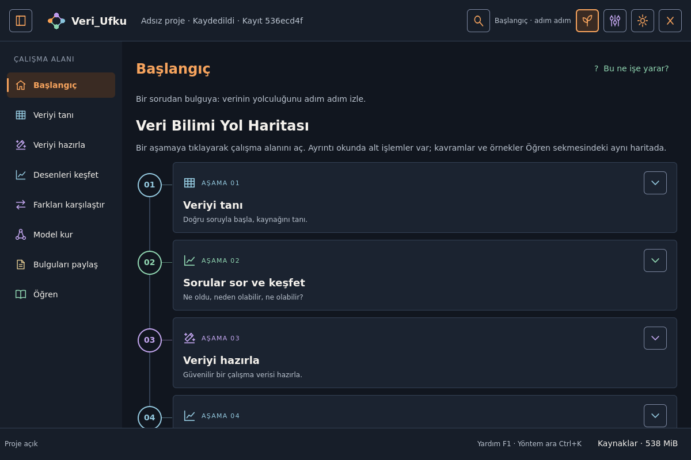
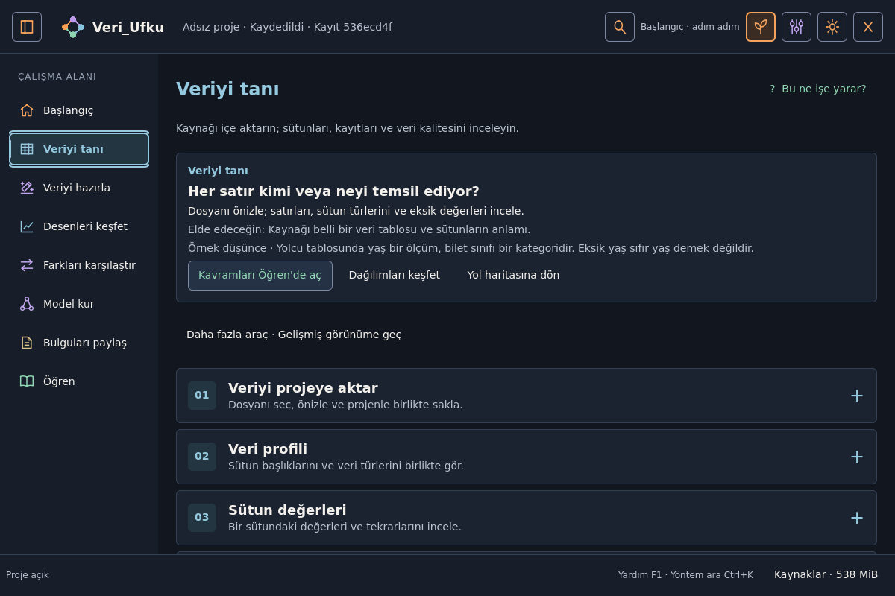
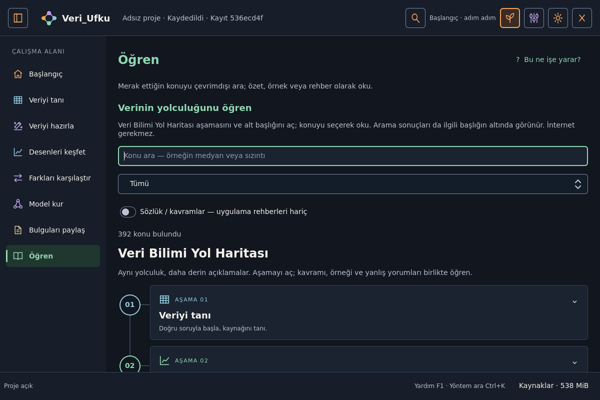
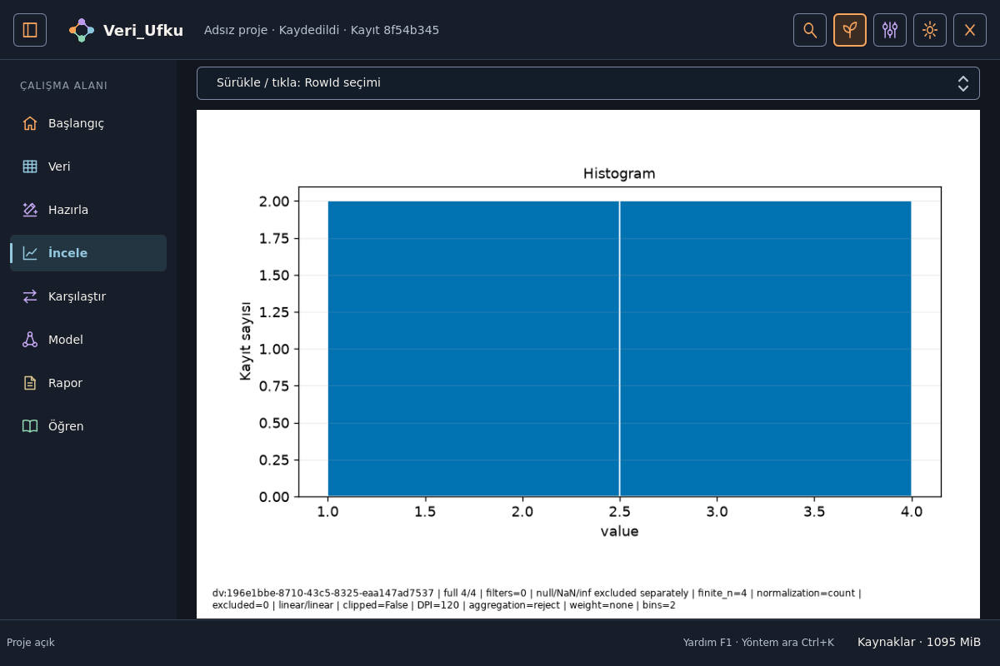
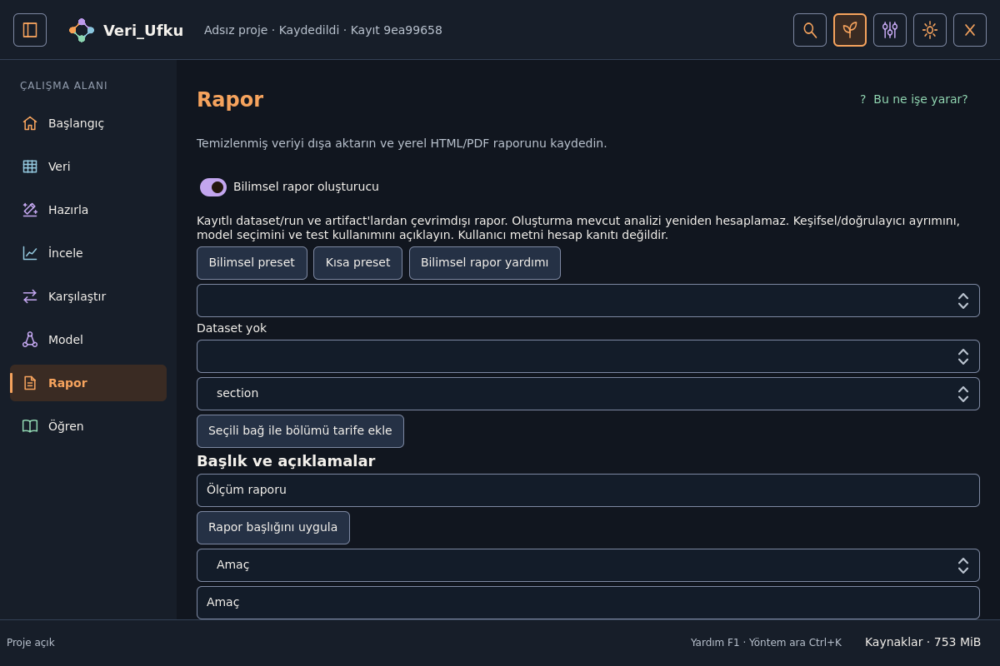

<div align="center">
  
  <h1>Veri_Ufku</h1>
  <p><strong>Linux’ta yerel veri bilimi.</strong><br>
  Veriyi tanı → incele → görselleştir → hazırla → ölç → modelle → raporla.</p>
  <p>
    <a href="#yedi-aşama-bir-çalışma-alanı">Aşamalar</a> ·
    <a href="#neden-veri_ufku">Neden</a> ·
    <a href="#kurulum">Kurulum</a> ·
    <a href="#ilk-oturum">İlk oturum</a> ·
    <a href="docs/PRO_CAPABILITY_MATRIX.md">Yetenek matrisi</a> ·
    <a href="docs/INSTALL_EN.md">English install</a>
  </p>
</div>

> **0.1.0 — deneysel teknik önizleme.** Çalışan yollar ve odaklı testler vardır;
> her yöntem, her dağıtım ve üretim kabulü tamamlanmış sayılmaz. Güncel kapsam:
> [yetenek matrisi](docs/PRO_CAPABILITY_MATRIX.md) ·
> [sürüm kapsamı](docs/RELEASE_SCOPE_0_1.md) ·
> [proje durumu](docs/PROJECT_STATE.md).



## Neden Veri_Ufku?

Çoğu araç ya **kod ister**, ya **buluta bağlar**, ya da sonucu **siyah kutu** gibi
bırakır. Veri_Ufku bunların yerine şunu ister:

- **Anlayarak çalış** — her adımda soru, varsayım, kapsam ve sınır görünür.
- **Kendi makinen** — temel akış için hesap veya sürekli internet yok.
- **İz bırak** — kaynak dosya, veri sürümü, önizleme/uygulama ve rapor aynı projede bağlanır.
- **Öğrenirken üret** — yardım ve sözlük çevrimdışı; “Bu adımı öğren” işin yanında açılır.

Kaynak dosyan sessizce ezilmez. Temizlik ve dönüşüm önce **önizlenir**, sonra
**Uygula** ile yeni sürüm üretir. Geri al, geçmişi korur.

## Yedi aşama, bir çalışma alanı

Sol rayda yedi araç. Sihirbaz değildir: istediğin adıma dönersin; seçim ve
çalışma kaybolmaz. Merkezde tablo / tuval / sonuç; sağda ayar ve “Bu adımı öğren”.

| Aşama | Ne yaparsın |
|---|---|
| **Veri** | Dosya, **Verilerim** veya çevrimdışı **Örnek** ile içeri al; salt okunur tablo, tür ve rol |
| **İncele** | Profil, eksik, kalite taraması; bulguyu **Hazırla’ya taşı** (taslak — sürüm yazmaz) |
| **Görselleştir** | Amaç kartlarıyla grafik; yorum ve RowId işaretleme; sürüm değişmez |
| **Hazırla** | Temizlik / dönüşüm kataloğu; önce–sonra; **Önizle → Uygula**; İncele taslağını aç |
| **İstatistik** | Soru odaklı karşılaştırma ve ilişki; varsayım uyarısı sonuçla birlikte |
| **Model** | Gerekçeli adaylar; sen seçmeden fit yok; sızıntı / eğitim-katı kapıları |
| **Raporla** | Bulgu + yöntem + kapsam + sınır; HTML/PDF ayrı hedefe |



### Bu sürümde öne çıkanlar

- **Tablo merkezde** — tür, rol, açıklama; sayfa ≠ tüm veri uyarısı; filtre sürüm üretmez.
- **Eksik etki önizlemesi** — “şu kadar satır kaybolur” hesabı; otomatik silme yok.
- **Üç yöntemli aykırı aday** — IQR / dayanıklı z / klasik z; karar yalnız Hazırla’da.
- **İncele → Hazırla köprüsü** — bulgu taslağı; **Taslağı aç** ile form; Önizle/Uygula şart.
- **Örnek + Verilerim** — paketlenmiş katalog ve XDG kütüphanesi; proje bozulmadan silinebilir.
- **Çevrimdışı öğrenme** — yüzlerce konu, sözlük, atlanabilir ilk tur; ağ otomatik açılmaz.

<details>
<summary>Diğer ekranlar</summary>

**Öğren — aynı yol haritasında kavramlar**



**Gerçek hesapla histogram**



**Rapor düzenleyici**



Bu görüntüler gerçek QML arayüzünün başsız Qt render’larıdır; tasarım maketi değildir.
Fiziksel masaüstü ve insan kullanılabilirlik testinin yerine geçmez.

</details>

## Kimler için?

| Sen | Veri_Ufku’da |
|---|---|
| Yeni başlayan | Yol haritası + Örnek veri + “Bu ne işe yarar?” |
| Öğrenci / eğitmen | Çevrimdışı ders ve laboratuvar; proje dosyan ezilmez |
| Analist / araştırmacı | Yerel CSV…Parquet, hazırlama, grafik, istatistik, rapor |
| Deneyimli kullanıcı | Gelişmiş paneller, işlem geçmişi, capability registry, eklenti yüzeyi |

## Neler üzerinde çalışabilirsin?

Özet kapsam. Yöntem bazında destek ve sınır için
[yetenek matrisini](docs/PRO_CAPABILITY_MATRIX.md) aç.

| Alan | Örnek |
|---|---|
| Kaynaklar | CSV/TSV, Excel, JSON/JSONL, Parquet; seçilmiş adaptörler |
| Kalite | Sayfalı tablo, profil, eksik, kural / tekrar / aykırı aday |
| Hazırlama | Doldurma, kırpma, dedup, dönüşüm, birleştirme; önizleme + geçmiş |
| Görsel | Dağılım, karşılaştırma, ilişki ve diğer desteklenen grafikler |
| İstatistik | Karşılaştırma, ilişki, belirsizlik; ileri yollar isteğe bağlı |
| Model | Regresyon / sınıflandırma / kümeleme adayları; doğrulama planı |
| Rapor | Not, grafik, yöntem, sınır; yerel paket / redaction yolları |

İsteğe bağlı backend yoksa ilgili özellik kapalı kalabilir. Ağ, model indirme ve
kullanıcı kodu **açık kullanıcı eylemidir**; eski proje açılışı bunları başlatmaz.

## Kurulum

**Gereksinim:** Linux masaüstü, Qt sistem kitaplıkları, **CPython 3.13.15**, **uv**.

```bash
# Ubuntu/Debian örneği — Qt
sudo apt-get update
sudo apt-get install --no-install-recommends -y libegl1 libgl1

git clone https://github.com/Teknoloji-Filozoflari/Veri_Ufku.git
cd Veri_Ufku
uv sync --locked --no-dev
.venv/bin/veri-ufku
```

İlk sync internet isteyebilir; kurulumdan sonra temel uygulama ve yardım çevrimdışıdır.
Dağıtım sınırları: [Türkçe](docs/INSTALL_TR.md) · [English](docs/INSTALL_EN.md).

İsteğe bağlı ekstra örnekleri:

```bash
uv sync --locked --no-dev --extra arrays --extra geospatial
```

Diğerleri: `formats`, `audio`, `graphs`, `statistics-advanced`, `bayes`, `neural`,
`connectors`, `privacy`, `audio-speech`. Flatpak altyapısı vardır; imzalı binary
release iddiası yoktur.

## İlk oturum

1. Uygulamayı aç; atlanabilir turu geç veya izle.
2. **Veri** → Dosya / **Verilerim** / **Örnek** → önizle → **İçe aktar**.
3. **İncele** → tarama çalıştır; bir bulguyu Hazırla’ya taşı.
4. **Hazırla** → **Taslağı aç** → **Önizle** → gerekirse **Uygula**.
5. **Görselleştir** veya **İstatistik** ile sorunu aç; kapsamı oku.
6. İstersen **Model**; sonra **Raporla** ve projeyi kaydet.

| Kısayol | Eylem |
|---|---|
| `Ctrl+1 … Ctrl+8` | Bölümler |
| `Ctrl+K` | Yöntem / amaç ara |
| `F1` / `Esc` | Bağlamsal yardım |
| `Ctrl+O` / `Ctrl+S` | Proje aç / kaydet |
| `Ctrl+,` | Ayarlar |

## Teknik özet

**Python + PySide6/QML.** Polars/PyArrow veri; Matplotlib grafik; SciPy/scikit-learn
seçilmiş bilimsel yollar. Tek Capability registry, ProjectStore, ComputeBudget,
Provenance; RowId / ColumnId / SourceRecordId korunur. Worker Qt nesnesi almaz.

```text
src/veri_ufku/   Uygulama, QML, analitik
tests/           Birim + gerçek Qt iş akışları
scripts/         Kapı, ölçüm, paket
docs/            Mimari, matrisi, kanıt
packaging/       Linux paket tanımları
examples/        Örnek eklenti / kullanım
```

[Mimari](docs/ARCHITECTURE.md) ·
[Çekirdek sözleşmeler](docs/CORE_CONTRACTS.md) ·
[Ürün](docs/PRODUCT.md) ·
[UX V2 çalışma alanı](docs/UX_WORKSPACE_V2.md) ·
[Eklenti API](docs/PLUGIN_API_EN.md)

## Geliştirme kapıları

```bash
uv sync --locked --group dev
uv run --frozen python scripts/check_docs.py
uv run --frozen python scripts/check_artifacts.py
uv run --frozen python scripts/check_learning.py
uv run --frozen python scripts/check_usability.py
uv run --frozen ruff check src tests scripts
uv run --frozen ruff format --check src tests scripts
QT_QPA_PLATFORM=offscreen QT_QUICK_BACKEND=software uv run --frozen veri-ufku --smoke-test
```

Odaklı UI örneği:

```bash
QT_QPA_PLATFORM=offscreen QT_QUICK_BACKEND=software uv run --frozen pytest -q \
  tests/test_ux2_shell_gui.py tests/test_data_workspace_gui.py \
  tests/test_inspect_workspace_gui.py tests/test_prepare_workspace_gui.py
```

Tam komutlar: [DEVELOPMENT.md](docs/DEVELOPMENT.md).

## Sınırlar (dürüstçe)

- Deneysel önizleme; “production tamam” denmez.
- Başsız GUI ≠ fiziksel masaüstü / AT / insan kabulü.
- Uzun zincirlerde bellek / timeout açıkları bilinir.
- Minimum donanım, tüm dağıtımlar, offline installer ve remote CI ayrı kanıttır.
- İleri / isteğe bağlı modüller aynı olgunlukta değildir.

[Bilinen sınırlar](docs/KNOWN_LIMITATIONS.md) ·
[Yol haritası](docs/ROADMAP.md) ·
[Changelog](CHANGELOG.md)

## Katkı

Hata, sentetik örnek, Türkçe netlik, erişilebilirlik ve bilimsel dürüstlük geri
bildirimleri değerlidir. Issue’ya kişisel veri veya gizli anahtar koyma.

[CONTRIBUTING.md](CONTRIBUTING.md) · [öğrenme sözleşmesi](docs/LEARNING_CONTENT.md)

## Lisans

**GPL-3.0-or-later** — [LICENSE](LICENSE). Font / örnek / üçüncü taraf:
[lisans](docs/LICENSING.md) · [bildirimler](docs/THIRD_PARTY_NOTICES.md).
