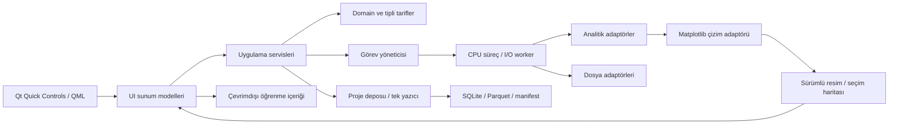

# Veri_Ufku — mimari

Durum: Faz00–26 teknik tasarım ve uygulama; görev/kabuk/yardım, depo/import, profil/kalite, sürümlü işlemler, grafik/export/rapor uygulanmıştır. Aşağıdaki faz bölümleri teslim anındaki sınırı kaydeder; güncel kabul matriste, kullanıcı testi ayrı bekler. Hazırlık/split/fold/Dummy/final test defteri uygulanmıştır; sınırlı model aileleri ve güvenli yaşam döngüsü uygulanmıştır. [Kurallar](PROJECT_RULES.md), [tasarım brief'i](UI_DESIGN_BRIEF.md), [UX](UX.md), [sözleşmeler](CORE_CONTRACTS.md), [teknik ortam](ENVIRONMENT.md).

## Sınırlar ve bağımlılık yönü

Planlanan paket `src/veri_ufku/`: ui (QML ve sunum), domain (Qt'siz tipler), services (kullanım senaryoları), analytics (Polars/DuckDB/SciPy/sklearn adaptörleri), importers (format parse), storage (tek yayın protokolü), jobs (iş/iptal/IPC), charts (ChartSpec→render/export), learning (sürümlü içerik). Framework eklenmez; bu dizinler Faz 01 ve ilgili fazlarda oluşur. Qt nesnesi analitik çekirdeğe girmez. Domain veri depolama nesneleri ve DataFrame taşımaz; immutable tanımlar ve artefact referansları kullanır.

QML TableView + QAbstractTableModel ile sınırlı sayfa cache'i; `data()` I/O yapmaz, hazır hücreye erişir. Sayfa worker ile gelir, ana thread model sinyali verir. Sıralama/filtre tüm dataset planında yapılır; yalnız görünür sayfayı sıralayıp bütün veri gibi sunmaz. RowId seçimi sayfa dışında korunur. Kolon ve satır başına kalıcı widget yok.

## Veri ve iş yaşam döngüsü

Servis import ayarlarını, sabit kaynağı, ColumnId'leri ve config_revision'ı bağlar. Job girdileri bir kez sabitlenir. Worker snapshot referansı ve tipli JSON tarif alır; UI objesi almaz. CPU işleri `spawn` tabanlı ayrı süreç, hafif dosya I/O Qt bağımsız cooperative thread worker; Qt/Matplotlib nesnesi süreçler arası geçirilmez. Küçük render ayrı worker/süreçte Agg; GUI QImage bridge'i ana thread üzerinden günceller.

İlerleme ölçülemiyorsa aşama/belirsiz ilerleme, biliniyorsa done/total; uydurma yüzde yok. İptal tokenı chunk sınırında kontrol edilir. Süreç iptali grace sonrası sonlandırılabilir; hiçbir worker aktif manifest değiştiremez. Sonuç job_id + dataset_version + config_revision + result_version ile gelir. Eşleşmeyen sonuç eski sonuçlar alanında kalır; güncel paneli değiştirmez. Kapanış yeni görev alımını keser, iptal/cleanup yapar, tek yazıcı kilidini en son bırakır.

## Analitik ve çizim

Polars genel tablo motoru; disk/spill veya yerel SQL gerektiğinde DuckDB. Motor seçimi CORE_CONTRACTS semantiğini değiştiremez. NumPy/model dense dönüşümü maliyet ve hassasiyet önkontrolüyle. SciPy istatistik, scikit-learn fold-içi Pipeline, statsmodels yalnız ihtiyaç duyulan yöntemlerde optional adapter.

Matplotlib Agg→RGBA/PNG ve SVG export, Qt Quick QImage/image provider bağlantısı (ADR-002). Etkileşim olayları UI koordinatından domain SelectionSpec'e dönüşür; render worker GUI'yi değiştirmez. ChartSpec görsel ayarları taşır; AnalysisResult sayısal hesabı taşır. Grafik üzerinde değişen başlık/renk veri sürümü yaratmaz; filtre/agregasyon yeni sonuç config'i yaratır. Gerçek QML etkileşimi ve paket export Faz 12'de doğrulanacaktır.

## Proje, içerik ve çevrimdışı kullanım

ADR-003 tek yayınlama ve kilit protokolü zorunlu. Proje dizini: metadata.sqlite, değişmez commits/<commit_id>/manifest.json, snapshots/<artifact_id>.parquet, lineage/, recipes/, results/, models/ ve staging/. `ACTIVE` tek otoritatif commit işaretçisidir; aktif SQLite görünümü commit kimliği üzerinden okunur. Kaynaklar isteğe bağlı sources/ içine kopyalanır. SQLite aktif sürümünü bağımsız güncellemez.

ProjectManifest relatif artefact URI + hash kullanır. Dış kaynak yolu ipucu olabilir, veri bütünlüğü kanıtı olamaz. Taşıma yeni dizinde hash doğrulamasıyla; source kayıpsa proje snapshot'ı açılır, yeniden import için eşleme gerekir. Export projenin kopya/secret/kişisel veri içeriğini açık gösterir. Arşiv açılırken traversal/symlink/zip boyutu sınırları uygulanır.

LearningArticle paket içinde Markdown/JSON, article_id/content_version/locale/capability_id; ağ isteği yok. Temel yardımın hangi sürümü kullanıldığı sonuçta saklanır. Uyumsuz yardım eski yöntemin davranışını güncelmiş gibi açıklamaz. Örnekler kendi sandbox projelerinde; yardım kapatılınca servis/job durumları değişmez. Yerel font ve rapor kaynakları paketlenecek, ilk açılış gizli download yok.

## Hata ve güvenlik sınırları

AppError: code, sade mesaj, önerilen düzeltme, correlation_id ve hassas veri içermeyen teknik ayrıntı. Parse, kaynak değişimi, izin, disk, bellek, unsupported dtype/version, lock, canceled ve stale ayrı kodlar. Dosya/formül eval/exec yok; güvenli AST izin listesi gelecekte işlem motorunda. SQL değerleri parametreli, tanımlayıcılar kayıtlı ColumnId haritasından doğrulanmış/quote edilmiş. Dış pickle/joblib çalıştırılmaz; güvenli model formatı Faz 20 destek matrisinde seçilir. Süreç izolasyonu güvenlik sandbox'ı değildir.

## Test sorumlulukları

Domain/hesap tests Qt'siz; importer elle yazılmış fixture; depo fault injection + iki süreç; jobs stale/config/iptal; QML başsız model ve signal smoke; gerçek Wayland/X11 keyboard/DPI akışı; bağımsız kullanıcı testi. Erken paket import Faz 06 ve grafik/export/process Faz 12; bütün paket sorunları Faz 27'ye bırakılmaz. [DEVELOPMENT](DEVELOPMENT.md), [ACCEPTANCE_POLICY](ACCEPTANCE_POLICY.md).

## Faz 01 uygulanan sınır

UI/controller, domain/contracts/capabilities, services/demo, jobs/manager/workers, storage/workspace ve learning/i18n gerçek uygulamadır. Import/proje depolama/analitik/öğrenme içerikleri bu fazda mevcut değildir. Görev geçici alanı proje yayınlama protokolü yerine geçmez. Uygulama yapılandırması ve güvenli log tek giriş noktasından kurulur. [Runtime ve worker kararı](adr/005-runtime-jobs-lock.md), [kanıt](evidence/PHASE01.md).

## Faz02 sunum sınırı

UI tercihleri PresentationPreferences QObject’unda; tema/görünüm/yazı boyutu ayrı atomik ui-preferences.json içindedir. Mod/tema değişimi DemoSession Binding veya JobSpec’i değiştirmez. Theme.qml tek token kaynağı, Main.qml tek pencere kabuğu, ortak bileşenler UiButton/UiCombo/StateNotice/InfoPanel. Henüz dataset olmadığı için üst bağlam bunu açık söyler; gelecek navigasyon yalnız kullanılabilirlik ekranıdır. Faz02 dönemindeki panel açıklaması yalnız kabuk yardımıydı; Faz03 ortak katalog render'ına taşındı. [Faz02 kanıtı](evidence/PHASE02.md).

## Faz03 öğrenme sınırı

Learning Catalog paket JSON şema1 ve düz metin bloklarını Qt/analitik kodundan bağımsız doğrular. LearningController arama, kategori, sözlük, makale/derinlik state'i ve isteğe bağlı atomik okuma işaretlerini QML'ye aktarır. InfoPanel/ArticleView aynı katalogdan okur. Ayrı ExampleWindow ve bağımsız LearningController yalnız geçici örnek öğrenme projesini açar; gerçek proje deposu veya analitik yetenek oluşturmaz. Capability help_links ve QML helpContext bağları CI'da zorunlu doğrulanır. [İçerik sözleşmesi](LEARNING_CONTENT.md).

## Faz04 proje deposu

SQLite/manifest/Parquet yayını, ACTIVE ve ayrı AUTOSAVE, single-writer flock, salt okunur ikinci örnek, şema0→1 kopya migrasyonu ve descriptor kontrollü yollar uygulandı. Gerçek proje state UI/controller I/O sınırında tutulur; kaynak doğrulaması metadata açılışından ayrıdır. [ADR-007](adr/007-project-store-phase04.md), [kanıt](evidence/PHASE04.md). Import ve analitik motor sonraki fazlardadır.

## Faz05 uygulama bağı

Faz05 importers/delimited ortak parser ve değişmez kopya, importers/worker spawn işlemi, ui/imports QObject + QAbstractTableModel/TableView, storage.publish_import parent yayın servisi eklendi. Worker ACTIVE/SQLite yazmaz; proje I/O executor tamamlanan çıktıyı doğrulayarak tek yayında kaydeder. Shared ComputeBudget/Capability/Provenance kullanılır; ayar revizyonu ve dataset/snapshot kimlikleri saklanır. Proje şema2; şema1 açılışta yazılmaz, sonraki açık kayıt migrasyon kaydını ekler. [ADR-008](adr/008-delimited-import-phase05.md).

## Faz06 adaptörler

importers/registry.py tek SourceAdapter registry; worker validate/inspect/preview/import_data aynı snapshot/settings ile çağırır. JSON/JSONL stdlib exact Decimal, bounded OOXML XLSX, Polars native Parquet. Yeni bağımlılık yok. Parent aynı SQLite/artifact/manifest/ACTIVE protokolüyle şema3 ve full diagnostics/provenance yayınlar. [ADR-009](adr/009-structured-import-phase06.md).

## Faz07 katkısı

Faz07: analytics/contracts.py/dataset.py ve worker.py, UI dataset.py/QML TableView; shared jobs/limits.py. Salt okunur200 kayıt sayfa; disk SQLite exact profil; metadata DatasetVersion4. [ADR-010](adr/010-dataset-view-phase07.md).

## Faz08 katkısı

Faz08: analytics/quality.py Qt bağımsız disk sayım motoru, mevcut spawn/binding/bütçe/iptal; QualityPanel.qml aynı Veri ekranında. Raporlar açık eylemle mevcut result kaydına girer; yeni şema yok. [Karar](adr/011-quality-phase08.md), [kanıt](evidence/PHASE08.md).

## Faz09 katkısı

Qt bağımsız operations/contracts/engine/worker; UI operations.py ve OperationsPanel/OperationTable.qml. Tek full hesap çıktısı önce preview, sonra hash kontrollü atomik publication. Proje şema5 heads/redo kalıcı; rol metadata da tipli tarif. Result binding aktif sürüme göre güncellik gösterir. [ADR-012](adr/012-versioned-operations-phase09.md).

## Faz10 katkısı

operations/cleaning_contracts ve cleaning Qt bağımsız tipli politikalar/batch4096/SQLite istatistik/dedup kökenini uygular. Şema6 copy başlangıcı+dönüşüm+lineage tek atomik publication. QML CleaningOptions tek seçili yöntemi gösterir; OperationsPanel isteğe bağlı tablo/geçmiş ve görünür undo/redo sunar. [Karar](adr/013-cleaning-phase10.md), [kanıt](evidence/PHASE10.md).

## Faz11 katkısı

Faz11: relational/formula kapalı AST motoru, immutable secondary girdiler, Parquet üyelik kenarları ve manifest7. Polars üretim, DuckDB yalnız dev fixture referansı. Yeni kaynaklar aynı capture/worker/yayın sınırında; SQLite salt okunur, ODS stdlib, IPC native Polars. [Karar](adr/014-transformations-phase11.md), [kanıt](evidence/PHASE11.md).

## Faz12 uygulama bağı

charts/contracts/engine/plot/worker Qt'siz hesap ve Matplotlib Agg adaptörüdür; ui/charts.py ve ChartPanel.qml QImage provider, koordinat ve RowId seçim bağını kurar. Hesap/render/export/üyelik spawn process, proje artifact yayını mevcut ACTIVE transaction/I/O executor kullanır. ChartSpec/v1 ve beş artifact manifest7 results içine eklenir. Aynı referans tablo zoom/reset ile yeniden hesaplanmaz. Gerçek QML/PNG/SVG/process yolu source ve kurulu Linux wheel100k testinde geçti; [karar](adr/015-charts-phase12.md), [kanıt](evidence/PHASE12.md).

## Faz13 export/rapor/rehber

exports/data.py Qt'siz sınırlandırılmış projeksiyon/yeniden açma kontrolü; exports/reports.py escaped self-contained HTML, disposable worker'da kendi offscreen Qt PDF; exports/files.py exclusive yeni dosya/fsync; ui/exports.py immutable sürüm/ViewSpec bağlama ve sonuç makbuzu; ui/guide.py isteğe bağlı navigasyon ve ayrı CC0 sentetik proje oluşturma. Hesap GUI thread'inden ayrıdır. GUI'deki kaydet draft kopyasını depoya taşır; rapor/export mevcut results alanında, temizlik geçmişi mevcut sürüm zincirinde korunur. Yerel paket font/yardım/örnek/rapor asset'lerini taşır. [ADR-016](adr/016-release-phase13.md).

## Faz14 — istatistik katmanı

statistics/contracts ve engine Qt bağımsızdır; SciPy1.18.0/NumPy locked API'sini worker içinde yükler. ui/statistics QML tarifini, dataset/config/view bağını ve önkontrolü yönetir; CPU işi spawn süreçte ortak bütçe/iptalle çalışır. Tam kapsam100000 kayıt/20 grup sınırını aşarsa açıklamayla durur; sessiz örnekleme yoktur. AnalysisSpec/v1 ve AnalysisResult/v1; JSON sonucu + kullanılan RowId Parquet'i mevcut şema7 results içinde additive saklanır. analysis_store hash/üyelik/köken doğruladıktan sonra ACTIVE atomik yayın protokolünü kullanır. Eski projeler migration gerektirmez. [ADR-017](adr/017-statistics-phase14.md).

## Faz15 hazırlama sınırı

modeling/contracts, history, preparation ve plan Qt bağımsızdır. Worker observational tam kaynak sayımları ve JSON blueprint üretir; estimator fit/import yok. ui/preparation/QML süreç/revision/source/origin bağını ve ayrı Model ekranını yönetir; storage/preparation_store mevcut ACTIVE metadata protokolüne yayınlar. Şema7 additive results, kaynak/workflow değişmez. [ADR-018](adr/018-model-preparation-phase15.md).

## Faz16

modeling/validation ve baseline Qt bağımsız split/fold/Dummy; sklearn Pipeline training-only transformer/seçme ve ayrı spawn worker. ui/validation QML/binding/iptal ve I/O defter yayınını yönetir. storage/validation_store mevcut ACTIVE transaction; schema7 additive results ve büyük full JSON artifact. Test rezervasyonu önce, sonuç+completed atomik, GUI gösterimi sonra. [ADR-019](adr/019-validation-baseline-phase16.md).

Faz17: sınırlı sayısal tahmin yolu, Faz15 hazırlığı ve Faz16 split/fold/defteri üstünde gerçek training-only estimator pipeline kullanır. Adaylar baseline/doğrusal/Ridge/RandomForest; seçim yalnız geliştirme CV MAE, final testte tek dondurulmuş aday. MAE/RMSE hedef birimi, R² negatif/sabit hedef sınırı, gerçek-tahmin/artık grafikleri (en fazla1000 örnek; metrik tam bölüm), dar ayar/maliyet sınırları ve test sonrası keşifsel yorum. Ayrıntılı sözleşme [ADR-020](adr/020-regression-phase17.md), gerçek kabul [PHASE17](evidence/PHASE17.md).

## Faz18 kategori tahmini

`modeling/classification.py` sınırlı estimator ayarlarını, sınıf eşlemesini, metrik/eğri ve eşik hesabını kapsar. Ortak `modeling/baseline.py` train/fold pipeline ve split planını yürütür; `validation_entry` ayrı süreçte çalışır. `ui/validation.py` protokol seçimini ve final reservation işlemini hesaplamadan önce kalıcılaştırır. ClassificationPanel, ConfusionMatrix ve ClassificationCurve QML parçaları yalnız sonuç gösterir. Büyük sonuçlar hash kontrollü JSON artifact; manifest özetleri ve append-only geçmiş `storage/validation_store.py` içinde korunur. Yeni bağımlılık veya model binary serileştirme formatı yok. [ADR-021](adr/021-classification-phase18.md), [gerçek teknik kayıt](evidence/PHASE18.md).

Faz19: Qt bağımsız unsupervised_contracts + unsupervised hesap çekirdeği; disposable spawn + Control bütçe/iptal; ayrı ui/unsupervised ve UnsupervisedPanel. storage/unsupervised_store RowId üyelikleri ve derived_analysis bağlantılı yeni dataset aktarımını mevcut ACTIVE protokolünde yayımlar. Güvenli model/new-file dağıtımı yok.

Faz20: modeling/lifecycle ve lifecycle_worker kapalı tipli skops0.16 model paketi,
şema/hash/version kontrolleri ve RowId inference; ui/lifecycle ayrı spawn/QML
önizlemesi. Model evaluation worker'ındaki seçilmiş fitted pipeline paketlenir;
storage/model_store mevcut tek ACTIVE işlemi içinde artifactı benimser. GUI ve
proje açma model deserialize etmez. [ADR-023](adr/023-model-lifecycle-phase20.md).

Faz21 ayrı `modeling/time_series.py` / `ui/time_series.py` / `TimeSeriesPanel.qml`
yoludur. CPU gerçek spawn/immutable snapshot/grup/zaman sırası; atomik
`storage/time_series_store.py` JSON ayrıntı+bounded özet ve final kullanım defteri.
Kaynak/test RowId üyelikleri reopen'da doğrulanır; estimator deserialize/yeniden fit yok.
[ADR-024](adr/024-time-series-phase21.md).

Faz22 `analytics/text.py` Qt bağımsız Unicode/token/TF-IDF ve sparse
TextPreparation pipeline step; `ui/text.py` ve TextPanel/TextOptions/TextFrequencyPlot
QML, mevcut spawn/bütçe/iptal/stale protokolü. `storage/text_store.py` safe JSON
özet, ham preview hariç; source fingerprint ve similarity RowId reopen kontrolü.
PreparationSpec opsiyonel text alanıyla mevcut classification CV/final altyapısına
bağlanır. [ADR-025](adr/025-local-text-phase22.md).

## Faz23

Faz23 operations/recipes ve monitoring Qt bağımsızdır; recipe_worker disposable CPU, ui/recipes eşleme/dry-run/iptal, RecipePanel QML. Bütün batch tek ProjectStore ACTIVE yayını; önceki fitted model lifecycle ayrı kalır. [ADR-026](adr/026-recipes-monitoring-phase23.md), [kanıt](evidence/PHASE23.md).

## Faz24

Native thread ortamı ilk importtan önce; ortak admission, Qt aggregate RSS/cache supervisor, Control RSS/disk/iptal ve worker final disk denetimi. Hafif JSON/ayar sözleşmeleri GUI model importlarını ayırır. Profil SQLite disk spool, sorgular Polars lazy; sayfa LRU parent-owned üç payload. [ADR-027](adr/027-performance-phase24.md), [kanıt](evidence/PHASE24.md).

## Faz25

PresentationPreferences şema4 ayrı atomik tema/yazı/dil kaydıdır; import
parse ayarlarını değiştirmez. Qt locale ve çeviri kaynakları uygulama
sınırındadır. Ortak form erişilebilir adları, odak görünürlüğü ve salt okunur
tabloda Tab çıkışı QML’de; yardım alan/bağ denetimi Qt bağımsız learning.audit
içindedir. [ADR-028](adr/028-usability-phase25.md).

## Faz26

ProjectStore.preview_autosave I/O doğrulaması state/pointer’ı değiştirmeden
özet üretir; GUI onayı gördüğü commit kimliğini restore’a taşır. Bilinmeyen
şema veya bozuk metadata otomatik uygulanmaz. Log leaf/SQLite link guard
ve ODS archive/bütçe kontrolleri mevcut adaptör sınırlarında uygulanır.
[ADR-029](adr/029-reliability-phase26.md).

2026-10-10 CSV/TSV otomatik algılama mevcut worker içinde infer_settings ile tüm kaynağı bounded sütun-aday durumuyla tarar. Çözülen türler preview settings içinde sabitlenir; tam import aynı türlerle doğrular. UI preview modeli bütün adaptörlerde20 kayıt taşır; analitik preview/inceleme penceresi ayrı kalır. Veri profili aynı inventory worker yolunu tam kapsamla otomatik çağırır; cache sonucu veri sürümüne bağlıdır. [Kanıt](evidence/UI_DATA_REFINEMENT.md).

2026-10-10: TypeInference ortak bounded aday mantığı importta ve legacy String içerik taramasında kullanılır. Inventory collect_batches4096 streaming ile içerik türü çıkarır, kaynak artifact değişmez. İçe aktarım sayı kararında başlık/digit veto yoktur; Int64 tamlık/aralık ve Decimal kesin sınırları belirler. [Kanıt](evidence/UI_PROFILE_TYPES.md).

GUI format seçimi CSV/TSV otomatik tür ayarını korur; programatik/manual varsayılanlar ayrı kalır. [Kontrol](evidence/UI_PROFILE_TYPES.md).

2026-10-10 son saklama talebi önceki içerik türü gösterimini geçersiz kıldı: profil yalnız gerçek physical_type gösterir; aktarımda Int64/Decimal fiziksel olarak saklanır. Titanic mevcut aktif sürümü kullanıcı izniyle mevcut convert operasyonu üzerinden dönüştürüldü; kaynak, satır kimlikleri ve geri alma geçmişi korunur. [Gerçek kayıt](evidence/UI_ACTUAL_STORAGE.md).

2026-10-10 kullanıcı kısa not isteği: Anlam ve notlar ayrı Veri başlığı olmaktan çıktı, profil tablosunun altına sütun seçimi/kısa açıklama/Notu kaydet alanı taşındı. Her sütunun taslağı seçimler arasında korunur; açık kayıt projeyi kalıcı kaydeder. applyDescription mevcut rol/birim/sıra/analiz birimi ve confirmed durumunu korur; yeni not role önerisini onaylamaz. Analitik profil onaylanmamış rolün yerine mevcut öneri politikasını kullanır. Kaynak/snapshot/RowId değişmez. [Kanıt](evidence/UI_PROFILE_NOTES.md).

2026-10-10 sade veri akışı: import Gelişmiş alanı tüm seviye tercihlerinde ve yeniden girişte kapalıdır; kullanıcı tıklayarak açar. Profil not girişinin üstünde yalnız açıklaması olan sütunlar ad/açıklama biçiminde kompakt, plain-text ve220px bounded listede görünür. Verini tanı altında inventory/describe/unique/sütun profili GUI çağrıları sample=false; ilk10.000 seçicileri kaldırıldı, tam veri hesabı ve200 değer görüntü sayfası ayrı tutulur. [Kanıt](evidence/UI_COMPACT_NOTES_FULL_DATA.md).

Faz28 [genişleme planı](PRO_ARCHITECTURE.md) mevcut Capability/ComputeBudget/Provenance/Validation ve ACTIVE protokolünü korur; ikinci registry veya yeni veri şeması kurmaz. Gerçek kod/test/GUI denetimi [PHASE28](evidence/PHASE28.md); yeni uzman modül uygulaması yok.

Faz30: mevcut SourceAdapter registry aynı worker'a advanced.py/advanced_readers.py üzerinden bağlanır. sources.py immutable çok-parçalı bundle ve bounded gzip/ZIP sağlar. StructuredSettings/v1 additive format_metadata içinde kaynak şema/labels/missing/weights/parça metadata; manifest7 korunur. [Karar](adr/031-advanced-import-phase30.md).

Faz31 `connector_contracts`, `database_connectors`, `http_connectors`,
`credentials` ve `connectors` mevcut ADAPTERS/worker sınırındadır.
GUI explicit capture/discovery başlatır; Secret Service yalnız worker/local
credential eylemiyle kullanılır. Native yerel capture ve source.connector
additive metadata aynı ProjectStore yayınında kalıcıdır; proje açılışı ağ
ve secret lookup yapmaz. [ADR-032](adr/032-connectors-phase31.md).

Faz32, 2026-10-11: Faz07 ColumnId semantic_metadata alanları additive
measurement_level ile genişletilir. Contract/v1 tanımı ve kontrol durumu
DatasetVersion'a bağlıdır; kapalı declarative kurallar aynı OperationSpec,
ComputeBudget/worker ve ProjectStore ACTIVE protokolündedir. Hata politikası
stop/quarantine/continue açık; kaynakta otomatik düzeltme yok. Onaylı entity
ataması RowId/SourceRecordId'yi korur; tam önceki/yeni canonical ilişki inverse
Parquet artifact'ında, insan kararı Provenance/operation kaydındadır.
Undo/redo immutable sürüme geçer; bağlı sonuçlar otomatik retarget edilmez.
[ADR-033](adr/033-data-contracts-phase32.md), [kanıt](evidence/PHASE32.md).

Faz33 statistics/missing_contracts.py ve missing_sampling.py aynı worker ve analysis_store atomik sonuç yoludur. KNN/iterative FoldPreparation içinde ortak sayısal matris ve training-fold fit; MI ayrı seçili örneklem çıkarımı. MissingSamplingPanel mevcut Karşılaştır içine bağlı; yeni depolama sistemi yok. [Gerçek kanıt ve sınırlar](evidence/PHASE33.md).

Faz34: importers/arrays.py mevcut AdvancedAdapter/SourceAdapter registry üzerinden NetCDF/Zarr/HDF dimension-scale kaynaklarını metadata-first okur. xarray chunks=None/cache=False/create_default_indexes=False ve HDF read-only;200 hücre segment, decoded bellek önkontrolü. CF attributes, dimensions/coordinates, source indices, calendar, chunk ve units native metadata/ProjectStore v7 içinde korunur. Chart/analysis provenance kaynak kesitini taşır; bağımsız tensor deposu yok. [ADR-035](adr/035-multidimensional-phase34.md).

Faz35 mevcut ChartSpec/Capability/worker/ProjectStore yolunu genişletir. Dağılım hesapları Qt bağımsız; RowId üyelikleri ve belirsizlik hesabı snapshot fingerprint ile saklanır. PDF ek artifact; eski kayıt okunur. [ADR036](adr/036-distribution-charts-phase35.md).

Faz36 mevcut chart ve filter registry/provenance/atomik yayın yolunu genişletir. Çok panel maliyeti collect öncesi denetlenir; per-panel gerçek device koordinatları immutable RowId üyeliğiyle seçim yapar. [ADR037](adr/037-multivariate-charts-phase36.md).

Faz37 aynı ChartSpec/registry/Qt-freeworker/atomicstore; inputşemaları ve soru galerisi tek Capability kayıtlarından okunur. Hiyerarşi/akış validation glyphlardan önce; RowId üyeliği korunur. [ADR038](adr/038-composition-charts-phase37.md).

Faz38: tek SourceAdapter/Capability registry coğrafi okuyucular, maps ve versioned operations ile genişledi. geo paketinde Pyogrio/Arrow, Shapely, pyproj offline PROJ ve Rasterio window; Qt-free worker, ComputeBudget ve ProjectStore atomik preview/apply protokolü korunur. [ADR039](adr/039-geospatial-phase38.md).

Faz43 mevcut StatisticsController/spawn/AnalysisSpec ve analysis_store genişletir; Qt-free PyMC CPU interpreter backend eylemde lazy. Source/RowId ve numeric NetCDF posterior/likelihood/PPC/chunks atomic ProjectStore; hiçbir model scripti/pickle import edilmez. [ADR044](adr/044-bayes-phase43.md).
