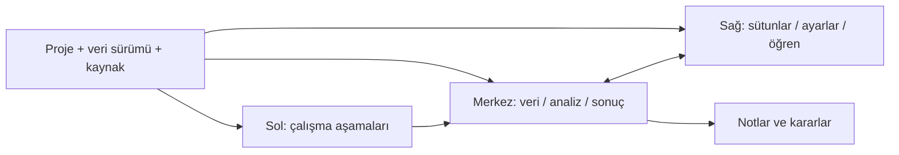

# Veri_Ufku — JASP ve Orange esinli ürün yönü

**Durum:** Ürün tasarımı ve fazlı çalışma taslağı · 2026-10-24  
**Kapsam:** Arayüz ve öğrenme deneyimi için öneri; kod değişikliği veya yeni teknik faz yetkisi değildir.

Bu belge, son kullanıcı isteğinde anlatılan hedefi Veri_Ufku'nun mevcut yapısına bağlar. Her uygulama fazı ayrıca kullanıcı tarafından seçilmelidir. Faz seçilmeden kaynak kodu, proje şeması veya kullanıcı verisi değiştirilmez.

## 1. Ürün yönü

Veri_Ufku, **veriyi merkezde tutan ve her analiz kararını açıklayan bir veri bilimi çalışma alanı** olmalı. Kullanıcı verisini tüm satır ve sütunlarıyla inceleyebilmeli, sütun seçerek analiz ve grafik kurabilmeli; yaptığı işlemin nedenini, sonucunu ve sınırlarını aynı çalışma alanında görebilmeli.

JASP'tan alınacak ana kullanım ilkesi, tablo ile analiz ayarları ve sonuçları arasında hızlı geçiştir. Orange'dan alınacak ilke, verinin bir sorudan başlayıp inceleme, hazırlama, analiz ve sonuç aşamalarından geçmesinin görünür olmasıdır. Veri_Ufku bu fikirleri kendi tema, gezinme ve bileşenleriyle uygular; başka ürünlerin ekranları, markaları veya ikonları kopyalanmaz.

### Şu anki projeden korunacaklar

- Linux masaüstü uygulaması, Python/PySide6/QML ve yerel/çevrimdışı çalışma yaklaşımı.
- Proje, veri sürümü, sütun/satır kimlikleri, işlem geçmişi, geri alma, kaynak kökeni ve hesap bütçesi.
- Veri profili, değer inceleme, eksik değer ve kalite panelleri, sütun sözlüğü/notları, grafik ve modelleme yolları.
- Başlangıç ve Öğren yol haritası, çevrimdışı dersler, raporlar ve mevcut örnek dosyalar.
- Aynı proje ve sonuçların başlangıçta ve gelişmiş görünümde kullanılması.

Mevcut belgeler ve ekranlar bu yeteneklerin çoğunun zaten bulunduğunu gösteriyor. Bu planın ilk işi yeni analiz yöntemleri eklemek değil; var olan yetenekleri kullanıcının bulabileceği ve anlayabileceği tek bir masa merkezli akışta düzenlemektir. Mevcut ekranlardaki yol haritası ve açıklama kartları öğrenme niyetini taşıyor; veri tablosu ise çalışma alanının merkezinde yeterince yer kaplamıyor. Yeni düzen bu önceliği değiştirmeyi öneriyor.

## 2. Önerilen çalışma alanı



| Bölge | Sorumluluk |
|---|---|
| **Üst çubuk** | Proje, etkin veri kümesi ve sürümü, kaydedilme durumu, geri/ileri ve arama. Veri kapsamı değiştiğinde görünür işaret. |
| **Sol aşama şeridi** | Veriyi tanı, kaliteyi incele, desenleri keşfet, hazırla, modelle/değerlendir, bulguları paylaş. Bu bir gezinme yardımcısıdır; zorunlu sihirbaz değildir. |
| **Merkez çalışma alanı** | Kalıcı bağlamda **Tablo**, **İnceleme**, **Sonuçlar** görünümleri. Tabloda sayfalama/sanal kaydırma ile bütün veri satırlarına erişim; grafik ve sonuç görünümünde aynı veri sürümü ve filtre bağlamı. |
| **Sağ bağlam paneli** | **Sütunlar**, **Analiz ayarları**, **Bu adımı öğren** bölümleri. Dar ekranda açılıp kapanan panel. Sütun seçimi analiz ayarlarına doğrudan aktarılır. |
| **Not/karar alanı** | Grafik veya analiz sonucuna bağlı kullanıcı yorumu, temizleme kararı ve sonraki adım notu. Sonuçtan kopuk genel not defteri değildir. |
| **Alt durum satırı** | Toplam satır/sütun, görünen sayfa, filtre, örneklem varsa kapsamı, iş durumu ve kaynak bilgisi. Örneklem hiçbir zaman tüm veri gibi sunulmaz. |

### Tablo davranışı

- Tablo, proje açıldığında ana çalışma yüzeyidir. Satır/sütun sayısı ve kullanılan veri sürümü başlıkta görünür.
- Bütün kayıtlara sayfalama veya sanal kaydırmayla erişilir. Büyük verinin tamamı belleğe yüklenmez; analiz kapsamı ayrıca açıklanır.
- Sütun seçimi, arama, sıralama ve filtre kontrolü tabloyla aynı yerde bulunur. Görünüm filtresi veri dönüşümü sayılmaz.
- Sütun başlığında fiziksel tür, rol ve varsa kısa açıklama görülebilir. Eksik değer sıfır veya boş metinle karıştırılmaz.
- Veri tablosu varsayılan olarak salt okunur kalır. Kalıcı değişiklikler Hazırla aşamasındaki önizleme ve açık Uygula eyleminden geçer.

### Sağ panel davranışı

- Sütunlar listesi ada göre aranır; veri türü ve rol rozeti taşır. Bir veya daha çok sütun seçilebilir.
- Seçilen sütunlar ilgili grafik, profil veya analiz formuna aktarılır; kullanıcı seçim ekranları arasında kaybolmaz.
- İleri seçenekler gerektiğinde açılır. Kritik varsayım, veri dışlama, maliyet, uyarı ve sonuç sınırı sade görünümde de kalır.
- Yardım isteğe bağlıdır. “Bu ne işe yarar?”, “Nasıl yorumlarım?” ve örnek açıklamaları işin yanında bulunur; paneli kapatmak sonucu veya seçimi değiştirmez.

## 3. Öğrenme yolculuğu

Her aşama aynı öğretim kalıbını kullanır: **Sorduğum soru → Neden bu adım → Kullanacağım veri/sütunlar → Eylem → Sonuç ve kapsam → Nasıl yorumlarım → Kararım/notum → Sonraki adım.** Açıklamalar kısa başlar; “ayrıntıyı gör” ile formül, varsayım ve teknik terime iner.

| Aşama | Kullanıcının sorusu | Uygulama ne gösterir? | Kullanıcı kararı / çıktı |
|---|---|---|---|
| **0. Amaç ve veri kaynağı** | “Ne öğrenmek istiyorum?” | Veriyi tanıma, grupları karşılaştırma, ilişki arama, tahmin, gruplama veya sıra dışı kayıt bulma gibi amaçlar; kendi dosyam veya örnek veri deposu. | İsterse araştırma sorusu yazar. Bir model hedefi seçmediyse modelleme zorlanmaz. |
| **1. Veriyi yükle ve gör** | “Dosya doğru okundu mu, satırlar neyi temsil ediyor?” | Dosya önizlemesi, toplam boyut, bütün sütun başlıkları, algılanan türler, ayraç/tarih/sayı ayarları ve veri kaynağı. | İçe aktarım ayarını onaylar; kaynak ve çalışma kopyası ayrı görünür. |
| **2. Sütunları tanı** | “Her sütun ne anlama geliyor?” | Tam tablo, sütun değerleri, tür, benzersiz değer sayısı, rol, birim ve notlar. | Sütuna açıklama ve rol ekler: kimlik, ölçüm, kategori, tarih, hedef veya özellik. Öneriler kullanıcı onayı olmadan kesinleştirilmez. |
| **3. Kaliteyi incele** | “Eksik, tekrar veya geçersiz değer var mı?” | Sütun ve satır başına eksik sayı/yüzde, örüntü, tekrarlar, alan kurallarına aykırı değerler ve aykırı değer adayları. | Silme/doldurma/koruma kararını verir. Uygulama yüzdeye bakıp otomatik veri silmez; aykırı adayın gerçek bir nadir gözlem olabileceğini belirtir. |
| **4. Desenleri keşfet** | “Dağılım nasıl, gruplar veya sütunlar nasıl ilişkili?” | Sütun seçerek grafik oluşturma; her grafik için neyi gösterdiği, uygun veri türü, kullanılan kayıt sayısı ve yorum sınırı. Grafik yanında yorum/not alanı. | Grafiği kurar, görünüm ve filtre seçer, bulgusunu kaydeder. Korelasyon nedensellik diye sunulmaz. |
| **5. Veriyi hazırla** | “Bu sorun için hangi değişikliği yapmalıyım?” | İşlem seçimi, neden gerekli olabileceği, önce/sonra örneği, etkilenen kayıt/sütun sayısı, yeni eksik/kayıp ve geri alma bilgisi. | Önizlemeyi inceler ve ayrıca Uygula der. Kaynak korunur; yeni sürüm ve işlem geçmişi oluşur. |
| **6. Yöntem veya model seç** | “Bu soruya hangi yöntem cevap verebilir?” | Hedef, sütun türleri, veri boyutu, grup/zaman yapısı ve soru tipine göre aday yöntemler. Her aday için “neden uygun olabilir”, “hangi koşullarda uygun değil” ve gereken hazırlık. | Kullanıcı adayı seçer. Öneri bir sıralama/garanti değildir; yöntem otomatik çalıştırılmaz. Hedef yoksa keşif veya etiketsiz analiz yoluna dönülür. |
| **7. Modeli değerlendir** | “Yeni veride işe yarayacağına nasıl karar veririm?” | Eğitim/doğrulama/test planı; sınıf, grup veya zaman yapısına uygun ayırma; başlangıç modeli; çapraz doğrulama ve probleme uygun ölçüler. | Test verisine göre işlem uydurulmaz. Ön işleme yalnız eğitim bölümünde öğrenilir ve aynı tarifle diğer bölümlere uygulanır. Son test bir kez nihai ölçüm olarak kullanılır. |
| **8. Bulguları anlat ve paylaş** | “Ne buldum, ne kadar güvenebilirim?” | Grafik, tablo, karar notları, veri sürümü, filtre, kullanılan yöntem, kapsam ve sınırlılıklar aynı raporda. | HTML/PDF/veri/proje çıktısını ayrı hedefe kaydeder; kaynak dosya sessizce üzerine yazılmaz. |

Akış keşif ve kalite arasında ileri-geri geçişe izin verir. Örneğin bir grafik eksik değer örüntüsü gösterirse kullanıcı kalite adımına döner; tabloya dönmek seçimini ve çalışmasını kaybettirmez.

## 4. Grafik ve yöntem seçme kılavuzu

Veri Görselleştirme Kataloğu'nun [“Ne göstermek istersin?”](https://datavizcatalogue.com/TR/arama.html) yaklaşımı iyi bir başlangıç noktası: kullanıcıyı grafik adlarını bilmeye zorlamadan görsel amacına göre yönlendiriyor. Ancak katalog çok sayıda grafik ve kategori içerdiği için bunun tamamını başlangıç ekranında sunmak acemi kullanıcıyı yorabilir. Veri_Ufku'nda iki giriş yolu olmalı:

1. **Rehberli seçim (varsayılan):** “Dağılımı gör”, “Grupları karşılaştır”, “İlişki ara”, “Zaman içindeki değişimi incele”, “Oranları göster” gibi az sayıda amaç kartı. Kullanıcı tablo veya sağ sütun listesinden alanları seçtikçe uyumlu grafikler önerilir.
2. **Grafik kataloğu (isteğe bağlı):** Grafik adıyla arama, amaca göre gezinme ve veri türü/değişken sayısı filtreleri. Daha önce grafik deneyimi olan kullanıcı tüm listeyi açabilir.

Her grafik kartı ve ayrıntı paneli, “kaç sütun gerekir ve bu sütunlar ne tür olmalı?” bilgisini açıkça vermeli. Burada **değişken**, kullanıcının tablodan seçtiği sütun demektir; satırlar gözlemleri temsil eder. **Zorunlu alanlar** ile **isteğe bağlı alanlar** ayrılmalı; ölçümün satır başına mı yoksa gruplama/toplulaştırma ile mi yapıldığı belirtilmeli. Örneğin:

| Grafik | Zorunlu sütunlar | İsteğe bağlı alanlar / dikkat |
|---|---|---|
| Histogram | 1 sayısal sütun | Gruplama için 1 kategorik sütun; çok sayıda kayıt veya uç değer ölçeği etkileyebilir. |
| Çubuk / count | 1 kategorik sütun | Değer toplamı/ortalaması için ek bir sayısal sütun; kategori adedi artınca okunabilirlik düşer. |
| Dağılım grafiği | 2 sayısal sütun (x ve y) | Renk veya nokta biçimi için 1 kategorik sütun; üst üste binen noktalar gösterilir. |
| Kutu grafiği | 1 sayısal sütun | Grupları karşılaştırmak için 1 kategorik sütun; aykırı noktalar otomatik hata anlamına gelmez. |
| Çizgi grafiği | 1 tarih/zaman sütunu ve 1 sayısal sütun | İsteğe bağlı kategorik grup; zaman sıralaması ve eşit olmayan aralıklar kontrol edilir. |

Grafik kartı şu bilgileri içermeli: **ne soruya cevap verir**, **uygun veri türleri ve gerekli/isteğe bağlı sütun sayısı**, **seçili verinde neden önerildiği**, **hangi durumda uygun olmadığı**, **küçük bir örnek**, **eksik değer/toplulaştırma davranışı**, **satır kapsamı ve sınırlar**. Mini örnek sentetik ya da açıkça etiketlenmiş olmalı; kullanıcı verisi örneğe karışmamalı. Uygun olmayan grafikler varsayılan listede gürültü yaratmamalı; katalogda gösterilecekse neden kullanılamadığı ve neyin değişmesi gerektiği yazmalı.

Önerilen etkileşim: **amaç seç → sütunları seç → uyumlu grafik önerilerini ve gerekçelerini gör → önizle/ayar yap → grafik ve açıklamayı kaydet.** Kullanıcı önce sütun seçerse amaç önerileri ters sıradan da çalışabilir. Seçilen sütunlar adımlar arasında korunur; öneri kararın yerine geçmez.

- Sayısal tek sütun: histogram/yoğunluk, box plot; eksikler ve kullanılan n görünür.
- Kategorik sütun: frekans ve count plot; çok fazla kategori olduğunda gruplama sınırı açıklanır.
- Sayısal-sayısal: scatter plot ve uygun olduğunda korelasyon. Korelasyon katsayısı kullanılan çiftlerin sayısı ve yöntemiyle gösterilir.
- Kategori-sayısal: box/violin veya özetli karşılaştırma; küçük gruplar ve dağılım uyarıları görünür.
- Zaman-sayısal: sıralı zaman eksenli line plot; sıralama ve eksik zaman aralıkları açıklanır.
- Pair plot yalnız az sayıda seçilmiş sayısal sütunda açılır; maliyet ve kalabalık riski gösterilir.
- Heatmap, subplot ve diğer sunum türleri doğru bağlamda önerilir. `subplot` yerleşim düzenidir; `distplot` yerine güncel histogram/dağılım araçları kullanılır.

Her sonuçta veri sürümü, filtre, kullanılan satır sayısı, dışlanan eksikler, örnekleme varsa örnekleme yöntemi ve grafik ayarları bulunur. Seçim veya yakınlaştırma yeni veri sürümü üretmez.

## 5. Veri deposu taslağı

İlk sürüm **önce çevrimdışı** çalışır ve projedeki mevcut örnekleri keşfedilebilir bir katalogda sunar. Harici kataloglar daha sonra, kullanıcı açıkça çevrimiçi kaynak seçtiğinde eklenir. Uygulama açılışı, arama veya eski projeyi açma kendiliğinden internet isteği başlatmaz.

### Veri kartı alanları

| Alan | İçerik |
|---|---|
| Kimlik ve başlık | Sabit katalog kimliği, ad, kısa açıklama, dil, alan/konu ve zorluk düzeyi. |
| Öğrenme amacı | Hangi kavramı gösterdiği, önerilen soru, varsa hedef ve uygun analiz türleri. |
| Tablo bilgisi | Satır/sütun sayısı, biçim, yaklaşık boyut, sütun adları/türleri ve insan tarafından yazılmış sütun sözlüğü. |
| Köken ve lisans | Sağlayıcı/yazar, kaynak bağlantısı, lisans, sürüm/tarih, atıf metni ve varsa checksum. |
| Kullanım notları | Sentetik/gerçek, kişisel/hassas veri uyarısı, bilinen kısıtlar, beklenen eksikler ve örnek görevler. |

Kullanıcı **Veri deposu → kart → ayrıntılar → örnek tablo → yeni proje olarak aç** sırasıyla ilerler. Dış kaynakta indirme, boyut/lisans/sürüm/checksum gösterildikten sonra açık kullanıcı eylemidir. Sağlayıcı lisansı ve bağlantısı proje kökeninde saklanır. İlk fazlarda yeni online sağlayıcı eklemek zorunlu değildir.

Teknikte yeni bir proje/veri/işlem kayıt sistemi açılmaz. Katalog kartı mevcut kaynak adaptörü, proje deposu, DatasetVersion, ColumnId/RowId ve Provenance sözleşmelerine bağlanır. Büyük veri deposu veya uzaktan veri indirme sonraki kullanıcı onaylı alt iş olarak kalır.

### Büyük uzmanlık paketleri ve opsiyonel modüller

Temel kurulum yaygın dosyaları açma, projeyi ve mevcut sonuçları görüntüleme, tablo/profil/kalite incelemesi, temel grafikler ve temel modelleme için çevrimdışı çalışır. Özel bir backend eksik olduğunda uygulama veya proje açılışı bozulmaz. Yalnızca o backend'e ihtiyaç duyan eylem, anlaşılır gereksinim mesajı ve opsiyonel modül kartına yönlendirir; kayıtlı sonuçlar okunabilir kalır, yeniden hesaplama için gerekli modül aranır.

Bu hedef mevcut kanıtla kısmen destekleniyor: Faz74'ün ağ paylaşımı kapalı core Flatpak kurulumu Parquet içe aktarma, temel ortalama, scikit-learn CPU tahmini ve proje kaydet/aç akışını tamamlamış. Bu kanıt opsiyoneller yokken core yolunun çalıştığını gösterir; bütün isteğe bağlı backend'leri ve her tarihsel proje türünü doğrulamaz.

Ürün içinde uzmanlık başlıkları ve kısa öğrenme açıklamaları her zaman görünür. Her kart **kurulu / kurulu değil / bu sistemle uyumsuz / çevrimdışı kurulu** durumunu, ne işe yaradığını, sürümünü, indirme boyutunu, lisansını, uyumlu Python/platform bilgisini, bağımlılıklarını, yeniden başlatma gereksinimini ve kurulumdan sonra internet isteyip istemediğini gösterir. **İndir ve kur** yalnız kullanıcının açık tıklamasıyla başlar. Uygulama açılışı, proje açma, modül kartını görüntüleme veya güncelleme araması ağ isteği ya da kurulum başlatmaz. Paket kurulduktan sonra özelliğin internet olmadan çalışıp çalışmadığı açıkça belirtilir.

İlk aday gruplar mevcut bağımlılık profillerinden çıkarılabilir: `neural` (CPU Torch), `geospatial`, `arrays`, `bayes`, `connectors`, `formats`, `graphs`, `statistics-advanced` ve `audio-speech`. Bunların boyut ve sistem uyumu gerçek lock/build çıktısından hesaplanır; tahmini boyut gösterilmez. Model ağırlıkları ve hazır veri setleri Python paketlerinden ayrı kataloglanıp indirilir; lisans ve boyutları ayrıdır.

Git deposunda paket tanımı, tam sürüm kilidi, bağımlılık manifesti, lisans/köken, uyumluluk ve doğrulanmış build reçetesi bulunur. Büyük ikili paketleri Git geçmişine eklemek yerine imzalı/sabit sürümlü release veya paket deposunda yayımla; uygulama katalogdan bu değişmez pakete ve hash/imza manifestine erişir. Kurulum mevcut `/app` ya da temel Python ortamının üstüne kontrolsüz `pip install` yapmaz. Seçilen sürüm için uygulama-özel, yalıtılmış worker ortamı veya dağıtımın desteklediği eşdeğer mekanizma kullanılır; çakışan bağımlılıklar aynı ortama zorla birleştirilmez.

Flatpak dağıtımında P0/P10, ağ izni ve uygulamanın yazabildiği kullanıcı dizini koşullarını ayrıca denetler. Ağ izninin paket manifestinde nasıl tanımlandığı ve indirilmiş worker paketlerinin uygulamaya özel veri alanında nerede tutulacağı açıkça belgelenmeden düğme çalışır sayılmaz.

Kurulum öncesi lisans, Python/platform/CPU uyumu, boş disk alanı ve ağ izni gösterilir. İndirme doğrulanıp geçici alanda hazırlanır; doğrulama tamamlanınca atomik etkinleştirilir. İptal veya hata temel uygulamayı ve kullanıcı projesini değiştirmez; kaldırma proje verisini/saklı sonucu silmez. Çevrimdışı kullanıcı temel uygulamayı kullanır ve modül kartından neden indirmenin yapılamadığını görür.

## 6. Önerilen fazlar

Bu fazlar ürün tasarımı içindir; mevcut teknik Faz00–75 durumlarını değiştirmez. Her uygulama fazı yalnız ayrıca seçildiğinde başlar.

| Faz | Amaç ve teslim | Kabul koşulu |
|---|---|---|
| **P0 — Mevcut durumu eşle** | Yetenek matrisi, kullanıcı akışları, gerçek ekranlar, bağımlılık profilleri ve veri deposu varlıklarını incele; var olanı/eksik olanı/kararsız olanı haritala. | Yeni kod yok. Özellik tekrarı, core/opsiyonel paket ayrımı, başlangıç bağımlılık/boyut kanıtı, opsiyoneller yokken proje açılma davranışı ve korunacak sözleşmeler listelenmiş. |
| **P1 — Etkileşim taslağını seç** | Başlangıç, veri tablosu, sütun seçerek grafik kurma ve opsiyonel modül kartları için ortak çalışma alanı prototipi. JASP/Orange ilkelerini bu ürünün tasarımına uyarla. | 1366×768 ve dar pencere; başlangıç kullanıcısı/uzman senaryosu; paket kurulu/eksik/uyumsuz/çevrimdışı durumu ve indirme bilgisi anlaşılır; tablo/parametre/sonuç aynı veri sürümünü gösteriyor. Prototip gerçek özellik gibi sunulmuyor. |
| **P2 — Çalışma alanı kabuğu** | Sol aşama şeridi, merkez çalışma alanı, açılır bağlam paneli ve üst veri/proje bağlamını mevcut QML kabuğuna bağla. | Mevcut ekranlara erişim korunur; dar ekranda merkez kullanılabilir; proje veya veri sürümü değişmez. |
| **P3 — Tablo ve sütun çalışma alanı** | Tabloyu merkez al; sayfalama/sanal görüntüleme, sütun arama/seçimi, rol/tür ve aynı bağlamda profil. | Bütün satırlara erişim açık; görünen sayfa tam veri sanılmaz; çoklu sütun seçimi ekran geçişinde korunur. Salt okunur ve mevcut RowId/ColumnId sözleşmeleri korunur. |
| **P4 — Örnek veri deposu** | Var olan küçük örnekleri metadata kartları ve aramayla katalogla; örnek dosyayı yeni proje olarak aç. | Lisans/köken/şema/kullanım amacı görünür; çevrimdışı çalışır; kullanıcı verisini ezmez ve örnek veri gerçeğe aitmiş gibi sunulmaz. |
| **P5 — Adım içi öğretim** | Her aşamada “neden, girdi, eylem, çıktı, yorum, sınırlama, sonraki adım” açıklama bileşeni. | Yardım isteğe bağlı; kapatınca seçim/parametre/sonuç kalır; kritik uyarı açıklama panelinin içinde kaybolmaz. |
| **P6 — Sütun seçmeli keşif** | Soruya ve sütun türüne göre grafik/özet oluşturucu; katalog/rehberli giriş, her grafik için zorunlu ve isteğe bağlı sütunların veri türleri, sonuç açıklaması ve kullanıcı notu. | Öneri gerekçeli; gerekli alan sayısı/türü ve uygun olmayan grafik gerekçesi anlaşılır; kapsam/n/filtre ve veri sürümü sonuçta görünür; grafik veriyi değiştirmez. |
| **P7 — Kalite ve hazırlama** | Eksik/tekrar/geçersiz/aykırı incelemesini mevcut işlem önizleme/uygulama/geçmiş akışına bağla. | Otomatik silme yok; önce/sonra ve tam etki görünür; iptal/geri alma son sağlam sürümü korur. |
| **P8 — Yöntem önerisi ve modelleme** | Hedef/soru/türlere göre açıklamalı model adayları, train/validation/test planı, başlangıç modeli ve ölçüm yolu. | Öneri “aday” olarak işaretli; grup/zaman/stratify koşulları; train-only preprocessing; test sızıntısı engeli ve probleme uygun metrik açıklaması. |
| **P9 — Bulgular ve ürün kabulü** | Notları, grafikleri ve modeli veri sürümü/kapsam/kısıt bilgisiyle rapora bağla; klavye, küçük ekran, performans ve kullanıcı senaryolarını değerlendir. | Rapor yeniden açılabilir ve kökeni izlenebilir; kullanıcı testleri otomatik teknik kontrollerden ayrı raporlanır; çözümlenmemiş işler açık kalır. |
| **P10 — Opsiyonel paket kataloğu** | `pyproject.toml`/lock/build profillerinden uzmanlık kartlarını ve kurulum durumlarını üret; indirme kaynağı, paket boyutu/lisansı/uyumu ve kullanıcı akışını hazırla. | İndirme butonu yalnız açık kullanıcı eylemi sunar; ağ/kurulum henüz tetiklenmeden açıklama, boyut, lisans, uyumluluk ve eksik backend mesajı görünür. Kurulu olmayan extras ile temel uygulama ve eski projeler açılır; gerçek paketleme kaynağı ve hash/signature kanıtı belirlenmiştir. |
| **P11 — İsteğe bağlı paket kurulumu** | Önce tek bir büyük opsiyonel paketle doğrulanmış indirme, kurulum, worker yönlendirme, güncelleme ve kaldırma akışını uygula; sonra paket gruplarını ayrı kullanıcı onayıyla genişlet. | Uygulama başlangıç/proje açılışı ağ erişimi istemez; sadece İndir tıklaması kurar. Core/opsiyonel yok/kısmi/tam, eski kayıtlı proje, offline, uyumsuzluk, disk yetersizliği, iptal, hash/imza hatası ve geri alma senaryoları belgelenmiş gerçek kontrollerle geçer. Başarısız kurulum proje ve core ortamını değiştirmez; kurulu modül offline çalışır. |

Önerilen sıra **P0 → P1 → P2 → P3 → P4 → P5 → P6 → P7 → P8 → P9 → P10 → P11** şeklindedir. Bu belge için doküman ve ekranlara ilk bakış yapıldı; mevcut kod/ekran kapsamının ve core/opsiyonel paketlerinin satır satır eşlenmesi P0'da tamamlanmalı. Önce temel çalışma alanı ve çevrimdışı kullanım korunur; paket kataloğu ve gerçek kurucu, bağımlılık uyumu ve worker sınırları denetlendikten sonra gelir.

## 7. Her uygulama fazında korunacak ürün kuralları

1. Faz başlangıcında `AGENTS.md`, `docs/PROJECT_STATE.md`, `docs/ROADMAP.md` ve fazın ilgili kaynak belgelerini oku; `git status` ile çalışma ağacını kontrol et.
2. Yalnızca kullanıcı tarafından adı verilen fazı uygula. Sonraki fazları otomatik başlatma; bu belge tek başına kodlama yetkisi değildir.
3. Mevcut yetenekleri önce ara ve yeniden kullan. İkinci ProjectStore, veri kataloğu kayıt sistemi, provenance günlüğü veya hesap motoru oluşturma.
4. Python/PySide6/QML, çevrimdışı temel deneyim, açık kullanıcı eylemi, veri kökeni, bütçe ve geri alma sınırlarını koru.
5. Veri silme, doldurma, dönüştürme, fit, indirme veya model seçimini gizli/otomatik yapma. Öneriyi gerekçelendir, kullanıcı onayı ve etkiyi göster.
6. JASP/Orange kullanım ilkelerini incele; tasarım tokenı, marka, ikon, metin veya ekranı kopyalama. Doğrulanmayan referans davranışı iddia etme.
7. Her fazı tek başına incelenebilir tut: değişen dosyalar, ürün davranışı, kabul koşulları, yapılan kontroller ve açık sınırlamalar raporlansın. Çalıştırılmamış kontrol başarılı diye yazılmasın.
8. Kullanıcı ayrıca istemedikçe sonraki faza geçme, dosyaları stage/commit/push etme veya dış kaynağa veri gönderme.
9. Opsiyonel backend eksik diye uygulama açılışını, temel veri işlerini, proje açma/kaydetmeyi veya mevcut sonuçları görüntülemeyi bozma. Eksik modüle ihtiyaç duyan tek eylem açıklamalı olarak kilitlensin; kullanıcı projeleri modül gereksiniminden bağımsız yüklenebilsin.
10. Paket kaynağı, sürüm kilidi, lisans, uyumluluk ve hash/imza doğrulaması olmadan modül indirme/kurma. Git'e büyük wheel/model ikilileri ekleme; başlangıçta, projeyi açarken veya paneli görüntülerken otomatik ağ/kurulum yapma. İptal, hata, uninstall ve offline koşullarını kabul ölçütüne dahil et.

## 8. GitHub reposunu okuyarak başlayan tek ana prompt

```text
GÖREVİN BAŞLANGICI — GITHUB DEPOSUNU OKU
Depo: https://github.com/Teknoloji-Filozoflari/Veri_Ufku

Bu prompt tek başına yeterli ürün bağlamını içerir. Önce GitHub erişimini kullanarak
deponun varsayılan dalını ve okuduğun commit SHA'sini belirle. Depodaki AGENTS.md,
docs/PROJECT_STATE.md ve docs/ROADMAP.md dosyalarını; sonra bu görevle ilgili ürün,
UX, paketleme, performans ve görselleştirme belgelerini oku. Ardından gerçek kaynak
kodu ve mevcut kanıtları incele; yalnız README'deki iddialarla yetinme.

Eğer bu görev için yerel checkout da sağlanmışsa origin URL'sini, aktif dalı,
commit'i ve git status --short çıktısını kontrol et; GitHub'da olmayan yerel
değişiklikleri koru. GitHub'da docs/PRODUCT_DIRECTION_JASP_ORANGE.md bulunmayabilir;
bu prompttaki aşağıdaki hedefler ürün yönü için esas alınmalı, yerel belge varmış
gibi davranılmamalı. Repo erişimin yoksa bunu açıkça bildir ve dosyaları okumuş gibi
varsayım üretme.

İLK TURDA YALNIZ P0 — SALT OKUNUR DEPO İNCELEMESİ
Bu turda kodlama veya dosya düzenleme yapma. Yalnızca GitHub deposundaki mevcut
durumu kanıtlarıyla çıkar, eksikleri ve faz planını raporla; ardından kullanıcıdan
seçeceği sonraki fazı bekle. P1–P11'i kendiliğinden uygulama.

Veri_Ufku projesini JASP ve Orange'dan seçilmiş kullanım ilkeleriyle,
veriyi merkezde tutan ve yeni başlayanlara her adımı açıklayan bir veri bilimi
çalışma alanına dönüştürmek istiyorum.

ÜRÜN VE TASARIM HEDEFİ
- JASP'tan tablo merkezli inceleme, sütun seçimi, aynı çalışma bağlamında analiz
  ayarı ve sonuç gösterimini; Orange'dan aşamaların görünür veri bilimi yolculuğu
  fikrini al. Başka uygulamaların görünümünü/markasını kopyalama.
- Kullanıcı kendi verisini veya lisansı ve kaynağı gösterilen hazır veri deposu
  örneğini açabilsin. Tablo veriye erişimin merkezi olsun.
- Veri deposu ilk etapta uygulamayla gelen küçük, çevrimdışı örnekleri sunsun; kartta
  amaç, satır/sütun bilgisi, sütun türü/açıklaması, kaynak ve lisans görünsün.
- Kullanıcı tabloyu elektronik tablo gibi görüp tüm satırlara sayfalı/sanal erişsin;
  seçtiği sütunlar grafik ve analiz adımlarına taşınsın.
- Her öğrenme aşaması nedenini, gereken girdiyi/sütunları, eylemi, sonucu, yorumlama
  sınırını ve sonraki adımı açıklasın. Akış rehberli olsun ama zorunlu wizard olmasın.
- Veri bilmeyen kullanıcı “ne görmek/öğrenmek istiyorum?” diye başlayabilsin;
  seçilen sütun ve türlerine uygun grafikler gerekçeleriyle önerilsin. Grafik
  kataloğu arama ve amaca/veri türüne göre filtreyle isteğe bağlı gezilebilsin.
- Her grafik kartı cevapladığı soruyu, zorunlu/isteğe bağlı sütun sayısı ve rollerini,
  beklediği veri türlerini, örneğini, eksik/toplulaştırma davranışını, uygun olmadığı
  durumları ve yorumlama sınırını göstersin. Grafik oluşturma veriyi değiştirmesin.
- Akış: amaç/kaynak → veri yükleme ve tablo → sütunları tanı → kalite/eksikler/aykırı
  adaylar → sütun seçerek görselleştirme → temizlik/hazırlık → yöntem/model adayı →
  doğru doğrulama/değerlendirme → not ve rapor. Kullanıcı adımlar arasında dönebilsin.

FAZLAR
P0 mevcut mimari/yetenek/bağımlılık ve çevrimdışı davranış denetimi;
P1 arayüz prototipi; P2 çalışma alanı kabuğu; P3 tablo ve sütun keşfi;
P4 çevrimdışı örnek veri deposu; P5 adım içi öğretim; P6 sütun seçmeli grafik rehberi
ve kataloğu; P7 kalite/hazırlama; P8 yöntem/model seçimi ve değerlendirme;
P9 rapor/ürün kabulü; P10 opsiyonel paket kataloğu; P11 güvenli on-demand paket
kurulumu. P0 bulgularıyla fazları doğrula veya gerekçeli sırala. Fazlar yalnızca
kullanıcı açıkça seçtiğinde uygulanır.

KORUNACAK SINIRLAR
- Python/PySide6/QML Linux masaüstü yapısını koru; P0'da GitHub commit'i ve kanıt
  yollarını raporla. İleride seçilmiş uygulama fazında AGENTS.md, PROJECT_STATE.md,
  ROADMAP.md ve ilgili belgeleri yeniden oku; git status ile kullanıcı değişikliklerini
  koru.
- Python/PySide6/QML, yerel/çevrimdışı temel çalışma, ProjectStore, DatasetVersion,
  ColumnId, RowId, SourceRecordId, ComputeBudget, Provenance, registry ve atomik
  yayın sözleşmelerini koru. İkinci kayıt/işlem sistemi ekleme.
- Core uygulama opsiyonel paketler olmadan da başlamalı ve temel veri/proje
  senaryolarını yürütmeli. Eski proje, o projede kullanılan opsiyonel backend bulunmasa
  da açılmalı; kayıtlı sonuç görüntülenmeli. Backend gerektiren yeniden çalıştırma
  yalnız açıklamalı şekilde kurulum isteyebilir.
- Git deposunda kilit/manifest/lisans/uyumluluk/build reçetesi hazır tut; büyük wheel
  ve model ikililerini Git geçmişine ekleme, değişmez ve doğrulanabilir release/paket
  kaynağında yayımla. Temel Python ortamını kontrolsüz güncelleme; uygulama başlangıcı,
  proje açma ve modül kartını görme ağ/kurulum başlatmasın.
- İndirme ve kurma yalnız seçilen faz bu işi kapsıyorsa ve kullanıcı açıkça başlatırsa
  yapılabilir. Hash/imza, sürüm/platform/Python uyumu, lisans, disk alanı, iptal,
  atomik etkinleştirme, geri alma ve offline kullanım kabul koşullarını içer.
- Büyük paket gruplarının başlık, açıklama, sürüm, boyut, lisans, uyumluluk ve kurulum
  durumu paket kurulmadan da uygulamada görünmeli. Eksik opsiyonel paket uygulama
  açılışını, temel veri işlerini, eski projeyi açmayı veya saklı sonucu göstermeyi
  engellememeli; yalnız ilgili backend işlemi açıklamalı olarak kullanılamamalı.
- Paket lock/manifest/build reçetesi repoda tutulabilir. Büyük wheel/model ikilileri
  Git geçmişine eklenmemeli; değişmez, doğrulanabilir release/paket kaynağında yer
  almalı. Temel Python ortamına kontrolsüz pip kurulumu yapma. Açılış/proje açma/paneli
  görüntüleme ağ ya da kurulum başlatmamalı; kurulum yalnız P11'de açık tıklamayla olur.
- Kullanıcı açıkça seçmedikçe hiçbir fazı uygulama. Bu ilk tur P0 salt okunur
  incelemedir; P1–P11 için kullanıcı seçimi beklenir.
- Otomatik silme/doldurma/fit/model seçme/paket indirme yapma. Veri değişikliğini ve
  etkisini göster, sonra ayrı ve açık onay bekle. Paket indirme yalnız P11 açıkça
  seçilmişse ve kullanıcı karttaki “İndir ve kur” eylemini başlatırsa mümkündür.
- Öneri kesin hüküm değildir: neden uygun olabileceğini, varsayımları, veri ihtiyacını
  ve uygun olmayabileceği durumları anlat.
- Train/test ayrımından önce tüm veride öğrenilen imputation/scaling/feature selection
  uygulama. Grup veya zaman yapısını koru; test verisini tuning için kullanma.
- Başka uygulamanın ekranını, ikonunu, markasını veya metnini kopyalama.
- Sadece seçilen fazın kapsamını tamamla. Bittiğinde değişen dosyaları, davranışı,
  kabul koşullarını, gerçekten yapılan kontrolleri ve kalan işleri raporla; sonraki
  fazı kendiliğinden başlatma. Stage/commit/push yapma.

P0 İNCELEME ÇIKTISI — TÜRKÇE
1. GitHub varsayılan dalı, okunan commit SHA ve incelenen dosyalar/kanıtlar.
2. Mevcut mimari ve kullanıcı akışı; mevcut/kısmi/eksik/belirsiz yetenek tablosu.
3. Core ve opsiyonel bağımlılık grupları; varsa lock/build profili, gerçek boyut ve
   platform/Python koşulları. Ölçülmemiş boyut tahminini gerçekmiş gibi sunma.
4. Opsiyonel paketler yokken core açılış, temel veri işleri, eski proje açma/kaydetme
   ve saklı sonucu görme kanıtı. Kod/kanıt yetersizse “belirsiz” de; test çalıştırma.
5. Görselleştirme seçimi için amaç temelli akış, isteğe bağlı katalog ve örnek
   histogram/çubuk/dağılım/kutu/çizgi grafiklerinde gerekli/isteğe bağlı sütun türü.
6. Opsiyonel paket kataloğu ve gerçek kurulum için ayrı faz kapsamı/kabul ölçütü;
   Flatpak ağ izni, yazılabilir uygulama alanı ve worker ortamı dahil açık riskler.
7. P0–P11 faz önerisi, her fazın kabul ölçütü ve çözümlenmemiş sorular.

P0 SINIRLARI
- Bu turda kaynak kodu, belge, kullanıcı verisi veya ayar değiştirme.
- Test çalıştırma, dependency kurma, paket/model/veri indirme, ağ servisine bağlanma,
  stage, commit veya push yapma. GitHub deposunu okumak dışında ağ eylemi yok.
- Olguları ürün önerilerinden ayır; dosya/satır/commit kanıtı ver. Görmediğin dosya
  veya çalıştırmadığın davranış hakkında kesin iddia kurma.
- Cevabın sonunda çalışma ağacını değiştirmediğini, P0 dışında faz uygulamadığını
  belirt ve P0 raporundan sonra kullanıcı seçimini bekle.
```

## 9. Faz başlatma eki

Ana prompttan sonra yalnız seçilen faza uygun bir ek kullan:

- **P0:** “Salt okunur incele. Yetenek matrisi, dependency lock/build profili, artifact boyutu, import/worker sınırı ve gerçek ekranlarla planı eşleştir. Opsiyonel paketler olmadan uygulama başlangıcı, temel veri akışları, mevcut projeyi aç/kaydet ve kayıtlı sonucu görüntüleme davranışını kanıtla; kanıt yoksa belirsiz yaz. Tekrar kullanılacak servisleri, UX farklarını ve ölçülebilir kabul senaryolarını tabloyla ver. Kod, belge ve kullanıcı verisi değiştirme; test veya indirme yapma.”
- **P1:** “Yalnız prototip/etkileşim tasarımı hazırla: başlangıç, merkez tablo, sütun seçerek grafik ve opsiyonel modül kartları. 1366×768/dar pencereyi; kurulu, kurulu değil, uyumsuz, çevrimdışı kullanılabilir durumlarını göster. Boyut, sürüm, lisans, uyum, internet ihtiyacı ve restart bilgisini İndir eyleminden önce görünür yap. Gerçek özellik iddiası veya runtime değişikliği yapma.”
- **P2:** “Yalnız çalışma alanı kabuğunu uygula. Var olan ekranları yeni gezinme ve merkez/sağ panel düzenine bağla; analiz motorunu ve proje/veri sözleşmelerini değiştirme.”
- **P3:** “Yalnız tablo ve sütun keşfini çalışma alanına bağla. Sayfalı/sanal görünüm, sütun arama/seçimi ve mevcut kimlikleri koru; görünüm filtresini veri dönüşümüne çevirmeden kabul koşullarını göster.”
- **P4:** “Yalnız çevrimdışı veri deposu kataloğunu mevcut örnekler üzerinden oluştur. Lisans, kaynak, boyut, sütun sözlüğü ve öğrenme amacını göster; internet kullanma ve veri indirme.”
- **P5:** “Yalnız seçili öğrenme aşamalarındaki adım açıklamalarını bağla: neden, girdi, eylem, çıktı, yorum ve sınırlama. Mevcut Öğren/F1 sözleşmesini kullan; genel yardım düğmesi ekleme.”
- **P6:** “Yalnız sütun seçmeli keşif oluşturucusunu uygula. Rehberli amaç seçimini varsayılan, arama/filtreli grafik kataloğunu isteğe bağlı sun. Her grafik için gerekli ve isteğe bağlı sütun sayısını, beklenen veri türü/rollerini, uygunluk gerekçesini ve sınırını açıkla. Öneriyi kullanıcı sorusu ve sütunlarla gerekçelendir; kapsam/n/filtre/sürümü sonuçta göster; grafik çizmek veriyi değiştirmesin.”
- **P7:** “Yalnız kalite ve hazırlama akışını mevcut önizleme/uygulama/geçmiş motoruna bağla. Eksik/tekrar/aykırı bulgularını otomatik silmeden göster; önce/sonra etki, iptal ve geri almayı koru.”
- **P8:** “Yalnız model adayları ve değerlendirme akışını geliştir. Hedef/amaç/veri tipinden adayları gerekçelendir; train/validation/test, leakage koruması ve probleme uygun ölçümleri açıkla; kullanıcı seçmeden fit etme.”
- **P9:** “Yalnız not/rapor birleştirme ve seçili senaryoların kabulünü tamamla. Veri sürümü, filtre, karar, yöntem ve sınırlama bağlarını doğrula; teknik kontrol ile gerçek kullanıcı kabulini ayrı raporla.”
- **P10:** “Yalnız opsiyonel paket kataloğunu ve kurulum durumlarını oluştur. `pyproject.toml`, `uv.lock`, environment profile ve build scriptlerinden kilitli kaynak üret; kurulu/eksik/uyumsuz/çevrimdışı kullanılabilir durumlarını göster. Kartta amaç, boyut, lisans, Python/platform uyumu, bağımlılıklar, offline/restart ve release/hash/imza bilgisi yer alsın. Bu fazda gerçek indirme/kurulum başlatma; opsiyoneller yokken core ve mevcut proje/sonuç açılışını kabul senaryosu yap.”
- **P11:** “Yalnız seçilmiş tek opsiyonel paket için doğrulanmış on-demand indirme/kurulum ve worker yönlendirme uygula. Kullanıcı açıkça İndir ve kur demeden ağ/kurulum olmasın; app açılışı ve proje açma offline çalışsın. Raw Git branch veya mevcut core Python'a kontrolsüz pip kurma yapma. Sabit sürüm, lisans, platform/Python uyumu, indirme boyutu, imza/hash, disk kontrolü, progress/cancel, geçici kurulum, atomik etkinleştirme, rollback/uninstall ve kurulum sonrası offline davranışı kabul ölçütlerine ekle. Paket yokken eski proje ve kayıtlı sonuç görüntülensin; yalnız ilgili backend işlemi kurulum isteyebilsin.”

## 10. İlk ürün senaryosu

Bu senaryo görsel/ürün kabulü için öneridir; mevcut uygulamada test edilmiş kullanıcı sonucu değildir:

> Yeni başlayan kullanıcı örnek depo kartlarından “Mağaza satışları” verisini açar. Merkez tabloda tüm satırlara geçebilir ve eksik tutarları görür. “Tutar” sütununu seçip histogram oluşturur. Sağ panel, histogramın dağılımı gösterdiğini, eksik iki kaydın hesap dışında kaldığını ve grafiğin nedensellik göstermediğini anlatır. Kullanıcı grafiğin altına yorum yazar. Temizlik önerisini seçerse önce etkilenecek kayıtları ve seçenekleri görür; işlemi ancak Uygula ile yeni veri sürümüne geçirir. Ardından uygulama, belirlediği tahmin sorusu ve hedef türüne göre model adaylarını gerekçeleriyle gösterir. Kullanıcı henüz model kurmadan raporunu kaydedebilir.

Başarı işaretleri: kullanıcı tablodan ayrılmadan sütun seçebiliyor; örnek kapsam ile tam veri kapsamını karıştırmıyor; grafiği yorumlayabiliyor; veri değişikliği önizlemesiz uygulanmıyor; model önerisinin gerekçesini ve sınırını anlatabiliyor.

### Opsiyonel paket kabul senaryosu

İnternetsiz ve yalnız core kurulmuş kullanıcı, içinde opsiyonel Bayes sonucu olan eski bir projeyi açar. Tablo, proje geçmişi ve kayıtlı Bayes sonucu görünür; Bayes analizini yeniden çalıştırma açıklamalı olarak paket kartına yönlenir. Paket kurulu değilken temel veri düzenleme/kaydetme çalışır. Kullanıcı çevrimiçi olduğunda kartta sürüm, boyut, lisans, platform uyumu ve yayın doğrulaması görünür; yalnız **İndir ve kur** eylemi ağı başlatır. Başarılı kurulumdan sonra kullanıcı interneti kapatsa da desteklenen analizi çalıştırır. İptal/kaldırma proje dosyalarını ve kayıtlı sonucu silmez.

## İç referanslar

- [AGENTS.md](../AGENTS.md), [aktif proje durumu](PROJECT_STATE.md), [kısa teknik yol haritası](ROADMAP.md)
- [Ürün kapsamı](PRODUCT.md), [kullanım akışı](UX.md), [arayüz/tasarım kuralları](UI_DESIGN_BRIEF.md)
- [Tasarım referansları](UI_REFERENCES.md), [tasarım sistemi](DESIGN_SYSTEM.md), [kabiliyet matrisi](PRO_CAPABILITY_MATRIX.md)
- [Mevcut ders içeriği sözleşmesi](LEARNING_CONTENT.md), [performans sınırları](PERFORMANCE.md)
- [Opsiyonel paket profilleri ve core/Flatpak kanıtı](evidence/PHASE74.md)
