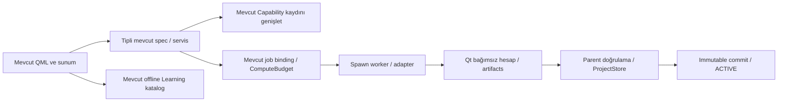

# Veri_Ufku — profesyonel mimari genişleme planı

Faz28, 2026-10-10. [ARCHITECTURE](ARCHITECTURE.md) ve
[CORE_CONTRACTS](CORE_CONTRACTS.md) korunur; bu belge yeni runtime değildir.
Mevcut sözleşmenin kopyası veya ikinci registry/bütçe/provenance kurulmadı.
[Ana gereksinimler](REQUIREMENTS_MATRIX.md), [teknik audit](evidence/PHASE28.md).

## Mevcut gerçek sınırlar

QML → ui QObject/QAbstractTableModel → immutable spec → spawn worker →
Qt'siz analytics/statistics/modeling/operations → parent ProjectStore yayın.
Worker ACTIVE yazmaz. Hafif I/O ayrı executor; UI sinyalleri ana thread'de.
Kaynak snapshot hash/size, ColumnId/RowId/SourceRecordId ve çok kaynak lineage
değişmez. Filtreli görünüm kalıcı dönüşüm değildir; yeni sonuç job binding
dataset/config sürümüyle bağlanır. Eski sonuç sessiz güncel sayılamaz.

Tek kaynaklar: domain/contracts.py Capability/ComputeBudget/Provenance/Binding;
domain/capabilities.py CAPABILITIES; importers/registry.py format adaptörleri;
jobs/limits.py worker Control ve jobs/manager.py yürütme. Format adaptör
registry'si ortak capability'nin yerine geçmez; F29 bunları ilişkilendirir.
storage/project_store.py ACTIVE/SQLite/manifest tek-yazıcı yayın otoritesidir.

Kaynak incelemesi jobs/supervision.py içinde Qt QObject/QTimer gösterdi:
bu mevcut GUI ResourceSupervisor'dır, yalnız app.py import eder; worker veya
analitik motor import etmez. DEP-28-06 adlandırma/yerleşim iyileştirmesi P2;
F28'de taşıyarak mevcut davranış değiştirilmedi. Core analitik/model/import/
depo sınırlarında Qt importu bulunmadı. Gerçek test kapsamı audit JSON'dadır.

## Sözleşme genişlemeleri: mevcut / planlı ayrımı

| Sözleşme | Şu anki gerçek kod | Profesyonel genişleme ve alt iş |
|---|---|---|
| InputSchema | Capability.input_schema string; import/PreparationSpec/AnalysisSpec ayrı gerçek tipler | F29-P001.C/V: roles/dtypes/sparse/weights/group/time tipli alanlar; string kayıtları sürümlü oku |
| AnalysisSpec | statistics/contracts.py; mevcut ChartSpec/OperationSpec/ValidationSpec | Adapter envelope var olan tipli tarif referansı taşır; parametre revizyonu yeni run |
| ResultArtifact | Sonuç JSON + hash/URI Parquet/PNG/SVG; projede results/model artifact | Ortak referans/render metadata, mevcut artifact korunur; hesapla sunum ayrılır |
| ValidationPlan | modeling/validation.py ve modeling/contracts.py; split/fold/RowId/final defter | Inner/outer CV, calibration/conformal ve spatial plan alanları ayrı; sessiz random fallback yok |
| ComputeBudget | domain/contracts.py CPU-only; Control/admission/RSS/disk guard | F66 mevcut tipe device/VRAM/executor ekler; F29–65 temel limitleri korur |
| LearningLink | Capability.help_links ve sürümlü yerel katalog | Yöntem/sonuç/örnek bağlantısı tipli referansa genişler; ayrı sandbox, silent active-data iş yok |
| Provenance | domain/contracts.py + source/lineage/manifests/run artifact | F65 mevcut kökeni environment/repro bundle ile genişletir; geçmişte bulunmayan alan uydurulmaz |

Bu adların hepsi bugün aynı isimli Python sınıfı olarak varmış gibi sunulmaz.
F29 geçişinde en az iki mevcut yöntem gerçek GUI→result→help→reopen ile
bağlanır; bütün yöntemler bir seferde yeniden yazılmaz. Bool destekleri
bilinmiyor/ret/koşullu/destekli ayrımına versioned geçiş ister. Detaylar
[teknik matris](PRO_CAPABILITY_MATRIX.md), F29-P001.C/V/G/H/P ana kayıttadır.

## Bilimsel adapter yükümlülüğü

Adapter veri birimi, dependent observations, ölçüm düzeyi, missing/nonfinite,
ağırlık türü ve group/time/spatial yapısını açık doğrular. Learned fill,
selection/embedding/tuning/calibration/stacking eğitim kapsamını mevcut fold
üyeliklerine bağlar. OOF stacking ayrı tahmin üyeliği, calibration ve conformal
ayrı ayrılmış üyelik gerektirir. Final test mevcut kalıcı defterde final kalır;
trial/resume/copy/yeni run defteri sıfırlamaz. Genel temizlik learned_scope
geçmişi modeling/history.py üzerinden risk olarak korunur.

Frequentist CI, credible interval, probability ve prediction interval ayrı
çıktı şemasıyla tanımlanır. Destek yoksa boş/null ve gerekçe; uydurma çıktı yok.
Seed/backends/hardware/hash/tolerance kaydedilir; cihazlar arası exact garanti
yok. Causal DAG/feature importance kendiliğinden nedensellik kanıtı değildir.

## Depolama ve geriye uyumluluk

F28 proje/veri şemasını değiştirmez (mevcut manifest7). Salt okunur açılış
migration yazmaz.0 farklı kaydet;1–6 açık kayıt→7 ve migration kaydı, eski
manifest/SQLite payload/snapshot korunur. Bu kayıtlı commit geçmişi backup'tır;
keyfî gelecekteki kayıplı dönüştürme izni değildir. Yeni şema gerektiğinde
schemaN→N+1, önce backup, immutable yeni commit, validate/fsync/ACTIVE;
failure/crash/readonly/iki süreç ve eski fixture testleri şarttır.

Bilinmeyen gelecekteki proje şeması şu an kontrollü reddedilir. Bilinmeyen
capability için salt okunur eski sonuç gösterme F29 planıdır, mevcut garanti
sayılmaz. Uyumsuz fitted paket exact runtime/type allowlist ile reddedilir;
pickle/joblib load yok, worker ayrı process olması güvenli sandbox değildir.

## Optional ortam ve güvenlik

Yeni ağır bağımlılık F28'de eklenmez. F29 adapter discovery hafif kalır;
geospatial/Bayes/tensor/model ağırlığı optional extras veya doğrulanmış worker
ortamında yüklenir. Resmî sürüm/API ve lisans/model-data koşulları ilgili faz
başlarken doğrulanır; bugünkü plan gelecekte paket uyum kanıtı değildir.
GPU/paket/ağırlık yokluğu core açılışını bozmaz; ağ ve download açık eylemdir.

Importer HTML/formül/SQL kullanıcı verisini kod saymaz. Arbitrary Python/SQL/
notebook yalnız F63 açık çalıştırma yeteneğidir; proje açma yürütmez.
Credential/keyring referansları, kişisel kayıt ve dış path redaction; kaynak
ve export hedef çakışması ret; lisanslı offline örnekler zorunludur. Registry,
SDK ve network adapter yürütmesi öncesi eski güvenlik kapıları korunur.

## Bağımlılık güvenliği

F44 randomize ATE için F42 ek bilimsel önkoşulu DEC-28-04 ile matrise ve
PHASE_PLAN'a eklendi. Sayısal sıra DAG açısından geçerlidir; kabul açısından
mevcut kapılar açıktır. F21→53/54, F22→55, F23→62/63/64/67 ve transitif işler
engelli. F65/66 sonraki genişlemeler olduğu için eski provenance/budget
uygulamasını daha önceki fazlara koşul olmaktan çıkarmaz. Tam graf ve
yöntem/dilim teslim planı [PRO_WORK_PLAN](PRO_WORK_PLAN.md).

## Faz29 uygulanmış genişleme

Planlı InputSchema/InputRole/Parameter/MethodSupport/ResultArtifact/LearningLink mevcut domain/contracts.py içinde uygulandı; Capability v2 aynı registry üstündedir. ComputeBudget/Provenance değiştirilmedi/çoğaltılmadı. ui/workspace.py hesap yapmaz; mevcut worker/controllers/result_version referanslarıyla çalışır. Workspace schema1 yerel XDG tercih dosyasıdır, proje şeması7 değişmez; eski/bozuk/future tercihler korunur. [Uyumluluk ve sınırlar](evidence/PHASE29.md).

Faz31 mevcut SourceAdapter/Capability registry, ComputeBudget ve
ProjectStore genişletilir; ikinci yayın veya görev altyapısı yoktur.
Connector capture metadata ve native source bytes parent tarafından tek
ACTIVE ile yayımlanır. Optional client bağımlılıkları yalnız explicit worker
eyleminde yüklenir; eski snapshot açılışı ağ/keyring istemez.
[ADR-032](adr/032-connectors-phase31.md).

Faz32, 2026-10-11: Faz07 ColumnId semantic_metadata alanları additive
measurement_level ile genişletilir. Contract/v1 tanımı ve kontrol durumu
DatasetVersion'a bağlıdır; kapalı declarative kurallar aynı OperationSpec,
ComputeBudget/worker ve ProjectStore ACTIVE protokolündedir. Hata politikası
stop/quarantine/continue açık; kaynakta otomatik düzeltme yok. Onaylı entity
ataması RowId/SourceRecordId'yi korur; tam önceki/yeni canonical ilişki inverse
Parquet artifact'ında, insan kararı Provenance/operation kaydındadır.
Undo/redo immutable sürüme geçer; bağlı sonuçlar otomatik retarget edilmez.
[ADR-033](adr/033-data-contracts-phase32.md), [kanıt](evidence/PHASE32.md).

Faz33 aynı Capability registry üzerinde11 ileri analiz ve typed weight support. Prediction fold-içi tek doldurma; çıkarım MI realizasyonları ayrı. Survey WR Taylor strata/PSU; desteklenmeyen modeller/ağırlıklar kapalı ret. [Gerçek kanıt ve sınırlar](evidence/PHASE33.md).
