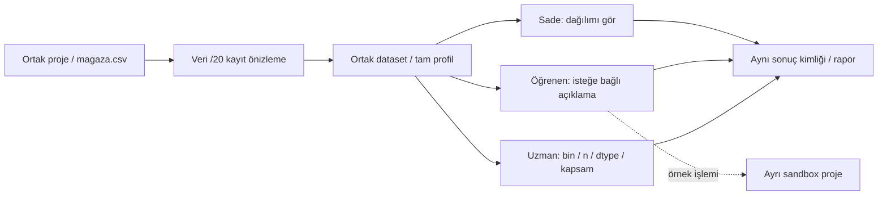

# Veri_Ufku — profesyonel ürün sözleşmesi

Faz28, 2026-10-10. Bu tasarım uygulanacak Faz29–75'i yetkilendirmez.
Ana kabul/kapsam [REQUIREMENTS_MATRIX](REQUIREMENTS_MATRIX.md), mevcut
yetenekler [PRO_CAPABILITY_MATRIX](PRO_CAPABILITY_MATRIX.md), geçiş engelleri
[PHASE28](evidence/PHASE28.md). Python/PySide6/QML Linux uygulaması korunur.

## Ortak ürün ve kapsam kararı

Sade, öğrenen ve uzman aynı ProjectStore, DatasetVersion, ColumnId, RowId,
AnalysisSpec ve Result kimliklerinde çalışır. Seviye değişimi veri kopyası,
otomatik eğitim veya yeniden hesap üretmez. Varsayılan ekran amaç ve tek ana
eylemi gösterir; parametre, seed/fold, varsayım ve tanılamalar kullanıcı açınca
görünür. Kritik varsayım/hata/dışlama bilgisi sade görünümde de görünür kalır.

DEC-28-01: kullanıcı yalnız Faz28 denetim ve planını seçti; bu faz zorunlu.
DEC-28-02: Faz29–75 için önceki isteğe bağlı teslim seçimi korunur. Kaynak
metindeki bütün şartlar ve 552 yöntem/alt yetenek ana matrise açıldı; kullanıcı
bir fazı seçtiğinde o fazın zorunlu şartları uygulanır. Bu kayıt listeyi
azaltmaz, erteleme kararı üretmez. Önceden seçilmiş Faz21–23 zorunlu kalır.
Kapsam değişimi tarihli DEC ve etkilenen bağımlılıklar olmadan yapılmaz.

Araç keşfi gelecekte mevcut capability kaydından arama, favori, komut paleti
ve amaç filtreleriyle yapılır (F29); yüzlerce araç tek menüye eklenmez.
Kararlı/deneysel/mevcut değil ve eksik paket bilgisi dürüst gösterilir.
Genel "en iyi yöntem" veya veriden kendiliğinden nedensellik sonucu yoktur.

Her seçilmiş yöntem: uygunluk → parametre/varsayım → maliyet/kapsam → önizleme
→ açık işlem → sonuç/tanılama → yorum → export. Desteklenmeyen interval,
probability, serialization veya sparse dönüşüm hesaplanmış gibi gösterilmez.
Final test yalnız dondurulmuş kararın final değerlendirmesidir; tekrar kullanım
proje genelindeki mevcut defterde görünür.

## Aynı örnek problemin üç ekran akışı

Problem: "Mağazamın satışları ne içeriyor, eksikler ve dağılım ne anlatıyor?"
Üç yolun ortak fixture'ı paketli CC0 magaza.csv: 12 kayıt/4 sütun; iki tutar
eksik, geçerli n=10, toplam480, ortalama48, medyan45. Kimlik0001–0012 metindir.
Bu tasarım yeni çalışır ekran iddiası değildir; mevcut ekranlara bağlanır.

| Adım | Sade kullanıcı | Öğrenen kullanıcı | Uzman kullanıcı | Ortak veri/sonuç ve hata |
|---|---|---|---|---|
| Başlangıç | Proje oluştur/aç | Aynı proje; Öğren'den kavram oku | Aynı proje ve mevcut sürümleri incele | Proje yokken Veri → Proje oluştur/aç; açık projede düğme yok |
| Veri / aktar | Dosya seç → en fazla20 kayıt → aktar | Aynı önizleme; F1 veya Öğren'de tür/eksik anlatımı | Gelişmiş'i aç; ayraç`;`, null`\N`, Date ve Decimal ayarını doğrula | Gelişmiş varsayılan kapalı; kaynak değişimi/hata/karantina ortak |
| Verini tanı | Fiziksel tür, sütun özeti, disk; tutar notu | Anlam ve notlara birkaç cümle; ilgili yardım isteğe bağlı | Dolu/null/NaN, filtre, ddof1/linear ve fiziksel dtype | Otomatik tam veri; ilk10.000 seçicisi yok; not veri değerlerini değiştirmez |
| Özet / kalite | İki eksik tutarı gör; doldurmak zorunda değil | Eksik ile sıfır farkını ayrı örnekte öğren | Valid n=10 ve dışlama/payda kontrolü | Null, NaN, inf, boş metin ayrı; otomatik düzeltme yok |
| İncele | Tutar histogramını açıkça oluştur | Histogram/medyan yorumunu oku; Escape işe geri döner | Bin/kapsam/filtre, kesin özet ve RowId üyeliğini incele | Aynı ChartResult; grafik görünüşü dataset değiştirmez |
| Rapor | HTML/PDF veya Parquet → yeni dosya; proje kaydet | Yanlış yorum ve kaynak bilgisini oku | Tarif/sürüm/birim/export kaybı; yeniden açma kontrolü | Kaynak ezilmez; export hatasında son sağlam proje korunur |

Nasıl hesaplandı?/Nasıl yorumlarım?/Örnekle öğren sonuç bağlamında tasarlanır.
Kullanıcının önceki talimatıyla kaldırılan genel sağ üst ve görev yardım
düğmeleri geri eklenmez. Öğren ve F1 erişimi korunur. Ders sandbox işlemleri
aktif kullanıcı dataset'ini değiştiremez; okuma zorunlu değildir.

## Korunacak regression ve eski projeler

| Fixture / sözleşme | Referans ve test | Beklenen değişmezlik |
|---|---|---|
| magaza.csv | US-01; test_exports_gui, test_exports | 12/4; null2; n10;480/48/45; leading-zero kimlik; export/reopen |
| subeler.csv | US-02; test_cleaning, test_exports_gui | Kırpma2/6; silme0; iki Bursa ayrı RowId; undo/redo |
| sales/problem CSV ve Parquet | test_data_inspection, measure_data_inspection | Int64/Decimal/date fiziksel şema; tam profil; kısa not save/reopen; kaynak hash |
| schema0.json | test_projects | Salt okunur; yalnız farklı kaydet migrasyonu; eski kaynak değişmez |
| schema1–3.json | test_delimited, test_structured_import | Açılış yazmaz; açık kayıt yeni şema commit'i üretir |
| schema4–6.json | test_security_audit | ACTIVE/SQLite açılışta aynı; save→7; eski commit/payload backup korunur |
| Yeni schema7 projeleri | Mevcut full GUI/project/model testleri | Sonuç/tarif/RowId/ColumnId/history/final defter roundtrip |
| Fit-spy / test poison / grup-zaman fixture | test_validation/regression/classification/text/time_series | Fit sadece fold üyeleri; gelecekte hedef görülmez; calibration ileri fazda ayrı üyelik |
| Hostile model/arşiv/formül ve crash fixture | test_lifecycle/security_audit/projects | Kod çalışmaz; no-fit prediction; eski veya tam yeni commit; kontrollü ret |

Hash ve gerçek vakalar [audit](evidence/phase28/audit.json) içinde tutulur.
Kullanıcının daha önce izin verdiği Titanic projesi bu fazda sadece salt okunur
açıldı: [metadata bütünlüğü](evidence/phase28/existing-project.json). Ham kayıt,
gerçek proje kopyası veya kişisel örnek export edilmedi. Kalıcı regression için
kişisel proje yerine yukarıdaki lisansı açık/sentetik projeler seçilir.

## Boyut ve donanım hedefleri

Temel hedef korunur: Linux x86_64, CPU4 fiziksel core/8GiB, SSD10GiB boş,
1366×768; 720×560 dar uyarlama. Geliştirici Ryzen/32GiB ölçümü minimum kabul
değildir. GPU isteğe bağlı gelecek yetenektir, core için zorunlu değildir.

| Sınıf | Bu planın ölçüm fixture'ı | Kabul hedefi / gerçek sınır |
|---|---|---|
| Küçük tablo | 10k×≤50,≤10MiB; null/text/Decimal/tz | Tam profil; preview p95≤1s; sıcak açılış p95≤2s |
| Orta tablo | 100k×≤100; ayrıca1M kadar dosya preview/page | Analiz yalnız yöntem limiti kadar; model≤100k/4m dense hücre; forest≤20k |
| Büyük tablo | 1,000,001 satır; kayıtlı ayrı join/profil fixture | Tam dense ML reddi beklenir; açık örnek ayrı sürüm; out-of-core evrensel değil |
| Sınır testi | ≥1MiB tek CSV kaydı, aşırı archive, n² DBSCAN | Bütçe ret/iptal; kaynak ve son sağlam commit değişmez |

Toplam RAM hedef≤2GiB, geçici disk≤4GiB/reserve≥1GiB;1 CPU/2 I/O,2 native
thread.100 giriş olayında fiziksel input→frame p95≤100ms/max250ms; iptal
ack≤100ms, worker p95≤2s, cleanup≤5s.20 warm/5 cold; benchmark3 tekrar median
ve max, yeterli örnek olmadan p95 iddiası yok. Sıcak/cold, RSS paylaşılan sayfa
çifte sayımı ve staging/published disk ayrımı kaydedilir. Faz24 gerçek ölçümler
[PERFORMANCE](PERFORMANCE.md); hedeflerin bütünü henüz karşılanmış değildir.

## Kabul sınırı

F13 kullanıcı, F24 minimum/cold, F25 insan/AT/çeviri ve durdurulmuş F27
dağıtım kapısı kapanmadan profesyonel geliştirme açılmaz. Çalışır wheel,
offscreen GUI, gerçek masaüstü, yeni başlayan/uzman kullanıcı ve offline
kurulum ayrı kanıtlardır. Faz28 raporunun tamamlanması bu açıkları kapatmaz.

Faz29: uzman görünümünde Ctrl+K/modül araması, favoriler, yerel kayıtlı sekmeler, iki sonuç karşılaştırması ve istatistik presetleri çalışır. Ortak sonuç kimliği başlangıçta da aynıdır; yardım isteğe bağlıdır. [Deneme ve taşınabilirlik sınırı](evidence/PHASE29.md#e29-limits).

Faz30 kullanıcı tarafından DEC-30-01 ile seçildi: gelişmiş yerel dosya
adaptörleri, açık key/kayıt yolu/karakter genişliği, bounded sıkıştırma ve
şema çözüm önizlemesi. [Doğrulanan varyantlar](evidence/PHASE30.md#e30-formats).
Önceki insan/AT/donanım/dağıtım kapıları açık; Faz31 başlamadı.

Faz31 DEC-31-01 açık kullanıcı seçimi: altı ayrı read-only kaynak adaptörü,
explicit network, keyring-ref, snapshot aralığı/garanti ve kontrollü API
sayfalama. Temel uygulama offline kalır; önceki insan/dağıtım kabulü
değişmez. [Gerçek varyantlar](evidence/PHASE31.md).

Faz32: Veri → Verini tanı altında açılan veri sözlüğü/sözleşme/eşleme paneli.
Kolon anlamı, birim ve ölçüm düzeyi; ordinal sıra ve valid-range/null/unique/FK
kuralları. Tam girdi kontrolü, uyarı/hata ve en fazla10 örnek; dur/karantina/
devam açık seçilir. Kaydedilen girdi raporu yeniden hesaplamadan açılır;
yeni sürümde eski rapor olarak işaretlenir. Fuzzy puan yalnız adaydır; insan
onayı ve ayrı Uygula gerekli. Canonical atama satır silmez; source kimlikleri,
tam inverse ve bağlı sonuç sürümleri korunur. [Sınırlar](adr/033-data-contracts-phase32.md).

Faz33 tek doldurma/MI ve frequency/analytic/survey/sample_weight ayrı, registry destek doğrular. Survey weighted mean alone kabul edilmez; doğrulanmış strata/PSU WR Taylor SE/t CI vardır. Numeric MI yalnız mean/OLS; kaynak değişmez. [Gerçek kanıt ve sınırlar](evidence/PHASE33.md).
