# Veri_Ufku — Faz29–75 bağımlılık ve alt iş planı

Faz28 tasarımı; gelecekteki uygulama yetkisi değildir. Ana kapsam [REQUIREMENTS_MATRIX](REQUIREMENTS_MATRIX.md); makineye okunur [plan](evidence/phase28/work-plan.json). DEC-28-01/02 geçerlidir.

Numara sırası topolojik olarak geçerli olsa da bütün transitif kabul kapıları kapanmadan güvenli değildir. Mevcut ComputeBudget/registry/provenance her fazda kullanılır; Faz65/66 gelene kadar güvenlik ertelenmez. Optional paket yokken core açılışı, source hash, RowId, atomik yayın, train-only fit ve kalıcı test defteri her yöntemin V/G/P kapısıdır.

.C → .V → .G; .H çevrimdışı örnekle, .P save/reopen/export ile G sonucunu doğrular. Bir iterasyon tek format/grafik/modelin C/V/G/H/P dilimini bitirir; sonraki yöntem başlatılmaz. Ağır fazlarda ilk küçük dilim: F30 partitioned Parquet, F31 PostgreSQL sonra HTTP, F33 missing indicator sonra KNN sonra MI, F38 GeoJSON/CRS sonra raster, F40 OLS sonra GLM sonra mixed, F43 conjugate sonra sampler, F44 randomize ATE sonra IPW sonra DiD/IV, F45 KM sonra Cox, F48 Lasso sonra ağaçlar sonra optional boosted, F49 bounded random sonra nested CV, F56 CPU MLP sonra CNN sonra GPU, F57 classification sonra detection/segmentation, F64 tek source→transform→export sonra branch/batch. Bunlar kapsam azaltımı değil test edilebilir teslim sırasıdır.

```mermaid
flowchart TD
  ENTRY[00–20 ve 24–27 gerçek kabul] --> F28[Faz28 kapısı]
  F29["29: Yöntem kayıt sistemi ve profesyonel çalışma alanı"]
  F28 --> F29
  F30["30: Gelişmiş tablo formatları ve dosya kaynakları"]
  F06 --> F30
  F24 --> F30
  F29 --> F30
  F31["31: Veritabanı ve kullanıcı tarafından açılan ağ kaynakları"]
  F11 --> F31
  F29 --> F31
  F30 --> F31
  F32["32: Veri sözlüğü, kalite sözleşmeleri ve varlık eşleme"]
  F07 --> F32
  F08 --> F32
  F29 --> F32
  F30 --> F32
  F33["33: İleri eksik veri, örnekleme ve ağırlıklar"]
  F10 --> F33
  F16 --> F33
  F29 --> F33
  F32 --> F33
  F34["34: Çok boyutlu bilimsel veri ve birimler"]
  F24 --> F34
  F29 --> F34
  F30 --> F34
  F32 --> F34
  F35["35: Profesyonel dağılım ve belirsizlik grafikleri"]
  F12 --> F35
  F29 --> F35
  F33 --> F35
  F36["36: Çok değişkenli, ilişkisel ve yüksek boyutlu görseller"]
  F35 --> F36
  F37["37: Kompozisyon, hiyerarşi, akış ve iş grafikleri"]
  F35 --> F37
  F36 --> F37
  F38["38: Coğrafi veri, haritalar ve mekânsal analiz"]
  F24 --> F38
  F29 --> F38
  F30 --> F38
  F32 --> F38
  F34 --> F38
  F39["39: Bağlantılı dashboard ve yayın kalitesinde figür düzenleme"]
  F12 --> F39
  F35 --> F39
  F36 --> F39
  F37 --> F39
  F40["40: İstatistiksel modeller ve tanılama"]
  F14 --> F40
  F16 --> F40
  F29 --> F40
  F32 --> F40
  F33 --> F40
  F35 --> F40
  F41["41: Bootstrap, permütasyon, çoklu test ve sağlam analiz"]
  F14 --> F41
  F29 --> F41
  F33 --> F41
  F40 --> F41
  F42["42: Deney tasarımı, A/B testi ve güç analizi"]
  F14 --> F42
  F32 --> F42
  F40 --> F42
  F41 --> F42
  F43["43: Bayesçi analiz ve model kontrolü"]
  F16 --> F43
  F29 --> F43
  F40 --> F43
  F41 --> F43
  F44["44: Nedensel çıkarım ve varsayımların görünürlüğü"]
  F16 --> F44
  F29 --> F44
  F32 --> F44
  F40 --> F44
  F41 --> F44
  F42 --> F44
  F45["45: Sağkalım ve olay zamanı analizi"]
  F16 --> F45
  F29 --> F45
  F32 --> F45
  F40 --> F45
  F46["46: Boyut indirgeme ve özellik seçimi"]
  F16 --> F46
  F29 --> F46
  F35 --> F46
  F36 --> F46
  F47["47: Gelişmiş kümeleme, yoğunluk ve anomali yöntemleri"]
  F19 --> F47
  F29 --> F47
  F46 --> F47
  F48["48: Profesyonel tabular model kataloğu"]
  F20 --> F48
  F29 --> F48
  F32 --> F48
  F33 --> F48
  F46 --> F48
  F49["49: Hiperparametre araması ve bütçeli AutoML"]
  F16 --> F49
  F29 --> F49
  F48 --> F49
  F50["50: Kalibrasyon, tahmin belirsizliği ve karar eşikleri"]
  F16 --> F50
  F48 --> F50
  F49 --> F50
  F51["51: Açıklanabilirlik, hata dilimleri ve adalet değerlendirmesi"]
  F16 --> F51
  F39 --> F51
  F48 --> F51
  F50 --> F51
  F52["52: Deney takibi ve model kayıt sistemi"]
  F20 --> F52
  F29 --> F52
  F49 --> F52
  F50 --> F52
  F51 --> F52
  F53["53: İleri zaman serisi ve panel tahmin"]
  F21 --> F53
  F29 --> F53
  F33 --> F53
  F40 --> F53
  F48 --> F53
  F52 --> F53
  F54["54: Sinyal işleme, sensör ve frekans analizi"]
  F21 --> F54
  F29 --> F54
  F34 --> F54
  F35 --> F54
  F55["55: İleri NLP, arama ve metin etiketleme"]
  F22 --> F55
  F29 --> F55
  F46 --> F55
  F48 --> F55
  F52 --> F55
  F56["56: Derin öğrenme çalışma motoru"]
  F16 --> F56
  F29 --> F56
  F48 --> F56
  F52 --> F56
  F57["57: Görüntü verisi, annotation ve bilgisayarlı görü"]
  F30 --> F57
  F32 --> F57
  F56 --> F57
  F58["58: Ses verisi ve ses analizi"]
  F30 --> F58
  F54 --> F58
  F56 --> F58
  F59["59: Öneri sistemleri ve sıralama"]
  F16 --> F59
  F29 --> F59
  F32 --> F59
  F48 --> F59
  F52 --> F59
  F60["60: İlişkilendirme kuralları, kohort ve süreç analizi"]
  F29 --> F60
  F32 --> F60
  F35 --> F60
  F40 --> F60
  F61["61: Ağ ve graf verisi"]
  F29 --> F61
  F30 --> F61
  F32 --> F61
  F36 --> F61
  F62["62: Streaming, online ve özel öğrenme hedefleri"]
  F23 --> F62
  F29 --> F62
  F32 --> F62
  F52 --> F62
  F53 --> F62
  F63["63: Profesyonel kod, SQL ve notebook köprüsü"]
  F23 --> F63
  F29 --> F63
  F52 --> F63
  F64["64: Görsel workflow ve başsız batch çalıştırma"]
  F23 --> F64
  F29 --> F64
  F39 --> F64
  F52 --> F64
  F63 --> F64
  F65["65: Veri kökeni, ortam ve bilimsel yeniden üretilebilirlik"]
  F29 --> F65
  F32 --> F65
  F52 --> F65
  F64 --> F65
  F66["66: CPU/GPU, disk ve dağıtık hesaplama bütçeleri"]
  F24 --> F66
  F29 --> F66
  F49 --> F66
  F56 --> F66
  F65 --> F66
  F67["67: Model izleme ve operasyonel kalite"]
  F23 --> F67
  F32 --> F67
  F48 --> F67
  F50 --> F67
  F52 --> F67
  F65 --> F67
  F68["68: Monte Carlo, duyarlılık ve optimizasyon"]
  F29 --> F68
  F40 --> F68
  F41 --> F68
  F52 --> F68
  F66 --> F68
  F69["69: Öğrenme laboratuvarı ve uygulamalı ders yolları"]
  F03 --> F69
  F25 --> F69
  F29 --> F69
  F64 --> F69
  F70["70: Profesyonel rapor, dashboard anlatısı ve araştırma notları"]
  F13 --> F70
  F39 --> F70
  F40 --> F70
  F52 --> F70
  F65 --> F70
  F69 --> F70
  F71["71: Ekipler arasında proje aktarımı ve inceleme"]
  F26 --> F71
  F32 --> F71
  F65 --> F71
  F70 --> F71
  F72["72: Gizlilik, güvenlik ve veri yaşam döngüsü"]
  F26 --> F72
  F32 --> F72
  F65 --> F72
  F71 --> F72
  F73["73: Uzman eklentileri ve açık geliştirme SDK'sı"]
  F29 --> F73
  F63 --> F73
  F64 --> F73
  F65 --> F73
  F66 --> F73
  F72 --> F73
  F74["74: Profesyonel dağıtım, ortam yönetimi ve kalite matrisi"]
  F27 --> F74
  F29 --> F74
  F66 --> F74
  F72 --> F74
  F73 --> F74
  F75["75: Profesyonel sürümün bilimsel ve ürün kabul denetimi"]
  F28 --> F75
  F29 --> F75
  F30 --> F75
  F31 --> F75
  F32 --> F75
  F33 --> F75
  F34 --> F75
  F35 --> F75
  F36 --> F75
  F37 --> F75
  F38 --> F75
  F39 --> F75
  F40 --> F75
  F41 --> F75
  F42 --> F75
  F43 --> F75
  F44 --> F75
  F45 --> F75
  F46 --> F75
  F47 --> F75
  F48 --> F75
  F49 --> F75
  F50 --> F75
  F51 --> F75
  F52 --> F75
  F53 --> F75
  F54 --> F75
  F55 --> F75
  F56 --> F75
  F57 --> F75
  F58 --> F75
  F59 --> F75
  F60 --> F75
  F61 --> F75
  F62 --> F75
  F63 --> F75
  F64 --> F75
  F65 --> F75
  F66 --> F75
  F67 --> F75
  F68 --> F75
  F69 --> F75
  F70 --> F75
  F71 --> F75
  F72 --> F75
  F73 --> F75
  F74 --> F75
```

## Faz başına teslim dilimleri

| Faz | Bağımlılık | Kaynak şartlar | Yöntem alt işleri | Başlama durumu |
|---|---|---|---|---|
| 29 Yöntem kayıt sistemi ve profesyonel çalışma alanı | 28 | F29-S001, F29-S002, F29-S003, F29-S004, F29-S005, F29-S006 | F29-P001 Mevcut Capability genişletme; F29-P002 Modül araması; F29-P003 Komut paleti; F29-P004 Favoriler; F29-P005 Preset; F29-P006 Analiz sekmeleri ve karşılaştırma; F29-P007 Ortak artifact paneli; F29-P008 Bilinmeyen yöntem salt okunur açılışı | DEC-29-01; deneysel; zorunlu; önceki kabul açık |
| 30 Gelişmiş tablo formatları ve dosya kaynakları | 06,24,29 | F30-S001, F30-S002, F30-S003, F30-S004 | F30-P001 Partitioned Parquet; F30-P002 Arrow dataset; F30-P003 Avro; F30-P004 ORC; F30-P005 HDF5 tablo; F30-P006 XML kayıt; F30-P007 Sabit genişlikli metin; F30-P008 SPSS; F30-P009 Stata; F30-P010 SAS; F30-P011 Gzip; F30-P012 ZIP; F30-P013 Schema evolution ve çok kaynak kökeni | DEC-30-01; deneysel; zorunlu |
| 31 Veritabanı ve kullanıcı tarafından açılan ağ kaynakları | 11,29,30 | F31-S001, F31-S002, F31-S003, F31-S004, F31-S005 | F31-P001 PostgreSQL; F31-P002 MySQL; F31-P003 MariaDB; F31-P004 DuckDB yerel; F31-P005 HTTP REST; F31-P006 Nesne depolama; F31-P007 Keyring TLS; F31-P008 Snapshot pagination retry tutarlılığı | DEC-31-01; deneysel; zorunlu |
| 32 Veri sözlüğü, kalite sözleşmeleri ve varlık eşleme | 07,08,29,30 | F32-S001, F32-S002, F32-S003, F32-S004, F32-S005 | F32-P001 Kolon anlam birim ölçüm düzeyi; F32-P002 Ordinal sıralama; F32-P003 Valid range nullable unique; F32-P004 Foreign key; F32-P005 Kalite sözleşmesi; F32-P006 Fuzzy kategori eşleme; F32-P007 Blocking ve entity resolution; F32-P008 Onaylı canonical merge ve undo | DEC-32-01; deneysel; zorunlu |
| 33 İleri eksik veri, örnekleme ve ağırlıklar | 10,16,29,32 | F33-S001, F33-S002, F33-S003, F33-S004 | F33-P001 Eksiklik desenleri; F33-P002 Missing indicator; F33-P003 KNN imputasyon; F33-P004 Iterative imputasyon; F33-P005 Multiple imputation ve havuzlama; F33-P006 MNAR duyarlılık; F33-P007 Basit rastgele örnekleme; F33-P008 Stratified örnekleme; F33-P009 Cluster örnekleme; F33-P010 Frekans ağırlığı; F33-P011 Analitik ağırlık; F33-P012 Survey strata PSU; F33-P013 Sample weight | DEC-33-01; deneysel; zorunlu;17 teknik madde doğrulandı, resmî önceki kapılar açık |
| 34 Çok boyutlu bilimsel veri ve birimler | 24,29,30,32 | F34-S001, F34-S002, F34-S003, F34-S004 | F34-P001 NetCDF; F34-P002 Zarr; F34-P003 Çok boyutlu HDF5; F34-P004 Lazy slice ve tablo dönüşümü; F34-P005 CF metadata ve takvim; F34-P006 Offset birim dönüşümü; F34-P007 2D heatmap; F34-P008 Profil çizgisi | DEC-34-01; deneysel; zorunlu; teknik doğrulandı; resmî kabuller açık |
| 35 Profesyonel dağılım ve belirsizlik grafikleri | 12,29,33 | F35-S001, F35-S002, F35-S003, F35-S004 | F35-P001 Violin; F35-P002 KDE; F35-P003 ECDF; F35-P004 Rug; F35-P005 Strip; F35-P006 Swarm; F35-P007 QQ; F35-P008 PP; F35-P009 Error bar; F35-P010 CI band; F35-P011 Missing pattern; F35-P012 Histogram grup facet ağırlık; F35-P013 Boxplot grup facet ağırlık; F35-P014 Log symlog; F35-P015 Annotation DPI PNG SVG PDF | DEC-35-01; deneysel; zorunlu |
| 36 Çok değişkenli, ilişkisel ve yüksek boyutlu görseller | 35 | F36-S001, F36-S002, F36-S003, F36-S004 | F36-P001 Pair plot; F36-P002 Scatter matrix; F36-P003 Hexbin; F36-P004 2D density; F36-P005 Bubble; F36-P006 Grouped heatmap; F36-P007 Clustered heatmap; F36-P008 Parallel coordinates; F36-P009 Facet small multiples; F36-P010 Koşullu ilişki; F36-P011 Brushing RowId; F36-P012 3D scatter; F36-P013 Surface | DEC-36-01; deneysel; zorunlu (3D/surface isteğe bağlı, uygulanmadı) |
| 37 Kompozisyon, hiyerarşi, akış ve iş grafikleri | 35,36 | F37-S001, F37-S002, F37-S003, F37-S004 | F37-P001 Stacked bar; F37-P002 100% stacked bar; F37-P003 Stacked area; F37-P004 100% stacked area; F37-P005 Dot; F37-P006 Lollipop; F37-P007 Waterfall; F37-P008 Pareto; F37-P009 Treemap; F37-P010 Sunburst; F37-P011 Sankey; F37-P012 Alluvial; F37-P013 Funnel; F37-P014 Takvim heatmap; F37-P015 Pie; F37-P016 Donut; F37-P017 Radar | DEC-37-01; deneysel; zorunlu; radar advanced onaylı |
| 38 Coğrafi veri, haritalar ve mekânsal analiz | 24,29,30,32,34 | F38-S001, F38-S002, F38-S003, F38-S004 | F38-P001 GeoJSON; F38-P002 GeoPackage; F38-P003 Shapefile; F38-P004 GeoParquet; F38-P005 Koordinat kolonları; F38-P006 GeoTIFF; F38-P007 CRS atama; F38-P008 Reprojection; F38-P009 Nokta haritası; F38-P010 Choropleth; F38-P011 Yoğunluk haritası; F38-P012 Raster kesit; F38-P013 Spatial join; F38-P014 Clip; F38-P015 Buffer; F38-P016 Mesafe alan; F38-P017 Spatial block validation; F38-P018 Moran I; F38-P019 Online tile; F38-P020 Geocoding | DEC-38-01; deneysel; zorunlu; explicit local/network sources |
| 39 Bağlantılı dashboard ve yayın kalitesinde figür düzenleme | 12,35,36,37 | F39-S001, F39-S002, F39-S003, F39-S004 | F39-P001 Dashboard canvas; F39-P002 KPI; F39-P003 Global local filtre; F39-P004 Linked brushing drill down; F39-P005 Figure composer; F39-P006 Subplot facet ortak legend; F39-P007 Vektör raster export; F39-P008 Yerel etkileşimli HTML | DEP-28-GATE; mevcut değil; isteğe bağlı |
| 40 İstatistiksel modeller ve tanılama | 14,16,29,32,33,35 | F40-S001, F40-S002, F40-S003, F40-S004 | F40-P001 OLS; F40-P002 WLS; F40-P003 GLM binomial; F40-P004 GLM Poisson; F40-P005 GLM negative binomial; F40-P006 Quantile regression; F40-P007 Mixed effects; F40-P008 Repeated measures; F40-P009 Güvenli formül interaction offset; F40-P010 VIF residual heteroskedasticity overdispersion; F40-P011 Robust SE; F40-P012 Cluster SE; F40-P013 Influence convergence AIC BIC | DEP-28-GATE; mevcut değil; isteğe bağlı |
| 41 Bootstrap, permütasyon, çoklu test ve sağlam analiz | 14,29,33,40 | F41-S001, F41-S002, F41-S003, F41-S004 | F41-P001 Bootstrap percentile; F41-P002 BCa; F41-P003 Cluster bootstrap; F41-P004 Time block bootstrap; F41-P005 Permutation; F41-P006 Paired sign flip; F41-P007 Trimmed robust summary; F41-P008 Holm; F41-P009 Bonferroni; F41-P010 BH; F41-P011 Duyarlılık karşılaştırması | DEP-28-GATE; mevcut değil; isteğe bağlı |
| 42 Deney tasarımı, A/B testi ve güç analizi | 14,32,40,41 | F42-S001, F42-S002, F42-S003, F42-S004 | F42-P001 İki grup randomize deney; F42-P002 Paired deney; F42-P003 Cluster deney; F42-P004 Factorial deney; F42-P005 Power sample size MDE; F42-P006 SRM; F42-P007 ITT per protocol; F42-P008 Sequential alpha spending; F42-P009 Sequential e value | DEP-28-GATE; mevcut değil; isteğe bağlı |
| 43 Bayesçi analiz ve model kontrolü | 16,29,40,41 | F43-S001, F43-S002, F43-S003, F43-S004 | F43-P001 Beta binomial; F43-P002 Normal mean; F43-P003 Bayesian linear regression; F43-P004 Bayesian hierarchical regression; F43-P005 Prior predictive; F43-P006 MCMC R hat ESS divergence trace; F43-P007 Posterior predictive; F43-P008 LOO; F43-P009 WAIC; F43-P010 Prior sensitivity | DEP-28-GATE; mevcut değil; isteğe bağlı |
| 44 Nedensel çıkarım ve varsayımların görünürlüğü | 16,29,32,40,41,42 | F44-S001, F44-S002, F44-S003, F44-S004 | F44-P001 DAG identification; F44-P002 Randomize ATE; F44-P003 Adjustment; F44-P004 IPW; F44-P005 AIPW; F44-P006 Matching; F44-P007 Difference in differences; F44-P008 IV; F44-P009 Cross fitting; F44-P010 Overlap balance positivity; F44-P011 Sensitivity placebo | DEP-28-GATE; mevcut değil; isteğe bağlı |
| 45 Sağkalım ve olay zamanı analizi | 16,29,32,40 | F45-S001, F45-S002, F45-S003, F45-S004 | F45-P001 Right censoring; F45-P002 Left truncation; F45-P003 Interval censoring; F45-P004 Competing risk; F45-P005 Kaplan Meier; F45-P006 Risk table; F45-P007 Log rank; F45-P008 Cox PH; F45-P009 AFT; F45-P010 PH ties convergence; F45-P011 C index; F45-P012 Time dependent Brier; F45-P013 Cumulative incidence; F45-P014 Time dependent covariate | DEP-28-GATE; mevcut değil; isteğe bağlı |
| 46 Boyut indirgeme ve özellik seçimi | 16,29,35,36 | F46-S001, F46-S002, F46-S003, F46-S004 | F46-P001 PCA; F46-P002 Incremental PCA; F46-P003 Truncated SVD; F46-P004 NMF; F46-P005 ICA; F46-P006 t SNE; F46-P007 UMAP; F46-P008 Variance filter; F46-P009 Model based selection; F46-P010 Univariate selection; F46-P011 RFE; F46-P012 Sequential selection; F46-P013 Fold selection stability | DEP-28-GATE; mevcut değil; isteğe bağlı |
| 47 Gelişmiş kümeleme, yoğunluk ve anomali yöntemleri | 19,29,46 | F47-S001, F47-S002, F47-S003, F47-S004 | F47-P001 Agglomerative dendrogram; F47-P002 Gaussian mixture; F47-P003 OPTICS; F47-P004 HDBSCAN; F47-P005 DBSCAN; F47-P006 KMeans; F47-P007 Silhouette; F47-P008 Davies Bouldin; F47-P009 Calinski Harabasz; F47-P010 GMM AIC BIC; F47-P011 Resampling stability; F47-P012 LOF outlier; F47-P013 LOF novelty; F47-P014 OneClassSVM; F47-P015 Robust covariance; F47-P016 Etiketli anomaly PR maliyet | DEC47-01; deneysel; zorunlu; optional HDBSCAN ayrı |
| 48 Profesyonel tabular model kataloğu | 20,29,32,33,46 | F48-S001, F48-S002, F48-S003, F48-S004 | F48-P001 ElasticNet; F48-P002 Lasso; F48-P003 SGD; F48-P004 Decision tree; F48-P005 ExtraTrees; F48-P006 Gradient boosting; F48-P007 Hist gradient boosting; F48-P008 SVM; F48-P009 SVR; F48-P010 KNN; F48-P011 Naive Bayes; F48-P012 XGBoost; F48-P013 LightGBM; F48-P014 CatBoost; F48-P015 Bagging; F48-P016 Voting; F48-P017 Stacking OOF; F48-P018 Ranking objective; F48-P019 Multioutput; F48-P020 Safe model persistence | DEC48-01;deneysel;zorunlu;optional backend ayrı unvalidated |
| 49 Hiperparametre araması ve bütçeli AutoML | 16,29,48 | F49-S001, F49-S002, F49-S003, F49-S004, F49-S005 | F49-P001 Grid search; F49-P002 Random search; F49-P003 Bayesian optimization; F49-P004 Nested CV; F49-P005 Learning curve; F49-P006 Validation curve; F49-P007 Early stopping; F49-P008 Pruning; F49-P009 Fail cancel resume trial history | DEC49-01; deneysel; zorunlu; optional Bayesian ayrı |
| 50 Kalibrasyon, tahmin belirsizliği ve karar eşikleri | 16,48,49 | F50-S001, F50-S002, F50-S003, F50-S004 | F50-P001 Reliability diagram; F50-P002 Log loss; F50-P003 Brier; F50-P004 Sigmoid calibration; F50-P005 Isotonic calibration; F50-P006 Validation eşik constraints; F50-P007 Quantile prediction; F50-P008 Conformal interval; F50-P009 Conformal prediction sets; F50-P010 Calibrator threshold persistence | DEC50-01; deneysel; zorunlu; bounded native |
| 51 Açıklanabilirlik, hata dilimleri ve adalet değerlendirmesi | 16,39,48,50 | F51-S001, F51-S002, F51-S003, F51-S004, F51-S005 | F51-P001 Permutation importance; F51-P002 PDP; F51-P003 ICE; F51-P004 SHAP; F51-P005 Feature mapping; F51-P006 Grup zaman sınıf hata dilimi; F51-P007 Fairness metrikleri; F51-P008 Sensitive export redaction; F51-P009 Constrained counterfactual; F51-P010 What if | DEC51-01; deneysel; native zorunlu; SHAP/constrained optional |
| 52 Deney takibi ve model kayıt sistemi | 20,29,49,50,51 | F52-S001, F52-S002, F52-S003, F52-S004, F52-S005 | F52-P001 Yerel experiment registry; F52-P002 Model registry ve model kartı; F52-P003 Run search filter comparison; F52-P004 Fold dağılımı; F52-P005 Pareto maliyet başarı; F52-P006 Final test defteri bağlantısı; F52-P007 Quota immutable artifact; F52-P008 Tracking backend | DEC52-01 local7native; sürüyor/deneysel/zorunlu; optional tracking unconfigured |
| 53 İleri zaman serisi ve panel tahmin | 21,29,33,40,48,52 | F53-S001, F53-S002, F53-S003, F53-S004 | F53-P001 Seasonal decomposition; F53-P002 STL; F53-P003 ACF; F53-P004 PACF; F53-P005 Stationarity testleri; F53-P006 ARIMA; F53-P007 SARIMA; F53-P008 SARIMAX; F53-P009 VAR; F53-P010 Change point; F53-P011 Yerel panel forecast; F53-P012 Global panel forecast; F53-P013 Rolling origin gap embargo; F53-P014 MASE train denominator; F53-P015 Probabilistic coverage pinball; F53-P016 Hierarchical reconciliation; F53-P017 Intermittent demand; F53-P018 Time series classification; F53-P019 Time series clustering | DEC53-01 19 bounded native teknik doğrulandı; resmî sürüyor/deneysel/zorunlu |
| 54 Sinyal işleme, sensör ve frekans analizi | 21,29,34,35 | F54-S001, F54-S002, F54-S003, F54-S004 | F54-P001 Sinyal sampling şeması; F54-P002 Resampling; F54-P003 Detrending; F54-P004 Window; F54-P005 FFT; F54-P006 Welch PSD; F54-P007 STFT; F54-P008 Spectrogram; F54-P009 Peak; F54-P010 Filtreleme; F54-P011 Zero phase offline only; F54-P012 Event segmentation; F54-P013 Overlap window split | DEC54-01 13bounded native teknik doğrulandı; resmî sürüyor/deneysel/zorunlu |
| 55 İleri NLP, arama ve metin etiketleme | 22,29,46,48,52 | F55-S001, F55-S002, F55-S003, F55-S004, F55-S005 | F55-P001 TF IDF genişletme; F55-P002 NMF topic; F55-P003 LDA topic; F55-P004 Local embeddings; F55-P005 Semantic search; F55-P006 NER offset; F55-P007 Sentiment; F55-P008 Text classification; F55-P009 Annotation review export; F55-P010 Active learning; F55-P011 Retrieval evaluation; F55-P012 Model lisans offline cache | DEC55-01 12bounded native teknik doğrulandı; resmî sürüyor/deneysel/zorunlu |
| 56 Derin öğrenme çalışma motoru | 16,29,48,52 | F56-S001, F56-S002, F56-S003, F56-S004 | F56-P001 Optional tensor backend; F56-P002 Loader tensor schema; F56-P003 CPU MLP; F56-P004 CPU CNN şablonu; F56-P005 GPU VRAM mixed precision; F56-P006 Training validation curves; F56-P007 Optimizer scheduler; F56-P008 Train augmentation; F56-P009 Safe checkpoint; F56-P010 Tam optimizer resume; F56-P011 Early stopping | DEC56-01 açık talimat; 10bounded CPU kayıt teknik doğrulandı; GPU kapalı/unvalidated |
| 57 Görüntü verisi, annotation ve bilgisayarlı görü | 30,32,56 | F57-S001, F57-S002, F57-S003, F57-S004 | F57-P001 Görüntü manifesti; F57-P002 Sınıf etiketleme; F57-P003 Bounding box; F57-P004 Mask; F57-P005 Duplicate near duplicate; F57-P006 Classification transfer learning; F57-P007 Detection; F57-P008 Segmentation; F57-P009 IoU mAP; F57-P010 Dice; F57-P011 Video frame provenance; F57-P012 CPU fixture | DEP-28-GATE; mevcut değil; isteğe bağlı |
| 58 Ses verisi ve ses analizi | 30,54,56 | F58-S001, F58-S002, F58-S003, F58-S004 | F58-P001 WAV; F58-P002 FLAC; F58-P003 Waveform; F58-P004 Spectrogram; F58-P005 Clipping silence; F58-P006 Resampling; F58-P007 MFCC; F58-P008 Log mel; F58-P009 Audio classification; F58-P010 Local speech to text; F58-P011 Timestamp confidence; F58-P012 WER; F58-P013 CER; F58-P014 Speaker diarization; F58-P015 Event detection; F58-P016 Opt in microphone | DEP-28-GATE; mevcut değil; isteğe bağlı |
| 59 Öneri sistemleri ve sıralama | 16,29,32,48,52 | F59-S001, F59-S002, F59-S003, F59-S004 | F59-P001 User item interaction schema; F59-P002 Popularity baseline; F59-P003 Content similarity; F59-P004 Matrix factorization; F59-P005 Learning to rank; F59-P006 Temporal leave last out; F59-P007 Negative sampling; F59-P008 Precision Recall at K; F59-P009 NDCG at K; F59-P010 MAP at K; F59-P011 Coverage diversity cold start; F59-P012 Unknown identity fallback | DEP-28-GATE; mevcut değil; isteğe bağlı |
| 60 İlişkilendirme kuralları, kohort ve süreç analizi | 29,32,35,40 | F60-S001, F60-S002, F60-S003, F60-S004, F60-S005 | F60-P001 Transaction basket schema; F60-P002 Apriori; F60-P003 FP growth; F60-P004 Support; F60-P005 Confidence; F60-P006 Lift; F60-P007 Cohort retention; F60-P008 Event funnel; F60-P009 Case activity timestamp; F60-P010 Directly follows graph; F60-P011 Conformance | DEP-28-GATE; mevcut değil; isteğe bağlı |
| 61 Ağ ve graf verisi | 29,30,32,36 | F61-S001, F61-S002, F61-S003, F61-S004 | F61-P001 Edge node schema; F61-P002 GraphML; F61-P003 GEXF; F61-P004 Degree; F61-P005 Centrality; F61-P006 Connected components; F61-P007 Shortest paths; F61-P008 Community detection; F61-P009 Graph layout filter; F61-P010 Link prediction; F61-P011 Network embedding; F61-P012 Multi edge identity export | DEP-28-GATE; mevcut değil; isteğe bağlı |
| 62 Streaming, online ve özel öğrenme hedefleri | 23,29,32,52,53 | F62-S001, F62-S002, F62-S003, F62-S004 | F62-P001 Bounded stream simulator; F62-P002 Event processing time late events; F62-P003 Window checkpoint; F62-P004 Incremental scaler; F62-P005 Partial fit model; F62-P006 Prequential test then train; F62-P007 Label delay drift retrain; F62-P008 Multi label; F62-P009 Multi output; F62-P010 Ordinal target; F62-P011 Positive unlabeled; F62-P012 Semi supervised; F62-P013 Label propagation transductive; F62-P014 Network broker | DEP-28-GATE; mevcut değil; isteğe bağlı |
| 63 Profesyonel kod, SQL ve notebook köprüsü | 23,29,52 | F63-S001, F63-S002, F63-S003, F63-S004 | F63-P001 Python export; F63-P002 SQL export; F63-P003 Runnable script; F63-P004 Notebook export; F63-P005 Kernel opt in; F63-P006 Output timeout cancel budget; F63-P007 Code hash lineage; F63-P008 Jupyter integration | DEP-28-GATE; mevcut değil; isteğe bağlı |
| 64 Görsel workflow ve başsız batch çalıştırma | 23,29,39,52,63 | F64-S001, F64-S002, F64-S003, F64-S004, F64-S005 | F64-P001 Typed DAG source transform quality; F64-P002 DAG analysis train predict export; F64-P003 Cycle port type; F64-P004 Cache invalidation; F64-P005 Failure retry idempotency; F64-P006 CLI GUI equivalence; F64-P007 Batch dataset; F64-P008 Parameter sweep dry run; F64-P009 Local schedule | DEP-28-GATE; mevcut değil; isteğe bağlı |
| 65 Veri kökeni, ortam ve bilimsel yeniden üretilebilirlik | 29,32,52,64 | F65-S001, F65-S002, F65-S003, F65-S004, F65-S005 | F65-P001 Lineage graph; F65-P002 RowId çok kaynak kökeni; F65-P003 Environment hash; F65-P004 Snapshot retention; F65-P005 Repro bundle; F65-P006 Data inclusion redaction; F65-P007 Exact rerun verifier; F65-P008 Numeric tolerance verifier; F65-P009 Migration backend safe failure | DEP-28-GATE; mevcut değil; isteğe bağlı |
| 66 CPU/GPU, disk ve dağıtık hesaplama bütçeleri | 24,29,49,56,65 | F66-S001, F66-S002, F66-S003, F66-S004, F66-S005 | F66-P001 Mevcut ComputeBudget genişletme; F66-P002 Toplam thread process budget; F66-P003 Out of core lazy chunk; F66-P004 Sparse dense guard; F66-P005 Disk spill quota cleanup; F66-P006 GPU transfer fallback; F66-P007 Distributed executor; F66-P008 Remote auth opt in; F66-P009 Benchmark | DEP-28-GATE; mevcut değil; isteğe bağlı |
| 67 Model izleme ve operasyonel kalite | 23,32,48,50,52,65 | F67-S001, F67-S002, F67-S003, F67-S004 | F67-P001 Schema drift; F67-P002 Feature drift; F67-P003 Prediction drift; F67-P004 Data quality; F67-P005 Label delay performance; F67-P006 Calibration drift; F67-P007 PSI; F67-P008 KS; F67-P009 Dağılım mesafesi; F67-P010 Champion challenger; F67-P011 Rollback; F67-P012 CLI scoring; F67-P013 Opt in local API | DEP-28-GATE; mevcut değil; isteğe bağlı |
| 68 Monte Carlo, duyarlılık ve optimizasyon | 29,40,41,52,66 | F68-S001, F68-S002, F68-S003, F68-S004 | F68-P001 Monte Carlo correlated input; F68-P002 Quantile MC error; F68-P003 Sensitivity; F68-P004 What if; F68-P005 Linear optimization; F68-P006 Mixed integer optimization; F68-P007 Bounded nonlinear optimization; F68-P008 Feasibility unbounded timeout gap | DEP-28-GATE; mevcut değil; isteğe bağlı |
| 69 Öğrenme laboratuvarı ve uygulamalı ders yolları | 03,25,29,64 | F69-S001, F69-S002, F69-S003, F69-S004, F69-S005 | F69-P001 Ayrı öğrenme workspace; F69-P002 Prerequisite kavram haritası; F69-P003 Ders arama sözlük favori; F69-P004 Yerel opt in ilerleme; F69-P005 Mean median gerçek solver; F69-P006 Sampling laboratuvarı; F69-P007 CI laboratuvarı; F69-P008 Overfitting leakage; F69-P009 Calibration confounding; F69-P010 Self check; F69-P011 Coverage audit | DEP-28-GATE; mevcut değil; isteğe bağlı |
| 70 Profesyonel rapor, dashboard anlatısı ve araştırma notları | 13,39,40,52,65,69 | F70-S001, F70-S002, F70-S003, F70-S004 | F70-P001 Report builder; F70-P002 Araştırma notları; F70-P003 Template preset; F70-P004 Markdown; F70-P005 HTML; F70-P006 PDF; F70-P007 DOCX; F70-P008 SVG PDF grafik bağlantısı; F70-P009 CSV Parquet tablo bağlantısı; F70-P010 Script notebook bağlantısı; F70-P011 Stale recompute; F70-P012 Deterministik anlatı; F70-P013 Local LLM | DEP-28-GATE; mevcut değil; isteğe bağlı |
| 71 Ekipler arasında proje aktarımı ve inceleme | 26,32,65,70 | F71-S001, F71-S002, F71-S003, F71-S004, F71-S005 | F71-P001 Tam review bundle; F71-P002 Redacted örnek bundle; F71-P003 Metadata only bundle; F71-P004 Inclusion PII secret preview; F71-P005 Project diff; F71-P006 Versioned yorum checklist; F71-P007 Merge review; F71-P008 RowId ColumnId çakışma; F71-P009 Ekip sunucusu | DEP-28-GATE; mevcut değil; isteğe bağlı |
| 72 Gizlilik, güvenlik ve veri yaşam döngüsü | 26,32,65,71 | F72-S001, F72-S002, F72-S003, F72-S004 | F72-P001 PII adayları onay; F72-P002 Masking; F72-P003 Pseudonymization; F72-P004 Export redaction; F72-P005 Encryption threat model; F72-P006 Key handling recovery; F72-P007 Retention deletion preview; F72-P008 Code plugin network audit; F72-P009 Differential privacy accounting | DEC72-01 bounded uygulanmış; live keyring unvalidated, DP yok; önceki resmî kapılar açık; isteğe bağlı |
| 73 Uzman eklentileri ve açık geliştirme SDK'sı | 29,63,64,65,66,72 | F73-S001, F73-S002, F73-S003, F73-S004 | F73-P001 Importer SDK; F73-P002 Transform SDK; F73-P003 Stat SDK; F73-P004 Model SDK; F73-P005 Chart SDK; F73-P006 Lesson SDK; F73-P007 Versioned manifest discovery; F73-P008 Trust permissions worker environment; F73-P009 Optional missing plugin readonly; F73-P010 Example plugin contract | DEC73-01 bounded SDK ve stat örneği uygulanmış; full native adapter entegrasyonları/önceki kabuller açık; isteğe bağlı |
| 74 Profesyonel dağıtım, ortam yönetimi ve kalite matrisi | 27,29,66,72,73 | F74-S001, F74-S002, F74-S003, F74-S004, F74-S005, F74-S006 | F74-P001 Core install; F74-P002 Optional extras worker environment; F74-P003 Dependency compatibility lock; F74-P004 GPU model cache status; F74-P005 Environment export import; F74-P006 User approved update rollback; F74-P007 AppImage Flatpak seçilmiş yol; F74-P008 Pardus Debian matrix; F74-P009 CachyOS Arch matrix; F74-P010 SBOM release CI; F74-P011 Offline installer; F74-P012 Local optional weights installer | DEP-28-GATE; mevcut değil; isteğe bağlı |
| 75 Profesyonel sürümün bilimsel ve ürün kabul denetimi | 28,29,30,31,32,33,34,35,36,37,38,39,40,41,42,43,44,45,46,47,48,49,50,51,52,53,54,55,56,57,58,59,60,61,62,63,64,65,66,67,68,69,70,71,72,73,74 | F75-S001, F75-S002, F75-S003, F75-S004, F75-S005, F75-S006 | F75-P001 Tablo benchmark; F75-P002 Weighted statistics benchmark; F75-P003 Experiment Bayes benchmark; F75-P004 Regression classification calibration; F75-P005 Spatial time split; F75-P006 Causal survival; F75-P007 NLP vision audio; F75-P008 Recommendation graph; F75-P009 Workflow repro; F75-P010 Scientific leakage audit; F75-P011 Integrity cancel crash audit; F75-P012 Optional dependency audit; F75-P013 User novice expert audit; F75-P014 Learning uzman review; F75-P015 Release scope gate | DEP-28-GATE; mevcut değil; isteğe bağlı |

## Önkoşul güvenliği

F44 randomize ATE dilimi F42 deney kabulünü ayrıca ister; observational IPW için F33 ağırlık semantiği gerekir (F40 üzerinden transitif). F45 competing-risk alt işi basic KM’den bağımsız bilimsel referans ister. F50 conformal’da train/calibration/test üyelikleri ayrı; F49 nested CV dış final defterini korur. F51 fairness/SHAP ve F55/57/58 annotation eğitim havuzunu test etiketlerinden ayırır. F62 online’daki örtüşen olaylar F53 temporal ve F23 yeniden çalışma kabulüne bağlı. F63 arbitrary code ve F73 plugins için güvenlik politikası Faz26 temeline bağlı, process bir sandbox sayılmaz. F71–72 gelene kadar export sır/PII kontrolleri uygulanır. F56’dan önce mevcut CPU bütçesi şart; F66 gelişmiş GPU/dağıtık bütçeyi genişletir.

F44→F42 ek bilimsel bağımlılığı ana faz tablosu ve PHASE_PLAN’a eşlenmiştir. Yeni seçimde alt yöntemin daha dar bağımlılığı gevşetilemez; çıkarılan opsiyonel fazın yerine doğrulanmış alternatif ancak açık DEC kararıyla konur.

2026-10-10 DEC-29-01: kullanıcı “faz 29 bitir önce” dedi. F29-P001..008 kapsamı zorunlu seçildi; F28 DEP-28-02..05 kabulü kapanmış sayılmaz. Bu istisna yalnız Faz29 teknik geliştirmesidir. Faz30 başlamadı.

DEC-30-01: kullanıcı Faz30 adaptörlerini açıkça seçti. F30-P001..013 zorunlu; teknik geliştirme yetkisi önceki insan/AT/donanım/dağıtım kabullerini kapatmaz. Faz31 başlamadı.

DEC-31-01: 2026-10-11 açık kullanıcı Faz31 talimatı; F31-P001..008 zorunlu. PostgreSQL ve HTTP ilk dilim, kalan adaptörler ayrı gerçek ortam/QML testleriyle izlenir. Önceki kabul kapıları açık; Faz32 başlamadı.

DEC-32-01: 2026-10-11 açık kullanıcı Faz32 uygulama talimatı; F32-S001..005/P001..008 zorunlu. Önceki resmî kabul kapıları açık kalır. Faz33 başlatılmaz.

DEC-33-01: 2026-10-11 açık Faz33 talimatı; F33-S001..004/P001..013 zorunlu. Önceki resmî kabul kapıları açık; Faz34 başlatılmaz.

DEC-34-01: 2026-10-11 açık Faz34 talimatı; yalnız F34-S001..004/P001..008 zorunlu. Önceki resmî kapılar korunur; Faz35 başlatılmaz.

DEC-35-01 (2026-10-11): kullanıcının açık Faz35 talimatı bu fazın teknik kapsamını açar. Önceki insan/AT/donanım/dağıtım kabullerini kapatmaz ve Faz36 yetkisi vermez.

DEC-36-01 (2026-10-11): açık Faz36 talimatı yalnız bu teknik kapsamı açar. 3D scatter/surface isteğe bağlı, uygulanmadı ve test edilmiş sayılmaz. Önceki resmî kapılar korunur; Faz37 yetkisi yok.

DEC-37-01 (2026-10-11): açık Faz37 talimatı yalnız bu teknik kapsamı açar. Radar advanced seçimi ve normalizasyon ister. Önceki resmî kabuller korunur; Faz38 yetkisi yok.

DEC-38-01 (2026-10-11): açık Faz38 talimatı yalnız bu teknik kapsamı açar. Kaynak CRS ve metric gereksinimi açık; online yalnız kullanıcı eylemi. Önceki resmî kabuller korunur; Faz39 yetkisi yok.

## DEC44-01 — açık Faz44 talimatı

2026-10-12: yalnız Faz44. Önce44.1randomizeATE/adjustment/IPW/AIPW; sonra44.2matching,44.3DiD,44.4IV ayrı sınırlı alt aşamalar. DAG gerekçe/identification/crossfit/overlap/sensitivity/RowId raporu. F44-S001..004/P001..011 mevcut açık kullanıcı kapsamında zorunlu; yeni faz yetkisi yok. ADR045/PHASE44 teknik kanıt ve resmî önceki kapılar ayrı.

## DEC45-01 — açık Faz45 talimatı

2026-10-12: yalnızFaz45. İlkright-censoringKM/logrank/Cox/AFT;lefttruncationKM/logrank/Cox,CIFcompetingrightayrı. Interval/leftcensoring,IPCW Brier/timeAUC ve time-dependentfitkapalı; countingprocessşema validatoruygulanır. F45-S001..004/P001..014 açık kapsamdazorunlu; closedbackendvalidation ile hazırmodel ayrı. ADR046/PHASE45 ve önceki resmî kapılar ayrı. Faz46 yetkisi yok.

## DEC46-01 — açık Faz46 talimatı

2026-10-12; yalnızFaz46. PCA/IPCA/SVD/NMF/ICA,t-SNEvisual-only,optionalUMAPadapter. Variance/model/univariate/RFE/sequentialnestednumericPipeline;fitpurpose/variance/loading/inverse/leakagesınırları. F46-S001..004/P001..013 mandatoryexceptP007optional;UMAPbackendyokve tested sayılmaz. ADR047/PHASE46; önceki resmîkapılar ayrı. Faz47yetkisiyok.
