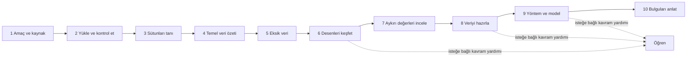
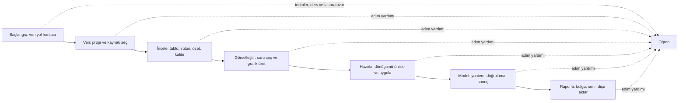

# Veri Ufku: mevcut ve önerilen çalışma şeması

Bu belge iki şeyi birbirinden ayırır: **mevcut arayüzde izlenen yol** ve
kullanıcının tarif ettiği **hedef kullanıcı yolculuğu**. Hedef şema tasarım
önerisidir; tabloda “mevcut” diye işaretlenmeyen bir düzeni uygulamada varmış
gibi anlatmaz. Bu belge yöntemlerin tamamının her veri türünde kullanılabildiği
anlamına da gelmez: bir işlemin kullanılabilirliği veri şeması, kaynak adaptörü
ve isteğe bağlı bağımlılığa bağlıdır.

## 1. Bugünkü uygulamanın çalışma düzeni

### 1.1 Ana gezinme ve yol haritası

Mevcut kabukta kullanıcı sekiz ana alana gider. Sol taraftaki on adımlı şerit,
bu alanların üstünde bir öğrenme ve iş sırası sunar. Şerit zorunlu sihirbaz
değildir; kullanıcı adımlar arasında serbestçe geçebilir. Bazı adımlar aynı ana
alanın farklı panelini açar.

| Ana alan | İçindeki işler |
|---|---|
| **Başlangıç** | Amaç ve proje alanı; yerel dosya, örnek veri veya Verilerim yoluna giriş; ilk kullanım turu atlanabilir. |
| **Veriyi tanı** | Kaynak içe aktarma, tablo, sütunlar, özet/profil, kalite ve eksik veri panelleri. |
| **Veriyi hazırla** | Aykırı değer adayları, temizlik ve dönüşüm önizlemesi, onaylanmış değişikliği yeni veri sürümüne uygulama. |
| **Desenleri keşfet** | Grafik galerisi, amaca göre grafik önerileri, grafik ayarları ve sonuç notu. |
| **Farkları karşılaştır** | Karşılaştırma araçları ve ilgili analiz yüzeyleri. |
| **Model kur** | Yöntem/özellik/hedef seçimi, doğrulama planı, model veya baseline çalıştırma ve test kullanım denetimi. |
| **Bulguları paylaş** | Yerel rapor, veri dışa aktarma, bilimsel rapor oluşturucu ve proje kaydı. |
| **Öğren** | Ders/kavram içeriği ve çalışma adımlarına bağlı yardım. |

On adımın bugünkü ana alan eşlemesi şöyledir:

Adım şeridinde 3–5. adımlar **Veriyi tanı** alanının; 7–8. adımlar **Veriyi
hazırla** alanının panellerini açar. 6. adım **Desenleri keşfet** alanına, 9.
adım **Model kur** alanına, 10. adım **Bulguları paylaş** alanına gider.

### 1.2 Bugünkü uçtan uca iş akışı

| Adım / başlık | Kullanıcının yaptığı işlemler | Sonuç ve koruma |
|---|---|---|
| **Başlangıç: amaç ve proje** | Amaç kartından çalışma niyetini seçer; yeni proje açar/oluşturur veya mevcut projeye gider. Başlangıç turunu kapatabilir. | Amaç yön gösterir, kullanıcıyı zorunlu bir sihirbaza kilitlemez. |
| **Veri: kaynak ve proje** | Proje klasörü seçer; yerel dosya seçer, sürükleyip bırakır veya uygun veri klasörünü açar. Çevrimdışı örnek kataloğunu ve **Verilerim** kütüphanesini kullanabilir. Uygun adaptör varsa gelişmiş panelden veri tabanı, HTTP/API veya nesne kaynağı gibi bağlantılara geçer. | Proje veri dosyasının kendisi değildir: kaynak ve projedeki çalışma sürümü ilişkilendirilir. Kaynak dosyanın üstüne yazılmaz. Adaptör/bağımlılık yoksa kaynak kullanılabilir görünmemelidir. |
| **Yükle ve kontrol et** | Biçim algılanır; örnek satırlar ve sütun türleri önizlenir. CSV/TSV için ayraç, kodlama, başlık satırı, ondalık/binlik, null işaretleri, tarih biçimi/saat dilimi ve bozuk satır politikası ayarlanabilir. İçe aktarım iptal edilebilir; kullanıcı **İçe aktar ve projeye kaydet** eylemini başlatır. | Kabul edilen veri, proje çalışma alanına kaydedilir. Hatalar ve önizleme uyarıları gösterilir; otomatik kaynak değişikliği yapılmaz. |
| **Sütunları tanı / tablo** | Satırları sayfalı tabloda inceler; sütun adı, türü, rolü ve açıklamasına bakar; kayıt/sütun seçer. Filtre ve sıralama görünümünü kullanır. | Görünüm filtresi tek başına veri dönüşümü veya yeni veri sürümü değildir. Kayıt kimlikleri seçim ve inceleme boyunca korunur. |
| **Temel veri özeti** | Satır/sütun, tip, benzersiz değer, özet ölçüler, dağılım ve uygun olduğunda korelasyon/profil sonuçlarını inceler. | Özetler seçili veri sürümü ve kapsamına aittir. Korelasyon nedensel etki olarak yorumlanmaz. |
| **Eksik veri / kalite** | Null/NaN sayı ve oranlarını inceler; eksik kayıt/sütun çıkarmanın etkisini önizler. Kalite uyarılarını ve ihlal örneklerini kontrol eder. | Etki paneli karar vermez. Veri silme/atama gibi değişiklik için **Hazırla** adımında ayrıca önizleme ve uygulama gerekir. |
| **Desenleri keşfet / grafik** | Bir veri sürümü seçer; grafik türü veya araştırma sorusu arar; x/y, grup, kategori sırası, örnekleme, bin, agregasyon ve kapsamı ayarlar; grafiği açıkça oluşturur. Sonucu, n/kapsam uyarılarını ve dışlanan kayıt sayılarını inceler. Nokta seçimi ilgili RowId kayıtlarını işaretleyebilir; grafik notu eklenebilir. | Grafik, veri sürümünü değiştirmez. Grafik ayarı, kullanılan kapsam ve sonuç kaydı grafiğe bağlanır. Galeri, grafik türüne ek olarak “dağılımı incele / grupları karşılaştır / ilişki ara / zamanı incele / eksikleri incele” sorularıyla aranabilir. |
| **Aykırı değerleri incele** | Sütun seçip IQR, dayanıklı z ve klasik z yöntemlerinin ürettiği adayları karşılaştırır; aday kayıtları grafikte seçilmiş RowId'lerle birlikte görür. | Aykırı aday otomatik olarak hata sayılmaz; otomatik silme veya winsorize yapılmaz. Karar **Hazırla** aşamasına bırakılır. |
| **Veriyi hazırla** | Sütunu yeniden adlandırır/çıkarır, görünüm filtrelerini veriye uygular; temizlik seçeneklerini veya yeni kolon/tablo dönüşümlerini açar. Mevcut paneller; hesaplanmış kolon, metin bölme/birleştirme, tarih parçası, gruplama/toplulaştırma, pivot/unpivot, append, anahtarla join ve mekânsal işlemler gibi dönüşümler sunar. Önce etki/şema/örnek önizlemesini inceler, sonra **Uygula ve projeye kaydet** der. | Uygulanan işlem yeni çalışma sürümü ve geçmiş girdisi üretir; kaynak dosya korunur. Önizleme olmadan sessiz kalıcı dönüşüm yapılmaz; iptal ve işlem durumu gösterilir. |
| **Model kur** | Problem türünü, hedefi, özellikleri ve yöntem adayını seçer; veri bölme/validation planını belirler; baseline veya desteklenen modeli çalıştırır. Metrik, tanı ve uyarıları inceler. Final test ayrı açık eylemdir. | Yöntem seçimi kullanıcıdadır; hedef veya izin olmadan otomatik fit yoktur. Train/test sızıntısı ve test kullanım defteri model yolunun parçasıdır. |
| **Bulguları paylaş / proje** | Veri dışa aktarma biçimini ve kaydetme konumunu seçer; format kaybı/güvenlik bilgisini inceleyip onaylar. HTML/PDF raporu, rapor başlığı/amacı ve bilimsel rapor bölümlerini düzenler. Projeyi kaydeder. | Dışa aktarma yeni hedef dosyaya yapılır; var olan kaynağın üstüne sessiz yazılmaz. Rapor kayıtlı sürüm, grafik, analiz, not ve sınırlamalarla ilişkilidir. |
| **Öğren** | Yol haritasındaki kavram yardımını açar; terim ve konu anlatımlarına gider. | Okuma isteğe bağlıdır; öğrenme penceresini kapatmak çalışma akışını durdurmaz veya veriyi değiştirmez. |

### 1.3 Mevcut grafik kataloğu

Grafik seçicisinde aşağıdaki aileler ve türler bulunur. Bu, her grafiğin her
tabloya uygulanacağı veya tüm yöntemlerin her durumda kullanılabilir olduğu
iddiası değildir. Galeri, giriş şemasını ve kullanılabilirlik durumunu gösterir;
çok boyutlu dizi ve coğrafi grafiklerde ilgili kaynak/koordinat/ölçüm alanları
gerekir.

| Soru / aile | Mevcut grafikler | Ne gösterir / ne zaman kullanılır |
|---|---|---|
| **Dağılım ve veri kalitesi** | Histogram, kutu grafiği, violin, KDE, ECDF, rug, strip, swarm, QQ, PP, eksik oranı, eksiklik desenleri | Tek değişkenin sıklık/yoğunluk/birikimli dağılımını, gruptaki gözlemleri veya dağılımın referansla uyumunu inceler. KDE/yoğunluk sayım değildir; swarm büyük örneklemde sınırlandırılır. |
| **Grupları ve zamanı karşılaştır** | Sütun, çizgi, stacked bar, %100 stacked bar, stacked area, %100 stacked area, dot, lollipop, error bar (SD/SE/CI), CI band, waterfall, Pareto, funnel, takvim heatmap | Kategori, sıralı zaman, kümülatif değişim, aşama veya belirsizlik karşılaştırması. Payda, kişi/olay birimi ve error-bar anlamı seçime bağlıdır. |
| **İki veya çok değişken arasındaki ilişki** | Dağılım grafiği, korelasyon ısı haritası, pair/scatter matrix, hexbin, 2D density, bubble, gruplu heatmap, clustered heatmap, parallel coordinates, facet/small multiples, conditional relation | İkili/çoklu ilişkiyi, yoğun noktaları, gruplara göre desenleri ve koşullu ilişkileri inceler. Çok sütun/panel ve büyük n için maliyet/örnekleme sınırları vardır. |
| **Hiyerarşi ve akış** | Treemap, sunburst, Sankey, alluvial | İç içe kategorilerin toplamını veya aşamalar/varlıklar arasındaki akışı gösterir. Double counting, cycle, dengesiz akış ve negatif değerler ilgili türe göre kontrol edilir. |
| **Bileşim ve ileri seçenek** | Pie, donut (ikisi de en fazla 6 kategori seçeneğiyle); gelişmiş radar | Az kategorili, doğru toplam paydalı parça-bütün karşılaştırması. Radar birimleri normalleştirmeden aynı eksene koymaz; dot/parallel coordinates daha açık alternatiflerdir. |
| **Çok boyutlu dizi** | Array 2D heatmap, array profile çizgisi | Seçilmiş koordinat/kesit üzerindeki raster/array ölçümünü veya profilini gösterir; boyut seçimi ve tablosal açılım maliyeti önemlidir. |
| **Coğrafi** | Nokta haritası (offline), choropleth (sayım/oran), yoğunluk grid haritası, GeoTIFF raster kesiti | Koordinat/geometri veya raster üzerinden mekânsal desen. CRS, payda ve harita sınıfları görünür olmalıdır; coğrafi derece doğrudan metre değildir. |

Grafik ayarlarında, türe göre x/y/grup/ölçüm, kapsam, örnekleme, kategori sırası,
bin sayısı, korelasyon, agregasyon, composition, harita ve ileri seçenekler
bulunur. Null/NaN/sonsuz sayısal değerler ilgili grafikte dışlanan kayıt olarak
sayılır; eksik değerleri sessizce sıfıra çevirme kuralı değildir. Başlık ve
eksen düzenlemeleri analitik veriyi değiştirmez.

## 2. Olması gereken kullanıcı şeması

Hedefte kullanıcı önce **Başlangıç** sayfasındaki yol haritasını görür. İlk
girişte görünüm başlangıç düzeyindedir: tek bir sonraki adım, sade açıklama,
küçük bir örnek ve “bu adımda ne yapacağım?” sorusu öne çıkar. Kullanıcı
okumadan doğrudan işlem yapabilir; hiçbir ders veya sınav zorunlu değildir.

### 2.1 Hedef ana başlıklar ve alt işlemler

| Hedef başlık | Kullanıcıya gösterilecek işler | Bitiş ölçütü / güvenli davranış |
|---|---|---|
| **Başlangıç — yol haritası** | “Veri nereden gelir, nasıl incelenir, nasıl hazırlanır, nasıl analiz edilir ve nasıl raporlanır?” yolunu göster. Her düğüm ilgili ekrana götürsün. Yolun altında **Proje ekle / Yeni proje / Proje aç / Son projeler** alanı olsun. Proje açıkken **Kaydet** eylemi aynı alanda ve üst çubukta erişilebilir kalsın. | İlk kullanım basit görünümle açılsın. Proje kaydetme henüz proje yoksa açıklamalı biçimde devre dışı olsun; veri kaynağı seçmek, proje kaydıyla karıştırılmasın. |
| **Veri — proje ve kaynak** | Proje klasörünü seç/oluştur/aç; dosya veya desteklenen dataset klasörünü ekle; çevrimdışı örnek ya da Verilerim’den seç. Gelişmiş görünümde destekli DB/HTTP/nesne/dizi/geo adaptörlerini aç. Dosya türü, tablo/şema, kaynak sürümü, erişim ve gizlilik uyarısını göster. | Kaynak seçimi ile projede çalışılan kopya/snapshot ayrımı baştan açık olsun. Bağlantı veya ağ çağrısı kullanıcı tarafından başlatılsın. |
| **İncele — veriyi anla** | Tablo, sütun türü/rol/açıklama, satır ve sütun sayısı, profil/özet, kategoriler, eksik desenleri, kalite sözleşmesi ve aykırı adaylarını tek inceleme bağlamında sun. Filtre/kapsamı her sonuçta göster. | Sıfır, boş metin ve null ayrı gösterilsin. Sıralama/filtreleme yalnız görünüm olsun. Silme/düzeltme kararı verilmesin. |
| **Görselleştir — soruyu yanıtla** | Galeriyi türden veya sorudan arat; “dağılım nasıl?”, “gruplar nasıl ayrılıyor?”, “zaman içinde ne oluyor?”, “ilişki var mı?”, “eksikler nerede?”, “akış/hiyerarşi nasıl?” girişlerinden uygun grafiğe yönel. Yukarıdaki grafik katalog gruplarını kullan. Türe göre kolon/ölçüm, grup, örneklem ve ölçek alanlarını göster. | Her grafik n, kapsam, dışlanan kayıt ve yöntem ayarlarını kaydetsin. Seçim “yalnız görünümde seç” mi, “seçilileri yeni dataset yap” mı açıkça sorulsun; grafik kaynak veriyi değiştirmesin. |
| **Hazırla — açık veri dönüşümü** | Eksik/aykırı işleme, tür ve kolon işlemleri, kodlama/ölçekleme gibi destekli hazırlıkları; hesaplanmış kolon, filtre, pivot/unpivot, append/join ve uygun mekânsal/dizi dönüşümlerini düzenle. Önce önce/sonra tablo, etkilenen satır/hücre ve şema farkını göster. | Kullanıcı onayından sonra yeni DatasetVersion üret. Kaynak ve önceki sürümler korunur; veri sessizce düzeltilmez. Makine öğrenmesi preprocessing'i CV fold içinde fit edilir. |
| **Model — yöntem ve değerlendirme** | Hedef/özellik/analiz birimi, yöntem adayı, split/validation planı, metriğin anlamı ve maliyeti seç. Baseline ile aynı protokolde karşılaştır; tanı/uyarı, belirsizlik ve model kartını göster. | Train/validation/test ayrımını koru. Teste bakarak model veya eşik arama yok. Bir yöntem veya bağımlılık desteklenmiyorsa “kullanılamıyor” göster; sahte sonuç üretme. |
| **Raporla — bulguyu paylaş** | Veri/sürüm, yöntem, varsayım, grafik/tablo, belirsizlik/diagnostic, sonuç ve sınırlamayı bölümlere ekle. Önizleme, redaction ve çıktı biçimi seç; HTML/PDF ve diğer yalnız doğrulanmış dışa aktarımları ayrı göster. Projeyi kaydet. | Rapor her sonucu gerçek kaynak/run'a bağlasın; eski sürüm raporu stale işaretlensin. Secret/PII ve format kaybı önizlemesi olsun. |
| **Öğren — isteğe bağlı derinleşme** | Aynı yol haritasını kavram haritası olarak aç; sözlük, arama, favori, adım dersi, örnek veriyle gerçek hesap yapan laboratuvar ve isteğe bağlı kendini kontrol içer. Her derste amaç, veri, varsayım, yanlış yorum ve “kendi verime nasıl uygularım?” bulunsun. | İlerleme yerel ve isteğe bağlı tutulur. Örnek workspace kullanıcının projesinden ayrı kalır. Kullanıcı okumadan her araca ulaşabilir. |
| **Gelişmiş görünüm — uzman çalışma alanı** | Aynı proje ve veri sürümü üzerinde ek yöntem parametreleri, ileri model aileleri, DAG/workflow, validation ve kaynak/bütçe kontrollerine doğrudan erişim. | Ayrı veri kopyası veya ikinci kayıt sistemi oluşturmaz; aynı provenance, kaynak kimliği ve güvenli işlem kuralları korunur. Başlangıç düzeyine dönüş proje/veri durumunu silmez. |

### 2.2 Görselleştirme sayfasının önerilen düzeni

Grafikleri uzun ve karışık bir tek liste yerine kullanıcının sorusuna göre
başlıklandır. Arama kutusu hem adla hem soruyla eşleşsin; her kartta gerekli
girdi şeması, hazır/uygun değil durumu ve kısa “ne zaman kullanılır?” yardımı
bulunsun.

1. **Dağılım ve eksikler:** histogram, kutu, violin, KDE, ECDF, rug, strip,
   swarm, QQ/PP, eksik oranı ve eksiklik desenleri.
2. **Karşılaştırma ve zaman:** sütun/çizgi, dot/lollipop, hata çubuğu ve CI
   bandı, stacked/%100 stacked bar/area, waterfall, Pareto, funnel, takvim
   heatmap.
3. **İlişki ve çok değişken:** scatter, korelasyon, pair plot, hexbin, 2D
   density, bubble, grouped/clustered heatmap, parallel coordinates, facet ve
   koşullu ilişki.
4. **Hiyerarşi ve akış:** treemap, sunburst, Sankey ve alluvial.
5. **Dizi ve coğrafya:** array ısı haritası/profili; nokta, choropleth, grid
   yoğunluk ve raster kesiti.
6. **Gelişmiş/uygun olduğunda:** az kategorili pie/donut ve açıklamalı radar.

Grafik ayarları gerektiğinde sağ panelde kademeli açılsın: önce gerekli
kolonlar, sonra grup/ölçek/örneklem, en son ileri ayarlar. Payda, log eksende
dışarıda kalacak değerler, kategori sırası, örnekleme ve güven aralığının türü
grafiğin yanında görünür olsun.

## 3. Önerilen bilgi mimarisi ile bugünkü durum arasındaki fark

| Konu | Bugünkü düzen | Hedef düzen |
|---|---|---|
| Navigasyon | 8 ana bölüm + bunlarla eşlenmiş 10 adımlı şerit. | Başlangıç kullanıcısına tek anlaşılır Veri→İncele→Görselleştir→Hazırla→Model→Raporla yolu; Öğren haritaya bağlı. |
| Başlangıç sayfası | Amaç, tur ve proje/veri girişleri mevcut; on adımlı yol haritası ayrı şeritte de görünür. | Yol haritası ana içerik; proje ekle/aç/son projeler/kaydet alanı sayfanın sonunda. |
| İçerik yoğunluğu | Ana alanlarda çok sayıda araç ve bazı ileri paneller bulunur. | Başlangıçta yalnız o adım için gereken alanlar; ileri seçenekler açıklamayla açılır. |
| Grafikler | 50 tür seçeneği ve soru galerisi tek inceleme alanında; özel seçenek panelleri tür aralığına göre açılır. | Türler soru/aile gruplarıyla aranır; gereksinimi karşılamayan grafik hazır gibi görünmez. |
| Öğrenme | Ders ve terim yardımı bulunur; kullanıcı çalışmadan da araca geçebilir. | Aynı yolun kavram haritası, sözlük ve kontrollü laboratuvarları aynı terimlerle bağlanır. |
| Uzman kullanımı | Gelişmiş görünüm ve mevcut ileri paneller korunur. | Başlangıç görünümünden ayrı yetenek seti yaratmadan aynı veri/provenance üzerinde ayrıntı açar. |

## 4. Tasarım ilkeleri

- **Proje**, kaynak dosya, **DatasetVersion** ve rapor/model çıktısı farklı
  varlıklardır; arayüz bunları tek “dosya” gibi göstermemelidir.
- Her veri değiştiren eylem: **önizle → etkiyi incele → onayla → yeni sürüm**
  sırasını izler. Kaynak dosya korunur.
- Her inceleme ve grafik, kullandığı veri sürümü, filtre/kapsam, örneklem ve
  yöntemi gösterir.
- Başlangıç düzeyi açıklamalar kısa, somut ve isteğe bağlıdır. Uzman terimleri
  saklanmaz; seçildiğinde açıklanır.
- Sonuçları açıklayan grafik veya model uyarısı, yalnız Öğren sayfasına
  taşınmaz; ilgili sonucun yanında kalır.
- Öneri bölümü ürün düzeni önerisidir. İnsan yeni başlayan/uzman kullanıcı
  gösterimi ve erişilebilirlik kabulü yapılmış sayılmaz.

## 5. Kaynak eşlemesi

Mevcut arayüz eşlemesini doğrulamak için başlıca dosyalar: [ana kabuk](../src/veri_ufku/ui/qml/Main.qml),
[aşama kimlikleri](../src/veri_ufku/ui/qml/UxStages.js), [içe aktarma](../src/veri_ufku/ui/qml/ImportPanel.qml),
[veri kütüphanesi](../src/veri_ufku/ui/qml/DataLibraryPanel.qml), [grafik galerisi](../src/veri_ufku/ui/qml/ChartPanel.qml),
[işlem ve önizleme](../src/veri_ufku/ui/qml/OperationsPanel.qml), [model doğrulama](../src/veri_ufku/ui/qml/ValidationPanel.qml),
[rapor ve dışa aktarma](../src/veri_ufku/ui/qml/ReportPanel.qml), [öğrenme aşama metinleri](../src/veri_ufku/learning/content/ux_v2_stages.json).

