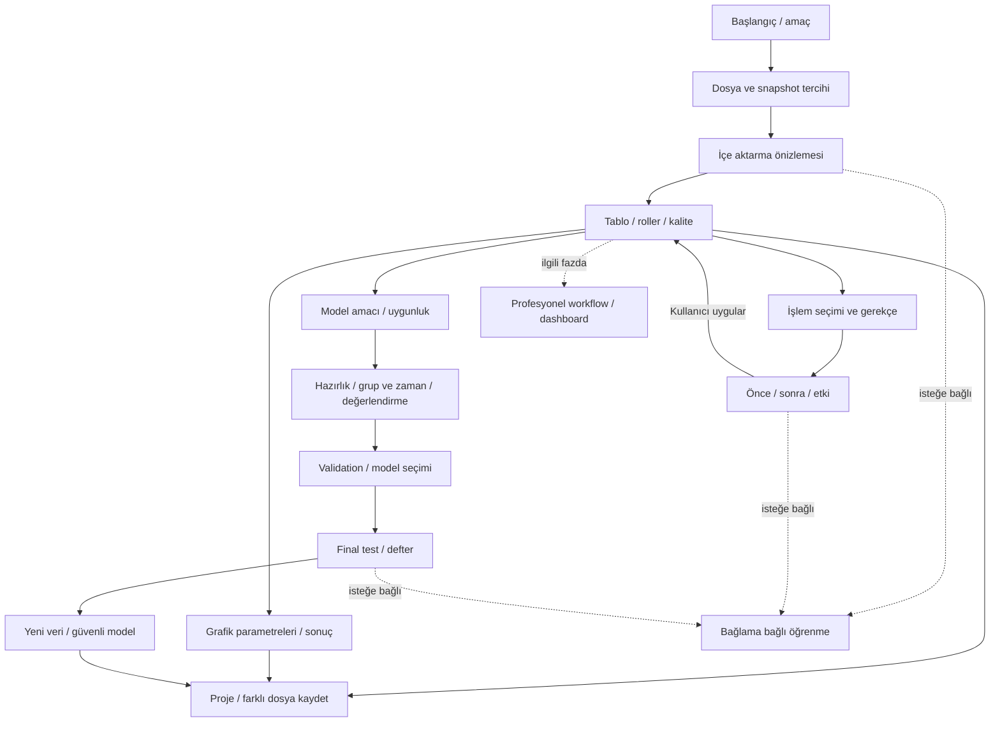

# Veri_Ufku — ekran haritası ve kullanım akışı

2026-10-10 veri ekranı devam düzenlemesi: sütun özeti tablosunda oklarla
seçilen satır, özet istatistiklerde seçilen hücre vurgulanır ve görünür alana
kaydırılır. Enter/Space seçilen sütunun değerlerini açar; Tab tablodan çıkar.
Boş tabloda açma işlemi yapılmaz. [Gerçek kontrol](evidence/UI_DATA_INSPECTION.md#udi-continuation).

Faz00 ekran planı ve Faz00–13 uygulanmış akışları aşağıda kayıtlı. Import → profil → kalite → seçilmiş temizlik → grafik → export/rapor gerçek GUI yoludur; istatistik, model hazırlığı ve baseline gerçek GUI yollarıdır; sonraki estimator/tahmin gelecek kapsamdır. Geliştirici walkthrough'u gerçek kullanıcı testi değildir. [Ürün senaryoları](PRODUCT.md), [brief](UI_DESIGN_BRIEF.md), [sistem](DESIGN_SYSTEM.md), [referanslar](UI_REFERENCES.md), [üç prototip](prototypes/triptych.svg).

Gri/gelecek dal gerçek uygulamada henüz nav'a eklenmez. Diagram Faz00 planıdır; eğitim veya tahmin çalıştığı iddiası yok.

## Ekran sorumlulukları

| ID / ekran / faz | Kullanıcının sorusu ve ana eylem | Görünür bağlam / hata / geri dönüş |
|---|---|---|
| SCR-01 Başlangıç/amaç, 02 | “Ne yapmak istiyorsunuz?” amaç kartları, Dosya aç | Son projeler yerel, örnekler; olmayan amaç yolu etiketli veya gizli; seçimi dosya/proje durumunu silmez |
| SCR-02 Import preview, 05–06 | “Dosya doğru okunuyor mu?” ayarları kontrol et→İçe aktar | 200 kayıt sınırlı örnek, delimiter/encoding/date/decimal/null, role, snapshot zamanı, kopya+disk tercihi; kaynak değişiminde tekrar preview; hata/karantina kararı |
| SCR-03 Tablo/kalite, 07–08 | “Verim ne içeriyor?” sütun seç→incele | version/filter/full-sample badge, profile/quality/gerekçe, column_id rol; bozuk kayıtları saklama raporu; salt okunur; undo geçmişi |
| SCR-04 Önce/sonra, 09–11 | “Neyi değiştirecek?” seç→önizle→Uygula | aynı RowId, changed/dropped/new null, olası precision loss, maliyet; iptal hiçbir sürümü publish etmez |
| SCR-05 Grafik, 12 | “Nasıl görünür?” grafik seç→Oluştur | axes/unit/bins/filter/scope/version, downsample/Diğer sayısı; zoom/reset/select; PNG/SVG; görünüş ayarı analitik state'i değiştirmez |
| SCR-06 Analiz/model, 14–20 | “Hangi soru/yöntem, sonuç ne anlatıyor?” uygunluk→Çalıştır | params/result/diagnostics, n/exclusions/assumptions, model split/test ledger; destek yoksa ret; geniş seçenekler uzman panelinde |
| SCR-07 Öğren, 03+ | “Bu ne işe yarar?” Özet/örnek/uygun değil/yorum | panel isteğe bağlı, close işe dokunmaz; örnek sandbox, içerik sürümü; yöntem yoksa yardım çalışıyormuş göstermez |
| SCR-08 Workflow/dashboard, 39/64 | “İşlem ve görünümü nasıl düzenlerim?” profesyonel typed DAG/layout | mevcut service/spec/version yeniden kullanır; başlanmadı; erken boş düğme yok |

## Üç yolun state ve geri dönüşleri

US-01 (PRODUCT): SCR01→02→03→05→save; kullanıcı çizmeden sadece tabloda/profilde kalabilir. Preview “Geri” import ayarlarını saklar; dosya değiştirme yeni snapshot/ayar doğrulaması ister. Import başarısı publication sonrası; job cancel son sağlam projeyi korur.

US-02: SCR01→02→03→04→03→save. Öneri metni gerekçe ve etkiyi söyler. Preview cancel aktif veriye dokunmaz. Uygulama hata verirse aynı tarifi düzeltmeye dönülür; undo eski sürüme, history eski dalı korur. Genel learned doldurma model risk bayrağıyla kayıtlıdır.

US-03: SCR01→02→03→06(uygunluk/hazırlık/split)→validation→final test→yeni dosya eşleme→save. Tahmin anındaki bilgi/hedef ufku/grup kullanım amacı sorulmadan uygun split tamamlandı sayılmaz. Final test açık eylem ve defter; geçersiz plan işi durdurur. Model bulunamadığında fake metric/chart yok.

Başlangıç→uzman yalnız visibility/layout tercihidir. Ortak project/session config_revision ve dataset_version aynı; parametre editleri job başladığında sabitlenir. Geçiş scroll/selection/draft/result_ref'i korur. Öğren paneli ayrı presentation state. Navigasyon dirty parametreyi kaybetmez, veri kaybı riski varsa anlaşılır karar gerekir.

## Temsilî tasarım kapısı

Dosya preview, tablo kalite ve analiz sonucu aynı tokenlarla tasarlandı: [SVG](prototypes/triptych.svg), [inceleme](DESIGN_REVIEW.md). Sonuç alanı hesaplanmış sayı içermez, açık “prototip / gerçek sonuç yok”. Faz02 bu taslakları gerçek tema/Qt ölçeğiyle yeniden değerlendirir; sorun kapatmadan diğer ekranlara yayılmaz. Statik prototip gerçek import/model kabulü değildir.

## Faz02 çalışan kabuk

Sekiz nav alanı yerleşimi gerçek Qt’de uygulanır; gelecek alanların merkezinde “Henüz mevcut değil” ve amaç açıklaması vardır. Başlangıçta veri açma/örnek kartları görünür fakat import hazır olmadığı için devre dışıdır; kısa amaç kartları aynı kullanılabilirlik ekranını açar. UI dosyaya dokunmaz.

Başlangıç/gelişmiş tercihi sunum state’idir: sonuç/hata/iptal iki görünümde ortak, teknik kimlik/config denemeleri yalnız gelişmişte. Tema/görünüm/yazı tercihi yeniden açılışta geri gelir. Sağ panel genişte dock, darda modal Drawer; Escape/kapama odağı açana döndürür. Nav Ctrl+1..8/oklar/Space, genel Tab/ShiftTab; uzun içerik klavye odağına kaydırılır. [Gerçek ekran/Qt kanıtı](evidence/PHASE02.md).

## Faz03 gerçek öğrenme akışı

Öğren ekranı çevrimdışı Türkçe arama, kategori ve dokuz kavramlık sözlük sunar. Makale seçimi sağ bilgi panelini açar; özet/örnek/rehber seçimi aynı makaleyi okutur. Kritik uyarı her derinlikte ve gelişmiş görünümde katlanmadan kalır. Panel kapanması mevcut işi/sonucu/aramayı değiştirmez. İsteğe bağlı okundu/yer imi kaydı varsayılan kapalı ve yalnız açık kullanıcı eylemiyle yereldir. Uygulamada dene yalnız yardım araması için bağımsız geçici örnek öğrenme projesini açar; veri/model denemesi sunmaz. [Sözleşme](LEARNING_CONTENT.md).

## Faz04 gerçek proje akışı

Başlangıçtaki Projen kartı Yeni proje/Proje aç/Kaydet/Farklı kaydet/Projeyi kapat ve son projeleri sunar. Yeni hedef mevcut olmayan dizindir; mevcut hedefler korunur. Proje adı, isteğe bağlı seed, kaynak referansı/taşınabilir kopya açıklaması, dosya seçimi ve yeniden bağlama aynı karttadır. Kaynak durumu ile sonuçların veri sürümü görünürdür. Metadata açılışı yeniden işlem yapmaz. Kapanış dirty kararını açık sorar; otomatik kurtarma kaydını yükleme ekrandaki draft yerine geçmeden karar ister. I/O sürerken kayıt kontrolleri ve kapanış bekler, Qt olayları devam eder. İkinci örnek salt okunur, eski kilit kurtarma açık eylemdir. F1 proje/kaynak/kurtarma rehberini açar. [Kanıt](evidence/PHASE04.md).

## Faz05 uygulama bağı

Faz05 Veri ekranında Dosya seç/yerel tek dosya DropArea, algılama önerisi ve düzenlenebilir bütün import ayarları vardır. Önizleme200 kayıtla sınırlı sanal tablo; sütun türünü kullanıcı seçer. Bozuk kayıt Durdur/Raporlu karantina; kaynak kopyası zamanı/SHA256 ve güncel kaynak için yeniden seçim açıklaması açık. İçe aktar ve projeye kaydet draft değişikliklerini de kaydeder; tamamlanma sonrası dataset sürümü/kayıt ve karantina sayısı görünür. İptal ve aktif görevde proje geçişi engeli vardır. Dar/%200 ekranda tek sütun/sarılan düğmeler; tablo yatay/dikey kayar. [Kanıt](evidence/PHASE05.md).

## Faz06 import

Veri ekranı tüm altı adaptörü alır; format elle düzeltilebilir. JSON path/flatten ve liste açma ayrı; kartesyen büyüme önizlemede. Excel sayfa/aralık/başlık ve merged/blank/formula/date politikası görünür. Parquet tür değiştirme kapalı, native types öneri yanında görünür. Aynı kopyayı önizle; türleri sıfırla; iptal ve projeye kaydet ortak. [Kanıt](evidence/PHASE06.md#e06-gui).

## Faz07 katkısı

Faz07: Veri → Veri tablosu → Tabloyu aç/yenile. Sütun arama/gizle/seç; global sıralama ve en fazla8 AND filtre. Salt okunur, aktif filtre/kapsam ve200 kayıt sayfa görünür. Sütun detayında rol/birim/ordinal sıra/analiz birimi taslağa uygulanır; Projeyi kaydet kalıcıdır. Profil hedefi ve first10.000/tam seçimi açıktır; görünüm filtresi dataset’i değiştirmez. [Kanıt](evidence/PHASE07.md).

## Faz08 katkısı

Veri → Veri kalitesi → dataset/miktar/kapsam/amaç → isteğe bağlı seçili tekrar anahtarı ve kurallar → Kaliteyi tara. Bulgu gerekçesi, sayım/oran, örnek, seçenek ve yardım aynı kartta; aday/gözlem/ihlal metinle ayrılır. Raporu proje taslağına ekle → Projeyi kaydet; yeniden açıldığında aynı sürümün raporu görünür. [Karar](adr/011-quality-phase08.md), [kanıt](evidence/PHASE08.md).

## Faz09 gerçek işlem akışı

Hazırla → dataset/rename/drop/filter → Önizle → tam veri etki sayısı, önce/sonra şema ve first200 tablo → Uygula ve projeye kaydet. Kalıcı filtre koşulları Veri tablosunda hazırlanır; görünüm sıralaması kalıcı filtre hesabına karışmaz. Geçmişte Geri al/Yinele veya adımın öncesine dön; yeni işlem eski dalı korur, redo zinciri temizlenir. Sonuçların veri sürümü ve “güncel değil” etiketi aynı ekrandadır. Kaynak farkı/önizleme/geçmiş yardımı bağlamlıdır. [Karar](adr/012-versioned-operations-phase09.md).

## Faz10 katkısı

Hazırla → Temizlik araçları → yöntem ve sütunlar → mevcut zincir veya ayrı kopya → Önizle → Uygula. Tam etki, şema, hata/yeni null ve uyarılar görünür. Tablolar/geçmiş ayrıntıları kullanıcı açar; undo/redo sürekli erişilebilir. Açık sıra/grup, dedup first/last, mod ve DST politikaları sessiz seçim yapmaz. Kullanıcı manuel testleri daha sonra toplamak istedi; otomatik faz kontrolleri sürer, manuel kabul yapılmış sayılmaz. [Karar](adr/013-cleaning-phase10.md), [kanıt](evidence/PHASE10.md).

## Faz11 katkısı

Hazırla → Yeni kolon / tablo dönüşümleri tek yöntem seçicisi; sadece seçili yöntem alanları. Join üç adım: anahtarlar, eşleşme/adlar, tam etki. Append öneri/alan düzeltme ve açık onay. İlk200 karşılaştırma/geçmiş isteğe bağlı; tam etki ve undo/redo görünür. Yeni kaynaklar Veri → Dosya içe aktarma içinde; SQLite tablo seçimi aynı sayfa seçicisiyle. [Karar](adr/014-transformations-phase11.md), [kanıt](evidence/PHASE11.md).

## Faz12 gerçek grafik ekranı

İncele ekranında grafik ayarlarını aç, tür/rol/amaç önerisini incele, kendin tür/alanları seç ve oluştur. Kapsam/filtre/veri sürümü sonuçta görünür. Ayarlar katlanabilir; grafik ve iptal/hata bilgisi korunur. Grafik üzerinde tıkla/sürükle seçimi veya yakınlaştırma modu, reset, yeni PNG/SVG ve projeye tarif/veri/üyelik kaydı vardır. Referans ayrıntılarını açınca kesin özet ve ilk400 grafik noktası (korelasyonda bütün≤400 çift r/n/hata) okunur. Her türün yardımı F1/ilgili düğmede. Kayıtlı grafiği aç formu geri yükler; eski sürüm/filtre güncel etiket almaz. Kaynak dosyası salt okunur. [Kanıt ve kapsam](evidence/PHASE12.md).

## Faz13 ilk akış

Başlangıç'ta Dosyamı anlamak istiyorum, kendi dosyası veya iki ayrı sentetik örnek proje. Altı adım seç/atla/geri/kapat; zorunlu ders yok. Profil/kalite kaydını ekle, istersen temizlik önizle/uygula, grafik oluştur, Rapor'da tür kaybını gör/veriyi veya HTML/PDF raporu yeni dosyaya kaydet. Projeyi kaydet geçmiş ve makbuzu korur. Veri sürümü/filtre/kapsam görünür; örnekler CC0 ve gerçek veri değildir. Bilgisiz kullanıcı görev testi henüz yapılmadı. [Kanıt](evidence/PHASE13.md).

Kullanıcı görsel düzeltmesi: sağ üstte yalnız tema ve başlangıç/gelişmiş simgeleri; yazı boyutu sabit. Eski ölçek kanıtları tarihsel kayıt olarak korunur; güncel doğrulama [UI_HEADER](evidence/UI_HEADER.md).

Sol menü görsel düzeltmesi: sekiz özgün ortak çizgi simgesi,184px menü,44px sola hizalı düğmeler; planlanan alan açıklaması kaldırıldı. [Gerçek Qt kanıtı](evidence/UI_NAVIGATION.md).

Koyu tema revizyonu: katmanlı antrasit yüzeyler, sıcak turuncu ana eylem/seçim ve sakin alan simge renkleri. [Teknik/görsel kayıt](evidence/UI_DARK_THEME.md).

Son kullanıcı talimatıyla yalnız turuncu vurgulu koyu tema; tema düğmesi kaldırıldı. Eski açık/sistem kayıtları uygulanmaz; sağ üst yalnız seviye simgeleri. [Güncel doğrulama](evidence/UI_DARK_ONLY.md).

Güncel tema: mor işlemler, mint öğren/yardım, turkuaz veri/grafik, turuncu ana dosya/kayıt; yalnız koyu tema. Logo sonraya bırakıldı. [Doğrulama](evidence/UI_MULTICOLOR.md).

## Faz14 — karşılaştırma akışı

Soru → çalışma tasarımı → ölçüm/grup/anahtar/birim → hipotez/yöntem → önkontrol → varsayım onayı → sonuç. Önkontrol veri yeterliliğini, grup sırasını, özetleri/kişi içi farkları, eksik dışlamalarını ve koşulları gösterir. Parametrik olmayan seçenekler hipotezleriyle adlandırılır. Sonuç geldiğinde form katlanır; ayarlar tekrar açılabilir. Eski filtre/veri/tarif sonucu etiketlenir, güncel önkontrol olmadan hesap başlatılamaz. Yöntem yardımı, altı temel kavram yardımı ve F1 bağlamı çevrimdışıdır. [Gerçek geliştirici GUI kanıtı](evidence/PHASE14.md); insan kullanılabilirlik kabulü değildir.

## Model hazırlığı — Faz15

Model → amaç/hedef/aile → özellikler/grup/zaman → geçmiş yolu ve gerçek kaynak → encoding/scaling/imputasyon/tarih/opsiyonel seçim → rapor → fit edilmemiş planı kaydet/aç. Rapordan sonra seçenekler katlanır; tekrar açılır. Kimlik adayları varsayılan özellik seçimine girmez; açık kabul ayrıca gerekir. Rapor tam kaynak ve henüz fit edilmedi bilgisini gösterir. Risk çözülmediyse blocked plan eğitim onayı değildir. Bağlamsal yardım/F1 model.prepare; [kanıt](evidence/PHASE15.md).

Başlangıç güncel akışı: Proje → Yeni proje/Farklı kaydet → Klasör seç → Proje oluştur/Kopyayı kaydet. Düzenlenebilir dizin yolu yok; yeni alt klasör adı çakışınca numara alır. Proje aç aynı temalı klasör penceresidir. Son projeler yalnız isim; iç yol açma için korunur. Kaynak/seed/kurtarma Proje ayrıntıları içinde. Rehber isteğe bağlı; başlangıç açıklamaları sadeleştirildi. [Kanıt](evidence/UI_HOME_COMPACT.md).

## Faz16

Model hazırlığı → bağımsız/grup/zaman/birleşik yapı → tahmin anı/saniye ufku/yeni varlık/özellik zamanı → validation/CV baseline çalıştır ve kaydet → sonuç/gerçek bölüm ve fold boyutları → seçim tamamlandı beyanı → final test ayrı değerlendir → proje geneli defter. Engelli protokol açıklanır; iptal/hata/eski sonuç güncel başarı değildir. Seed ve teknik kimlikler ayrıntı seçimiyle, kritik test uyarısı daima görünür. [Kanıt](evidence/PHASE16.md).

Faz17: sınırlı sayısal tahmin yolu, Faz15 hazırlığı ve Faz16 split/fold/defteri üstünde gerçek training-only estimator pipeline kullanır. Adaylar baseline/doğrusal/Ridge/RandomForest; seçim yalnız geliştirme CV MAE, final testte tek dondurulmuş aday. MAE/RMSE hedef birimi, R² negatif/sabit hedef sınırı, gerçek-tahmin/artık grafikleri (en fazla1000 örnek; metrik tam bölüm), dar ayar/maliyet sınırları ve test sonrası keşifsel yorum. Ayrıntılı sözleşme [ADR-020](adr/020-regression-phase17.md), gerçek kabul [PHASE17](evidence/PHASE17.md).

2026-10-08 kullanıcı arayüz düzenlemesi: Başlangıç yardım ve ara rehber/dosya/örnek satırları kaldırıldı; Veri bilimi yol haritası başlığı; üst gelişmiş yanında uygulama kapatma simgesi; son projeler yatay sarılan düğmeler. Bütün tik kutuları ortak oval UiCheckBox; tek FolderPicker geri/üst simgeleri ve üzerine yazmayan yeni klasör oluşturma. Örnek projeler Öğren ekranında aynı seçiciye bağlı. Faz/olgunluk/kapsam değişmedi. [Gerçek kontrol](evidence/UI_HOME_REFINEMENT.md).

2026-10-08 kullanıcı yol haritası düzenlemesi: Veri Bilimi Yol Haritası on numaralı kıvrılan aşama, açılabilir alt başlıklar ve yalnız etkileşim/ilk görünüş animasyonlarıyla sunulur. Genişte iki yana, darda tek sütuna yerleşir; alt yollar mevcut ekranlara bağlı, planlanan araçlar pasiftir. İçerik20/home.roadmap çevrimdışı yardım mevcut home makalesinde. Yeni faz veya analitik capability başlamadı. [Gerçek kayıt](evidence/UI_SCIENCE_ROADMAP.md).

### Öğren: aşama ve alt başlıklar (2026-10-09)

Öğren kataloğu Veri Bilimi Yol Haritası sırasıyla açılabilir aşama/alt başlıklar sunar. Her yayımlanan konu tek bir alt başlığa aittir; arama, kategori ve sözlük filtreleri eşleşen yolları açar. İçeriği olmayan başlıklar açıkça belirtilir, etkin konu gibi sunulmaz. Konu seçimi ortalanmış, dar ekrana uyarlanan kaydırılabilir okuma penceresi açar; Escape/kapat odağı konuya döndürür. F1 bağlamsal yardım akışı korunur.

2026-10-09 güncel kullanıcı düzenlemesi: Öğren başlığı ile “Merak ettiğin konuyu bul” arasındaki rehber/örnek alanı kaldırıldı. Öğren ekranında üst yardım düğmesi, sözlük, aramayı temizle ve okuma tercihini açma düğmeleri gösterilmez. Konular numaralı, renkli ve kademeli girintili açılır kartlardadır; arama/kategori korunur. Veri başlığı yalnız sağlanan Veri.md anlatımına ait tanım, tipler, yapı ve kullanım konularını içerir. Eski kaynak/içe aktarma/uygulama başlıkları bu ağaçta gösterilmez; ilgili ekranların bağlamsal yardımları korunur. Başlangıç sırası artık Veri Bilimi Yol Haritası → Proje/Son projeler. [Kanıt](evidence/UI_LEARNING_REFINEMENT.md).

2026-10-09 — Öğren açıklamalarında içerik kaynakları varsayılan kapalıdır. “İçerik kaynakları” düğmesiyle açılır; farklı veya aynı konu yeniden açıldığında kapanır. Veriyi Analiz Etme altında genel bakış ile Türkçe/İngilizce açıklayıcı, teşhis, tahmine dayalı, kuralcı ve keşifsel analiz başlıkları bulunur. Yeni anlatımlar kullanıcının sohbet metninden düzenlenmiştir; mevcut ilgili kavramlar uygun başlığın altında korunur. Kuralcı analiz öğrenme içeriğidir; başlangıç yol haritasındaki henüz geliştirilmeyen optimizasyon yolu etkinleştirilmez.

2026-10-09 — Ortak yol haritası: Başlangıç ve Öğren aynı ScienceRoadmap çizgisi/kartları/numaraları ve açılma düzenini kullanır. Başlangıç ana başlığı işlem ekranını açar; ayrı ok alt işlemleri açar. Alt işlem tıklaması ilgili ekran/tab/seçeneklere gider (temizlik, JOIN, dönüşüm, model hazırlığı, validation, regresyon); önizleme/uygulama/fit kendiliğinden başlamaz. Öğren ana başlığı alt başlıkları, alt başlık konu bağlantılarını açar; konu aynı çevrimdışı okuma penceresinde anlatılır. Başlangıçtan öğrenme açıklamasına yönlendiren eski adımlar işlem ekranlarına bağlandı. Planlanan araçlar Başlangıçta pasif; kavramın okunması araç yeteneği değildir. Proje bölümü yol haritasından sonra kalır.

2026-10-09 — Veri sayfası Veriyi projeye aktar kartıyla başlar; desteklenen yerel formatlar ve açık dosya seçimi bulunur. Dört Veri yol haritası alt başlığı aynı RoadmapSteps kaynağından sayfada sunulur. Veri tablosu sekmesinde Veri içeriği tam kayıt/sütun/kaynak/satır birimini ve kullanıcı açıklamalı sütun sözlüğünü; Veriyi oku ve incele altında gerçek tablo/filtre/profil araçlarını gösterir. Sütun seçimi açıklama formunu görünür alana getirir. Açıklama/rol/birim açıkça taslağa eklenir, Projeyi kaydet ile kalıcıdır. [Kontrol](evidence/UI_DATA_CONTENT.md).

## Faz18 kategori tahmini

Model sayfasında kategori hedefi ve özellikler hazırlıkta seçilir. Protokol, pozitif sınıf, averaging ve dar model ayarlarından sonra kategori adayları geliştirmede karşılaştırılır. İkili eşik yalnız validation üzerinde; çok sınıfta argmax kullanılır. Hata maliyeti metni,95 normal/5 sorunlu accuracy örneği ve kalibrasyon/saha güvenliği sınırı görünür. Kaynak dağılımı, değerlendirme matrisi, her sınıfın gerçek/tahmin sayısı ve sıfır bölme durumları azınlığı saklamaz. Final test ayrı kapsam başlığı/onayla; sınıf/eşik/model seçim geçmişi ve tekrar kullanım defteri gösterilir. Matris yatay kaydırılabilir, tam etiketler per-class satırlarında korunur; ROC/PR çizimi en fazla1000 gerçek nokta, AUC tam eşik kapsamında hesaplanır. [ADR-021](adr/021-classification-phase18.md), [gerçek teknik kayıt](evidence/PHASE18.md).

Faz19 GUI: Model → amaç Benzer kayıtları gruplamak / Sıra dışı kayıtları bulmak → ölçümleri açık seç → yöntem/ölçek/ayar → hesapla → profil/örnek/score/eşik ve yardım → tüm kayıtları koruyarak işaretli yeni dataset. Veri ekranından yeni dataset seçilir. İşaretli dataset silme değildir. Sonuç kaydı otomatik, kaynak korunur; kayıtlı sonucu aç form parametrelerini geri getirir.

Faz20: Model kartı ve yeni veriye uygulama panelinde koşunun güvenli modelini aç,
yeni paket kaydet veya haricî .vumodel aç. Yeni dosyayı Veri ekranında içe aktar,
yeni dataset seç, kolonları gerekirse açık eşle, reject/drop ve batch seç,
önizleme sayım/engellerini incele; yeni Parquet dosyasına tahmin aktar. Şema/birim
engellerinde açık dönüşüm/metadata sürümüne dönülür; mevcut dosya ezilmez. Beş F1
bağı model kartı/önem/unknown/yeni veri/belirsizlik. [ADR-023](adr/023-model-lifecycle-phase20.md).

Faz21 Model yol seçimi: Kayıt bazlı modelleme veya Zaman serisi. Zaman serisinde
tarih/ölçüm/grup, sıklık/IANA, açık resample ve toplam/ortalama, ufuk/final/dönem
seçimleri; minimum geçmiş/gap/duplicate reddi görünürdür. Geliştirme baseline
karşılaştırması ve geçmiş grafiği; ayrı kalıcı final açma eylemi ve kayıtlı koşu
açma. Yardım sıklık/mevsimsellik/lag/ufuk/doğrulama bağlarıyla çevrimdışıdır.

Faz22 Model → Yerel metin incelemesi: String kolon ve düzeltilebilir dil varsayımı,
NFC/NFKC/küçük harf/sayı/stopword/n-gram/vocab, opt-in ham önce/sonra ve ayrı
benzerlik. Frekans tablosu/sütun grafiği önce, TF-IDF ve benzerlik açıklamaları
sonra; sınıflandırma için Kayıt bazlı modelleme/Kategori hedefi/Metin TF-IDF.
Ham preview kaydedilmez; tekrar açıldığında onay kapalıdır.

## Faz23

Hazırla → kayıtlı sürüm zinciri seç veya JSON tarif aç → her kaynak ve kolon eşle → dry-run → her adım etki/hata → tüm akışı uygula. İzleme aç → eski/yeni seç → dağılımları karşılaştır. Sonradan hedef için son Modeli uygula çıktısı ve hedef sürümü/kimlik/kolon seç → yeni performans. Model → Modeli uygula veya Yeniden eğit (hazırlık/split ve ayrı eğitim eylemi). [ADR-026](adr/026-recipes-monitoring-phase23.md), [kanıt](evidence/PHASE23.md).

## Faz24

Hazırlama raporunda yaklaşık giriş/dense matris MiB, bellek bütçesi ve özellik daraltma/açık filtre önerisi görünür. İlerleme bilinmiyorsa aşama/sayı vardır, yüzde yok. RAM/disk hatası önceki proje korumasını ve düzeltme eylemini açıklar. İptal sonrası import yeniden önizlenir. [ADR-027](adr/027-performance-phase24.md), [kanıt](evidence/PHASE24.md).

## Faz25 denetimi

Görünüm ve dil simgesi / Ctrl+, temel İngilizce, tema ve yazı boyutunu açar.
Ayrıntılı Türkçe yardım ve bazı analiz metinlerinin sınırı görünürdür.
Ayarlar dosya parse seçimini değiştirmez. Tab/ShiftTab textarea ve boş
tablodan çıkar; dinamik tür seçimi odağı korur; gelişmiş görünüm yardım
panelini kaybettirmez. Gerçek insan/AT oturumları [plan](USER_TEST_PLAN.md),
teknik walkthrough [kanıt](evidence/PHASE25.md) içindedir.

## Faz26 kurtarma

Kurtarma kaydını yükle önce ad/zaman/veri/işlem/sonuç sayısını doğrulayıp
gösterir; kullanıcı yüklemeyi onaylar. Bozuk veya değişmiş önizleme yüklenmez.
Manuel kayıt korunur; taslak incelendikten sonra ayrı Kaydet seçilir.
Bağlamsal F1 project.recovery aynı açıklamayı taşır. [Kanıt](evidence/PHASE26.md).

2026-10-10 kullanıcı veri inceleme düzenlemesi: kapalı başlıklar, gerçek tüm-sütun tablosu, sayfalı unique, describe ve not sözlüğü. Öğren Veri aşamasına dört çevrimdışı konu eklendi (katalog36/151 makale). [Gerçek kapsam](evidence/UI_DATA_INSPECTION.md); Faz27 durdurulmuş olarak kalır.

2026-10-10 kullanıcı düzenlemesi: sayfa sağ üstündeki genel yardım düğmesi kaldırıldı; Öğren ve F1 erişimi korunur. Veri başlıkları numara/açıklama/açılma işaretli kartlardır. İçe aktarma önce dosya seçimi ve sınırlı önizleme sunar; yol/format/okuma ayarları/sütun türü/kopya ayrıntıları Gelişmiş içinde açılır. Proje yokken Proje oluştur / aç Başlangıç’a yönlendirir; açık projede bu düğme görünmez. Dosya seç/bırak, önizleme ve aktarım alanı proje durumundan bağımsız görünür; proje açılmadan dosya önizlenebilir, kalıcı aktarım düğmesi proje açılana kadar pasiftir. Hata/uyarı/iptal ve kayıt sonucu temel görünümde de gösterilir.

2026-10-10 kullanıcı Veri düzeltmesi: görev açıklama düğmesi kaldırıldı. Import yalnız ilk20 kaydı gösterir, kayıt işlemi bütün dosyayı alır. Veri profili açılınca tam veri özeti otomatik hesaplanır; örnek kapsam seçicisi/hesap düğmesi görünmez. Üstte yalnız sütun sayısı, tür özeti ve çalışma kopyasının disk boyutu; tabloda sütun başlığı ve gerçek tür bulunur. Sütun değerleri listesi başlıklı, şeritli ve tekrar rozetlidir. Hızlı ekran geçişinde100ms geciktirilen otomatik tarama başlamaz; başlamış otomatik tarama profil kapanınca iptal edilir. [Kanıt](evidence/UI_DATA_REFINEMENT.md).

2026-10-10: Veri profili eski beş sütunlu düzene döndü: Sütun/Veri türü/Dolu/Null/NaN. Üstte üç özet ve otomatik tam kapsam korunur. Eski metin kayıtlarında içerik türü kayıtlı türle birlikte açıkça gösterilir; yeniden import profil için zorunlu değildir. [Kanıt](evidence/UI_PROFILE_TYPES.md).

2026-10-10 son kullanıcı gösterim isteği: profil tablosu ve üst tür özetinde teknik tür adları (Int64/String/Decimal…) kullanılır. İçerik türü hücrede tek başına; farklı fiziksel kayıt türü tooltip içinde açıklanır. Veri dönüşümü yapılmaz. [Güncel kanıt](evidence/UI_PROFILE_TYPE_LABELS.md).

2026-10-10 son saklama talebi önceki içerik türü gösterimini geçersiz kıldı: profil yalnız gerçek physical_type gösterir; aktarımda Int64/Decimal fiziksel olarak saklanır. Titanic mevcut aktif sürümü kullanıcı izniyle mevcut convert operasyonu üzerinden dönüştürüldü; kaynak, satır kimlikleri ve geri alma geçmişi korunur. [Gerçek kayıt](evidence/UI_ACTUAL_STORAGE.md).

2026-10-10 profil tür özeti her fiziksel türü ayrı satırda sayı ve ilgili sütun adlarıyla gösterir: Int64:4 — sütunlar. Uzun adlar sarılır, plain text korunur. Kullanıcının data_info.png referansı gerçekten incelendi. [Kanıt](evidence/UI_PROFILE_TYPE_COLUMNS.md).

2026-10-10 kullanıcı kısa not isteği: Anlam ve notlar ayrı Veri başlığı olmaktan çıktı, profil tablosunun altına sütun seçimi/kısa açıklama/Notu kaydet alanı taşındı. Her sütunun taslağı seçimler arasında korunur; açık kayıt projeyi kalıcı kaydeder. applyDescription mevcut rol/birim/sıra/analiz birimi ve confirmed durumunu korur; yeni not role önerisini onaylamaz. Analitik profil onaylanmamış rolün yerine mevcut öneri politikasını kullanır. Kaynak/snapshot/RowId değişmez. [Kanıt](evidence/UI_PROFILE_NOTES.md).

2026-10-10 sade veri akışı: import Gelişmiş alanı tüm seviye tercihlerinde ve yeniden girişte kapalıdır; kullanıcı tıklayarak açar. Profil not girişinin üstünde yalnız açıklaması olan sütunlar ad/açıklama biçiminde kompakt, plain-text ve220px bounded listede görünür. Verini tanı altında inventory/describe/unique/sütun profili GUI çağrıları sample=false; ilk10.000 seçicileri kaldırıldı, tam veri hesabı ve200 değer görüntü sayfası ayrı tutulur. [Kanıt](evidence/UI_COMPACT_NOTES_FULL_DATA.md).

Faz30 Veri → Dataset klasörü seç mevcut import yolundadır. Gelişmiş altında HDF5 key/XML kayıt yolu/karakter genişlikleri ve kolon adları kullanıcı seçimi; strict/union çözüm önizlemesi, açık satır sınırı, kaynak format metadata ve isteğe bağlı ağırlık beyanı. Etiket ve missing/weight metadata veri kararı değildir. [Gerçek kanıt](evidence/PHASE30.md).

Faz31 Veri → Gelişmiş → Veritabanı/API/nesne depolama. Tür/sunucu/TLS ve
keyring referansı; veritabanında tablo/şema keşfi ayrı açık düğmedir.
Seçim/bağlı filtre/limit ve koşul onayından sonra Snapshot önizle → İçe aktar.
Gizli değer maskeli alandan keyring'e kaydedilir ve alan temizlenir; secret
metadata/URL'ye yazılmaz. Tazelik, API tek-an belirsizliği ve dar auth desteği
form/önizlemede görünür. F1/Escape ve iptal ortak yoldur.
[Gerçek teknik kanıt](evidence/PHASE31.md).

Faz32: Veri → Verini tanı → Veri sözlüğü, kalite sözleşmesi ve kimlik eşlemeyi
aç. Kolon formu seçili sütunun kurallarını form değerleriyle yeniden tanımlar;
karma dereceler/çoklu aynı-kind kurallar için declarative JSON tarifi kullanılır.
Önizleme ve Uygula ayrı; aday puanı uygulama yetkisi değildir. Reviewer/gerekçe
ve açık çift onayı ardından yeni önizleme; geri al/yinele kimlik ilişkisini tam
sürümle geri getirir. Sonuç giriş sürümü ve yayın çıktısını ayrı gösterir.
Kaydedilmiş rapor eski sürümde kalırsa yeniden kontrol gereği görünür.
F1: ölçüm düzeyi, sözleşme, referans bütünlüğü, fuzzy ve yanlış birleşme.

Faz33 Karşılaştır altında açılan ayrı panel; adımları soru/ölçüm/tür/tasarım, önkontrol, varsayım onayı, Hesapla, Kaydet veya yeni klasöre Export. MI delta birimi ve destek sınırları görünür; mekanizma tespit edildi ifadesi yok. Mevcut model hazırlığında komşu/iterasyon/seed ve özgün eksik gösterge. [Gerçek kanıt ve sınırlar](evidence/PHASE33.md).

Faz34: engellenen kesitin satır/bellek-disk maliyeti görünür uyarıdır; import butonu pasif. Boyut seçimi sıfır tabanlı indeks veya [başlangıç,bitiş,adım]; bitiş hariç. HDF5 tablo ve array ayrı format. Özgün dosya değişmez; ham CF tarihini Gregorian saymaz. F1/Escape odağı ve mevcut yardım paneli korunur. Isı haritası eksenleri ve ölçüm sırası açık; profil ek boyutları otomatik toplulaştırmaz.

Faz35 her grafik türünü aynı QML formundan ve F1 bağından sunar. Sonuçta kullanılan/dışlanan n, grup/facet, bandwidth/bin/normalizasyon ve interval hesabı görünür. Log reddi ve swarm/KDE sınırı kullanıcıya alternatif seçim mesajı verir. [Kayıt](evidence/PHASE35.md).

Faz36 panel önkontrolü ve yöntem seçenekleri QML formunda; sonuçta n/örnek/facet ölçeği/heatmap ve bubble kodlama görünür. Seçim statik çıktıya ayrı eylemle işlenir; yeni dataset ayrı önizleme/uygulama. [Kayıt](evidence/PHASE36.md).

Faz37 CompositionOptions inputrolü/eksik/aşama/kişi-olay/advancedradar seçenekleri; soru galerisi inputşeması ve availability gösterir. Kaynak değişmez; eski RowId seçim/export/kayıt yolu. [Kayıt](evidence/PHASE37.md).
