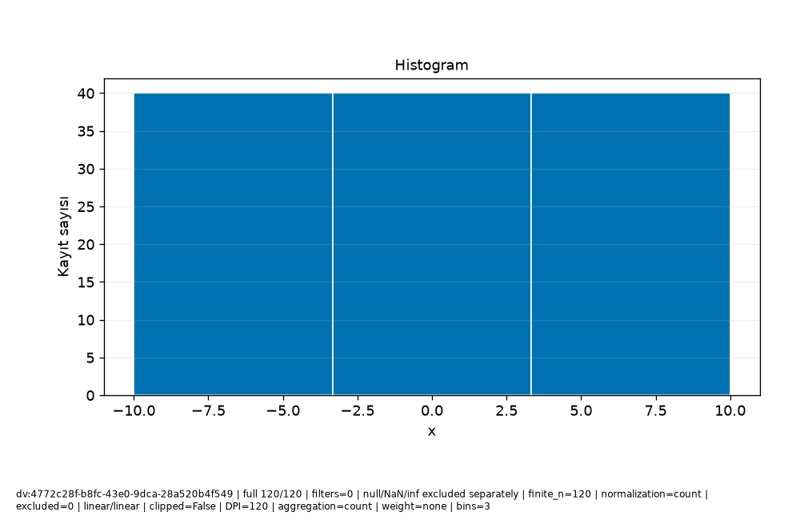

# Veri\_Ufku · Bilimsel rapor

Protokol: exploratory
Keşifsel inceleme; analiz birimi, seçim ve test kullanımını kayıtlı sonuçlarla değerlendirin.

Güncellik: Seçilen dataset/run için daha yeni kayıt bulunmadı; dış kaynağın canlı tazeliği doğrulanmadı.

Test kullanım defteri: []
Model seçim protokolü: kayıtlı method/model-card alanlarına bakın; alan yoksa not_recorded.

## Araştırma sorusu

**text**

```text
Soruyu ve analiz birimini kullanıcı olarak açıklayın.
```
**evidence**

```text
Kullanıcı metni; doğrulanmış hesap değildir.
```

## Yorum ve sınırlamalar

**text**

```text
Bulguyu yorumdan ayırın; nedensel çıkarım varsayımlarını açıkça yazın.
```
**evidence**

```text
Kullanıcı metni; doğrulanmış hesap değildir.
```

## Kaynakça


## method

**record_id**

```text
result:4edecf77-220c-4d6e-aa97-25136fbd00a3
```
**capability_id**

```text
model.regression
```
**dataset_versions**

```text
[
  "dv:4772c28f-b8fc-43e0-9dca-28a520b4f549"
]
```
**run_id**

```text
run:88a4a232-d07d-4072-af01-7ce78db37aae
```
**evidence**

```text
Kayıtlı alan projeksiyonu; yeni hesap veya otomatik yorum değildir.
```
**data**

```text
{
  "spec": {
    "availability": {
      "col:2e08a603-c221-4c5b-8c83-ef8153448f78": {
        "note": "Önceden bilinir",
        "offset_seconds": 0
      }
    },
    "baseline": "auto",
    "entity_use": "new",
    "folds": 3,
    "horizon_seconds": 0,
    "method": "auto",
    "prediction_moment": "Ölçüm öncesi",
    "seed": 42,
    "structure": "independent",
    "test_fraction": 0.2,
    "validation_fraction": 0.2
  },
  "model_card": {
    "baseline": {
      "comparison": [
        {
          "metrics": [
            {
              "averaging": "per_record",
              "coverage": "all eligible records in this evaluation partition",
              "direction": "minimize",
              "metric": "mae",
              "n": 24,
              "scope": "validation",
              "status": "valid",
              "value": 15.105042016806722
            },
            {
              "averaging": "per_record",
              "coverage": "all eligible records in this evaluation partition",
              "direction": "minimize",
              "metric": "rmse",
              "n": 24,
              "scope": "validation",
              "status": "valid",
              "value": 17.131074485116738
            },
            {
              "averaging": "per_record",
              "coverage": "all eligible records in this evaluation partition",
              "direction": "maximize",
              "metric": "r2",
              "n": 24,
              "scope": "validation",
              "status": "valid",
              "value": -0.07031033705694889
            }
          ],
          "scope": "validation"
        },
        {
          "metrics": [
            {
              "averaging": "per_record",
              "coverage": "all eligible records in this evaluation partition",
              "direction": "minimize",
              "metric": "mae",
              "n": 32,
              "scope": "cv:1",
              "status": "valid",
              "value": 16.085215336134453
            },
            {
              "averaging": "per_record",
              "coverage": "all eligible records in this evaluation partition",
              "direction": "minimize",
              "metric": "rmse",
              "n": 32,
              "scope": "cv:1",
              "status": "valid",
              "value": 17.78349866194151
            },
            {
              "averaging": "per_record",
              "coverage": "all eligible records in this evaluation partition",
              "direction": "maximize",
              "metric": "r2",
              "n": 32,
              "scope": "cv:1",
              "status": "valid",
              "value": -0.08216532968157875
            }
          ],
          "scope": "cv:1"
        },
        {
          "metrics": [
            {
              "averaging": "per_record",
              "coverage": "all eligible records in this evaluation partition",
              "direction": "minimize",
              "metric": "mae",
              "n": 32,
              "scope": "cv:2",
              "status": "valid",
              "value": 14.063484768907566
            },
            {
              "averaging": "per_record",
              "coverage": "all eligible records in this evaluation partition",
              "direction": "minimize",
              "metric": "rmse",
              "n": 32,
              "scope": "cv:2",
              "status": "valid",
              "value": 16.834420290258713
            },
            {
              "averaging": "per_record",
              "coverage": "all eligible records in this evaluation partition",
              "direction": "maximize",
              "metric": "r2",
              "n": 32,
              "scope": "cv:2",
              "status": "valid",
              "value": -0.000592538052601066
            }
          ],
          "scope": "cv:2"
        },
        {
          "metrics": [
            {
              "averaging": "per_record",
              "coverage": "all eligible records in this evaluation partition",
              "direction": "minimize",
              "metric": "mae",
              "n": 32,
              "scope": "cv:3",
              "status": "valid",
              "value": 16.882878151260506
            },
            {
              "averaging": "per_record",
              "coverage": "all eligible records in this evaluation partition",
              "direction": "minimize",
              "metric": "rmse",
              "n": 32,
              "scope": "cv:3",
              "status": "valid",
              "value": 19.037369544238533
            },
            {
              "averaging": "per_record",
              "coverage": "all eligible records in this evaluation partition",
              "direction": "maximize",
              "metric": "r2",
              "n": 32,
              "scope": "cv:3",
              "status": "valid",
              "value": -0.084358201283397
            }
          ],
          "scope": "cv:3"
        }
      ],
      "limitation": "Final koşuda yeniden baseline seçimi yapılmaz; geliştirme koşusu kartına bakın.",
      "strategy": "mean"
    },
    "candidate_selection": {
      "parameters": {
        "alpha": 1.0,
        "candidates": [
          "baseline",
          "linear",
          "ridge",
          "forest"
        ],
        "depth": 8,
        "trees": 50,
        "unit": "TL"
      },
      "rule": "minimum development CV mean MAE; ties follow candidate order",
      "selected": "linear"
    },
    "columns": [
      {
        "id": "col:2e08a603-c221-4c5b-8c83-ef8153448f78",
        "name": "x",
        "original_name": "x",
        "type": "Float64"
      },
      {
        "id": "col:c37e102a-2c72-4b84-8add-96a8e8f9757c",
        "name": "y",
        "original_name": "y",
        "type": "Float64"
      }
    ],
    "dataset_version": "dv:4772c28f-b8fc-43e0-9dca-28a520b4f549",
    "decision": null,
    "estimator": "LinearRegression",
    "features": [
      {
        "id": "col:2e08a603-c221-4c5b-8c83-ef8153448f78",
        "name": "x",
        "type": "Float64",
        "unit": ""
      }
    ],
    "fit_row_ids": [
      "row:cce8cc0f-e39a-4dd9-afa8-5921b26c51f5",
      "row:9cebed5d-dc05-4c46-92a1-ba02c0dcabd0",
      "row:2f4b8974-545f-44bd-896e-aa3aeeaccbf4",
      "row:30a08d99-d543-4418-8f2a-a94580a71cf6",
      "row:e778650e-fd90-40aa-be14-e044e8fe8a82",
      "row:11ef59f6-5835-471f-abf5-8592a0f69cb1",
      "row:b07a35ca-5f6a-4e44-9f1d-e7b9d67c602b",
      "row:0a4b1349-cff1-46f7-9cd7-401d99e0a75a",
      "row:6244ec4e-02e7-4a34-89c4-01c32139d7e7",
      "row:c91f1ea7-072b-485e-acf1-20ab6d816b6c",
      "row:3a02c59a-02ad-4592-bacc-6c138bd23eb9",
      "row:d90d9790-1565-416f-b388-58bac6094e06",
      "row:db8b4302-6ff3-46ab-b734-32c165957287",
      "row:0765e9db-abe7-47bb-95d6-94805c4e5e1e",
      "row:cba90e6e-c7f7-4fd6-b791-0911e8fdf7af",
      "row:677ecc2e-ffef-4058-9a50-933cafbdd2a1",
      "row:65757efc-71e8-40bd-96c4-0651b5702b3c",
      "row:d4770759-a803-4680-b13a-090ad9b4045e",
      "row:d13fc44a-eb92-40eb-ac06-2528f8742a35",
      "row:9f40920f-3d98-4881-a244-1266191716fd",
      "row:7705c505-9c99-4c0d-a671-1525a0f6884c",
      "row:d0992f34-d6eb-490d-92d6-dc9220927693",
      "row:581e51ff-19f5-4efd-aa57-39faac343e71",
      "row:dc83508c-0864-41a8-afef-5547a637c6b3",
      "row:9d0d7c70-a753-486f-87b1-79e19dc84143",
      "row:a69a1b14-d68f-45c2-904c-b9b15bcf4960",
      "row:b303974e-b38e-4c07-a501-48787965582a",
      "row:6d7025b2-01d9-47ee-a04f-c4c3b389d1c6",
      "row:60859b6b-3d80-4333-b5ad-d17416b708a0",
      "row:50903aa9-9f7a-4701-bcca-35ad00404bdf",
      "row:6d1f4f3a-6d65-460f-b16b-acb13f10543f",
      "row:278c1112-1a61-42f4-98c6-530a7978ed86",
      "row:87b0d7cb-f08f-4590-bd69-2b05f0f9be78",
      "row:b73e59da-4044-40fe-bb8e-01ce2214b36b",
      "row:4aace335-18be-4e56-bcae-d5cfae47696a",
      "row:747a3e2b-9b94-47a7-8762-f3417a64b64e",
      "row:9bbe3d90-8ab9-4fa1-bfc0-53e3e7c4eaaa",
      "row:f1f1a7dc-4f75-4f7e-b640-7b878a7d13ea",
      "row:d4bb204a-c0d9-44ab-8937-2ea3f77aeed6",
      "row:fd4a274b-ec33-4e83-aa4a-553b6e0e1438",
      "row:b8fd13c4-3862-453a-8016-0f42d41b121e",
      "row:2ab3ed47-7348-41fb-9c6d-2cc273b99c31",
      "row:a8e27a95-ef92-4cd0-941b-e07c31aad93a",
      "row:2d1280b2-edc7-4b7d-a32a-40b3d48540f4",
      "row:8afd1c56-c740-46df-91ca-dbceb503e352",
      "row:2a13b9b9-95cf-4c45-bacc-8a430fb63299",
      "row:b04016e3-edb4-40ff-aedb-c86985319523",
      "row:28927ec0-b2dc-4c47-949e-ad478b86ff7c",
      "row:d121a40a-9100-4611-bfd5-f0395284275a",
      "row:ca19ac31-aeb4-4fb0-8853-334f658c3a82",
      "row:ddd6a3e3-f7e3-4ae8-8357-ffade87c4b9f",
      "row:2e66ba6e-60c8-4209-bf85-87ef141dbb88",
      "row:00ec4de6-d51e-4b4d-9377-c0b25b36ff03",
      "row:fe052a5f-391a-4285-a814-6dd660230aa7",
      "row:7f6bc6c3-51a3-4899-9298-6d1b15f3465d",
      "row:f912edcc-bb6d-4729-9044-a6168f88baaa",
      "row:6e427d4e-1aed-43c5-9fa1-15ef02218227",
      "row:8166f77c-fd9d-40d6-a91f-299e7df02496",
      "row:d798a28e-7d70-4883-99ee-17129fae0def",
      "row:c9b4e4e1-089a-4c98-999b-2faee6cff090",
      "row:2e835d4a-f6b1-4ba2-bf3f-b0a0701ffadb",
      "row:62e3e9c3-66ea-4792-9388-2b6a06981826",
      "row:88db8f72-76f1-417d-9501-f41e964491d9",
      "row:55baa129-88d9-4227-b803-a5dc957b9649",
      "row:0eb989ab-1eb4-44ae-9032-69793b3a20fc",
      "row:64acb4e3-e774-4d0d-9310-3541f68d02b9",
      "row:62de0568-f057-461a-b91a-d47fd809431f",
      "row:6a56d4d8-fb75-4bcb-8194-3ab7d836a4d0",
      "row:0ba79b56-5106-473a-bc3e-e7286932bd09",
      "row:064ec898-4622-4a37-ae88-aabf8511e9f0",
      "row:7909665a-91bd-4b86-9759-8c12f61ddde4",
      "row:ad23bbe5-760c-420b-adaf-4a00b3030bfe"
    ],
    "fit_scope": "development_train; validation previously used for selection",
    "fitted_preprocessing": {
      "1": {
        "kind": "impute_numeric",
        "statistics": [
          1.344537815126051
        ]
      },
      "2": {
        "kind": "standard_scale",
        "mean": [
          0.6092436974789925
        ],
        "scale": [
          5.948272597687973
        ]
      }
    },
    "importance": {
      "limitation": "İlişkili değişkenler önemi paylaşır/gizler; negatif önem mümkün. Nedensellik değildir; final test kullanılmadı.",
      "metric": "negative_MAE",
      "repeats": 3,
      "row_ids": [
        "row:a90cad35-aabe-49f8-9e29-b28dcb08864f",
        "row:9245d5d1-1e65-4d36-9916-c4dc736054c5",
        "row:79b9ce62-c68f-43b9-9e74-0eb205d8b90a",
        "row:8d4db8d7-a3ee-4987-b8e5-974066c3dad1",
        "row:bc7b3d65-d46f-4617-a124-a3eec98b3842",
        "row:2ce46f94-f242-45e8-aeb7-c549ba012787",
        "row:851d3704-1d4c-46c6-9411-fce2815263aa",
        "row:ddbaba8d-b4ba-459e-8728-f1fa84ec03c8",
        "row:d48ebe7c-d4ac-4e89-8138-baa67618c468",
        "row:34784ae1-0672-45ff-87be-52c82a6d0a86",
        "row:89dccf27-f0b8-4e79-9a08-8f9e4e96b14b",
        "row:23edc128-b0a2-4a02-81c6-db01dcc37bbb",
        "row:c9d82573-c49a-44c1-843b-0a6f68b5a223",
        "row:f47e47b1-6f6c-4f9a-b00f-034b8eaf7645",
        "row:6b9fcf1d-3828-4574-b02d-b18a2c8ac75e",
        "row:4927fcbd-d71b-441b-9f59-1e6cc8e3b435",
        "row:e703e49b-0ef9-41fd-a0bc-5dbc28ab391f",
        "row:22ee1f24-31df-4ddc-8f53-8e2a751cff8e",
        "row:f8c2eecf-4e9a-4a2b-bf03-7ab208aba0df",
        "row:14ab286a-4fd4-4a8f-ae5d-24c47d3e3685",
        "row:ae9e9dce-cc9f-4dc2-a13d-014f55aafa43",
        "row:1a7b3e09-61b8-4eab-bff3-6f2340eff314",
        "row:1bd6e1f5-eb67-4f0f-9767-071fce41a126",
        "row:89665406-b133-42ab-b085-fc44c502c668"
      ],
      "scope": "validation; exploratory; already used for model/threshold selection",
      "seed": 42,
      "status": "available",
      "values": [
        {
          "column_id": "col:2e08a603-c221-4c5b-8c83-ef8153448f78",
          "mean": 19.523809523809522,
          "name": "x",
          "std": 2.038091850261204
        }
      ]
    },
    "label_order": [],
    "limitations": "Katsayı ve önemler nedensel etki değildir. İlişkili özellikler önemi paylaşabilir veya gizleyebilir. Yeni veri dağılımı değişebilir; olasılık kesinlik veya kalibrasyon garantisi değildir. Küme ve anomali adayları gerçek sınıf/veri hatası değildir; otomatik silme yok.",
    "method": null,
    "metrics": [
      {
        "evaluation_n": 24,
        "metrics": [
          {
            "averaging": "per_record",
            "coverage": "all eligible records in this evaluation partition",
            "direction": "minimize",
            "metric": "mae",
            "n": 24,
            "scope": "validation",
            "status": "valid",
            "value": 4.810966440042345e-15
          },
          {
            "averaging": "per_record",
            "coverage": "all eligible records in this evaluation partition",
            "direction": "minimize",
            "metric": "rmse",
            "n": 24,
            "scope": "validation",
            "status": "valid",
            "value": 5.582114810376975e-15
          },
          {
            "averaging": "per_record",
            "coverage": "all eligible records in this evaluation partition",
            "direction": "maximize",
            "metric": "r2",
            "n": 24,
            "scope": "validation",
            "status": "valid",
            "value": 1.0
          }
        ],
        "scope": "validation",
        "status": "valid",
        "train_n": 72
      },
      {
        "evaluation_n": 32,
        "metrics": [
          {
            "averaging": "per_record",
            "coverage": "all eligible records in this evaluation partition",
            "direction": "minimize",
            "metric": "mae",
            "n": 32,
            "scope": "cv:1",
            "status": "valid",
            "value": 1.3877787807814457e-15
          },
          {
            "averaging": "per_record",
            "coverage": "all eligible records in this evaluation partition",
            "direction": "minimize",
            "metric": "rmse",
            "n": 32,
            "scope": "cv:1",
            "status": "valid",
            "value": 2.1413206232596582e-15
          },
          {
            "averaging": "per_record",
            "coverage": "all eligible records in this evaluation partition",
            "direction": "maximize",
            "metric": "r2",
            "n": 32,
            "scope": "cv:1",
            "status": "valid",
            "value": 1.0
          }
        ],
        "scope": "cv:1",
        "status": "valid",
        "train_n": 64
      },
      {
        "evaluation_n": 32,
        "metrics": [
          {
            "averaging": "per_record",
            "coverage": "all eligible records in this evaluation partition",
            "direction": "minimize",
            "metric": "mae",
            "n": 32,
            "scope": "cv:2",
            "status": "valid",
            "value": 5.828670879282072e-15
          },
          {
            "averaging": "per_record",
            "coverage": "all eligible records in this evaluation partition",
            "direction": "minimize",
            "metric": "rmse",
            "n": 32,
            "scope": "cv:2",
            "status": "valid",
            "value": 7.320740245935003e-15
          },
          {
            "averaging": "per_record",
            "coverage": "all eligible records in this evaluation partition",
            "direction": "maximize",
            "metric": "r2",
            "n": 32,
            "scope": "cv:2",
            "status": "valid",
            "value": 1.0
          }
        ],
        "scope": "cv:2",
        "status": "valid",
        "train_n": 64
      },
      {
        "evaluation_n": 32,
        "metrics": [
          {
            "averaging": "per_record",
            "coverage": "all eligible records in this evaluation partition",
            "direction": "minimize",
            "metric": "mae",
            "n": 32,
            "scope": "cv:3",
            "status": "valid",
            "value": 1.915134717478395e-15
          },
          {
            "averaging": "per_record",
            "coverage": "all eligible records in this evaluation partition",
            "direction": "minimize",
            "metric": "rmse",
            "n": 32,
            "scope": "cv:3",
            "status": "valid",
            "value": 2.687565378447544e-15
          },
          {
            "averaging": "per_record",
            "coverage": "all eligible records in this evaluation partition",
            "direction": "maximize",
            "metric": "r2",
            "n": 32,
            "scope": "cv:3",
            "status": "valid",
            "value": 1.0
          }
        ],
        "scope": "cv:3",
        "status": "valid",
        "train_n": 64
      }
    ],
    "preparation_spec": {
      "allow_identifiers": false,
      "categorical_imputation": "most_frequent",
      "date_features": true,
      "encoding": "onehot",
      "family": "linear",
      "features": [
        "col:2e08a603-c221-4c5b-8c83-ef8153448f78"
      ],
      "group": "",
      "history_action": "review",
      "history_note": "",
      "invalid_numeric": "reject",
      "numeric_imputation": "median",
      "precision": "reject",
      "prediction_context": "",
      "purpose": "regression",
      "scaling": "standard",
      "selection": "none",
      "source_version": "dv:4772c28f-b8fc-43e0-9dca-28a520b4f549",
      "target": "col:c37e102a-2c72-4b84-8add-96a8e8f9757c",
      "time": ""
    },
    "preprocessing": {
      "category_vocabulary": null,
      "column_lineage": [
        {
          "category_map": [],
          "input_column_id": "col:2e08a603-c221-4c5b-8c83-ef8153448f78",
          "names_status": "structurally_known",
          "output_names": [
            "f_2e08a603c2214c5b8c83ef8153448f78__numeric"
          ],
          "selected_after_fit": "all_planned",
          "source_dtype": "Float64",
          "source_name": "x"
        }
      ],
      "estimator_family": "linear",
      "feature_selection_mask": null,
      "fit_state": "not_fitted",
      "fitted_parameters": {},
      "schema": "PreparationPlan/v1",
      "steps": [
        {
          "input_column_ids": [
            "col:2e08a603-c221-4c5b-8c83-ef8153448f78"
          ],
          "kind": "numeric",
          "learned_scope": "row_local",
          "output_names": [
            "f_2e08a603c2214c5b8c83ef8153448f78__numeric"
          ],
          "parameters": {
            "nonfinite": "reject",
            "precision": "reject"
          },
          "reason": "Kimlik ölçüm değildir; Float64 kaybı gelecekte açık politika ile denetlenir.",
          "state": "planned"
        },
        {
          "input_column_ids": [
            "col:2e08a603-c221-4c5b-8c83-ef8153448f78"
          ],
          "kind": "impute_numeric",
          "learned_scope": "training_fold",
          "output_names": [
            "f_2e08a603c2214c5b8c83ef8153448f78__numeric"
          ],
          "parameters": {
            "all_missing": "error",
            "strategy": "median"
          },
          "reason": "Seçilen doldurma değeri yalnız eğitim katında öğrenilir; test/validation ortalaması kullanılmaz.",
          "state": "planned"
        },
        {
          "input_column_ids": [
            "col:2e08a603-c221-4c5b-8c83-ef8153448f78"
          ],
          "kind": "standard_scale",
          "learned_scope": "training_fold",
          "output_names": [
            "f_2e08a603c2214c5b8c83ef8153448f78__numeric"
          ],
          "parameters": {
            "explicit_override": false
          },
          "reason": "Uzaklıklar ve düzenlileştirilmiş doğrusal modeller ölçüm ölçeğine duyarlıdır; eğitim katında standardizasyon planlandı.",
          "state": "planned"
        }
      ],
      "training_dependency": "Requires a validated split/fold protocol in Phase16; no training performed",
      "version_id": "ml-pipeline:42f90114-4860-4891-b644-d840c2951df7"
    },
    "probability_supported": false,
    "purpose": "regression",
    "run_id": "run:88a4a232-d07d-4072-af01-7ce78db37aae",
    "schema": "ModelCard/v1",
    "seed": 42,
    "snapshot_fingerprint": {
      "sha256": "1c6594d2ede8dceb45b9a6af27a40c88037bad35f4667c86e489de012d984cda",
      "size": 11598
    },
    "split": {
      "invalid_folds": [],
      "membership": {
        "development": [
          "row:00ec4de6-d51e-4b4d-9377-c0b25b36ff03",
          "row:064ec898-4622-4a37-ae88-aabf8511e9f0",
          "row:0765e9db-abe7-47bb-95d6-94805c4e5e1e",
          "row:0a4b1349-cff1-46f7-9cd7-401d99e0a75a",
          "row:0ba79b56-5106-473a-bc3e-e7286932bd09",
          "row:0eb989ab-1eb4-44ae-9032-69793b3a20fc",
          "row:11ef59f6-5835-471f-abf5-8592a0f69cb1",
          "row:14ab286a-4fd4-4a8f-ae5d-24c47d3e3685",
          "row:1a7b3e09-61b8-4eab-bff3-6f2340eff314",
          "row:1bd6e1f5-eb67-4f0f-9767-071fce41a126",
          "row:22ee1f24-31df-4ddc-8f53-8e2a751cff8e",
          "row:23edc128-b0a2-4a02-81c6-db01dcc37bbb",
          "row:278c1112-1a61-42f4-98c6-530a7978ed86",
          "row:28927ec0-b2dc-4c47-949e-ad478b86ff7c",
          "row:2a13b9b9-95cf-4c45-bacc-8a430fb63299",
          "row:2ab3ed47-7348-41fb-9c6d-2cc273b99c31",
          "row:2ce46f94-f242-45e8-aeb7-c549ba012787",
          "row:2d1280b2-edc7-4b7d-a32a-40b3d48540f4",
          "row:2e66ba6e-60c8-4209-bf85-87ef141dbb88",
          "row:2e835d4a-f6b1-4ba2-bf3f-b0a0701ffadb",
          "row:2f4b8974-545f-44bd-896e-aa3aeeaccbf4",
          "row:30a08d99-d543-4418-8f2a-a94580a71cf6",
          "row:34784ae1-0672-45ff-87be-52c82a6d0a86",
          "row:3a02c59a-02ad-4592-bacc-6c138bd23eb9",
          "row:4927fcbd-d71b-441b-9f59-1e6cc8e3b435",
          "row:4aace335-18be-4e56-bcae-d5cfae47696a",
          "row:50903aa9-9f7a-4701-bcca-35ad00404bdf",
          "row:55baa129-88d9-4227-b803-a5dc957b9649",
          "row:581e51ff-19f5-4efd-aa57-39faac343e71",
          "row:60859b6b-3d80-4333-b5ad-d17416b708a0",
          "row:6244ec4e-02e7-4a34-89c4-01c32139d7e7",
          "row:62de0568-f057-461a-b91a-d47fd809431f",
          "row:62e3e9c3-66ea-4792-9388-2b6a06981826",
          "row:64acb4e3-e774-4d0d-9310-3541f68d02b9",
          "row:65757efc-71e8-40bd-96c4-0651b5702b3c",
          "row:677ecc2e-ffef-4058-9a50-933cafbdd2a1",
          "row:6a56d4d8-fb75-4bcb-8194-3ab7d836a4d0",
          "row:6b9fcf1d-3828-4574-b02d-b18a2c8ac75e",
          "row:6d1f4f3a-6d65-460f-b16b-acb13f10543f",
          "row:6d7025b2-01d9-47ee-a04f-c4c3b389d1c6",
          "row:6e427d4e-1aed-43c5-9fa1-15ef02218227",
          "row:747a3e2b-9b94-47a7-8762-f3417a64b64e",
          "row:7705c505-9c99-4c0d-a671-1525a0f6884c",
          "row:7909665a-91bd-4b86-9759-8c12f61ddde4",
          "row:79b9ce62-c68f-43b9-9e74-0eb205d8b90a",
          "row:7f6bc6c3-51a3-4899-9298-6d1b15f3465d",
          "row:8166f77c-fd9d-40d6-a91f-299e7df02496",
          "row:851d3704-1d4c-46c6-9411-fce2815263aa",
          "row:87b0d7cb-f08f-4590-bd69-2b05f0f9be78",
          "row:88db8f72-76f1-417d-9501-f41e964491d9",
          "row:89665406-b133-42ab-b085-fc44c502c668",
          "row:89dccf27-f0b8-4e79-9a08-8f9e4e96b14b",
          "row:8afd1c56-c740-46df-91ca-dbceb503e352",
          "row:8d4db8d7-a3ee-4987-b8e5-974066c3dad1",
          "row:9245d5d1-1e65-4d36-9916-c4dc736054c5",
          "row:9bbe3d90-8ab9-4fa1-bfc0-53e3e7c4eaaa",
          "row:9cebed5d-dc05-4c46-92a1-ba02c0dcabd0",
          "row:9d0d7c70-a753-486f-87b1-79e19dc84143",
          "row:9f40920f-3d98-4881-a244-1266191716fd",
          "row:a69a1b14-d68f-45c2-904c-b9b15bcf4960",
          "row:a8e27a95-ef92-4cd0-941b-e07c31aad93a",
          "row:a90cad35-aabe-49f8-9e29-b28dcb08864f",
          "row:ad23bbe5-760c-420b-adaf-4a00b3030bfe",
          "row:ae9e9dce-cc9f-4dc2-a13d-014f55aafa43",
          "row:b04016e3-edb4-40ff-aedb-c86985319523",
          "row:b07a35ca-5f6a-4e44-9f1d-e7b9d67c602b",
          "row:b303974e-b38e-4c07-a501-48787965582a",
          "row:b73e59da-4044-40fe-bb8e-01ce2214b36b",
          "row:b8fd13c4-3862-453a-8016-0f42d41b121e",
          "row:bc7b3d65-d46f-4617-a124-a3eec98b3842",
          "row:c91f1ea7-072b-485e-acf1-20ab6d816b6c",
          "row:c9b4e4e1-089a-4c98-999b-2faee6cff090",
          "row:c9d82573-c49a-44c1-843b-0a6f68b5a223",
          "row:ca19ac31-aeb4-4fb0-8853-334f658c3a82",
          "row:cba90e6e-c7f7-4fd6-b791-0911e8fdf7af",
          "row:cce8cc0f-e39a-4dd9-afa8-5921b26c51f5",
          "row:d0992f34-d6eb-490d-92d6-dc9220927693",
          "row:d121a40a-9100-4611-bfd5-f0395284275a",
          "row:d13fc44a-eb92-40eb-ac06-2528f8742a35",
          "row:d4770759-a803-4680-b13a-090ad9b4045e",
          "row:d48ebe7c-d4ac-4e89-8138-baa67618c468",
          "row:d4bb204a-c0d9-44ab-8937-2ea3f77aeed6",
          "row:d798a28e-7d70-4883-99ee-17129fae0def",
          "row:d90d9790-1565-416f-b388-58bac6094e06",
          "row:db8b4302-6ff3-46ab-b734-32c165957287",
          "row:dc83508c-0864-41a8-afef-5547a637c6b3",
          "row:ddbaba8d-b4ba-459e-8728-f1fa84ec03c8",
          "row:ddd6a3e3-f7e3-4ae8-8357-ffade87c4b9f",
          "row:e703e49b-0ef9-41fd-a0bc-5dbc28ab391f",
          "row:e778650e-fd90-40aa-be14-e044e8fe8a82",
          "row:f1f1a7dc-4f75-4f7e-b640-7b878a7d13ea",
          "row:f47e47b1-6f6c-4f9a-b00f-034b8eaf7645",
          "row:f8c2eecf-4e9a-4a2b-bf03-7ab208aba0df",
          "row:f912edcc-bb6d-4729-9044-a6168f88baaa",
          "row:fd4a274b-ec33-4e83-aa4a-553b6e0e1438",
          "row:fe052a5f-391a-4285-a814-6dd660230aa7"
        ],
        "folds": [
          {
            "status": "valid",
            "train": [
              "row:00ec4de6-d51e-4b4d-9377-c0b25b36ff03",
              "row:064ec898-4622-4a37-ae88-aabf8511e9f0",
              "row:0765e9db-abe7-47bb-95d6-94805c4e5e1e",
              "row:0ba79b56-5106-473a-bc3e-e7286932bd09",
              "row:0eb989ab-1eb4-44ae-9032-69793b3a20fc",
              "row:278c1112-1a61-42f4-98c6-530a7978ed86",
              "row:28927ec0-b2dc-4c47-949e-ad478b86ff7c",
              "row:2a13b9b9-95cf-4c45-bacc-8a430fb63299",
              "row:2ab3ed47-7348-41fb-9c6d-2cc273b99c31",
              "row:2d1280b2-edc7-4b7d-a32a-40b3d48540f4",
              "row:2e66ba6e-60c8-4209-bf85-87ef141dbb88",
              "row:2e835d4a-f6b1-4ba2-bf3f-b0a0701ffadb",
              "row:3a02c59a-02ad-4592-bacc-6c138bd23eb9",
              "row:4aace335-18be-4e56-bcae-d5cfae47696a",
              "row:50903aa9-9f7a-4701-bcca-35ad00404bdf",
              "row:55baa129-88d9-4227-b803-a5dc957b9649",
              "row:581e51ff-19f5-4efd-aa57-39faac343e71",
              "row:60859b6b-3d80-4333-b5ad-d17416b708a0",
              "row:6244ec4e-02e7-4a34-89c4-01c32139d7e7",
              "row:62de0568-f057-461a-b91a-d47fd809431f",
              "row:62e3e9c3-66ea-4792-9388-2b6a06981826",
              "row:64acb4e3-e774-4d0d-9310-3541f68d02b9",
              "row:65757efc-71e8-40bd-96c4-0651b5702b3c",
              "row:677ecc2e-ffef-4058-9a50-933cafbdd2a1",
              "row:6a56d4d8-fb75-4bcb-8194-3ab7d836a4d0",
              "row:6d1f4f3a-6d65-460f-b16b-acb13f10543f",
              "row:6d7025b2-01d9-47ee-a04f-c4c3b389d1c6",
              "row:6e427d4e-1aed-43c5-9fa1-15ef02218227",
              "row:747a3e2b-9b94-47a7-8762-f3417a64b64e",
              "row:7705c505-9c99-4c0d-a671-1525a0f6884c",
              "row:7909665a-91bd-4b86-9759-8c12f61ddde4",
              "row:7f6bc6c3-51a3-4899-9298-6d1b15f3465d",
              "row:8166f77c-fd9d-40d6-a91f-299e7df02496",
              "row:87b0d7cb-f08f-4590-bd69-2b05f0f9be78",
              "row:88db8f72-76f1-417d-9501-f41e964491d9",
              "row:8afd1c56-c740-46df-91ca-dbceb503e352",
              "row:9bbe3d90-8ab9-4fa1-bfc0-53e3e7c4eaaa",
              "row:9d0d7c70-a753-486f-87b1-79e19dc84143",
              "row:9f40920f-3d98-4881-a244-1266191716fd",
              "row:a69a1b14-d68f-45c2-904c-b9b15bcf4960",
              "row:a8e27a95-ef92-4cd0-941b-e07c31aad93a",
              "row:ad23bbe5-760c-420b-adaf-4a00b3030bfe",
              "row:b04016e3-edb4-40ff-aedb-c86985319523",
              "row:b303974e-b38e-4c07-a501-48787965582a",
              "row:b73e59da-4044-40fe-bb8e-01ce2214b36b",
              "row:b8fd13c4-3862-453a-8016-0f42d41b121e",
              "row:c91f1ea7-072b-485e-acf1-20ab6d816b6c",
              "row:c9b4e4e1-089a-4c98-999b-2faee6cff090",
              "row:ca19ac31-aeb4-4fb0-8853-334f658c3a82",
              "row:cba90e6e-c7f7-4fd6-b791-0911e8fdf7af",
              "row:d0992f34-d6eb-490d-92d6-dc9220927693",
              "row:d121a40a-9100-4611-bfd5-f0395284275a",
              "row:d13fc44a-eb92-40eb-ac06-2528f8742a35",
              "row:d4770759-a803-4680-b13a-090ad9b4045e",
              "row:d4bb204a-c0d9-44ab-8937-2ea3f77aeed6",
              "row:d798a28e-7d70-4883-99ee-17129fae0def",
              "row:d90d9790-1565-416f-b388-58bac6094e06",
              "row:db8b4302-6ff3-46ab-b734-32c165957287",
              "row:dc83508c-0864-41a8-afef-5547a637c6b3",
              "row:ddd6a3e3-f7e3-4ae8-8357-ffade87c4b9f",
              "row:f1f1a7dc-4f75-4f7e-b640-7b878a7d13ea",
              "row:f912edcc-bb6d-4729-9044-a6168f88baaa",
              "row:fd4a274b-ec33-4e83-aa4a-553b6e0e1438",
              "row:fe052a5f-391a-4285-a814-6dd660230aa7"
            ],
            "validation": [
              "row:0a4b1349-cff1-46f7-9cd7-401d99e0a75a",
              "row:11ef59f6-5835-471f-abf5-8592a0f69cb1",
              "row:14ab286a-4fd4-4a8f-ae5d-24c47d3e3685",
              "row:1a7b3e09-61b8-4eab-bff3-6f2340eff314",
              "row:1bd6e1f5-eb67-4f0f-9767-071fce41a126",
              "row:22ee1f24-31df-4ddc-8f53-8e2a751cff8e",
              "row:23edc128-b0a2-4a02-81c6-db01dcc37bbb",
              "row:2ce46f94-f242-45e8-aeb7-c549ba012787",
              "row:2f4b8974-545f-44bd-896e-aa3aeeaccbf4",
              "row:30a08d99-d543-4418-8f2a-a94580a71cf6",
              "row:34784ae1-0672-45ff-87be-52c82a6d0a86",
              "row:4927fcbd-d71b-441b-9f59-1e6cc8e3b435",
              "row:6b9fcf1d-3828-4574-b02d-b18a2c8ac75e",
              "row:79b9ce62-c68f-43b9-9e74-0eb205d8b90a",
              "row:851d3704-1d4c-46c6-9411-fce2815263aa",
              "row:89665406-b133-42ab-b085-fc44c502c668",
              "row:89dccf27-f0b8-4e79-9a08-8f9e4e96b14b",
              "row:8d4db8d7-a3ee-4987-b8e5-974066c3dad1",
              "row:9245d5d1-1e65-4d36-9916-c4dc736054c5",
              "row:9cebed5d-dc05-4c46-92a1-ba02c0dcabd0",
              "row:a90cad35-aabe-49f8-9e29-b28dcb08864f",
              "row:ae9e9dce-cc9f-4dc2-a13d-014f55aafa43",
              "row:b07a35ca-5f6a-4e44-9f1d-e7b9d67c602b",
              "row:bc7b3d65-d46f-4617-a124-a3eec98b3842",
              "row:c9d82573-c49a-44c1-843b-0a6f68b5a223",
              "row:cce8cc0f-e39a-4dd9-afa8-5921b26c51f5",
              "row:d48ebe7c-d4ac-4e89-8138-baa67618c468",
              "row:ddbaba8d-b4ba-459e-8728-f1fa84ec03c8",
              "row:e703e49b-0ef9-41fd-a0bc-5dbc28ab391f",
              "row:e778650e-fd90-40aa-be14-e044e8fe8a82",
              "row:f47e47b1-6f6c-4f9a-b00f-034b8eaf7645",
              "row:f8c2eecf-4e9a-4a2b-bf03-7ab208aba0df"
            ]
          },
          {
            "status": "valid",
            "train": [
              "row:00ec4de6-d51e-4b4d-9377-c0b25b36ff03",
              "row:064ec898-4622-4a37-ae88-aabf8511e9f0",
              "row:0a4b1349-cff1-46f7-9cd7-401d99e0a75a",
              "row:0ba79b56-5106-473a-bc3e-e7286932bd09",
              "row:0eb989ab-1eb4-44ae-9032-69793b3a20fc",
              "row:11ef59f6-5835-471f-abf5-8592a0f69cb1",
              "row:14ab286a-4fd4-4a8f-ae5d-24c47d3e3685",
              "row:1a7b3e09-61b8-4eab-bff3-6f2340eff314",
              "row:1bd6e1f5-eb67-4f0f-9767-071fce41a126",
              "row:22ee1f24-31df-4ddc-8f53-8e2a751cff8e",
              "row:23edc128-b0a2-4a02-81c6-db01dcc37bbb",
              "row:28927ec0-b2dc-4c47-949e-ad478b86ff7c",
              "row:2a13b9b9-95cf-4c45-bacc-8a430fb63299",
              "row:2ab3ed47-7348-41fb-9c6d-2cc273b99c31",
              "row:2ce46f94-f242-45e8-aeb7-c549ba012787",
              "row:2d1280b2-edc7-4b7d-a32a-40b3d48540f4",
              "row:2e66ba6e-60c8-4209-bf85-87ef141dbb88",
              "row:2e835d4a-f6b1-4ba2-bf3f-b0a0701ffadb",
              "row:2f4b8974-545f-44bd-896e-aa3aeeaccbf4",
              "row:30a08d99-d543-4418-8f2a-a94580a71cf6",
              "row:34784ae1-0672-45ff-87be-52c82a6d0a86",
              "row:4927fcbd-d71b-441b-9f59-1e6cc8e3b435",
              "row:55baa129-88d9-4227-b803-a5dc957b9649",
              "row:62de0568-f057-461a-b91a-d47fd809431f",
              "row:62e3e9c3-66ea-4792-9388-2b6a06981826",
              "row:64acb4e3-e774-4d0d-9310-3541f68d02b9",
              "row:6a56d4d8-fb75-4bcb-8194-3ab7d836a4d0",
              "row:6b9fcf1d-3828-4574-b02d-b18a2c8ac75e",
              "row:6e427d4e-1aed-43c5-9fa1-15ef02218227",
              "row:7909665a-91bd-4b86-9759-8c12f61ddde4",
              "row:79b9ce62-c68f-43b9-9e74-0eb205d8b90a",
              "row:7f6bc6c3-51a3-4899-9298-6d1b15f3465d",
              "row:8166f77c-fd9d-40d6-a91f-299e7df02496",
              "row:851d3704-1d4c-46c6-9411-fce2815263aa",
              "row:88db8f72-76f1-417d-9501-f41e964491d9",
              "row:89665406-b133-42ab-b085-fc44c502c668",
              "row:89dccf27-f0b8-4e79-9a08-8f9e4e96b14b",
              "row:8afd1c56-c740-46df-91ca-dbceb503e352",
              "row:8d4db8d7-a3ee-4987-b8e5-974066c3dad1",
              "row:9245d5d1-1e65-4d36-9916-c4dc736054c5",
              "row:9cebed5d-dc05-4c46-92a1-ba02c0dcabd0",
              "row:a8e27a95-ef92-4cd0-941b-e07c31aad93a",
              "row:a90cad35-aabe-49f8-9e29-b28dcb08864f",
              "row:ad23bbe5-760c-420b-adaf-4a00b3030bfe",
              "row:ae9e9dce-cc9f-4dc2-a13d-014f55aafa43",
              "row:b04016e3-edb4-40ff-aedb-c86985319523",
              "row:b07a35ca-5f6a-4e44-9f1d-e7b9d67c602b",
              "row:b8fd13c4-3862-453a-8016-0f42d41b121e",
              "row:bc7b3d65-d46f-4617-a124-a3eec98b3842",
              "row:c9b4e4e1-089a-4c98-999b-2faee6cff090",
              "row:c9d82573-c49a-44c1-843b-0a6f68b5a223",
              "row:ca19ac31-aeb4-4fb0-8853-334f658c3a82",
              "row:cce8cc0f-e39a-4dd9-afa8-5921b26c51f5",
              "row:d121a40a-9100-4611-bfd5-f0395284275a",
              "row:d48ebe7c-d4ac-4e89-8138-baa67618c468",
              "row:d798a28e-7d70-4883-99ee-17129fae0def",
              "row:ddbaba8d-b4ba-459e-8728-f1fa84ec03c8",
              "row:ddd6a3e3-f7e3-4ae8-8357-ffade87c4b9f",
              "row:e703e49b-0ef9-41fd-a0bc-5dbc28ab391f",
              "row:e778650e-fd90-40aa-be14-e044e8fe8a82",
              "row:f47e47b1-6f6c-4f9a-b00f-034b8eaf7645",
              "row:f8c2eecf-4e9a-4a2b-bf03-7ab208aba0df",
              "row:f912edcc-bb6d-4729-9044-a6168f88baaa",
              "row:fe052a5f-391a-4285-a814-6dd660230aa7"
            ],
            "validation": [
              "row:0765e9db-abe7-47bb-95d6-94805c4e5e1e",
              "row:278c1112-1a61-42f4-98c6-530a7978ed86",
              "row:3a02c59a-02ad-4592-bacc-6c138bd23eb9",
              "row:4aace335-18be-4e56-bcae-d5cfae47696a",
              "row:50903aa9-9f7a-4701-bcca-35ad00404bdf",
              "row:581e51ff-19f5-4efd-aa57-39faac343e71",
              "row:60859b6b-3d80-4333-b5ad-d17416b708a0",
              "row:6244ec4e-02e7-4a34-89c4-01c32139d7e7",
              "row:65757efc-71e8-40bd-96c4-0651b5702b3c",
              "row:677ecc2e-ffef-4058-9a50-933cafbdd2a1",
              "row:6d1f4f3a-6d65-460f-b16b-acb13f10543f",
              "row:6d7025b2-01d9-47ee-a04f-c4c3b389d1c6",
              "row:747a3e2b-9b94-47a7-8762-f3417a64b64e",
              "row:7705c505-9c99-4c0d-a671-1525a0f6884c",
              "row:87b0d7cb-f08f-4590-bd69-2b05f0f9be78",
              "row:9bbe3d90-8ab9-4fa1-bfc0-53e3e7c4eaaa",
              "row:9d0d7c70-a753-486f-87b1-79e19dc84143",
              "row:9f40920f-3d98-4881-a244-1266191716fd",
              "row:a69a1b14-d68f-45c2-904c-b9b15bcf4960",
              "row:b303974e-b38e-4c07-a501-48787965582a",
              "row:b73e59da-4044-40fe-bb8e-01ce2214b36b",
              "row:c91f1ea7-072b-485e-acf1-20ab6d816b6c",
              "row:cba90e6e-c7f7-4fd6-b791-0911e8fdf7af",
              "row:d0992f34-d6eb-490d-92d6-dc9220927693",
              "row:d13fc44a-eb92-40eb-ac06-2528f8742a35",
              "row:d4770759-a803-4680-b13a-090ad9b4045e",
              "row:d4bb204a-c0d9-44ab-8937-2ea3f77aeed6",
              "row:d90d9790-1565-416f-b388-58bac6094e06",
              "row:db8b4302-6ff3-46ab-b734-32c165957287",
              "row:dc83508c-0864-41a8-afef-5547a637c6b3",
              "row:f1f1a7dc-4f75-4f7e-b640-7b878a7d13ea",
              "row:fd4a274b-ec33-4e83-aa4a-553b6e0e1438"
            ]
          },
          {
            "status": "valid",
            "train": [
              "row:0765e9db-abe7-47bb-95d6-94805c4e5e1e",
              "row:0a4b1349-cff1-46f7-9cd7-401d99e0a75a",
              "row:11ef59f6-5835-471f-abf5-8592a0f69cb1",
              "row:14ab286a-4fd4-4a8f-ae5d-24c47d3e3685",
              "row:1a7b3e09-61b8-4eab-bff3-6f2340eff314",
              "row:1bd6e1f5-eb67-4f0f-9767-071fce41a126",
              "row:22ee1f24-31df-4ddc-8f53-8e2a751cff8e",
              "row:23edc128-b0a2-4a02-81c6-db01dcc37bbb",
              "row:278c1112-1a61-42f4-98c6-530a7978ed86",
              "row:2ce46f94-f242-45e8-aeb7-c549ba012787",
              "row:2f4b8974-545f-44bd-896e-aa3aeeaccbf4",
              "row:30a08d99-d543-4418-8f2a-a94580a71cf6",
              "row:34784ae1-0672-45ff-87be-52c82a6d0a86",
              "row:3a02c59a-02ad-4592-bacc-6c138bd23eb9",
              "row:4927fcbd-d71b-441b-9f59-1e6cc8e3b435",
              "row:4aace335-18be-4e56-bcae-d5cfae47696a",
              "row:50903aa9-9f7a-4701-bcca-35ad00404bdf",
              "row:581e51ff-19f5-4efd-aa57-39faac343e71",
              "row:60859b6b-3d80-4333-b5ad-d17416b708a0",
              "row:6244ec4e-02e7-4a34-89c4-01c32139d7e7",
              "row:65757efc-71e8-40bd-96c4-0651b5702b3c",
              "row:677ecc2e-ffef-4058-9a50-933cafbdd2a1",
              "row:6b9fcf1d-3828-4574-b02d-b18a2c8ac75e",
              "row:6d1f4f3a-6d65-460f-b16b-acb13f10543f",
              "row:6d7025b2-01d9-47ee-a04f-c4c3b389d1c6",
              "row:747a3e2b-9b94-47a7-8762-f3417a64b64e",
              "row:7705c505-9c99-4c0d-a671-1525a0f6884c",
              "row:79b9ce62-c68f-43b9-9e74-0eb205d8b90a",
              "row:851d3704-1d4c-46c6-9411-fce2815263aa",
              "row:87b0d7cb-f08f-4590-bd69-2b05f0f9be78",
              "row:89665406-b133-42ab-b085-fc44c502c668",
              "row:89dccf27-f0b8-4e79-9a08-8f9e4e96b14b",
              "row:8d4db8d7-a3ee-4987-b8e5-974066c3dad1",
              "row:9245d5d1-1e65-4d36-9916-c4dc736054c5",
              "row:9bbe3d90-8ab9-4fa1-bfc0-53e3e7c4eaaa",
              "row:9cebed5d-dc05-4c46-92a1-ba02c0dcabd0",
              "row:9d0d7c70-a753-486f-87b1-79e19dc84143",
              "row:9f40920f-3d98-4881-a244-1266191716fd",
              "row:a69a1b14-d68f-45c2-904c-b9b15bcf4960",
              "row:a90cad35-aabe-49f8-9e29-b28dcb08864f",
              "row:ae9e9dce-cc9f-4dc2-a13d-014f55aafa43",
              "row:b07a35ca-5f6a-4e44-9f1d-e7b9d67c602b",
              "row:b303974e-b38e-4c07-a501-48787965582a",
              "row:b73e59da-4044-40fe-bb8e-01ce2214b36b",
              "row:bc7b3d65-d46f-4617-a124-a3eec98b3842",
              "row:c91f1ea7-072b-485e-acf1-20ab6d816b6c",
              "row:c9d82573-c49a-44c1-843b-0a6f68b5a223",
              "row:cba90e6e-c7f7-4fd6-b791-0911e8fdf7af",
              "row:cce8cc0f-e39a-4dd9-afa8-5921b26c51f5",
              "row:d0992f34-d6eb-490d-92d6-dc9220927693",
              "row:d13fc44a-eb92-40eb-ac06-2528f8742a35",
              "row:d4770759-a803-4680-b13a-090ad9b4045e",
              "row:d48ebe7c-d4ac-4e89-8138-baa67618c468",
              "row:d4bb204a-c0d9-44ab-8937-2ea3f77aeed6",
              "row:d90d9790-1565-416f-b388-58bac6094e06",
              "row:db8b4302-6ff3-46ab-b734-32c165957287",
              "row:dc83508c-0864-41a8-afef-5547a637c6b3",
              "row:ddbaba8d-b4ba-459e-8728-f1fa84ec03c8",
              "row:e703e49b-0ef9-41fd-a0bc-5dbc28ab391f",
              "row:e778650e-fd90-40aa-be14-e044e8fe8a82",
              "row:f1f1a7dc-4f75-4f7e-b640-7b878a7d13ea",
              "row:f47e47b1-6f6c-4f9a-b00f-034b8eaf7645",
              "row:f8c2eecf-4e9a-4a2b-bf03-7ab208aba0df",
              "row:fd4a274b-ec33-4e83-aa4a-553b6e0e1438"
            ],
            "validation": [
              "row:00ec4de6-d51e-4b4d-9377-c0b25b36ff03",
              "row:064ec898-4622-4a37-ae88-aabf8511e9f0",
              "row:0ba79b56-5106-473a-bc3e-e7286932bd09",
              "row:0eb989ab-1eb4-44ae-9032-69793b3a20fc",
              "row:28927ec0-b2dc-4c47-949e-ad478b86ff7c",
              "row:2a13b9b9-95cf-4c45-bacc-8a430fb63299",
              "row:2ab3ed47-7348-41fb-9c6d-2cc273b99c31",
              "row:2d1280b2-edc7-4b7d-a32a-40b3d48540f4",
              "row:2e66ba6e-60c8-4209-bf85-87ef141dbb88",
              "row:2e835d4a-f6b1-4ba2-bf3f-b0a0701ffadb",
              "row:55baa129-88d9-4227-b803-a5dc957b9649",
              "row:62de0568-f057-461a-b91a-d47fd809431f",
              "row:62e3e9c3-66ea-4792-9388-2b6a06981826",
              "row:64acb4e3-e774-4d0d-9310-3541f68d02b9",
              "row:6a56d4d8-fb75-4bcb-8194-3ab7d836a4d0",
              "row:6e427d4e-1aed-43c5-9fa1-15ef02218227",
              "row:7909665a-91bd-4b86-9759-8c12f61ddde4",
              "row:7f6bc6c3-51a3-4899-9298-6d1b15f3465d",
              "row:8166f77c-fd9d-40d6-a91f-299e7df02496",
              "row:88db8f72-76f1-417d-9501-f41e964491d9",
              "row:8afd1c56-c740-46df-91ca-dbceb503e352",
              "row:a8e27a95-ef92-4cd0-941b-e07c31aad93a",
              "row:ad23bbe5-760c-420b-adaf-4a00b3030bfe",
              "row:b04016e3-edb4-40ff-aedb-c86985319523",
              "row:b8fd13c4-3862-453a-8016-0f42d41b121e",
              "row:c9b4e4e1-089a-4c98-999b-2faee6cff090",
              "row:ca19ac31-aeb4-4fb0-8853-334f658c3a82",
              "row:d121a40a-9100-4611-bfd5-f0395284275a",
              "row:d798a28e-7d70-4883-99ee-17129fae0def",
              "row:ddd6a3e3-f7e3-4ae8-8357-ffade87c4b9f",
              "row:f912edcc-bb6d-4729-9044-a6168f88baaa",
              "row:fe052a5f-391a-4285-a814-6dd660230aa7"
            ]
          }
        ],
        "purged": [],
        "test": [
          "row:13e226db-8ab4-4b4d-88ff-47fc0e6e6d1f",
          "row:29407282-9e95-406f-91f1-d868351c0b78",
          "row:30458c36-dcde-42a8-8234-a1285950a39e",
          "row:451d30ea-b8fd-48e3-a666-60deac172ffd",
          "row:4a4f238a-250b-457b-b763-fc1749812429",
          "row:51378129-56ed-4308-8676-623fb8736f92",
          "row:57dbccc4-36f1-417e-b129-ce8d18ecb015",
          "row:61eedacd-e33b-41fb-8560-841ab339051e",
          "row:6ee9854d-6acc-4ea6-8a9a-d06e0b9099e8",
          "row:70b4a144-e6c5-4380-95fa-4a2c1548547d",
          "row:8856fc8e-030e-4aee-b17b-4672f09b0402",
          "row:89878d56-5058-49ae-8921-73de51923003",
          "row:8bd62b4e-120d-4f78-860b-fd884a7e98f6",
          "row:8e2c0266-2c54-4578-be17-7326f621a8df",
          "row:9bb331ff-befa-4728-bb7a-b663afe3f6bd",
          "row:9c9e26fa-8a5a-4b3e-8654-ab606035c30f",
          "row:a6dabd02-83a2-4f18-ae80-88e3b98613a9",
          "row:b702b865-3c45-4f50-9657-f8a82deed649",
          "row:cb58eb11-2eb0-4894-8026-1904d63c6b73",
          "row:dabcbedd-eefe-428b-8f9b-b9ec19127f05",
          "row:e8d363ac-0b80-456f-9265-9eede3f00256",
          "row:e9ed90a2-295e-4f5a-a5eb-dc8fa1d07774",
          "row:f014064b-d1d1-46e0-92bc-144be5503511",
          "row:f7541ff7-3645-4dfd-b8bc-40f4027db959"
        ],
        "train": [
          "row:00ec4de6-d51e-4b4d-9377-c0b25b36ff03",
          "row:064ec898-4622-4a37-ae88-aabf8511e9f0",
          "row:0765e9db-abe7-47bb-95d6-94805c4e5e1e",
          "row:0a4b1349-cff1-46f7-9cd7-401d99e0a75a",
          "row:0ba79b56-5106-473a-bc3e-e7286932bd09",
          "row:0eb989ab-1eb4-44ae-9032-69793b3a20fc",
          "row:11ef59f6-5835-471f-abf5-8592a0f69cb1",
          "row:278c1112-1a61-42f4-98c6-530a7978ed86",
          "row:28927ec0-b2dc-4c47-949e-ad478b86ff7c",
          "row:2a13b9b9-95cf-4c45-bacc-8a430fb63299",
          "row:2ab3ed47-7348-41fb-9c6d-2cc273b99c31",
          "row:2d1280b2-edc7-4b7d-a32a-40b3d48540f4",
          "row:2e66ba6e-60c8-4209-bf85-87ef141dbb88",
          "row:2e835d4a-f6b1-4ba2-bf3f-b0a0701ffadb",
          "row:2f4b8974-545f-44bd-896e-aa3aeeaccbf4",
          "row:30a08d99-d543-4418-8f2a-a94580a71cf6",
          "row:3a02c59a-02ad-4592-bacc-6c138bd23eb9",
          "row:4aace335-18be-4e56-bcae-d5cfae47696a",
          "row:50903aa9-9f7a-4701-bcca-35ad00404bdf",
          "row:55baa129-88d9-4227-b803-a5dc957b9649",
          "row:581e51ff-19f5-4efd-aa57-39faac343e71",
          "row:60859b6b-3d80-4333-b5ad-d17416b708a0",
          "row:6244ec4e-02e7-4a34-89c4-01c32139d7e7",
          "row:62de0568-f057-461a-b91a-d47fd809431f",
          "row:62e3e9c3-66ea-4792-9388-2b6a06981826",
          "row:64acb4e3-e774-4d0d-9310-3541f68d02b9",
          "row:65757efc-71e8-40bd-96c4-0651b5702b3c",
          "row:677ecc2e-ffef-4058-9a50-933cafbdd2a1",
          "row:6a56d4d8-fb75-4bcb-8194-3ab7d836a4d0",
          "row:6d1f4f3a-6d65-460f-b16b-acb13f10543f",
          "row:6d7025b2-01d9-47ee-a04f-c4c3b389d1c6",
          "row:6e427d4e-1aed-43c5-9fa1-15ef02218227",
          "row:747a3e2b-9b94-47a7-8762-f3417a64b64e",
          "row:7705c505-9c99-4c0d-a671-1525a0f6884c",
          "row:7909665a-91bd-4b86-9759-8c12f61ddde4",
          "row:7f6bc6c3-51a3-4899-9298-6d1b15f3465d",
          "row:8166f77c-fd9d-40d6-a91f-299e7df02496",
          "row:87b0d7cb-f08f-4590-bd69-2b05f0f9be78",
          "row:88db8f72-76f1-417d-9501-f41e964491d9",
          "row:8afd1c56-c740-46df-91ca-dbceb503e352",
          "row:9bbe3d90-8ab9-4fa1-bfc0-53e3e7c4eaaa",
          "row:9cebed5d-dc05-4c46-92a1-ba02c0dcabd0",
          "row:9d0d7c70-a753-486f-87b1-79e19dc84143",
          "row:9f40920f-3d98-4881-a244-1266191716fd",
          "row:a69a1b14-d68f-45c2-904c-b9b15bcf4960",
          "row:a8e27a95-ef92-4cd0-941b-e07c31aad93a",
          "row:ad23bbe5-760c-420b-adaf-4a00b3030bfe",
          "row:b04016e3-edb4-40ff-aedb-c86985319523",
          "row:b07a35ca-5f6a-4e44-9f1d-e7b9d67c602b",
          "row:b303974e-b38e-4c07-a501-48787965582a",
          "row:b73e59da-4044-40fe-bb8e-01ce2214b36b",
          "row:b8fd13c4-3862-453a-8016-0f42d41b121e",
          "row:c91f1ea7-072b-485e-acf1-20ab6d816b6c",
          "row:c9b4e4e1-089a-4c98-999b-2faee6cff090",
          "row:ca19ac31-aeb4-4fb0-8853-334f658c3a82",
          "row:cba90e6e-c7f7-4fd6-b791-0911e8fdf7af",
          "row:cce8cc0f-e39a-4dd9-afa8-5921b26c51f5",
          "row:d0992f34-d6eb-490d-92d6-dc9220927693",
          "row:d121a40a-9100-4611-bfd5-f0395284275a",
          "row:d13fc44a-eb92-40eb-ac06-2528f8742a35",
          "row:d4770759-a803-4680-b13a-090ad9b4045e",
          "row:d4bb204a-c0d9-44ab-8937-2ea3f77aeed6",
          "row:d798a28e-7d70-4883-99ee-17129fae0def",
          "row:d90d9790-1565-416f-b388-58bac6094e06",
          "row:db8b4302-6ff3-46ab-b734-32c165957287",
          "row:dc83508c-0864-41a8-afef-5547a637c6b3",
          "row:ddd6a3e3-f7e3-4ae8-8357-ffade87c4b9f",
          "row:e778650e-fd90-40aa-be14-e044e8fe8a82",
          "row:f1f1a7dc-4f75-4f7e-b640-7b878a7d13ea",
          "row:f912edcc-bb6d-4729-9044-a6168f88baaa",
          "row:fd4a274b-ec33-4e83-aa4a-553b6e0e1438",
          "row:fe052a5f-391a-4285-a814-6dd660230aa7"
        ],
        "validation": [
          "row:14ab286a-4fd4-4a8f-ae5d-24c47d3e3685",
          "row:1a7b3e09-61b8-4eab-bff3-6f2340eff314",
          "row:1bd6e1f5-eb67-4f0f-9767-071fce41a126",
          "row:22ee1f24-31df-4ddc-8f53-8e2a751cff8e",
          "row:23edc128-b0a2-4a02-81c6-db01dcc37bbb",
          "row:2ce46f94-f242-45e8-aeb7-c549ba012787",
          "row:34784ae1-0672-45ff-87be-52c82a6d0a86",
          "row:4927fcbd-d71b-441b-9f59-1e6cc8e3b435",
          "row:6b9fcf1d-3828-4574-b02d-b18a2c8ac75e",
          "row:79b9ce62-c68f-43b9-9e74-0eb205d8b90a",
          "row:851d3704-1d4c-46c6-9411-fce2815263aa",
          "row:89665406-b133-42ab-b085-fc44c502c668",
          "row:89dccf27-f0b8-4e79-9a08-8f9e4e96b14b",
          "row:8d4db8d7-a3ee-4987-b8e5-974066c3dad1",
          "row:9245d5d1-1e65-4d36-9916-c4dc736054c5",
          "row:a90cad35-aabe-49f8-9e29-b28dcb08864f",
          "row:ae9e9dce-cc9f-4dc2-a13d-014f55aafa43",
          "row:bc7b3d65-d46f-4617-a124-a3eec98b3842",
          "row:c9d82573-c49a-44c1-843b-0a6f68b5a223",
          "row:d48ebe7c-d4ac-4e89-8138-baa67618c468",
          "row:ddbaba8d-b4ba-459e-8728-f1fa84ec03c8",
          "row:e703e49b-0ef9-41fd-a0bc-5dbc28ab391f",
          "row:f47e47b1-6f6c-4f9a-b00f-034b8eaf7645",
          "row:f8c2eecf-4e9a-4a2b-bf03-7ab208aba0df"
        ]
      },
      "method": "random",
      "protocol_id": "protocol:3d0d013c70c5d6cf7abeddc3bb0a3b2512dd472fdf8f99a3ce22c4e3a453c66b",
      "schema": "ValidationPlan/v1",
      "split_id": "split:0980961506292d136a474da3fedc43f7332afe9a5aeab1c2b1cf553ce7813160"
    },
    "target": {
      "id": "col:c37e102a-2c72-4b84-8add-96a8e8f9757c",
      "name": "y",
      "original_name": "y",
      "type": "Float64",
      "unit": "TL"
    },
    "threshold": null,
    "versions": {
      "numpy": "2.5.3",
      "polars": "2.0.0",
      "python": "3.13.15",
      "scikit-learn": "1.9.1",
      "scipy": "1.18.0",
      "skops": "0.16.0",
      "veri-ufku": "0.1.0"
    }
  },
  "status": "completed",
  "cv_summary": [
    {
      "aggregation": "unweighted fold mean; not pooled record error",
      "ddof": 1,
      "direction": "minimize",
      "invalid_folds": 0,
      "mean": 3.0438614591806376e-15,
      "metric": "mae",
      "scope": "development_cv",
      "standard_deviation": 2.4260871172953877e-15,
      "valid_folds": 3
    },
    {
      "aggregation": "unweighted fold mean; not pooled record error",
      "ddof": 1,
      "direction": "minimize",
      "invalid_folds": 0,
      "mean": 4.049875415880735e-15,
      "metric": "rmse",
      "scope": "development_cv",
      "standard_deviation": 2.845788710622596e-15,
      "valid_folds": 3
    },
    {
      "aggregation": "unweighted fold mean; not pooled record error",
      "ddof": 1,
      "direction": "maximize",
      "invalid_folds": 0,
      "mean": 1.0,
      "metric": "r2",
      "scope": "development_cv",
      "standard_deviation": 0.0,
      "valid_folds": 3
    }
  ],
  "plan": {
    "invalid_folds": [],
    "membership": {
      "development": [
        "row:00ec4de6-d51e-4b4d-9377-c0b25b36ff03",
        "row:064ec898-4622-4a37-ae88-aabf8511e9f0",
        "row:0765e9db-abe7-47bb-95d6-94805c4e5e1e",
        "row:0a4b1349-cff1-46f7-9cd7-401d99e0a75a",
        "row:0ba79b56-5106-473a-bc3e-e7286932bd09",
        "row:0eb989ab-1eb4-44ae-9032-69793b3a20fc",
        "row:11ef59f6-5835-471f-abf5-8592a0f69cb1",
        "row:14ab286a-4fd4-4a8f-ae5d-24c47d3e3685",
        "row:1a7b3e09-61b8-4eab-bff3-6f2340eff314",
        "row:1bd6e1f5-eb67-4f0f-9767-071fce41a126",
        "row:22ee1f24-31df-4ddc-8f53-8e2a751cff8e",
        "row:23edc128-b0a2-4a02-81c6-db01dcc37bbb",
        "row:278c1112-1a61-42f4-98c6-530a7978ed86",
        "row:28927ec0-b2dc-4c47-949e-ad478b86ff7c",
        "row:2a13b9b9-95cf-4c45-bacc-8a430fb63299",
        "row:2ab3ed47-7348-41fb-9c6d-2cc273b99c31",
        "row:2ce46f94-f242-45e8-aeb7-c549ba012787",
        "row:2d1280b2-edc7-4b7d-a32a-40b3d48540f4",
        "row:2e66ba6e-60c8-4209-bf85-87ef141dbb88",
        "row:2e835d4a-f6b1-4ba2-bf3f-b0a0701ffadb",
        "row:2f4b8974-545f-44bd-896e-aa3aeeaccbf4",
        "row:30a08d99-d543-4418-8f2a-a94580a71cf6",
        "row:34784ae1-0672-45ff-87be-52c82a6d0a86",
        "row:3a02c59a-02ad-4592-bacc-6c138bd23eb9",
        "row:4927fcbd-d71b-441b-9f59-1e6cc8e3b435",
        "row:4aace335-18be-4e56-bcae-d5cfae47696a",
        "row:50903aa9-9f7a-4701-bcca-35ad00404bdf",
        "row:55baa129-88d9-4227-b803-a5dc957b9649",
        "row:581e51ff-19f5-4efd-aa57-39faac343e71",
        "row:60859b6b-3d80-4333-b5ad-d17416b708a0",
        "row:6244ec4e-02e7-4a34-89c4-01c32139d7e7",
        "row:62de0568-f057-461a-b91a-d47fd809431f",
        "row:62e3e9c3-66ea-4792-9388-2b6a06981826",
        "row:64acb4e3-e774-4d0d-9310-3541f68d02b9",
        "row:65757efc-71e8-40bd-96c4-0651b5702b3c",
        "row:677ecc2e-ffef-4058-9a50-933cafbdd2a1",
        "row:6a56d4d8-fb75-4bcb-8194-3ab7d836a4d0",
        "row:6b9fcf1d-3828-4574-b02d-b18a2c8ac75e",
        "row:6d1f4f3a-6d65-460f-b16b-acb13f10543f",
        "row:6d7025b2-01d9-47ee-a04f-c4c3b389d1c6",
        "row:6e427d4e-1aed-43c5-9fa1-15ef02218227",
        "row:747a3e2b-9b94-47a7-8762-f3417a64b64e",
        "row:7705c505-9c99-4c0d-a671-1525a0f6884c",
        "row:7909665a-91bd-4b86-9759-8c12f61ddde4",
        "row:79b9ce62-c68f-43b9-9e74-0eb205d8b90a",
        "row:7f6bc6c3-51a3-4899-9298-6d1b15f3465d",
        "row:8166f77c-fd9d-40d6-a91f-299e7df02496",
        "row:851d3704-1d4c-46c6-9411-fce2815263aa",
        "row:87b0d7cb-f08f-4590-bd69-2b05f0f9be78",
        "row:88db8f72-76f1-417d-9501-f41e964491d9",
        "row:89665406-b133-42ab-b085-fc44c502c668",
        "row:89dccf27-f0b8-4e79-9a08-8f9e4e96b14b",
        "row:8afd1c56-c740-46df-91ca-dbceb503e352",
        "row:8d4db8d7-a3ee-4987-b8e5-974066c3dad1",
        "row:9245d5d1-1e65-4d36-9916-c4dc736054c5",
        "row:9bbe3d90-8ab9-4fa1-bfc0-53e3e7c4eaaa",
        "row:9cebed5d-dc05-4c46-92a1-ba02c0dcabd0",
        "row:9d0d7c70-a753-486f-87b1-79e19dc84143",
        "row:9f40920f-3d98-4881-a244-1266191716fd",
        "row:a69a1b14-d68f-45c2-904c-b9b15bcf4960",
        "row:a8e27a95-ef92-4cd0-941b-e07c31aad93a",
        "row:a90cad35-aabe-49f8-9e29-b28dcb08864f",
        "row:ad23bbe5-760c-420b-adaf-4a00b3030bfe",
        "row:ae9e9dce-cc9f-4dc2-a13d-014f55aafa43",
        "row:b04016e3-edb4-40ff-aedb-c86985319523",
        "row:b07a35ca-5f6a-4e44-9f1d-e7b9d67c602b",
        "row:b303974e-b38e-4c07-a501-48787965582a",
        "row:b73e59da-4044-40fe-bb8e-01ce2214b36b",
        "row:b8fd13c4-3862-453a-8016-0f42d41b121e",
        "row:bc7b3d65-d46f-4617-a124-a3eec98b3842",
        "row:c91f1ea7-072b-485e-acf1-20ab6d816b6c",
        "row:c9b4e4e1-089a-4c98-999b-2faee6cff090",
        "row:c9d82573-c49a-44c1-843b-0a6f68b5a223",
        "row:ca19ac31-aeb4-4fb0-8853-334f658c3a82",
        "row:cba90e6e-c7f7-4fd6-b791-0911e8fdf7af",
        "row:cce8cc0f-e39a-4dd9-afa8-5921b26c51f5",
        "row:d0992f34-d6eb-490d-92d6-dc9220927693",
        "row:d121a40a-9100-4611-bfd5-f0395284275a",
        "row:d13fc44a-eb92-40eb-ac06-2528f8742a35",
        "row:d4770759-a803-4680-b13a-090ad9b4045e",
        "row:d48ebe7c-d4ac-4e89-8138-baa67618c468",
        "row:d4bb204a-c0d9-44ab-8937-2ea3f77aeed6",
        "row:d798a28e-7d70-4883-99ee-17129fae0def",
        "row:d90d9790-1565-416f-b388-58bac6094e06",
        "row:db8b4302-6ff3-46ab-b734-32c165957287",
        "row:dc83508c-0864-41a8-afef-5547a637c6b3",
        "row:ddbaba8d-b4ba-459e-8728-f1fa84ec03c8",
        "row:ddd6a3e3-f7e3-4ae8-8357-ffade87c4b9f",
        "row:e703e49b-0ef9-41fd-a0bc-5dbc28ab391f",
        "row:e778650e-fd90-40aa-be14-e044e8fe8a82",
        "row:f1f1a7dc-4f75-4f7e-b640-7b878a7d13ea",
        "row:f47e47b1-6f6c-4f9a-b00f-034b8eaf7645",
        "row:f8c2eecf-4e9a-4a2b-bf03-7ab208aba0df",
        "row:f912edcc-bb6d-4729-9044-a6168f88baaa",
        "row:fd4a274b-ec33-4e83-aa4a-553b6e0e1438",
        "row:fe052a5f-391a-4285-a814-6dd660230aa7"
      ],
      "folds": [
        {
          "status": "valid",
          "train": [
            "row:00ec4de6-d51e-4b4d-9377-c0b25b36ff03",
            "row:064ec898-4622-4a37-ae88-aabf8511e9f0",
            "row:0765e9db-abe7-47bb-95d6-94805c4e5e1e",
            "row:0ba79b56-5106-473a-bc3e-e7286932bd09",
            "row:0eb989ab-1eb4-44ae-9032-69793b3a20fc",
            "row:278c1112-1a61-42f4-98c6-530a7978ed86",
            "row:28927ec0-b2dc-4c47-949e-ad478b86ff7c",
            "row:2a13b9b9-95cf-4c45-bacc-8a430fb63299",
            "row:2ab3ed47-7348-41fb-9c6d-2cc273b99c31",
            "row:2d1280b2-edc7-4b7d-a32a-40b3d48540f4",
            "row:2e66ba6e-60c8-4209-bf85-87ef141dbb88",
            "row:2e835d4a-f6b1-4ba2-bf3f-b0a0701ffadb",
            "row:3a02c59a-02ad-4592-bacc-6c138bd23eb9",
            "row:4aace335-18be-4e56-bcae-d5cfae47696a",
            "row:50903aa9-9f7a-4701-bcca-35ad00404bdf",
            "row:55baa129-88d9-4227-b803-a5dc957b9649",
            "row:581e51ff-19f5-4efd-aa57-39faac343e71",
            "row:60859b6b-3d80-4333-b5ad-d17416b708a0",
            "row:6244ec4e-02e7-4a34-89c4-01c32139d7e7",
            "row:62de0568-f057-461a-b91a-d47fd809431f",
            "row:62e3e9c3-66ea-4792-9388-2b6a06981826",
            "row:64acb4e3-e774-4d0d-9310-3541f68d02b9",
            "row:65757efc-71e8-40bd-96c4-0651b5702b3c",
            "row:677ecc2e-ffef-4058-9a50-933cafbdd2a1",
            "row:6a56d4d8-fb75-4bcb-8194-3ab7d836a4d0",
            "row:6d1f4f3a-6d65-460f-b16b-acb13f10543f",
            "row:6d7025b2-01d9-47ee-a04f-c4c3b389d1c6",
            "row:6e427d4e-1aed-43c5-9fa1-15ef02218227",
            "row:747a3e2b-9b94-47a7-8762-f3417a64b64e",
            "row:7705c505-9c99-4c0d-a671-1525a0f6884c",
            "row:7909665a-91bd-4b86-9759-8c12f61ddde4",
            "row:7f6bc6c3-51a3-4899-9298-6d1b15f3465d",
            "row:8166f77c-fd9d-40d6-a91f-299e7df02496",
            "row:87b0d7cb-f08f-4590-bd69-2b05f0f9be78",
            "row:88db8f72-76f1-417d-9501-f41e964491d9",
            "row:8afd1c56-c740-46df-91ca-dbceb503e352",
            "row:9bbe3d90-8ab9-4fa1-bfc0-53e3e7c4eaaa",
            "row:9d0d7c70-a753-486f-87b1-79e19dc84143",
            "row:9f40920f-3d98-4881-a244-1266191716fd",
            "row:a69a1b14-d68f-45c2-904c-b9b15bcf4960",
            "row:a8e27a95-ef92-4cd0-941b-e07c31aad93a",
            "row:ad23bbe5-760c-420b-adaf-4a00b3030bfe",
            "row:b04016e3-edb4-40ff-aedb-c86985319523",
            "row:b303974e-b38e-4c07-a501-48787965582a",
            "row:b73e59da-4044-40fe-bb8e-01ce2214b36b",
            "row:b8fd13c4-3862-453a-8016-0f42d41b121e",
            "row:c91f1ea7-072b-485e-acf1-20ab6d816b6c",
            "row:c9b4e4e1-089a-4c98-999b-2faee6cff090",
            "row:ca19ac31-aeb4-4fb0-8853-334f658c3a82",
            "row:cba90e6e-c7f7-4fd6-b791-0911e8fdf7af",
            "row:d0992f34-d6eb-490d-92d6-dc9220927693",
            "row:d121a40a-9100-4611-bfd5-f0395284275a",
            "row:d13fc44a-eb92-40eb-ac06-2528f8742a35",
            "row:d4770759-a803-4680-b13a-090ad9b4045e",
            "row:d4bb204a-c0d9-44ab-8937-2ea3f77aeed6",
            "row:d798a28e-7d70-4883-99ee-17129fae0def",
            "row:d90d9790-1565-416f-b388-58bac6094e06",
            "row:db8b4302-6ff3-46ab-b734-32c165957287",
            "row:dc83508c-0864-41a8-afef-5547a637c6b3",
            "row:ddd6a3e3-f7e3-4ae8-8357-ffade87c4b9f",
            "row:f1f1a7dc-4f75-4f7e-b640-7b878a7d13ea",
            "row:f912edcc-bb6d-4729-9044-a6168f88baaa",
            "row:fd4a274b-ec33-4e83-aa4a-553b6e0e1438",
            "row:fe052a5f-391a-4285-a814-6dd660230aa7"
          ],
          "validation": [
            "row:0a4b1349-cff1-46f7-9cd7-401d99e0a75a",
            "row:11ef59f6-5835-471f-abf5-8592a0f69cb1",
            "row:14ab286a-4fd4-4a8f-ae5d-24c47d3e3685",
            "row:1a7b3e09-61b8-4eab-bff3-6f2340eff314",
            "row:1bd6e1f5-eb67-4f0f-9767-071fce41a126",
            "row:22ee1f24-31df-4ddc-8f53-8e2a751cff8e",
            "row:23edc128-b0a2-4a02-81c6-db01dcc37bbb",
            "row:2ce46f94-f242-45e8-aeb7-c549ba012787",
            "row:2f4b8974-545f-44bd-896e-aa3aeeaccbf4",
            "row:30a08d99-d543-4418-8f2a-a94580a71cf6",
            "row:34784ae1-0672-45ff-87be-52c82a6d0a86",
            "row:4927fcbd-d71b-441b-9f59-1e6cc8e3b435",
            "row:6b9fcf1d-3828-4574-b02d-b18a2c8ac75e",
            "row:79b9ce62-c68f-43b9-9e74-0eb205d8b90a",
            "row:851d3704-1d4c-46c6-9411-fce2815263aa",
            "row:89665406-b133-42ab-b085-fc44c502c668",
            "row:89dccf27-f0b8-4e79-9a08-8f9e4e96b14b",
            "row:8d4db8d7-a3ee-4987-b8e5-974066c3dad1",
            "row:9245d5d1-1e65-4d36-9916-c4dc736054c5",
            "row:9cebed5d-dc05-4c46-92a1-ba02c0dcabd0",
            "row:a90cad35-aabe-49f8-9e29-b28dcb08864f",
            "row:ae9e9dce-cc9f-4dc2-a13d-014f55aafa43",
            "row:b07a35ca-5f6a-4e44-9f1d-e7b9d67c602b",
            "row:bc7b3d65-d46f-4617-a124-a3eec98b3842",
            "row:c9d82573-c49a-44c1-843b-0a6f68b5a223",
            "row:cce8cc0f-e39a-4dd9-afa8-5921b26c51f5",
            "row:d48ebe7c-d4ac-4e89-8138-baa67618c468",
            "row:ddbaba8d-b4ba-459e-8728-f1fa84ec03c8",
            "row:e703e49b-0ef9-41fd-a0bc-5dbc28ab391f",
            "row:e778650e-fd90-40aa-be14-e044e8fe8a82",
            "row:f47e47b1-6f6c-4f9a-b00f-034b8eaf7645",
            "row:f8c2eecf-4e9a-4a2b-bf03-7ab208aba0df"
          ]
        },
        {
          "status": "valid",
          "train": [
            "row:00ec4de6-d51e-4b4d-9377-c0b25b36ff03",
            "row:064ec898-4622-4a37-ae88-aabf8511e9f0",
            "row:0a4b1349-cff1-46f7-9cd7-401d99e0a75a",
            "row:0ba79b56-5106-473a-bc3e-e7286932bd09",
            "row:0eb989ab-1eb4-44ae-9032-69793b3a20fc",
            "row:11ef59f6-5835-471f-abf5-8592a0f69cb1",
            "row:14ab286a-4fd4-4a8f-ae5d-24c47d3e3685",
            "row:1a7b3e09-61b8-4eab-bff3-6f2340eff314",
            "row:1bd6e1f5-eb67-4f0f-9767-071fce41a126",
            "row:22ee1f24-31df-4ddc-8f53-8e2a751cff8e",
            "row:23edc128-b0a2-4a02-81c6-db01dcc37bbb",
            "row:28927ec0-b2dc-4c47-949e-ad478b86ff7c",
            "row:2a13b9b9-95cf-4c45-bacc-8a430fb63299",
            "row:2ab3ed47-7348-41fb-9c6d-2cc273b99c31",
            "row:2ce46f94-f242-45e8-aeb7-c549ba012787",
            "row:2d1280b2-edc7-4b7d-a32a-40b3d48540f4",
            "row:2e66ba6e-60c8-4209-bf85-87ef141dbb88",
            "row:2e835d4a-f6b1-4ba2-bf3f-b0a0701ffadb",
            "row:2f4b8974-545f-44bd-896e-aa3aeeaccbf4",
            "row:30a08d99-d543-4418-8f2a-a94580a71cf6",
            "row:34784ae1-0672-45ff-87be-52c82a6d0a86",
            "row:4927fcbd-d71b-441b-9f59-1e6cc8e3b435",
            "row:55baa129-88d9-4227-b803-a5dc957b9649",
            "row:62de0568-f057-461a-b91a-d47fd809431f",
            "row:62e3e9c3-66ea-4792-9388-2b6a06981826",
            "row:64acb4e3-e774-4d0d-9310-3541f68d02b9",
            "row:6a56d4d8-fb75-4bcb-8194-3ab7d836a4d0",
            "row:6b9fcf1d-3828-4574-b02d-b18a2c8ac75e",
            "row:6e427d4e-1aed-43c5-9fa1-15ef02218227",
            "row:7909665a-91bd-4b86-9759-8c12f61ddde4",
            "row:79b9ce62-c68f-43b9-9e74-0eb205d8b90a",
            "row:7f6bc6c3-51a3-4899-9298-6d1b15f3465d",
            "row:8166f77c-fd9d-40d6-a91f-299e7df02496",
            "row:851d3704-1d4c-46c6-9411-fce2815263aa",
            "row:88db8f72-76f1-417d-9501-f41e964491d9",
            "row:89665406-b133-42ab-b085-fc44c502c668",
            "row:89dccf27-f0b8-4e79-9a08-8f9e4e96b14b",
            "row:8afd1c56-c740-46df-91ca-dbceb503e352",
            "row:8d4db8d7-a3ee-4987-b8e5-974066c3dad1",
            "row:9245d5d1-1e65-4d36-9916-c4dc736054c5",
            "row:9cebed5d-dc05-4c46-92a1-ba02c0dcabd0",
            "row:a8e27a95-ef92-4cd0-941b-e07c31aad93a",
            "row:a90cad35-aabe-49f8-9e29-b28dcb08864f",
            "row:ad23bbe5-760c-420b-adaf-4a00b3030bfe",
            "row:ae9e9dce-cc9f-4dc2-a13d-014f55aafa43",
            "row:b04016e3-edb4-40ff-aedb-c86985319523",
            "row:b07a35ca-5f6a-4e44-9f1d-e7b9d67c602b",
            "row:b8fd13c4-3862-453a-8016-0f42d41b121e",
            "row:bc7b3d65-d46f-4617-a124-a3eec98b3842",
            "row:c9b4e4e1-089a-4c98-999b-2faee6cff090",
            "row:c9d82573-c49a-44c1-843b-0a6f68b5a223",
            "row:ca19ac31-aeb4-4fb0-8853-334f658c3a82",
            "row:cce8cc0f-e39a-4dd9-afa8-5921b26c51f5",
            "row:d121a40a-9100-4611-bfd5-f0395284275a",
            "row:d48ebe7c-d4ac-4e89-8138-baa67618c468",
            "row:d798a28e-7d70-4883-99ee-17129fae0def",
            "row:ddbaba8d-b4ba-459e-8728-f1fa84ec03c8",
            "row:ddd6a3e3-f7e3-4ae8-8357-ffade87c4b9f",
            "row:e703e49b-0ef9-41fd-a0bc-5dbc28ab391f",
            "row:e778650e-fd90-40aa-be14-e044e8fe8a82",
            "row:f47e47b1-6f6c-4f9a-b00f-034b8eaf7645",
            "row:f8c2eecf-4e9a-4a2b-bf03-7ab208aba0df",
            "row:f912edcc-bb6d-4729-9044-a6168f88baaa",
            "row:fe052a5f-391a-4285-a814-6dd660230aa7"
          ],
          "validation": [
            "row:0765e9db-abe7-47bb-95d6-94805c4e5e1e",
            "row:278c1112-1a61-42f4-98c6-530a7978ed86",
            "row:3a02c59a-02ad-4592-bacc-6c138bd23eb9",
            "row:4aace335-18be-4e56-bcae-d5cfae47696a",
            "row:50903aa9-9f7a-4701-bcca-35ad00404bdf",
            "row:581e51ff-19f5-4efd-aa57-39faac343e71",
            "row:60859b6b-3d80-4333-b5ad-d17416b708a0",
            "row:6244ec4e-02e7-4a34-89c4-01c32139d7e7",
            "row:65757efc-71e8-40bd-96c4-0651b5702b3c",
            "row:677ecc2e-ffef-4058-9a50-933cafbdd2a1",
            "row:6d1f4f3a-6d65-460f-b16b-acb13f10543f",
            "row:6d7025b2-01d9-47ee-a04f-c4c3b389d1c6",
            "row:747a3e2b-9b94-47a7-8762-f3417a64b64e",
            "row:7705c505-9c99-4c0d-a671-1525a0f6884c",
            "row:87b0d7cb-f08f-4590-bd69-2b05f0f9be78",
            "row:9bbe3d90-8ab9-4fa1-bfc0-53e3e7c4eaaa",
            "row:9d0d7c70-a753-486f-87b1-79e19dc84143",
            "row:9f40920f-3d98-4881-a244-1266191716fd",
            "row:a69a1b14-d68f-45c2-904c-b9b15bcf4960",
            "row:b303974e-b38e-4c07-a501-48787965582a",
            "row:b73e59da-4044-40fe-bb8e-01ce2214b36b",
            "row:c91f1ea7-072b-485e-acf1-20ab6d816b6c",
            "row:cba90e6e-c7f7-4fd6-b791-0911e8fdf7af",
            "row:d0992f34-d6eb-490d-92d6-dc9220927693",
            "row:d13fc44a-eb92-40eb-ac06-2528f8742a35",
            "row:d4770759-a803-4680-b13a-090ad9b4045e",
            "row:d4bb204a-c0d9-44ab-8937-2ea3f77aeed6",
            "row:d90d9790-1565-416f-b388-58bac6094e06",
            "row:db8b4302-6ff3-46ab-b734-32c165957287",
            "row:dc83508c-0864-41a8-afef-5547a637c6b3",
            "row:f1f1a7dc-4f75-4f7e-b640-7b878a7d13ea",
            "row:fd4a274b-ec33-4e83-aa4a-553b6e0e1438"
          ]
        },
        {
          "status": "valid",
          "train": [
            "row:0765e9db-abe7-47bb-95d6-94805c4e5e1e",
            "row:0a4b1349-cff1-46f7-9cd7-401d99e0a75a",
            "row:11ef59f6-5835-471f-abf5-8592a0f69cb1",
            "row:14ab286a-4fd4-4a8f-ae5d-24c47d3e3685",
            "row:1a7b3e09-61b8-4eab-bff3-6f2340eff314",
            "row:1bd6e1f5-eb67-4f0f-9767-071fce41a126",
            "row:22ee1f24-31df-4ddc-8f53-8e2a751cff8e",
            "row:23edc128-b0a2-4a02-81c6-db01dcc37bbb",
            "row:278c1112-1a61-42f4-98c6-530a7978ed86",
            "row:2ce46f94-f242-45e8-aeb7-c549ba012787",
            "row:2f4b8974-545f-44bd-896e-aa3aeeaccbf4",
            "row:30a08d99-d543-4418-8f2a-a94580a71cf6",
            "row:34784ae1-0672-45ff-87be-52c82a6d0a86",
            "row:3a02c59a-02ad-4592-bacc-6c138bd23eb9",
            "row:4927fcbd-d71b-441b-9f59-1e6cc8e3b435",
            "row:4aace335-18be-4e56-bcae-d5cfae47696a",
            "row:50903aa9-9f7a-4701-bcca-35ad00404bdf",
            "row:581e51ff-19f5-4efd-aa57-39faac343e71",
            "row:60859b6b-3d80-4333-b5ad-d17416b708a0",
            "row:6244ec4e-02e7-4a34-89c4-01c32139d7e7",
            "row:65757efc-71e8-40bd-96c4-0651b5702b3c",
            "row:677ecc2e-ffef-4058-9a50-933cafbdd2a1",
            "row:6b9fcf1d-3828-4574-b02d-b18a2c8ac75e",
            "row:6d1f4f3a-6d65-460f-b16b-acb13f10543f",
            "row:6d7025b2-01d9-47ee-a04f-c4c3b389d1c6",
            "row:747a3e2b-9b94-47a7-8762-f3417a64b64e",
            "row:7705c505-9c99-4c0d-a671-1525a0f6884c",
            "row:79b9ce62-c68f-43b9-9e74-0eb205d8b90a",
            "row:851d3704-1d4c-46c6-9411-fce2815263aa",
            "row:87b0d7cb-f08f-4590-bd69-2b05f0f9be78",
            "row:89665406-b133-42ab-b085-fc44c502c668",
            "row:89dccf27-f0b8-4e79-9a08-8f9e4e96b14b",
            "row:8d4db8d7-a3ee-4987-b8e5-974066c3dad1",
            "row:9245d5d1-1e65-4d36-9916-c4dc736054c5",
            "row:9bbe3d90-8ab9-4fa1-bfc0-53e3e7c4eaaa",
            "row:9cebed5d-dc05-4c46-92a1-ba02c0dcabd0",
            "row:9d0d7c70-a753-486f-87b1-79e19dc84143",
            "row:9f40920f-3d98-4881-a244-1266191716fd",
            "row:a69a1b14-d68f-45c2-904c-b9b15bcf4960",
            "row:a90cad35-aabe-49f8-9e29-b28dcb08864f",
            "row:ae9e9dce-cc9f-4dc2-a13d-014f55aafa43",
            "row:b07a35ca-5f6a-4e44-9f1d-e7b9d67c602b",
            "row:b303974e-b38e-4c07-a501-48787965582a",
            "row:b73e59da-4044-40fe-bb8e-01ce2214b36b",
            "row:bc7b3d65-d46f-4617-a124-a3eec98b3842",
            "row:c91f1ea7-072b-485e-acf1-20ab6d816b6c",
            "row:c9d82573-c49a-44c1-843b-0a6f68b5a223",
            "row:cba90e6e-c7f7-4fd6-b791-0911e8fdf7af",
            "row:cce8cc0f-e39a-4dd9-afa8-5921b26c51f5",
            "row:d0992f34-d6eb-490d-92d6-dc9220927693",
            "row:d13fc44a-eb92-40eb-ac06-2528f8742a35",
            "row:d4770759-a803-4680-b13a-090ad9b4045e",
            "row:d48ebe7c-d4ac-4e89-8138-baa67618c468",
            "row:d4bb204a-c0d9-44ab-8937-2ea3f77aeed6",
            "row:d90d9790-1565-416f-b388-58bac6094e06",
            "row:db8b4302-6ff3-46ab-b734-32c165957287",
            "row:dc83508c-0864-41a8-afef-5547a637c6b3",
            "row:ddbaba8d-b4ba-459e-8728-f1fa84ec03c8",
            "row:e703e49b-0ef9-41fd-a0bc-5dbc28ab391f",
            "row:e778650e-fd90-40aa-be14-e044e8fe8a82",
            "row:f1f1a7dc-4f75-4f7e-b640-7b878a7d13ea",
            "row:f47e47b1-6f6c-4f9a-b00f-034b8eaf7645",
            "row:f8c2eecf-4e9a-4a2b-bf03-7ab208aba0df",
            "row:fd4a274b-ec33-4e83-aa4a-553b6e0e1438"
          ],
          "validation": [
            "row:00ec4de6-d51e-4b4d-9377-c0b25b36ff03",
            "row:064ec898-4622-4a37-ae88-aabf8511e9f0",
            "row:0ba79b56-5106-473a-bc3e-e7286932bd09",
            "row:0eb989ab-1eb4-44ae-9032-69793b3a20fc",
            "row:28927ec0-b2dc-4c47-949e-ad478b86ff7c",
            "row:2a13b9b9-95cf-4c45-bacc-8a430fb63299",
            "row:2ab3ed47-7348-41fb-9c6d-2cc273b99c31",
            "row:2d1280b2-edc7-4b7d-a32a-40b3d48540f4",
            "row:2e66ba6e-60c8-4209-bf85-87ef141dbb88",
            "row:2e835d4a-f6b1-4ba2-bf3f-b0a0701ffadb",
            "row:55baa129-88d9-4227-b803-a5dc957b9649",
            "row:62de0568-f057-461a-b91a-d47fd809431f",
            "row:62e3e9c3-66ea-4792-9388-2b6a06981826",
            "row:64acb4e3-e774-4d0d-9310-3541f68d02b9",
            "row:6a56d4d8-fb75-4bcb-8194-3ab7d836a4d0",
            "row:6e427d4e-1aed-43c5-9fa1-15ef02218227",
            "row:7909665a-91bd-4b86-9759-8c12f61ddde4",
            "row:7f6bc6c3-51a3-4899-9298-6d1b15f3465d",
            "row:8166f77c-fd9d-40d6-a91f-299e7df02496",
            "row:88db8f72-76f1-417d-9501-f41e964491d9",
            "row:8afd1c56-c740-46df-91ca-dbceb503e352",
            "row:a8e27a95-ef92-4cd0-941b-e07c31aad93a",
            "row:ad23bbe5-760c-420b-adaf-4a00b3030bfe",
            "row:b04016e3-edb4-40ff-aedb-c86985319523",
            "row:b8fd13c4-3862-453a-8016-0f42d41b121e",
            "row:c9b4e4e1-089a-4c98-999b-2faee6cff090",
            "row:ca19ac31-aeb4-4fb0-8853-334f658c3a82",
            "row:d121a40a-9100-4611-bfd5-f0395284275a",
            "row:d798a28e-7d70-4883-99ee-17129fae0def",
            "row:ddd6a3e3-f7e3-4ae8-8357-ffade87c4b9f",
            "row:f912edcc-bb6d-4729-9044-a6168f88baaa",
            "row:fe052a5f-391a-4285-a814-6dd660230aa7"
          ]
        }
      ],
      "purged": [],
      "test": [
        "row:13e226db-8ab4-4b4d-88ff-47fc0e6e6d1f",
        "row:29407282-9e95-406f-91f1-d868351c0b78",
        "row:30458c36-dcde-42a8-8234-a1285950a39e",
        "row:451d30ea-b8fd-48e3-a666-60deac172ffd",
        "row:4a4f238a-250b-457b-b763-fc1749812429",
        "row:51378129-56ed-4308-8676-623fb8736f92",
        "row:57dbccc4-36f1-417e-b129-ce8d18ecb015",
        "row:61eedacd-e33b-41fb-8560-841ab339051e",
        "row:6ee9854d-6acc-4ea6-8a9a-d06e0b9099e8",
        "row:70b4a144-e6c5-4380-95fa-4a2c1548547d",
        "row:8856fc8e-030e-4aee-b17b-4672f09b0402",
        "row:89878d56-5058-49ae-8921-73de51923003",
        "row:8bd62b4e-120d-4f78-860b-fd884a7e98f6",
        "row:8e2c0266-2c54-4578-be17-7326f621a8df",
        "row:9bb331ff-befa-4728-bb7a-b663afe3f6bd",
        "row:9c9e26fa-8a5a-4b3e-8654-ab606035c30f",
        "row:a6dabd02-83a2-4f18-ae80-88e3b98613a9",
        "row:b702b865-3c45-4f50-9657-f8a82deed649",
        "row:cb58eb11-2eb0-4894-8026-1904d63c6b73",
        "row:dabcbedd-eefe-428b-8f9b-b9ec19127f05",
        "row:e8d363ac-0b80-456f-9265-9eede3f00256",
        "row:e9ed90a2-295e-4f5a-a5eb-dc8fa1d07774",
        "row:f014064b-d1d1-46e0-92bc-144be5503511",
        "row:f7541ff7-3645-4dfd-b8bc-40f4027db959"
      ],
      "train": [
        "row:00ec4de6-d51e-4b4d-9377-c0b25b36ff03",
        "row:064ec898-4622-4a37-ae88-aabf8511e9f0",
        "row:0765e9db-abe7-47bb-95d6-94805c4e5e1e",
        "row:0a4b1349-cff1-46f7-9cd7-401d99e0a75a",
        "row:0ba79b56-5106-473a-bc3e-e7286932bd09",
        "row:0eb989ab-1eb4-44ae-9032-69793b3a20fc",
        "row:11ef59f6-5835-471f-abf5-8592a0f69cb1",
        "row:278c1112-1a61-42f4-98c6-530a7978ed86",
        "row:28927ec0-b2dc-4c47-949e-ad478b86ff7c",
        "row:2a13b9b9-95cf-4c45-bacc-8a430fb63299",
        "row:2ab3ed47-7348-41fb-9c6d-2cc273b99c31",
        "row:2d1280b2-edc7-4b7d-a32a-40b3d48540f4",
        "row:2e66ba6e-60c8-4209-bf85-87ef141dbb88",
        "row:2e835d4a-f6b1-4ba2-bf3f-b0a0701ffadb",
        "row:2f4b8974-545f-44bd-896e-aa3aeeaccbf4",
        "row:30a08d99-d543-4418-8f2a-a94580a71cf6",
        "row:3a02c59a-02ad-4592-bacc-6c138bd23eb9",
        "row:4aace335-18be-4e56-bcae-d5cfae47696a",
        "row:50903aa9-9f7a-4701-bcca-35ad00404bdf",
        "row:55baa129-88d9-4227-b803-a5dc957b9649",
        "row:581e51ff-19f5-4efd-aa57-39faac343e71",
        "row:60859b6b-3d80-4333-b5ad-d17416b708a0",
        "row:6244ec4e-02e7-4a34-89c4-01c32139d7e7",
        "row:62de0568-f057-461a-b91a-d47fd809431f",
        "row:62e3e9c3-66ea-4792-9388-2b6a06981826",
        "row:64acb4e3-e774-4d0d-9310-3541f68d02b9",
        "row:65757efc-71e8-40bd-96c4-0651b5702b3c",
        "row:677ecc2e-ffef-4058-9a50-933cafbdd2a1",
        "row:6a56d4d8-fb75-4bcb-8194-3ab7d836a4d0",
        "row:6d1f4f3a-6d65-460f-b16b-acb13f10543f",
        "row:6d7025b2-01d9-47ee-a04f-c4c3b389d1c6",
        "row:6e427d4e-1aed-43c5-9fa1-15ef02218227",
        "row:747a3e2b-9b94-47a7-8762-f3417a64b64e",
        "row:7705c505-9c99-4c0d-a671-1525a0f6884c",
        "row:7909665a-91bd-4b86-9759-8c12f61ddde4",
        "row:7f6bc6c3-51a3-4899-9298-6d1b15f3465d",
        "row:8166f77c-fd9d-40d6-a91f-299e7df02496",
        "row:87b0d7cb-f08f-4590-bd69-2b05f0f9be78",
        "row:88db8f72-76f1-417d-9501-f41e964491d9",
        "row:8afd1c56-c740-46df-91ca-dbceb503e352",
        "row:9bbe3d90-8ab9-4fa1-bfc0-53e3e7c4eaaa",
        "row:9cebed5d-dc05-4c46-92a1-ba02c0dcabd0",
        "row:9d0d7c70-a753-486f-87b1-79e19dc84143",
        "row:9f40920f-3d98-4881-a244-1266191716fd",
        "row:a69a1b14-d68f-45c2-904c-b9b15bcf4960",
        "row:a8e27a95-ef92-4cd0-941b-e07c31aad93a",
        "row:ad23bbe5-760c-420b-adaf-4a00b3030bfe",
        "row:b04016e3-edb4-40ff-aedb-c86985319523",
        "row:b07a35ca-5f6a-4e44-9f1d-e7b9d67c602b",
        "row:b303974e-b38e-4c07-a501-48787965582a",
        "row:b73e59da-4044-40fe-bb8e-01ce2214b36b",
        "row:b8fd13c4-3862-453a-8016-0f42d41b121e",
        "row:c91f1ea7-072b-485e-acf1-20ab6d816b6c",
        "row:c9b4e4e1-089a-4c98-999b-2faee6cff090",
        "row:ca19ac31-aeb4-4fb0-8853-334f658c3a82",
        "row:cba90e6e-c7f7-4fd6-b791-0911e8fdf7af",
        "row:cce8cc0f-e39a-4dd9-afa8-5921b26c51f5",
        "row:d0992f34-d6eb-490d-92d6-dc9220927693",
        "row:d121a40a-9100-4611-bfd5-f0395284275a",
        "row:d13fc44a-eb92-40eb-ac06-2528f8742a35",
        "row:d4770759-a803-4680-b13a-090ad9b4045e",
        "row:d4bb204a-c0d9-44ab-8937-2ea3f77aeed6",
        "row:d798a28e-7d70-4883-99ee-17129fae0def",
        "row:d90d9790-1565-416f-b388-58bac6094e06",
        "row:db8b4302-6ff3-46ab-b734-32c165957287",
        "row:dc83508c-0864-41a8-afef-5547a637c6b3",
        "row:ddd6a3e3-f7e3-4ae8-8357-ffade87c4b9f",
        "row:e778650e-fd90-40aa-be14-e044e8fe8a82",
        "row:f1f1a7dc-4f75-4f7e-b640-7b878a7d13ea",
        "row:f912edcc-bb6d-4729-9044-a6168f88baaa",
        "row:fd4a274b-ec33-4e83-aa4a-553b6e0e1438",
        "row:fe052a5f-391a-4285-a814-6dd660230aa7"
      ],
      "validation": [
        "row:14ab286a-4fd4-4a8f-ae5d-24c47d3e3685",
        "row:1a7b3e09-61b8-4eab-bff3-6f2340eff314",
        "row:1bd6e1f5-eb67-4f0f-9767-071fce41a126",
        "row:22ee1f24-31df-4ddc-8f53-8e2a751cff8e",
        "row:23edc128-b0a2-4a02-81c6-db01dcc37bbb",
        "row:2ce46f94-f242-45e8-aeb7-c549ba012787",
        "row:34784ae1-0672-45ff-87be-52c82a6d0a86",
        "row:4927fcbd-d71b-441b-9f59-1e6cc8e3b435",
        "row:6b9fcf1d-3828-4574-b02d-b18a2c8ac75e",
        "row:79b9ce62-c68f-43b9-9e74-0eb205d8b90a",
        "row:851d3704-1d4c-46c6-9411-fce2815263aa",
        "row:89665406-b133-42ab-b085-fc44c502c668",
        "row:89dccf27-f0b8-4e79-9a08-8f9e4e96b14b",
        "row:8d4db8d7-a3ee-4987-b8e5-974066c3dad1",
        "row:9245d5d1-1e65-4d36-9916-c4dc736054c5",
        "row:a90cad35-aabe-49f8-9e29-b28dcb08864f",
        "row:ae9e9dce-cc9f-4dc2-a13d-014f55aafa43",
        "row:bc7b3d65-d46f-4617-a124-a3eec98b3842",
        "row:c9d82573-c49a-44c1-843b-0a6f68b5a223",
        "row:d48ebe7c-d4ac-4e89-8138-baa67618c468",
        "row:ddbaba8d-b4ba-459e-8728-f1fa84ec03c8",
        "row:e703e49b-0ef9-41fd-a0bc-5dbc28ab391f",
        "row:f47e47b1-6f6c-4f9a-b00f-034b8eaf7645",
        "row:f8c2eecf-4e9a-4a2b-bf03-7ab208aba0df"
      ]
    },
    "method": "random",
    "protocol_id": "protocol:3d0d013c70c5d6cf7abeddc3bb0a3b2512dd472fdf8f99a3ce22c4e3a453c66b",
    "schema": "ValidationPlan/v1",
    "split_id": "split:0980961506292d136a474da3fedc43f7332afe9a5aeab1c2b1cf553ce7813160"
  },
  "evaluations": [
    {
      "baseline_center": null,
      "elapsed_seconds": 0.0038713870017090812,
      "evaluation_n": 24,
      "fit_row_ids": [
        "row:cce8cc0f-e39a-4dd9-afa8-5921b26c51f5",
        "row:9cebed5d-dc05-4c46-92a1-ba02c0dcabd0",
        "row:2f4b8974-545f-44bd-896e-aa3aeeaccbf4",
        "row:30a08d99-d543-4418-8f2a-a94580a71cf6",
        "row:e778650e-fd90-40aa-be14-e044e8fe8a82",
        "row:11ef59f6-5835-471f-abf5-8592a0f69cb1",
        "row:b07a35ca-5f6a-4e44-9f1d-e7b9d67c602b",
        "row:0a4b1349-cff1-46f7-9cd7-401d99e0a75a",
        "row:6244ec4e-02e7-4a34-89c4-01c32139d7e7",
        "row:c91f1ea7-072b-485e-acf1-20ab6d816b6c",
        "row:3a02c59a-02ad-4592-bacc-6c138bd23eb9",
        "row:d90d9790-1565-416f-b388-58bac6094e06",
        "row:db8b4302-6ff3-46ab-b734-32c165957287",
        "row:0765e9db-abe7-47bb-95d6-94805c4e5e1e",
        "row:cba90e6e-c7f7-4fd6-b791-0911e8fdf7af",
        "row:677ecc2e-ffef-4058-9a50-933cafbdd2a1",
        "row:65757efc-71e8-40bd-96c4-0651b5702b3c",
        "row:d4770759-a803-4680-b13a-090ad9b4045e",
        "row:d13fc44a-eb92-40eb-ac06-2528f8742a35",
        "row:9f40920f-3d98-4881-a244-1266191716fd",
        "row:7705c505-9c99-4c0d-a671-1525a0f6884c",
        "row:d0992f34-d6eb-490d-92d6-dc9220927693",
        "row:581e51ff-19f5-4efd-aa57-39faac343e71",
        "row:dc83508c-0864-41a8-afef-5547a637c6b3",
        "row:9d0d7c70-a753-486f-87b1-79e19dc84143",
        "row:a69a1b14-d68f-45c2-904c-b9b15bcf4960",
        "row:b303974e-b38e-4c07-a501-48787965582a",
        "row:6d7025b2-01d9-47ee-a04f-c4c3b389d1c6",
        "row:60859b6b-3d80-4333-b5ad-d17416b708a0",
        "row:50903aa9-9f7a-4701-bcca-35ad00404bdf",
        "row:6d1f4f3a-6d65-460f-b16b-acb13f10543f",
        "row:278c1112-1a61-42f4-98c6-530a7978ed86",
        "row:87b0d7cb-f08f-4590-bd69-2b05f0f9be78",
        "row:b73e59da-4044-40fe-bb8e-01ce2214b36b",
        "row:4aace335-18be-4e56-bcae-d5cfae47696a",
        "row:747a3e2b-9b94-47a7-8762-f3417a64b64e",
        "row:9bbe3d90-8ab9-4fa1-bfc0-53e3e7c4eaaa",
        "row:f1f1a7dc-4f75-4f7e-b640-7b878a7d13ea",
        "row:d4bb204a-c0d9-44ab-8937-2ea3f77aeed6",
        "row:fd4a274b-ec33-4e83-aa4a-553b6e0e1438",
        "row:b8fd13c4-3862-453a-8016-0f42d41b121e",
        "row:2ab3ed47-7348-41fb-9c6d-2cc273b99c31",
        "row:a8e27a95-ef92-4cd0-941b-e07c31aad93a",
        "row:2d1280b2-edc7-4b7d-a32a-40b3d48540f4",
        "row:8afd1c56-c740-46df-91ca-dbceb503e352",
        "row:2a13b9b9-95cf-4c45-bacc-8a430fb63299",
        "row:b04016e3-edb4-40ff-aedb-c86985319523",
        "row:28927ec0-b2dc-4c47-949e-ad478b86ff7c",
        "row:d121a40a-9100-4611-bfd5-f0395284275a",
        "row:ca19ac31-aeb4-4fb0-8853-334f658c3a82",
        "row:ddd6a3e3-f7e3-4ae8-8357-ffade87c4b9f",
        "row:2e66ba6e-60c8-4209-bf85-87ef141dbb88",
        "row:00ec4de6-d51e-4b4d-9377-c0b25b36ff03",
        "row:fe052a5f-391a-4285-a814-6dd660230aa7",
        "row:7f6bc6c3-51a3-4899-9298-6d1b15f3465d",
        "row:f912edcc-bb6d-4729-9044-a6168f88baaa",
        "row:6e427d4e-1aed-43c5-9fa1-15ef02218227",
        "row:8166f77c-fd9d-40d6-a91f-299e7df02496",
        "row:d798a28e-7d70-4883-99ee-17129fae0def",
        "row:c9b4e4e1-089a-4c98-999b-2faee6cff090",
        "row:2e835d4a-f6b1-4ba2-bf3f-b0a0701ffadb",
        "row:62e3e9c3-66ea-4792-9388-2b6a06981826",
        "row:88db8f72-76f1-417d-9501-f41e964491d9",
        "row:55baa129-88d9-4227-b803-a5dc957b9649",
        "row:0eb989ab-1eb4-44ae-9032-69793b3a20fc",
        "row:64acb4e3-e774-4d0d-9310-3541f68d02b9",
        "row:62de0568-f057-461a-b91a-d47fd809431f",
        "row:6a56d4d8-fb75-4bcb-8194-3ab7d836a4d0",
        "row:0ba79b56-5106-473a-bc3e-e7286932bd09",
        "row:064ec898-4622-4a37-ae88-aabf8511e9f0",
        "row:7909665a-91bd-4b86-9759-8c12f61ddde4",
        "row:ad23bbe5-760c-420b-adaf-4a00b3030bfe"
      ],
      "fitted_parameters": {
        "1": {
          "kind": "impute_numeric",
          "statistics": [
            1.344537815126051
          ]
        },
        "2": {
          "kind": "standard_scale",
          "mean": [
            0.6092436974789925
          ],
          "scale": [
            5.948272597687973
          ]
        }
      },
      "metrics": [
        {
          "averaging": "per_record",
          "coverage": "all eligible records in this evaluation partition",
          "direction": "minimize",
          "metric": "mae",
          "n": 24,
          "scope": "validation",
          "status": "valid",
          "value": 4.810966440042345e-15
        },
        {
          "averaging": "per_record",
          "coverage": "all eligible records in this evaluation partition",
          "direction": "minimize",
          "metric": "rmse",
          "n": 24,
          "scope": "validation",
          "status": "valid",
          "value": 5.582114810376975e-15
        },
        {
          "averaging": "per_record",
          "coverage": "all eligible records in this evaluation partition",
          "direction": "maximize",
          "metric": "r2",
          "n": 24,
          "scope": "validation",
          "status": "valid",
          "value": 1.0
        }
      ],
      "prediction_coverage": {
        "displayed": 24,
        "sampling": "evenly spaced partition positions; not a random fit sample",
        "total": 24
      },
      "predictions": [
        {
          "actual": 28.932773109243705,
          "predicted": 28.93277310924371,
          "residual": -3.552713678800501e-15,
          "row_id": "row:a90cad35-aabe-49f8-9e29-b28dcb08864f"
        },
        {
          "actual": -12.411764705882355,
          "predicted": -12.411764705882362,
          "residual": 7.105427357601002e-15,
          "row_id": "row:9245d5d1-1e65-4d36-9916-c4dc736054c5"
        },
        {
          "actual": -8.3781512605042,
          "predicted": -8.378151260504207,
          "residual": 7.105427357601002e-15,
          "row_id": "row:79b9ce62-c68f-43b9-9e74-0eb205d8b90a"
        },
        {
          "actual": 2.714285714285719,
          "predicted": 2.714285714285716,
          "residual": 2.6645352591003757e-15,
          "row_id": "row:8d4db8d7-a3ee-4987-b8e5-974066c3dad1"
        },
        {
          "actual": -1.319327731092434,
          "predicted": -1.3193277310924376,
          "residual": 3.552713678800501e-15,
          "row_id": "row:bc7b3d65-d46f-4617-a124-a3eec98b3842"
        },
        {
          "actual": -11.403361344537814,
          "predicted": -11.403361344537824,
          "residual": 1.0658141036401503e-14,
          "row_id": "row:2ce46f94-f242-45e8-aeb7-c549ba012787"
        },
        {
          "actual": 6.747899159663866,
          "predicted": 6.7478991596638656,
          "residual": 8.881784197001252e-16,
          "row_id": "row:851d3704-1d4c-46c6-9411-fce2815263aa"
        },
        {
          "actual": -16.445378151260503,
          "predicted": -16.44537815126051,
          "residual": 7.105427357601002e-15,
          "row_id": "row:ddbaba8d-b4ba-459e-8728-f1fa84ec03c8"
        },
        {
          "actual": -1.823529411764703,
          "predicted": -1.8235294117647065,
          "residual": 3.552713678800501e-15,
          "row_id": "row:d48ebe7c-d4ac-4e89-8138-baa67618c468"
        },
        {
          "actual": 5.23529411764706,
          "predicted": 5.235294117647058,
          "residual": 1.7763568394002505e-15,
          "row_id": "row:34784ae1-0672-45ff-87be-52c82a6d0a86"
        },
        {
          "actual": 27.92436974789916,
          "predicted": 27.924369747899167,
          "residual": -7.105427357601002e-15,
          "row_id": "row:89dccf27-f0b8-4e79-9a08-8f9e4e96b14b"
        },
        {
          "actual": -5.857142857142858,
          "predicted": -5.857142857142861,
          "residual": 3.552713678800501e-15,
          "row_id": "row:23edc128-b0a2-4a02-81c6-db01dcc37bbb"
        },
        {
          "actual": 11.789915966386559,
          "predicted": 11.789915966386559,
          "residual": 0.0,
          "row_id": "row:c9d82573-c49a-44c1-843b-0a6f68b5a223"
        },
        {
          "actual": 15.31932773109244,
          "predicted": 15.319327731092441,
          "residual": -1.7763568394002505e-15,
          "row_id": "row:f47e47b1-6f6c-4f9a-b00f-034b8eaf7645"
        },
        {
          "actual": 33.97478991596638,
          "predicted": 33.97478991596639,
          "residual": -7.105427357601002e-15,
          "row_id": "row:6b9fcf1d-3828-4574-b02d-b18a2c8ac75e"
        },
        {
          "actual": 1.7058823529411793,
          "predicted": 1.7058823529411766,
          "residual": 2.6645352591003757e-15,
          "row_id": "row:4927fcbd-d71b-441b-9f59-1e6cc8e3b435"
        },
        {
          "actual": -7.87394957983193,
          "predicted": -7.873949579831933,
          "residual": 3.552713678800501e-15,
          "row_id": "row:e703e49b-0ef9-41fd-a0bc-5dbc28ab391f"
        },
        {
          "actual": -20.478991596638654,
          "predicted": -20.478991596638664,
          "residual": 1.0658141036401503e-14,
          "row_id": "row:22ee1f24-31df-4ddc-8f53-8e2a751cff8e"
        },
        {
          "actual": 2.2100840336134464,
          "predicted": 2.2100840336134437,
          "residual": 2.6645352591003757e-15,
          "row_id": "row:f8c2eecf-4e9a-4a2b-bf03-7ab208aba0df"
        },
        {
          "actual": 20.361344537815132,
          "predicted": 20.361344537815135,
          "residual": -3.552713678800501e-15,
          "row_id": "row:14ab286a-4fd4-4a8f-ae5d-24c47d3e3685"
        },
        {
          "actual": 27.420168067226893,
          "predicted": 27.420168067226896,
          "residual": -3.552713678800501e-15,
          "row_id": "row:ae9e9dce-cc9f-4dc2-a13d-014f55aafa43"
        },
        {
          "actual": -6.865546218487394,
          "predicted": -6.865546218487401,
          "residual": 7.105427357601002e-15,
          "row_id": "row:1a7b3e09-61b8-4eab-bff3-6f2340eff314"
        },
        {
          "actual": -18.46218487394958,
          "predicted": -18.46218487394959,
          "residual": 7.105427357601002e-15,
          "row_id": "row:1bd6e1f5-eb67-4f0f-9767-071fce41a126"
        },
        {
          "actual": 33.470588235294116,
          "predicted": 33.47058823529412,
          "residual": -7.105427357601002e-15,
          "row_id": "row:89665406-b133-42ab-b085-fc44c502c668"
        }
      ],
      "scope": "validation",
      "status": "valid",
      "train_n": 72
    },
    {
      "baseline_center": null,
      "elapsed_seconds": 0.003256824998970842,
      "evaluation_n": 32,
      "fit_row_ids": [
        "row:8166f77c-fd9d-40d6-a91f-299e7df02496",
        "row:2e835d4a-f6b1-4ba2-bf3f-b0a0701ffadb",
        "row:a69a1b14-d68f-45c2-904c-b9b15bcf4960",
        "row:c91f1ea7-072b-485e-acf1-20ab6d816b6c",
        "row:6d1f4f3a-6d65-460f-b16b-acb13f10543f",
        "row:65757efc-71e8-40bd-96c4-0651b5702b3c",
        "row:60859b6b-3d80-4333-b5ad-d17416b708a0",
        "row:dc83508c-0864-41a8-afef-5547a637c6b3",
        "row:064ec898-4622-4a37-ae88-aabf8511e9f0",
        "row:0765e9db-abe7-47bb-95d6-94805c4e5e1e",
        "row:b303974e-b38e-4c07-a501-48787965582a",
        "row:9f40920f-3d98-4881-a244-1266191716fd",
        "row:62de0568-f057-461a-b91a-d47fd809431f",
        "row:c9b4e4e1-089a-4c98-999b-2faee6cff090",
        "row:62e3e9c3-66ea-4792-9388-2b6a06981826",
        "row:9d0d7c70-a753-486f-87b1-79e19dc84143",
        "row:d0992f34-d6eb-490d-92d6-dc9220927693",
        "row:d13fc44a-eb92-40eb-ac06-2528f8742a35",
        "row:6e427d4e-1aed-43c5-9fa1-15ef02218227",
        "row:ddd6a3e3-f7e3-4ae8-8357-ffade87c4b9f",
        "row:677ecc2e-ffef-4058-9a50-933cafbdd2a1",
        "row:db8b4302-6ff3-46ab-b734-32c165957287",
        "row:87b0d7cb-f08f-4590-bd69-2b05f0f9be78",
        "row:f912edcc-bb6d-4729-9044-a6168f88baaa",
        "row:6d7025b2-01d9-47ee-a04f-c4c3b389d1c6",
        "row:2a13b9b9-95cf-4c45-bacc-8a430fb63299",
        "row:f1f1a7dc-4f75-4f7e-b640-7b878a7d13ea",
        "row:3a02c59a-02ad-4592-bacc-6c138bd23eb9",
        "row:b8fd13c4-3862-453a-8016-0f42d41b121e",
        "row:cba90e6e-c7f7-4fd6-b791-0911e8fdf7af",
        "row:28927ec0-b2dc-4c47-949e-ad478b86ff7c",
        "row:d90d9790-1565-416f-b388-58bac6094e06",
        "row:d4bb204a-c0d9-44ab-8937-2ea3f77aeed6",
        "row:ad23bbe5-760c-420b-adaf-4a00b3030bfe",
        "row:d798a28e-7d70-4883-99ee-17129fae0def",
        "row:9bbe3d90-8ab9-4fa1-bfc0-53e3e7c4eaaa",
        "row:4aace335-18be-4e56-bcae-d5cfae47696a",
        "row:ca19ac31-aeb4-4fb0-8853-334f658c3a82",
        "row:b04016e3-edb4-40ff-aedb-c86985319523",
        "row:00ec4de6-d51e-4b4d-9377-c0b25b36ff03",
        "row:6a56d4d8-fb75-4bcb-8194-3ab7d836a4d0",
        "row:a8e27a95-ef92-4cd0-941b-e07c31aad93a",
        "row:278c1112-1a61-42f4-98c6-530a7978ed86",
        "row:fe052a5f-391a-4285-a814-6dd660230aa7",
        "row:fd4a274b-ec33-4e83-aa4a-553b6e0e1438",
        "row:2ab3ed47-7348-41fb-9c6d-2cc273b99c31",
        "row:6244ec4e-02e7-4a34-89c4-01c32139d7e7",
        "row:0ba79b56-5106-473a-bc3e-e7286932bd09",
        "row:55baa129-88d9-4227-b803-a5dc957b9649",
        "row:50903aa9-9f7a-4701-bcca-35ad00404bdf",
        "row:8afd1c56-c740-46df-91ca-dbceb503e352",
        "row:7705c505-9c99-4c0d-a671-1525a0f6884c",
        "row:7f6bc6c3-51a3-4899-9298-6d1b15f3465d",
        "row:64acb4e3-e774-4d0d-9310-3541f68d02b9",
        "row:d121a40a-9100-4611-bfd5-f0395284275a",
        "row:b73e59da-4044-40fe-bb8e-01ce2214b36b",
        "row:0eb989ab-1eb4-44ae-9032-69793b3a20fc",
        "row:88db8f72-76f1-417d-9501-f41e964491d9",
        "row:581e51ff-19f5-4efd-aa57-39faac343e71",
        "row:2e66ba6e-60c8-4209-bf85-87ef141dbb88",
        "row:d4770759-a803-4680-b13a-090ad9b4045e",
        "row:7909665a-91bd-4b86-9759-8c12f61ddde4",
        "row:2d1280b2-edc7-4b7d-a32a-40b3d48540f4",
        "row:747a3e2b-9b94-47a7-8762-f3417a64b64e"
      ],
      "fitted_parameters": {
        "1": {
          "kind": "impute_numeric",
          "statistics": [
            1.6806722689075633
          ]
        },
        "2": {
          "kind": "standard_scale",
          "mean": [
            0.7878151260504211
          ],
          "scale": [
            5.891265382167167
          ]
        }
      },
      "metrics": [
        {
          "averaging": "per_record",
          "coverage": "all eligible records in this evaluation partition",
          "direction": "minimize",
          "metric": "mae",
          "n": 32,
          "scope": "cv:1",
          "status": "valid",
          "value": 1.3877787807814457e-15
        },
        {
          "averaging": "per_record",
          "coverage": "all eligible records in this evaluation partition",
          "direction": "minimize",
          "metric": "rmse",
          "n": 32,
          "scope": "cv:1",
          "status": "valid",
          "value": 2.1413206232596582e-15
        },
        {
          "averaging": "per_record",
          "coverage": "all eligible records in this evaluation partition",
          "direction": "maximize",
          "metric": "r2",
          "n": 32,
          "scope": "cv:1",
          "status": "valid",
          "value": 1.0
        }
      ],
      "prediction_coverage": {
        "displayed": 32,
        "sampling": "evenly spaced partition positions; not a random fit sample",
        "total": 32
      },
      "predictions": [
        {
          "actual": -1.823529411764703,
          "predicted": -1.823529411764703,
          "residual": 0.0,
          "row_id": "row:d48ebe7c-d4ac-4e89-8138-baa67618c468"
        },
        {
          "actual": 15.31932773109244,
          "predicted": 15.31932773109244,
          "residual": 0.0,
          "row_id": "row:f47e47b1-6f6c-4f9a-b00f-034b8eaf7645"
        },
        {
          "actual": 25.403361344537814,
          "predicted": 25.403361344537814,
          "residual": 0.0,
          "row_id": "row:9cebed5d-dc05-4c46-92a1-ba02c0dcabd0"
        },
        {
          "actual": 5.23529411764706,
          "predicted": 5.23529411764706,
          "residual": 0.0,
          "row_id": "row:34784ae1-0672-45ff-87be-52c82a6d0a86"
        },
        {
          "actual": 32.46218487394958,
          "predicted": 32.46218487394959,
          "residual": -7.105427357601002e-15,
          "row_id": "row:30a08d99-d543-4418-8f2a-a94580a71cf6"
        },
        {
          "actual": -7.87394957983193,
          "predicted": -7.8739495798319314,
          "residual": 1.7763568394002505e-15,
          "row_id": "row:e703e49b-0ef9-41fd-a0bc-5dbc28ab391f"
        },
        {
          "actual": -18.46218487394958,
          "predicted": -18.46218487394958,
          "residual": 0.0,
          "row_id": "row:1bd6e1f5-eb67-4f0f-9767-071fce41a126"
        },
        {
          "actual": 11.789915966386559,
          "predicted": 11.789915966386559,
          "residual": 0.0,
          "row_id": "row:c9d82573-c49a-44c1-843b-0a6f68b5a223"
        },
        {
          "actual": -20.478991596638654,
          "predicted": -20.478991596638657,
          "residual": 3.552713678800501e-15,
          "row_id": "row:22ee1f24-31df-4ddc-8f53-8e2a751cff8e"
        },
        {
          "actual": 1.7058823529411793,
          "predicted": 1.7058823529411793,
          "residual": 0.0,
          "row_id": "row:4927fcbd-d71b-441b-9f59-1e6cc8e3b435"
        },
        {
          "actual": -14.932773109243698,
          "predicted": -14.932773109243696,
          "residual": -1.7763568394002505e-15,
          "row_id": "row:b07a35ca-5f6a-4e44-9f1d-e7b9d67c602b"
        },
        {
          "actual": -5.857142857142858,
          "predicted": -5.857142857142856,
          "residual": -1.7763568394002505e-15,
          "row_id": "row:23edc128-b0a2-4a02-81c6-db01dcc37bbb"
        },
        {
          "actual": 33.97478991596638,
          "predicted": 33.97478991596638,
          "residual": 0.0,
          "row_id": "row:6b9fcf1d-3828-4574-b02d-b18a2c8ac75e"
        },
        {
          "actual": -1.319327731092434,
          "predicted": -1.319327731092434,
          "residual": 0.0,
          "row_id": "row:bc7b3d65-d46f-4617-a124-a3eec98b3842"
        },
        {
          "actual": 24.899159663865554,
          "predicted": 24.899159663865554,
          "residual": 0.0,
          "row_id": "row:2f4b8974-545f-44bd-896e-aa3aeeaccbf4"
        },
        {
          "actual": 27.420168067226893,
          "predicted": 27.42016806722689,
          "residual": 3.552713678800501e-15,
          "row_id": "row:ae9e9dce-cc9f-4dc2-a13d-014f55aafa43"
        },
        {
          "actual": -16.445378151260503,
          "predicted": -16.445378151260506,
          "residual": 3.552713678800501e-15,
          "row_id": "row:ddbaba8d-b4ba-459e-8728-f1fa84ec03c8"
        },
        {
          "actual": -14.428571428571427,
          "predicted": -14.428571428571425,
          "residual": -1.7763568394002505e-15,
          "row_id": "row:e778650e-fd90-40aa-be14-e044e8fe8a82"
        },
        {
          "actual": 2.2100840336134464,
          "predicted": 2.2100840336134473,
          "residual": -8.881784197001252e-16,
          "row_id": "row:f8c2eecf-4e9a-4a2b-bf03-7ab208aba0df"
        },
        {
          "actual": 0.19327731092437261,
          "predicted": 0.1932773109243744,
          "residual": -1.7763568394002505e-15,
          "row_id": "row:11ef59f6-5835-471f-abf5-8592a0f69cb1"
        },
        {
          "actual": 27.92436974789916,
          "predicted": 27.924369747899163,
          "residual": -3.552713678800501e-15,
          "row_id": "row:89dccf27-f0b8-4e79-9a08-8f9e4e96b14b"
        },
        {
          "actual": -6.865546218487394,
          "predicted": -6.865546218487394,
          "residual": 0.0,
          "row_id": "row:1a7b3e09-61b8-4eab-bff3-6f2340eff314"
        },
        {
          "actual": 33.470588235294116,
          "predicted": 33.470588235294116,
          "residual": 0.0,
          "row_id": "row:89665406-b133-42ab-b085-fc44c502c668"
        },
        {
          "actual": 6.747899159663866,
          "predicted": 6.747899159663866,
          "residual": 0.0,
          "row_id": "row:851d3704-1d4c-46c6-9411-fce2815263aa"
        },
        {
          "actual": -4.344537815126049,
          "predicted": -4.344537815126051,
          "residual": 1.7763568394002505e-15,
          "row_id": "row:0a4b1349-cff1-46f7-9cd7-401d99e0a75a"
        },
        {
          "actual": -8.3781512605042,
          "predicted": -8.378151260504202,
          "residual": 1.7763568394002505e-15,
          "row_id": "row:79b9ce62-c68f-43b9-9e74-0eb205d8b90a"
        },
        {
          "actual": -12.411764705882355,
          "predicted": -12.411764705882353,
          "residual": -1.7763568394002505e-15,
          "row_id": "row:9245d5d1-1e65-4d36-9916-c4dc736054c5"
        },
        {
          "actual": -11.403361344537814,
          "predicted": -11.403361344537812,
          "residual": -1.7763568394002505e-15,
          "row_id": "row:2ce46f94-f242-45e8-aeb7-c549ba012787"
        },
        {
          "actual": 28.932773109243705,
          "predicted": 28.932773109243705,
          "residual": 0.0,
          "row_id": "row:a90cad35-aabe-49f8-9e29-b28dcb08864f"
        },
        {
          "actual": 20.361344537815132,
          "predicted": 20.361344537815135,
          "residual": -3.552713678800501e-15,
          "row_id": "row:14ab286a-4fd4-4a8f-ae5d-24c47d3e3685"
        },
        {
          "actual": -12.915966386554622,
          "predicted": -12.91596638655462,
          "residual": -1.7763568394002505e-15,
          "row_id": "row:cce8cc0f-e39a-4dd9-afa8-5921b26c51f5"
        },
        {
          "actual": 2.714285714285719,
          "predicted": 2.7142857142857197,
          "residual": -8.881784197001252e-16,
          "row_id": "row:8d4db8d7-a3ee-4987-b8e5-974066c3dad1"
        }
      ],
      "scope": "cv:1",
      "status": "valid",
      "train_n": 64
    },
    {
      "baseline_center": null,
      "elapsed_seconds": 0.0038056849989516195,
      "evaluation_n": 32,
      "fit_row_ids": [
        "row:d48ebe7c-d4ac-4e89-8138-baa67618c468",
        "row:8166f77c-fd9d-40d6-a91f-299e7df02496",
        "row:2e835d4a-f6b1-4ba2-bf3f-b0a0701ffadb",
        "row:f47e47b1-6f6c-4f9a-b00f-034b8eaf7645",
        "row:9cebed5d-dc05-4c46-92a1-ba02c0dcabd0",
        "row:34784ae1-0672-45ff-87be-52c82a6d0a86",
        "row:30a08d99-d543-4418-8f2a-a94580a71cf6",
        "row:e703e49b-0ef9-41fd-a0bc-5dbc28ab391f",
        "row:064ec898-4622-4a37-ae88-aabf8511e9f0",
        "row:1bd6e1f5-eb67-4f0f-9767-071fce41a126",
        "row:c9d82573-c49a-44c1-843b-0a6f68b5a223",
        "row:62de0568-f057-461a-b91a-d47fd809431f",
        "row:c9b4e4e1-089a-4c98-999b-2faee6cff090",
        "row:22ee1f24-31df-4ddc-8f53-8e2a751cff8e",
        "row:62e3e9c3-66ea-4792-9388-2b6a06981826",
        "row:4927fcbd-d71b-441b-9f59-1e6cc8e3b435",
        "row:b07a35ca-5f6a-4e44-9f1d-e7b9d67c602b",
        "row:6e427d4e-1aed-43c5-9fa1-15ef02218227",
        "row:23edc128-b0a2-4a02-81c6-db01dcc37bbb",
        "row:6b9fcf1d-3828-4574-b02d-b18a2c8ac75e",
        "row:ddd6a3e3-f7e3-4ae8-8357-ffade87c4b9f",
        "row:bc7b3d65-d46f-4617-a124-a3eec98b3842",
        "row:f912edcc-bb6d-4729-9044-a6168f88baaa",
        "row:2f4b8974-545f-44bd-896e-aa3aeeaccbf4",
        "row:ae9e9dce-cc9f-4dc2-a13d-014f55aafa43",
        "row:2a13b9b9-95cf-4c45-bacc-8a430fb63299",
        "row:ddbaba8d-b4ba-459e-8728-f1fa84ec03c8",
        "row:e778650e-fd90-40aa-be14-e044e8fe8a82",
        "row:b8fd13c4-3862-453a-8016-0f42d41b121e",
        "row:28927ec0-b2dc-4c47-949e-ad478b86ff7c",
        "row:ad23bbe5-760c-420b-adaf-4a00b3030bfe",
        "row:d798a28e-7d70-4883-99ee-17129fae0def",
        "row:f8c2eecf-4e9a-4a2b-bf03-7ab208aba0df",
        "row:11ef59f6-5835-471f-abf5-8592a0f69cb1",
        "row:ca19ac31-aeb4-4fb0-8853-334f658c3a82",
        "row:b04016e3-edb4-40ff-aedb-c86985319523",
        "row:00ec4de6-d51e-4b4d-9377-c0b25b36ff03",
        "row:6a56d4d8-fb75-4bcb-8194-3ab7d836a4d0",
        "row:a8e27a95-ef92-4cd0-941b-e07c31aad93a",
        "row:fe052a5f-391a-4285-a814-6dd660230aa7",
        "row:89dccf27-f0b8-4e79-9a08-8f9e4e96b14b",
        "row:2ab3ed47-7348-41fb-9c6d-2cc273b99c31",
        "row:1a7b3e09-61b8-4eab-bff3-6f2340eff314",
        "row:89665406-b133-42ab-b085-fc44c502c668",
        "row:851d3704-1d4c-46c6-9411-fce2815263aa",
        "row:0ba79b56-5106-473a-bc3e-e7286932bd09",
        "row:0a4b1349-cff1-46f7-9cd7-401d99e0a75a",
        "row:79b9ce62-c68f-43b9-9e74-0eb205d8b90a",
        "row:55baa129-88d9-4227-b803-a5dc957b9649",
        "row:8afd1c56-c740-46df-91ca-dbceb503e352",
        "row:9245d5d1-1e65-4d36-9916-c4dc736054c5",
        "row:2ce46f94-f242-45e8-aeb7-c549ba012787",
        "row:a90cad35-aabe-49f8-9e29-b28dcb08864f",
        "row:7f6bc6c3-51a3-4899-9298-6d1b15f3465d",
        "row:64acb4e3-e774-4d0d-9310-3541f68d02b9",
        "row:d121a40a-9100-4611-bfd5-f0395284275a",
        "row:14ab286a-4fd4-4a8f-ae5d-24c47d3e3685",
        "row:0eb989ab-1eb4-44ae-9032-69793b3a20fc",
        "row:88db8f72-76f1-417d-9501-f41e964491d9",
        "row:cce8cc0f-e39a-4dd9-afa8-5921b26c51f5",
        "row:2e66ba6e-60c8-4209-bf85-87ef141dbb88",
        "row:7909665a-91bd-4b86-9759-8c12f61ddde4",
        "row:2d1280b2-edc7-4b7d-a32a-40b3d48540f4",
        "row:8d4db8d7-a3ee-4987-b8e5-974066c3dad1"
      ],
      "fitted_parameters": {
        "1": {
          "kind": "impute_numeric",
          "statistics": [
            -0.3361344537815123
          ]
        },
        "2": {
          "kind": "standard_scale",
          "mean": [
            0.28886554621848815
          ],
          "scale": [
            6.007556262639732
          ]
        }
      },
      "metrics": [
        {
          "averaging": "per_record",
          "coverage": "all eligible records in this evaluation partition",
          "direction": "minimize",
          "metric": "mae",
          "n": 32,
          "scope": "cv:2",
          "status": "valid",
          "value": 5.828670879282072e-15
        },
        {
          "averaging": "per_record",
          "coverage": "all eligible records in this evaluation partition",
          "direction": "minimize",
          "metric": "rmse",
          "n": 32,
          "scope": "cv:2",
          "status": "valid",
          "value": 7.320740245935003e-15
        },
        {
          "averaging": "per_record",
          "coverage": "all eligible records in this evaluation partition",
          "direction": "maximize",
          "metric": "r2",
          "n": 32,
          "scope": "cv:2",
          "status": "valid",
          "value": 1.0
        }
      ],
      "prediction_coverage": {
        "displayed": 32,
        "sampling": "evenly spaced partition positions; not a random fit sample",
        "total": 32
      },
      "predictions": [
        {
          "actual": 34.478991596638664,
          "predicted": 34.47899159663867,
          "residual": -7.105427357601002e-15,
          "row_id": "row:a69a1b14-d68f-45c2-904c-b9b15bcf4960"
        },
        {
          "actual": 25.90756302521009,
          "predicted": 25.907563025210095,
          "residual": -3.552713678800501e-15,
          "row_id": "row:c91f1ea7-072b-485e-acf1-20ab6d816b6c"
        },
        {
          "actual": -10.899159663865547,
          "predicted": -10.899159663865559,
          "residual": 1.2434497875801753e-14,
          "row_id": "row:6d1f4f3a-6d65-460f-b16b-acb13f10543f"
        },
        {
          "actual": 16.327731092436977,
          "predicted": 16.327731092436984,
          "residual": -7.105427357601002e-15,
          "row_id": "row:65757efc-71e8-40bd-96c4-0651b5702b3c"
        },
        {
          "actual": -11.907563025210084,
          "predicted": -11.90756302521009,
          "residual": 5.329070518200751e-15,
          "row_id": "row:60859b6b-3d80-4333-b5ad-d17416b708a0"
        },
        {
          "actual": 3.722689075630253,
          "predicted": 3.7226890756302504,
          "residual": 2.6645352591003757e-15,
          "row_id": "row:dc83508c-0864-41a8-afef-5547a637c6b3"
        },
        {
          "actual": -6.361344537815125,
          "predicted": -6.36134453781513,
          "residual": 5.329070518200751e-15,
          "row_id": "row:0765e9db-abe7-47bb-95d6-94805c4e5e1e"
        },
        {
          "actual": -10.394957983193276,
          "predicted": -10.394957983193285,
          "residual": 8.881784197001252e-15,
          "row_id": "row:b303974e-b38e-4c07-a501-48787965582a"
        },
        {
          "actual": -8.882352941176471,
          "predicted": -8.882352941176476,
          "residual": 5.329070518200751e-15,
          "row_id": "row:9f40920f-3d98-4881-a244-1266191716fd"
        },
        {
          "actual": 11.285714285714286,
          "predicted": 11.285714285714288,
          "residual": -1.7763568394002505e-15,
          "row_id": "row:9d0d7c70-a753-486f-87b1-79e19dc84143"
        },
        {
          "actual": -3.3361344537815114,
          "predicted": -3.336134453781515,
          "residual": 3.552713678800501e-15,
          "row_id": "row:d0992f34-d6eb-490d-92d6-dc9220927693"
        },
        {
          "actual": -5.352941176470587,
          "predicted": -5.352941176470596,
          "residual": 8.881784197001252e-15,
          "row_id": "row:d13fc44a-eb92-40eb-ac06-2528f8742a35"
        },
        {
          "actual": 13.302521008403366,
          "predicted": 13.302521008403367,
          "residual": -1.7763568394002505e-15,
          "row_id": "row:677ecc2e-ffef-4058-9a50-933cafbdd2a1"
        },
        {
          "actual": 10.78151260504202,
          "predicted": 10.781512605042021,
          "residual": -1.7763568394002505e-15,
          "row_id": "row:db8b4302-6ff3-46ab-b734-32c165957287"
        },
        {
          "actual": 18.848739495798327,
          "predicted": 18.84873949579833,
          "residual": -3.552713678800501e-15,
          "row_id": "row:87b0d7cb-f08f-4590-bd69-2b05f0f9be78"
        },
        {
          "actual": -13.42016806722689,
          "predicted": -13.420168067226902,
          "residual": 1.2434497875801753e-14,
          "row_id": "row:6d7025b2-01d9-47ee-a04f-c4c3b389d1c6"
        },
        {
          "actual": 19.352941176470594,
          "predicted": 19.352941176470594,
          "residual": 0.0,
          "row_id": "row:f1f1a7dc-4f75-4f7e-b640-7b878a7d13ea"
        },
        {
          "actual": -21.48739495798319,
          "predicted": -21.487394957983206,
          "residual": 1.4210854715202004e-14,
          "row_id": "row:3a02c59a-02ad-4592-bacc-6c138bd23eb9"
        },
        {
          "actual": 35.991596638655466,
          "predicted": 35.99159663865547,
          "residual": -7.105427357601002e-15,
          "row_id": "row:cba90e6e-c7f7-4fd6-b791-0911e8fdf7af"
        },
        {
          "actual": 15.823529411764707,
          "predicted": 15.82352941176471,
          "residual": -3.552713678800501e-15,
          "row_id": "row:d90d9790-1565-416f-b388-58bac6094e06"
        },
        {
          "actual": 32.96638655462185,
          "predicted": 32.96638655462186,
          "residual": -1.4210854715202004e-14,
          "row_id": "row:d4bb204a-c0d9-44ab-8937-2ea3f77aeed6"
        },
        {
          "actual": 17.33613445378152,
          "predicted": 17.336134453781522,
          "residual": -3.552713678800501e-15,
          "row_id": "row:9bbe3d90-8ab9-4fa1-bfc0-53e3e7c4eaaa"
        },
        {
          "actual": 17.840336134453786,
          "predicted": 17.84033613445379,
          "residual": -3.552713678800501e-15,
          "row_id": "row:4aace335-18be-4e56-bcae-d5cfae47696a"
        },
        {
          "actual": 6.243697478991599,
          "predicted": 6.2436974789915975,
          "residual": 1.7763568394002505e-15,
          "row_id": "row:278c1112-1a61-42f4-98c6-530a7978ed86"
        },
        {
          "actual": 5.739495798319332,
          "predicted": 5.73949579831933,
          "residual": 1.7763568394002505e-15,
          "row_id": "row:fd4a274b-ec33-4e83-aa4a-553b6e0e1438"
        },
        {
          "actual": 8.764705882352946,
          "predicted": 8.764705882352946,
          "residual": 0.0,
          "row_id": "row:6244ec4e-02e7-4a34-89c4-01c32139d7e7"
        },
        {
          "actual": -22.495798319327733,
          "predicted": -22.495798319327747,
          "residual": 1.4210854715202004e-14,
          "row_id": "row:50903aa9-9f7a-4701-bcca-35ad00404bdf"
        },
        {
          "actual": -21.99159663865546,
          "predicted": -21.991596638655473,
          "residual": 1.4210854715202004e-14,
          "row_id": "row:7705c505-9c99-4c0d-a671-1525a0f6884c"
        },
        {
          "actual": 14.3109243697479,
          "predicted": 14.310924369747902,
          "residual": -1.7763568394002505e-15,
          "row_id": "row:b73e59da-4044-40fe-bb8e-01ce2214b36b"
        },
        {
          "actual": 7.252100840336139,
          "predicted": 7.252100840336138,
          "residual": 8.881784197001252e-16,
          "row_id": "row:581e51ff-19f5-4efd-aa57-39faac343e71"
        },
        {
          "actual": 30.445378151260506,
          "predicted": 30.445378151260513,
          "residual": -7.105427357601002e-15,
          "row_id": "row:d4770759-a803-4680-b13a-090ad9b4045e"
        },
        {
          "actual": 28.428571428571438,
          "predicted": 28.428571428571445,
          "residual": -7.105427357601002e-15,
          "row_id": "row:747a3e2b-9b94-47a7-8762-f3417a64b64e"
        }
      ],
      "scope": "cv:2",
      "status": "valid",
      "train_n": 64
    },
    {
      "baseline_center": null,
      "elapsed_seconds": 0.003991901998233516,
      "evaluation_n": 32,
      "fit_row_ids": [
        "row:d48ebe7c-d4ac-4e89-8138-baa67618c468",
        "row:a69a1b14-d68f-45c2-904c-b9b15bcf4960",
        "row:f47e47b1-6f6c-4f9a-b00f-034b8eaf7645",
        "row:c91f1ea7-072b-485e-acf1-20ab6d816b6c",
        "row:6d1f4f3a-6d65-460f-b16b-acb13f10543f",
        "row:65757efc-71e8-40bd-96c4-0651b5702b3c",
        "row:60859b6b-3d80-4333-b5ad-d17416b708a0",
        "row:9cebed5d-dc05-4c46-92a1-ba02c0dcabd0",
        "row:34784ae1-0672-45ff-87be-52c82a6d0a86",
        "row:30a08d99-d543-4418-8f2a-a94580a71cf6",
        "row:e703e49b-0ef9-41fd-a0bc-5dbc28ab391f",
        "row:dc83508c-0864-41a8-afef-5547a637c6b3",
        "row:1bd6e1f5-eb67-4f0f-9767-071fce41a126",
        "row:0765e9db-abe7-47bb-95d6-94805c4e5e1e",
        "row:b303974e-b38e-4c07-a501-48787965582a",
        "row:c9d82573-c49a-44c1-843b-0a6f68b5a223",
        "row:9f40920f-3d98-4881-a244-1266191716fd",
        "row:22ee1f24-31df-4ddc-8f53-8e2a751cff8e",
        "row:9d0d7c70-a753-486f-87b1-79e19dc84143",
        "row:d0992f34-d6eb-490d-92d6-dc9220927693",
        "row:4927fcbd-d71b-441b-9f59-1e6cc8e3b435",
        "row:d13fc44a-eb92-40eb-ac06-2528f8742a35",
        "row:b07a35ca-5f6a-4e44-9f1d-e7b9d67c602b",
        "row:23edc128-b0a2-4a02-81c6-db01dcc37bbb",
        "row:6b9fcf1d-3828-4574-b02d-b18a2c8ac75e",
        "row:bc7b3d65-d46f-4617-a124-a3eec98b3842",
        "row:677ecc2e-ffef-4058-9a50-933cafbdd2a1",
        "row:db8b4302-6ff3-46ab-b734-32c165957287",
        "row:87b0d7cb-f08f-4590-bd69-2b05f0f9be78",
        "row:6d7025b2-01d9-47ee-a04f-c4c3b389d1c6",
        "row:2f4b8974-545f-44bd-896e-aa3aeeaccbf4",
        "row:ae9e9dce-cc9f-4dc2-a13d-014f55aafa43",
        "row:ddbaba8d-b4ba-459e-8728-f1fa84ec03c8",
        "row:f1f1a7dc-4f75-4f7e-b640-7b878a7d13ea",
        "row:3a02c59a-02ad-4592-bacc-6c138bd23eb9",
        "row:e778650e-fd90-40aa-be14-e044e8fe8a82",
        "row:cba90e6e-c7f7-4fd6-b791-0911e8fdf7af",
        "row:d90d9790-1565-416f-b388-58bac6094e06",
        "row:d4bb204a-c0d9-44ab-8937-2ea3f77aeed6",
        "row:f8c2eecf-4e9a-4a2b-bf03-7ab208aba0df",
        "row:9bbe3d90-8ab9-4fa1-bfc0-53e3e7c4eaaa",
        "row:11ef59f6-5835-471f-abf5-8592a0f69cb1",
        "row:4aace335-18be-4e56-bcae-d5cfae47696a",
        "row:278c1112-1a61-42f4-98c6-530a7978ed86",
        "row:89dccf27-f0b8-4e79-9a08-8f9e4e96b14b",
        "row:fd4a274b-ec33-4e83-aa4a-553b6e0e1438",
        "row:1a7b3e09-61b8-4eab-bff3-6f2340eff314",
        "row:89665406-b133-42ab-b085-fc44c502c668",
        "row:851d3704-1d4c-46c6-9411-fce2815263aa",
        "row:6244ec4e-02e7-4a34-89c4-01c32139d7e7",
        "row:0a4b1349-cff1-46f7-9cd7-401d99e0a75a",
        "row:79b9ce62-c68f-43b9-9e74-0eb205d8b90a",
        "row:50903aa9-9f7a-4701-bcca-35ad00404bdf",
        "row:9245d5d1-1e65-4d36-9916-c4dc736054c5",
        "row:7705c505-9c99-4c0d-a671-1525a0f6884c",
        "row:2ce46f94-f242-45e8-aeb7-c549ba012787",
        "row:a90cad35-aabe-49f8-9e29-b28dcb08864f",
        "row:b73e59da-4044-40fe-bb8e-01ce2214b36b",
        "row:14ab286a-4fd4-4a8f-ae5d-24c47d3e3685",
        "row:cce8cc0f-e39a-4dd9-afa8-5921b26c51f5",
        "row:581e51ff-19f5-4efd-aa57-39faac343e71",
        "row:d4770759-a803-4680-b13a-090ad9b4045e",
        "row:8d4db8d7-a3ee-4987-b8e5-974066c3dad1",
        "row:747a3e2b-9b94-47a7-8762-f3417a64b64e"
      ],
      "fitted_parameters": {
        "1": {
          "kind": "impute_numeric",
          "statistics": [
            -0.504201680672268
          ]
        },
        "2": {
          "kind": "standard_scale",
          "mean": [
            -0.3466386554621841
          ],
          "scale": [
            5.676226055105291
          ]
        }
      },
      "metrics": [
        {
          "averaging": "per_record",
          "coverage": "all eligible records in this evaluation partition",
          "direction": "minimize",
          "metric": "mae",
          "n": 32,
          "scope": "cv:3",
          "status": "valid",
          "value": 1.915134717478395e-15
        },
        {
          "averaging": "per_record",
          "coverage": "all eligible records in this evaluation partition",
          "direction": "minimize",
          "metric": "rmse",
          "n": 32,
          "scope": "cv:3",
          "status": "valid",
          "value": 2.687565378447544e-15
        },
        {
          "averaging": "per_record",
          "coverage": "all eligible records in this evaluation partition",
          "direction": "maximize",
          "metric": "r2",
          "n": 32,
          "scope": "cv:3",
          "status": "valid",
          "value": 1.0
        }
      ],
      "prediction_coverage": {
        "displayed": 32,
        "sampling": "evenly spaced partition positions; not a random fit sample",
        "total": 32
      },
      "predictions": [
        {
          "actual": -16.949579831932773,
          "predicted": -16.949579831932773,
          "residual": 0.0,
          "row_id": "row:8166f77c-fd9d-40d6-a91f-299e7df02496"
        },
        {
          "actual": -15.436974789915965,
          "predicted": -15.436974789915968,
          "residual": 3.552713678800501e-15,
          "row_id": "row:2e835d4a-f6b1-4ba2-bf3f-b0a0701ffadb"
        },
        {
          "actual": 36.49579831932773,
          "predicted": 36.49579831932773,
          "residual": 0.0,
          "row_id": "row:064ec898-4622-4a37-ae88-aabf8511e9f0"
        },
        {
          "actual": 26.41176470588236,
          "predicted": 26.411764705882362,
          "residual": -3.552713678800501e-15,
          "row_id": "row:62de0568-f057-461a-b91a-d47fd809431f"
        },
        {
          "actual": 19.85714285714286,
          "predicted": 19.85714285714286,
          "residual": 0.0,
          "row_id": "row:c9b4e4e1-089a-4c98-999b-2faee6cff090"
        },
        {
          "actual": 22.378151260504204,
          "predicted": 22.378151260504207,
          "residual": -3.552713678800501e-15,
          "row_id": "row:62e3e9c3-66ea-4792-9388-2b6a06981826"
        },
        {
          "actual": 10.277310924369752,
          "predicted": 10.277310924369752,
          "residual": 0.0,
          "row_id": "row:6e427d4e-1aed-43c5-9fa1-15ef02218227"
        },
        {
          "actual": -19.47058823529412,
          "predicted": -19.47058823529412,
          "residual": 0.0,
          "row_id": "row:ddd6a3e3-f7e3-4ae8-8357-ffade87c4b9f"
        },
        {
          "actual": -9.386554621848738,
          "predicted": -9.386554621848742,
          "residual": 3.552713678800501e-15,
          "row_id": "row:f912edcc-bb6d-4729-9044-a6168f88baaa"
        },
        {
          "actual": -18.96638655462185,
          "predicted": -18.966386554621845,
          "residual": -3.552713678800501e-15,
          "row_id": "row:2a13b9b9-95cf-4c45-bacc-8a430fb63299"
        },
        {
          "actual": -3.8403361344537803,
          "predicted": -3.840336134453781,
          "residual": 8.881784197001252e-16,
          "row_id": "row:b8fd13c4-3862-453a-8016-0f42d41b121e"
        },
        {
          "actual": -19.974789915966387,
          "predicted": -19.974789915966387,
          "residual": 0.0,
          "row_id": "row:28927ec0-b2dc-4c47-949e-ad478b86ff7c"
        },
        {
          "actual": 24.39495798319328,
          "predicted": 24.394957983193283,
          "residual": -3.552713678800501e-15,
          "row_id": "row:ad23bbe5-760c-420b-adaf-4a00b3030bfe"
        },
        {
          "actual": 4.2268907563025255,
          "predicted": 4.226890756302525,
          "residual": 8.881784197001252e-16,
          "row_id": "row:d798a28e-7d70-4883-99ee-17129fae0def"
        },
        {
          "actual": 7.756302521008406,
          "predicted": 7.756302521008406,
          "residual": 0.0,
          "row_id": "row:ca19ac31-aeb4-4fb0-8853-334f658c3a82"
        },
        {
          "actual": 35.4873949579832,
          "predicted": 35.4873949579832,
          "residual": 0.0,
          "row_id": "row:b04016e3-edb4-40ff-aedb-c86985319523"
        },
        {
          "actual": 16.831932773109244,
          "predicted": 16.831932773109248,
          "residual": -3.552713678800501e-15,
          "row_id": "row:00ec4de6-d51e-4b4d-9377-c0b25b36ff03"
        },
        {
          "actual": 23.890756302521012,
          "predicted": 23.890756302521016,
          "residual": -3.552713678800501e-15,
          "row_id": "row:6a56d4d8-fb75-4bcb-8194-3ab7d836a4d0"
        },
        {
          "actual": -2.3277310924369736,
          "predicted": -2.3277310924369745,
          "residual": 8.881784197001252e-16,
          "row_id": "row:a8e27a95-ef92-4cd0-941b-e07c31aad93a"
        },
        {
          "actual": 1.2016806722689068,
          "predicted": 1.201680672268906,
          "residual": 8.881784197001252e-16,
          "row_id": "row:fe052a5f-391a-4285-a814-6dd660230aa7"
        },
        {
          "actual": 14.815126050420172,
          "predicted": 14.815126050420172,
          "residual": 0.0,
          "row_id": "row:2ab3ed47-7348-41fb-9c6d-2cc273b99c31"
        },
        {
          "actual": 29.94117647058824,
          "predicted": 29.941176470588243,
          "residual": -3.552713678800501e-15,
          "row_id": "row:0ba79b56-5106-473a-bc3e-e7286932bd09"
        },
        {
          "actual": 34.98319327731093,
          "predicted": 34.98319327731093,
          "residual": 0.0,
          "row_id": "row:55baa129-88d9-4227-b803-a5dc957b9649"
        },
        {
          "actual": 3.218487394957986,
          "predicted": 3.218487394957985,
          "residual": 8.881784197001252e-16,
          "row_id": "row:8afd1c56-c740-46df-91ca-dbceb503e352"
        },
        {
          "actual": 26.915966386554626,
          "predicted": 26.91596638655463,
          "residual": -3.552713678800501e-15,
          "row_id": "row:7f6bc6c3-51a3-4899-9298-6d1b15f3465d"
        },
        {
          "actual": 20.8655462184874,
          "predicted": 20.865546218487403,
          "residual": -3.552713678800501e-15,
          "row_id": "row:64acb4e3-e774-4d0d-9310-3541f68d02b9"
        },
        {
          "actual": 31.45378151260505,
          "predicted": 31.453781512605055,
          "residual": -3.552713678800501e-15,
          "row_id": "row:d121a40a-9100-4611-bfd5-f0395284275a"
        },
        {
          "actual": 18.344537815126053,
          "predicted": 18.344537815126056,
          "residual": -3.552713678800501e-15,
          "row_id": "row:0eb989ab-1eb4-44ae-9032-69793b3a20fc"
        },
        {
          "actual": 37.0,
          "predicted": 37.00000000000001,
          "residual": -7.105427357601002e-15,
          "row_id": "row:88db8f72-76f1-417d-9501-f41e964491d9"
        },
        {
          "actual": 12.798319327731093,
          "predicted": 12.798319327731093,
          "residual": 0.0,
          "row_id": "row:2e66ba6e-60c8-4209-bf85-87ef141dbb88"
        },
        {
          "actual": -15.941176470588232,
          "predicted": -15.941176470588232,
          "residual": 0.0,
          "row_id": "row:7909665a-91bd-4b86-9759-8c12f61ddde4"
        },
        {
          "actual": 23.386554621848745,
          "predicted": 23.38655462184875,
          "residual": -3.552713678800501e-15,
          "row_id": "row:2d1280b2-edc7-4b7d-a32a-40b3d48540f4"
        }
      ],
      "scope": "cv:3",
      "status": "valid",
      "train_n": 64
    }
  ],
  "data_access_at": "2026-10-16T11:07:40.580000+00:00",
  "evaluated_at": "2026-10-16T11:07:40.750987+00:00"
}
```
**narrative**

```text
[
  "Kayıtlı bulgu: cv_summary/0/ddof = 1 · kaynak result:4edecf77-220c-4d6e-aa97-25136fbd00a3/cv_summary/0/ddof",
  "Kayıtlı bulgu: cv_summary/0/invalid_folds = 0 · kaynak result:4edecf77-220c-4d6e-aa97-25136fbd00a3/cv_summary/0/invalid_folds",
  "Kayıtlı bulgu: cv_summary/0/mean = 3.0438614591806376e-15 · kaynak result:4edecf77-220c-4d6e-aa97-25136fbd00a3/cv_summary/0/mean",
  "Kayıtlı bulgu: cv_summary/0/standard_deviation = 2.4260871172953877e-15 · kaynak result:4edecf77-220c-4d6e-aa97-25136fbd00a3/cv_summary/0/standard_deviation",
  "Kayıtlı bulgu: cv_summary/0/valid_folds = 3 · kaynak result:4edecf77-220c-4d6e-aa97-25136fbd00a3/cv_summary/0/valid_folds",
  "Kayıtlı bulgu: cv_summary/1/ddof = 1 · kaynak result:4edecf77-220c-4d6e-aa97-25136fbd00a3/cv_summary/1/ddof",
  "Kayıtlı bulgu: cv_summary/1/invalid_folds = 0 · kaynak result:4edecf77-220c-4d6e-aa97-25136fbd00a3/cv_summary/1/invalid_folds",
  "Kayıtlı bulgu: cv_summary/1/mean = 4.049875415880735e-15 · kaynak result:4edecf77-220c-4d6e-aa97-25136fbd00a3/cv_summary/1/mean",
  "Kayıtlı bulgu: cv_summary/1/standard_deviation = 2.845788710622596e-15 · kaynak result:4edecf77-220c-4d6e-aa97-25136fbd00a3/cv_summary/1/standard_deviation",
  "Kayıtlı bulgu: cv_summary/1/valid_folds = 3 · kaynak result:4edecf77-220c-4d6e-aa97-25136fbd00a3/cv_summary/1/valid_folds",
  "Kayıtlı bulgu: cv_summary/2/ddof = 1 · kaynak result:4edecf77-220c-4d6e-aa97-25136fbd00a3/cv_summary/2/ddof",
  "Kayıtlı bulgu: cv_summary/2/invalid_folds = 0 · kaynak result:4edecf77-220c-4d6e-aa97-25136fbd00a3/cv_summary/2/invalid_folds",
  "Kayıtlı bulgu: cv_summary/2/mean = 1.0 · kaynak result:4edecf77-220c-4d6e-aa97-25136fbd00a3/cv_summary/2/mean",
  "Kayıtlı bulgu: cv_summary/2/standard_deviation = 0.0 · kaynak result:4edecf77-220c-4d6e-aa97-25136fbd00a3/cv_summary/2/standard_deviation",
  "Kayıtlı bulgu: cv_summary/2/valid_folds = 3 · kaynak result:4edecf77-220c-4d6e-aa97-25136fbd00a3/cv_summary/2/valid_folds"
]
```
**narrative_scope**

```text
İlk40 numeric alanın birebir değeri; bütün kayıtlı ayrıntılar data alanında. İstatistiksel yorum/hesap yapılmaz.
```
**field_references**

```text
{
  "spec": "result:4edecf77-220c-4d6e-aa97-25136fbd00a3/spec",
  "model_card": "result:4edecf77-220c-4d6e-aa97-25136fbd00a3/model_card",
  "status": "result:4edecf77-220c-4d6e-aa97-25136fbd00a3/status",
  "cv_summary": "result:4edecf77-220c-4d6e-aa97-25136fbd00a3/cv_summary",
  "plan": "result:4edecf77-220c-4d6e-aa97-25136fbd00a3/plan",
  "evaluations": "result:4edecf77-220c-4d6e-aa97-25136fbd00a3/evaluations",
  "data_access_at": "result:4edecf77-220c-4d6e-aa97-25136fbd00a3/data_access_at",
  "evaluated_at": "result:4edecf77-220c-4d6e-aa97-25136fbd00a3/evaluated_at"
}
```

## model-card

**record_id**

```text
result:4edecf77-220c-4d6e-aa97-25136fbd00a3
```
**capability_id**

```text
model.regression
```
**dataset_versions**

```text
[
  "dv:4772c28f-b8fc-43e0-9dca-28a520b4f549"
]
```
**run_id**

```text
run:88a4a232-d07d-4072-af01-7ce78db37aae
```
**evidence**

```text
Kayıtlı alan projeksiyonu; yeni hesap veya otomatik yorum değildir.
```
**data**

```text
{
  "model_card": {
    "baseline": {
      "comparison": [
        {
          "metrics": [
            {
              "averaging": "per_record",
              "coverage": "all eligible records in this evaluation partition",
              "direction": "minimize",
              "metric": "mae",
              "n": 24,
              "scope": "validation",
              "status": "valid",
              "value": 15.105042016806722
            },
            {
              "averaging": "per_record",
              "coverage": "all eligible records in this evaluation partition",
              "direction": "minimize",
              "metric": "rmse",
              "n": 24,
              "scope": "validation",
              "status": "valid",
              "value": 17.131074485116738
            },
            {
              "averaging": "per_record",
              "coverage": "all eligible records in this evaluation partition",
              "direction": "maximize",
              "metric": "r2",
              "n": 24,
              "scope": "validation",
              "status": "valid",
              "value": -0.07031033705694889
            }
          ],
          "scope": "validation"
        },
        {
          "metrics": [
            {
              "averaging": "per_record",
              "coverage": "all eligible records in this evaluation partition",
              "direction": "minimize",
              "metric": "mae",
              "n": 32,
              "scope": "cv:1",
              "status": "valid",
              "value": 16.085215336134453
            },
            {
              "averaging": "per_record",
              "coverage": "all eligible records in this evaluation partition",
              "direction": "minimize",
              "metric": "rmse",
              "n": 32,
              "scope": "cv:1",
              "status": "valid",
              "value": 17.78349866194151
            },
            {
              "averaging": "per_record",
              "coverage": "all eligible records in this evaluation partition",
              "direction": "maximize",
              "metric": "r2",
              "n": 32,
              "scope": "cv:1",
              "status": "valid",
              "value": -0.08216532968157875
            }
          ],
          "scope": "cv:1"
        },
        {
          "metrics": [
            {
              "averaging": "per_record",
              "coverage": "all eligible records in this evaluation partition",
              "direction": "minimize",
              "metric": "mae",
              "n": 32,
              "scope": "cv:2",
              "status": "valid",
              "value": 14.063484768907566
            },
            {
              "averaging": "per_record",
              "coverage": "all eligible records in this evaluation partition",
              "direction": "minimize",
              "metric": "rmse",
              "n": 32,
              "scope": "cv:2",
              "status": "valid",
              "value": 16.834420290258713
            },
            {
              "averaging": "per_record",
              "coverage": "all eligible records in this evaluation partition",
              "direction": "maximize",
              "metric": "r2",
              "n": 32,
              "scope": "cv:2",
              "status": "valid",
              "value": -0.000592538052601066
            }
          ],
          "scope": "cv:2"
        },
        {
          "metrics": [
            {
              "averaging": "per_record",
              "coverage": "all eligible records in this evaluation partition",
              "direction": "minimize",
              "metric": "mae",
              "n": 32,
              "scope": "cv:3",
              "status": "valid",
              "value": 16.882878151260506
            },
            {
              "averaging": "per_record",
              "coverage": "all eligible records in this evaluation partition",
              "direction": "minimize",
              "metric": "rmse",
              "n": 32,
              "scope": "cv:3",
              "status": "valid",
              "value": 19.037369544238533
            },
            {
              "averaging": "per_record",
              "coverage": "all eligible records in this evaluation partition",
              "direction": "maximize",
              "metric": "r2",
              "n": 32,
              "scope": "cv:3",
              "status": "valid",
              "value": -0.084358201283397
            }
          ],
          "scope": "cv:3"
        }
      ],
      "limitation": "Final koşuda yeniden baseline seçimi yapılmaz; geliştirme koşusu kartına bakın.",
      "strategy": "mean"
    },
    "candidate_selection": {
      "parameters": {
        "alpha": 1.0,
        "candidates": [
          "baseline",
          "linear",
          "ridge",
          "forest"
        ],
        "depth": 8,
        "trees": 50,
        "unit": "TL"
      },
      "rule": "minimum development CV mean MAE; ties follow candidate order",
      "selected": "linear"
    },
    "columns": [
      {
        "id": "col:2e08a603-c221-4c5b-8c83-ef8153448f78",
        "name": "x",
        "original_name": "x",
        "type": "Float64"
      },
      {
        "id": "col:c37e102a-2c72-4b84-8add-96a8e8f9757c",
        "name": "y",
        "original_name": "y",
        "type": "Float64"
      }
    ],
    "dataset_version": "dv:4772c28f-b8fc-43e0-9dca-28a520b4f549",
    "decision": null,
    "estimator": "LinearRegression",
    "features": [
      {
        "id": "col:2e08a603-c221-4c5b-8c83-ef8153448f78",
        "name": "x",
        "type": "Float64",
        "unit": ""
      }
    ],
    "fit_row_ids": [
      "row:cce8cc0f-e39a-4dd9-afa8-5921b26c51f5",
      "row:9cebed5d-dc05-4c46-92a1-ba02c0dcabd0",
      "row:2f4b8974-545f-44bd-896e-aa3aeeaccbf4",
      "row:30a08d99-d543-4418-8f2a-a94580a71cf6",
      "row:e778650e-fd90-40aa-be14-e044e8fe8a82",
      "row:11ef59f6-5835-471f-abf5-8592a0f69cb1",
      "row:b07a35ca-5f6a-4e44-9f1d-e7b9d67c602b",
      "row:0a4b1349-cff1-46f7-9cd7-401d99e0a75a",
      "row:6244ec4e-02e7-4a34-89c4-01c32139d7e7",
      "row:c91f1ea7-072b-485e-acf1-20ab6d816b6c",
      "row:3a02c59a-02ad-4592-bacc-6c138bd23eb9",
      "row:d90d9790-1565-416f-b388-58bac6094e06",
      "row:db8b4302-6ff3-46ab-b734-32c165957287",
      "row:0765e9db-abe7-47bb-95d6-94805c4e5e1e",
      "row:cba90e6e-c7f7-4fd6-b791-0911e8fdf7af",
      "row:677ecc2e-ffef-4058-9a50-933cafbdd2a1",
      "row:65757efc-71e8-40bd-96c4-0651b5702b3c",
      "row:d4770759-a803-4680-b13a-090ad9b4045e",
      "row:d13fc44a-eb92-40eb-ac06-2528f8742a35",
      "row:9f40920f-3d98-4881-a244-1266191716fd",
      "row:7705c505-9c99-4c0d-a671-1525a0f6884c",
      "row:d0992f34-d6eb-490d-92d6-dc9220927693",
      "row:581e51ff-19f5-4efd-aa57-39faac343e71",
      "row:dc83508c-0864-41a8-afef-5547a637c6b3",
      "row:9d0d7c70-a753-486f-87b1-79e19dc84143",
      "row:a69a1b14-d68f-45c2-904c-b9b15bcf4960",
      "row:b303974e-b38e-4c07-a501-48787965582a",
      "row:6d7025b2-01d9-47ee-a04f-c4c3b389d1c6",
      "row:60859b6b-3d80-4333-b5ad-d17416b708a0",
      "row:50903aa9-9f7a-4701-bcca-35ad00404bdf",
      "row:6d1f4f3a-6d65-460f-b16b-acb13f10543f",
      "row:278c1112-1a61-42f4-98c6-530a7978ed86",
      "row:87b0d7cb-f08f-4590-bd69-2b05f0f9be78",
      "row:b73e59da-4044-40fe-bb8e-01ce2214b36b",
      "row:4aace335-18be-4e56-bcae-d5cfae47696a",
      "row:747a3e2b-9b94-47a7-8762-f3417a64b64e",
      "row:9bbe3d90-8ab9-4fa1-bfc0-53e3e7c4eaaa",
      "row:f1f1a7dc-4f75-4f7e-b640-7b878a7d13ea",
      "row:d4bb204a-c0d9-44ab-8937-2ea3f77aeed6",
      "row:fd4a274b-ec33-4e83-aa4a-553b6e0e1438",
      "row:b8fd13c4-3862-453a-8016-0f42d41b121e",
      "row:2ab3ed47-7348-41fb-9c6d-2cc273b99c31",
      "row:a8e27a95-ef92-4cd0-941b-e07c31aad93a",
      "row:2d1280b2-edc7-4b7d-a32a-40b3d48540f4",
      "row:8afd1c56-c740-46df-91ca-dbceb503e352",
      "row:2a13b9b9-95cf-4c45-bacc-8a430fb63299",
      "row:b04016e3-edb4-40ff-aedb-c86985319523",
      "row:28927ec0-b2dc-4c47-949e-ad478b86ff7c",
      "row:d121a40a-9100-4611-bfd5-f0395284275a",
      "row:ca19ac31-aeb4-4fb0-8853-334f658c3a82",
      "row:ddd6a3e3-f7e3-4ae8-8357-ffade87c4b9f",
      "row:2e66ba6e-60c8-4209-bf85-87ef141dbb88",
      "row:00ec4de6-d51e-4b4d-9377-c0b25b36ff03",
      "row:fe052a5f-391a-4285-a814-6dd660230aa7",
      "row:7f6bc6c3-51a3-4899-9298-6d1b15f3465d",
      "row:f912edcc-bb6d-4729-9044-a6168f88baaa",
      "row:6e427d4e-1aed-43c5-9fa1-15ef02218227",
      "row:8166f77c-fd9d-40d6-a91f-299e7df02496",
      "row:d798a28e-7d70-4883-99ee-17129fae0def",
      "row:c9b4e4e1-089a-4c98-999b-2faee6cff090",
      "row:2e835d4a-f6b1-4ba2-bf3f-b0a0701ffadb",
      "row:62e3e9c3-66ea-4792-9388-2b6a06981826",
      "row:88db8f72-76f1-417d-9501-f41e964491d9",
      "row:55baa129-88d9-4227-b803-a5dc957b9649",
      "row:0eb989ab-1eb4-44ae-9032-69793b3a20fc",
      "row:64acb4e3-e774-4d0d-9310-3541f68d02b9",
      "row:62de0568-f057-461a-b91a-d47fd809431f",
      "row:6a56d4d8-fb75-4bcb-8194-3ab7d836a4d0",
      "row:0ba79b56-5106-473a-bc3e-e7286932bd09",
      "row:064ec898-4622-4a37-ae88-aabf8511e9f0",
      "row:7909665a-91bd-4b86-9759-8c12f61ddde4",
      "row:ad23bbe5-760c-420b-adaf-4a00b3030bfe"
    ],
    "fit_scope": "development_train; validation previously used for selection",
    "fitted_preprocessing": {
      "1": {
        "kind": "impute_numeric",
        "statistics": [
          1.344537815126051
        ]
      },
      "2": {
        "kind": "standard_scale",
        "mean": [
          0.6092436974789925
        ],
        "scale": [
          5.948272597687973
        ]
      }
    },
    "importance": {
      "limitation": "İlişkili değişkenler önemi paylaşır/gizler; negatif önem mümkün. Nedensellik değildir; final test kullanılmadı.",
      "metric": "negative_MAE",
      "repeats": 3,
      "row_ids": [
        "row:a90cad35-aabe-49f8-9e29-b28dcb08864f",
        "row:9245d5d1-1e65-4d36-9916-c4dc736054c5",
        "row:79b9ce62-c68f-43b9-9e74-0eb205d8b90a",
        "row:8d4db8d7-a3ee-4987-b8e5-974066c3dad1",
        "row:bc7b3d65-d46f-4617-a124-a3eec98b3842",
        "row:2ce46f94-f242-45e8-aeb7-c549ba012787",
        "row:851d3704-1d4c-46c6-9411-fce2815263aa",
        "row:ddbaba8d-b4ba-459e-8728-f1fa84ec03c8",
        "row:d48ebe7c-d4ac-4e89-8138-baa67618c468",
        "row:34784ae1-0672-45ff-87be-52c82a6d0a86",
        "row:89dccf27-f0b8-4e79-9a08-8f9e4e96b14b",
        "row:23edc128-b0a2-4a02-81c6-db01dcc37bbb",
        "row:c9d82573-c49a-44c1-843b-0a6f68b5a223",
        "row:f47e47b1-6f6c-4f9a-b00f-034b8eaf7645",
        "row:6b9fcf1d-3828-4574-b02d-b18a2c8ac75e",
        "row:4927fcbd-d71b-441b-9f59-1e6cc8e3b435",
        "row:e703e49b-0ef9-41fd-a0bc-5dbc28ab391f",
        "row:22ee1f24-31df-4ddc-8f53-8e2a751cff8e",
        "row:f8c2eecf-4e9a-4a2b-bf03-7ab208aba0df",
        "row:14ab286a-4fd4-4a8f-ae5d-24c47d3e3685",
        "row:ae9e9dce-cc9f-4dc2-a13d-014f55aafa43",
        "row:1a7b3e09-61b8-4eab-bff3-6f2340eff314",
        "row:1bd6e1f5-eb67-4f0f-9767-071fce41a126",
        "row:89665406-b133-42ab-b085-fc44c502c668"
      ],
      "scope": "validation; exploratory; already used for model/threshold selection",
      "seed": 42,
      "status": "available",
      "values": [
        {
          "column_id": "col:2e08a603-c221-4c5b-8c83-ef8153448f78",
          "mean": 19.523809523809522,
          "name": "x",
          "std": 2.038091850261204
        }
      ]
    },
    "label_order": [],
    "limitations": "Katsayı ve önemler nedensel etki değildir. İlişkili özellikler önemi paylaşabilir veya gizleyebilir. Yeni veri dağılımı değişebilir; olasılık kesinlik veya kalibrasyon garantisi değildir. Küme ve anomali adayları gerçek sınıf/veri hatası değildir; otomatik silme yok.",
    "method": null,
    "metrics": [
      {
        "evaluation_n": 24,
        "metrics": [
          {
            "averaging": "per_record",
            "coverage": "all eligible records in this evaluation partition",
            "direction": "minimize",
            "metric": "mae",
            "n": 24,
            "scope": "validation",
            "status": "valid",
            "value": 4.810966440042345e-15
          },
          {
            "averaging": "per_record",
            "coverage": "all eligible records in this evaluation partition",
            "direction": "minimize",
            "metric": "rmse",
            "n": 24,
            "scope": "validation",
            "status": "valid",
            "value": 5.582114810376975e-15
          },
          {
            "averaging": "per_record",
            "coverage": "all eligible records in this evaluation partition",
            "direction": "maximize",
            "metric": "r2",
            "n": 24,
            "scope": "validation",
            "status": "valid",
            "value": 1.0
          }
        ],
        "scope": "validation",
        "status": "valid",
        "train_n": 72
      },
      {
        "evaluation_n": 32,
        "metrics": [
          {
            "averaging": "per_record",
            "coverage": "all eligible records in this evaluation partition",
            "direction": "minimize",
            "metric": "mae",
            "n": 32,
            "scope": "cv:1",
            "status": "valid",
            "value": 1.3877787807814457e-15
          },
          {
            "averaging": "per_record",
            "coverage": "all eligible records in this evaluation partition",
            "direction": "minimize",
            "metric": "rmse",
            "n": 32,
            "scope": "cv:1",
            "status": "valid",
            "value": 2.1413206232596582e-15
          },
          {
            "averaging": "per_record",
            "coverage": "all eligible records in this evaluation partition",
            "direction": "maximize",
            "metric": "r2",
            "n": 32,
            "scope": "cv:1",
            "status": "valid",
            "value": 1.0
          }
        ],
        "scope": "cv:1",
        "status": "valid",
        "train_n": 64
      },
      {
        "evaluation_n": 32,
        "metrics": [
          {
            "averaging": "per_record",
            "coverage": "all eligible records in this evaluation partition",
            "direction": "minimize",
            "metric": "mae",
            "n": 32,
            "scope": "cv:2",
            "status": "valid",
            "value": 5.828670879282072e-15
          },
          {
            "averaging": "per_record",
            "coverage": "all eligible records in this evaluation partition",
            "direction": "minimize",
            "metric": "rmse",
            "n": 32,
            "scope": "cv:2",
            "status": "valid",
            "value": 7.320740245935003e-15
          },
          {
            "averaging": "per_record",
            "coverage": "all eligible records in this evaluation partition",
            "direction": "maximize",
            "metric": "r2",
            "n": 32,
            "scope": "cv:2",
            "status": "valid",
            "value": 1.0
          }
        ],
        "scope": "cv:2",
        "status": "valid",
        "train_n": 64
      },
      {
        "evaluation_n": 32,
        "metrics": [
          {
            "averaging": "per_record",
            "coverage": "all eligible records in this evaluation partition",
            "direction": "minimize",
            "metric": "mae",
            "n": 32,
            "scope": "cv:3",
            "status": "valid",
            "value": 1.915134717478395e-15
          },
          {
            "averaging": "per_record",
            "coverage": "all eligible records in this evaluation partition",
            "direction": "minimize",
            "metric": "rmse",
            "n": 32,
            "scope": "cv:3",
            "status": "valid",
            "value": 2.687565378447544e-15
          },
          {
            "averaging": "per_record",
            "coverage": "all eligible records in this evaluation partition",
            "direction": "maximize",
            "metric": "r2",
            "n": 32,
            "scope": "cv:3",
            "status": "valid",
            "value": 1.0
          }
        ],
        "scope": "cv:3",
        "status": "valid",
        "train_n": 64
      }
    ],
    "preparation_spec": {
      "allow_identifiers": false,
      "categorical_imputation": "most_frequent",
      "date_features": true,
      "encoding": "onehot",
      "family": "linear",
      "features": [
        "col:2e08a603-c221-4c5b-8c83-ef8153448f78"
      ],
      "group": "",
      "history_action": "review",
      "history_note": "",
      "invalid_numeric": "reject",
      "numeric_imputation": "median",
      "precision": "reject",
      "prediction_context": "",
      "purpose": "regression",
      "scaling": "standard",
      "selection": "none",
      "source_version": "dv:4772c28f-b8fc-43e0-9dca-28a520b4f549",
      "target": "col:c37e102a-2c72-4b84-8add-96a8e8f9757c",
      "time": ""
    },
    "preprocessing": {
      "category_vocabulary": null,
      "column_lineage": [
        {
          "category_map": [],
          "input_column_id": "col:2e08a603-c221-4c5b-8c83-ef8153448f78",
          "names_status": "structurally_known",
          "output_names": [
            "f_2e08a603c2214c5b8c83ef8153448f78__numeric"
          ],
          "selected_after_fit": "all_planned",
          "source_dtype": "Float64",
          "source_name": "x"
        }
      ],
      "estimator_family": "linear",
      "feature_selection_mask": null,
      "fit_state": "not_fitted",
      "fitted_parameters": {},
      "schema": "PreparationPlan/v1",
      "steps": [
        {
          "input_column_ids": [
            "col:2e08a603-c221-4c5b-8c83-ef8153448f78"
          ],
          "kind": "numeric",
          "learned_scope": "row_local",
          "output_names": [
            "f_2e08a603c2214c5b8c83ef8153448f78__numeric"
          ],
          "parameters": {
            "nonfinite": "reject",
            "precision": "reject"
          },
          "reason": "Kimlik ölçüm değildir; Float64 kaybı gelecekte açık politika ile denetlenir.",
          "state": "planned"
        },
        {
          "input_column_ids": [
            "col:2e08a603-c221-4c5b-8c83-ef8153448f78"
          ],
          "kind": "impute_numeric",
          "learned_scope": "training_fold",
          "output_names": [
            "f_2e08a603c2214c5b8c83ef8153448f78__numeric"
          ],
          "parameters": {
            "all_missing": "error",
            "strategy": "median"
          },
          "reason": "Seçilen doldurma değeri yalnız eğitim katında öğrenilir; test/validation ortalaması kullanılmaz.",
          "state": "planned"
        },
        {
          "input_column_ids": [
            "col:2e08a603-c221-4c5b-8c83-ef8153448f78"
          ],
          "kind": "standard_scale",
          "learned_scope": "training_fold",
          "output_names": [
            "f_2e08a603c2214c5b8c83ef8153448f78__numeric"
          ],
          "parameters": {
            "explicit_override": false
          },
          "reason": "Uzaklıklar ve düzenlileştirilmiş doğrusal modeller ölçüm ölçeğine duyarlıdır; eğitim katında standardizasyon planlandı.",
          "state": "planned"
        }
      ],
      "training_dependency": "Requires a validated split/fold protocol in Phase16; no training performed",
      "version_id": "ml-pipeline:42f90114-4860-4891-b644-d840c2951df7"
    },
    "probability_supported": false,
    "purpose": "regression",
    "run_id": "run:88a4a232-d07d-4072-af01-7ce78db37aae",
    "schema": "ModelCard/v1",
    "seed": 42,
    "snapshot_fingerprint": {
      "sha256": "1c6594d2ede8dceb45b9a6af27a40c88037bad35f4667c86e489de012d984cda",
      "size": 11598
    },
    "split": {
      "invalid_folds": [],
      "membership": {
        "development": [
          "row:00ec4de6-d51e-4b4d-9377-c0b25b36ff03",
          "row:064ec898-4622-4a37-ae88-aabf8511e9f0",
          "row:0765e9db-abe7-47bb-95d6-94805c4e5e1e",
          "row:0a4b1349-cff1-46f7-9cd7-401d99e0a75a",
          "row:0ba79b56-5106-473a-bc3e-e7286932bd09",
          "row:0eb989ab-1eb4-44ae-9032-69793b3a20fc",
          "row:11ef59f6-5835-471f-abf5-8592a0f69cb1",
          "row:14ab286a-4fd4-4a8f-ae5d-24c47d3e3685",
          "row:1a7b3e09-61b8-4eab-bff3-6f2340eff314",
          "row:1bd6e1f5-eb67-4f0f-9767-071fce41a126",
          "row:22ee1f24-31df-4ddc-8f53-8e2a751cff8e",
          "row:23edc128-b0a2-4a02-81c6-db01dcc37bbb",
          "row:278c1112-1a61-42f4-98c6-530a7978ed86",
          "row:28927ec0-b2dc-4c47-949e-ad478b86ff7c",
          "row:2a13b9b9-95cf-4c45-bacc-8a430fb63299",
          "row:2ab3ed47-7348-41fb-9c6d-2cc273b99c31",
          "row:2ce46f94-f242-45e8-aeb7-c549ba012787",
          "row:2d1280b2-edc7-4b7d-a32a-40b3d48540f4",
          "row:2e66ba6e-60c8-4209-bf85-87ef141dbb88",
          "row:2e835d4a-f6b1-4ba2-bf3f-b0a0701ffadb",
          "row:2f4b8974-545f-44bd-896e-aa3aeeaccbf4",
          "row:30a08d99-d543-4418-8f2a-a94580a71cf6",
          "row:34784ae1-0672-45ff-87be-52c82a6d0a86",
          "row:3a02c59a-02ad-4592-bacc-6c138bd23eb9",
          "row:4927fcbd-d71b-441b-9f59-1e6cc8e3b435",
          "row:4aace335-18be-4e56-bcae-d5cfae47696a",
          "row:50903aa9-9f7a-4701-bcca-35ad00404bdf",
          "row:55baa129-88d9-4227-b803-a5dc957b9649",
          "row:581e51ff-19f5-4efd-aa57-39faac343e71",
          "row:60859b6b-3d80-4333-b5ad-d17416b708a0",
          "row:6244ec4e-02e7-4a34-89c4-01c32139d7e7",
          "row:62de0568-f057-461a-b91a-d47fd809431f",
          "row:62e3e9c3-66ea-4792-9388-2b6a06981826",
          "row:64acb4e3-e774-4d0d-9310-3541f68d02b9",
          "row:65757efc-71e8-40bd-96c4-0651b5702b3c",
          "row:677ecc2e-ffef-4058-9a50-933cafbdd2a1",
          "row:6a56d4d8-fb75-4bcb-8194-3ab7d836a4d0",
          "row:6b9fcf1d-3828-4574-b02d-b18a2c8ac75e",
          "row:6d1f4f3a-6d65-460f-b16b-acb13f10543f",
          "row:6d7025b2-01d9-47ee-a04f-c4c3b389d1c6",
          "row:6e427d4e-1aed-43c5-9fa1-15ef02218227",
          "row:747a3e2b-9b94-47a7-8762-f3417a64b64e",
          "row:7705c505-9c99-4c0d-a671-1525a0f6884c",
          "row:7909665a-91bd-4b86-9759-8c12f61ddde4",
          "row:79b9ce62-c68f-43b9-9e74-0eb205d8b90a",
          "row:7f6bc6c3-51a3-4899-9298-6d1b15f3465d",
          "row:8166f77c-fd9d-40d6-a91f-299e7df02496",
          "row:851d3704-1d4c-46c6-9411-fce2815263aa",
          "row:87b0d7cb-f08f-4590-bd69-2b05f0f9be78",
          "row:88db8f72-76f1-417d-9501-f41e964491d9",
          "row:89665406-b133-42ab-b085-fc44c502c668",
          "row:89dccf27-f0b8-4e79-9a08-8f9e4e96b14b",
          "row:8afd1c56-c740-46df-91ca-dbceb503e352",
          "row:8d4db8d7-a3ee-4987-b8e5-974066c3dad1",
          "row:9245d5d1-1e65-4d36-9916-c4dc736054c5",
          "row:9bbe3d90-8ab9-4fa1-bfc0-53e3e7c4eaaa",
          "row:9cebed5d-dc05-4c46-92a1-ba02c0dcabd0",
          "row:9d0d7c70-a753-486f-87b1-79e19dc84143",
          "row:9f40920f-3d98-4881-a244-1266191716fd",
          "row:a69a1b14-d68f-45c2-904c-b9b15bcf4960",
          "row:a8e27a95-ef92-4cd0-941b-e07c31aad93a",
          "row:a90cad35-aabe-49f8-9e29-b28dcb08864f",
          "row:ad23bbe5-760c-420b-adaf-4a00b3030bfe",
          "row:ae9e9dce-cc9f-4dc2-a13d-014f55aafa43",
          "row:b04016e3-edb4-40ff-aedb-c86985319523",
          "row:b07a35ca-5f6a-4e44-9f1d-e7b9d67c602b",
          "row:b303974e-b38e-4c07-a501-48787965582a",
          "row:b73e59da-4044-40fe-bb8e-01ce2214b36b",
          "row:b8fd13c4-3862-453a-8016-0f42d41b121e",
          "row:bc7b3d65-d46f-4617-a124-a3eec98b3842",
          "row:c91f1ea7-072b-485e-acf1-20ab6d816b6c",
          "row:c9b4e4e1-089a-4c98-999b-2faee6cff090",
          "row:c9d82573-c49a-44c1-843b-0a6f68b5a223",
          "row:ca19ac31-aeb4-4fb0-8853-334f658c3a82",
          "row:cba90e6e-c7f7-4fd6-b791-0911e8fdf7af",
          "row:cce8cc0f-e39a-4dd9-afa8-5921b26c51f5",
          "row:d0992f34-d6eb-490d-92d6-dc9220927693",
          "row:d121a40a-9100-4611-bfd5-f0395284275a",
          "row:d13fc44a-eb92-40eb-ac06-2528f8742a35",
          "row:d4770759-a803-4680-b13a-090ad9b4045e",
          "row:d48ebe7c-d4ac-4e89-8138-baa67618c468",
          "row:d4bb204a-c0d9-44ab-8937-2ea3f77aeed6",
          "row:d798a28e-7d70-4883-99ee-17129fae0def",
          "row:d90d9790-1565-416f-b388-58bac6094e06",
          "row:db8b4302-6ff3-46ab-b734-32c165957287",
          "row:dc83508c-0864-41a8-afef-5547a637c6b3",
          "row:ddbaba8d-b4ba-459e-8728-f1fa84ec03c8",
          "row:ddd6a3e3-f7e3-4ae8-8357-ffade87c4b9f",
          "row:e703e49b-0ef9-41fd-a0bc-5dbc28ab391f",
          "row:e778650e-fd90-40aa-be14-e044e8fe8a82",
          "row:f1f1a7dc-4f75-4f7e-b640-7b878a7d13ea",
          "row:f47e47b1-6f6c-4f9a-b00f-034b8eaf7645",
          "row:f8c2eecf-4e9a-4a2b-bf03-7ab208aba0df",
          "row:f912edcc-bb6d-4729-9044-a6168f88baaa",
          "row:fd4a274b-ec33-4e83-aa4a-553b6e0e1438",
          "row:fe052a5f-391a-4285-a814-6dd660230aa7"
        ],
        "folds": [
          {
            "status": "valid",
            "train": [
              "row:00ec4de6-d51e-4b4d-9377-c0b25b36ff03",
              "row:064ec898-4622-4a37-ae88-aabf8511e9f0",
              "row:0765e9db-abe7-47bb-95d6-94805c4e5e1e",
              "row:0ba79b56-5106-473a-bc3e-e7286932bd09",
              "row:0eb989ab-1eb4-44ae-9032-69793b3a20fc",
              "row:278c1112-1a61-42f4-98c6-530a7978ed86",
              "row:28927ec0-b2dc-4c47-949e-ad478b86ff7c",
              "row:2a13b9b9-95cf-4c45-bacc-8a430fb63299",
              "row:2ab3ed47-7348-41fb-9c6d-2cc273b99c31",
              "row:2d1280b2-edc7-4b7d-a32a-40b3d48540f4",
              "row:2e66ba6e-60c8-4209-bf85-87ef141dbb88",
              "row:2e835d4a-f6b1-4ba2-bf3f-b0a0701ffadb",
              "row:3a02c59a-02ad-4592-bacc-6c138bd23eb9",
              "row:4aace335-18be-4e56-bcae-d5cfae47696a",
              "row:50903aa9-9f7a-4701-bcca-35ad00404bdf",
              "row:55baa129-88d9-4227-b803-a5dc957b9649",
              "row:581e51ff-19f5-4efd-aa57-39faac343e71",
              "row:60859b6b-3d80-4333-b5ad-d17416b708a0",
              "row:6244ec4e-02e7-4a34-89c4-01c32139d7e7",
              "row:62de0568-f057-461a-b91a-d47fd809431f",
              "row:62e3e9c3-66ea-4792-9388-2b6a06981826",
              "row:64acb4e3-e774-4d0d-9310-3541f68d02b9",
              "row:65757efc-71e8-40bd-96c4-0651b5702b3c",
              "row:677ecc2e-ffef-4058-9a50-933cafbdd2a1",
              "row:6a56d4d8-fb75-4bcb-8194-3ab7d836a4d0",
              "row:6d1f4f3a-6d65-460f-b16b-acb13f10543f",
              "row:6d7025b2-01d9-47ee-a04f-c4c3b389d1c6",
              "row:6e427d4e-1aed-43c5-9fa1-15ef02218227",
              "row:747a3e2b-9b94-47a7-8762-f3417a64b64e",
              "row:7705c505-9c99-4c0d-a671-1525a0f6884c",
              "row:7909665a-91bd-4b86-9759-8c12f61ddde4",
              "row:7f6bc6c3-51a3-4899-9298-6d1b15f3465d",
              "row:8166f77c-fd9d-40d6-a91f-299e7df02496",
              "row:87b0d7cb-f08f-4590-bd69-2b05f0f9be78",
              "row:88db8f72-76f1-417d-9501-f41e964491d9",
              "row:8afd1c56-c740-46df-91ca-dbceb503e352",
              "row:9bbe3d90-8ab9-4fa1-bfc0-53e3e7c4eaaa",
              "row:9d0d7c70-a753-486f-87b1-79e19dc84143",
              "row:9f40920f-3d98-4881-a244-1266191716fd",
              "row:a69a1b14-d68f-45c2-904c-b9b15bcf4960",
              "row:a8e27a95-ef92-4cd0-941b-e07c31aad93a",
              "row:ad23bbe5-760c-420b-adaf-4a00b3030bfe",
              "row:b04016e3-edb4-40ff-aedb-c86985319523",
              "row:b303974e-b38e-4c07-a501-48787965582a",
              "row:b73e59da-4044-40fe-bb8e-01ce2214b36b",
              "row:b8fd13c4-3862-453a-8016-0f42d41b121e",
              "row:c91f1ea7-072b-485e-acf1-20ab6d816b6c",
              "row:c9b4e4e1-089a-4c98-999b-2faee6cff090",
              "row:ca19ac31-aeb4-4fb0-8853-334f658c3a82",
              "row:cba90e6e-c7f7-4fd6-b791-0911e8fdf7af",
              "row:d0992f34-d6eb-490d-92d6-dc9220927693",
              "row:d121a40a-9100-4611-bfd5-f0395284275a",
              "row:d13fc44a-eb92-40eb-ac06-2528f8742a35",
              "row:d4770759-a803-4680-b13a-090ad9b4045e",
              "row:d4bb204a-c0d9-44ab-8937-2ea3f77aeed6",
              "row:d798a28e-7d70-4883-99ee-17129fae0def",
              "row:d90d9790-1565-416f-b388-58bac6094e06",
              "row:db8b4302-6ff3-46ab-b734-32c165957287",
              "row:dc83508c-0864-41a8-afef-5547a637c6b3",
              "row:ddd6a3e3-f7e3-4ae8-8357-ffade87c4b9f",
              "row:f1f1a7dc-4f75-4f7e-b640-7b878a7d13ea",
              "row:f912edcc-bb6d-4729-9044-a6168f88baaa",
              "row:fd4a274b-ec33-4e83-aa4a-553b6e0e1438",
              "row:fe052a5f-391a-4285-a814-6dd660230aa7"
            ],
            "validation": [
              "row:0a4b1349-cff1-46f7-9cd7-401d99e0a75a",
              "row:11ef59f6-5835-471f-abf5-8592a0f69cb1",
              "row:14ab286a-4fd4-4a8f-ae5d-24c47d3e3685",
              "row:1a7b3e09-61b8-4eab-bff3-6f2340eff314",
              "row:1bd6e1f5-eb67-4f0f-9767-071fce41a126",
              "row:22ee1f24-31df-4ddc-8f53-8e2a751cff8e",
              "row:23edc128-b0a2-4a02-81c6-db01dcc37bbb",
              "row:2ce46f94-f242-45e8-aeb7-c549ba012787",
              "row:2f4b8974-545f-44bd-896e-aa3aeeaccbf4",
              "row:30a08d99-d543-4418-8f2a-a94580a71cf6",
              "row:34784ae1-0672-45ff-87be-52c82a6d0a86",
              "row:4927fcbd-d71b-441b-9f59-1e6cc8e3b435",
              "row:6b9fcf1d-3828-4574-b02d-b18a2c8ac75e",
              "row:79b9ce62-c68f-43b9-9e74-0eb205d8b90a",
              "row:851d3704-1d4c-46c6-9411-fce2815263aa",
              "row:89665406-b133-42ab-b085-fc44c502c668",
              "row:89dccf27-f0b8-4e79-9a08-8f9e4e96b14b",
              "row:8d4db8d7-a3ee-4987-b8e5-974066c3dad1",
              "row:9245d5d1-1e65-4d36-9916-c4dc736054c5",
              "row:9cebed5d-dc05-4c46-92a1-ba02c0dcabd0",
              "row:a90cad35-aabe-49f8-9e29-b28dcb08864f",
              "row:ae9e9dce-cc9f-4dc2-a13d-014f55aafa43",
              "row:b07a35ca-5f6a-4e44-9f1d-e7b9d67c602b",
              "row:bc7b3d65-d46f-4617-a124-a3eec98b3842",
              "row:c9d82573-c49a-44c1-843b-0a6f68b5a223",
              "row:cce8cc0f-e39a-4dd9-afa8-5921b26c51f5",
              "row:d48ebe7c-d4ac-4e89-8138-baa67618c468",
              "row:ddbaba8d-b4ba-459e-8728-f1fa84ec03c8",
              "row:e703e49b-0ef9-41fd-a0bc-5dbc28ab391f",
              "row:e778650e-fd90-40aa-be14-e044e8fe8a82",
              "row:f47e47b1-6f6c-4f9a-b00f-034b8eaf7645",
              "row:f8c2eecf-4e9a-4a2b-bf03-7ab208aba0df"
            ]
          },
          {
            "status": "valid",
            "train": [
              "row:00ec4de6-d51e-4b4d-9377-c0b25b36ff03",
              "row:064ec898-4622-4a37-ae88-aabf8511e9f0",
              "row:0a4b1349-cff1-46f7-9cd7-401d99e0a75a",
              "row:0ba79b56-5106-473a-bc3e-e7286932bd09",
              "row:0eb989ab-1eb4-44ae-9032-69793b3a20fc",
              "row:11ef59f6-5835-471f-abf5-8592a0f69cb1",
              "row:14ab286a-4fd4-4a8f-ae5d-24c47d3e3685",
              "row:1a7b3e09-61b8-4eab-bff3-6f2340eff314",
              "row:1bd6e1f5-eb67-4f0f-9767-071fce41a126",
              "row:22ee1f24-31df-4ddc-8f53-8e2a751cff8e",
              "row:23edc128-b0a2-4a02-81c6-db01dcc37bbb",
              "row:28927ec0-b2dc-4c47-949e-ad478b86ff7c",
              "row:2a13b9b9-95cf-4c45-bacc-8a430fb63299",
              "row:2ab3ed47-7348-41fb-9c6d-2cc273b99c31",
              "row:2ce46f94-f242-45e8-aeb7-c549ba012787",
              "row:2d1280b2-edc7-4b7d-a32a-40b3d48540f4",
              "row:2e66ba6e-60c8-4209-bf85-87ef141dbb88",
              "row:2e835d4a-f6b1-4ba2-bf3f-b0a0701ffadb",
              "row:2f4b8974-545f-44bd-896e-aa3aeeaccbf4",
              "row:30a08d99-d543-4418-8f2a-a94580a71cf6",
              "row:34784ae1-0672-45ff-87be-52c82a6d0a86",
              "row:4927fcbd-d71b-441b-9f59-1e6cc8e3b435",
              "row:55baa129-88d9-4227-b803-a5dc957b9649",
              "row:62de0568-f057-461a-b91a-d47fd809431f",
              "row:62e3e9c3-66ea-4792-9388-2b6a06981826",
              "row:64acb4e3-e774-4d0d-9310-3541f68d02b9",
              "row:6a56d4d8-fb75-4bcb-8194-3ab7d836a4d0",
              "row:6b9fcf1d-3828-4574-b02d-b18a2c8ac75e",
              "row:6e427d4e-1aed-43c5-9fa1-15ef02218227",
              "row:7909665a-91bd-4b86-9759-8c12f61ddde4",
              "row:79b9ce62-c68f-43b9-9e74-0eb205d8b90a",
              "row:7f6bc6c3-51a3-4899-9298-6d1b15f3465d",
              "row:8166f77c-fd9d-40d6-a91f-299e7df02496",
              "row:851d3704-1d4c-46c6-9411-fce2815263aa",
              "row:88db8f72-76f1-417d-9501-f41e964491d9",
              "row:89665406-b133-42ab-b085-fc44c502c668",
              "row:89dccf27-f0b8-4e79-9a08-8f9e4e96b14b",
              "row:8afd1c56-c740-46df-91ca-dbceb503e352",
              "row:8d4db8d7-a3ee-4987-b8e5-974066c3dad1",
              "row:9245d5d1-1e65-4d36-9916-c4dc736054c5",
              "row:9cebed5d-dc05-4c46-92a1-ba02c0dcabd0",
              "row:a8e27a95-ef92-4cd0-941b-e07c31aad93a",
              "row:a90cad35-aabe-49f8-9e29-b28dcb08864f",
              "row:ad23bbe5-760c-420b-adaf-4a00b3030bfe",
              "row:ae9e9dce-cc9f-4dc2-a13d-014f55aafa43",
              "row:b04016e3-edb4-40ff-aedb-c86985319523",
              "row:b07a35ca-5f6a-4e44-9f1d-e7b9d67c602b",
              "row:b8fd13c4-3862-453a-8016-0f42d41b121e",
              "row:bc7b3d65-d46f-4617-a124-a3eec98b3842",
              "row:c9b4e4e1-089a-4c98-999b-2faee6cff090",
              "row:c9d82573-c49a-44c1-843b-0a6f68b5a223",
              "row:ca19ac31-aeb4-4fb0-8853-334f658c3a82",
              "row:cce8cc0f-e39a-4dd9-afa8-5921b26c51f5",
              "row:d121a40a-9100-4611-bfd5-f0395284275a",
              "row:d48ebe7c-d4ac-4e89-8138-baa67618c468",
              "row:d798a28e-7d70-4883-99ee-17129fae0def",
              "row:ddbaba8d-b4ba-459e-8728-f1fa84ec03c8",
              "row:ddd6a3e3-f7e3-4ae8-8357-ffade87c4b9f",
              "row:e703e49b-0ef9-41fd-a0bc-5dbc28ab391f",
              "row:e778650e-fd90-40aa-be14-e044e8fe8a82",
              "row:f47e47b1-6f6c-4f9a-b00f-034b8eaf7645",
              "row:f8c2eecf-4e9a-4a2b-bf03-7ab208aba0df",
              "row:f912edcc-bb6d-4729-9044-a6168f88baaa",
              "row:fe052a5f-391a-4285-a814-6dd660230aa7"
            ],
            "validation": [
              "row:0765e9db-abe7-47bb-95d6-94805c4e5e1e",
              "row:278c1112-1a61-42f4-98c6-530a7978ed86",
              "row:3a02c59a-02ad-4592-bacc-6c138bd23eb9",
              "row:4aace335-18be-4e56-bcae-d5cfae47696a",
              "row:50903aa9-9f7a-4701-bcca-35ad00404bdf",
              "row:581e51ff-19f5-4efd-aa57-39faac343e71",
              "row:60859b6b-3d80-4333-b5ad-d17416b708a0",
              "row:6244ec4e-02e7-4a34-89c4-01c32139d7e7",
              "row:65757efc-71e8-40bd-96c4-0651b5702b3c",
              "row:677ecc2e-ffef-4058-9a50-933cafbdd2a1",
              "row:6d1f4f3a-6d65-460f-b16b-acb13f10543f",
              "row:6d7025b2-01d9-47ee-a04f-c4c3b389d1c6",
              "row:747a3e2b-9b94-47a7-8762-f3417a64b64e",
              "row:7705c505-9c99-4c0d-a671-1525a0f6884c",
              "row:87b0d7cb-f08f-4590-bd69-2b05f0f9be78",
              "row:9bbe3d90-8ab9-4fa1-bfc0-53e3e7c4eaaa",
              "row:9d0d7c70-a753-486f-87b1-79e19dc84143",
              "row:9f40920f-3d98-4881-a244-1266191716fd",
              "row:a69a1b14-d68f-45c2-904c-b9b15bcf4960",
              "row:b303974e-b38e-4c07-a501-48787965582a",
              "row:b73e59da-4044-40fe-bb8e-01ce2214b36b",
              "row:c91f1ea7-072b-485e-acf1-20ab6d816b6c",
              "row:cba90e6e-c7f7-4fd6-b791-0911e8fdf7af",
              "row:d0992f34-d6eb-490d-92d6-dc9220927693",
              "row:d13fc44a-eb92-40eb-ac06-2528f8742a35",
              "row:d4770759-a803-4680-b13a-090ad9b4045e",
              "row:d4bb204a-c0d9-44ab-8937-2ea3f77aeed6",
              "row:d90d9790-1565-416f-b388-58bac6094e06",
              "row:db8b4302-6ff3-46ab-b734-32c165957287",
              "row:dc83508c-0864-41a8-afef-5547a637c6b3",
              "row:f1f1a7dc-4f75-4f7e-b640-7b878a7d13ea",
              "row:fd4a274b-ec33-4e83-aa4a-553b6e0e1438"
            ]
          },
          {
            "status": "valid",
            "train": [
              "row:0765e9db-abe7-47bb-95d6-94805c4e5e1e",
              "row:0a4b1349-cff1-46f7-9cd7-401d99e0a75a",
              "row:11ef59f6-5835-471f-abf5-8592a0f69cb1",
              "row:14ab286a-4fd4-4a8f-ae5d-24c47d3e3685",
              "row:1a7b3e09-61b8-4eab-bff3-6f2340eff314",
              "row:1bd6e1f5-eb67-4f0f-9767-071fce41a126",
              "row:22ee1f24-31df-4ddc-8f53-8e2a751cff8e",
              "row:23edc128-b0a2-4a02-81c6-db01dcc37bbb",
              "row:278c1112-1a61-42f4-98c6-530a7978ed86",
              "row:2ce46f94-f242-45e8-aeb7-c549ba012787",
              "row:2f4b8974-545f-44bd-896e-aa3aeeaccbf4",
              "row:30a08d99-d543-4418-8f2a-a94580a71cf6",
              "row:34784ae1-0672-45ff-87be-52c82a6d0a86",
              "row:3a02c59a-02ad-4592-bacc-6c138bd23eb9",
              "row:4927fcbd-d71b-441b-9f59-1e6cc8e3b435",
              "row:4aace335-18be-4e56-bcae-d5cfae47696a",
              "row:50903aa9-9f7a-4701-bcca-35ad00404bdf",
              "row:581e51ff-19f5-4efd-aa57-39faac343e71",
              "row:60859b6b-3d80-4333-b5ad-d17416b708a0",
              "row:6244ec4e-02e7-4a34-89c4-01c32139d7e7",
              "row:65757efc-71e8-40bd-96c4-0651b5702b3c",
              "row:677ecc2e-ffef-4058-9a50-933cafbdd2a1",
              "row:6b9fcf1d-3828-4574-b02d-b18a2c8ac75e",
              "row:6d1f4f3a-6d65-460f-b16b-acb13f10543f",
              "row:6d7025b2-01d9-47ee-a04f-c4c3b389d1c6",
              "row:747a3e2b-9b94-47a7-8762-f3417a64b64e",
              "row:7705c505-9c99-4c0d-a671-1525a0f6884c",
              "row:79b9ce62-c68f-43b9-9e74-0eb205d8b90a",
              "row:851d3704-1d4c-46c6-9411-fce2815263aa",
              "row:87b0d7cb-f08f-4590-bd69-2b05f0f9be78",
              "row:89665406-b133-42ab-b085-fc44c502c668",
              "row:89dccf27-f0b8-4e79-9a08-8f9e4e96b14b",
              "row:8d4db8d7-a3ee-4987-b8e5-974066c3dad1",
              "row:9245d5d1-1e65-4d36-9916-c4dc736054c5",
              "row:9bbe3d90-8ab9-4fa1-bfc0-53e3e7c4eaaa",
              "row:9cebed5d-dc05-4c46-92a1-ba02c0dcabd0",
              "row:9d0d7c70-a753-486f-87b1-79e19dc84143",
              "row:9f40920f-3d98-4881-a244-1266191716fd",
              "row:a69a1b14-d68f-45c2-904c-b9b15bcf4960",
              "row:a90cad35-aabe-49f8-9e29-b28dcb08864f",
              "row:ae9e9dce-cc9f-4dc2-a13d-014f55aafa43",
              "row:b07a35ca-5f6a-4e44-9f1d-e7b9d67c602b",
              "row:b303974e-b38e-4c07-a501-48787965582a",
              "row:b73e59da-4044-40fe-bb8e-01ce2214b36b",
              "row:bc7b3d65-d46f-4617-a124-a3eec98b3842",
              "row:c91f1ea7-072b-485e-acf1-20ab6d816b6c",
              "row:c9d82573-c49a-44c1-843b-0a6f68b5a223",
              "row:cba90e6e-c7f7-4fd6-b791-0911e8fdf7af",
              "row:cce8cc0f-e39a-4dd9-afa8-5921b26c51f5",
              "row:d0992f34-d6eb-490d-92d6-dc9220927693",
              "row:d13fc44a-eb92-40eb-ac06-2528f8742a35",
              "row:d4770759-a803-4680-b13a-090ad9b4045e",
              "row:d48ebe7c-d4ac-4e89-8138-baa67618c468",
              "row:d4bb204a-c0d9-44ab-8937-2ea3f77aeed6",
              "row:d90d9790-1565-416f-b388-58bac6094e06",
              "row:db8b4302-6ff3-46ab-b734-32c165957287",
              "row:dc83508c-0864-41a8-afef-5547a637c6b3",
              "row:ddbaba8d-b4ba-459e-8728-f1fa84ec03c8",
              "row:e703e49b-0ef9-41fd-a0bc-5dbc28ab391f",
              "row:e778650e-fd90-40aa-be14-e044e8fe8a82",
              "row:f1f1a7dc-4f75-4f7e-b640-7b878a7d13ea",
              "row:f47e47b1-6f6c-4f9a-b00f-034b8eaf7645",
              "row:f8c2eecf-4e9a-4a2b-bf03-7ab208aba0df",
              "row:fd4a274b-ec33-4e83-aa4a-553b6e0e1438"
            ],
            "validation": [
              "row:00ec4de6-d51e-4b4d-9377-c0b25b36ff03",
              "row:064ec898-4622-4a37-ae88-aabf8511e9f0",
              "row:0ba79b56-5106-473a-bc3e-e7286932bd09",
              "row:0eb989ab-1eb4-44ae-9032-69793b3a20fc",
              "row:28927ec0-b2dc-4c47-949e-ad478b86ff7c",
              "row:2a13b9b9-95cf-4c45-bacc-8a430fb63299",
              "row:2ab3ed47-7348-41fb-9c6d-2cc273b99c31",
              "row:2d1280b2-edc7-4b7d-a32a-40b3d48540f4",
              "row:2e66ba6e-60c8-4209-bf85-87ef141dbb88",
              "row:2e835d4a-f6b1-4ba2-bf3f-b0a0701ffadb",
              "row:55baa129-88d9-4227-b803-a5dc957b9649",
              "row:62de0568-f057-461a-b91a-d47fd809431f",
              "row:62e3e9c3-66ea-4792-9388-2b6a06981826",
              "row:64acb4e3-e774-4d0d-9310-3541f68d02b9",
              "row:6a56d4d8-fb75-4bcb-8194-3ab7d836a4d0",
              "row:6e427d4e-1aed-43c5-9fa1-15ef02218227",
              "row:7909665a-91bd-4b86-9759-8c12f61ddde4",
              "row:7f6bc6c3-51a3-4899-9298-6d1b15f3465d",
              "row:8166f77c-fd9d-40d6-a91f-299e7df02496",
              "row:88db8f72-76f1-417d-9501-f41e964491d9",
              "row:8afd1c56-c740-46df-91ca-dbceb503e352",
              "row:a8e27a95-ef92-4cd0-941b-e07c31aad93a",
              "row:ad23bbe5-760c-420b-adaf-4a00b3030bfe",
              "row:b04016e3-edb4-40ff-aedb-c86985319523",
              "row:b8fd13c4-3862-453a-8016-0f42d41b121e",
              "row:c9b4e4e1-089a-4c98-999b-2faee6cff090",
              "row:ca19ac31-aeb4-4fb0-8853-334f658c3a82",
              "row:d121a40a-9100-4611-bfd5-f0395284275a",
              "row:d798a28e-7d70-4883-99ee-17129fae0def",
              "row:ddd6a3e3-f7e3-4ae8-8357-ffade87c4b9f",
              "row:f912edcc-bb6d-4729-9044-a6168f88baaa",
              "row:fe052a5f-391a-4285-a814-6dd660230aa7"
            ]
          }
        ],
        "purged": [],
        "test": [
          "row:13e226db-8ab4-4b4d-88ff-47fc0e6e6d1f",
          "row:29407282-9e95-406f-91f1-d868351c0b78",
          "row:30458c36-dcde-42a8-8234-a1285950a39e",
          "row:451d30ea-b8fd-48e3-a666-60deac172ffd",
          "row:4a4f238a-250b-457b-b763-fc1749812429",
          "row:51378129-56ed-4308-8676-623fb8736f92",
          "row:57dbccc4-36f1-417e-b129-ce8d18ecb015",
          "row:61eedacd-e33b-41fb-8560-841ab339051e",
          "row:6ee9854d-6acc-4ea6-8a9a-d06e0b9099e8",
          "row:70b4a144-e6c5-4380-95fa-4a2c1548547d",
          "row:8856fc8e-030e-4aee-b17b-4672f09b0402",
          "row:89878d56-5058-49ae-8921-73de51923003",
          "row:8bd62b4e-120d-4f78-860b-fd884a7e98f6",
          "row:8e2c0266-2c54-4578-be17-7326f621a8df",
          "row:9bb331ff-befa-4728-bb7a-b663afe3f6bd",
          "row:9c9e26fa-8a5a-4b3e-8654-ab606035c30f",
          "row:a6dabd02-83a2-4f18-ae80-88e3b98613a9",
          "row:b702b865-3c45-4f50-9657-f8a82deed649",
          "row:cb58eb11-2eb0-4894-8026-1904d63c6b73",
          "row:dabcbedd-eefe-428b-8f9b-b9ec19127f05",
          "row:e8d363ac-0b80-456f-9265-9eede3f00256",
          "row:e9ed90a2-295e-4f5a-a5eb-dc8fa1d07774",
          "row:f014064b-d1d1-46e0-92bc-144be5503511",
          "row:f7541ff7-3645-4dfd-b8bc-40f4027db959"
        ],
        "train": [
          "row:00ec4de6-d51e-4b4d-9377-c0b25b36ff03",
          "row:064ec898-4622-4a37-ae88-aabf8511e9f0",
          "row:0765e9db-abe7-47bb-95d6-94805c4e5e1e",
          "row:0a4b1349-cff1-46f7-9cd7-401d99e0a75a",
          "row:0ba79b56-5106-473a-bc3e-e7286932bd09",
          "row:0eb989ab-1eb4-44ae-9032-69793b3a20fc",
          "row:11ef59f6-5835-471f-abf5-8592a0f69cb1",
          "row:278c1112-1a61-42f4-98c6-530a7978ed86",
          "row:28927ec0-b2dc-4c47-949e-ad478b86ff7c",
          "row:2a13b9b9-95cf-4c45-bacc-8a430fb63299",
          "row:2ab3ed47-7348-41fb-9c6d-2cc273b99c31",
          "row:2d1280b2-edc7-4b7d-a32a-40b3d48540f4",
          "row:2e66ba6e-60c8-4209-bf85-87ef141dbb88",
          "row:2e835d4a-f6b1-4ba2-bf3f-b0a0701ffadb",
          "row:2f4b8974-545f-44bd-896e-aa3aeeaccbf4",
          "row:30a08d99-d543-4418-8f2a-a94580a71cf6",
          "row:3a02c59a-02ad-4592-bacc-6c138bd23eb9",
          "row:4aace335-18be-4e56-bcae-d5cfae47696a",
          "row:50903aa9-9f7a-4701-bcca-35ad00404bdf",
          "row:55baa129-88d9-4227-b803-a5dc957b9649",
          "row:581e51ff-19f5-4efd-aa57-39faac343e71",
          "row:60859b6b-3d80-4333-b5ad-d17416b708a0",
          "row:6244ec4e-02e7-4a34-89c4-01c32139d7e7",
          "row:62de0568-f057-461a-b91a-d47fd809431f",
          "row:62e3e9c3-66ea-4792-9388-2b6a06981826",
          "row:64acb4e3-e774-4d0d-9310-3541f68d02b9",
          "row:65757efc-71e8-40bd-96c4-0651b5702b3c",
          "row:677ecc2e-ffef-4058-9a50-933cafbdd2a1",
          "row:6a56d4d8-fb75-4bcb-8194-3ab7d836a4d0",
          "row:6d1f4f3a-6d65-460f-b16b-acb13f10543f",
          "row:6d7025b2-01d9-47ee-a04f-c4c3b389d1c6",
          "row:6e427d4e-1aed-43c5-9fa1-15ef02218227",
          "row:747a3e2b-9b94-47a7-8762-f3417a64b64e",
          "row:7705c505-9c99-4c0d-a671-1525a0f6884c",
          "row:7909665a-91bd-4b86-9759-8c12f61ddde4",
          "row:7f6bc6c3-51a3-4899-9298-6d1b15f3465d",
          "row:8166f77c-fd9d-40d6-a91f-299e7df02496",
          "row:87b0d7cb-f08f-4590-bd69-2b05f0f9be78",
          "row:88db8f72-76f1-417d-9501-f41e964491d9",
          "row:8afd1c56-c740-46df-91ca-dbceb503e352",
          "row:9bbe3d90-8ab9-4fa1-bfc0-53e3e7c4eaaa",
          "row:9cebed5d-dc05-4c46-92a1-ba02c0dcabd0",
          "row:9d0d7c70-a753-486f-87b1-79e19dc84143",
          "row:9f40920f-3d98-4881-a244-1266191716fd",
          "row:a69a1b14-d68f-45c2-904c-b9b15bcf4960",
          "row:a8e27a95-ef92-4cd0-941b-e07c31aad93a",
          "row:ad23bbe5-760c-420b-adaf-4a00b3030bfe",
          "row:b04016e3-edb4-40ff-aedb-c86985319523",
          "row:b07a35ca-5f6a-4e44-9f1d-e7b9d67c602b",
          "row:b303974e-b38e-4c07-a501-48787965582a",
          "row:b73e59da-4044-40fe-bb8e-01ce2214b36b",
          "row:b8fd13c4-3862-453a-8016-0f42d41b121e",
          "row:c91f1ea7-072b-485e-acf1-20ab6d816b6c",
          "row:c9b4e4e1-089a-4c98-999b-2faee6cff090",
          "row:ca19ac31-aeb4-4fb0-8853-334f658c3a82",
          "row:cba90e6e-c7f7-4fd6-b791-0911e8fdf7af",
          "row:cce8cc0f-e39a-4dd9-afa8-5921b26c51f5",
          "row:d0992f34-d6eb-490d-92d6-dc9220927693",
          "row:d121a40a-9100-4611-bfd5-f0395284275a",
          "row:d13fc44a-eb92-40eb-ac06-2528f8742a35",
          "row:d4770759-a803-4680-b13a-090ad9b4045e",
          "row:d4bb204a-c0d9-44ab-8937-2ea3f77aeed6",
          "row:d798a28e-7d70-4883-99ee-17129fae0def",
          "row:d90d9790-1565-416f-b388-58bac6094e06",
          "row:db8b4302-6ff3-46ab-b734-32c165957287",
          "row:dc83508c-0864-41a8-afef-5547a637c6b3",
          "row:ddd6a3e3-f7e3-4ae8-8357-ffade87c4b9f",
          "row:e778650e-fd90-40aa-be14-e044e8fe8a82",
          "row:f1f1a7dc-4f75-4f7e-b640-7b878a7d13ea",
          "row:f912edcc-bb6d-4729-9044-a6168f88baaa",
          "row:fd4a274b-ec33-4e83-aa4a-553b6e0e1438",
          "row:fe052a5f-391a-4285-a814-6dd660230aa7"
        ],
        "validation": [
          "row:14ab286a-4fd4-4a8f-ae5d-24c47d3e3685",
          "row:1a7b3e09-61b8-4eab-bff3-6f2340eff314",
          "row:1bd6e1f5-eb67-4f0f-9767-071fce41a126",
          "row:22ee1f24-31df-4ddc-8f53-8e2a751cff8e",
          "row:23edc128-b0a2-4a02-81c6-db01dcc37bbb",
          "row:2ce46f94-f242-45e8-aeb7-c549ba012787",
          "row:34784ae1-0672-45ff-87be-52c82a6d0a86",
          "row:4927fcbd-d71b-441b-9f59-1e6cc8e3b435",
          "row:6b9fcf1d-3828-4574-b02d-b18a2c8ac75e",
          "row:79b9ce62-c68f-43b9-9e74-0eb205d8b90a",
          "row:851d3704-1d4c-46c6-9411-fce2815263aa",
          "row:89665406-b133-42ab-b085-fc44c502c668",
          "row:89dccf27-f0b8-4e79-9a08-8f9e4e96b14b",
          "row:8d4db8d7-a3ee-4987-b8e5-974066c3dad1",
          "row:9245d5d1-1e65-4d36-9916-c4dc736054c5",
          "row:a90cad35-aabe-49f8-9e29-b28dcb08864f",
          "row:ae9e9dce-cc9f-4dc2-a13d-014f55aafa43",
          "row:bc7b3d65-d46f-4617-a124-a3eec98b3842",
          "row:c9d82573-c49a-44c1-843b-0a6f68b5a223",
          "row:d48ebe7c-d4ac-4e89-8138-baa67618c468",
          "row:ddbaba8d-b4ba-459e-8728-f1fa84ec03c8",
          "row:e703e49b-0ef9-41fd-a0bc-5dbc28ab391f",
          "row:f47e47b1-6f6c-4f9a-b00f-034b8eaf7645",
          "row:f8c2eecf-4e9a-4a2b-bf03-7ab208aba0df"
        ]
      },
      "method": "random",
      "protocol_id": "protocol:3d0d013c70c5d6cf7abeddc3bb0a3b2512dd472fdf8f99a3ce22c4e3a453c66b",
      "schema": "ValidationPlan/v1",
      "split_id": "split:0980961506292d136a474da3fedc43f7332afe9a5aeab1c2b1cf553ce7813160"
    },
    "target": {
      "id": "col:c37e102a-2c72-4b84-8add-96a8e8f9757c",
      "name": "y",
      "original_name": "y",
      "type": "Float64",
      "unit": "TL"
    },
    "threshold": null,
    "versions": {
      "numpy": "2.5.3",
      "polars": "2.0.0",
      "python": "3.13.15",
      "scikit-learn": "1.9.1",
      "scipy": "1.18.0",
      "skops": "0.16.0",
      "veri-ufku": "0.1.0"
    }
  }
}
```
**narrative**

```text
[
  "Bu blokta şablonun desteklediği sayısal alan yok; kayıtlı ayrıntılara bakın. Yeni metrik hesaplanmadı."
]
```
**narrative_scope**

```text
İlk40 numeric alanın birebir değeri; bütün kayıtlı ayrıntılar data alanında. İstatistiksel yorum/hesap yapılmaz.
```
**field_references**

```text
{
  "model_card": "result:4edecf77-220c-4d6e-aa97-25136fbd00a3/model_card"
}
```

## result

**record_id**

```text
result:4edecf77-220c-4d6e-aa97-25136fbd00a3
```
**capability_id**

```text
model.regression
```
**dataset_versions**

```text
[
  "dv:4772c28f-b8fc-43e0-9dca-28a520b4f549"
]
```
**run_id**

```text
run:88a4a232-d07d-4072-af01-7ce78db37aae
```
**evidence**

```text
Kayıtlı alan projeksiyonu; yeni hesap veya otomatik yorum değildir.
```
**data**

```text
{
  "spec": {
    "availability": {
      "col:2e08a603-c221-4c5b-8c83-ef8153448f78": {
        "note": "Önceden bilinir",
        "offset_seconds": 0
      }
    },
    "baseline": "auto",
    "entity_use": "new",
    "folds": 3,
    "horizon_seconds": 0,
    "method": "auto",
    "prediction_moment": "Ölçüm öncesi",
    "seed": 42,
    "structure": "independent",
    "test_fraction": 0.2,
    "validation_fraction": 0.2
  },
  "model_card": {
    "baseline": {
      "comparison": [
        {
          "metrics": [
            {
              "averaging": "per_record",
              "coverage": "all eligible records in this evaluation partition",
              "direction": "minimize",
              "metric": "mae",
              "n": 24,
              "scope": "validation",
              "status": "valid",
              "value": 15.105042016806722
            },
            {
              "averaging": "per_record",
              "coverage": "all eligible records in this evaluation partition",
              "direction": "minimize",
              "metric": "rmse",
              "n": 24,
              "scope": "validation",
              "status": "valid",
              "value": 17.131074485116738
            },
            {
              "averaging": "per_record",
              "coverage": "all eligible records in this evaluation partition",
              "direction": "maximize",
              "metric": "r2",
              "n": 24,
              "scope": "validation",
              "status": "valid",
              "value": -0.07031033705694889
            }
          ],
          "scope": "validation"
        },
        {
          "metrics": [
            {
              "averaging": "per_record",
              "coverage": "all eligible records in this evaluation partition",
              "direction": "minimize",
              "metric": "mae",
              "n": 32,
              "scope": "cv:1",
              "status": "valid",
              "value": 16.085215336134453
            },
            {
              "averaging": "per_record",
              "coverage": "all eligible records in this evaluation partition",
              "direction": "minimize",
              "metric": "rmse",
              "n": 32,
              "scope": "cv:1",
              "status": "valid",
              "value": 17.78349866194151
            },
            {
              "averaging": "per_record",
              "coverage": "all eligible records in this evaluation partition",
              "direction": "maximize",
              "metric": "r2",
              "n": 32,
              "scope": "cv:1",
              "status": "valid",
              "value": -0.08216532968157875
            }
          ],
          "scope": "cv:1"
        },
        {
          "metrics": [
            {
              "averaging": "per_record",
              "coverage": "all eligible records in this evaluation partition",
              "direction": "minimize",
              "metric": "mae",
              "n": 32,
              "scope": "cv:2",
              "status": "valid",
              "value": 14.063484768907566
            },
            {
              "averaging": "per_record",
              "coverage": "all eligible records in this evaluation partition",
              "direction": "minimize",
              "metric": "rmse",
              "n": 32,
              "scope": "cv:2",
              "status": "valid",
              "value": 16.834420290258713
            },
            {
              "averaging": "per_record",
              "coverage": "all eligible records in this evaluation partition",
              "direction": "maximize",
              "metric": "r2",
              "n": 32,
              "scope": "cv:2",
              "status": "valid",
              "value": -0.000592538052601066
            }
          ],
          "scope": "cv:2"
        },
        {
          "metrics": [
            {
              "averaging": "per_record",
              "coverage": "all eligible records in this evaluation partition",
              "direction": "minimize",
              "metric": "mae",
              "n": 32,
              "scope": "cv:3",
              "status": "valid",
              "value": 16.882878151260506
            },
            {
              "averaging": "per_record",
              "coverage": "all eligible records in this evaluation partition",
              "direction": "minimize",
              "metric": "rmse",
              "n": 32,
              "scope": "cv:3",
              "status": "valid",
              "value": 19.037369544238533
            },
            {
              "averaging": "per_record",
              "coverage": "all eligible records in this evaluation partition",
              "direction": "maximize",
              "metric": "r2",
              "n": 32,
              "scope": "cv:3",
              "status": "valid",
              "value": -0.084358201283397
            }
          ],
          "scope": "cv:3"
        }
      ],
      "limitation": "Final koşuda yeniden baseline seçimi yapılmaz; geliştirme koşusu kartına bakın.",
      "strategy": "mean"
    },
    "candidate_selection": {
      "parameters": {
        "alpha": 1.0,
        "candidates": [
          "baseline",
          "linear",
          "ridge",
          "forest"
        ],
        "depth": 8,
        "trees": 50,
        "unit": "TL"
      },
      "rule": "minimum development CV mean MAE; ties follow candidate order",
      "selected": "linear"
    },
    "columns": [
      {
        "id": "col:2e08a603-c221-4c5b-8c83-ef8153448f78",
        "name": "x",
        "original_name": "x",
        "type": "Float64"
      },
      {
        "id": "col:c37e102a-2c72-4b84-8add-96a8e8f9757c",
        "name": "y",
        "original_name": "y",
        "type": "Float64"
      }
    ],
    "dataset_version": "dv:4772c28f-b8fc-43e0-9dca-28a520b4f549",
    "decision": null,
    "estimator": "LinearRegression",
    "features": [
      {
        "id": "col:2e08a603-c221-4c5b-8c83-ef8153448f78",
        "name": "x",
        "type": "Float64",
        "unit": ""
      }
    ],
    "fit_row_ids": [
      "row:cce8cc0f-e39a-4dd9-afa8-5921b26c51f5",
      "row:9cebed5d-dc05-4c46-92a1-ba02c0dcabd0",
      "row:2f4b8974-545f-44bd-896e-aa3aeeaccbf4",
      "row:30a08d99-d543-4418-8f2a-a94580a71cf6",
      "row:e778650e-fd90-40aa-be14-e044e8fe8a82",
      "row:11ef59f6-5835-471f-abf5-8592a0f69cb1",
      "row:b07a35ca-5f6a-4e44-9f1d-e7b9d67c602b",
      "row:0a4b1349-cff1-46f7-9cd7-401d99e0a75a",
      "row:6244ec4e-02e7-4a34-89c4-01c32139d7e7",
      "row:c91f1ea7-072b-485e-acf1-20ab6d816b6c",
      "row:3a02c59a-02ad-4592-bacc-6c138bd23eb9",
      "row:d90d9790-1565-416f-b388-58bac6094e06",
      "row:db8b4302-6ff3-46ab-b734-32c165957287",
      "row:0765e9db-abe7-47bb-95d6-94805c4e5e1e",
      "row:cba90e6e-c7f7-4fd6-b791-0911e8fdf7af",
      "row:677ecc2e-ffef-4058-9a50-933cafbdd2a1",
      "row:65757efc-71e8-40bd-96c4-0651b5702b3c",
      "row:d4770759-a803-4680-b13a-090ad9b4045e",
      "row:d13fc44a-eb92-40eb-ac06-2528f8742a35",
      "row:9f40920f-3d98-4881-a244-1266191716fd",
      "row:7705c505-9c99-4c0d-a671-1525a0f6884c",
      "row:d0992f34-d6eb-490d-92d6-dc9220927693",
      "row:581e51ff-19f5-4efd-aa57-39faac343e71",
      "row:dc83508c-0864-41a8-afef-5547a637c6b3",
      "row:9d0d7c70-a753-486f-87b1-79e19dc84143",
      "row:a69a1b14-d68f-45c2-904c-b9b15bcf4960",
      "row:b303974e-b38e-4c07-a501-48787965582a",
      "row:6d7025b2-01d9-47ee-a04f-c4c3b389d1c6",
      "row:60859b6b-3d80-4333-b5ad-d17416b708a0",
      "row:50903aa9-9f7a-4701-bcca-35ad00404bdf",
      "row:6d1f4f3a-6d65-460f-b16b-acb13f10543f",
      "row:278c1112-1a61-42f4-98c6-530a7978ed86",
      "row:87b0d7cb-f08f-4590-bd69-2b05f0f9be78",
      "row:b73e59da-4044-40fe-bb8e-01ce2214b36b",
      "row:4aace335-18be-4e56-bcae-d5cfae47696a",
      "row:747a3e2b-9b94-47a7-8762-f3417a64b64e",
      "row:9bbe3d90-8ab9-4fa1-bfc0-53e3e7c4eaaa",
      "row:f1f1a7dc-4f75-4f7e-b640-7b878a7d13ea",
      "row:d4bb204a-c0d9-44ab-8937-2ea3f77aeed6",
      "row:fd4a274b-ec33-4e83-aa4a-553b6e0e1438",
      "row:b8fd13c4-3862-453a-8016-0f42d41b121e",
      "row:2ab3ed47-7348-41fb-9c6d-2cc273b99c31",
      "row:a8e27a95-ef92-4cd0-941b-e07c31aad93a",
      "row:2d1280b2-edc7-4b7d-a32a-40b3d48540f4",
      "row:8afd1c56-c740-46df-91ca-dbceb503e352",
      "row:2a13b9b9-95cf-4c45-bacc-8a430fb63299",
      "row:b04016e3-edb4-40ff-aedb-c86985319523",
      "row:28927ec0-b2dc-4c47-949e-ad478b86ff7c",
      "row:d121a40a-9100-4611-bfd5-f0395284275a",
      "row:ca19ac31-aeb4-4fb0-8853-334f658c3a82",
      "row:ddd6a3e3-f7e3-4ae8-8357-ffade87c4b9f",
      "row:2e66ba6e-60c8-4209-bf85-87ef141dbb88",
      "row:00ec4de6-d51e-4b4d-9377-c0b25b36ff03",
      "row:fe052a5f-391a-4285-a814-6dd660230aa7",
      "row:7f6bc6c3-51a3-4899-9298-6d1b15f3465d",
      "row:f912edcc-bb6d-4729-9044-a6168f88baaa",
      "row:6e427d4e-1aed-43c5-9fa1-15ef02218227",
      "row:8166f77c-fd9d-40d6-a91f-299e7df02496",
      "row:d798a28e-7d70-4883-99ee-17129fae0def",
      "row:c9b4e4e1-089a-4c98-999b-2faee6cff090",
      "row:2e835d4a-f6b1-4ba2-bf3f-b0a0701ffadb",
      "row:62e3e9c3-66ea-4792-9388-2b6a06981826",
      "row:88db8f72-76f1-417d-9501-f41e964491d9",
      "row:55baa129-88d9-4227-b803-a5dc957b9649",
      "row:0eb989ab-1eb4-44ae-9032-69793b3a20fc",
      "row:64acb4e3-e774-4d0d-9310-3541f68d02b9",
      "row:62de0568-f057-461a-b91a-d47fd809431f",
      "row:6a56d4d8-fb75-4bcb-8194-3ab7d836a4d0",
      "row:0ba79b56-5106-473a-bc3e-e7286932bd09",
      "row:064ec898-4622-4a37-ae88-aabf8511e9f0",
      "row:7909665a-91bd-4b86-9759-8c12f61ddde4",
      "row:ad23bbe5-760c-420b-adaf-4a00b3030bfe"
    ],
    "fit_scope": "development_train; validation previously used for selection",
    "fitted_preprocessing": {
      "1": {
        "kind": "impute_numeric",
        "statistics": [
          1.344537815126051
        ]
      },
      "2": {
        "kind": "standard_scale",
        "mean": [
          0.6092436974789925
        ],
        "scale": [
          5.948272597687973
        ]
      }
    },
    "importance": {
      "limitation": "İlişkili değişkenler önemi paylaşır/gizler; negatif önem mümkün. Nedensellik değildir; final test kullanılmadı.",
      "metric": "negative_MAE",
      "repeats": 3,
      "row_ids": [
        "row:a90cad35-aabe-49f8-9e29-b28dcb08864f",
        "row:9245d5d1-1e65-4d36-9916-c4dc736054c5",
        "row:79b9ce62-c68f-43b9-9e74-0eb205d8b90a",
        "row:8d4db8d7-a3ee-4987-b8e5-974066c3dad1",
        "row:bc7b3d65-d46f-4617-a124-a3eec98b3842",
        "row:2ce46f94-f242-45e8-aeb7-c549ba012787",
        "row:851d3704-1d4c-46c6-9411-fce2815263aa",
        "row:ddbaba8d-b4ba-459e-8728-f1fa84ec03c8",
        "row:d48ebe7c-d4ac-4e89-8138-baa67618c468",
        "row:34784ae1-0672-45ff-87be-52c82a6d0a86",
        "row:89dccf27-f0b8-4e79-9a08-8f9e4e96b14b",
        "row:23edc128-b0a2-4a02-81c6-db01dcc37bbb",
        "row:c9d82573-c49a-44c1-843b-0a6f68b5a223",
        "row:f47e47b1-6f6c-4f9a-b00f-034b8eaf7645",
        "row:6b9fcf1d-3828-4574-b02d-b18a2c8ac75e",
        "row:4927fcbd-d71b-441b-9f59-1e6cc8e3b435",
        "row:e703e49b-0ef9-41fd-a0bc-5dbc28ab391f",
        "row:22ee1f24-31df-4ddc-8f53-8e2a751cff8e",
        "row:f8c2eecf-4e9a-4a2b-bf03-7ab208aba0df",
        "row:14ab286a-4fd4-4a8f-ae5d-24c47d3e3685",
        "row:ae9e9dce-cc9f-4dc2-a13d-014f55aafa43",
        "row:1a7b3e09-61b8-4eab-bff3-6f2340eff314",
        "row:1bd6e1f5-eb67-4f0f-9767-071fce41a126",
        "row:89665406-b133-42ab-b085-fc44c502c668"
      ],
      "scope": "validation; exploratory; already used for model/threshold selection",
      "seed": 42,
      "status": "available",
      "values": [
        {
          "column_id": "col:2e08a603-c221-4c5b-8c83-ef8153448f78",
          "mean": 19.523809523809522,
          "name": "x",
          "std": 2.038091850261204
        }
      ]
    },
    "label_order": [],
    "limitations": "Katsayı ve önemler nedensel etki değildir. İlişkili özellikler önemi paylaşabilir veya gizleyebilir. Yeni veri dağılımı değişebilir; olasılık kesinlik veya kalibrasyon garantisi değildir. Küme ve anomali adayları gerçek sınıf/veri hatası değildir; otomatik silme yok.",
    "method": null,
    "metrics": [
      {
        "evaluation_n": 24,
        "metrics": [
          {
            "averaging": "per_record",
            "coverage": "all eligible records in this evaluation partition",
            "direction": "minimize",
            "metric": "mae",
            "n": 24,
            "scope": "validation",
            "status": "valid",
            "value": 4.810966440042345e-15
          },
          {
            "averaging": "per_record",
            "coverage": "all eligible records in this evaluation partition",
            "direction": "minimize",
            "metric": "rmse",
            "n": 24,
            "scope": "validation",
            "status": "valid",
            "value": 5.582114810376975e-15
          },
          {
            "averaging": "per_record",
            "coverage": "all eligible records in this evaluation partition",
            "direction": "maximize",
            "metric": "r2",
            "n": 24,
            "scope": "validation",
            "status": "valid",
            "value": 1.0
          }
        ],
        "scope": "validation",
        "status": "valid",
        "train_n": 72
      },
      {
        "evaluation_n": 32,
        "metrics": [
          {
            "averaging": "per_record",
            "coverage": "all eligible records in this evaluation partition",
            "direction": "minimize",
            "metric": "mae",
            "n": 32,
            "scope": "cv:1",
            "status": "valid",
            "value": 1.3877787807814457e-15
          },
          {
            "averaging": "per_record",
            "coverage": "all eligible records in this evaluation partition",
            "direction": "minimize",
            "metric": "rmse",
            "n": 32,
            "scope": "cv:1",
            "status": "valid",
            "value": 2.1413206232596582e-15
          },
          {
            "averaging": "per_record",
            "coverage": "all eligible records in this evaluation partition",
            "direction": "maximize",
            "metric": "r2",
            "n": 32,
            "scope": "cv:1",
            "status": "valid",
            "value": 1.0
          }
        ],
        "scope": "cv:1",
        "status": "valid",
        "train_n": 64
      },
      {
        "evaluation_n": 32,
        "metrics": [
          {
            "averaging": "per_record",
            "coverage": "all eligible records in this evaluation partition",
            "direction": "minimize",
            "metric": "mae",
            "n": 32,
            "scope": "cv:2",
            "status": "valid",
            "value": 5.828670879282072e-15
          },
          {
            "averaging": "per_record",
            "coverage": "all eligible records in this evaluation partition",
            "direction": "minimize",
            "metric": "rmse",
            "n": 32,
            "scope": "cv:2",
            "status": "valid",
            "value": 7.320740245935003e-15
          },
          {
            "averaging": "per_record",
            "coverage": "all eligible records in this evaluation partition",
            "direction": "maximize",
            "metric": "r2",
            "n": 32,
            "scope": "cv:2",
            "status": "valid",
            "value": 1.0
          }
        ],
        "scope": "cv:2",
        "status": "valid",
        "train_n": 64
      },
      {
        "evaluation_n": 32,
        "metrics": [
          {
            "averaging": "per_record",
            "coverage": "all eligible records in this evaluation partition",
            "direction": "minimize",
            "metric": "mae",
            "n": 32,
            "scope": "cv:3",
            "status": "valid",
            "value": 1.915134717478395e-15
          },
          {
            "averaging": "per_record",
            "coverage": "all eligible records in this evaluation partition",
            "direction": "minimize",
            "metric": "rmse",
            "n": 32,
            "scope": "cv:3",
            "status": "valid",
            "value": 2.687565378447544e-15
          },
          {
            "averaging": "per_record",
            "coverage": "all eligible records in this evaluation partition",
            "direction": "maximize",
            "metric": "r2",
            "n": 32,
            "scope": "cv:3",
            "status": "valid",
            "value": 1.0
          }
        ],
        "scope": "cv:3",
        "status": "valid",
        "train_n": 64
      }
    ],
    "preparation_spec": {
      "allow_identifiers": false,
      "categorical_imputation": "most_frequent",
      "date_features": true,
      "encoding": "onehot",
      "family": "linear",
      "features": [
        "col:2e08a603-c221-4c5b-8c83-ef8153448f78"
      ],
      "group": "",
      "history_action": "review",
      "history_note": "",
      "invalid_numeric": "reject",
      "numeric_imputation": "median",
      "precision": "reject",
      "prediction_context": "",
      "purpose": "regression",
      "scaling": "standard",
      "selection": "none",
      "source_version": "dv:4772c28f-b8fc-43e0-9dca-28a520b4f549",
      "target": "col:c37e102a-2c72-4b84-8add-96a8e8f9757c",
      "time": ""
    },
    "preprocessing": {
      "category_vocabulary": null,
      "column_lineage": [
        {
          "category_map": [],
          "input_column_id": "col:2e08a603-c221-4c5b-8c83-ef8153448f78",
          "names_status": "structurally_known",
          "output_names": [
            "f_2e08a603c2214c5b8c83ef8153448f78__numeric"
          ],
          "selected_after_fit": "all_planned",
          "source_dtype": "Float64",
          "source_name": "x"
        }
      ],
      "estimator_family": "linear",
      "feature_selection_mask": null,
      "fit_state": "not_fitted",
      "fitted_parameters": {},
      "schema": "PreparationPlan/v1",
      "steps": [
        {
          "input_column_ids": [
            "col:2e08a603-c221-4c5b-8c83-ef8153448f78"
          ],
          "kind": "numeric",
          "learned_scope": "row_local",
          "output_names": [
            "f_2e08a603c2214c5b8c83ef8153448f78__numeric"
          ],
          "parameters": {
            "nonfinite": "reject",
            "precision": "reject"
          },
          "reason": "Kimlik ölçüm değildir; Float64 kaybı gelecekte açık politika ile denetlenir.",
          "state": "planned"
        },
        {
          "input_column_ids": [
            "col:2e08a603-c221-4c5b-8c83-ef8153448f78"
          ],
          "kind": "impute_numeric",
          "learned_scope": "training_fold",
          "output_names": [
            "f_2e08a603c2214c5b8c83ef8153448f78__numeric"
          ],
          "parameters": {
            "all_missing": "error",
            "strategy": "median"
          },
          "reason": "Seçilen doldurma değeri yalnız eğitim katında öğrenilir; test/validation ortalaması kullanılmaz.",
          "state": "planned"
        },
        {
          "input_column_ids": [
            "col:2e08a603-c221-4c5b-8c83-ef8153448f78"
          ],
          "kind": "standard_scale",
          "learned_scope": "training_fold",
          "output_names": [
            "f_2e08a603c2214c5b8c83ef8153448f78__numeric"
          ],
          "parameters": {
            "explicit_override": false
          },
          "reason": "Uzaklıklar ve düzenlileştirilmiş doğrusal modeller ölçüm ölçeğine duyarlıdır; eğitim katında standardizasyon planlandı.",
          "state": "planned"
        }
      ],
      "training_dependency": "Requires a validated split/fold protocol in Phase16; no training performed",
      "version_id": "ml-pipeline:42f90114-4860-4891-b644-d840c2951df7"
    },
    "probability_supported": false,
    "purpose": "regression",
    "run_id": "run:88a4a232-d07d-4072-af01-7ce78db37aae",
    "schema": "ModelCard/v1",
    "seed": 42,
    "snapshot_fingerprint": {
      "sha256": "1c6594d2ede8dceb45b9a6af27a40c88037bad35f4667c86e489de012d984cda",
      "size": 11598
    },
    "split": {
      "invalid_folds": [],
      "membership": {
        "development": [
          "row:00ec4de6-d51e-4b4d-9377-c0b25b36ff03",
          "row:064ec898-4622-4a37-ae88-aabf8511e9f0",
          "row:0765e9db-abe7-47bb-95d6-94805c4e5e1e",
          "row:0a4b1349-cff1-46f7-9cd7-401d99e0a75a",
          "row:0ba79b56-5106-473a-bc3e-e7286932bd09",
          "row:0eb989ab-1eb4-44ae-9032-69793b3a20fc",
          "row:11ef59f6-5835-471f-abf5-8592a0f69cb1",
          "row:14ab286a-4fd4-4a8f-ae5d-24c47d3e3685",
          "row:1a7b3e09-61b8-4eab-bff3-6f2340eff314",
          "row:1bd6e1f5-eb67-4f0f-9767-071fce41a126",
          "row:22ee1f24-31df-4ddc-8f53-8e2a751cff8e",
          "row:23edc128-b0a2-4a02-81c6-db01dcc37bbb",
          "row:278c1112-1a61-42f4-98c6-530a7978ed86",
          "row:28927ec0-b2dc-4c47-949e-ad478b86ff7c",
          "row:2a13b9b9-95cf-4c45-bacc-8a430fb63299",
          "row:2ab3ed47-7348-41fb-9c6d-2cc273b99c31",
          "row:2ce46f94-f242-45e8-aeb7-c549ba012787",
          "row:2d1280b2-edc7-4b7d-a32a-40b3d48540f4",
          "row:2e66ba6e-60c8-4209-bf85-87ef141dbb88",
          "row:2e835d4a-f6b1-4ba2-bf3f-b0a0701ffadb",
          "row:2f4b8974-545f-44bd-896e-aa3aeeaccbf4",
          "row:30a08d99-d543-4418-8f2a-a94580a71cf6",
          "row:34784ae1-0672-45ff-87be-52c82a6d0a86",
          "row:3a02c59a-02ad-4592-bacc-6c138bd23eb9",
          "row:4927fcbd-d71b-441b-9f59-1e6cc8e3b435",
          "row:4aace335-18be-4e56-bcae-d5cfae47696a",
          "row:50903aa9-9f7a-4701-bcca-35ad00404bdf",
          "row:55baa129-88d9-4227-b803-a5dc957b9649",
          "row:581e51ff-19f5-4efd-aa57-39faac343e71",
          "row:60859b6b-3d80-4333-b5ad-d17416b708a0",
          "row:6244ec4e-02e7-4a34-89c4-01c32139d7e7",
          "row:62de0568-f057-461a-b91a-d47fd809431f",
          "row:62e3e9c3-66ea-4792-9388-2b6a06981826",
          "row:64acb4e3-e774-4d0d-9310-3541f68d02b9",
          "row:65757efc-71e8-40bd-96c4-0651b5702b3c",
          "row:677ecc2e-ffef-4058-9a50-933cafbdd2a1",
          "row:6a56d4d8-fb75-4bcb-8194-3ab7d836a4d0",
          "row:6b9fcf1d-3828-4574-b02d-b18a2c8ac75e",
          "row:6d1f4f3a-6d65-460f-b16b-acb13f10543f",
          "row:6d7025b2-01d9-47ee-a04f-c4c3b389d1c6",
          "row:6e427d4e-1aed-43c5-9fa1-15ef02218227",
          "row:747a3e2b-9b94-47a7-8762-f3417a64b64e",
          "row:7705c505-9c99-4c0d-a671-1525a0f6884c",
          "row:7909665a-91bd-4b86-9759-8c12f61ddde4",
          "row:79b9ce62-c68f-43b9-9e74-0eb205d8b90a",
          "row:7f6bc6c3-51a3-4899-9298-6d1b15f3465d",
          "row:8166f77c-fd9d-40d6-a91f-299e7df02496",
          "row:851d3704-1d4c-46c6-9411-fce2815263aa",
          "row:87b0d7cb-f08f-4590-bd69-2b05f0f9be78",
          "row:88db8f72-76f1-417d-9501-f41e964491d9",
          "row:89665406-b133-42ab-b085-fc44c502c668",
          "row:89dccf27-f0b8-4e79-9a08-8f9e4e96b14b",
          "row:8afd1c56-c740-46df-91ca-dbceb503e352",
          "row:8d4db8d7-a3ee-4987-b8e5-974066c3dad1",
          "row:9245d5d1-1e65-4d36-9916-c4dc736054c5",
          "row:9bbe3d90-8ab9-4fa1-bfc0-53e3e7c4eaaa",
          "row:9cebed5d-dc05-4c46-92a1-ba02c0dcabd0",
          "row:9d0d7c70-a753-486f-87b1-79e19dc84143",
          "row:9f40920f-3d98-4881-a244-1266191716fd",
          "row:a69a1b14-d68f-45c2-904c-b9b15bcf4960",
          "row:a8e27a95-ef92-4cd0-941b-e07c31aad93a",
          "row:a90cad35-aabe-49f8-9e29-b28dcb08864f",
          "row:ad23bbe5-760c-420b-adaf-4a00b3030bfe",
          "row:ae9e9dce-cc9f-4dc2-a13d-014f55aafa43",
          "row:b04016e3-edb4-40ff-aedb-c86985319523",
          "row:b07a35ca-5f6a-4e44-9f1d-e7b9d67c602b",
          "row:b303974e-b38e-4c07-a501-48787965582a",
          "row:b73e59da-4044-40fe-bb8e-01ce2214b36b",
          "row:b8fd13c4-3862-453a-8016-0f42d41b121e",
          "row:bc7b3d65-d46f-4617-a124-a3eec98b3842",
          "row:c91f1ea7-072b-485e-acf1-20ab6d816b6c",
          "row:c9b4e4e1-089a-4c98-999b-2faee6cff090",
          "row:c9d82573-c49a-44c1-843b-0a6f68b5a223",
          "row:ca19ac31-aeb4-4fb0-8853-334f658c3a82",
          "row:cba90e6e-c7f7-4fd6-b791-0911e8fdf7af",
          "row:cce8cc0f-e39a-4dd9-afa8-5921b26c51f5",
          "row:d0992f34-d6eb-490d-92d6-dc9220927693",
          "row:d121a40a-9100-4611-bfd5-f0395284275a",
          "row:d13fc44a-eb92-40eb-ac06-2528f8742a35",
          "row:d4770759-a803-4680-b13a-090ad9b4045e",
          "row:d48ebe7c-d4ac-4e89-8138-baa67618c468",
          "row:d4bb204a-c0d9-44ab-8937-2ea3f77aeed6",
          "row:d798a28e-7d70-4883-99ee-17129fae0def",
          "row:d90d9790-1565-416f-b388-58bac6094e06",
          "row:db8b4302-6ff3-46ab-b734-32c165957287",
          "row:dc83508c-0864-41a8-afef-5547a637c6b3",
          "row:ddbaba8d-b4ba-459e-8728-f1fa84ec03c8",
          "row:ddd6a3e3-f7e3-4ae8-8357-ffade87c4b9f",
          "row:e703e49b-0ef9-41fd-a0bc-5dbc28ab391f",
          "row:e778650e-fd90-40aa-be14-e044e8fe8a82",
          "row:f1f1a7dc-4f75-4f7e-b640-7b878a7d13ea",
          "row:f47e47b1-6f6c-4f9a-b00f-034b8eaf7645",
          "row:f8c2eecf-4e9a-4a2b-bf03-7ab208aba0df",
          "row:f912edcc-bb6d-4729-9044-a6168f88baaa",
          "row:fd4a274b-ec33-4e83-aa4a-553b6e0e1438",
          "row:fe052a5f-391a-4285-a814-6dd660230aa7"
        ],
        "folds": [
          {
            "status": "valid",
            "train": [
              "row:00ec4de6-d51e-4b4d-9377-c0b25b36ff03",
              "row:064ec898-4622-4a37-ae88-aabf8511e9f0",
              "row:0765e9db-abe7-47bb-95d6-94805c4e5e1e",
              "row:0ba79b56-5106-473a-bc3e-e7286932bd09",
              "row:0eb989ab-1eb4-44ae-9032-69793b3a20fc",
              "row:278c1112-1a61-42f4-98c6-530a7978ed86",
              "row:28927ec0-b2dc-4c47-949e-ad478b86ff7c",
              "row:2a13b9b9-95cf-4c45-bacc-8a430fb63299",
              "row:2ab3ed47-7348-41fb-9c6d-2cc273b99c31",
              "row:2d1280b2-edc7-4b7d-a32a-40b3d48540f4",
              "row:2e66ba6e-60c8-4209-bf85-87ef141dbb88",
              "row:2e835d4a-f6b1-4ba2-bf3f-b0a0701ffadb",
              "row:3a02c59a-02ad-4592-bacc-6c138bd23eb9",
              "row:4aace335-18be-4e56-bcae-d5cfae47696a",
              "row:50903aa9-9f7a-4701-bcca-35ad00404bdf",
              "row:55baa129-88d9-4227-b803-a5dc957b9649",
              "row:581e51ff-19f5-4efd-aa57-39faac343e71",
              "row:60859b6b-3d80-4333-b5ad-d17416b708a0",
              "row:6244ec4e-02e7-4a34-89c4-01c32139d7e7",
              "row:62de0568-f057-461a-b91a-d47fd809431f",
              "row:62e3e9c3-66ea-4792-9388-2b6a06981826",
              "row:64acb4e3-e774-4d0d-9310-3541f68d02b9",
              "row:65757efc-71e8-40bd-96c4-0651b5702b3c",
              "row:677ecc2e-ffef-4058-9a50-933cafbdd2a1",
              "row:6a56d4d8-fb75-4bcb-8194-3ab7d836a4d0",
              "row:6d1f4f3a-6d65-460f-b16b-acb13f10543f",
              "row:6d7025b2-01d9-47ee-a04f-c4c3b389d1c6",
              "row:6e427d4e-1aed-43c5-9fa1-15ef02218227",
              "row:747a3e2b-9b94-47a7-8762-f3417a64b64e",
              "row:7705c505-9c99-4c0d-a671-1525a0f6884c",
              "row:7909665a-91bd-4b86-9759-8c12f61ddde4",
              "row:7f6bc6c3-51a3-4899-9298-6d1b15f3465d",
              "row:8166f77c-fd9d-40d6-a91f-299e7df02496",
              "row:87b0d7cb-f08f-4590-bd69-2b05f0f9be78",
              "row:88db8f72-76f1-417d-9501-f41e964491d9",
              "row:8afd1c56-c740-46df-91ca-dbceb503e352",
              "row:9bbe3d90-8ab9-4fa1-bfc0-53e3e7c4eaaa",
              "row:9d0d7c70-a753-486f-87b1-79e19dc84143",
              "row:9f40920f-3d98-4881-a244-1266191716fd",
              "row:a69a1b14-d68f-45c2-904c-b9b15bcf4960",
              "row:a8e27a95-ef92-4cd0-941b-e07c31aad93a",
              "row:ad23bbe5-760c-420b-adaf-4a00b3030bfe",
              "row:b04016e3-edb4-40ff-aedb-c86985319523",
              "row:b303974e-b38e-4c07-a501-48787965582a",
              "row:b73e59da-4044-40fe-bb8e-01ce2214b36b",
              "row:b8fd13c4-3862-453a-8016-0f42d41b121e",
              "row:c91f1ea7-072b-485e-acf1-20ab6d816b6c",
              "row:c9b4e4e1-089a-4c98-999b-2faee6cff090",
              "row:ca19ac31-aeb4-4fb0-8853-334f658c3a82",
              "row:cba90e6e-c7f7-4fd6-b791-0911e8fdf7af",
              "row:d0992f34-d6eb-490d-92d6-dc9220927693",
              "row:d121a40a-9100-4611-bfd5-f0395284275a",
              "row:d13fc44a-eb92-40eb-ac06-2528f8742a35",
              "row:d4770759-a803-4680-b13a-090ad9b4045e",
              "row:d4bb204a-c0d9-44ab-8937-2ea3f77aeed6",
              "row:d798a28e-7d70-4883-99ee-17129fae0def",
              "row:d90d9790-1565-416f-b388-58bac6094e06",
              "row:db8b4302-6ff3-46ab-b734-32c165957287",
              "row:dc83508c-0864-41a8-afef-5547a637c6b3",
              "row:ddd6a3e3-f7e3-4ae8-8357-ffade87c4b9f",
              "row:f1f1a7dc-4f75-4f7e-b640-7b878a7d13ea",
              "row:f912edcc-bb6d-4729-9044-a6168f88baaa",
              "row:fd4a274b-ec33-4e83-aa4a-553b6e0e1438",
              "row:fe052a5f-391a-4285-a814-6dd660230aa7"
            ],
            "validation": [
              "row:0a4b1349-cff1-46f7-9cd7-401d99e0a75a",
              "row:11ef59f6-5835-471f-abf5-8592a0f69cb1",
              "row:14ab286a-4fd4-4a8f-ae5d-24c47d3e3685",
              "row:1a7b3e09-61b8-4eab-bff3-6f2340eff314",
              "row:1bd6e1f5-eb67-4f0f-9767-071fce41a126",
              "row:22ee1f24-31df-4ddc-8f53-8e2a751cff8e",
              "row:23edc128-b0a2-4a02-81c6-db01dcc37bbb",
              "row:2ce46f94-f242-45e8-aeb7-c549ba012787",
              "row:2f4b8974-545f-44bd-896e-aa3aeeaccbf4",
              "row:30a08d99-d543-4418-8f2a-a94580a71cf6",
              "row:34784ae1-0672-45ff-87be-52c82a6d0a86",
              "row:4927fcbd-d71b-441b-9f59-1e6cc8e3b435",
              "row:6b9fcf1d-3828-4574-b02d-b18a2c8ac75e",
              "row:79b9ce62-c68f-43b9-9e74-0eb205d8b90a",
              "row:851d3704-1d4c-46c6-9411-fce2815263aa",
              "row:89665406-b133-42ab-b085-fc44c502c668",
              "row:89dccf27-f0b8-4e79-9a08-8f9e4e96b14b",
              "row:8d4db8d7-a3ee-4987-b8e5-974066c3dad1",
              "row:9245d5d1-1e65-4d36-9916-c4dc736054c5",
              "row:9cebed5d-dc05-4c46-92a1-ba02c0dcabd0",
              "row:a90cad35-aabe-49f8-9e29-b28dcb08864f",
              "row:ae9e9dce-cc9f-4dc2-a13d-014f55aafa43",
              "row:b07a35ca-5f6a-4e44-9f1d-e7b9d67c602b",
              "row:bc7b3d65-d46f-4617-a124-a3eec98b3842",
              "row:c9d82573-c49a-44c1-843b-0a6f68b5a223",
              "row:cce8cc0f-e39a-4dd9-afa8-5921b26c51f5",
              "row:d48ebe7c-d4ac-4e89-8138-baa67618c468",
              "row:ddbaba8d-b4ba-459e-8728-f1fa84ec03c8",
              "row:e703e49b-0ef9-41fd-a0bc-5dbc28ab391f",
              "row:e778650e-fd90-40aa-be14-e044e8fe8a82",
              "row:f47e47b1-6f6c-4f9a-b00f-034b8eaf7645",
              "row:f8c2eecf-4e9a-4a2b-bf03-7ab208aba0df"
            ]
          },
          {
            "status": "valid",
            "train": [
              "row:00ec4de6-d51e-4b4d-9377-c0b25b36ff03",
              "row:064ec898-4622-4a37-ae88-aabf8511e9f0",
              "row:0a4b1349-cff1-46f7-9cd7-401d99e0a75a",
              "row:0ba79b56-5106-473a-bc3e-e7286932bd09",
              "row:0eb989ab-1eb4-44ae-9032-69793b3a20fc",
              "row:11ef59f6-5835-471f-abf5-8592a0f69cb1",
              "row:14ab286a-4fd4-4a8f-ae5d-24c47d3e3685",
              "row:1a7b3e09-61b8-4eab-bff3-6f2340eff314",
              "row:1bd6e1f5-eb67-4f0f-9767-071fce41a126",
              "row:22ee1f24-31df-4ddc-8f53-8e2a751cff8e",
              "row:23edc128-b0a2-4a02-81c6-db01dcc37bbb",
              "row:28927ec0-b2dc-4c47-949e-ad478b86ff7c",
              "row:2a13b9b9-95cf-4c45-bacc-8a430fb63299",
              "row:2ab3ed47-7348-41fb-9c6d-2cc273b99c31",
              "row:2ce46f94-f242-45e8-aeb7-c549ba012787",
              "row:2d1280b2-edc7-4b7d-a32a-40b3d48540f4",
              "row:2e66ba6e-60c8-4209-bf85-87ef141dbb88",
              "row:2e835d4a-f6b1-4ba2-bf3f-b0a0701ffadb",
              "row:2f4b8974-545f-44bd-896e-aa3aeeaccbf4",
              "row:30a08d99-d543-4418-8f2a-a94580a71cf6",
              "row:34784ae1-0672-45ff-87be-52c82a6d0a86",
              "row:4927fcbd-d71b-441b-9f59-1e6cc8e3b435",
              "row:55baa129-88d9-4227-b803-a5dc957b9649",
              "row:62de0568-f057-461a-b91a-d47fd809431f",
              "row:62e3e9c3-66ea-4792-9388-2b6a06981826",
              "row:64acb4e3-e774-4d0d-9310-3541f68d02b9",
              "row:6a56d4d8-fb75-4bcb-8194-3ab7d836a4d0",
              "row:6b9fcf1d-3828-4574-b02d-b18a2c8ac75e",
              "row:6e427d4e-1aed-43c5-9fa1-15ef02218227",
              "row:7909665a-91bd-4b86-9759-8c12f61ddde4",
              "row:79b9ce62-c68f-43b9-9e74-0eb205d8b90a",
              "row:7f6bc6c3-51a3-4899-9298-6d1b15f3465d",
              "row:8166f77c-fd9d-40d6-a91f-299e7df02496",
              "row:851d3704-1d4c-46c6-9411-fce2815263aa",
              "row:88db8f72-76f1-417d-9501-f41e964491d9",
              "row:89665406-b133-42ab-b085-fc44c502c668",
              "row:89dccf27-f0b8-4e79-9a08-8f9e4e96b14b",
              "row:8afd1c56-c740-46df-91ca-dbceb503e352",
              "row:8d4db8d7-a3ee-4987-b8e5-974066c3dad1",
              "row:9245d5d1-1e65-4d36-9916-c4dc736054c5",
              "row:9cebed5d-dc05-4c46-92a1-ba02c0dcabd0",
              "row:a8e27a95-ef92-4cd0-941b-e07c31aad93a",
              "row:a90cad35-aabe-49f8-9e29-b28dcb08864f",
              "row:ad23bbe5-760c-420b-adaf-4a00b3030bfe",
              "row:ae9e9dce-cc9f-4dc2-a13d-014f55aafa43",
              "row:b04016e3-edb4-40ff-aedb-c86985319523",
              "row:b07a35ca-5f6a-4e44-9f1d-e7b9d67c602b",
              "row:b8fd13c4-3862-453a-8016-0f42d41b121e",
              "row:bc7b3d65-d46f-4617-a124-a3eec98b3842",
              "row:c9b4e4e1-089a-4c98-999b-2faee6cff090",
              "row:c9d82573-c49a-44c1-843b-0a6f68b5a223",
              "row:ca19ac31-aeb4-4fb0-8853-334f658c3a82",
              "row:cce8cc0f-e39a-4dd9-afa8-5921b26c51f5",
              "row:d121a40a-9100-4611-bfd5-f0395284275a",
              "row:d48ebe7c-d4ac-4e89-8138-baa67618c468",
              "row:d798a28e-7d70-4883-99ee-17129fae0def",
              "row:ddbaba8d-b4ba-459e-8728-f1fa84ec03c8",
              "row:ddd6a3e3-f7e3-4ae8-8357-ffade87c4b9f",
              "row:e703e49b-0ef9-41fd-a0bc-5dbc28ab391f",
              "row:e778650e-fd90-40aa-be14-e044e8fe8a82",
              "row:f47e47b1-6f6c-4f9a-b00f-034b8eaf7645",
              "row:f8c2eecf-4e9a-4a2b-bf03-7ab208aba0df",
              "row:f912edcc-bb6d-4729-9044-a6168f88baaa",
              "row:fe052a5f-391a-4285-a814-6dd660230aa7"
            ],
            "validation": [
              "row:0765e9db-abe7-47bb-95d6-94805c4e5e1e",
              "row:278c1112-1a61-42f4-98c6-530a7978ed86",
              "row:3a02c59a-02ad-4592-bacc-6c138bd23eb9",
              "row:4aace335-18be-4e56-bcae-d5cfae47696a",
              "row:50903aa9-9f7a-4701-bcca-35ad00404bdf",
              "row:581e51ff-19f5-4efd-aa57-39faac343e71",
              "row:60859b6b-3d80-4333-b5ad-d17416b708a0",
              "row:6244ec4e-02e7-4a34-89c4-01c32139d7e7",
              "row:65757efc-71e8-40bd-96c4-0651b5702b3c",
              "row:677ecc2e-ffef-4058-9a50-933cafbdd2a1",
              "row:6d1f4f3a-6d65-460f-b16b-acb13f10543f",
              "row:6d7025b2-01d9-47ee-a04f-c4c3b389d1c6",
              "row:747a3e2b-9b94-47a7-8762-f3417a64b64e",
              "row:7705c505-9c99-4c0d-a671-1525a0f6884c",
              "row:87b0d7cb-f08f-4590-bd69-2b05f0f9be78",
              "row:9bbe3d90-8ab9-4fa1-bfc0-53e3e7c4eaaa",
              "row:9d0d7c70-a753-486f-87b1-79e19dc84143",
              "row:9f40920f-3d98-4881-a244-1266191716fd",
              "row:a69a1b14-d68f-45c2-904c-b9b15bcf4960",
              "row:b303974e-b38e-4c07-a501-48787965582a",
              "row:b73e59da-4044-40fe-bb8e-01ce2214b36b",
              "row:c91f1ea7-072b-485e-acf1-20ab6d816b6c",
              "row:cba90e6e-c7f7-4fd6-b791-0911e8fdf7af",
              "row:d0992f34-d6eb-490d-92d6-dc9220927693",
              "row:d13fc44a-eb92-40eb-ac06-2528f8742a35",
              "row:d4770759-a803-4680-b13a-090ad9b4045e",
              "row:d4bb204a-c0d9-44ab-8937-2ea3f77aeed6",
              "row:d90d9790-1565-416f-b388-58bac6094e06",
              "row:db8b4302-6ff3-46ab-b734-32c165957287",
              "row:dc83508c-0864-41a8-afef-5547a637c6b3",
              "row:f1f1a7dc-4f75-4f7e-b640-7b878a7d13ea",
              "row:fd4a274b-ec33-4e83-aa4a-553b6e0e1438"
            ]
          },
          {
            "status": "valid",
            "train": [
              "row:0765e9db-abe7-47bb-95d6-94805c4e5e1e",
              "row:0a4b1349-cff1-46f7-9cd7-401d99e0a75a",
              "row:11ef59f6-5835-471f-abf5-8592a0f69cb1",
              "row:14ab286a-4fd4-4a8f-ae5d-24c47d3e3685",
              "row:1a7b3e09-61b8-4eab-bff3-6f2340eff314",
              "row:1bd6e1f5-eb67-4f0f-9767-071fce41a126",
              "row:22ee1f24-31df-4ddc-8f53-8e2a751cff8e",
              "row:23edc128-b0a2-4a02-81c6-db01dcc37bbb",
              "row:278c1112-1a61-42f4-98c6-530a7978ed86",
              "row:2ce46f94-f242-45e8-aeb7-c549ba012787",
              "row:2f4b8974-545f-44bd-896e-aa3aeeaccbf4",
              "row:30a08d99-d543-4418-8f2a-a94580a71cf6",
              "row:34784ae1-0672-45ff-87be-52c82a6d0a86",
              "row:3a02c59a-02ad-4592-bacc-6c138bd23eb9",
              "row:4927fcbd-d71b-441b-9f59-1e6cc8e3b435",
              "row:4aace335-18be-4e56-bcae-d5cfae47696a",
              "row:50903aa9-9f7a-4701-bcca-35ad00404bdf",
              "row:581e51ff-19f5-4efd-aa57-39faac343e71",
              "row:60859b6b-3d80-4333-b5ad-d17416b708a0",
              "row:6244ec4e-02e7-4a34-89c4-01c32139d7e7",
              "row:65757efc-71e8-40bd-96c4-0651b5702b3c",
              "row:677ecc2e-ffef-4058-9a50-933cafbdd2a1",
              "row:6b9fcf1d-3828-4574-b02d-b18a2c8ac75e",
              "row:6d1f4f3a-6d65-460f-b16b-acb13f10543f",
              "row:6d7025b2-01d9-47ee-a04f-c4c3b389d1c6",
              "row:747a3e2b-9b94-47a7-8762-f3417a64b64e",
              "row:7705c505-9c99-4c0d-a671-1525a0f6884c",
              "row:79b9ce62-c68f-43b9-9e74-0eb205d8b90a",
              "row:851d3704-1d4c-46c6-9411-fce2815263aa",
              "row:87b0d7cb-f08f-4590-bd69-2b05f0f9be78",
              "row:89665406-b133-42ab-b085-fc44c502c668",
              "row:89dccf27-f0b8-4e79-9a08-8f9e4e96b14b",
              "row:8d4db8d7-a3ee-4987-b8e5-974066c3dad1",
              "row:9245d5d1-1e65-4d36-9916-c4dc736054c5",
              "row:9bbe3d90-8ab9-4fa1-bfc0-53e3e7c4eaaa",
              "row:9cebed5d-dc05-4c46-92a1-ba02c0dcabd0",
              "row:9d0d7c70-a753-486f-87b1-79e19dc84143",
              "row:9f40920f-3d98-4881-a244-1266191716fd",
              "row:a69a1b14-d68f-45c2-904c-b9b15bcf4960",
              "row:a90cad35-aabe-49f8-9e29-b28dcb08864f",
              "row:ae9e9dce-cc9f-4dc2-a13d-014f55aafa43",
              "row:b07a35ca-5f6a-4e44-9f1d-e7b9d67c602b",
              "row:b303974e-b38e-4c07-a501-48787965582a",
              "row:b73e59da-4044-40fe-bb8e-01ce2214b36b",
              "row:bc7b3d65-d46f-4617-a124-a3eec98b3842",
              "row:c91f1ea7-072b-485e-acf1-20ab6d816b6c",
              "row:c9d82573-c49a-44c1-843b-0a6f68b5a223",
              "row:cba90e6e-c7f7-4fd6-b791-0911e8fdf7af",
              "row:cce8cc0f-e39a-4dd9-afa8-5921b26c51f5",
              "row:d0992f34-d6eb-490d-92d6-dc9220927693",
              "row:d13fc44a-eb92-40eb-ac06-2528f8742a35",
              "row:d4770759-a803-4680-b13a-090ad9b4045e",
              "row:d48ebe7c-d4ac-4e89-8138-baa67618c468",
              "row:d4bb204a-c0d9-44ab-8937-2ea3f77aeed6",
              "row:d90d9790-1565-416f-b388-58bac6094e06",
              "row:db8b4302-6ff3-46ab-b734-32c165957287",
              "row:dc83508c-0864-41a8-afef-5547a637c6b3",
              "row:ddbaba8d-b4ba-459e-8728-f1fa84ec03c8",
              "row:e703e49b-0ef9-41fd-a0bc-5dbc28ab391f",
              "row:e778650e-fd90-40aa-be14-e044e8fe8a82",
              "row:f1f1a7dc-4f75-4f7e-b640-7b878a7d13ea",
              "row:f47e47b1-6f6c-4f9a-b00f-034b8eaf7645",
              "row:f8c2eecf-4e9a-4a2b-bf03-7ab208aba0df",
              "row:fd4a274b-ec33-4e83-aa4a-553b6e0e1438"
            ],
            "validation": [
              "row:00ec4de6-d51e-4b4d-9377-c0b25b36ff03",
              "row:064ec898-4622-4a37-ae88-aabf8511e9f0",
              "row:0ba79b56-5106-473a-bc3e-e7286932bd09",
              "row:0eb989ab-1eb4-44ae-9032-69793b3a20fc",
              "row:28927ec0-b2dc-4c47-949e-ad478b86ff7c",
              "row:2a13b9b9-95cf-4c45-bacc-8a430fb63299",
              "row:2ab3ed47-7348-41fb-9c6d-2cc273b99c31",
              "row:2d1280b2-edc7-4b7d-a32a-40b3d48540f4",
              "row:2e66ba6e-60c8-4209-bf85-87ef141dbb88",
              "row:2e835d4a-f6b1-4ba2-bf3f-b0a0701ffadb",
              "row:55baa129-88d9-4227-b803-a5dc957b9649",
              "row:62de0568-f057-461a-b91a-d47fd809431f",
              "row:62e3e9c3-66ea-4792-9388-2b6a06981826",
              "row:64acb4e3-e774-4d0d-9310-3541f68d02b9",
              "row:6a56d4d8-fb75-4bcb-8194-3ab7d836a4d0",
              "row:6e427d4e-1aed-43c5-9fa1-15ef02218227",
              "row:7909665a-91bd-4b86-9759-8c12f61ddde4",
              "row:7f6bc6c3-51a3-4899-9298-6d1b15f3465d",
              "row:8166f77c-fd9d-40d6-a91f-299e7df02496",
              "row:88db8f72-76f1-417d-9501-f41e964491d9",
              "row:8afd1c56-c740-46df-91ca-dbceb503e352",
              "row:a8e27a95-ef92-4cd0-941b-e07c31aad93a",
              "row:ad23bbe5-760c-420b-adaf-4a00b3030bfe",
              "row:b04016e3-edb4-40ff-aedb-c86985319523",
              "row:b8fd13c4-3862-453a-8016-0f42d41b121e",
              "row:c9b4e4e1-089a-4c98-999b-2faee6cff090",
              "row:ca19ac31-aeb4-4fb0-8853-334f658c3a82",
              "row:d121a40a-9100-4611-bfd5-f0395284275a",
              "row:d798a28e-7d70-4883-99ee-17129fae0def",
              "row:ddd6a3e3-f7e3-4ae8-8357-ffade87c4b9f",
              "row:f912edcc-bb6d-4729-9044-a6168f88baaa",
              "row:fe052a5f-391a-4285-a814-6dd660230aa7"
            ]
          }
        ],
        "purged": [],
        "test": [
          "row:13e226db-8ab4-4b4d-88ff-47fc0e6e6d1f",
          "row:29407282-9e95-406f-91f1-d868351c0b78",
          "row:30458c36-dcde-42a8-8234-a1285950a39e",
          "row:451d30ea-b8fd-48e3-a666-60deac172ffd",
          "row:4a4f238a-250b-457b-b763-fc1749812429",
          "row:51378129-56ed-4308-8676-623fb8736f92",
          "row:57dbccc4-36f1-417e-b129-ce8d18ecb015",
          "row:61eedacd-e33b-41fb-8560-841ab339051e",
          "row:6ee9854d-6acc-4ea6-8a9a-d06e0b9099e8",
          "row:70b4a144-e6c5-4380-95fa-4a2c1548547d",
          "row:8856fc8e-030e-4aee-b17b-4672f09b0402",
          "row:89878d56-5058-49ae-8921-73de51923003",
          "row:8bd62b4e-120d-4f78-860b-fd884a7e98f6",
          "row:8e2c0266-2c54-4578-be17-7326f621a8df",
          "row:9bb331ff-befa-4728-bb7a-b663afe3f6bd",
          "row:9c9e26fa-8a5a-4b3e-8654-ab606035c30f",
          "row:a6dabd02-83a2-4f18-ae80-88e3b98613a9",
          "row:b702b865-3c45-4f50-9657-f8a82deed649",
          "row:cb58eb11-2eb0-4894-8026-1904d63c6b73",
          "row:dabcbedd-eefe-428b-8f9b-b9ec19127f05",
          "row:e8d363ac-0b80-456f-9265-9eede3f00256",
          "row:e9ed90a2-295e-4f5a-a5eb-dc8fa1d07774",
          "row:f014064b-d1d1-46e0-92bc-144be5503511",
          "row:f7541ff7-3645-4dfd-b8bc-40f4027db959"
        ],
        "train": [
          "row:00ec4de6-d51e-4b4d-9377-c0b25b36ff03",
          "row:064ec898-4622-4a37-ae88-aabf8511e9f0",
          "row:0765e9db-abe7-47bb-95d6-94805c4e5e1e",
          "row:0a4b1349-cff1-46f7-9cd7-401d99e0a75a",
          "row:0ba79b56-5106-473a-bc3e-e7286932bd09",
          "row:0eb989ab-1eb4-44ae-9032-69793b3a20fc",
          "row:11ef59f6-5835-471f-abf5-8592a0f69cb1",
          "row:278c1112-1a61-42f4-98c6-530a7978ed86",
          "row:28927ec0-b2dc-4c47-949e-ad478b86ff7c",
          "row:2a13b9b9-95cf-4c45-bacc-8a430fb63299",
          "row:2ab3ed47-7348-41fb-9c6d-2cc273b99c31",
          "row:2d1280b2-edc7-4b7d-a32a-40b3d48540f4",
          "row:2e66ba6e-60c8-4209-bf85-87ef141dbb88",
          "row:2e835d4a-f6b1-4ba2-bf3f-b0a0701ffadb",
          "row:2f4b8974-545f-44bd-896e-aa3aeeaccbf4",
          "row:30a08d99-d543-4418-8f2a-a94580a71cf6",
          "row:3a02c59a-02ad-4592-bacc-6c138bd23eb9",
          "row:4aace335-18be-4e56-bcae-d5cfae47696a",
          "row:50903aa9-9f7a-4701-bcca-35ad00404bdf",
          "row:55baa129-88d9-4227-b803-a5dc957b9649",
          "row:581e51ff-19f5-4efd-aa57-39faac343e71",
          "row:60859b6b-3d80-4333-b5ad-d17416b708a0",
          "row:6244ec4e-02e7-4a34-89c4-01c32139d7e7",
          "row:62de0568-f057-461a-b91a-d47fd809431f",
          "row:62e3e9c3-66ea-4792-9388-2b6a06981826",
          "row:64acb4e3-e774-4d0d-9310-3541f68d02b9",
          "row:65757efc-71e8-40bd-96c4-0651b5702b3c",
          "row:677ecc2e-ffef-4058-9a50-933cafbdd2a1",
          "row:6a56d4d8-fb75-4bcb-8194-3ab7d836a4d0",
          "row:6d1f4f3a-6d65-460f-b16b-acb13f10543f",
          "row:6d7025b2-01d9-47ee-a04f-c4c3b389d1c6",
          "row:6e427d4e-1aed-43c5-9fa1-15ef02218227",
          "row:747a3e2b-9b94-47a7-8762-f3417a64b64e",
          "row:7705c505-9c99-4c0d-a671-1525a0f6884c",
          "row:7909665a-91bd-4b86-9759-8c12f61ddde4",
          "row:7f6bc6c3-51a3-4899-9298-6d1b15f3465d",
          "row:8166f77c-fd9d-40d6-a91f-299e7df02496",
          "row:87b0d7cb-f08f-4590-bd69-2b05f0f9be78",
          "row:88db8f72-76f1-417d-9501-f41e964491d9",
          "row:8afd1c56-c740-46df-91ca-dbceb503e352",
          "row:9bbe3d90-8ab9-4fa1-bfc0-53e3e7c4eaaa",
          "row:9cebed5d-dc05-4c46-92a1-ba02c0dcabd0",
          "row:9d0d7c70-a753-486f-87b1-79e19dc84143",
          "row:9f40920f-3d98-4881-a244-1266191716fd",
          "row:a69a1b14-d68f-45c2-904c-b9b15bcf4960",
          "row:a8e27a95-ef92-4cd0-941b-e07c31aad93a",
          "row:ad23bbe5-760c-420b-adaf-4a00b3030bfe",
          "row:b04016e3-edb4-40ff-aedb-c86985319523",
          "row:b07a35ca-5f6a-4e44-9f1d-e7b9d67c602b",
          "row:b303974e-b38e-4c07-a501-48787965582a",
          "row:b73e59da-4044-40fe-bb8e-01ce2214b36b",
          "row:b8fd13c4-3862-453a-8016-0f42d41b121e",
          "row:c91f1ea7-072b-485e-acf1-20ab6d816b6c",
          "row:c9b4e4e1-089a-4c98-999b-2faee6cff090",
          "row:ca19ac31-aeb4-4fb0-8853-334f658c3a82",
          "row:cba90e6e-c7f7-4fd6-b791-0911e8fdf7af",
          "row:cce8cc0f-e39a-4dd9-afa8-5921b26c51f5",
          "row:d0992f34-d6eb-490d-92d6-dc9220927693",
          "row:d121a40a-9100-4611-bfd5-f0395284275a",
          "row:d13fc44a-eb92-40eb-ac06-2528f8742a35",
          "row:d4770759-a803-4680-b13a-090ad9b4045e",
          "row:d4bb204a-c0d9-44ab-8937-2ea3f77aeed6",
          "row:d798a28e-7d70-4883-99ee-17129fae0def",
          "row:d90d9790-1565-416f-b388-58bac6094e06",
          "row:db8b4302-6ff3-46ab-b734-32c165957287",
          "row:dc83508c-0864-41a8-afef-5547a637c6b3",
          "row:ddd6a3e3-f7e3-4ae8-8357-ffade87c4b9f",
          "row:e778650e-fd90-40aa-be14-e044e8fe8a82",
          "row:f1f1a7dc-4f75-4f7e-b640-7b878a7d13ea",
          "row:f912edcc-bb6d-4729-9044-a6168f88baaa",
          "row:fd4a274b-ec33-4e83-aa4a-553b6e0e1438",
          "row:fe052a5f-391a-4285-a814-6dd660230aa7"
        ],
        "validation": [
          "row:14ab286a-4fd4-4a8f-ae5d-24c47d3e3685",
          "row:1a7b3e09-61b8-4eab-bff3-6f2340eff314",
          "row:1bd6e1f5-eb67-4f0f-9767-071fce41a126",
          "row:22ee1f24-31df-4ddc-8f53-8e2a751cff8e",
          "row:23edc128-b0a2-4a02-81c6-db01dcc37bbb",
          "row:2ce46f94-f242-45e8-aeb7-c549ba012787",
          "row:34784ae1-0672-45ff-87be-52c82a6d0a86",
          "row:4927fcbd-d71b-441b-9f59-1e6cc8e3b435",
          "row:6b9fcf1d-3828-4574-b02d-b18a2c8ac75e",
          "row:79b9ce62-c68f-43b9-9e74-0eb205d8b90a",
          "row:851d3704-1d4c-46c6-9411-fce2815263aa",
          "row:89665406-b133-42ab-b085-fc44c502c668",
          "row:89dccf27-f0b8-4e79-9a08-8f9e4e96b14b",
          "row:8d4db8d7-a3ee-4987-b8e5-974066c3dad1",
          "row:9245d5d1-1e65-4d36-9916-c4dc736054c5",
          "row:a90cad35-aabe-49f8-9e29-b28dcb08864f",
          "row:ae9e9dce-cc9f-4dc2-a13d-014f55aafa43",
          "row:bc7b3d65-d46f-4617-a124-a3eec98b3842",
          "row:c9d82573-c49a-44c1-843b-0a6f68b5a223",
          "row:d48ebe7c-d4ac-4e89-8138-baa67618c468",
          "row:ddbaba8d-b4ba-459e-8728-f1fa84ec03c8",
          "row:e703e49b-0ef9-41fd-a0bc-5dbc28ab391f",
          "row:f47e47b1-6f6c-4f9a-b00f-034b8eaf7645",
          "row:f8c2eecf-4e9a-4a2b-bf03-7ab208aba0df"
        ]
      },
      "method": "random",
      "protocol_id": "protocol:3d0d013c70c5d6cf7abeddc3bb0a3b2512dd472fdf8f99a3ce22c4e3a453c66b",
      "schema": "ValidationPlan/v1",
      "split_id": "split:0980961506292d136a474da3fedc43f7332afe9a5aeab1c2b1cf553ce7813160"
    },
    "target": {
      "id": "col:c37e102a-2c72-4b84-8add-96a8e8f9757c",
      "name": "y",
      "original_name": "y",
      "type": "Float64",
      "unit": "TL"
    },
    "threshold": null,
    "versions": {
      "numpy": "2.5.3",
      "polars": "2.0.0",
      "python": "3.13.15",
      "scikit-learn": "1.9.1",
      "scipy": "1.18.0",
      "skops": "0.16.0",
      "veri-ufku": "0.1.0"
    }
  },
  "status": "completed",
  "cv_summary": [
    {
      "aggregation": "unweighted fold mean; not pooled record error",
      "ddof": 1,
      "direction": "minimize",
      "invalid_folds": 0,
      "mean": 3.0438614591806376e-15,
      "metric": "mae",
      "scope": "development_cv",
      "standard_deviation": 2.4260871172953877e-15,
      "valid_folds": 3
    },
    {
      "aggregation": "unweighted fold mean; not pooled record error",
      "ddof": 1,
      "direction": "minimize",
      "invalid_folds": 0,
      "mean": 4.049875415880735e-15,
      "metric": "rmse",
      "scope": "development_cv",
      "standard_deviation": 2.845788710622596e-15,
      "valid_folds": 3
    },
    {
      "aggregation": "unweighted fold mean; not pooled record error",
      "ddof": 1,
      "direction": "maximize",
      "invalid_folds": 0,
      "mean": 1.0,
      "metric": "r2",
      "scope": "development_cv",
      "standard_deviation": 0.0,
      "valid_folds": 3
    }
  ],
  "plan": {
    "invalid_folds": [],
    "membership": {
      "development": [
        "row:00ec4de6-d51e-4b4d-9377-c0b25b36ff03",
        "row:064ec898-4622-4a37-ae88-aabf8511e9f0",
        "row:0765e9db-abe7-47bb-95d6-94805c4e5e1e",
        "row:0a4b1349-cff1-46f7-9cd7-401d99e0a75a",
        "row:0ba79b56-5106-473a-bc3e-e7286932bd09",
        "row:0eb989ab-1eb4-44ae-9032-69793b3a20fc",
        "row:11ef59f6-5835-471f-abf5-8592a0f69cb1",
        "row:14ab286a-4fd4-4a8f-ae5d-24c47d3e3685",
        "row:1a7b3e09-61b8-4eab-bff3-6f2340eff314",
        "row:1bd6e1f5-eb67-4f0f-9767-071fce41a126",
        "row:22ee1f24-31df-4ddc-8f53-8e2a751cff8e",
        "row:23edc128-b0a2-4a02-81c6-db01dcc37bbb",
        "row:278c1112-1a61-42f4-98c6-530a7978ed86",
        "row:28927ec0-b2dc-4c47-949e-ad478b86ff7c",
        "row:2a13b9b9-95cf-4c45-bacc-8a430fb63299",
        "row:2ab3ed47-7348-41fb-9c6d-2cc273b99c31",
        "row:2ce46f94-f242-45e8-aeb7-c549ba012787",
        "row:2d1280b2-edc7-4b7d-a32a-40b3d48540f4",
        "row:2e66ba6e-60c8-4209-bf85-87ef141dbb88",
        "row:2e835d4a-f6b1-4ba2-bf3f-b0a0701ffadb",
        "row:2f4b8974-545f-44bd-896e-aa3aeeaccbf4",
        "row:30a08d99-d543-4418-8f2a-a94580a71cf6",
        "row:34784ae1-0672-45ff-87be-52c82a6d0a86",
        "row:3a02c59a-02ad-4592-bacc-6c138bd23eb9",
        "row:4927fcbd-d71b-441b-9f59-1e6cc8e3b435",
        "row:4aace335-18be-4e56-bcae-d5cfae47696a",
        "row:50903aa9-9f7a-4701-bcca-35ad00404bdf",
        "row:55baa129-88d9-4227-b803-a5dc957b9649",
        "row:581e51ff-19f5-4efd-aa57-39faac343e71",
        "row:60859b6b-3d80-4333-b5ad-d17416b708a0",
        "row:6244ec4e-02e7-4a34-89c4-01c32139d7e7",
        "row:62de0568-f057-461a-b91a-d47fd809431f",
        "row:62e3e9c3-66ea-4792-9388-2b6a06981826",
        "row:64acb4e3-e774-4d0d-9310-3541f68d02b9",
        "row:65757efc-71e8-40bd-96c4-0651b5702b3c",
        "row:677ecc2e-ffef-4058-9a50-933cafbdd2a1",
        "row:6a56d4d8-fb75-4bcb-8194-3ab7d836a4d0",
        "row:6b9fcf1d-3828-4574-b02d-b18a2c8ac75e",
        "row:6d1f4f3a-6d65-460f-b16b-acb13f10543f",
        "row:6d7025b2-01d9-47ee-a04f-c4c3b389d1c6",
        "row:6e427d4e-1aed-43c5-9fa1-15ef02218227",
        "row:747a3e2b-9b94-47a7-8762-f3417a64b64e",
        "row:7705c505-9c99-4c0d-a671-1525a0f6884c",
        "row:7909665a-91bd-4b86-9759-8c12f61ddde4",
        "row:79b9ce62-c68f-43b9-9e74-0eb205d8b90a",
        "row:7f6bc6c3-51a3-4899-9298-6d1b15f3465d",
        "row:8166f77c-fd9d-40d6-a91f-299e7df02496",
        "row:851d3704-1d4c-46c6-9411-fce2815263aa",
        "row:87b0d7cb-f08f-4590-bd69-2b05f0f9be78",
        "row:88db8f72-76f1-417d-9501-f41e964491d9",
        "row:89665406-b133-42ab-b085-fc44c502c668",
        "row:89dccf27-f0b8-4e79-9a08-8f9e4e96b14b",
        "row:8afd1c56-c740-46df-91ca-dbceb503e352",
        "row:8d4db8d7-a3ee-4987-b8e5-974066c3dad1",
        "row:9245d5d1-1e65-4d36-9916-c4dc736054c5",
        "row:9bbe3d90-8ab9-4fa1-bfc0-53e3e7c4eaaa",
        "row:9cebed5d-dc05-4c46-92a1-ba02c0dcabd0",
        "row:9d0d7c70-a753-486f-87b1-79e19dc84143",
        "row:9f40920f-3d98-4881-a244-1266191716fd",
        "row:a69a1b14-d68f-45c2-904c-b9b15bcf4960",
        "row:a8e27a95-ef92-4cd0-941b-e07c31aad93a",
        "row:a90cad35-aabe-49f8-9e29-b28dcb08864f",
        "row:ad23bbe5-760c-420b-adaf-4a00b3030bfe",
        "row:ae9e9dce-cc9f-4dc2-a13d-014f55aafa43",
        "row:b04016e3-edb4-40ff-aedb-c86985319523",
        "row:b07a35ca-5f6a-4e44-9f1d-e7b9d67c602b",
        "row:b303974e-b38e-4c07-a501-48787965582a",
        "row:b73e59da-4044-40fe-bb8e-01ce2214b36b",
        "row:b8fd13c4-3862-453a-8016-0f42d41b121e",
        "row:bc7b3d65-d46f-4617-a124-a3eec98b3842",
        "row:c91f1ea7-072b-485e-acf1-20ab6d816b6c",
        "row:c9b4e4e1-089a-4c98-999b-2faee6cff090",
        "row:c9d82573-c49a-44c1-843b-0a6f68b5a223",
        "row:ca19ac31-aeb4-4fb0-8853-334f658c3a82",
        "row:cba90e6e-c7f7-4fd6-b791-0911e8fdf7af",
        "row:cce8cc0f-e39a-4dd9-afa8-5921b26c51f5",
        "row:d0992f34-d6eb-490d-92d6-dc9220927693",
        "row:d121a40a-9100-4611-bfd5-f0395284275a",
        "row:d13fc44a-eb92-40eb-ac06-2528f8742a35",
        "row:d4770759-a803-4680-b13a-090ad9b4045e",
        "row:d48ebe7c-d4ac-4e89-8138-baa67618c468",
        "row:d4bb204a-c0d9-44ab-8937-2ea3f77aeed6",
        "row:d798a28e-7d70-4883-99ee-17129fae0def",
        "row:d90d9790-1565-416f-b388-58bac6094e06",
        "row:db8b4302-6ff3-46ab-b734-32c165957287",
        "row:dc83508c-0864-41a8-afef-5547a637c6b3",
        "row:ddbaba8d-b4ba-459e-8728-f1fa84ec03c8",
        "row:ddd6a3e3-f7e3-4ae8-8357-ffade87c4b9f",
        "row:e703e49b-0ef9-41fd-a0bc-5dbc28ab391f",
        "row:e778650e-fd90-40aa-be14-e044e8fe8a82",
        "row:f1f1a7dc-4f75-4f7e-b640-7b878a7d13ea",
        "row:f47e47b1-6f6c-4f9a-b00f-034b8eaf7645",
        "row:f8c2eecf-4e9a-4a2b-bf03-7ab208aba0df",
        "row:f912edcc-bb6d-4729-9044-a6168f88baaa",
        "row:fd4a274b-ec33-4e83-aa4a-553b6e0e1438",
        "row:fe052a5f-391a-4285-a814-6dd660230aa7"
      ],
      "folds": [
        {
          "status": "valid",
          "train": [
            "row:00ec4de6-d51e-4b4d-9377-c0b25b36ff03",
            "row:064ec898-4622-4a37-ae88-aabf8511e9f0",
            "row:0765e9db-abe7-47bb-95d6-94805c4e5e1e",
            "row:0ba79b56-5106-473a-bc3e-e7286932bd09",
            "row:0eb989ab-1eb4-44ae-9032-69793b3a20fc",
            "row:278c1112-1a61-42f4-98c6-530a7978ed86",
            "row:28927ec0-b2dc-4c47-949e-ad478b86ff7c",
            "row:2a13b9b9-95cf-4c45-bacc-8a430fb63299",
            "row:2ab3ed47-7348-41fb-9c6d-2cc273b99c31",
            "row:2d1280b2-edc7-4b7d-a32a-40b3d48540f4",
            "row:2e66ba6e-60c8-4209-bf85-87ef141dbb88",
            "row:2e835d4a-f6b1-4ba2-bf3f-b0a0701ffadb",
            "row:3a02c59a-02ad-4592-bacc-6c138bd23eb9",
            "row:4aace335-18be-4e56-bcae-d5cfae47696a",
            "row:50903aa9-9f7a-4701-bcca-35ad00404bdf",
            "row:55baa129-88d9-4227-b803-a5dc957b9649",
            "row:581e51ff-19f5-4efd-aa57-39faac343e71",
            "row:60859b6b-3d80-4333-b5ad-d17416b708a0",
            "row:6244ec4e-02e7-4a34-89c4-01c32139d7e7",
            "row:62de0568-f057-461a-b91a-d47fd809431f",
            "row:62e3e9c3-66ea-4792-9388-2b6a06981826",
            "row:64acb4e3-e774-4d0d-9310-3541f68d02b9",
            "row:65757efc-71e8-40bd-96c4-0651b5702b3c",
            "row:677ecc2e-ffef-4058-9a50-933cafbdd2a1",
            "row:6a56d4d8-fb75-4bcb-8194-3ab7d836a4d0",
            "row:6d1f4f3a-6d65-460f-b16b-acb13f10543f",
            "row:6d7025b2-01d9-47ee-a04f-c4c3b389d1c6",
            "row:6e427d4e-1aed-43c5-9fa1-15ef02218227",
            "row:747a3e2b-9b94-47a7-8762-f3417a64b64e",
            "row:7705c505-9c99-4c0d-a671-1525a0f6884c",
            "row:7909665a-91bd-4b86-9759-8c12f61ddde4",
            "row:7f6bc6c3-51a3-4899-9298-6d1b15f3465d",
            "row:8166f77c-fd9d-40d6-a91f-299e7df02496",
            "row:87b0d7cb-f08f-4590-bd69-2b05f0f9be78",
            "row:88db8f72-76f1-417d-9501-f41e964491d9",
            "row:8afd1c56-c740-46df-91ca-dbceb503e352",
            "row:9bbe3d90-8ab9-4fa1-bfc0-53e3e7c4eaaa",
            "row:9d0d7c70-a753-486f-87b1-79e19dc84143",
            "row:9f40920f-3d98-4881-a244-1266191716fd",
            "row:a69a1b14-d68f-45c2-904c-b9b15bcf4960",
            "row:a8e27a95-ef92-4cd0-941b-e07c31aad93a",
            "row:ad23bbe5-760c-420b-adaf-4a00b3030bfe",
            "row:b04016e3-edb4-40ff-aedb-c86985319523",
            "row:b303974e-b38e-4c07-a501-48787965582a",
            "row:b73e59da-4044-40fe-bb8e-01ce2214b36b",
            "row:b8fd13c4-3862-453a-8016-0f42d41b121e",
            "row:c91f1ea7-072b-485e-acf1-20ab6d816b6c",
            "row:c9b4e4e1-089a-4c98-999b-2faee6cff090",
            "row:ca19ac31-aeb4-4fb0-8853-334f658c3a82",
            "row:cba90e6e-c7f7-4fd6-b791-0911e8fdf7af",
            "row:d0992f34-d6eb-490d-92d6-dc9220927693",
            "row:d121a40a-9100-4611-bfd5-f0395284275a",
            "row:d13fc44a-eb92-40eb-ac06-2528f8742a35",
            "row:d4770759-a803-4680-b13a-090ad9b4045e",
            "row:d4bb204a-c0d9-44ab-8937-2ea3f77aeed6",
            "row:d798a28e-7d70-4883-99ee-17129fae0def",
            "row:d90d9790-1565-416f-b388-58bac6094e06",
            "row:db8b4302-6ff3-46ab-b734-32c165957287",
            "row:dc83508c-0864-41a8-afef-5547a637c6b3",
            "row:ddd6a3e3-f7e3-4ae8-8357-ffade87c4b9f",
            "row:f1f1a7dc-4f75-4f7e-b640-7b878a7d13ea",
            "row:f912edcc-bb6d-4729-9044-a6168f88baaa",
            "row:fd4a274b-ec33-4e83-aa4a-553b6e0e1438",
            "row:fe052a5f-391a-4285-a814-6dd660230aa7"
          ],
          "validation": [
            "row:0a4b1349-cff1-46f7-9cd7-401d99e0a75a",
            "row:11ef59f6-5835-471f-abf5-8592a0f69cb1",
            "row:14ab286a-4fd4-4a8f-ae5d-24c47d3e3685",
            "row:1a7b3e09-61b8-4eab-bff3-6f2340eff314",
            "row:1bd6e1f5-eb67-4f0f-9767-071fce41a126",
            "row:22ee1f24-31df-4ddc-8f53-8e2a751cff8e",
            "row:23edc128-b0a2-4a02-81c6-db01dcc37bbb",
            "row:2ce46f94-f242-45e8-aeb7-c549ba012787",
            "row:2f4b8974-545f-44bd-896e-aa3aeeaccbf4",
            "row:30a08d99-d543-4418-8f2a-a94580a71cf6",
            "row:34784ae1-0672-45ff-87be-52c82a6d0a86",
            "row:4927fcbd-d71b-441b-9f59-1e6cc8e3b435",
            "row:6b9fcf1d-3828-4574-b02d-b18a2c8ac75e",
            "row:79b9ce62-c68f-43b9-9e74-0eb205d8b90a",
            "row:851d3704-1d4c-46c6-9411-fce2815263aa",
            "row:89665406-b133-42ab-b085-fc44c502c668",
            "row:89dccf27-f0b8-4e79-9a08-8f9e4e96b14b",
            "row:8d4db8d7-a3ee-4987-b8e5-974066c3dad1",
            "row:9245d5d1-1e65-4d36-9916-c4dc736054c5",
            "row:9cebed5d-dc05-4c46-92a1-ba02c0dcabd0",
            "row:a90cad35-aabe-49f8-9e29-b28dcb08864f",
            "row:ae9e9dce-cc9f-4dc2-a13d-014f55aafa43",
            "row:b07a35ca-5f6a-4e44-9f1d-e7b9d67c602b",
            "row:bc7b3d65-d46f-4617-a124-a3eec98b3842",
            "row:c9d82573-c49a-44c1-843b-0a6f68b5a223",
            "row:cce8cc0f-e39a-4dd9-afa8-5921b26c51f5",
            "row:d48ebe7c-d4ac-4e89-8138-baa67618c468",
            "row:ddbaba8d-b4ba-459e-8728-f1fa84ec03c8",
            "row:e703e49b-0ef9-41fd-a0bc-5dbc28ab391f",
            "row:e778650e-fd90-40aa-be14-e044e8fe8a82",
            "row:f47e47b1-6f6c-4f9a-b00f-034b8eaf7645",
            "row:f8c2eecf-4e9a-4a2b-bf03-7ab208aba0df"
          ]
        },
        {
          "status": "valid",
          "train": [
            "row:00ec4de6-d51e-4b4d-9377-c0b25b36ff03",
            "row:064ec898-4622-4a37-ae88-aabf8511e9f0",
            "row:0a4b1349-cff1-46f7-9cd7-401d99e0a75a",
            "row:0ba79b56-5106-473a-bc3e-e7286932bd09",
            "row:0eb989ab-1eb4-44ae-9032-69793b3a20fc",
            "row:11ef59f6-5835-471f-abf5-8592a0f69cb1",
            "row:14ab286a-4fd4-4a8f-ae5d-24c47d3e3685",
            "row:1a7b3e09-61b8-4eab-bff3-6f2340eff314",
            "row:1bd6e1f5-eb67-4f0f-9767-071fce41a126",
            "row:22ee1f24-31df-4ddc-8f53-8e2a751cff8e",
            "row:23edc128-b0a2-4a02-81c6-db01dcc37bbb",
            "row:28927ec0-b2dc-4c47-949e-ad478b86ff7c",
            "row:2a13b9b9-95cf-4c45-bacc-8a430fb63299",
            "row:2ab3ed47-7348-41fb-9c6d-2cc273b99c31",
            "row:2ce46f94-f242-45e8-aeb7-c549ba012787",
            "row:2d1280b2-edc7-4b7d-a32a-40b3d48540f4",
            "row:2e66ba6e-60c8-4209-bf85-87ef141dbb88",
            "row:2e835d4a-f6b1-4ba2-bf3f-b0a0701ffadb",
            "row:2f4b8974-545f-44bd-896e-aa3aeeaccbf4",
            "row:30a08d99-d543-4418-8f2a-a94580a71cf6",
            "row:34784ae1-0672-45ff-87be-52c82a6d0a86",
            "row:4927fcbd-d71b-441b-9f59-1e6cc8e3b435",
            "row:55baa129-88d9-4227-b803-a5dc957b9649",
            "row:62de0568-f057-461a-b91a-d47fd809431f",
            "row:62e3e9c3-66ea-4792-9388-2b6a06981826",
            "row:64acb4e3-e774-4d0d-9310-3541f68d02b9",
            "row:6a56d4d8-fb75-4bcb-8194-3ab7d836a4d0",
            "row:6b9fcf1d-3828-4574-b02d-b18a2c8ac75e",
            "row:6e427d4e-1aed-43c5-9fa1-15ef02218227",
            "row:7909665a-91bd-4b86-9759-8c12f61ddde4",
            "row:79b9ce62-c68f-43b9-9e74-0eb205d8b90a",
            "row:7f6bc6c3-51a3-4899-9298-6d1b15f3465d",
            "row:8166f77c-fd9d-40d6-a91f-299e7df02496",
            "row:851d3704-1d4c-46c6-9411-fce2815263aa",
            "row:88db8f72-76f1-417d-9501-f41e964491d9",
            "row:89665406-b133-42ab-b085-fc44c502c668",
            "row:89dccf27-f0b8-4e79-9a08-8f9e4e96b14b",
            "row:8afd1c56-c740-46df-91ca-dbceb503e352",
            "row:8d4db8d7-a3ee-4987-b8e5-974066c3dad1",
            "row:9245d5d1-1e65-4d36-9916-c4dc736054c5",
            "row:9cebed5d-dc05-4c46-92a1-ba02c0dcabd0",
            "row:a8e27a95-ef92-4cd0-941b-e07c31aad93a",
            "row:a90cad35-aabe-49f8-9e29-b28dcb08864f",
            "row:ad23bbe5-760c-420b-adaf-4a00b3030bfe",
            "row:ae9e9dce-cc9f-4dc2-a13d-014f55aafa43",
            "row:b04016e3-edb4-40ff-aedb-c86985319523",
            "row:b07a35ca-5f6a-4e44-9f1d-e7b9d67c602b",
            "row:b8fd13c4-3862-453a-8016-0f42d41b121e",
            "row:bc7b3d65-d46f-4617-a124-a3eec98b3842",
            "row:c9b4e4e1-089a-4c98-999b-2faee6cff090",
            "row:c9d82573-c49a-44c1-843b-0a6f68b5a223",
            "row:ca19ac31-aeb4-4fb0-8853-334f658c3a82",
            "row:cce8cc0f-e39a-4dd9-afa8-5921b26c51f5",
            "row:d121a40a-9100-4611-bfd5-f0395284275a",
            "row:d48ebe7c-d4ac-4e89-8138-baa67618c468",
            "row:d798a28e-7d70-4883-99ee-17129fae0def",
            "row:ddbaba8d-b4ba-459e-8728-f1fa84ec03c8",
            "row:ddd6a3e3-f7e3-4ae8-8357-ffade87c4b9f",
            "row:e703e49b-0ef9-41fd-a0bc-5dbc28ab391f",
            "row:e778650e-fd90-40aa-be14-e044e8fe8a82",
            "row:f47e47b1-6f6c-4f9a-b00f-034b8eaf7645",
            "row:f8c2eecf-4e9a-4a2b-bf03-7ab208aba0df",
            "row:f912edcc-bb6d-4729-9044-a6168f88baaa",
            "row:fe052a5f-391a-4285-a814-6dd660230aa7"
          ],
          "validation": [
            "row:0765e9db-abe7-47bb-95d6-94805c4e5e1e",
            "row:278c1112-1a61-42f4-98c6-530a7978ed86",
            "row:3a02c59a-02ad-4592-bacc-6c138bd23eb9",
            "row:4aace335-18be-4e56-bcae-d5cfae47696a",
            "row:50903aa9-9f7a-4701-bcca-35ad00404bdf",
            "row:581e51ff-19f5-4efd-aa57-39faac343e71",
            "row:60859b6b-3d80-4333-b5ad-d17416b708a0",
            "row:6244ec4e-02e7-4a34-89c4-01c32139d7e7",
            "row:65757efc-71e8-40bd-96c4-0651b5702b3c",
            "row:677ecc2e-ffef-4058-9a50-933cafbdd2a1",
            "row:6d1f4f3a-6d65-460f-b16b-acb13f10543f",
            "row:6d7025b2-01d9-47ee-a04f-c4c3b389d1c6",
            "row:747a3e2b-9b94-47a7-8762-f3417a64b64e",
            "row:7705c505-9c99-4c0d-a671-1525a0f6884c",
            "row:87b0d7cb-f08f-4590-bd69-2b05f0f9be78",
            "row:9bbe3d90-8ab9-4fa1-bfc0-53e3e7c4eaaa",
            "row:9d0d7c70-a753-486f-87b1-79e19dc84143",
            "row:9f40920f-3d98-4881-a244-1266191716fd",
            "row:a69a1b14-d68f-45c2-904c-b9b15bcf4960",
            "row:b303974e-b38e-4c07-a501-48787965582a",
            "row:b73e59da-4044-40fe-bb8e-01ce2214b36b",
            "row:c91f1ea7-072b-485e-acf1-20ab6d816b6c",
            "row:cba90e6e-c7f7-4fd6-b791-0911e8fdf7af",
            "row:d0992f34-d6eb-490d-92d6-dc9220927693",
            "row:d13fc44a-eb92-40eb-ac06-2528f8742a35",
            "row:d4770759-a803-4680-b13a-090ad9b4045e",
            "row:d4bb204a-c0d9-44ab-8937-2ea3f77aeed6",
            "row:d90d9790-1565-416f-b388-58bac6094e06",
            "row:db8b4302-6ff3-46ab-b734-32c165957287",
            "row:dc83508c-0864-41a8-afef-5547a637c6b3",
            "row:f1f1a7dc-4f75-4f7e-b640-7b878a7d13ea",
            "row:fd4a274b-ec33-4e83-aa4a-553b6e0e1438"
          ]
        },
        {
          "status": "valid",
          "train": [
            "row:0765e9db-abe7-47bb-95d6-94805c4e5e1e",
            "row:0a4b1349-cff1-46f7-9cd7-401d99e0a75a",
            "row:11ef59f6-5835-471f-abf5-8592a0f69cb1",
            "row:14ab286a-4fd4-4a8f-ae5d-24c47d3e3685",
            "row:1a7b3e09-61b8-4eab-bff3-6f2340eff314",
            "row:1bd6e1f5-eb67-4f0f-9767-071fce41a126",
            "row:22ee1f24-31df-4ddc-8f53-8e2a751cff8e",
            "row:23edc128-b0a2-4a02-81c6-db01dcc37bbb",
            "row:278c1112-1a61-42f4-98c6-530a7978ed86",
            "row:2ce46f94-f242-45e8-aeb7-c549ba012787",
            "row:2f4b8974-545f-44bd-896e-aa3aeeaccbf4",
            "row:30a08d99-d543-4418-8f2a-a94580a71cf6",
            "row:34784ae1-0672-45ff-87be-52c82a6d0a86",
            "row:3a02c59a-02ad-4592-bacc-6c138bd23eb9",
            "row:4927fcbd-d71b-441b-9f59-1e6cc8e3b435",
            "row:4aace335-18be-4e56-bcae-d5cfae47696a",
            "row:50903aa9-9f7a-4701-bcca-35ad00404bdf",
            "row:581e51ff-19f5-4efd-aa57-39faac343e71",
            "row:60859b6b-3d80-4333-b5ad-d17416b708a0",
            "row:6244ec4e-02e7-4a34-89c4-01c32139d7e7",
            "row:65757efc-71e8-40bd-96c4-0651b5702b3c",
            "row:677ecc2e-ffef-4058-9a50-933cafbdd2a1",
            "row:6b9fcf1d-3828-4574-b02d-b18a2c8ac75e",
            "row:6d1f4f3a-6d65-460f-b16b-acb13f10543f",
            "row:6d7025b2-01d9-47ee-a04f-c4c3b389d1c6",
            "row:747a3e2b-9b94-47a7-8762-f3417a64b64e",
            "row:7705c505-9c99-4c0d-a671-1525a0f6884c",
            "row:79b9ce62-c68f-43b9-9e74-0eb205d8b90a",
            "row:851d3704-1d4c-46c6-9411-fce2815263aa",
            "row:87b0d7cb-f08f-4590-bd69-2b05f0f9be78",
            "row:89665406-b133-42ab-b085-fc44c502c668",
            "row:89dccf27-f0b8-4e79-9a08-8f9e4e96b14b",
            "row:8d4db8d7-a3ee-4987-b8e5-974066c3dad1",
            "row:9245d5d1-1e65-4d36-9916-c4dc736054c5",
            "row:9bbe3d90-8ab9-4fa1-bfc0-53e3e7c4eaaa",
            "row:9cebed5d-dc05-4c46-92a1-ba02c0dcabd0",
            "row:9d0d7c70-a753-486f-87b1-79e19dc84143",
            "row:9f40920f-3d98-4881-a244-1266191716fd",
            "row:a69a1b14-d68f-45c2-904c-b9b15bcf4960",
            "row:a90cad35-aabe-49f8-9e29-b28dcb08864f",
            "row:ae9e9dce-cc9f-4dc2-a13d-014f55aafa43",
            "row:b07a35ca-5f6a-4e44-9f1d-e7b9d67c602b",
            "row:b303974e-b38e-4c07-a501-48787965582a",
            "row:b73e59da-4044-40fe-bb8e-01ce2214b36b",
            "row:bc7b3d65-d46f-4617-a124-a3eec98b3842",
            "row:c91f1ea7-072b-485e-acf1-20ab6d816b6c",
            "row:c9d82573-c49a-44c1-843b-0a6f68b5a223",
            "row:cba90e6e-c7f7-4fd6-b791-0911e8fdf7af",
            "row:cce8cc0f-e39a-4dd9-afa8-5921b26c51f5",
            "row:d0992f34-d6eb-490d-92d6-dc9220927693",
            "row:d13fc44a-eb92-40eb-ac06-2528f8742a35",
            "row:d4770759-a803-4680-b13a-090ad9b4045e",
            "row:d48ebe7c-d4ac-4e89-8138-baa67618c468",
            "row:d4bb204a-c0d9-44ab-8937-2ea3f77aeed6",
            "row:d90d9790-1565-416f-b388-58bac6094e06",
            "row:db8b4302-6ff3-46ab-b734-32c165957287",
            "row:dc83508c-0864-41a8-afef-5547a637c6b3",
            "row:ddbaba8d-b4ba-459e-8728-f1fa84ec03c8",
            "row:e703e49b-0ef9-41fd-a0bc-5dbc28ab391f",
            "row:e778650e-fd90-40aa-be14-e044e8fe8a82",
            "row:f1f1a7dc-4f75-4f7e-b640-7b878a7d13ea",
            "row:f47e47b1-6f6c-4f9a-b00f-034b8eaf7645",
            "row:f8c2eecf-4e9a-4a2b-bf03-7ab208aba0df",
            "row:fd4a274b-ec33-4e83-aa4a-553b6e0e1438"
          ],
          "validation": [
            "row:00ec4de6-d51e-4b4d-9377-c0b25b36ff03",
            "row:064ec898-4622-4a37-ae88-aabf8511e9f0",
            "row:0ba79b56-5106-473a-bc3e-e7286932bd09",
            "row:0eb989ab-1eb4-44ae-9032-69793b3a20fc",
            "row:28927ec0-b2dc-4c47-949e-ad478b86ff7c",
            "row:2a13b9b9-95cf-4c45-bacc-8a430fb63299",
            "row:2ab3ed47-7348-41fb-9c6d-2cc273b99c31",
            "row:2d1280b2-edc7-4b7d-a32a-40b3d48540f4",
            "row:2e66ba6e-60c8-4209-bf85-87ef141dbb88",
            "row:2e835d4a-f6b1-4ba2-bf3f-b0a0701ffadb",
            "row:55baa129-88d9-4227-b803-a5dc957b9649",
            "row:62de0568-f057-461a-b91a-d47fd809431f",
            "row:62e3e9c3-66ea-4792-9388-2b6a06981826",
            "row:64acb4e3-e774-4d0d-9310-3541f68d02b9",
            "row:6a56d4d8-fb75-4bcb-8194-3ab7d836a4d0",
            "row:6e427d4e-1aed-43c5-9fa1-15ef02218227",
            "row:7909665a-91bd-4b86-9759-8c12f61ddde4",
            "row:7f6bc6c3-51a3-4899-9298-6d1b15f3465d",
            "row:8166f77c-fd9d-40d6-a91f-299e7df02496",
            "row:88db8f72-76f1-417d-9501-f41e964491d9",
            "row:8afd1c56-c740-46df-91ca-dbceb503e352",
            "row:a8e27a95-ef92-4cd0-941b-e07c31aad93a",
            "row:ad23bbe5-760c-420b-adaf-4a00b3030bfe",
            "row:b04016e3-edb4-40ff-aedb-c86985319523",
            "row:b8fd13c4-3862-453a-8016-0f42d41b121e",
            "row:c9b4e4e1-089a-4c98-999b-2faee6cff090",
            "row:ca19ac31-aeb4-4fb0-8853-334f658c3a82",
            "row:d121a40a-9100-4611-bfd5-f0395284275a",
            "row:d798a28e-7d70-4883-99ee-17129fae0def",
            "row:ddd6a3e3-f7e3-4ae8-8357-ffade87c4b9f",
            "row:f912edcc-bb6d-4729-9044-a6168f88baaa",
            "row:fe052a5f-391a-4285-a814-6dd660230aa7"
          ]
        }
      ],
      "purged": [],
      "test": [
        "row:13e226db-8ab4-4b4d-88ff-47fc0e6e6d1f",
        "row:29407282-9e95-406f-91f1-d868351c0b78",
        "row:30458c36-dcde-42a8-8234-a1285950a39e",
        "row:451d30ea-b8fd-48e3-a666-60deac172ffd",
        "row:4a4f238a-250b-457b-b763-fc1749812429",
        "row:51378129-56ed-4308-8676-623fb8736f92",
        "row:57dbccc4-36f1-417e-b129-ce8d18ecb015",
        "row:61eedacd-e33b-41fb-8560-841ab339051e",
        "row:6ee9854d-6acc-4ea6-8a9a-d06e0b9099e8",
        "row:70b4a144-e6c5-4380-95fa-4a2c1548547d",
        "row:8856fc8e-030e-4aee-b17b-4672f09b0402",
        "row:89878d56-5058-49ae-8921-73de51923003",
        "row:8bd62b4e-120d-4f78-860b-fd884a7e98f6",
        "row:8e2c0266-2c54-4578-be17-7326f621a8df",
        "row:9bb331ff-befa-4728-bb7a-b663afe3f6bd",
        "row:9c9e26fa-8a5a-4b3e-8654-ab606035c30f",
        "row:a6dabd02-83a2-4f18-ae80-88e3b98613a9",
        "row:b702b865-3c45-4f50-9657-f8a82deed649",
        "row:cb58eb11-2eb0-4894-8026-1904d63c6b73",
        "row:dabcbedd-eefe-428b-8f9b-b9ec19127f05",
        "row:e8d363ac-0b80-456f-9265-9eede3f00256",
        "row:e9ed90a2-295e-4f5a-a5eb-dc8fa1d07774",
        "row:f014064b-d1d1-46e0-92bc-144be5503511",
        "row:f7541ff7-3645-4dfd-b8bc-40f4027db959"
      ],
      "train": [
        "row:00ec4de6-d51e-4b4d-9377-c0b25b36ff03",
        "row:064ec898-4622-4a37-ae88-aabf8511e9f0",
        "row:0765e9db-abe7-47bb-95d6-94805c4e5e1e",
        "row:0a4b1349-cff1-46f7-9cd7-401d99e0a75a",
        "row:0ba79b56-5106-473a-bc3e-e7286932bd09",
        "row:0eb989ab-1eb4-44ae-9032-69793b3a20fc",
        "row:11ef59f6-5835-471f-abf5-8592a0f69cb1",
        "row:278c1112-1a61-42f4-98c6-530a7978ed86",
        "row:28927ec0-b2dc-4c47-949e-ad478b86ff7c",
        "row:2a13b9b9-95cf-4c45-bacc-8a430fb63299",
        "row:2ab3ed47-7348-41fb-9c6d-2cc273b99c31",
        "row:2d1280b2-edc7-4b7d-a32a-40b3d48540f4",
        "row:2e66ba6e-60c8-4209-bf85-87ef141dbb88",
        "row:2e835d4a-f6b1-4ba2-bf3f-b0a0701ffadb",
        "row:2f4b8974-545f-44bd-896e-aa3aeeaccbf4",
        "row:30a08d99-d543-4418-8f2a-a94580a71cf6",
        "row:3a02c59a-02ad-4592-bacc-6c138bd23eb9",
        "row:4aace335-18be-4e56-bcae-d5cfae47696a",
        "row:50903aa9-9f7a-4701-bcca-35ad00404bdf",
        "row:55baa129-88d9-4227-b803-a5dc957b9649",
        "row:581e51ff-19f5-4efd-aa57-39faac343e71",
        "row:60859b6b-3d80-4333-b5ad-d17416b708a0",
        "row:6244ec4e-02e7-4a34-89c4-01c32139d7e7",
        "row:62de0568-f057-461a-b91a-d47fd809431f",
        "row:62e3e9c3-66ea-4792-9388-2b6a06981826",
        "row:64acb4e3-e774-4d0d-9310-3541f68d02b9",
        "row:65757efc-71e8-40bd-96c4-0651b5702b3c",
        "row:677ecc2e-ffef-4058-9a50-933cafbdd2a1",
        "row:6a56d4d8-fb75-4bcb-8194-3ab7d836a4d0",
        "row:6d1f4f3a-6d65-460f-b16b-acb13f10543f",
        "row:6d7025b2-01d9-47ee-a04f-c4c3b389d1c6",
        "row:6e427d4e-1aed-43c5-9fa1-15ef02218227",
        "row:747a3e2b-9b94-47a7-8762-f3417a64b64e",
        "row:7705c505-9c99-4c0d-a671-1525a0f6884c",
        "row:7909665a-91bd-4b86-9759-8c12f61ddde4",
        "row:7f6bc6c3-51a3-4899-9298-6d1b15f3465d",
        "row:8166f77c-fd9d-40d6-a91f-299e7df02496",
        "row:87b0d7cb-f08f-4590-bd69-2b05f0f9be78",
        "row:88db8f72-76f1-417d-9501-f41e964491d9",
        "row:8afd1c56-c740-46df-91ca-dbceb503e352",
        "row:9bbe3d90-8ab9-4fa1-bfc0-53e3e7c4eaaa",
        "row:9cebed5d-dc05-4c46-92a1-ba02c0dcabd0",
        "row:9d0d7c70-a753-486f-87b1-79e19dc84143",
        "row:9f40920f-3d98-4881-a244-1266191716fd",
        "row:a69a1b14-d68f-45c2-904c-b9b15bcf4960",
        "row:a8e27a95-ef92-4cd0-941b-e07c31aad93a",
        "row:ad23bbe5-760c-420b-adaf-4a00b3030bfe",
        "row:b04016e3-edb4-40ff-aedb-c86985319523",
        "row:b07a35ca-5f6a-4e44-9f1d-e7b9d67c602b",
        "row:b303974e-b38e-4c07-a501-48787965582a",
        "row:b73e59da-4044-40fe-bb8e-01ce2214b36b",
        "row:b8fd13c4-3862-453a-8016-0f42d41b121e",
        "row:c91f1ea7-072b-485e-acf1-20ab6d816b6c",
        "row:c9b4e4e1-089a-4c98-999b-2faee6cff090",
        "row:ca19ac31-aeb4-4fb0-8853-334f658c3a82",
        "row:cba90e6e-c7f7-4fd6-b791-0911e8fdf7af",
        "row:cce8cc0f-e39a-4dd9-afa8-5921b26c51f5",
        "row:d0992f34-d6eb-490d-92d6-dc9220927693",
        "row:d121a40a-9100-4611-bfd5-f0395284275a",
        "row:d13fc44a-eb92-40eb-ac06-2528f8742a35",
        "row:d4770759-a803-4680-b13a-090ad9b4045e",
        "row:d4bb204a-c0d9-44ab-8937-2ea3f77aeed6",
        "row:d798a28e-7d70-4883-99ee-17129fae0def",
        "row:d90d9790-1565-416f-b388-58bac6094e06",
        "row:db8b4302-6ff3-46ab-b734-32c165957287",
        "row:dc83508c-0864-41a8-afef-5547a637c6b3",
        "row:ddd6a3e3-f7e3-4ae8-8357-ffade87c4b9f",
        "row:e778650e-fd90-40aa-be14-e044e8fe8a82",
        "row:f1f1a7dc-4f75-4f7e-b640-7b878a7d13ea",
        "row:f912edcc-bb6d-4729-9044-a6168f88baaa",
        "row:fd4a274b-ec33-4e83-aa4a-553b6e0e1438",
        "row:fe052a5f-391a-4285-a814-6dd660230aa7"
      ],
      "validation": [
        "row:14ab286a-4fd4-4a8f-ae5d-24c47d3e3685",
        "row:1a7b3e09-61b8-4eab-bff3-6f2340eff314",
        "row:1bd6e1f5-eb67-4f0f-9767-071fce41a126",
        "row:22ee1f24-31df-4ddc-8f53-8e2a751cff8e",
        "row:23edc128-b0a2-4a02-81c6-db01dcc37bbb",
        "row:2ce46f94-f242-45e8-aeb7-c549ba012787",
        "row:34784ae1-0672-45ff-87be-52c82a6d0a86",
        "row:4927fcbd-d71b-441b-9f59-1e6cc8e3b435",
        "row:6b9fcf1d-3828-4574-b02d-b18a2c8ac75e",
        "row:79b9ce62-c68f-43b9-9e74-0eb205d8b90a",
        "row:851d3704-1d4c-46c6-9411-fce2815263aa",
        "row:89665406-b133-42ab-b085-fc44c502c668",
        "row:89dccf27-f0b8-4e79-9a08-8f9e4e96b14b",
        "row:8d4db8d7-a3ee-4987-b8e5-974066c3dad1",
        "row:9245d5d1-1e65-4d36-9916-c4dc736054c5",
        "row:a90cad35-aabe-49f8-9e29-b28dcb08864f",
        "row:ae9e9dce-cc9f-4dc2-a13d-014f55aafa43",
        "row:bc7b3d65-d46f-4617-a124-a3eec98b3842",
        "row:c9d82573-c49a-44c1-843b-0a6f68b5a223",
        "row:d48ebe7c-d4ac-4e89-8138-baa67618c468",
        "row:ddbaba8d-b4ba-459e-8728-f1fa84ec03c8",
        "row:e703e49b-0ef9-41fd-a0bc-5dbc28ab391f",
        "row:f47e47b1-6f6c-4f9a-b00f-034b8eaf7645",
        "row:f8c2eecf-4e9a-4a2b-bf03-7ab208aba0df"
      ]
    },
    "method": "random",
    "protocol_id": "protocol:3d0d013c70c5d6cf7abeddc3bb0a3b2512dd472fdf8f99a3ce22c4e3a453c66b",
    "schema": "ValidationPlan/v1",
    "split_id": "split:0980961506292d136a474da3fedc43f7332afe9a5aeab1c2b1cf553ce7813160"
  },
  "evaluations": [
    {
      "baseline_center": null,
      "elapsed_seconds": 0.0038713870017090812,
      "evaluation_n": 24,
      "fit_row_ids": [
        "row:cce8cc0f-e39a-4dd9-afa8-5921b26c51f5",
        "row:9cebed5d-dc05-4c46-92a1-ba02c0dcabd0",
        "row:2f4b8974-545f-44bd-896e-aa3aeeaccbf4",
        "row:30a08d99-d543-4418-8f2a-a94580a71cf6",
        "row:e778650e-fd90-40aa-be14-e044e8fe8a82",
        "row:11ef59f6-5835-471f-abf5-8592a0f69cb1",
        "row:b07a35ca-5f6a-4e44-9f1d-e7b9d67c602b",
        "row:0a4b1349-cff1-46f7-9cd7-401d99e0a75a",
        "row:6244ec4e-02e7-4a34-89c4-01c32139d7e7",
        "row:c91f1ea7-072b-485e-acf1-20ab6d816b6c",
        "row:3a02c59a-02ad-4592-bacc-6c138bd23eb9",
        "row:d90d9790-1565-416f-b388-58bac6094e06",
        "row:db8b4302-6ff3-46ab-b734-32c165957287",
        "row:0765e9db-abe7-47bb-95d6-94805c4e5e1e",
        "row:cba90e6e-c7f7-4fd6-b791-0911e8fdf7af",
        "row:677ecc2e-ffef-4058-9a50-933cafbdd2a1",
        "row:65757efc-71e8-40bd-96c4-0651b5702b3c",
        "row:d4770759-a803-4680-b13a-090ad9b4045e",
        "row:d13fc44a-eb92-40eb-ac06-2528f8742a35",
        "row:9f40920f-3d98-4881-a244-1266191716fd",
        "row:7705c505-9c99-4c0d-a671-1525a0f6884c",
        "row:d0992f34-d6eb-490d-92d6-dc9220927693",
        "row:581e51ff-19f5-4efd-aa57-39faac343e71",
        "row:dc83508c-0864-41a8-afef-5547a637c6b3",
        "row:9d0d7c70-a753-486f-87b1-79e19dc84143",
        "row:a69a1b14-d68f-45c2-904c-b9b15bcf4960",
        "row:b303974e-b38e-4c07-a501-48787965582a",
        "row:6d7025b2-01d9-47ee-a04f-c4c3b389d1c6",
        "row:60859b6b-3d80-4333-b5ad-d17416b708a0",
        "row:50903aa9-9f7a-4701-bcca-35ad00404bdf",
        "row:6d1f4f3a-6d65-460f-b16b-acb13f10543f",
        "row:278c1112-1a61-42f4-98c6-530a7978ed86",
        "row:87b0d7cb-f08f-4590-bd69-2b05f0f9be78",
        "row:b73e59da-4044-40fe-bb8e-01ce2214b36b",
        "row:4aace335-18be-4e56-bcae-d5cfae47696a",
        "row:747a3e2b-9b94-47a7-8762-f3417a64b64e",
        "row:9bbe3d90-8ab9-4fa1-bfc0-53e3e7c4eaaa",
        "row:f1f1a7dc-4f75-4f7e-b640-7b878a7d13ea",
        "row:d4bb204a-c0d9-44ab-8937-2ea3f77aeed6",
        "row:fd4a274b-ec33-4e83-aa4a-553b6e0e1438",
        "row:b8fd13c4-3862-453a-8016-0f42d41b121e",
        "row:2ab3ed47-7348-41fb-9c6d-2cc273b99c31",
        "row:a8e27a95-ef92-4cd0-941b-e07c31aad93a",
        "row:2d1280b2-edc7-4b7d-a32a-40b3d48540f4",
        "row:8afd1c56-c740-46df-91ca-dbceb503e352",
        "row:2a13b9b9-95cf-4c45-bacc-8a430fb63299",
        "row:b04016e3-edb4-40ff-aedb-c86985319523",
        "row:28927ec0-b2dc-4c47-949e-ad478b86ff7c",
        "row:d121a40a-9100-4611-bfd5-f0395284275a",
        "row:ca19ac31-aeb4-4fb0-8853-334f658c3a82",
        "row:ddd6a3e3-f7e3-4ae8-8357-ffade87c4b9f",
        "row:2e66ba6e-60c8-4209-bf85-87ef141dbb88",
        "row:00ec4de6-d51e-4b4d-9377-c0b25b36ff03",
        "row:fe052a5f-391a-4285-a814-6dd660230aa7",
        "row:7f6bc6c3-51a3-4899-9298-6d1b15f3465d",
        "row:f912edcc-bb6d-4729-9044-a6168f88baaa",
        "row:6e427d4e-1aed-43c5-9fa1-15ef02218227",
        "row:8166f77c-fd9d-40d6-a91f-299e7df02496",
        "row:d798a28e-7d70-4883-99ee-17129fae0def",
        "row:c9b4e4e1-089a-4c98-999b-2faee6cff090",
        "row:2e835d4a-f6b1-4ba2-bf3f-b0a0701ffadb",
        "row:62e3e9c3-66ea-4792-9388-2b6a06981826",
        "row:88db8f72-76f1-417d-9501-f41e964491d9",
        "row:55baa129-88d9-4227-b803-a5dc957b9649",
        "row:0eb989ab-1eb4-44ae-9032-69793b3a20fc",
        "row:64acb4e3-e774-4d0d-9310-3541f68d02b9",
        "row:62de0568-f057-461a-b91a-d47fd809431f",
        "row:6a56d4d8-fb75-4bcb-8194-3ab7d836a4d0",
        "row:0ba79b56-5106-473a-bc3e-e7286932bd09",
        "row:064ec898-4622-4a37-ae88-aabf8511e9f0",
        "row:7909665a-91bd-4b86-9759-8c12f61ddde4",
        "row:ad23bbe5-760c-420b-adaf-4a00b3030bfe"
      ],
      "fitted_parameters": {
        "1": {
          "kind": "impute_numeric",
          "statistics": [
            1.344537815126051
          ]
        },
        "2": {
          "kind": "standard_scale",
          "mean": [
            0.6092436974789925
          ],
          "scale": [
            5.948272597687973
          ]
        }
      },
      "metrics": [
        {
          "averaging": "per_record",
          "coverage": "all eligible records in this evaluation partition",
          "direction": "minimize",
          "metric": "mae",
          "n": 24,
          "scope": "validation",
          "status": "valid",
          "value": 4.810966440042345e-15
        },
        {
          "averaging": "per_record",
          "coverage": "all eligible records in this evaluation partition",
          "direction": "minimize",
          "metric": "rmse",
          "n": 24,
          "scope": "validation",
          "status": "valid",
          "value": 5.582114810376975e-15
        },
        {
          "averaging": "per_record",
          "coverage": "all eligible records in this evaluation partition",
          "direction": "maximize",
          "metric": "r2",
          "n": 24,
          "scope": "validation",
          "status": "valid",
          "value": 1.0
        }
      ],
      "prediction_coverage": {
        "displayed": 24,
        "sampling": "evenly spaced partition positions; not a random fit sample",
        "total": 24
      },
      "predictions": [
        {
          "actual": 28.932773109243705,
          "predicted": 28.93277310924371,
          "residual": -3.552713678800501e-15,
          "row_id": "row:a90cad35-aabe-49f8-9e29-b28dcb08864f"
        },
        {
          "actual": -12.411764705882355,
          "predicted": -12.411764705882362,
          "residual": 7.105427357601002e-15,
          "row_id": "row:9245d5d1-1e65-4d36-9916-c4dc736054c5"
        },
        {
          "actual": -8.3781512605042,
          "predicted": -8.378151260504207,
          "residual": 7.105427357601002e-15,
          "row_id": "row:79b9ce62-c68f-43b9-9e74-0eb205d8b90a"
        },
        {
          "actual": 2.714285714285719,
          "predicted": 2.714285714285716,
          "residual": 2.6645352591003757e-15,
          "row_id": "row:8d4db8d7-a3ee-4987-b8e5-974066c3dad1"
        },
        {
          "actual": -1.319327731092434,
          "predicted": -1.3193277310924376,
          "residual": 3.552713678800501e-15,
          "row_id": "row:bc7b3d65-d46f-4617-a124-a3eec98b3842"
        },
        {
          "actual": -11.403361344537814,
          "predicted": -11.403361344537824,
          "residual": 1.0658141036401503e-14,
          "row_id": "row:2ce46f94-f242-45e8-aeb7-c549ba012787"
        },
        {
          "actual": 6.747899159663866,
          "predicted": 6.7478991596638656,
          "residual": 8.881784197001252e-16,
          "row_id": "row:851d3704-1d4c-46c6-9411-fce2815263aa"
        },
        {
          "actual": -16.445378151260503,
          "predicted": -16.44537815126051,
          "residual": 7.105427357601002e-15,
          "row_id": "row:ddbaba8d-b4ba-459e-8728-f1fa84ec03c8"
        },
        {
          "actual": -1.823529411764703,
          "predicted": -1.8235294117647065,
          "residual": 3.552713678800501e-15,
          "row_id": "row:d48ebe7c-d4ac-4e89-8138-baa67618c468"
        },
        {
          "actual": 5.23529411764706,
          "predicted": 5.235294117647058,
          "residual": 1.7763568394002505e-15,
          "row_id": "row:34784ae1-0672-45ff-87be-52c82a6d0a86"
        },
        {
          "actual": 27.92436974789916,
          "predicted": 27.924369747899167,
          "residual": -7.105427357601002e-15,
          "row_id": "row:89dccf27-f0b8-4e79-9a08-8f9e4e96b14b"
        },
        {
          "actual": -5.857142857142858,
          "predicted": -5.857142857142861,
          "residual": 3.552713678800501e-15,
          "row_id": "row:23edc128-b0a2-4a02-81c6-db01dcc37bbb"
        },
        {
          "actual": 11.789915966386559,
          "predicted": 11.789915966386559,
          "residual": 0.0,
          "row_id": "row:c9d82573-c49a-44c1-843b-0a6f68b5a223"
        },
        {
          "actual": 15.31932773109244,
          "predicted": 15.319327731092441,
          "residual": -1.7763568394002505e-15,
          "row_id": "row:f47e47b1-6f6c-4f9a-b00f-034b8eaf7645"
        },
        {
          "actual": 33.97478991596638,
          "predicted": 33.97478991596639,
          "residual": -7.105427357601002e-15,
          "row_id": "row:6b9fcf1d-3828-4574-b02d-b18a2c8ac75e"
        },
        {
          "actual": 1.7058823529411793,
          "predicted": 1.7058823529411766,
          "residual": 2.6645352591003757e-15,
          "row_id": "row:4927fcbd-d71b-441b-9f59-1e6cc8e3b435"
        },
        {
          "actual": -7.87394957983193,
          "predicted": -7.873949579831933,
          "residual": 3.552713678800501e-15,
          "row_id": "row:e703e49b-0ef9-41fd-a0bc-5dbc28ab391f"
        },
        {
          "actual": -20.478991596638654,
          "predicted": -20.478991596638664,
          "residual": 1.0658141036401503e-14,
          "row_id": "row:22ee1f24-31df-4ddc-8f53-8e2a751cff8e"
        },
        {
          "actual": 2.2100840336134464,
          "predicted": 2.2100840336134437,
          "residual": 2.6645352591003757e-15,
          "row_id": "row:f8c2eecf-4e9a-4a2b-bf03-7ab208aba0df"
        },
        {
          "actual": 20.361344537815132,
          "predicted": 20.361344537815135,
          "residual": -3.552713678800501e-15,
          "row_id": "row:14ab286a-4fd4-4a8f-ae5d-24c47d3e3685"
        },
        {
          "actual": 27.420168067226893,
          "predicted": 27.420168067226896,
          "residual": -3.552713678800501e-15,
          "row_id": "row:ae9e9dce-cc9f-4dc2-a13d-014f55aafa43"
        },
        {
          "actual": -6.865546218487394,
          "predicted": -6.865546218487401,
          "residual": 7.105427357601002e-15,
          "row_id": "row:1a7b3e09-61b8-4eab-bff3-6f2340eff314"
        },
        {
          "actual": -18.46218487394958,
          "predicted": -18.46218487394959,
          "residual": 7.105427357601002e-15,
          "row_id": "row:1bd6e1f5-eb67-4f0f-9767-071fce41a126"
        },
        {
          "actual": 33.470588235294116,
          "predicted": 33.47058823529412,
          "residual": -7.105427357601002e-15,
          "row_id": "row:89665406-b133-42ab-b085-fc44c502c668"
        }
      ],
      "scope": "validation",
      "status": "valid",
      "train_n": 72
    },
    {
      "baseline_center": null,
      "elapsed_seconds": 0.003256824998970842,
      "evaluation_n": 32,
      "fit_row_ids": [
        "row:8166f77c-fd9d-40d6-a91f-299e7df02496",
        "row:2e835d4a-f6b1-4ba2-bf3f-b0a0701ffadb",
        "row:a69a1b14-d68f-45c2-904c-b9b15bcf4960",
        "row:c91f1ea7-072b-485e-acf1-20ab6d816b6c",
        "row:6d1f4f3a-6d65-460f-b16b-acb13f10543f",
        "row:65757efc-71e8-40bd-96c4-0651b5702b3c",
        "row:60859b6b-3d80-4333-b5ad-d17416b708a0",
        "row:dc83508c-0864-41a8-afef-5547a637c6b3",
        "row:064ec898-4622-4a37-ae88-aabf8511e9f0",
        "row:0765e9db-abe7-47bb-95d6-94805c4e5e1e",
        "row:b303974e-b38e-4c07-a501-48787965582a",
        "row:9f40920f-3d98-4881-a244-1266191716fd",
        "row:62de0568-f057-461a-b91a-d47fd809431f",
        "row:c9b4e4e1-089a-4c98-999b-2faee6cff090",
        "row:62e3e9c3-66ea-4792-9388-2b6a06981826",
        "row:9d0d7c70-a753-486f-87b1-79e19dc84143",
        "row:d0992f34-d6eb-490d-92d6-dc9220927693",
        "row:d13fc44a-eb92-40eb-ac06-2528f8742a35",
        "row:6e427d4e-1aed-43c5-9fa1-15ef02218227",
        "row:ddd6a3e3-f7e3-4ae8-8357-ffade87c4b9f",
        "row:677ecc2e-ffef-4058-9a50-933cafbdd2a1",
        "row:db8b4302-6ff3-46ab-b734-32c165957287",
        "row:87b0d7cb-f08f-4590-bd69-2b05f0f9be78",
        "row:f912edcc-bb6d-4729-9044-a6168f88baaa",
        "row:6d7025b2-01d9-47ee-a04f-c4c3b389d1c6",
        "row:2a13b9b9-95cf-4c45-bacc-8a430fb63299",
        "row:f1f1a7dc-4f75-4f7e-b640-7b878a7d13ea",
        "row:3a02c59a-02ad-4592-bacc-6c138bd23eb9",
        "row:b8fd13c4-3862-453a-8016-0f42d41b121e",
        "row:cba90e6e-c7f7-4fd6-b791-0911e8fdf7af",
        "row:28927ec0-b2dc-4c47-949e-ad478b86ff7c",
        "row:d90d9790-1565-416f-b388-58bac6094e06",
        "row:d4bb204a-c0d9-44ab-8937-2ea3f77aeed6",
        "row:ad23bbe5-760c-420b-adaf-4a00b3030bfe",
        "row:d798a28e-7d70-4883-99ee-17129fae0def",
        "row:9bbe3d90-8ab9-4fa1-bfc0-53e3e7c4eaaa",
        "row:4aace335-18be-4e56-bcae-d5cfae47696a",
        "row:ca19ac31-aeb4-4fb0-8853-334f658c3a82",
        "row:b04016e3-edb4-40ff-aedb-c86985319523",
        "row:00ec4de6-d51e-4b4d-9377-c0b25b36ff03",
        "row:6a56d4d8-fb75-4bcb-8194-3ab7d836a4d0",
        "row:a8e27a95-ef92-4cd0-941b-e07c31aad93a",
        "row:278c1112-1a61-42f4-98c6-530a7978ed86",
        "row:fe052a5f-391a-4285-a814-6dd660230aa7",
        "row:fd4a274b-ec33-4e83-aa4a-553b6e0e1438",
        "row:2ab3ed47-7348-41fb-9c6d-2cc273b99c31",
        "row:6244ec4e-02e7-4a34-89c4-01c32139d7e7",
        "row:0ba79b56-5106-473a-bc3e-e7286932bd09",
        "row:55baa129-88d9-4227-b803-a5dc957b9649",
        "row:50903aa9-9f7a-4701-bcca-35ad00404bdf",
        "row:8afd1c56-c740-46df-91ca-dbceb503e352",
        "row:7705c505-9c99-4c0d-a671-1525a0f6884c",
        "row:7f6bc6c3-51a3-4899-9298-6d1b15f3465d",
        "row:64acb4e3-e774-4d0d-9310-3541f68d02b9",
        "row:d121a40a-9100-4611-bfd5-f0395284275a",
        "row:b73e59da-4044-40fe-bb8e-01ce2214b36b",
        "row:0eb989ab-1eb4-44ae-9032-69793b3a20fc",
        "row:88db8f72-76f1-417d-9501-f41e964491d9",
        "row:581e51ff-19f5-4efd-aa57-39faac343e71",
        "row:2e66ba6e-60c8-4209-bf85-87ef141dbb88",
        "row:d4770759-a803-4680-b13a-090ad9b4045e",
        "row:7909665a-91bd-4b86-9759-8c12f61ddde4",
        "row:2d1280b2-edc7-4b7d-a32a-40b3d48540f4",
        "row:747a3e2b-9b94-47a7-8762-f3417a64b64e"
      ],
      "fitted_parameters": {
        "1": {
          "kind": "impute_numeric",
          "statistics": [
            1.6806722689075633
          ]
        },
        "2": {
          "kind": "standard_scale",
          "mean": [
            0.7878151260504211
          ],
          "scale": [
            5.891265382167167
          ]
        }
      },
      "metrics": [
        {
          "averaging": "per_record",
          "coverage": "all eligible records in this evaluation partition",
          "direction": "minimize",
          "metric": "mae",
          "n": 32,
          "scope": "cv:1",
          "status": "valid",
          "value": 1.3877787807814457e-15
        },
        {
          "averaging": "per_record",
          "coverage": "all eligible records in this evaluation partition",
          "direction": "minimize",
          "metric": "rmse",
          "n": 32,
          "scope": "cv:1",
          "status": "valid",
          "value": 2.1413206232596582e-15
        },
        {
          "averaging": "per_record",
          "coverage": "all eligible records in this evaluation partition",
          "direction": "maximize",
          "metric": "r2",
          "n": 32,
          "scope": "cv:1",
          "status": "valid",
          "value": 1.0
        }
      ],
      "prediction_coverage": {
        "displayed": 32,
        "sampling": "evenly spaced partition positions; not a random fit sample",
        "total": 32
      },
      "predictions": [
        {
          "actual": -1.823529411764703,
          "predicted": -1.823529411764703,
          "residual": 0.0,
          "row_id": "row:d48ebe7c-d4ac-4e89-8138-baa67618c468"
        },
        {
          "actual": 15.31932773109244,
          "predicted": 15.31932773109244,
          "residual": 0.0,
          "row_id": "row:f47e47b1-6f6c-4f9a-b00f-034b8eaf7645"
        },
        {
          "actual": 25.403361344537814,
          "predicted": 25.403361344537814,
          "residual": 0.0,
          "row_id": "row:9cebed5d-dc05-4c46-92a1-ba02c0dcabd0"
        },
        {
          "actual": 5.23529411764706,
          "predicted": 5.23529411764706,
          "residual": 0.0,
          "row_id": "row:34784ae1-0672-45ff-87be-52c82a6d0a86"
        },
        {
          "actual": 32.46218487394958,
          "predicted": 32.46218487394959,
          "residual": -7.105427357601002e-15,
          "row_id": "row:30a08d99-d543-4418-8f2a-a94580a71cf6"
        },
        {
          "actual": -7.87394957983193,
          "predicted": -7.8739495798319314,
          "residual": 1.7763568394002505e-15,
          "row_id": "row:e703e49b-0ef9-41fd-a0bc-5dbc28ab391f"
        },
        {
          "actual": -18.46218487394958,
          "predicted": -18.46218487394958,
          "residual": 0.0,
          "row_id": "row:1bd6e1f5-eb67-4f0f-9767-071fce41a126"
        },
        {
          "actual": 11.789915966386559,
          "predicted": 11.789915966386559,
          "residual": 0.0,
          "row_id": "row:c9d82573-c49a-44c1-843b-0a6f68b5a223"
        },
        {
          "actual": -20.478991596638654,
          "predicted": -20.478991596638657,
          "residual": 3.552713678800501e-15,
          "row_id": "row:22ee1f24-31df-4ddc-8f53-8e2a751cff8e"
        },
        {
          "actual": 1.7058823529411793,
          "predicted": 1.7058823529411793,
          "residual": 0.0,
          "row_id": "row:4927fcbd-d71b-441b-9f59-1e6cc8e3b435"
        },
        {
          "actual": -14.932773109243698,
          "predicted": -14.932773109243696,
          "residual": -1.7763568394002505e-15,
          "row_id": "row:b07a35ca-5f6a-4e44-9f1d-e7b9d67c602b"
        },
        {
          "actual": -5.857142857142858,
          "predicted": -5.857142857142856,
          "residual": -1.7763568394002505e-15,
          "row_id": "row:23edc128-b0a2-4a02-81c6-db01dcc37bbb"
        },
        {
          "actual": 33.97478991596638,
          "predicted": 33.97478991596638,
          "residual": 0.0,
          "row_id": "row:6b9fcf1d-3828-4574-b02d-b18a2c8ac75e"
        },
        {
          "actual": -1.319327731092434,
          "predicted": -1.319327731092434,
          "residual": 0.0,
          "row_id": "row:bc7b3d65-d46f-4617-a124-a3eec98b3842"
        },
        {
          "actual": 24.899159663865554,
          "predicted": 24.899159663865554,
          "residual": 0.0,
          "row_id": "row:2f4b8974-545f-44bd-896e-aa3aeeaccbf4"
        },
        {
          "actual": 27.420168067226893,
          "predicted": 27.42016806722689,
          "residual": 3.552713678800501e-15,
          "row_id": "row:ae9e9dce-cc9f-4dc2-a13d-014f55aafa43"
        },
        {
          "actual": -16.445378151260503,
          "predicted": -16.445378151260506,
          "residual": 3.552713678800501e-15,
          "row_id": "row:ddbaba8d-b4ba-459e-8728-f1fa84ec03c8"
        },
        {
          "actual": -14.428571428571427,
          "predicted": -14.428571428571425,
          "residual": -1.7763568394002505e-15,
          "row_id": "row:e778650e-fd90-40aa-be14-e044e8fe8a82"
        },
        {
          "actual": 2.2100840336134464,
          "predicted": 2.2100840336134473,
          "residual": -8.881784197001252e-16,
          "row_id": "row:f8c2eecf-4e9a-4a2b-bf03-7ab208aba0df"
        },
        {
          "actual": 0.19327731092437261,
          "predicted": 0.1932773109243744,
          "residual": -1.7763568394002505e-15,
          "row_id": "row:11ef59f6-5835-471f-abf5-8592a0f69cb1"
        },
        {
          "actual": 27.92436974789916,
          "predicted": 27.924369747899163,
          "residual": -3.552713678800501e-15,
          "row_id": "row:89dccf27-f0b8-4e79-9a08-8f9e4e96b14b"
        },
        {
          "actual": -6.865546218487394,
          "predicted": -6.865546218487394,
          "residual": 0.0,
          "row_id": "row:1a7b3e09-61b8-4eab-bff3-6f2340eff314"
        },
        {
          "actual": 33.470588235294116,
          "predicted": 33.470588235294116,
          "residual": 0.0,
          "row_id": "row:89665406-b133-42ab-b085-fc44c502c668"
        },
        {
          "actual": 6.747899159663866,
          "predicted": 6.747899159663866,
          "residual": 0.0,
          "row_id": "row:851d3704-1d4c-46c6-9411-fce2815263aa"
        },
        {
          "actual": -4.344537815126049,
          "predicted": -4.344537815126051,
          "residual": 1.7763568394002505e-15,
          "row_id": "row:0a4b1349-cff1-46f7-9cd7-401d99e0a75a"
        },
        {
          "actual": -8.3781512605042,
          "predicted": -8.378151260504202,
          "residual": 1.7763568394002505e-15,
          "row_id": "row:79b9ce62-c68f-43b9-9e74-0eb205d8b90a"
        },
        {
          "actual": -12.411764705882355,
          "predicted": -12.411764705882353,
          "residual": -1.7763568394002505e-15,
          "row_id": "row:9245d5d1-1e65-4d36-9916-c4dc736054c5"
        },
        {
          "actual": -11.403361344537814,
          "predicted": -11.403361344537812,
          "residual": -1.7763568394002505e-15,
          "row_id": "row:2ce46f94-f242-45e8-aeb7-c549ba012787"
        },
        {
          "actual": 28.932773109243705,
          "predicted": 28.932773109243705,
          "residual": 0.0,
          "row_id": "row:a90cad35-aabe-49f8-9e29-b28dcb08864f"
        },
        {
          "actual": 20.361344537815132,
          "predicted": 20.361344537815135,
          "residual": -3.552713678800501e-15,
          "row_id": "row:14ab286a-4fd4-4a8f-ae5d-24c47d3e3685"
        },
        {
          "actual": -12.915966386554622,
          "predicted": -12.91596638655462,
          "residual": -1.7763568394002505e-15,
          "row_id": "row:cce8cc0f-e39a-4dd9-afa8-5921b26c51f5"
        },
        {
          "actual": 2.714285714285719,
          "predicted": 2.7142857142857197,
          "residual": -8.881784197001252e-16,
          "row_id": "row:8d4db8d7-a3ee-4987-b8e5-974066c3dad1"
        }
      ],
      "scope": "cv:1",
      "status": "valid",
      "train_n": 64
    },
    {
      "baseline_center": null,
      "elapsed_seconds": 0.0038056849989516195,
      "evaluation_n": 32,
      "fit_row_ids": [
        "row:d48ebe7c-d4ac-4e89-8138-baa67618c468",
        "row:8166f77c-fd9d-40d6-a91f-299e7df02496",
        "row:2e835d4a-f6b1-4ba2-bf3f-b0a0701ffadb",
        "row:f47e47b1-6f6c-4f9a-b00f-034b8eaf7645",
        "row:9cebed5d-dc05-4c46-92a1-ba02c0dcabd0",
        "row:34784ae1-0672-45ff-87be-52c82a6d0a86",
        "row:30a08d99-d543-4418-8f2a-a94580a71cf6",
        "row:e703e49b-0ef9-41fd-a0bc-5dbc28ab391f",
        "row:064ec898-4622-4a37-ae88-aabf8511e9f0",
        "row:1bd6e1f5-eb67-4f0f-9767-071fce41a126",
        "row:c9d82573-c49a-44c1-843b-0a6f68b5a223",
        "row:62de0568-f057-461a-b91a-d47fd809431f",
        "row:c9b4e4e1-089a-4c98-999b-2faee6cff090",
        "row:22ee1f24-31df-4ddc-8f53-8e2a751cff8e",
        "row:62e3e9c3-66ea-4792-9388-2b6a06981826",
        "row:4927fcbd-d71b-441b-9f59-1e6cc8e3b435",
        "row:b07a35ca-5f6a-4e44-9f1d-e7b9d67c602b",
        "row:6e427d4e-1aed-43c5-9fa1-15ef02218227",
        "row:23edc128-b0a2-4a02-81c6-db01dcc37bbb",
        "row:6b9fcf1d-3828-4574-b02d-b18a2c8ac75e",
        "row:ddd6a3e3-f7e3-4ae8-8357-ffade87c4b9f",
        "row:bc7b3d65-d46f-4617-a124-a3eec98b3842",
        "row:f912edcc-bb6d-4729-9044-a6168f88baaa",
        "row:2f4b8974-545f-44bd-896e-aa3aeeaccbf4",
        "row:ae9e9dce-cc9f-4dc2-a13d-014f55aafa43",
        "row:2a13b9b9-95cf-4c45-bacc-8a430fb63299",
        "row:ddbaba8d-b4ba-459e-8728-f1fa84ec03c8",
        "row:e778650e-fd90-40aa-be14-e044e8fe8a82",
        "row:b8fd13c4-3862-453a-8016-0f42d41b121e",
        "row:28927ec0-b2dc-4c47-949e-ad478b86ff7c",
        "row:ad23bbe5-760c-420b-adaf-4a00b3030bfe",
        "row:d798a28e-7d70-4883-99ee-17129fae0def",
        "row:f8c2eecf-4e9a-4a2b-bf03-7ab208aba0df",
        "row:11ef59f6-5835-471f-abf5-8592a0f69cb1",
        "row:ca19ac31-aeb4-4fb0-8853-334f658c3a82",
        "row:b04016e3-edb4-40ff-aedb-c86985319523",
        "row:00ec4de6-d51e-4b4d-9377-c0b25b36ff03",
        "row:6a56d4d8-fb75-4bcb-8194-3ab7d836a4d0",
        "row:a8e27a95-ef92-4cd0-941b-e07c31aad93a",
        "row:fe052a5f-391a-4285-a814-6dd660230aa7",
        "row:89dccf27-f0b8-4e79-9a08-8f9e4e96b14b",
        "row:2ab3ed47-7348-41fb-9c6d-2cc273b99c31",
        "row:1a7b3e09-61b8-4eab-bff3-6f2340eff314",
        "row:89665406-b133-42ab-b085-fc44c502c668",
        "row:851d3704-1d4c-46c6-9411-fce2815263aa",
        "row:0ba79b56-5106-473a-bc3e-e7286932bd09",
        "row:0a4b1349-cff1-46f7-9cd7-401d99e0a75a",
        "row:79b9ce62-c68f-43b9-9e74-0eb205d8b90a",
        "row:55baa129-88d9-4227-b803-a5dc957b9649",
        "row:8afd1c56-c740-46df-91ca-dbceb503e352",
        "row:9245d5d1-1e65-4d36-9916-c4dc736054c5",
        "row:2ce46f94-f242-45e8-aeb7-c549ba012787",
        "row:a90cad35-aabe-49f8-9e29-b28dcb08864f",
        "row:7f6bc6c3-51a3-4899-9298-6d1b15f3465d",
        "row:64acb4e3-e774-4d0d-9310-3541f68d02b9",
        "row:d121a40a-9100-4611-bfd5-f0395284275a",
        "row:14ab286a-4fd4-4a8f-ae5d-24c47d3e3685",
        "row:0eb989ab-1eb4-44ae-9032-69793b3a20fc",
        "row:88db8f72-76f1-417d-9501-f41e964491d9",
        "row:cce8cc0f-e39a-4dd9-afa8-5921b26c51f5",
        "row:2e66ba6e-60c8-4209-bf85-87ef141dbb88",
        "row:7909665a-91bd-4b86-9759-8c12f61ddde4",
        "row:2d1280b2-edc7-4b7d-a32a-40b3d48540f4",
        "row:8d4db8d7-a3ee-4987-b8e5-974066c3dad1"
      ],
      "fitted_parameters": {
        "1": {
          "kind": "impute_numeric",
          "statistics": [
            -0.3361344537815123
          ]
        },
        "2": {
          "kind": "standard_scale",
          "mean": [
            0.28886554621848815
          ],
          "scale": [
            6.007556262639732
          ]
        }
      },
      "metrics": [
        {
          "averaging": "per_record",
          "coverage": "all eligible records in this evaluation partition",
          "direction": "minimize",
          "metric": "mae",
          "n": 32,
          "scope": "cv:2",
          "status": "valid",
          "value": 5.828670879282072e-15
        },
        {
          "averaging": "per_record",
          "coverage": "all eligible records in this evaluation partition",
          "direction": "minimize",
          "metric": "rmse",
          "n": 32,
          "scope": "cv:2",
          "status": "valid",
          "value": 7.320740245935003e-15
        },
        {
          "averaging": "per_record",
          "coverage": "all eligible records in this evaluation partition",
          "direction": "maximize",
          "metric": "r2",
          "n": 32,
          "scope": "cv:2",
          "status": "valid",
          "value": 1.0
        }
      ],
      "prediction_coverage": {
        "displayed": 32,
        "sampling": "evenly spaced partition positions; not a random fit sample",
        "total": 32
      },
      "predictions": [
        {
          "actual": 34.478991596638664,
          "predicted": 34.47899159663867,
          "residual": -7.105427357601002e-15,
          "row_id": "row:a69a1b14-d68f-45c2-904c-b9b15bcf4960"
        },
        {
          "actual": 25.90756302521009,
          "predicted": 25.907563025210095,
          "residual": -3.552713678800501e-15,
          "row_id": "row:c91f1ea7-072b-485e-acf1-20ab6d816b6c"
        },
        {
          "actual": -10.899159663865547,
          "predicted": -10.899159663865559,
          "residual": 1.2434497875801753e-14,
          "row_id": "row:6d1f4f3a-6d65-460f-b16b-acb13f10543f"
        },
        {
          "actual": 16.327731092436977,
          "predicted": 16.327731092436984,
          "residual": -7.105427357601002e-15,
          "row_id": "row:65757efc-71e8-40bd-96c4-0651b5702b3c"
        },
        {
          "actual": -11.907563025210084,
          "predicted": -11.90756302521009,
          "residual": 5.329070518200751e-15,
          "row_id": "row:60859b6b-3d80-4333-b5ad-d17416b708a0"
        },
        {
          "actual": 3.722689075630253,
          "predicted": 3.7226890756302504,
          "residual": 2.6645352591003757e-15,
          "row_id": "row:dc83508c-0864-41a8-afef-5547a637c6b3"
        },
        {
          "actual": -6.361344537815125,
          "predicted": -6.36134453781513,
          "residual": 5.329070518200751e-15,
          "row_id": "row:0765e9db-abe7-47bb-95d6-94805c4e5e1e"
        },
        {
          "actual": -10.394957983193276,
          "predicted": -10.394957983193285,
          "residual": 8.881784197001252e-15,
          "row_id": "row:b303974e-b38e-4c07-a501-48787965582a"
        },
        {
          "actual": -8.882352941176471,
          "predicted": -8.882352941176476,
          "residual": 5.329070518200751e-15,
          "row_id": "row:9f40920f-3d98-4881-a244-1266191716fd"
        },
        {
          "actual": 11.285714285714286,
          "predicted": 11.285714285714288,
          "residual": -1.7763568394002505e-15,
          "row_id": "row:9d0d7c70-a753-486f-87b1-79e19dc84143"
        },
        {
          "actual": -3.3361344537815114,
          "predicted": -3.336134453781515,
          "residual": 3.552713678800501e-15,
          "row_id": "row:d0992f34-d6eb-490d-92d6-dc9220927693"
        },
        {
          "actual": -5.352941176470587,
          "predicted": -5.352941176470596,
          "residual": 8.881784197001252e-15,
          "row_id": "row:d13fc44a-eb92-40eb-ac06-2528f8742a35"
        },
        {
          "actual": 13.302521008403366,
          "predicted": 13.302521008403367,
          "residual": -1.7763568394002505e-15,
          "row_id": "row:677ecc2e-ffef-4058-9a50-933cafbdd2a1"
        },
        {
          "actual": 10.78151260504202,
          "predicted": 10.781512605042021,
          "residual": -1.7763568394002505e-15,
          "row_id": "row:db8b4302-6ff3-46ab-b734-32c165957287"
        },
        {
          "actual": 18.848739495798327,
          "predicted": 18.84873949579833,
          "residual": -3.552713678800501e-15,
          "row_id": "row:87b0d7cb-f08f-4590-bd69-2b05f0f9be78"
        },
        {
          "actual": -13.42016806722689,
          "predicted": -13.420168067226902,
          "residual": 1.2434497875801753e-14,
          "row_id": "row:6d7025b2-01d9-47ee-a04f-c4c3b389d1c6"
        },
        {
          "actual": 19.352941176470594,
          "predicted": 19.352941176470594,
          "residual": 0.0,
          "row_id": "row:f1f1a7dc-4f75-4f7e-b640-7b878a7d13ea"
        },
        {
          "actual": -21.48739495798319,
          "predicted": -21.487394957983206,
          "residual": 1.4210854715202004e-14,
          "row_id": "row:3a02c59a-02ad-4592-bacc-6c138bd23eb9"
        },
        {
          "actual": 35.991596638655466,
          "predicted": 35.99159663865547,
          "residual": -7.105427357601002e-15,
          "row_id": "row:cba90e6e-c7f7-4fd6-b791-0911e8fdf7af"
        },
        {
          "actual": 15.823529411764707,
          "predicted": 15.82352941176471,
          "residual": -3.552713678800501e-15,
          "row_id": "row:d90d9790-1565-416f-b388-58bac6094e06"
        },
        {
          "actual": 32.96638655462185,
          "predicted": 32.96638655462186,
          "residual": -1.4210854715202004e-14,
          "row_id": "row:d4bb204a-c0d9-44ab-8937-2ea3f77aeed6"
        },
        {
          "actual": 17.33613445378152,
          "predicted": 17.336134453781522,
          "residual": -3.552713678800501e-15,
          "row_id": "row:9bbe3d90-8ab9-4fa1-bfc0-53e3e7c4eaaa"
        },
        {
          "actual": 17.840336134453786,
          "predicted": 17.84033613445379,
          "residual": -3.552713678800501e-15,
          "row_id": "row:4aace335-18be-4e56-bcae-d5cfae47696a"
        },
        {
          "actual": 6.243697478991599,
          "predicted": 6.2436974789915975,
          "residual": 1.7763568394002505e-15,
          "row_id": "row:278c1112-1a61-42f4-98c6-530a7978ed86"
        },
        {
          "actual": 5.739495798319332,
          "predicted": 5.73949579831933,
          "residual": 1.7763568394002505e-15,
          "row_id": "row:fd4a274b-ec33-4e83-aa4a-553b6e0e1438"
        },
        {
          "actual": 8.764705882352946,
          "predicted": 8.764705882352946,
          "residual": 0.0,
          "row_id": "row:6244ec4e-02e7-4a34-89c4-01c32139d7e7"
        },
        {
          "actual": -22.495798319327733,
          "predicted": -22.495798319327747,
          "residual": 1.4210854715202004e-14,
          "row_id": "row:50903aa9-9f7a-4701-bcca-35ad00404bdf"
        },
        {
          "actual": -21.99159663865546,
          "predicted": -21.991596638655473,
          "residual": 1.4210854715202004e-14,
          "row_id": "row:7705c505-9c99-4c0d-a671-1525a0f6884c"
        },
        {
          "actual": 14.3109243697479,
          "predicted": 14.310924369747902,
          "residual": -1.7763568394002505e-15,
          "row_id": "row:b73e59da-4044-40fe-bb8e-01ce2214b36b"
        },
        {
          "actual": 7.252100840336139,
          "predicted": 7.252100840336138,
          "residual": 8.881784197001252e-16,
          "row_id": "row:581e51ff-19f5-4efd-aa57-39faac343e71"
        },
        {
          "actual": 30.445378151260506,
          "predicted": 30.445378151260513,
          "residual": -7.105427357601002e-15,
          "row_id": "row:d4770759-a803-4680-b13a-090ad9b4045e"
        },
        {
          "actual": 28.428571428571438,
          "predicted": 28.428571428571445,
          "residual": -7.105427357601002e-15,
          "row_id": "row:747a3e2b-9b94-47a7-8762-f3417a64b64e"
        }
      ],
      "scope": "cv:2",
      "status": "valid",
      "train_n": 64
    },
    {
      "baseline_center": null,
      "elapsed_seconds": 0.003991901998233516,
      "evaluation_n": 32,
      "fit_row_ids": [
        "row:d48ebe7c-d4ac-4e89-8138-baa67618c468",
        "row:a69a1b14-d68f-45c2-904c-b9b15bcf4960",
        "row:f47e47b1-6f6c-4f9a-b00f-034b8eaf7645",
        "row:c91f1ea7-072b-485e-acf1-20ab6d816b6c",
        "row:6d1f4f3a-6d65-460f-b16b-acb13f10543f",
        "row:65757efc-71e8-40bd-96c4-0651b5702b3c",
        "row:60859b6b-3d80-4333-b5ad-d17416b708a0",
        "row:9cebed5d-dc05-4c46-92a1-ba02c0dcabd0",
        "row:34784ae1-0672-45ff-87be-52c82a6d0a86",
        "row:30a08d99-d543-4418-8f2a-a94580a71cf6",
        "row:e703e49b-0ef9-41fd-a0bc-5dbc28ab391f",
        "row:dc83508c-0864-41a8-afef-5547a637c6b3",
        "row:1bd6e1f5-eb67-4f0f-9767-071fce41a126",
        "row:0765e9db-abe7-47bb-95d6-94805c4e5e1e",
        "row:b303974e-b38e-4c07-a501-48787965582a",
        "row:c9d82573-c49a-44c1-843b-0a6f68b5a223",
        "row:9f40920f-3d98-4881-a244-1266191716fd",
        "row:22ee1f24-31df-4ddc-8f53-8e2a751cff8e",
        "row:9d0d7c70-a753-486f-87b1-79e19dc84143",
        "row:d0992f34-d6eb-490d-92d6-dc9220927693",
        "row:4927fcbd-d71b-441b-9f59-1e6cc8e3b435",
        "row:d13fc44a-eb92-40eb-ac06-2528f8742a35",
        "row:b07a35ca-5f6a-4e44-9f1d-e7b9d67c602b",
        "row:23edc128-b0a2-4a02-81c6-db01dcc37bbb",
        "row:6b9fcf1d-3828-4574-b02d-b18a2c8ac75e",
        "row:bc7b3d65-d46f-4617-a124-a3eec98b3842",
        "row:677ecc2e-ffef-4058-9a50-933cafbdd2a1",
        "row:db8b4302-6ff3-46ab-b734-32c165957287",
        "row:87b0d7cb-f08f-4590-bd69-2b05f0f9be78",
        "row:6d7025b2-01d9-47ee-a04f-c4c3b389d1c6",
        "row:2f4b8974-545f-44bd-896e-aa3aeeaccbf4",
        "row:ae9e9dce-cc9f-4dc2-a13d-014f55aafa43",
        "row:ddbaba8d-b4ba-459e-8728-f1fa84ec03c8",
        "row:f1f1a7dc-4f75-4f7e-b640-7b878a7d13ea",
        "row:3a02c59a-02ad-4592-bacc-6c138bd23eb9",
        "row:e778650e-fd90-40aa-be14-e044e8fe8a82",
        "row:cba90e6e-c7f7-4fd6-b791-0911e8fdf7af",
        "row:d90d9790-1565-416f-b388-58bac6094e06",
        "row:d4bb204a-c0d9-44ab-8937-2ea3f77aeed6",
        "row:f8c2eecf-4e9a-4a2b-bf03-7ab208aba0df",
        "row:9bbe3d90-8ab9-4fa1-bfc0-53e3e7c4eaaa",
        "row:11ef59f6-5835-471f-abf5-8592a0f69cb1",
        "row:4aace335-18be-4e56-bcae-d5cfae47696a",
        "row:278c1112-1a61-42f4-98c6-530a7978ed86",
        "row:89dccf27-f0b8-4e79-9a08-8f9e4e96b14b",
        "row:fd4a274b-ec33-4e83-aa4a-553b6e0e1438",
        "row:1a7b3e09-61b8-4eab-bff3-6f2340eff314",
        "row:89665406-b133-42ab-b085-fc44c502c668",
        "row:851d3704-1d4c-46c6-9411-fce2815263aa",
        "row:6244ec4e-02e7-4a34-89c4-01c32139d7e7",
        "row:0a4b1349-cff1-46f7-9cd7-401d99e0a75a",
        "row:79b9ce62-c68f-43b9-9e74-0eb205d8b90a",
        "row:50903aa9-9f7a-4701-bcca-35ad00404bdf",
        "row:9245d5d1-1e65-4d36-9916-c4dc736054c5",
        "row:7705c505-9c99-4c0d-a671-1525a0f6884c",
        "row:2ce46f94-f242-45e8-aeb7-c549ba012787",
        "row:a90cad35-aabe-49f8-9e29-b28dcb08864f",
        "row:b73e59da-4044-40fe-bb8e-01ce2214b36b",
        "row:14ab286a-4fd4-4a8f-ae5d-24c47d3e3685",
        "row:cce8cc0f-e39a-4dd9-afa8-5921b26c51f5",
        "row:581e51ff-19f5-4efd-aa57-39faac343e71",
        "row:d4770759-a803-4680-b13a-090ad9b4045e",
        "row:8d4db8d7-a3ee-4987-b8e5-974066c3dad1",
        "row:747a3e2b-9b94-47a7-8762-f3417a64b64e"
      ],
      "fitted_parameters": {
        "1": {
          "kind": "impute_numeric",
          "statistics": [
            -0.504201680672268
          ]
        },
        "2": {
          "kind": "standard_scale",
          "mean": [
            -0.3466386554621841
          ],
          "scale": [
            5.676226055105291
          ]
        }
      },
      "metrics": [
        {
          "averaging": "per_record",
          "coverage": "all eligible records in this evaluation partition",
          "direction": "minimize",
          "metric": "mae",
          "n": 32,
          "scope": "cv:3",
          "status": "valid",
          "value": 1.915134717478395e-15
        },
        {
          "averaging": "per_record",
          "coverage": "all eligible records in this evaluation partition",
          "direction": "minimize",
          "metric": "rmse",
          "n": 32,
          "scope": "cv:3",
          "status": "valid",
          "value": 2.687565378447544e-15
        },
        {
          "averaging": "per_record",
          "coverage": "all eligible records in this evaluation partition",
          "direction": "maximize",
          "metric": "r2",
          "n": 32,
          "scope": "cv:3",
          "status": "valid",
          "value": 1.0
        }
      ],
      "prediction_coverage": {
        "displayed": 32,
        "sampling": "evenly spaced partition positions; not a random fit sample",
        "total": 32
      },
      "predictions": [
        {
          "actual": -16.949579831932773,
          "predicted": -16.949579831932773,
          "residual": 0.0,
          "row_id": "row:8166f77c-fd9d-40d6-a91f-299e7df02496"
        },
        {
          "actual": -15.436974789915965,
          "predicted": -15.436974789915968,
          "residual": 3.552713678800501e-15,
          "row_id": "row:2e835d4a-f6b1-4ba2-bf3f-b0a0701ffadb"
        },
        {
          "actual": 36.49579831932773,
          "predicted": 36.49579831932773,
          "residual": 0.0,
          "row_id": "row:064ec898-4622-4a37-ae88-aabf8511e9f0"
        },
        {
          "actual": 26.41176470588236,
          "predicted": 26.411764705882362,
          "residual": -3.552713678800501e-15,
          "row_id": "row:62de0568-f057-461a-b91a-d47fd809431f"
        },
        {
          "actual": 19.85714285714286,
          "predicted": 19.85714285714286,
          "residual": 0.0,
          "row_id": "row:c9b4e4e1-089a-4c98-999b-2faee6cff090"
        },
        {
          "actual": 22.378151260504204,
          "predicted": 22.378151260504207,
          "residual": -3.552713678800501e-15,
          "row_id": "row:62e3e9c3-66ea-4792-9388-2b6a06981826"
        },
        {
          "actual": 10.277310924369752,
          "predicted": 10.277310924369752,
          "residual": 0.0,
          "row_id": "row:6e427d4e-1aed-43c5-9fa1-15ef02218227"
        },
        {
          "actual": -19.47058823529412,
          "predicted": -19.47058823529412,
          "residual": 0.0,
          "row_id": "row:ddd6a3e3-f7e3-4ae8-8357-ffade87c4b9f"
        },
        {
          "actual": -9.386554621848738,
          "predicted": -9.386554621848742,
          "residual": 3.552713678800501e-15,
          "row_id": "row:f912edcc-bb6d-4729-9044-a6168f88baaa"
        },
        {
          "actual": -18.96638655462185,
          "predicted": -18.966386554621845,
          "residual": -3.552713678800501e-15,
          "row_id": "row:2a13b9b9-95cf-4c45-bacc-8a430fb63299"
        },
        {
          "actual": -3.8403361344537803,
          "predicted": -3.840336134453781,
          "residual": 8.881784197001252e-16,
          "row_id": "row:b8fd13c4-3862-453a-8016-0f42d41b121e"
        },
        {
          "actual": -19.974789915966387,
          "predicted": -19.974789915966387,
          "residual": 0.0,
          "row_id": "row:28927ec0-b2dc-4c47-949e-ad478b86ff7c"
        },
        {
          "actual": 24.39495798319328,
          "predicted": 24.394957983193283,
          "residual": -3.552713678800501e-15,
          "row_id": "row:ad23bbe5-760c-420b-adaf-4a00b3030bfe"
        },
        {
          "actual": 4.2268907563025255,
          "predicted": 4.226890756302525,
          "residual": 8.881784197001252e-16,
          "row_id": "row:d798a28e-7d70-4883-99ee-17129fae0def"
        },
        {
          "actual": 7.756302521008406,
          "predicted": 7.756302521008406,
          "residual": 0.0,
          "row_id": "row:ca19ac31-aeb4-4fb0-8853-334f658c3a82"
        },
        {
          "actual": 35.4873949579832,
          "predicted": 35.4873949579832,
          "residual": 0.0,
          "row_id": "row:b04016e3-edb4-40ff-aedb-c86985319523"
        },
        {
          "actual": 16.831932773109244,
          "predicted": 16.831932773109248,
          "residual": -3.552713678800501e-15,
          "row_id": "row:00ec4de6-d51e-4b4d-9377-c0b25b36ff03"
        },
        {
          "actual": 23.890756302521012,
          "predicted": 23.890756302521016,
          "residual": -3.552713678800501e-15,
          "row_id": "row:6a56d4d8-fb75-4bcb-8194-3ab7d836a4d0"
        },
        {
          "actual": -2.3277310924369736,
          "predicted": -2.3277310924369745,
          "residual": 8.881784197001252e-16,
          "row_id": "row:a8e27a95-ef92-4cd0-941b-e07c31aad93a"
        },
        {
          "actual": 1.2016806722689068,
          "predicted": 1.201680672268906,
          "residual": 8.881784197001252e-16,
          "row_id": "row:fe052a5f-391a-4285-a814-6dd660230aa7"
        },
        {
          "actual": 14.815126050420172,
          "predicted": 14.815126050420172,
          "residual": 0.0,
          "row_id": "row:2ab3ed47-7348-41fb-9c6d-2cc273b99c31"
        },
        {
          "actual": 29.94117647058824,
          "predicted": 29.941176470588243,
          "residual": -3.552713678800501e-15,
          "row_id": "row:0ba79b56-5106-473a-bc3e-e7286932bd09"
        },
        {
          "actual": 34.98319327731093,
          "predicted": 34.98319327731093,
          "residual": 0.0,
          "row_id": "row:55baa129-88d9-4227-b803-a5dc957b9649"
        },
        {
          "actual": 3.218487394957986,
          "predicted": 3.218487394957985,
          "residual": 8.881784197001252e-16,
          "row_id": "row:8afd1c56-c740-46df-91ca-dbceb503e352"
        },
        {
          "actual": 26.915966386554626,
          "predicted": 26.91596638655463,
          "residual": -3.552713678800501e-15,
          "row_id": "row:7f6bc6c3-51a3-4899-9298-6d1b15f3465d"
        },
        {
          "actual": 20.8655462184874,
          "predicted": 20.865546218487403,
          "residual": -3.552713678800501e-15,
          "row_id": "row:64acb4e3-e774-4d0d-9310-3541f68d02b9"
        },
        {
          "actual": 31.45378151260505,
          "predicted": 31.453781512605055,
          "residual": -3.552713678800501e-15,
          "row_id": "row:d121a40a-9100-4611-bfd5-f0395284275a"
        },
        {
          "actual": 18.344537815126053,
          "predicted": 18.344537815126056,
          "residual": -3.552713678800501e-15,
          "row_id": "row:0eb989ab-1eb4-44ae-9032-69793b3a20fc"
        },
        {
          "actual": 37.0,
          "predicted": 37.00000000000001,
          "residual": -7.105427357601002e-15,
          "row_id": "row:88db8f72-76f1-417d-9501-f41e964491d9"
        },
        {
          "actual": 12.798319327731093,
          "predicted": 12.798319327731093,
          "residual": 0.0,
          "row_id": "row:2e66ba6e-60c8-4209-bf85-87ef141dbb88"
        },
        {
          "actual": -15.941176470588232,
          "predicted": -15.941176470588232,
          "residual": 0.0,
          "row_id": "row:7909665a-91bd-4b86-9759-8c12f61ddde4"
        },
        {
          "actual": 23.386554621848745,
          "predicted": 23.38655462184875,
          "residual": -3.552713678800501e-15,
          "row_id": "row:2d1280b2-edc7-4b7d-a32a-40b3d48540f4"
        }
      ],
      "scope": "cv:3",
      "status": "valid",
      "train_n": 64
    }
  ],
  "data_access_at": "2026-10-16T11:07:40.580000+00:00",
  "evaluated_at": "2026-10-16T11:07:40.750987+00:00"
}
```
**narrative**

```text
[
  "Kayıtlı bulgu: cv_summary/0/ddof = 1 · kaynak result:4edecf77-220c-4d6e-aa97-25136fbd00a3/cv_summary/0/ddof",
  "Kayıtlı bulgu: cv_summary/0/invalid_folds = 0 · kaynak result:4edecf77-220c-4d6e-aa97-25136fbd00a3/cv_summary/0/invalid_folds",
  "Kayıtlı bulgu: cv_summary/0/mean = 3.0438614591806376e-15 · kaynak result:4edecf77-220c-4d6e-aa97-25136fbd00a3/cv_summary/0/mean",
  "Kayıtlı bulgu: cv_summary/0/standard_deviation = 2.4260871172953877e-15 · kaynak result:4edecf77-220c-4d6e-aa97-25136fbd00a3/cv_summary/0/standard_deviation",
  "Kayıtlı bulgu: cv_summary/0/valid_folds = 3 · kaynak result:4edecf77-220c-4d6e-aa97-25136fbd00a3/cv_summary/0/valid_folds",
  "Kayıtlı bulgu: cv_summary/1/ddof = 1 · kaynak result:4edecf77-220c-4d6e-aa97-25136fbd00a3/cv_summary/1/ddof",
  "Kayıtlı bulgu: cv_summary/1/invalid_folds = 0 · kaynak result:4edecf77-220c-4d6e-aa97-25136fbd00a3/cv_summary/1/invalid_folds",
  "Kayıtlı bulgu: cv_summary/1/mean = 4.049875415880735e-15 · kaynak result:4edecf77-220c-4d6e-aa97-25136fbd00a3/cv_summary/1/mean",
  "Kayıtlı bulgu: cv_summary/1/standard_deviation = 2.845788710622596e-15 · kaynak result:4edecf77-220c-4d6e-aa97-25136fbd00a3/cv_summary/1/standard_deviation",
  "Kayıtlı bulgu: cv_summary/1/valid_folds = 3 · kaynak result:4edecf77-220c-4d6e-aa97-25136fbd00a3/cv_summary/1/valid_folds",
  "Kayıtlı bulgu: cv_summary/2/ddof = 1 · kaynak result:4edecf77-220c-4d6e-aa97-25136fbd00a3/cv_summary/2/ddof",
  "Kayıtlı bulgu: cv_summary/2/invalid_folds = 0 · kaynak result:4edecf77-220c-4d6e-aa97-25136fbd00a3/cv_summary/2/invalid_folds",
  "Kayıtlı bulgu: cv_summary/2/mean = 1.0 · kaynak result:4edecf77-220c-4d6e-aa97-25136fbd00a3/cv_summary/2/mean",
  "Kayıtlı bulgu: cv_summary/2/standard_deviation = 0.0 · kaynak result:4edecf77-220c-4d6e-aa97-25136fbd00a3/cv_summary/2/standard_deviation",
  "Kayıtlı bulgu: cv_summary/2/valid_folds = 3 · kaynak result:4edecf77-220c-4d6e-aa97-25136fbd00a3/cv_summary/2/valid_folds"
]
```
**narrative_scope**

```text
İlk40 numeric alanın birebir değeri; bütün kayıtlı ayrıntılar data alanında. İstatistiksel yorum/hesap yapılmaz.
```
**field_references**

```text
{
  "spec": "result:4edecf77-220c-4d6e-aa97-25136fbd00a3/spec",
  "model_card": "result:4edecf77-220c-4d6e-aa97-25136fbd00a3/model_card",
  "status": "result:4edecf77-220c-4d6e-aa97-25136fbd00a3/status",
  "cv_summary": "result:4edecf77-220c-4d6e-aa97-25136fbd00a3/cv_summary",
  "plan": "result:4edecf77-220c-4d6e-aa97-25136fbd00a3/plan",
  "evaluations": "result:4edecf77-220c-4d6e-aa97-25136fbd00a3/evaluations",
  "data_access_at": "result:4edecf77-220c-4d6e-aa97-25136fbd00a3/data_access_at",
  "evaluated_at": "result:4edecf77-220c-4d6e-aa97-25136fbd00a3/evaluated_at"
}
```

## uncertainty

**record_id**

```text
result:4edecf77-220c-4d6e-aa97-25136fbd00a3
```
**capability_id**

```text
model.regression
```
**dataset_versions**

```text
[
  "dv:4772c28f-b8fc-43e0-9dca-28a520b4f549"
]
```
**run_id**

```text
run:88a4a232-d07d-4072-af01-7ce78db37aae
```
**evidence**

```text
Kayıtlı alan projeksiyonu; yeni hesap veya otomatik yorum değildir.
```
**data**

```text
{
  "status": "not_recorded"
}
```
**narrative**

```text
[
  "Bu blokta şablonun desteklediği sayısal alan yok; kayıtlı ayrıntılara bakın. Yeni metrik hesaplanmadı."
]
```
**narrative_scope**

```text
İlk40 numeric alanın birebir değeri; bütün kayıtlı ayrıntılar data alanında. İstatistiksel yorum/hesap yapılmaz.
```
**field_references**

```text
{
  "status": "result:4edecf77-220c-4d6e-aa97-25136fbd00a3/status"
}
```

## diagnostic

**record_id**

```text
result:4edecf77-220c-4d6e-aa97-25136fbd00a3
```
**capability_id**

```text
model.regression
```
**dataset_versions**

```text
[
  "dv:4772c28f-b8fc-43e0-9dca-28a520b4f549"
]
```
**run_id**

```text
run:88a4a232-d07d-4072-af01-7ce78db37aae
```
**evidence**

```text
Kayıtlı alan projeksiyonu; yeni hesap veya otomatik yorum değildir.
```
**data**

```text
{
  "status": "not_recorded"
}
```
**narrative**

```text
[
  "Bu blokta şablonun desteklediği sayısal alan yok; kayıtlı ayrıntılara bakın. Yeni metrik hesaplanmadı."
]
```
**narrative_scope**

```text
İlk40 numeric alanın birebir değeri; bütün kayıtlı ayrıntılar data alanında. İstatistiksel yorum/hesap yapılmaz.
```
**field_references**

```text
{
  "status": "result:4edecf77-220c-4d6e-aa97-25136fbd00a3/status"
}
```

## Varsayım

**text**

```text
Model fit ve seçim kapsamı ile sınırlı değerlendirme.
```
**evidence**

```text
Kullanıcı metni; doğrulanmış hesap değildir.
```

## Eğitim kaynağı dağılımı

**record_id**

```text
result:89d296e6-4445-4aba-b737-4ab72ec216a4
```
**capability_id**

```text
chart.histogram
```
**dataset_versions**

```text
[
  "dv:4772c28f-b8fc-43e0-9dca-28a520b4f549"
]
```
**run_id**

```text
not_recorded
```
**evidence**

```text
Kayıtlı alan projeksiyonu; yeni hesap veya otomatik yorum değildir.
```
**data**

```text
{
  "spec": {
    "advanced": false,
    "aggregation": "count",
    "annotation": "",
    "bandwidth": "scott",
    "bandwidth_factor": 1.0,
    "bins": 3,
    "bounds": [],
    "bubble_encoding": "area",
    "category_order": [],
    "cluster_method": "average",
    "columns": [],
    "confidence": 0.95,
    "correlation": "pearson",
    "dpi": 120,
    "entity": "",
    "facet": "",
    "facet_scale": "shared",
    "font": "DejaVu Sans",
    "font_size": 11,
    "funnel_unit": "people",
    "geo_classification": "equal",
    "geo_crs": "",
    "geo_denominator": "",
    "geo_measure": "",
    "geo_measure_mode": "count",
    "geo_thresholds": [],
    "geometry": "",
    "grid_bins": 40,
    "group": "",
    "heatmap_order": "input",
    "heatmap_scale": "raw",
    "height": 650,
    "kind": "histogram",
    "legend": true,
    "linthresh": 1.0,
    "missing_category": "include",
    "normalization": "count",
    "null_policy": "exclude_nonfinite; category_null_separate; missing_null_only",
    "palette": "accessible",
    "parent": "",
    "point_limit": 10000,
    "precision": "reject",
    "purpose": "distribution",
    "radar_scale": "minmax",
    "sample_rows": 10000,
    "scatter_mode": "systematic",
    "schema_version": 1,
    "scope": "view",
    "size": "",
    "target": "",
    "title": "",
    "top_n": 20,
    "uncertainty": "ci",
    "view": {},
    "waterfall_role": "",
    "weight": "",
    "weight_type": "none",
    "width": 1000,
    "x": "col:2e08a603-c221-4c5b-8c83-ef8153448f78",
    "xlabel": "",
    "xscale": "linear",
    "xunit": "",
    "y": "",
    "ylabel": "",
    "yscale": "linear",
    "yunit": ""
  },
  "warnings": [],
  "details": {
    "aggregation": "count",
    "bin_edges": [
      -10.0,
      -3.333333333333333,
      3.333333333333334,
      10.0
    ],
    "bin_rule": "left closed/right open; final right closed",
    "display": {
      "annotation": "",
      "bounds": [],
      "clipped": false,
      "export_dpi": 120,
      "font": "DejaVu Sans",
      "font_size": 11,
      "linthresh": 1.0,
      "palette": "accessible",
      "xscale": "linear",
      "yscale": "linear"
    },
    "excluded_rows": 0,
    "exclusions": {
      "col:2e08a603-c221-4c5b-8c83-ef8153448f78": {
        "nan": 0,
        "negative_infinity": 0,
        "null": 0,
        "positive_infinity": 0
      }
    },
    "included_n": 120,
    "normalization": "count",
    "other_categories": 0,
    "other_rows": 0,
    "precision_loss_values": 0
  },
  "dataset_n": 120,
  "population_n": 120,
  "used_n": 120,
  "scope": "full",
  "filters": [],
  "summary": [
    {
      "column_count": 2,
      "column_id": "col:2e08a603-c221-4c5b-8c83-ef8153448f78",
      "column_name": "x",
      "counts": {
        "empty_string": 0,
        "nan": 0,
        "negative_infinity": 0,
        "null": 0,
        "positive_infinity": 0,
        "valid": 120
      },
      "dataset_rows": 120,
      "dataset_version": "dv:4772c28f-b8fc-43e0-9dca-28a520b4f549",
      "date_range": null,
      "examples": [
        "-10.0",
        "-9.831932773109244",
        "-9.663865546218487",
        "-9.495798319327731",
        "-9.327731092436975"
      ],
      "filters": [],
      "frequencies": [
        {
          "count": 1,
          "value": "-10.0"
        },
        {
          "count": 1,
          "value": "-9.831932773109244"
        },
        {
          "count": 1,
          "value": "-9.663865546218487"
        },
        {
          "count": 1,
          "value": "-9.495798319327731"
        },
        {
          "count": 1,
          "value": "-9.327731092436975"
        },
        {
          "count": 1,
          "value": "-9.159663865546218"
        },
        {
          "count": 1,
          "value": "-8.991596638655462"
        },
        {
          "count": 1,
          "value": "-8.823529411764707"
        },
        {
          "count": 1,
          "value": "-8.655462184873949"
        },
        {
          "count": 1,
          "value": "-8.487394957983193"
        },
        {
          "count": 1,
          "value": "-8.319327731092436"
        },
        {
          "count": 1,
          "value": "-8.15126050420168"
        },
        {
          "count": 1,
          "value": "-7.983193277310924"
        },
        {
          "count": 1,
          "value": "-7.815126050420168"
        },
        {
          "count": 1,
          "value": "-7.647058823529411"
        },
        {
          "count": 1,
          "value": "-7.4789915966386555"
        },
        {
          "count": 1,
          "value": "-7.310924369747899"
        },
        {
          "count": 1,
          "value": "-7.142857142857142"
        },
        {
          "count": 1,
          "value": "-6.974789915966387"
        },
        {
          "count": 1,
          "value": "-6.80672268907563"
        }
      ],
      "frequency_other_count": 100,
      "null_rate": 0.0,
      "numeric": {
        "arithmetic": "Decimal precision80; sqrt rounded half-even",
        "ddof": 1,
        "exclusions": "null, NaN, +infinity, -infinity",
        "finite_n": 120,
        "maximum": "10",
        "mean": "8.14163551391781462977329889933268229166666666666666666666666666534E-16",
        "median": "8.8817841970012523233890533447265625E-16",
        "minimum": "-10",
        "quantile_method": "linear h=(n-1)*q",
        "quantiles": {
          "0.05": "-9.00000000000000000000000000000000000000000000000000",
          "0.25": "-4.9999999999999993338661852249060757458209991455078125",
          "0.5": "8.8817841970012523233890533447265625E-16",
          "0.75": "5.000000000000001776356839400250464677810668945312500",
          "0.95": "9.00000000000000017763568394002504646778106689453125"
        },
        "std": "5.8462276070339790544271037264853676434839086437545619525880970189476647725779493",
        "suppressed": false
      },
      "parent_scope": "full",
      "physical_type": "Float64",
      "population_n": 120,
      "provenance": {
        "capability_id": "dataset.profile",
        "column_lineage_ref": "col:2e08a603-c221-4c5b-8c83-ef8153448f78",
        "config_revision": 0,
        "created_at": "2026-10-16T11:07:40.876676+00:00",
        "dataset_versions": [
          "dv:4772c28f-b8fc-43e0-9dca-28a520b4f549"
        ],
        "environment": [
          [
            "polars",
            "2.0.0"
          ],
          [
            "arithmetic",
            "Decimal precision80"
          ]
        ],
        "exclusions": [
          "null",
          "NaN",
          "+infinity",
          "-infinity"
        ],
        "filters": [],
        "learning_content_version": "6",
        "method_version": 1,
        "parameters_hash": "558c373eb3b2c682a773d055820bb8c1d0c3aa171cc9a1b3b5bb8e67ab452a53",
        "provenance_id": "prov:8844b31d-6aa5-4728-ae3c-d9eb2890b296",
        "row_lineage_ref": "snapshots/a76d7d1c-2bdd-4da0-b7ab-d0fbd11d0f06.parquet",
        "scope": "full",
        "seed": null,
        "seed_reason": "Tam tarama; örnekleme yok",
        "source_snapshot_ids": [
          "snapshot:8ec7870f-b3e6-4c65-8d04-823fcdc16140"
        ]
      },
      "representative_sample": null,
      "role": "measurement",
      "role_proposal": "measurement",
      "role_reason": "Sayısal fiziksel tür; kimlik veya kategori ise rolü düzeltin.",
      "sampling_method": "none",
      "scope": "full",
      "snapshot_fingerprint": {
        "sha256": "1c6594d2ede8dceb45b9a6af27a40c88037bad35f4667c86e489de012d984cda",
        "size": 11598
      },
      "target": "view",
      "unique": 120,
      "unique_matching": 120,
      "unique_method": "exact non-null; NaN collapsed; +/-inf separate; -0=+0",
      "unique_offset": 0,
      "unique_query": "",
      "unique_values": [
        {
          "count": 1,
          "value": "-10.0"
        },
        {
          "count": 1,
          "value": "-9.831932773109244"
        },
        {
          "count": 1,
          "value": "-9.663865546218487"
        },
        {
          "count": 1,
          "value": "-9.495798319327731"
        },
        {
          "count": 1,
          "value": "-9.327731092436975"
        },
        {
          "count": 1,
          "value": "-9.159663865546218"
        },
        {
          "count": 1,
          "value": "-8.991596638655462"
        },
        {
          "count": 1,
          "value": "-8.823529411764707"
        },
        {
          "count": 1,
          "value": "-8.655462184873949"
        },
        {
          "count": 1,
          "value": "-8.487394957983193"
        },
        {
          "count": 1,
          "value": "-8.319327731092436"
        },
        {
          "count": 1,
          "value": "-8.15126050420168"
        },
        {
          "count": 1,
          "value": "-7.983193277310924"
        },
        {
          "count": 1,
          "value": "-7.815126050420168"
        },
        {
          "count": 1,
          "value": "-7.647058823529411"
        },
        {
          "count": 1,
          "value": "-7.4789915966386555"
        },
        {
          "count": 1,
          "value": "-7.310924369747899"
        },
        {
          "count": 1,
          "value": "-7.142857142857142"
        },
        {
          "count": 1,
          "value": "-6.974789915966387"
        },
        {
          "count": 1,
          "value": "-6.80672268907563"
        },
        {
          "count": 1,
          "value": "-6.6386554621848735"
        },
        {
          "count": 1,
          "value": "-6.470588235294118"
        },
        {
          "count": 1,
          "value": "-6.302521008403361"
        },
        {
          "count": 1,
          "value": "-6.134453781512605"
        },
        {
          "count": 1,
          "value": "-5.966386554621849"
        },
        {
          "count": 1,
          "value": "-5.798319327731092"
        },
        {
          "count": 1,
          "value": "-5.630252100840336"
        },
        {
          "count": 1,
          "value": "-5.462184873949579"
        },
        {
          "count": 1,
          "value": "-5.294117647058823"
        },
        {
          "count": 1,
          "value": "-5.126050420168067"
        },
        {
          "count": 1,
          "value": "-4.95798319327731"
        },
        {
          "count": 1,
          "value": "-4.7899159663865545"
        },
        {
          "count": 1,
          "value": "-4.621848739495798"
        },
        {
          "count": 1,
          "value": "-4.453781512605041"
        },
        {
          "count": 1,
          "value": "-4.285714285714286"
        },
        {
          "count": 1,
          "value": "-4.117647058823529"
        },
        {
          "count": 1,
          "value": "-3.9495798319327724"
        },
        {
          "count": 1,
          "value": "-3.7815126050420167"
        },
        {
          "count": 1,
          "value": "-3.61344537815126"
        },
        {
          "count": 1,
          "value": "-3.4453781512605035"
        },
        {
          "count": 1,
          "value": "-3.277310924369747"
        },
        {
          "count": 1,
          "value": "-3.109243697478991"
        },
        {
          "count": 1,
          "value": "-2.9411764705882346"
        },
        {
          "count": 1,
          "value": "-2.773109243697478"
        },
        {
          "count": 1,
          "value": "-2.6050420168067223"
        },
        {
          "count": 1,
          "value": "-2.4369747899159657"
        },
        {
          "count": 1,
          "value": "-2.268907563025209"
        },
        {
          "count": 1,
          "value": "-2.1008403361344534"
        },
        {
          "count": 1,
          "value": "-1.9327731092436977"
        },
        {
          "count": 1,
          "value": "-1.7647058823529402"
        },
        {
          "count": 1,
          "value": "-1.5966386554621845"
        },
        {
          "count": 1,
          "value": "-1.428571428571427"
        },
        {
          "count": 1,
          "value": "-1.2605042016806713"
        },
        {
          "count": 1,
          "value": "-1.0924369747899156"
        },
        {
          "count": 1,
          "value": "-0.9243697478991582"
        },
        {
          "count": 1,
          "value": "-0.7563025210084025"
        },
        {
          "count": 1,
          "value": "-0.5882352941176467"
        },
        {
          "count": 1,
          "value": "-0.42016806722688926"
        },
        {
          "count": 1,
          "value": "-0.25210084033613356"
        },
        {
          "count": 1,
          "value": "-0.08403361344537785"
        },
        {
          "count": 1,
          "value": "0.08403361344537963"
        },
        {
          "count": 1,
          "value": "0.25210084033613533"
        },
        {
          "count": 1,
          "value": "0.42016806722689104"
        },
        {
          "count": 1,
          "value": "0.5882352941176485"
        },
        {
          "count": 1,
          "value": "0.7563025210084042"
        },
        {
          "count": 1,
          "value": "0.9243697478991599"
        },
        {
          "count": 1,
          "value": "1.0924369747899174"
        },
        {
          "count": 1,
          "value": "1.2605042016806731"
        },
        {
          "count": 1,
          "value": "1.4285714285714288"
        },
        {
          "count": 1,
          "value": "1.5966386554621863"
        },
        {
          "count": 1,
          "value": "1.764705882352942"
        },
        {
          "count": 1,
          "value": "1.9327731092436977"
        },
        {
          "count": 1,
          "value": "2.100840336134455"
        },
        {
          "count": 1,
          "value": "2.268907563025211"
        },
        {
          "count": 1,
          "value": "2.4369747899159666"
        },
        {
          "count": 1,
          "value": "2.605042016806724"
        },
        {
          "count": 1,
          "value": "2.77310924369748"
        },
        {
          "count": 1,
          "value": "2.9411764705882355"
        },
        {
          "count": 1,
          "value": "3.109243697478993"
        },
        {
          "count": 1,
          "value": "3.2773109243697487"
        },
        {
          "count": 1,
          "value": "3.445378151260506"
        },
        {
          "count": 1,
          "value": "3.613445378151262"
        },
        {
          "count": 1,
          "value": "3.7815126050420176"
        },
        {
          "count": 1,
          "value": "3.949579831932775"
        },
        {
          "count": 1,
          "value": "4.117647058823531"
        },
        {
          "count": 1,
          "value": "4.2857142857142865"
        },
        {
          "count": 1,
          "value": "4.453781512605044"
        },
        {
          "count": 1,
          "value": "4.6218487394958"
        },
        {
          "count": 1,
          "value": "4.789915966386555"
        },
        {
          "count": 1,
          "value": "4.957983193277313"
        },
        {
          "count": 1,
          "value": "5.1260504201680686"
        },
        {
          "count": 1,
          "value": "5.294117647058824"
        },
        {
          "count": 1,
          "value": "5.462184873949582"
        },
        {
          "count": 1,
          "value": "5.6302521008403374"
        },
        {
          "count": 1,
          "value": "5.798319327731093"
        },
        {
          "count": 1,
          "value": "5.966386554621851"
        },
        {
          "count": 1,
          "value": "6.134453781512605"
        },
        {
          "count": 1,
          "value": "6.302521008403364"
        },
        {
          "count": 1,
          "value": "6.4705882352941195"
        },
        {
          "count": 1,
          "value": "6.638655462184875"
        },
        {
          "count": 1,
          "value": "6.806722689075631"
        },
        {
          "count": 1,
          "value": "6.974789915966387"
        },
        {
          "count": 1,
          "value": "7.142857142857146"
        },
        {
          "count": 1,
          "value": "7.310924369747902"
        },
        {
          "count": 1,
          "value": "7.478991596638657"
        },
        {
          "count": 1,
          "value": "7.647058823529413"
        },
        {
          "count": 1,
          "value": "7.815126050420169"
        },
        {
          "count": 1,
          "value": "7.983193277310924"
        },
        {
          "count": 1,
          "value": "8.151260504201684"
        },
        {
          "count": 1,
          "value": "8.31932773109244"
        },
        {
          "count": 1,
          "value": "8.487394957983195"
        },
        {
          "count": 1,
          "value": "8.65546218487395"
        },
        {
          "count": 1,
          "value": "8.823529411764707"
        },
        {
          "count": 1,
          "value": "8.991596638655462"
        },
        {
          "count": 1,
          "value": "9.159663865546221"
        },
        {
          "count": 1,
          "value": "9.327731092436977"
        },
        {
          "count": 1,
          "value": "9.495798319327733"
        },
        {
          "count": 1,
          "value": "9.663865546218489"
        },
        {
          "count": 1,
          "value": "9.831932773109244"
        },
        {
          "count": 1,
          "value": "10.0"
        }
      ],
      "used_n": 120,
      "warnings": []
    }
  ],
  "render": {
    "accessibility": {
      "correlation_encoding": "BrBG diverging + numeric values when <=10 columns",
      "group_encoding": "bar hatch / line dash+marker / scatter marker",
      "numeric_alternative": "points and membership table",
      "palette": "Okabe-Ito subset"
    },
    "axes_rect": [
      130.00000000000003,
      97.5,
      950.0000000000001,
      494.0
    ],
    "bounds": [
      -11.0,
      11.0,
      0.0,
      42.0
    ],
    "display": {
      "annotation": "",
      "bounds": [],
      "clipped": false,
      "export_dpi": 120,
      "font": "DejaVu Sans",
      "font_size": 11,
      "linthresh": 1.0,
      "palette": "accessible",
      "xscale": "linear",
      "yscale": "linear"
    },
    "facets": 1,
    "height": 650,
    "highlight": [],
    "hit_regions": [
      {
        "bottom": 494.0,
        "left": 167.2727272727273,
        "point_id": 0,
        "right": 415.75757575757586,
        "top": 116.38095238095241
      },
      {
        "bottom": 494.0,
        "left": 415.75757575757586,
        "point_id": 1,
        "right": 664.2424242424244,
        "top": 116.38095238095241
      },
      {
        "bottom": 494.0,
        "left": 664.2424242424244,
        "point_id": 2,
        "right": 912.727272727273,
        "top": 116.38095238095241
      }
    ],
    "panel_axes": [
      {
        "bounds": [
          -11.0,
          11.0,
          0.0,
          42.0
        ],
        "index": 0
      }
    ],
    "pixels": [
      {
        "point_id": 0,
        "x": 291.5151515151516,
        "y": 116.38095238095241
      },
      {
        "point_id": 1,
        "x": 540.0000000000001,
        "y": 116.38095238095241
      },
      {
        "point_id": 2,
        "x": 788.4848484848487,
        "y": 116.38095238095241
      }
    ],
    "selection_context": {},
    "view_bounds": [],
    "width": 1000
  }
}
```
**narrative**

```text
[
  "Bu blokta şablonun desteklediği sayısal alan yok; kayıtlı ayrıntılara bakın. Yeni metrik hesaplanmadı."
]
```
**narrative_scope**

```text
İlk40 numeric alanın birebir değeri; bütün kayıtlı ayrıntılar data alanında. İstatistiksel yorum/hesap yapılmaz.
```
**field_references**

```text
{
  "spec": "result:89d296e6-4445-4aba-b737-4ab72ec216a4/spec",
  "warnings": "result:89d296e6-4445-4aba-b737-4ab72ec216a4/warnings",
  "details": "result:89d296e6-4445-4aba-b737-4ab72ec216a4/details",
  "dataset_n": "result:89d296e6-4445-4aba-b737-4ab72ec216a4/dataset_n",
  "population_n": "result:89d296e6-4445-4aba-b737-4ab72ec216a4/population_n",
  "used_n": "result:89d296e6-4445-4aba-b737-4ab72ec216a4/used_n",
  "scope": "result:89d296e6-4445-4aba-b737-4ab72ec216a4/scope",
  "filters": "result:89d296e6-4445-4aba-b737-4ab72ec216a4/filters",
  "summary": "result:89d296e6-4445-4aba-b737-4ab72ec216a4/summary",
  "render": "result:89d296e6-4445-4aba-b737-4ab72ec216a4/render"
}
```
**caption**

```text
Üç bin; n/filtre bilgisi native kayıtla bağlı.
```

[figure-9.svg](figure-9.svg)
[figure-9.pdf](figure-9.pdf)

## Sınırlamalar
Bulgular seçilen immutable kayıtların değerleridir; bu rapor analiz/modeli yeniden hesaplamaz.
Keşifsel/doğrulayıcı sınıfı kullanıcı beyanıdır; confirmatory seçmek tasarımın geçerliliğini kanıtlamaz.
Kullanıcı notu/yorum/varsayım manuel metindir; doğrulanmış sayısal bulgu veya nedensel etki diye etiketlenmez.
Eksik metrik, belirsizlik veya tanılama üretilmez; not_recorded olarak görünür.
Redaction desen ve açık ColumnId seçimine dayanır; anonimlik veya bütün serbest metindeki sırları bulma garantisi değildir.
Statik grafikte örnekleme/filtre/caption bağlamı korunur; kaynak değişimi eski raporu güncel kanıt yapmaz.
Markdown/HTML/PDF bağımsız dosyada attachment bağlantıları yalnız paketle aynı dizine açıldığında çalışır; ZIP taşınabilir tam teslimdir.
PDF yerel A4 Türkçe font kullanır; HTML/Markdown/PDF düzenleri birebir aynı değildir. DOCX/local LLM/remote service desteklenmiyor.
