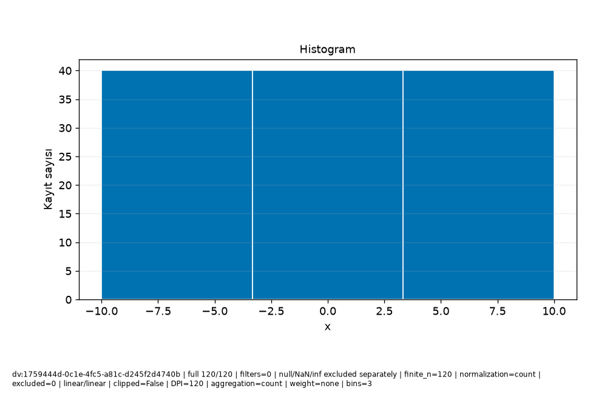

# Veri\_Ufku · Bilimsel rapor

Protokol: exploratory
Keşifsel inceleme; analiz birimi, seçim ve test kullanımını kayıtlı sonuçlarla değerlendirin.

Güncellik: Seçilen dataset/run için daha yeni kayıt bulunmadı; dış kaynağın canlı tazeliği doğrulanmadı.

Test kullanım defteri: []
Model seçim protokolü: kayıtlı method/model-card alanlarına bakın; alan yoksa not_recorded.

## Araştırma sorusu

**text**

```text
Soruyu ve analiz birimini kullanıcı olarak açıklayın.
```
**evidence**

```text
Kullanıcı metni; doğrulanmış hesap değildir.
```

## Yorum ve sınırlamalar

**text**

```text
Bulguyu yorumdan ayırın; nedensel çıkarım varsayımlarını açıkça yazın.
```
**evidence**

```text
Kullanıcı metni; doğrulanmış hesap değildir.
```

## Kaynakça


## method

**record_id**

```text
result:fc76cf61-db0b-4446-9ca0-0b8533ecadb6
```
**capability_id**

```text
model.regression
```
**dataset_versions**

```text
[
  "dv:1759444d-0c1e-4fc5-a81c-d245f2d4740b"
]
```
**run_id**

```text
run:713c056b-eee3-4616-8b75-1d96f90787e2
```
**evidence**

```text
Kayıtlı alan projeksiyonu; yeni hesap veya otomatik yorum değildir.
```
**data**

```text
{
  "spec": {
    "availability": {
      "col:25436e78-8f49-406b-8956-20fc65634a6e": {
        "note": "Önceden bilinir",
        "offset_seconds": 0
      }
    },
    "baseline": "auto",
    "entity_use": "new",
    "folds": 3,
    "horizon_seconds": 0,
    "method": "auto",
    "prediction_moment": "Ölçüm öncesi",
    "seed": 42,
    "structure": "independent",
    "test_fraction": 0.2,
    "validation_fraction": 0.2
  },
  "model_card": {
    "baseline": {
      "comparison": [
        {
          "metrics": [
            {
              "averaging": "per_record",
              "coverage": "all eligible records in this evaluation partition",
              "direction": "minimize",
              "metric": "mae",
              "n": 24,
              "scope": "validation",
              "status": "valid",
              "value": 15.105042016806722
            },
            {
              "averaging": "per_record",
              "coverage": "all eligible records in this evaluation partition",
              "direction": "minimize",
              "metric": "rmse",
              "n": 24,
              "scope": "validation",
              "status": "valid",
              "value": 17.131074485116738
            },
            {
              "averaging": "per_record",
              "coverage": "all eligible records in this evaluation partition",
              "direction": "maximize",
              "metric": "r2",
              "n": 24,
              "scope": "validation",
              "status": "valid",
              "value": -0.07031033705694889
            }
          ],
          "scope": "validation"
        },
        {
          "metrics": [
            {
              "averaging": "per_record",
              "coverage": "all eligible records in this evaluation partition",
              "direction": "minimize",
              "metric": "mae",
              "n": 32,
              "scope": "cv:1",
              "status": "valid",
              "value": 16.085215336134453
            },
            {
              "averaging": "per_record",
              "coverage": "all eligible records in this evaluation partition",
              "direction": "minimize",
              "metric": "rmse",
              "n": 32,
              "scope": "cv:1",
              "status": "valid",
              "value": 17.78349866194151
            },
            {
              "averaging": "per_record",
              "coverage": "all eligible records in this evaluation partition",
              "direction": "maximize",
              "metric": "r2",
              "n": 32,
              "scope": "cv:1",
              "status": "valid",
              "value": -0.08216532968157875
            }
          ],
          "scope": "cv:1"
        },
        {
          "metrics": [
            {
              "averaging": "per_record",
              "coverage": "all eligible records in this evaluation partition",
              "direction": "minimize",
              "metric": "mae",
              "n": 32,
              "scope": "cv:2",
              "status": "valid",
              "value": 14.063484768907566
            },
            {
              "averaging": "per_record",
              "coverage": "all eligible records in this evaluation partition",
              "direction": "minimize",
              "metric": "rmse",
              "n": 32,
              "scope": "cv:2",
              "status": "valid",
              "value": 16.834420290258713
            },
            {
              "averaging": "per_record",
              "coverage": "all eligible records in this evaluation partition",
              "direction": "maximize",
              "metric": "r2",
              "n": 32,
              "scope": "cv:2",
              "status": "valid",
              "value": -0.000592538052601066
            }
          ],
          "scope": "cv:2"
        },
        {
          "metrics": [
            {
              "averaging": "per_record",
              "coverage": "all eligible records in this evaluation partition",
              "direction": "minimize",
              "metric": "mae",
              "n": 32,
              "scope": "cv:3",
              "status": "valid",
              "value": 16.882878151260506
            },
            {
              "averaging": "per_record",
              "coverage": "all eligible records in this evaluation partition",
              "direction": "minimize",
              "metric": "rmse",
              "n": 32,
              "scope": "cv:3",
              "status": "valid",
              "value": 19.037369544238533
            },
            {
              "averaging": "per_record",
              "coverage": "all eligible records in this evaluation partition",
              "direction": "maximize",
              "metric": "r2",
              "n": 32,
              "scope": "cv:3",
              "status": "valid",
              "value": -0.084358201283397
            }
          ],
          "scope": "cv:3"
        }
      ],
      "limitation": "Final koşuda yeniden baseline seçimi yapılmaz; geliştirme koşusu kartına bakın.",
      "strategy": "mean"
    },
    "candidate_selection": {
      "parameters": {
        "alpha": 1.0,
        "candidates": [
          "baseline",
          "linear",
          "ridge",
          "forest"
        ],
        "depth": 8,
        "trees": 50,
        "unit": "TL"
      },
      "rule": "minimum development CV mean MAE; ties follow candidate order",
      "selected": "linear"
    },
    "columns": [
      {
        "id": "col:25436e78-8f49-406b-8956-20fc65634a6e",
        "name": "x",
        "original_name": "x",
        "type": "Float64"
      },
      {
        "id": "col:81292e47-c3fe-4358-9f1b-66fffb9491bd",
        "name": "y",
        "original_name": "y",
        "type": "Float64"
      }
    ],
    "dataset_version": "dv:1759444d-0c1e-4fc5-a81c-d245f2d4740b",
    "decision": null,
    "estimator": "LinearRegression",
    "features": [
      {
        "id": "col:25436e78-8f49-406b-8956-20fc65634a6e",
        "name": "x",
        "type": "Float64",
        "unit": ""
      }
    ],
    "fit_row_ids": [
      "row:d79e8978-2c73-4541-96e9-f57f3525bf39",
      "row:6be4f22d-b2ff-44c6-b061-639b50968080",
      "row:9c3cfa5f-7224-4570-b769-3b32f04c96b3",
      "row:2c891771-0200-404e-8243-d24370f08166",
      "row:a45e3aad-168a-4d06-b421-1d1e80b2bc96",
      "row:6158db76-3166-4027-bbdc-89127088c944",
      "row:d74503dd-216f-4f20-a5fe-62507544cf2c",
      "row:5a4a0cf9-b66c-4a63-8381-079d8e585ba2",
      "row:2aef84d2-c67d-4057-8f29-0cabad16cf9d",
      "row:7f73543b-70c2-4cf6-8b06-9688bb196ea4",
      "row:de31f497-93de-469b-9077-5cffef02c0ec",
      "row:6be74b5f-fde2-44af-aed8-c83ec03bfb91",
      "row:77daafe3-6b2c-4646-aae1-6e644c08b6b3",
      "row:c6ca180a-a80f-425b-8e68-e591763c074e",
      "row:0e4658d2-c7cd-4389-a209-c621e47b341f",
      "row:96de6964-b503-42ce-86f8-7fdc80fd850b",
      "row:3a1a1394-ff16-475c-be89-cfb920d9cb09",
      "row:cddbe015-6ee3-45ac-9175-9c12f66fd06f",
      "row:da15f771-b827-434d-9f6a-bf7613943f86",
      "row:011677ff-5add-43a0-975f-4516c4e4f35a",
      "row:b146e0a0-d58f-415d-b5e1-c48ef3f5b28d",
      "row:5be4a4c2-4d9c-46c9-a6a1-e570bc4f630a",
      "row:aeb24476-3b47-4e1c-b5a9-1fded17f2785",
      "row:a55886f1-93d6-4010-832e-6a9f5838ac11",
      "row:8e9f711f-ac49-4c7e-9692-8e58332be957",
      "row:a044ff22-428f-48f3-a622-53f1654d358e",
      "row:c1a1eea2-dbb1-463f-8c46-c566a33a8b3c",
      "row:ab329aa1-41dd-47ed-9282-48feca215e1a",
      "row:8aa6698e-242e-4d97-bde9-2799888f4f21",
      "row:799dd7eb-63be-4e08-9f50-85c900f74de9",
      "row:7d7a1239-64fe-4ceb-b54a-eff44f7a3165",
      "row:98fe3661-75db-4615-a328-089e210c1a3c",
      "row:8121f7dc-4355-4b3a-9acb-747e271e27f1",
      "row:e388cb84-42d9-4416-b4b2-867bd8ff44d0",
      "row:7cc171e3-797d-4c74-bc34-4ce330408266",
      "row:cefcb1ff-54b2-4675-9c68-e5ce4fbf0fd1",
      "row:5d00c7d8-a825-403a-89e8-e71bd84d3b6b",
      "row:039ff5f7-6fa3-48f1-9735-70a2ade5cab9",
      "row:8cace0a1-84e6-4840-b8a7-240a12fed546",
      "row:b6a07bdf-dc67-4fd2-a8da-46dcd29c3226",
      "row:c84ff0e2-c1ff-4178-bdc4-426126cd3022",
      "row:0c171753-3723-4907-a956-11b453563b1d",
      "row:20ede7a0-5dcb-4974-910b-07fdac8141d3",
      "row:7303b558-7fdc-49e4-a24f-b492a690dd6d",
      "row:217369f3-8c8e-4d38-98c0-f809ba5fb66a",
      "row:93b0dc91-d044-4797-ace2-7e2c97693c09",
      "row:7677727d-eaba-4694-b828-82d5278d62d5",
      "row:79696588-a59f-461d-8306-797648dbc080",
      "row:a910147f-c5d6-4e51-b36c-5c9567134ca6",
      "row:bf85efaf-1355-4f8a-a324-4d1d47cffb69",
      "row:a7ec64fb-3e59-4a90-b7d5-760d6dca4470",
      "row:2b3d0ad5-00d0-4153-9468-7473ed50d1bb",
      "row:84c419ef-b380-4f38-88a5-b6a111cd5877",
      "row:f6b2baa0-5052-4857-9465-417eacafa72c",
      "row:5ffe98d3-019e-4d8c-b5ea-91f93c3da0d2",
      "row:0fdb0f68-2bab-4766-aaf9-448afd2448ff",
      "row:aaccc126-0d59-42f9-b66a-376d8eb6fe4d",
      "row:0de0aa6d-6731-4a52-99b0-209ac952b67f",
      "row:75e85070-9cc8-497d-9856-adf2b6eb2c56",
      "row:37aa5e52-e94b-4023-8045-80571ac3ba05",
      "row:ca354a09-0366-4988-8e7b-607465ded9eb",
      "row:aeabb04a-804f-4ca9-ba99-21d139c909a3",
      "row:020ceee2-a52a-4df5-b3fb-0b5c0fe98266",
      "row:ce2f1c05-6bba-4a2f-923a-dc12c98e8f8e",
      "row:b8d90584-acc8-4890-bedf-105e3053efad",
      "row:9dcffd9d-2cc9-449f-b5f3-443621b4b7e5",
      "row:18b5c907-643d-4b14-9a38-8e249d97a2aa",
      "row:aed2c764-f837-4c93-8cf2-423a485b3adf",
      "row:d1737f37-af0f-437b-a8be-3ce368d0b7e2",
      "row:59628082-ca5b-43ee-a71b-80a1a4887a08",
      "row:a50ad0c3-8c94-4087-8f56-bc463b891c9a",
      "row:90460d0a-8160-477d-a164-de04d45ffbed"
    ],
    "fit_scope": "development_train; validation previously used for selection",
    "fitted_preprocessing": {
      "1": {
        "kind": "impute_numeric",
        "statistics": [
          1.344537815126051
        ]
      },
      "2": {
        "kind": "standard_scale",
        "mean": [
          0.6092436974789925
        ],
        "scale": [
          5.948272597687973
        ]
      }
    },
    "importance": {
      "limitation": "İlişkili değişkenler önemi paylaşır/gizler; negatif önem mümkün. Nedensellik değildir; final test kullanılmadı.",
      "metric": "negative_MAE",
      "repeats": 3,
      "row_ids": [
        "row:f41f5890-9ca9-4042-ab56-d61cf0150859",
        "row:e654e13c-1130-4933-a88b-1945bfaac443",
        "row:322cced7-1a06-4755-96b5-cdf61657c7e3",
        "row:c34c328b-d89b-4417-ba8e-c79bf3123dee",
        "row:62262784-5b49-48d8-844f-c95b011c81ca",
        "row:f02f776a-8c21-41e7-a29b-c58110f3a0bb",
        "row:1e9930a4-c271-4ec4-aab3-38977c189bc3",
        "row:d74f8078-e59d-46eb-8d72-6823e716ed41",
        "row:0cfdd659-94a0-40ef-93d2-d422caecfd6f",
        "row:ce2ed54f-9ff4-4557-842f-17b49b6034e2",
        "row:0b0f7d98-46c1-4c79-951b-ec1af4b24082",
        "row:6671a2ae-6944-4e10-b6e5-cc67d557bca8",
        "row:14b3cbee-4791-4b7e-840f-07c34c56d0ab",
        "row:f0de81fd-f5f6-4192-99c3-8f16e898e4ef",
        "row:f2bb7e20-f1ba-4d2f-bc45-afd42a460e68",
        "row:45308a21-2e68-4af5-add6-137300863ac2",
        "row:fb2360a5-80d6-4a9f-99d5-24933849babf",
        "row:02c6dab2-6a04-449e-aceb-08260bae50cd",
        "row:de3f8ab6-7ce6-4591-be38-15ad052b47df",
        "row:61448a9d-7f38-4ebb-83b3-d13c7a9dd97f",
        "row:3491440d-2aa7-48f5-b9e1-4fb011a3557e",
        "row:80a89173-19b2-40e4-bcdb-ed8695160c87",
        "row:6167aa6d-e323-45e6-82fa-2403069413e5",
        "row:255fd9f2-903b-460f-8128-c1952d0930e5"
      ],
      "scope": "validation; exploratory; already used for model/threshold selection",
      "seed": 42,
      "status": "available",
      "values": [
        {
          "column_id": "col:25436e78-8f49-406b-8956-20fc65634a6e",
          "mean": 19.523809523809522,
          "name": "x",
          "std": 2.038091850261204
        }
      ]
    },
    "label_order": [],
    "limitations": "Katsayı ve önemler nedensel etki değildir. İlişkili özellikler önemi paylaşabilir veya gizleyebilir. Yeni veri dağılımı değişebilir; olasılık kesinlik veya kalibrasyon garantisi değildir. Küme ve anomali adayları gerçek sınıf/veri hatası değildir; otomatik silme yok.",
    "method": null,
    "metrics": [
      {
        "evaluation_n": 24,
        "metrics": [
          {
            "averaging": "per_record",
            "coverage": "all eligible records in this evaluation partition",
            "direction": "minimize",
            "metric": "mae",
            "n": 24,
            "scope": "validation",
            "status": "valid",
            "value": 4.810966440042345e-15
          },
          {
            "averaging": "per_record",
            "coverage": "all eligible records in this evaluation partition",
            "direction": "minimize",
            "metric": "rmse",
            "n": 24,
            "scope": "validation",
            "status": "valid",
            "value": 5.582114810376975e-15
          },
          {
            "averaging": "per_record",
            "coverage": "all eligible records in this evaluation partition",
            "direction": "maximize",
            "metric": "r2",
            "n": 24,
            "scope": "validation",
            "status": "valid",
            "value": 1.0
          }
        ],
        "scope": "validation",
        "status": "valid",
        "train_n": 72
      },
      {
        "evaluation_n": 32,
        "metrics": [
          {
            "averaging": "per_record",
            "coverage": "all eligible records in this evaluation partition",
            "direction": "minimize",
            "metric": "mae",
            "n": 32,
            "scope": "cv:1",
            "status": "valid",
            "value": 1.3877787807814457e-15
          },
          {
            "averaging": "per_record",
            "coverage": "all eligible records in this evaluation partition",
            "direction": "minimize",
            "metric": "rmse",
            "n": 32,
            "scope": "cv:1",
            "status": "valid",
            "value": 2.1413206232596582e-15
          },
          {
            "averaging": "per_record",
            "coverage": "all eligible records in this evaluation partition",
            "direction": "maximize",
            "metric": "r2",
            "n": 32,
            "scope": "cv:1",
            "status": "valid",
            "value": 1.0
          }
        ],
        "scope": "cv:1",
        "status": "valid",
        "train_n": 64
      },
      {
        "evaluation_n": 32,
        "metrics": [
          {
            "averaging": "per_record",
            "coverage": "all eligible records in this evaluation partition",
            "direction": "minimize",
            "metric": "mae",
            "n": 32,
            "scope": "cv:2",
            "status": "valid",
            "value": 5.828670879282072e-15
          },
          {
            "averaging": "per_record",
            "coverage": "all eligible records in this evaluation partition",
            "direction": "minimize",
            "metric": "rmse",
            "n": 32,
            "scope": "cv:2",
            "status": "valid",
            "value": 7.320740245935003e-15
          },
          {
            "averaging": "per_record",
            "coverage": "all eligible records in this evaluation partition",
            "direction": "maximize",
            "metric": "r2",
            "n": 32,
            "scope": "cv:2",
            "status": "valid",
            "value": 1.0
          }
        ],
        "scope": "cv:2",
        "status": "valid",
        "train_n": 64
      },
      {
        "evaluation_n": 32,
        "metrics": [
          {
            "averaging": "per_record",
            "coverage": "all eligible records in this evaluation partition",
            "direction": "minimize",
            "metric": "mae",
            "n": 32,
            "scope": "cv:3",
            "status": "valid",
            "value": 1.915134717478395e-15
          },
          {
            "averaging": "per_record",
            "coverage": "all eligible records in this evaluation partition",
            "direction": "minimize",
            "metric": "rmse",
            "n": 32,
            "scope": "cv:3",
            "status": "valid",
            "value": 2.687565378447544e-15
          },
          {
            "averaging": "per_record",
            "coverage": "all eligible records in this evaluation partition",
            "direction": "maximize",
            "metric": "r2",
            "n": 32,
            "scope": "cv:3",
            "status": "valid",
            "value": 1.0
          }
        ],
        "scope": "cv:3",
        "status": "valid",
        "train_n": 64
      }
    ],
    "preparation_spec": {
      "allow_identifiers": false,
      "categorical_imputation": "most_frequent",
      "date_features": true,
      "encoding": "onehot",
      "family": "linear",
      "features": [
        "col:25436e78-8f49-406b-8956-20fc65634a6e"
      ],
      "group": "",
      "history_action": "review",
      "history_note": "",
      "invalid_numeric": "reject",
      "numeric_imputation": "median",
      "precision": "reject",
      "prediction_context": "",
      "purpose": "regression",
      "scaling": "standard",
      "selection": "none",
      "source_version": "dv:1759444d-0c1e-4fc5-a81c-d245f2d4740b",
      "target": "col:81292e47-c3fe-4358-9f1b-66fffb9491bd",
      "time": ""
    },
    "preprocessing": {
      "category_vocabulary": null,
      "column_lineage": [
        {
          "category_map": [],
          "input_column_id": "col:25436e78-8f49-406b-8956-20fc65634a6e",
          "names_status": "structurally_known",
          "output_names": [
            "f_25436e788f49406b895620fc65634a6e__numeric"
          ],
          "selected_after_fit": "all_planned",
          "source_dtype": "Float64",
          "source_name": "x"
        }
      ],
      "estimator_family": "linear",
      "feature_selection_mask": null,
      "fit_state": "not_fitted",
      "fitted_parameters": {},
      "schema": "PreparationPlan/v1",
      "steps": [
        {
          "input_column_ids": [
            "col:25436e78-8f49-406b-8956-20fc65634a6e"
          ],
          "kind": "numeric",
          "learned_scope": "row_local",
          "output_names": [
            "f_25436e788f49406b895620fc65634a6e__numeric"
          ],
          "parameters": {
            "nonfinite": "reject",
            "precision": "reject"
          },
          "reason": "Kimlik ölçüm değildir; Float64 kaybı gelecekte açık politika ile denetlenir.",
          "state": "planned"
        },
        {
          "input_column_ids": [
            "col:25436e78-8f49-406b-8956-20fc65634a6e"
          ],
          "kind": "impute_numeric",
          "learned_scope": "training_fold",
          "output_names": [
            "f_25436e788f49406b895620fc65634a6e__numeric"
          ],
          "parameters": {
            "all_missing": "error",
            "strategy": "median"
          },
          "reason": "Seçilen doldurma değeri yalnız eğitim katında öğrenilir; test/validation ortalaması kullanılmaz.",
          "state": "planned"
        },
        {
          "input_column_ids": [
            "col:25436e78-8f49-406b-8956-20fc65634a6e"
          ],
          "kind": "standard_scale",
          "learned_scope": "training_fold",
          "output_names": [
            "f_25436e788f49406b895620fc65634a6e__numeric"
          ],
          "parameters": {
            "explicit_override": false
          },
          "reason": "Uzaklıklar ve düzenlileştirilmiş doğrusal modeller ölçüm ölçeğine duyarlıdır; eğitim katında standardizasyon planlandı.",
          "state": "planned"
        }
      ],
      "training_dependency": "Requires a validated split/fold protocol in Phase16; no training performed",
      "version_id": "ml-pipeline:d45854b7-83b9-4f39-995c-88e65dc9fa7d"
    },
    "probability_supported": false,
    "purpose": "regression",
    "run_id": "run:713c056b-eee3-4616-8b75-1d96f90787e2",
    "schema": "ModelCard/v1",
    "seed": 42,
    "snapshot_fingerprint": {
      "sha256": "3604acaae076a8d84d3a30893b9a772853ed2205f5fbcebcb1ccbd53d5f40567",
      "size": 11598
    },
    "split": {
      "invalid_folds": [],
      "membership": {
        "development": [
          "row:011677ff-5add-43a0-975f-4516c4e4f35a",
          "row:020ceee2-a52a-4df5-b3fb-0b5c0fe98266",
          "row:02c6dab2-6a04-449e-aceb-08260bae50cd",
          "row:039ff5f7-6fa3-48f1-9735-70a2ade5cab9",
          "row:0b0f7d98-46c1-4c79-951b-ec1af4b24082",
          "row:0c171753-3723-4907-a956-11b453563b1d",
          "row:0cfdd659-94a0-40ef-93d2-d422caecfd6f",
          "row:0de0aa6d-6731-4a52-99b0-209ac952b67f",
          "row:0e4658d2-c7cd-4389-a209-c621e47b341f",
          "row:0fdb0f68-2bab-4766-aaf9-448afd2448ff",
          "row:14b3cbee-4791-4b7e-840f-07c34c56d0ab",
          "row:18b5c907-643d-4b14-9a38-8e249d97a2aa",
          "row:1e9930a4-c271-4ec4-aab3-38977c189bc3",
          "row:20ede7a0-5dcb-4974-910b-07fdac8141d3",
          "row:217369f3-8c8e-4d38-98c0-f809ba5fb66a",
          "row:255fd9f2-903b-460f-8128-c1952d0930e5",
          "row:2aef84d2-c67d-4057-8f29-0cabad16cf9d",
          "row:2b3d0ad5-00d0-4153-9468-7473ed50d1bb",
          "row:2c891771-0200-404e-8243-d24370f08166",
          "row:322cced7-1a06-4755-96b5-cdf61657c7e3",
          "row:3491440d-2aa7-48f5-b9e1-4fb011a3557e",
          "row:37aa5e52-e94b-4023-8045-80571ac3ba05",
          "row:3a1a1394-ff16-475c-be89-cfb920d9cb09",
          "row:45308a21-2e68-4af5-add6-137300863ac2",
          "row:59628082-ca5b-43ee-a71b-80a1a4887a08",
          "row:5a4a0cf9-b66c-4a63-8381-079d8e585ba2",
          "row:5be4a4c2-4d9c-46c9-a6a1-e570bc4f630a",
          "row:5d00c7d8-a825-403a-89e8-e71bd84d3b6b",
          "row:5ffe98d3-019e-4d8c-b5ea-91f93c3da0d2",
          "row:61448a9d-7f38-4ebb-83b3-d13c7a9dd97f",
          "row:6158db76-3166-4027-bbdc-89127088c944",
          "row:6167aa6d-e323-45e6-82fa-2403069413e5",
          "row:62262784-5b49-48d8-844f-c95b011c81ca",
          "row:6671a2ae-6944-4e10-b6e5-cc67d557bca8",
          "row:6be4f22d-b2ff-44c6-b061-639b50968080",
          "row:6be74b5f-fde2-44af-aed8-c83ec03bfb91",
          "row:7303b558-7fdc-49e4-a24f-b492a690dd6d",
          "row:75e85070-9cc8-497d-9856-adf2b6eb2c56",
          "row:7677727d-eaba-4694-b828-82d5278d62d5",
          "row:77daafe3-6b2c-4646-aae1-6e644c08b6b3",
          "row:79696588-a59f-461d-8306-797648dbc080",
          "row:799dd7eb-63be-4e08-9f50-85c900f74de9",
          "row:7cc171e3-797d-4c74-bc34-4ce330408266",
          "row:7d7a1239-64fe-4ceb-b54a-eff44f7a3165",
          "row:7f73543b-70c2-4cf6-8b06-9688bb196ea4",
          "row:80a89173-19b2-40e4-bcdb-ed8695160c87",
          "row:8121f7dc-4355-4b3a-9acb-747e271e27f1",
          "row:84c419ef-b380-4f38-88a5-b6a111cd5877",
          "row:8aa6698e-242e-4d97-bde9-2799888f4f21",
          "row:8cace0a1-84e6-4840-b8a7-240a12fed546",
          "row:8e9f711f-ac49-4c7e-9692-8e58332be957",
          "row:90460d0a-8160-477d-a164-de04d45ffbed",
          "row:93b0dc91-d044-4797-ace2-7e2c97693c09",
          "row:96de6964-b503-42ce-86f8-7fdc80fd850b",
          "row:98fe3661-75db-4615-a328-089e210c1a3c",
          "row:9c3cfa5f-7224-4570-b769-3b32f04c96b3",
          "row:9dcffd9d-2cc9-449f-b5f3-443621b4b7e5",
          "row:a044ff22-428f-48f3-a622-53f1654d358e",
          "row:a45e3aad-168a-4d06-b421-1d1e80b2bc96",
          "row:a50ad0c3-8c94-4087-8f56-bc463b891c9a",
          "row:a55886f1-93d6-4010-832e-6a9f5838ac11",
          "row:a7ec64fb-3e59-4a90-b7d5-760d6dca4470",
          "row:a910147f-c5d6-4e51-b36c-5c9567134ca6",
          "row:aaccc126-0d59-42f9-b66a-376d8eb6fe4d",
          "row:ab329aa1-41dd-47ed-9282-48feca215e1a",
          "row:aeabb04a-804f-4ca9-ba99-21d139c909a3",
          "row:aeb24476-3b47-4e1c-b5a9-1fded17f2785",
          "row:aed2c764-f837-4c93-8cf2-423a485b3adf",
          "row:b146e0a0-d58f-415d-b5e1-c48ef3f5b28d",
          "row:b6a07bdf-dc67-4fd2-a8da-46dcd29c3226",
          "row:b8d90584-acc8-4890-bedf-105e3053efad",
          "row:bf85efaf-1355-4f8a-a324-4d1d47cffb69",
          "row:c1a1eea2-dbb1-463f-8c46-c566a33a8b3c",
          "row:c34c328b-d89b-4417-ba8e-c79bf3123dee",
          "row:c6ca180a-a80f-425b-8e68-e591763c074e",
          "row:c84ff0e2-c1ff-4178-bdc4-426126cd3022",
          "row:ca354a09-0366-4988-8e7b-607465ded9eb",
          "row:cddbe015-6ee3-45ac-9175-9c12f66fd06f",
          "row:ce2ed54f-9ff4-4557-842f-17b49b6034e2",
          "row:ce2f1c05-6bba-4a2f-923a-dc12c98e8f8e",
          "row:cefcb1ff-54b2-4675-9c68-e5ce4fbf0fd1",
          "row:d1737f37-af0f-437b-a8be-3ce368d0b7e2",
          "row:d74503dd-216f-4f20-a5fe-62507544cf2c",
          "row:d74f8078-e59d-46eb-8d72-6823e716ed41",
          "row:d79e8978-2c73-4541-96e9-f57f3525bf39",
          "row:da15f771-b827-434d-9f6a-bf7613943f86",
          "row:de31f497-93de-469b-9077-5cffef02c0ec",
          "row:de3f8ab6-7ce6-4591-be38-15ad052b47df",
          "row:e388cb84-42d9-4416-b4b2-867bd8ff44d0",
          "row:e654e13c-1130-4933-a88b-1945bfaac443",
          "row:f02f776a-8c21-41e7-a29b-c58110f3a0bb",
          "row:f0de81fd-f5f6-4192-99c3-8f16e898e4ef",
          "row:f2bb7e20-f1ba-4d2f-bc45-afd42a460e68",
          "row:f41f5890-9ca9-4042-ab56-d61cf0150859",
          "row:f6b2baa0-5052-4857-9465-417eacafa72c",
          "row:fb2360a5-80d6-4a9f-99d5-24933849babf"
        ],
        "folds": [
          {
            "status": "valid",
            "train": [
              "row:011677ff-5add-43a0-975f-4516c4e4f35a",
              "row:020ceee2-a52a-4df5-b3fb-0b5c0fe98266",
              "row:039ff5f7-6fa3-48f1-9735-70a2ade5cab9",
              "row:0c171753-3723-4907-a956-11b453563b1d",
              "row:0de0aa6d-6731-4a52-99b0-209ac952b67f",
              "row:0e4658d2-c7cd-4389-a209-c621e47b341f",
              "row:0fdb0f68-2bab-4766-aaf9-448afd2448ff",
              "row:18b5c907-643d-4b14-9a38-8e249d97a2aa",
              "row:20ede7a0-5dcb-4974-910b-07fdac8141d3",
              "row:217369f3-8c8e-4d38-98c0-f809ba5fb66a",
              "row:2aef84d2-c67d-4057-8f29-0cabad16cf9d",
              "row:2b3d0ad5-00d0-4153-9468-7473ed50d1bb",
              "row:37aa5e52-e94b-4023-8045-80571ac3ba05",
              "row:3a1a1394-ff16-475c-be89-cfb920d9cb09",
              "row:59628082-ca5b-43ee-a71b-80a1a4887a08",
              "row:5be4a4c2-4d9c-46c9-a6a1-e570bc4f630a",
              "row:5d00c7d8-a825-403a-89e8-e71bd84d3b6b",
              "row:5ffe98d3-019e-4d8c-b5ea-91f93c3da0d2",
              "row:6be74b5f-fde2-44af-aed8-c83ec03bfb91",
              "row:7303b558-7fdc-49e4-a24f-b492a690dd6d",
              "row:75e85070-9cc8-497d-9856-adf2b6eb2c56",
              "row:7677727d-eaba-4694-b828-82d5278d62d5",
              "row:77daafe3-6b2c-4646-aae1-6e644c08b6b3",
              "row:79696588-a59f-461d-8306-797648dbc080",
              "row:799dd7eb-63be-4e08-9f50-85c900f74de9",
              "row:7cc171e3-797d-4c74-bc34-4ce330408266",
              "row:7d7a1239-64fe-4ceb-b54a-eff44f7a3165",
              "row:7f73543b-70c2-4cf6-8b06-9688bb196ea4",
              "row:8121f7dc-4355-4b3a-9acb-747e271e27f1",
              "row:84c419ef-b380-4f38-88a5-b6a111cd5877",
              "row:8aa6698e-242e-4d97-bde9-2799888f4f21",
              "row:8cace0a1-84e6-4840-b8a7-240a12fed546",
              "row:8e9f711f-ac49-4c7e-9692-8e58332be957",
              "row:90460d0a-8160-477d-a164-de04d45ffbed",
              "row:93b0dc91-d044-4797-ace2-7e2c97693c09",
              "row:96de6964-b503-42ce-86f8-7fdc80fd850b",
              "row:98fe3661-75db-4615-a328-089e210c1a3c",
              "row:9dcffd9d-2cc9-449f-b5f3-443621b4b7e5",
              "row:a044ff22-428f-48f3-a622-53f1654d358e",
              "row:a50ad0c3-8c94-4087-8f56-bc463b891c9a",
              "row:a55886f1-93d6-4010-832e-6a9f5838ac11",
              "row:a7ec64fb-3e59-4a90-b7d5-760d6dca4470",
              "row:a910147f-c5d6-4e51-b36c-5c9567134ca6",
              "row:aaccc126-0d59-42f9-b66a-376d8eb6fe4d",
              "row:ab329aa1-41dd-47ed-9282-48feca215e1a",
              "row:aeabb04a-804f-4ca9-ba99-21d139c909a3",
              "row:aeb24476-3b47-4e1c-b5a9-1fded17f2785",
              "row:aed2c764-f837-4c93-8cf2-423a485b3adf",
              "row:b146e0a0-d58f-415d-b5e1-c48ef3f5b28d",
              "row:b6a07bdf-dc67-4fd2-a8da-46dcd29c3226",
              "row:b8d90584-acc8-4890-bedf-105e3053efad",
              "row:bf85efaf-1355-4f8a-a324-4d1d47cffb69",
              "row:c1a1eea2-dbb1-463f-8c46-c566a33a8b3c",
              "row:c6ca180a-a80f-425b-8e68-e591763c074e",
              "row:c84ff0e2-c1ff-4178-bdc4-426126cd3022",
              "row:ca354a09-0366-4988-8e7b-607465ded9eb",
              "row:cddbe015-6ee3-45ac-9175-9c12f66fd06f",
              "row:ce2f1c05-6bba-4a2f-923a-dc12c98e8f8e",
              "row:cefcb1ff-54b2-4675-9c68-e5ce4fbf0fd1",
              "row:d1737f37-af0f-437b-a8be-3ce368d0b7e2",
              "row:da15f771-b827-434d-9f6a-bf7613943f86",
              "row:de31f497-93de-469b-9077-5cffef02c0ec",
              "row:e388cb84-42d9-4416-b4b2-867bd8ff44d0",
              "row:f6b2baa0-5052-4857-9465-417eacafa72c"
            ],
            "validation": [
              "row:02c6dab2-6a04-449e-aceb-08260bae50cd",
              "row:0b0f7d98-46c1-4c79-951b-ec1af4b24082",
              "row:0cfdd659-94a0-40ef-93d2-d422caecfd6f",
              "row:14b3cbee-4791-4b7e-840f-07c34c56d0ab",
              "row:1e9930a4-c271-4ec4-aab3-38977c189bc3",
              "row:255fd9f2-903b-460f-8128-c1952d0930e5",
              "row:2c891771-0200-404e-8243-d24370f08166",
              "row:322cced7-1a06-4755-96b5-cdf61657c7e3",
              "row:3491440d-2aa7-48f5-b9e1-4fb011a3557e",
              "row:45308a21-2e68-4af5-add6-137300863ac2",
              "row:5a4a0cf9-b66c-4a63-8381-079d8e585ba2",
              "row:61448a9d-7f38-4ebb-83b3-d13c7a9dd97f",
              "row:6158db76-3166-4027-bbdc-89127088c944",
              "row:6167aa6d-e323-45e6-82fa-2403069413e5",
              "row:62262784-5b49-48d8-844f-c95b011c81ca",
              "row:6671a2ae-6944-4e10-b6e5-cc67d557bca8",
              "row:6be4f22d-b2ff-44c6-b061-639b50968080",
              "row:80a89173-19b2-40e4-bcdb-ed8695160c87",
              "row:9c3cfa5f-7224-4570-b769-3b32f04c96b3",
              "row:a45e3aad-168a-4d06-b421-1d1e80b2bc96",
              "row:c34c328b-d89b-4417-ba8e-c79bf3123dee",
              "row:ce2ed54f-9ff4-4557-842f-17b49b6034e2",
              "row:d74503dd-216f-4f20-a5fe-62507544cf2c",
              "row:d74f8078-e59d-46eb-8d72-6823e716ed41",
              "row:d79e8978-2c73-4541-96e9-f57f3525bf39",
              "row:de3f8ab6-7ce6-4591-be38-15ad052b47df",
              "row:e654e13c-1130-4933-a88b-1945bfaac443",
              "row:f02f776a-8c21-41e7-a29b-c58110f3a0bb",
              "row:f0de81fd-f5f6-4192-99c3-8f16e898e4ef",
              "row:f2bb7e20-f1ba-4d2f-bc45-afd42a460e68",
              "row:f41f5890-9ca9-4042-ab56-d61cf0150859",
              "row:fb2360a5-80d6-4a9f-99d5-24933849babf"
            ]
          },
          {
            "status": "valid",
            "train": [
              "row:020ceee2-a52a-4df5-b3fb-0b5c0fe98266",
              "row:02c6dab2-6a04-449e-aceb-08260bae50cd",
              "row:0b0f7d98-46c1-4c79-951b-ec1af4b24082",
              "row:0c171753-3723-4907-a956-11b453563b1d",
              "row:0cfdd659-94a0-40ef-93d2-d422caecfd6f",
              "row:0de0aa6d-6731-4a52-99b0-209ac952b67f",
              "row:0fdb0f68-2bab-4766-aaf9-448afd2448ff",
              "row:14b3cbee-4791-4b7e-840f-07c34c56d0ab",
              "row:18b5c907-643d-4b14-9a38-8e249d97a2aa",
              "row:1e9930a4-c271-4ec4-aab3-38977c189bc3",
              "row:20ede7a0-5dcb-4974-910b-07fdac8141d3",
              "row:217369f3-8c8e-4d38-98c0-f809ba5fb66a",
              "row:255fd9f2-903b-460f-8128-c1952d0930e5",
              "row:2b3d0ad5-00d0-4153-9468-7473ed50d1bb",
              "row:2c891771-0200-404e-8243-d24370f08166",
              "row:322cced7-1a06-4755-96b5-cdf61657c7e3",
              "row:3491440d-2aa7-48f5-b9e1-4fb011a3557e",
              "row:37aa5e52-e94b-4023-8045-80571ac3ba05",
              "row:45308a21-2e68-4af5-add6-137300863ac2",
              "row:59628082-ca5b-43ee-a71b-80a1a4887a08",
              "row:5a4a0cf9-b66c-4a63-8381-079d8e585ba2",
              "row:5ffe98d3-019e-4d8c-b5ea-91f93c3da0d2",
              "row:61448a9d-7f38-4ebb-83b3-d13c7a9dd97f",
              "row:6158db76-3166-4027-bbdc-89127088c944",
              "row:6167aa6d-e323-45e6-82fa-2403069413e5",
              "row:62262784-5b49-48d8-844f-c95b011c81ca",
              "row:6671a2ae-6944-4e10-b6e5-cc67d557bca8",
              "row:6be4f22d-b2ff-44c6-b061-639b50968080",
              "row:7303b558-7fdc-49e4-a24f-b492a690dd6d",
              "row:75e85070-9cc8-497d-9856-adf2b6eb2c56",
              "row:7677727d-eaba-4694-b828-82d5278d62d5",
              "row:79696588-a59f-461d-8306-797648dbc080",
              "row:80a89173-19b2-40e4-bcdb-ed8695160c87",
              "row:84c419ef-b380-4f38-88a5-b6a111cd5877",
              "row:90460d0a-8160-477d-a164-de04d45ffbed",
              "row:93b0dc91-d044-4797-ace2-7e2c97693c09",
              "row:9c3cfa5f-7224-4570-b769-3b32f04c96b3",
              "row:9dcffd9d-2cc9-449f-b5f3-443621b4b7e5",
              "row:a45e3aad-168a-4d06-b421-1d1e80b2bc96",
              "row:a50ad0c3-8c94-4087-8f56-bc463b891c9a",
              "row:a7ec64fb-3e59-4a90-b7d5-760d6dca4470",
              "row:a910147f-c5d6-4e51-b36c-5c9567134ca6",
              "row:aaccc126-0d59-42f9-b66a-376d8eb6fe4d",
              "row:aeabb04a-804f-4ca9-ba99-21d139c909a3",
              "row:aed2c764-f837-4c93-8cf2-423a485b3adf",
              "row:b8d90584-acc8-4890-bedf-105e3053efad",
              "row:bf85efaf-1355-4f8a-a324-4d1d47cffb69",
              "row:c34c328b-d89b-4417-ba8e-c79bf3123dee",
              "row:c84ff0e2-c1ff-4178-bdc4-426126cd3022",
              "row:ca354a09-0366-4988-8e7b-607465ded9eb",
              "row:ce2ed54f-9ff4-4557-842f-17b49b6034e2",
              "row:ce2f1c05-6bba-4a2f-923a-dc12c98e8f8e",
              "row:d1737f37-af0f-437b-a8be-3ce368d0b7e2",
              "row:d74503dd-216f-4f20-a5fe-62507544cf2c",
              "row:d74f8078-e59d-46eb-8d72-6823e716ed41",
              "row:d79e8978-2c73-4541-96e9-f57f3525bf39",
              "row:de3f8ab6-7ce6-4591-be38-15ad052b47df",
              "row:e654e13c-1130-4933-a88b-1945bfaac443",
              "row:f02f776a-8c21-41e7-a29b-c58110f3a0bb",
              "row:f0de81fd-f5f6-4192-99c3-8f16e898e4ef",
              "row:f2bb7e20-f1ba-4d2f-bc45-afd42a460e68",
              "row:f41f5890-9ca9-4042-ab56-d61cf0150859",
              "row:f6b2baa0-5052-4857-9465-417eacafa72c",
              "row:fb2360a5-80d6-4a9f-99d5-24933849babf"
            ],
            "validation": [
              "row:011677ff-5add-43a0-975f-4516c4e4f35a",
              "row:039ff5f7-6fa3-48f1-9735-70a2ade5cab9",
              "row:0e4658d2-c7cd-4389-a209-c621e47b341f",
              "row:2aef84d2-c67d-4057-8f29-0cabad16cf9d",
              "row:3a1a1394-ff16-475c-be89-cfb920d9cb09",
              "row:5be4a4c2-4d9c-46c9-a6a1-e570bc4f630a",
              "row:5d00c7d8-a825-403a-89e8-e71bd84d3b6b",
              "row:6be74b5f-fde2-44af-aed8-c83ec03bfb91",
              "row:77daafe3-6b2c-4646-aae1-6e644c08b6b3",
              "row:799dd7eb-63be-4e08-9f50-85c900f74de9",
              "row:7cc171e3-797d-4c74-bc34-4ce330408266",
              "row:7d7a1239-64fe-4ceb-b54a-eff44f7a3165",
              "row:7f73543b-70c2-4cf6-8b06-9688bb196ea4",
              "row:8121f7dc-4355-4b3a-9acb-747e271e27f1",
              "row:8aa6698e-242e-4d97-bde9-2799888f4f21",
              "row:8cace0a1-84e6-4840-b8a7-240a12fed546",
              "row:8e9f711f-ac49-4c7e-9692-8e58332be957",
              "row:96de6964-b503-42ce-86f8-7fdc80fd850b",
              "row:98fe3661-75db-4615-a328-089e210c1a3c",
              "row:a044ff22-428f-48f3-a622-53f1654d358e",
              "row:a55886f1-93d6-4010-832e-6a9f5838ac11",
              "row:ab329aa1-41dd-47ed-9282-48feca215e1a",
              "row:aeb24476-3b47-4e1c-b5a9-1fded17f2785",
              "row:b146e0a0-d58f-415d-b5e1-c48ef3f5b28d",
              "row:b6a07bdf-dc67-4fd2-a8da-46dcd29c3226",
              "row:c1a1eea2-dbb1-463f-8c46-c566a33a8b3c",
              "row:c6ca180a-a80f-425b-8e68-e591763c074e",
              "row:cddbe015-6ee3-45ac-9175-9c12f66fd06f",
              "row:cefcb1ff-54b2-4675-9c68-e5ce4fbf0fd1",
              "row:da15f771-b827-434d-9f6a-bf7613943f86",
              "row:de31f497-93de-469b-9077-5cffef02c0ec",
              "row:e388cb84-42d9-4416-b4b2-867bd8ff44d0"
            ]
          },
          {
            "status": "valid",
            "train": [
              "row:011677ff-5add-43a0-975f-4516c4e4f35a",
              "row:02c6dab2-6a04-449e-aceb-08260bae50cd",
              "row:039ff5f7-6fa3-48f1-9735-70a2ade5cab9",
              "row:0b0f7d98-46c1-4c79-951b-ec1af4b24082",
              "row:0cfdd659-94a0-40ef-93d2-d422caecfd6f",
              "row:0e4658d2-c7cd-4389-a209-c621e47b341f",
              "row:14b3cbee-4791-4b7e-840f-07c34c56d0ab",
              "row:1e9930a4-c271-4ec4-aab3-38977c189bc3",
              "row:255fd9f2-903b-460f-8128-c1952d0930e5",
              "row:2aef84d2-c67d-4057-8f29-0cabad16cf9d",
              "row:2c891771-0200-404e-8243-d24370f08166",
              "row:322cced7-1a06-4755-96b5-cdf61657c7e3",
              "row:3491440d-2aa7-48f5-b9e1-4fb011a3557e",
              "row:3a1a1394-ff16-475c-be89-cfb920d9cb09",
              "row:45308a21-2e68-4af5-add6-137300863ac2",
              "row:5a4a0cf9-b66c-4a63-8381-079d8e585ba2",
              "row:5be4a4c2-4d9c-46c9-a6a1-e570bc4f630a",
              "row:5d00c7d8-a825-403a-89e8-e71bd84d3b6b",
              "row:61448a9d-7f38-4ebb-83b3-d13c7a9dd97f",
              "row:6158db76-3166-4027-bbdc-89127088c944",
              "row:6167aa6d-e323-45e6-82fa-2403069413e5",
              "row:62262784-5b49-48d8-844f-c95b011c81ca",
              "row:6671a2ae-6944-4e10-b6e5-cc67d557bca8",
              "row:6be4f22d-b2ff-44c6-b061-639b50968080",
              "row:6be74b5f-fde2-44af-aed8-c83ec03bfb91",
              "row:77daafe3-6b2c-4646-aae1-6e644c08b6b3",
              "row:799dd7eb-63be-4e08-9f50-85c900f74de9",
              "row:7cc171e3-797d-4c74-bc34-4ce330408266",
              "row:7d7a1239-64fe-4ceb-b54a-eff44f7a3165",
              "row:7f73543b-70c2-4cf6-8b06-9688bb196ea4",
              "row:80a89173-19b2-40e4-bcdb-ed8695160c87",
              "row:8121f7dc-4355-4b3a-9acb-747e271e27f1",
              "row:8aa6698e-242e-4d97-bde9-2799888f4f21",
              "row:8cace0a1-84e6-4840-b8a7-240a12fed546",
              "row:8e9f711f-ac49-4c7e-9692-8e58332be957",
              "row:96de6964-b503-42ce-86f8-7fdc80fd850b",
              "row:98fe3661-75db-4615-a328-089e210c1a3c",
              "row:9c3cfa5f-7224-4570-b769-3b32f04c96b3",
              "row:a044ff22-428f-48f3-a622-53f1654d358e",
              "row:a45e3aad-168a-4d06-b421-1d1e80b2bc96",
              "row:a55886f1-93d6-4010-832e-6a9f5838ac11",
              "row:ab329aa1-41dd-47ed-9282-48feca215e1a",
              "row:aeb24476-3b47-4e1c-b5a9-1fded17f2785",
              "row:b146e0a0-d58f-415d-b5e1-c48ef3f5b28d",
              "row:b6a07bdf-dc67-4fd2-a8da-46dcd29c3226",
              "row:c1a1eea2-dbb1-463f-8c46-c566a33a8b3c",
              "row:c34c328b-d89b-4417-ba8e-c79bf3123dee",
              "row:c6ca180a-a80f-425b-8e68-e591763c074e",
              "row:cddbe015-6ee3-45ac-9175-9c12f66fd06f",
              "row:ce2ed54f-9ff4-4557-842f-17b49b6034e2",
              "row:cefcb1ff-54b2-4675-9c68-e5ce4fbf0fd1",
              "row:d74503dd-216f-4f20-a5fe-62507544cf2c",
              "row:d74f8078-e59d-46eb-8d72-6823e716ed41",
              "row:d79e8978-2c73-4541-96e9-f57f3525bf39",
              "row:da15f771-b827-434d-9f6a-bf7613943f86",
              "row:de31f497-93de-469b-9077-5cffef02c0ec",
              "row:de3f8ab6-7ce6-4591-be38-15ad052b47df",
              "row:e388cb84-42d9-4416-b4b2-867bd8ff44d0",
              "row:e654e13c-1130-4933-a88b-1945bfaac443",
              "row:f02f776a-8c21-41e7-a29b-c58110f3a0bb",
              "row:f0de81fd-f5f6-4192-99c3-8f16e898e4ef",
              "row:f2bb7e20-f1ba-4d2f-bc45-afd42a460e68",
              "row:f41f5890-9ca9-4042-ab56-d61cf0150859",
              "row:fb2360a5-80d6-4a9f-99d5-24933849babf"
            ],
            "validation": [
              "row:020ceee2-a52a-4df5-b3fb-0b5c0fe98266",
              "row:0c171753-3723-4907-a956-11b453563b1d",
              "row:0de0aa6d-6731-4a52-99b0-209ac952b67f",
              "row:0fdb0f68-2bab-4766-aaf9-448afd2448ff",
              "row:18b5c907-643d-4b14-9a38-8e249d97a2aa",
              "row:20ede7a0-5dcb-4974-910b-07fdac8141d3",
              "row:217369f3-8c8e-4d38-98c0-f809ba5fb66a",
              "row:2b3d0ad5-00d0-4153-9468-7473ed50d1bb",
              "row:37aa5e52-e94b-4023-8045-80571ac3ba05",
              "row:59628082-ca5b-43ee-a71b-80a1a4887a08",
              "row:5ffe98d3-019e-4d8c-b5ea-91f93c3da0d2",
              "row:7303b558-7fdc-49e4-a24f-b492a690dd6d",
              "row:75e85070-9cc8-497d-9856-adf2b6eb2c56",
              "row:7677727d-eaba-4694-b828-82d5278d62d5",
              "row:79696588-a59f-461d-8306-797648dbc080",
              "row:84c419ef-b380-4f38-88a5-b6a111cd5877",
              "row:90460d0a-8160-477d-a164-de04d45ffbed",
              "row:93b0dc91-d044-4797-ace2-7e2c97693c09",
              "row:9dcffd9d-2cc9-449f-b5f3-443621b4b7e5",
              "row:a50ad0c3-8c94-4087-8f56-bc463b891c9a",
              "row:a7ec64fb-3e59-4a90-b7d5-760d6dca4470",
              "row:a910147f-c5d6-4e51-b36c-5c9567134ca6",
              "row:aaccc126-0d59-42f9-b66a-376d8eb6fe4d",
              "row:aeabb04a-804f-4ca9-ba99-21d139c909a3",
              "row:aed2c764-f837-4c93-8cf2-423a485b3adf",
              "row:b8d90584-acc8-4890-bedf-105e3053efad",
              "row:bf85efaf-1355-4f8a-a324-4d1d47cffb69",
              "row:c84ff0e2-c1ff-4178-bdc4-426126cd3022",
              "row:ca354a09-0366-4988-8e7b-607465ded9eb",
              "row:ce2f1c05-6bba-4a2f-923a-dc12c98e8f8e",
              "row:d1737f37-af0f-437b-a8be-3ce368d0b7e2",
              "row:f6b2baa0-5052-4857-9465-417eacafa72c"
            ]
          }
        ],
        "purged": [],
        "test": [
          "row:0a449bcb-f1ac-491a-b13e-4af451d2d25d",
          "row:0e2c201f-4ca7-4d44-a2fa-8c686977046e",
          "row:1bd03c60-588a-4786-85a2-a37cdd413b79",
          "row:252af933-dd71-430b-b4f9-8a8a3d3149e0",
          "row:274b8182-0311-4646-8473-56da172d8598",
          "row:29c721b9-2be1-44e0-a1bd-2215e77f4a01",
          "row:31fa2026-4bed-4caa-97f1-2903491f6b6a",
          "row:33491f8a-3a04-41c1-af2b-391209673a53",
          "row:366f74e1-8b1c-4eb1-9e08-e120425dd087",
          "row:4404847e-d119-4274-b79f-cc7b9a983f6d",
          "row:4c3b95d4-1431-4916-b8e6-73c8e7564bf4",
          "row:5f4a95a9-c4b9-4418-9792-0b760663471b",
          "row:64984050-090b-491d-a43b-e8fb0aaef794",
          "row:68b866c8-1b80-41a0-a074-12e484f5f419",
          "row:7fc5026c-637b-4b21-aa73-8cdb7b6f70ac",
          "row:8288a792-3187-4d17-b431-96b3590820e1",
          "row:82e6afc1-f6a5-4987-96e8-1ad3724063e2",
          "row:8cbb7011-9c93-4c3a-aaf4-384cac6199e4",
          "row:91eb9090-72a4-4433-a397-4dab434a690e",
          "row:96fed39b-83f8-4d51-bc53-be7a31d43c13",
          "row:ae937268-ee1c-4452-8c61-1fc9b66d98c7",
          "row:ccf2ae89-851b-4975-bd38-09c88af37a78",
          "row:d5bf3c21-5412-48ac-877c-305f74ab4857",
          "row:ec02f18e-8306-450a-ae99-6bac7927a1ee"
        ],
        "train": [
          "row:011677ff-5add-43a0-975f-4516c4e4f35a",
          "row:020ceee2-a52a-4df5-b3fb-0b5c0fe98266",
          "row:039ff5f7-6fa3-48f1-9735-70a2ade5cab9",
          "row:0c171753-3723-4907-a956-11b453563b1d",
          "row:0de0aa6d-6731-4a52-99b0-209ac952b67f",
          "row:0e4658d2-c7cd-4389-a209-c621e47b341f",
          "row:0fdb0f68-2bab-4766-aaf9-448afd2448ff",
          "row:18b5c907-643d-4b14-9a38-8e249d97a2aa",
          "row:20ede7a0-5dcb-4974-910b-07fdac8141d3",
          "row:217369f3-8c8e-4d38-98c0-f809ba5fb66a",
          "row:2aef84d2-c67d-4057-8f29-0cabad16cf9d",
          "row:2b3d0ad5-00d0-4153-9468-7473ed50d1bb",
          "row:2c891771-0200-404e-8243-d24370f08166",
          "row:37aa5e52-e94b-4023-8045-80571ac3ba05",
          "row:3a1a1394-ff16-475c-be89-cfb920d9cb09",
          "row:59628082-ca5b-43ee-a71b-80a1a4887a08",
          "row:5a4a0cf9-b66c-4a63-8381-079d8e585ba2",
          "row:5be4a4c2-4d9c-46c9-a6a1-e570bc4f630a",
          "row:5d00c7d8-a825-403a-89e8-e71bd84d3b6b",
          "row:5ffe98d3-019e-4d8c-b5ea-91f93c3da0d2",
          "row:6158db76-3166-4027-bbdc-89127088c944",
          "row:6be4f22d-b2ff-44c6-b061-639b50968080",
          "row:6be74b5f-fde2-44af-aed8-c83ec03bfb91",
          "row:7303b558-7fdc-49e4-a24f-b492a690dd6d",
          "row:75e85070-9cc8-497d-9856-adf2b6eb2c56",
          "row:7677727d-eaba-4694-b828-82d5278d62d5",
          "row:77daafe3-6b2c-4646-aae1-6e644c08b6b3",
          "row:79696588-a59f-461d-8306-797648dbc080",
          "row:799dd7eb-63be-4e08-9f50-85c900f74de9",
          "row:7cc171e3-797d-4c74-bc34-4ce330408266",
          "row:7d7a1239-64fe-4ceb-b54a-eff44f7a3165",
          "row:7f73543b-70c2-4cf6-8b06-9688bb196ea4",
          "row:8121f7dc-4355-4b3a-9acb-747e271e27f1",
          "row:84c419ef-b380-4f38-88a5-b6a111cd5877",
          "row:8aa6698e-242e-4d97-bde9-2799888f4f21",
          "row:8cace0a1-84e6-4840-b8a7-240a12fed546",
          "row:8e9f711f-ac49-4c7e-9692-8e58332be957",
          "row:90460d0a-8160-477d-a164-de04d45ffbed",
          "row:93b0dc91-d044-4797-ace2-7e2c97693c09",
          "row:96de6964-b503-42ce-86f8-7fdc80fd850b",
          "row:98fe3661-75db-4615-a328-089e210c1a3c",
          "row:9c3cfa5f-7224-4570-b769-3b32f04c96b3",
          "row:9dcffd9d-2cc9-449f-b5f3-443621b4b7e5",
          "row:a044ff22-428f-48f3-a622-53f1654d358e",
          "row:a45e3aad-168a-4d06-b421-1d1e80b2bc96",
          "row:a50ad0c3-8c94-4087-8f56-bc463b891c9a",
          "row:a55886f1-93d6-4010-832e-6a9f5838ac11",
          "row:a7ec64fb-3e59-4a90-b7d5-760d6dca4470",
          "row:a910147f-c5d6-4e51-b36c-5c9567134ca6",
          "row:aaccc126-0d59-42f9-b66a-376d8eb6fe4d",
          "row:ab329aa1-41dd-47ed-9282-48feca215e1a",
          "row:aeabb04a-804f-4ca9-ba99-21d139c909a3",
          "row:aeb24476-3b47-4e1c-b5a9-1fded17f2785",
          "row:aed2c764-f837-4c93-8cf2-423a485b3adf",
          "row:b146e0a0-d58f-415d-b5e1-c48ef3f5b28d",
          "row:b6a07bdf-dc67-4fd2-a8da-46dcd29c3226",
          "row:b8d90584-acc8-4890-bedf-105e3053efad",
          "row:bf85efaf-1355-4f8a-a324-4d1d47cffb69",
          "row:c1a1eea2-dbb1-463f-8c46-c566a33a8b3c",
          "row:c6ca180a-a80f-425b-8e68-e591763c074e",
          "row:c84ff0e2-c1ff-4178-bdc4-426126cd3022",
          "row:ca354a09-0366-4988-8e7b-607465ded9eb",
          "row:cddbe015-6ee3-45ac-9175-9c12f66fd06f",
          "row:ce2f1c05-6bba-4a2f-923a-dc12c98e8f8e",
          "row:cefcb1ff-54b2-4675-9c68-e5ce4fbf0fd1",
          "row:d1737f37-af0f-437b-a8be-3ce368d0b7e2",
          "row:d74503dd-216f-4f20-a5fe-62507544cf2c",
          "row:d79e8978-2c73-4541-96e9-f57f3525bf39",
          "row:da15f771-b827-434d-9f6a-bf7613943f86",
          "row:de31f497-93de-469b-9077-5cffef02c0ec",
          "row:e388cb84-42d9-4416-b4b2-867bd8ff44d0",
          "row:f6b2baa0-5052-4857-9465-417eacafa72c"
        ],
        "validation": [
          "row:02c6dab2-6a04-449e-aceb-08260bae50cd",
          "row:0b0f7d98-46c1-4c79-951b-ec1af4b24082",
          "row:0cfdd659-94a0-40ef-93d2-d422caecfd6f",
          "row:14b3cbee-4791-4b7e-840f-07c34c56d0ab",
          "row:1e9930a4-c271-4ec4-aab3-38977c189bc3",
          "row:255fd9f2-903b-460f-8128-c1952d0930e5",
          "row:322cced7-1a06-4755-96b5-cdf61657c7e3",
          "row:3491440d-2aa7-48f5-b9e1-4fb011a3557e",
          "row:45308a21-2e68-4af5-add6-137300863ac2",
          "row:61448a9d-7f38-4ebb-83b3-d13c7a9dd97f",
          "row:6167aa6d-e323-45e6-82fa-2403069413e5",
          "row:62262784-5b49-48d8-844f-c95b011c81ca",
          "row:6671a2ae-6944-4e10-b6e5-cc67d557bca8",
          "row:80a89173-19b2-40e4-bcdb-ed8695160c87",
          "row:c34c328b-d89b-4417-ba8e-c79bf3123dee",
          "row:ce2ed54f-9ff4-4557-842f-17b49b6034e2",
          "row:d74f8078-e59d-46eb-8d72-6823e716ed41",
          "row:de3f8ab6-7ce6-4591-be38-15ad052b47df",
          "row:e654e13c-1130-4933-a88b-1945bfaac443",
          "row:f02f776a-8c21-41e7-a29b-c58110f3a0bb",
          "row:f0de81fd-f5f6-4192-99c3-8f16e898e4ef",
          "row:f2bb7e20-f1ba-4d2f-bc45-afd42a460e68",
          "row:f41f5890-9ca9-4042-ab56-d61cf0150859",
          "row:fb2360a5-80d6-4a9f-99d5-24933849babf"
        ]
      },
      "method": "random",
      "protocol_id": "protocol:7dab507f2114957fa5548022a3ce3e91693ba3638d355b42500ea8ae5d2fca6d",
      "schema": "ValidationPlan/v1",
      "split_id": "split:364aadbdcad89df3b1641340cb0bb3108fbe07904a6078c1c35e65caa59dfdd9"
    },
    "target": {
      "id": "col:81292e47-c3fe-4358-9f1b-66fffb9491bd",
      "name": "y",
      "original_name": "y",
      "type": "Float64",
      "unit": "TL"
    },
    "threshold": null,
    "versions": {
      "numpy": "2.5.3",
      "polars": "2.0.0",
      "python": "3.13.15",
      "scikit-learn": "1.9.1",
      "scipy": "1.18.0",
      "skops": "0.16.0",
      "veri-ufku": "0.1.0"
    }
  },
  "status": "completed",
  "cv_summary": [
    {
      "aggregation": "unweighted fold mean; not pooled record error",
      "ddof": 1,
      "direction": "minimize",
      "invalid_folds": 0,
      "mean": 3.0438614591806376e-15,
      "metric": "mae",
      "scope": "development_cv",
      "standard_deviation": 2.4260871172953877e-15,
      "valid_folds": 3
    },
    {
      "aggregation": "unweighted fold mean; not pooled record error",
      "ddof": 1,
      "direction": "minimize",
      "invalid_folds": 0,
      "mean": 4.049875415880735e-15,
      "metric": "rmse",
      "scope": "development_cv",
      "standard_deviation": 2.845788710622596e-15,
      "valid_folds": 3
    },
    {
      "aggregation": "unweighted fold mean; not pooled record error",
      "ddof": 1,
      "direction": "maximize",
      "invalid_folds": 0,
      "mean": 1.0,
      "metric": "r2",
      "scope": "development_cv",
      "standard_deviation": 0.0,
      "valid_folds": 3
    }
  ],
  "plan": {
    "invalid_folds": [],
    "membership": {
      "development": [
        "row:011677ff-5add-43a0-975f-4516c4e4f35a",
        "row:020ceee2-a52a-4df5-b3fb-0b5c0fe98266",
        "row:02c6dab2-6a04-449e-aceb-08260bae50cd",
        "row:039ff5f7-6fa3-48f1-9735-70a2ade5cab9",
        "row:0b0f7d98-46c1-4c79-951b-ec1af4b24082",
        "row:0c171753-3723-4907-a956-11b453563b1d",
        "row:0cfdd659-94a0-40ef-93d2-d422caecfd6f",
        "row:0de0aa6d-6731-4a52-99b0-209ac952b67f",
        "row:0e4658d2-c7cd-4389-a209-c621e47b341f",
        "row:0fdb0f68-2bab-4766-aaf9-448afd2448ff",
        "row:14b3cbee-4791-4b7e-840f-07c34c56d0ab",
        "row:18b5c907-643d-4b14-9a38-8e249d97a2aa",
        "row:1e9930a4-c271-4ec4-aab3-38977c189bc3",
        "row:20ede7a0-5dcb-4974-910b-07fdac8141d3",
        "row:217369f3-8c8e-4d38-98c0-f809ba5fb66a",
        "row:255fd9f2-903b-460f-8128-c1952d0930e5",
        "row:2aef84d2-c67d-4057-8f29-0cabad16cf9d",
        "row:2b3d0ad5-00d0-4153-9468-7473ed50d1bb",
        "row:2c891771-0200-404e-8243-d24370f08166",
        "row:322cced7-1a06-4755-96b5-cdf61657c7e3",
        "row:3491440d-2aa7-48f5-b9e1-4fb011a3557e",
        "row:37aa5e52-e94b-4023-8045-80571ac3ba05",
        "row:3a1a1394-ff16-475c-be89-cfb920d9cb09",
        "row:45308a21-2e68-4af5-add6-137300863ac2",
        "row:59628082-ca5b-43ee-a71b-80a1a4887a08",
        "row:5a4a0cf9-b66c-4a63-8381-079d8e585ba2",
        "row:5be4a4c2-4d9c-46c9-a6a1-e570bc4f630a",
        "row:5d00c7d8-a825-403a-89e8-e71bd84d3b6b",
        "row:5ffe98d3-019e-4d8c-b5ea-91f93c3da0d2",
        "row:61448a9d-7f38-4ebb-83b3-d13c7a9dd97f",
        "row:6158db76-3166-4027-bbdc-89127088c944",
        "row:6167aa6d-e323-45e6-82fa-2403069413e5",
        "row:62262784-5b49-48d8-844f-c95b011c81ca",
        "row:6671a2ae-6944-4e10-b6e5-cc67d557bca8",
        "row:6be4f22d-b2ff-44c6-b061-639b50968080",
        "row:6be74b5f-fde2-44af-aed8-c83ec03bfb91",
        "row:7303b558-7fdc-49e4-a24f-b492a690dd6d",
        "row:75e85070-9cc8-497d-9856-adf2b6eb2c56",
        "row:7677727d-eaba-4694-b828-82d5278d62d5",
        "row:77daafe3-6b2c-4646-aae1-6e644c08b6b3",
        "row:79696588-a59f-461d-8306-797648dbc080",
        "row:799dd7eb-63be-4e08-9f50-85c900f74de9",
        "row:7cc171e3-797d-4c74-bc34-4ce330408266",
        "row:7d7a1239-64fe-4ceb-b54a-eff44f7a3165",
        "row:7f73543b-70c2-4cf6-8b06-9688bb196ea4",
        "row:80a89173-19b2-40e4-bcdb-ed8695160c87",
        "row:8121f7dc-4355-4b3a-9acb-747e271e27f1",
        "row:84c419ef-b380-4f38-88a5-b6a111cd5877",
        "row:8aa6698e-242e-4d97-bde9-2799888f4f21",
        "row:8cace0a1-84e6-4840-b8a7-240a12fed546",
        "row:8e9f711f-ac49-4c7e-9692-8e58332be957",
        "row:90460d0a-8160-477d-a164-de04d45ffbed",
        "row:93b0dc91-d044-4797-ace2-7e2c97693c09",
        "row:96de6964-b503-42ce-86f8-7fdc80fd850b",
        "row:98fe3661-75db-4615-a328-089e210c1a3c",
        "row:9c3cfa5f-7224-4570-b769-3b32f04c96b3",
        "row:9dcffd9d-2cc9-449f-b5f3-443621b4b7e5",
        "row:a044ff22-428f-48f3-a622-53f1654d358e",
        "row:a45e3aad-168a-4d06-b421-1d1e80b2bc96",
        "row:a50ad0c3-8c94-4087-8f56-bc463b891c9a",
        "row:a55886f1-93d6-4010-832e-6a9f5838ac11",
        "row:a7ec64fb-3e59-4a90-b7d5-760d6dca4470",
        "row:a910147f-c5d6-4e51-b36c-5c9567134ca6",
        "row:aaccc126-0d59-42f9-b66a-376d8eb6fe4d",
        "row:ab329aa1-41dd-47ed-9282-48feca215e1a",
        "row:aeabb04a-804f-4ca9-ba99-21d139c909a3",
        "row:aeb24476-3b47-4e1c-b5a9-1fded17f2785",
        "row:aed2c764-f837-4c93-8cf2-423a485b3adf",
        "row:b146e0a0-d58f-415d-b5e1-c48ef3f5b28d",
        "row:b6a07bdf-dc67-4fd2-a8da-46dcd29c3226",
        "row:b8d90584-acc8-4890-bedf-105e3053efad",
        "row:bf85efaf-1355-4f8a-a324-4d1d47cffb69",
        "row:c1a1eea2-dbb1-463f-8c46-c566a33a8b3c",
        "row:c34c328b-d89b-4417-ba8e-c79bf3123dee",
        "row:c6ca180a-a80f-425b-8e68-e591763c074e",
        "row:c84ff0e2-c1ff-4178-bdc4-426126cd3022",
        "row:ca354a09-0366-4988-8e7b-607465ded9eb",
        "row:cddbe015-6ee3-45ac-9175-9c12f66fd06f",
        "row:ce2ed54f-9ff4-4557-842f-17b49b6034e2",
        "row:ce2f1c05-6bba-4a2f-923a-dc12c98e8f8e",
        "row:cefcb1ff-54b2-4675-9c68-e5ce4fbf0fd1",
        "row:d1737f37-af0f-437b-a8be-3ce368d0b7e2",
        "row:d74503dd-216f-4f20-a5fe-62507544cf2c",
        "row:d74f8078-e59d-46eb-8d72-6823e716ed41",
        "row:d79e8978-2c73-4541-96e9-f57f3525bf39",
        "row:da15f771-b827-434d-9f6a-bf7613943f86",
        "row:de31f497-93de-469b-9077-5cffef02c0ec",
        "row:de3f8ab6-7ce6-4591-be38-15ad052b47df",
        "row:e388cb84-42d9-4416-b4b2-867bd8ff44d0",
        "row:e654e13c-1130-4933-a88b-1945bfaac443",
        "row:f02f776a-8c21-41e7-a29b-c58110f3a0bb",
        "row:f0de81fd-f5f6-4192-99c3-8f16e898e4ef",
        "row:f2bb7e20-f1ba-4d2f-bc45-afd42a460e68",
        "row:f41f5890-9ca9-4042-ab56-d61cf0150859",
        "row:f6b2baa0-5052-4857-9465-417eacafa72c",
        "row:fb2360a5-80d6-4a9f-99d5-24933849babf"
      ],
      "folds": [
        {
          "status": "valid",
          "train": [
            "row:011677ff-5add-43a0-975f-4516c4e4f35a",
            "row:020ceee2-a52a-4df5-b3fb-0b5c0fe98266",
            "row:039ff5f7-6fa3-48f1-9735-70a2ade5cab9",
            "row:0c171753-3723-4907-a956-11b453563b1d",
            "row:0de0aa6d-6731-4a52-99b0-209ac952b67f",
            "row:0e4658d2-c7cd-4389-a209-c621e47b341f",
            "row:0fdb0f68-2bab-4766-aaf9-448afd2448ff",
            "row:18b5c907-643d-4b14-9a38-8e249d97a2aa",
            "row:20ede7a0-5dcb-4974-910b-07fdac8141d3",
            "row:217369f3-8c8e-4d38-98c0-f809ba5fb66a",
            "row:2aef84d2-c67d-4057-8f29-0cabad16cf9d",
            "row:2b3d0ad5-00d0-4153-9468-7473ed50d1bb",
            "row:37aa5e52-e94b-4023-8045-80571ac3ba05",
            "row:3a1a1394-ff16-475c-be89-cfb920d9cb09",
            "row:59628082-ca5b-43ee-a71b-80a1a4887a08",
            "row:5be4a4c2-4d9c-46c9-a6a1-e570bc4f630a",
            "row:5d00c7d8-a825-403a-89e8-e71bd84d3b6b",
            "row:5ffe98d3-019e-4d8c-b5ea-91f93c3da0d2",
            "row:6be74b5f-fde2-44af-aed8-c83ec03bfb91",
            "row:7303b558-7fdc-49e4-a24f-b492a690dd6d",
            "row:75e85070-9cc8-497d-9856-adf2b6eb2c56",
            "row:7677727d-eaba-4694-b828-82d5278d62d5",
            "row:77daafe3-6b2c-4646-aae1-6e644c08b6b3",
            "row:79696588-a59f-461d-8306-797648dbc080",
            "row:799dd7eb-63be-4e08-9f50-85c900f74de9",
            "row:7cc171e3-797d-4c74-bc34-4ce330408266",
            "row:7d7a1239-64fe-4ceb-b54a-eff44f7a3165",
            "row:7f73543b-70c2-4cf6-8b06-9688bb196ea4",
            "row:8121f7dc-4355-4b3a-9acb-747e271e27f1",
            "row:84c419ef-b380-4f38-88a5-b6a111cd5877",
            "row:8aa6698e-242e-4d97-bde9-2799888f4f21",
            "row:8cace0a1-84e6-4840-b8a7-240a12fed546",
            "row:8e9f711f-ac49-4c7e-9692-8e58332be957",
            "row:90460d0a-8160-477d-a164-de04d45ffbed",
            "row:93b0dc91-d044-4797-ace2-7e2c97693c09",
            "row:96de6964-b503-42ce-86f8-7fdc80fd850b",
            "row:98fe3661-75db-4615-a328-089e210c1a3c",
            "row:9dcffd9d-2cc9-449f-b5f3-443621b4b7e5",
            "row:a044ff22-428f-48f3-a622-53f1654d358e",
            "row:a50ad0c3-8c94-4087-8f56-bc463b891c9a",
            "row:a55886f1-93d6-4010-832e-6a9f5838ac11",
            "row:a7ec64fb-3e59-4a90-b7d5-760d6dca4470",
            "row:a910147f-c5d6-4e51-b36c-5c9567134ca6",
            "row:aaccc126-0d59-42f9-b66a-376d8eb6fe4d",
            "row:ab329aa1-41dd-47ed-9282-48feca215e1a",
            "row:aeabb04a-804f-4ca9-ba99-21d139c909a3",
            "row:aeb24476-3b47-4e1c-b5a9-1fded17f2785",
            "row:aed2c764-f837-4c93-8cf2-423a485b3adf",
            "row:b146e0a0-d58f-415d-b5e1-c48ef3f5b28d",
            "row:b6a07bdf-dc67-4fd2-a8da-46dcd29c3226",
            "row:b8d90584-acc8-4890-bedf-105e3053efad",
            "row:bf85efaf-1355-4f8a-a324-4d1d47cffb69",
            "row:c1a1eea2-dbb1-463f-8c46-c566a33a8b3c",
            "row:c6ca180a-a80f-425b-8e68-e591763c074e",
            "row:c84ff0e2-c1ff-4178-bdc4-426126cd3022",
            "row:ca354a09-0366-4988-8e7b-607465ded9eb",
            "row:cddbe015-6ee3-45ac-9175-9c12f66fd06f",
            "row:ce2f1c05-6bba-4a2f-923a-dc12c98e8f8e",
            "row:cefcb1ff-54b2-4675-9c68-e5ce4fbf0fd1",
            "row:d1737f37-af0f-437b-a8be-3ce368d0b7e2",
            "row:da15f771-b827-434d-9f6a-bf7613943f86",
            "row:de31f497-93de-469b-9077-5cffef02c0ec",
            "row:e388cb84-42d9-4416-b4b2-867bd8ff44d0",
            "row:f6b2baa0-5052-4857-9465-417eacafa72c"
          ],
          "validation": [
            "row:02c6dab2-6a04-449e-aceb-08260bae50cd",
            "row:0b0f7d98-46c1-4c79-951b-ec1af4b24082",
            "row:0cfdd659-94a0-40ef-93d2-d422caecfd6f",
            "row:14b3cbee-4791-4b7e-840f-07c34c56d0ab",
            "row:1e9930a4-c271-4ec4-aab3-38977c189bc3",
            "row:255fd9f2-903b-460f-8128-c1952d0930e5",
            "row:2c891771-0200-404e-8243-d24370f08166",
            "row:322cced7-1a06-4755-96b5-cdf61657c7e3",
            "row:3491440d-2aa7-48f5-b9e1-4fb011a3557e",
            "row:45308a21-2e68-4af5-add6-137300863ac2",
            "row:5a4a0cf9-b66c-4a63-8381-079d8e585ba2",
            "row:61448a9d-7f38-4ebb-83b3-d13c7a9dd97f",
            "row:6158db76-3166-4027-bbdc-89127088c944",
            "row:6167aa6d-e323-45e6-82fa-2403069413e5",
            "row:62262784-5b49-48d8-844f-c95b011c81ca",
            "row:6671a2ae-6944-4e10-b6e5-cc67d557bca8",
            "row:6be4f22d-b2ff-44c6-b061-639b50968080",
            "row:80a89173-19b2-40e4-bcdb-ed8695160c87",
            "row:9c3cfa5f-7224-4570-b769-3b32f04c96b3",
            "row:a45e3aad-168a-4d06-b421-1d1e80b2bc96",
            "row:c34c328b-d89b-4417-ba8e-c79bf3123dee",
            "row:ce2ed54f-9ff4-4557-842f-17b49b6034e2",
            "row:d74503dd-216f-4f20-a5fe-62507544cf2c",
            "row:d74f8078-e59d-46eb-8d72-6823e716ed41",
            "row:d79e8978-2c73-4541-96e9-f57f3525bf39",
            "row:de3f8ab6-7ce6-4591-be38-15ad052b47df",
            "row:e654e13c-1130-4933-a88b-1945bfaac443",
            "row:f02f776a-8c21-41e7-a29b-c58110f3a0bb",
            "row:f0de81fd-f5f6-4192-99c3-8f16e898e4ef",
            "row:f2bb7e20-f1ba-4d2f-bc45-afd42a460e68",
            "row:f41f5890-9ca9-4042-ab56-d61cf0150859",
            "row:fb2360a5-80d6-4a9f-99d5-24933849babf"
          ]
        },
        {
          "status": "valid",
          "train": [
            "row:020ceee2-a52a-4df5-b3fb-0b5c0fe98266",
            "row:02c6dab2-6a04-449e-aceb-08260bae50cd",
            "row:0b0f7d98-46c1-4c79-951b-ec1af4b24082",
            "row:0c171753-3723-4907-a956-11b453563b1d",
            "row:0cfdd659-94a0-40ef-93d2-d422caecfd6f",
            "row:0de0aa6d-6731-4a52-99b0-209ac952b67f",
            "row:0fdb0f68-2bab-4766-aaf9-448afd2448ff",
            "row:14b3cbee-4791-4b7e-840f-07c34c56d0ab",
            "row:18b5c907-643d-4b14-9a38-8e249d97a2aa",
            "row:1e9930a4-c271-4ec4-aab3-38977c189bc3",
            "row:20ede7a0-5dcb-4974-910b-07fdac8141d3",
            "row:217369f3-8c8e-4d38-98c0-f809ba5fb66a",
            "row:255fd9f2-903b-460f-8128-c1952d0930e5",
            "row:2b3d0ad5-00d0-4153-9468-7473ed50d1bb",
            "row:2c891771-0200-404e-8243-d24370f08166",
            "row:322cced7-1a06-4755-96b5-cdf61657c7e3",
            "row:3491440d-2aa7-48f5-b9e1-4fb011a3557e",
            "row:37aa5e52-e94b-4023-8045-80571ac3ba05",
            "row:45308a21-2e68-4af5-add6-137300863ac2",
            "row:59628082-ca5b-43ee-a71b-80a1a4887a08",
            "row:5a4a0cf9-b66c-4a63-8381-079d8e585ba2",
            "row:5ffe98d3-019e-4d8c-b5ea-91f93c3da0d2",
            "row:61448a9d-7f38-4ebb-83b3-d13c7a9dd97f",
            "row:6158db76-3166-4027-bbdc-89127088c944",
            "row:6167aa6d-e323-45e6-82fa-2403069413e5",
            "row:62262784-5b49-48d8-844f-c95b011c81ca",
            "row:6671a2ae-6944-4e10-b6e5-cc67d557bca8",
            "row:6be4f22d-b2ff-44c6-b061-639b50968080",
            "row:7303b558-7fdc-49e4-a24f-b492a690dd6d",
            "row:75e85070-9cc8-497d-9856-adf2b6eb2c56",
            "row:7677727d-eaba-4694-b828-82d5278d62d5",
            "row:79696588-a59f-461d-8306-797648dbc080",
            "row:80a89173-19b2-40e4-bcdb-ed8695160c87",
            "row:84c419ef-b380-4f38-88a5-b6a111cd5877",
            "row:90460d0a-8160-477d-a164-de04d45ffbed",
            "row:93b0dc91-d044-4797-ace2-7e2c97693c09",
            "row:9c3cfa5f-7224-4570-b769-3b32f04c96b3",
            "row:9dcffd9d-2cc9-449f-b5f3-443621b4b7e5",
            "row:a45e3aad-168a-4d06-b421-1d1e80b2bc96",
            "row:a50ad0c3-8c94-4087-8f56-bc463b891c9a",
            "row:a7ec64fb-3e59-4a90-b7d5-760d6dca4470",
            "row:a910147f-c5d6-4e51-b36c-5c9567134ca6",
            "row:aaccc126-0d59-42f9-b66a-376d8eb6fe4d",
            "row:aeabb04a-804f-4ca9-ba99-21d139c909a3",
            "row:aed2c764-f837-4c93-8cf2-423a485b3adf",
            "row:b8d90584-acc8-4890-bedf-105e3053efad",
            "row:bf85efaf-1355-4f8a-a324-4d1d47cffb69",
            "row:c34c328b-d89b-4417-ba8e-c79bf3123dee",
            "row:c84ff0e2-c1ff-4178-bdc4-426126cd3022",
            "row:ca354a09-0366-4988-8e7b-607465ded9eb",
            "row:ce2ed54f-9ff4-4557-842f-17b49b6034e2",
            "row:ce2f1c05-6bba-4a2f-923a-dc12c98e8f8e",
            "row:d1737f37-af0f-437b-a8be-3ce368d0b7e2",
            "row:d74503dd-216f-4f20-a5fe-62507544cf2c",
            "row:d74f8078-e59d-46eb-8d72-6823e716ed41",
            "row:d79e8978-2c73-4541-96e9-f57f3525bf39",
            "row:de3f8ab6-7ce6-4591-be38-15ad052b47df",
            "row:e654e13c-1130-4933-a88b-1945bfaac443",
            "row:f02f776a-8c21-41e7-a29b-c58110f3a0bb",
            "row:f0de81fd-f5f6-4192-99c3-8f16e898e4ef",
            "row:f2bb7e20-f1ba-4d2f-bc45-afd42a460e68",
            "row:f41f5890-9ca9-4042-ab56-d61cf0150859",
            "row:f6b2baa0-5052-4857-9465-417eacafa72c",
            "row:fb2360a5-80d6-4a9f-99d5-24933849babf"
          ],
          "validation": [
            "row:011677ff-5add-43a0-975f-4516c4e4f35a",
            "row:039ff5f7-6fa3-48f1-9735-70a2ade5cab9",
            "row:0e4658d2-c7cd-4389-a209-c621e47b341f",
            "row:2aef84d2-c67d-4057-8f29-0cabad16cf9d",
            "row:3a1a1394-ff16-475c-be89-cfb920d9cb09",
            "row:5be4a4c2-4d9c-46c9-a6a1-e570bc4f630a",
            "row:5d00c7d8-a825-403a-89e8-e71bd84d3b6b",
            "row:6be74b5f-fde2-44af-aed8-c83ec03bfb91",
            "row:77daafe3-6b2c-4646-aae1-6e644c08b6b3",
            "row:799dd7eb-63be-4e08-9f50-85c900f74de9",
            "row:7cc171e3-797d-4c74-bc34-4ce330408266",
            "row:7d7a1239-64fe-4ceb-b54a-eff44f7a3165",
            "row:7f73543b-70c2-4cf6-8b06-9688bb196ea4",
            "row:8121f7dc-4355-4b3a-9acb-747e271e27f1",
            "row:8aa6698e-242e-4d97-bde9-2799888f4f21",
            "row:8cace0a1-84e6-4840-b8a7-240a12fed546",
            "row:8e9f711f-ac49-4c7e-9692-8e58332be957",
            "row:96de6964-b503-42ce-86f8-7fdc80fd850b",
            "row:98fe3661-75db-4615-a328-089e210c1a3c",
            "row:a044ff22-428f-48f3-a622-53f1654d358e",
            "row:a55886f1-93d6-4010-832e-6a9f5838ac11",
            "row:ab329aa1-41dd-47ed-9282-48feca215e1a",
            "row:aeb24476-3b47-4e1c-b5a9-1fded17f2785",
            "row:b146e0a0-d58f-415d-b5e1-c48ef3f5b28d",
            "row:b6a07bdf-dc67-4fd2-a8da-46dcd29c3226",
            "row:c1a1eea2-dbb1-463f-8c46-c566a33a8b3c",
            "row:c6ca180a-a80f-425b-8e68-e591763c074e",
            "row:cddbe015-6ee3-45ac-9175-9c12f66fd06f",
            "row:cefcb1ff-54b2-4675-9c68-e5ce4fbf0fd1",
            "row:da15f771-b827-434d-9f6a-bf7613943f86",
            "row:de31f497-93de-469b-9077-5cffef02c0ec",
            "row:e388cb84-42d9-4416-b4b2-867bd8ff44d0"
          ]
        },
        {
          "status": "valid",
          "train": [
            "row:011677ff-5add-43a0-975f-4516c4e4f35a",
            "row:02c6dab2-6a04-449e-aceb-08260bae50cd",
            "row:039ff5f7-6fa3-48f1-9735-70a2ade5cab9",
            "row:0b0f7d98-46c1-4c79-951b-ec1af4b24082",
            "row:0cfdd659-94a0-40ef-93d2-d422caecfd6f",
            "row:0e4658d2-c7cd-4389-a209-c621e47b341f",
            "row:14b3cbee-4791-4b7e-840f-07c34c56d0ab",
            "row:1e9930a4-c271-4ec4-aab3-38977c189bc3",
            "row:255fd9f2-903b-460f-8128-c1952d0930e5",
            "row:2aef84d2-c67d-4057-8f29-0cabad16cf9d",
            "row:2c891771-0200-404e-8243-d24370f08166",
            "row:322cced7-1a06-4755-96b5-cdf61657c7e3",
            "row:3491440d-2aa7-48f5-b9e1-4fb011a3557e",
            "row:3a1a1394-ff16-475c-be89-cfb920d9cb09",
            "row:45308a21-2e68-4af5-add6-137300863ac2",
            "row:5a4a0cf9-b66c-4a63-8381-079d8e585ba2",
            "row:5be4a4c2-4d9c-46c9-a6a1-e570bc4f630a",
            "row:5d00c7d8-a825-403a-89e8-e71bd84d3b6b",
            "row:61448a9d-7f38-4ebb-83b3-d13c7a9dd97f",
            "row:6158db76-3166-4027-bbdc-89127088c944",
            "row:6167aa6d-e323-45e6-82fa-2403069413e5",
            "row:62262784-5b49-48d8-844f-c95b011c81ca",
            "row:6671a2ae-6944-4e10-b6e5-cc67d557bca8",
            "row:6be4f22d-b2ff-44c6-b061-639b50968080",
            "row:6be74b5f-fde2-44af-aed8-c83ec03bfb91",
            "row:77daafe3-6b2c-4646-aae1-6e644c08b6b3",
            "row:799dd7eb-63be-4e08-9f50-85c900f74de9",
            "row:7cc171e3-797d-4c74-bc34-4ce330408266",
            "row:7d7a1239-64fe-4ceb-b54a-eff44f7a3165",
            "row:7f73543b-70c2-4cf6-8b06-9688bb196ea4",
            "row:80a89173-19b2-40e4-bcdb-ed8695160c87",
            "row:8121f7dc-4355-4b3a-9acb-747e271e27f1",
            "row:8aa6698e-242e-4d97-bde9-2799888f4f21",
            "row:8cace0a1-84e6-4840-b8a7-240a12fed546",
            "row:8e9f711f-ac49-4c7e-9692-8e58332be957",
            "row:96de6964-b503-42ce-86f8-7fdc80fd850b",
            "row:98fe3661-75db-4615-a328-089e210c1a3c",
            "row:9c3cfa5f-7224-4570-b769-3b32f04c96b3",
            "row:a044ff22-428f-48f3-a622-53f1654d358e",
            "row:a45e3aad-168a-4d06-b421-1d1e80b2bc96",
            "row:a55886f1-93d6-4010-832e-6a9f5838ac11",
            "row:ab329aa1-41dd-47ed-9282-48feca215e1a",
            "row:aeb24476-3b47-4e1c-b5a9-1fded17f2785",
            "row:b146e0a0-d58f-415d-b5e1-c48ef3f5b28d",
            "row:b6a07bdf-dc67-4fd2-a8da-46dcd29c3226",
            "row:c1a1eea2-dbb1-463f-8c46-c566a33a8b3c",
            "row:c34c328b-d89b-4417-ba8e-c79bf3123dee",
            "row:c6ca180a-a80f-425b-8e68-e591763c074e",
            "row:cddbe015-6ee3-45ac-9175-9c12f66fd06f",
            "row:ce2ed54f-9ff4-4557-842f-17b49b6034e2",
            "row:cefcb1ff-54b2-4675-9c68-e5ce4fbf0fd1",
            "row:d74503dd-216f-4f20-a5fe-62507544cf2c",
            "row:d74f8078-e59d-46eb-8d72-6823e716ed41",
            "row:d79e8978-2c73-4541-96e9-f57f3525bf39",
            "row:da15f771-b827-434d-9f6a-bf7613943f86",
            "row:de31f497-93de-469b-9077-5cffef02c0ec",
            "row:de3f8ab6-7ce6-4591-be38-15ad052b47df",
            "row:e388cb84-42d9-4416-b4b2-867bd8ff44d0",
            "row:e654e13c-1130-4933-a88b-1945bfaac443",
            "row:f02f776a-8c21-41e7-a29b-c58110f3a0bb",
            "row:f0de81fd-f5f6-4192-99c3-8f16e898e4ef",
            "row:f2bb7e20-f1ba-4d2f-bc45-afd42a460e68",
            "row:f41f5890-9ca9-4042-ab56-d61cf0150859",
            "row:fb2360a5-80d6-4a9f-99d5-24933849babf"
          ],
          "validation": [
            "row:020ceee2-a52a-4df5-b3fb-0b5c0fe98266",
            "row:0c171753-3723-4907-a956-11b453563b1d",
            "row:0de0aa6d-6731-4a52-99b0-209ac952b67f",
            "row:0fdb0f68-2bab-4766-aaf9-448afd2448ff",
            "row:18b5c907-643d-4b14-9a38-8e249d97a2aa",
            "row:20ede7a0-5dcb-4974-910b-07fdac8141d3",
            "row:217369f3-8c8e-4d38-98c0-f809ba5fb66a",
            "row:2b3d0ad5-00d0-4153-9468-7473ed50d1bb",
            "row:37aa5e52-e94b-4023-8045-80571ac3ba05",
            "row:59628082-ca5b-43ee-a71b-80a1a4887a08",
            "row:5ffe98d3-019e-4d8c-b5ea-91f93c3da0d2",
            "row:7303b558-7fdc-49e4-a24f-b492a690dd6d",
            "row:75e85070-9cc8-497d-9856-adf2b6eb2c56",
            "row:7677727d-eaba-4694-b828-82d5278d62d5",
            "row:79696588-a59f-461d-8306-797648dbc080",
            "row:84c419ef-b380-4f38-88a5-b6a111cd5877",
            "row:90460d0a-8160-477d-a164-de04d45ffbed",
            "row:93b0dc91-d044-4797-ace2-7e2c97693c09",
            "row:9dcffd9d-2cc9-449f-b5f3-443621b4b7e5",
            "row:a50ad0c3-8c94-4087-8f56-bc463b891c9a",
            "row:a7ec64fb-3e59-4a90-b7d5-760d6dca4470",
            "row:a910147f-c5d6-4e51-b36c-5c9567134ca6",
            "row:aaccc126-0d59-42f9-b66a-376d8eb6fe4d",
            "row:aeabb04a-804f-4ca9-ba99-21d139c909a3",
            "row:aed2c764-f837-4c93-8cf2-423a485b3adf",
            "row:b8d90584-acc8-4890-bedf-105e3053efad",
            "row:bf85efaf-1355-4f8a-a324-4d1d47cffb69",
            "row:c84ff0e2-c1ff-4178-bdc4-426126cd3022",
            "row:ca354a09-0366-4988-8e7b-607465ded9eb",
            "row:ce2f1c05-6bba-4a2f-923a-dc12c98e8f8e",
            "row:d1737f37-af0f-437b-a8be-3ce368d0b7e2",
            "row:f6b2baa0-5052-4857-9465-417eacafa72c"
          ]
        }
      ],
      "purged": [],
      "test": [
        "row:0a449bcb-f1ac-491a-b13e-4af451d2d25d",
        "row:0e2c201f-4ca7-4d44-a2fa-8c686977046e",
        "row:1bd03c60-588a-4786-85a2-a37cdd413b79",
        "row:252af933-dd71-430b-b4f9-8a8a3d3149e0",
        "row:274b8182-0311-4646-8473-56da172d8598",
        "row:29c721b9-2be1-44e0-a1bd-2215e77f4a01",
        "row:31fa2026-4bed-4caa-97f1-2903491f6b6a",
        "row:33491f8a-3a04-41c1-af2b-391209673a53",
        "row:366f74e1-8b1c-4eb1-9e08-e120425dd087",
        "row:4404847e-d119-4274-b79f-cc7b9a983f6d",
        "row:4c3b95d4-1431-4916-b8e6-73c8e7564bf4",
        "row:5f4a95a9-c4b9-4418-9792-0b760663471b",
        "row:64984050-090b-491d-a43b-e8fb0aaef794",
        "row:68b866c8-1b80-41a0-a074-12e484f5f419",
        "row:7fc5026c-637b-4b21-aa73-8cdb7b6f70ac",
        "row:8288a792-3187-4d17-b431-96b3590820e1",
        "row:82e6afc1-f6a5-4987-96e8-1ad3724063e2",
        "row:8cbb7011-9c93-4c3a-aaf4-384cac6199e4",
        "row:91eb9090-72a4-4433-a397-4dab434a690e",
        "row:96fed39b-83f8-4d51-bc53-be7a31d43c13",
        "row:ae937268-ee1c-4452-8c61-1fc9b66d98c7",
        "row:ccf2ae89-851b-4975-bd38-09c88af37a78",
        "row:d5bf3c21-5412-48ac-877c-305f74ab4857",
        "row:ec02f18e-8306-450a-ae99-6bac7927a1ee"
      ],
      "train": [
        "row:011677ff-5add-43a0-975f-4516c4e4f35a",
        "row:020ceee2-a52a-4df5-b3fb-0b5c0fe98266",
        "row:039ff5f7-6fa3-48f1-9735-70a2ade5cab9",
        "row:0c171753-3723-4907-a956-11b453563b1d",
        "row:0de0aa6d-6731-4a52-99b0-209ac952b67f",
        "row:0e4658d2-c7cd-4389-a209-c621e47b341f",
        "row:0fdb0f68-2bab-4766-aaf9-448afd2448ff",
        "row:18b5c907-643d-4b14-9a38-8e249d97a2aa",
        "row:20ede7a0-5dcb-4974-910b-07fdac8141d3",
        "row:217369f3-8c8e-4d38-98c0-f809ba5fb66a",
        "row:2aef84d2-c67d-4057-8f29-0cabad16cf9d",
        "row:2b3d0ad5-00d0-4153-9468-7473ed50d1bb",
        "row:2c891771-0200-404e-8243-d24370f08166",
        "row:37aa5e52-e94b-4023-8045-80571ac3ba05",
        "row:3a1a1394-ff16-475c-be89-cfb920d9cb09",
        "row:59628082-ca5b-43ee-a71b-80a1a4887a08",
        "row:5a4a0cf9-b66c-4a63-8381-079d8e585ba2",
        "row:5be4a4c2-4d9c-46c9-a6a1-e570bc4f630a",
        "row:5d00c7d8-a825-403a-89e8-e71bd84d3b6b",
        "row:5ffe98d3-019e-4d8c-b5ea-91f93c3da0d2",
        "row:6158db76-3166-4027-bbdc-89127088c944",
        "row:6be4f22d-b2ff-44c6-b061-639b50968080",
        "row:6be74b5f-fde2-44af-aed8-c83ec03bfb91",
        "row:7303b558-7fdc-49e4-a24f-b492a690dd6d",
        "row:75e85070-9cc8-497d-9856-adf2b6eb2c56",
        "row:7677727d-eaba-4694-b828-82d5278d62d5",
        "row:77daafe3-6b2c-4646-aae1-6e644c08b6b3",
        "row:79696588-a59f-461d-8306-797648dbc080",
        "row:799dd7eb-63be-4e08-9f50-85c900f74de9",
        "row:7cc171e3-797d-4c74-bc34-4ce330408266",
        "row:7d7a1239-64fe-4ceb-b54a-eff44f7a3165",
        "row:7f73543b-70c2-4cf6-8b06-9688bb196ea4",
        "row:8121f7dc-4355-4b3a-9acb-747e271e27f1",
        "row:84c419ef-b380-4f38-88a5-b6a111cd5877",
        "row:8aa6698e-242e-4d97-bde9-2799888f4f21",
        "row:8cace0a1-84e6-4840-b8a7-240a12fed546",
        "row:8e9f711f-ac49-4c7e-9692-8e58332be957",
        "row:90460d0a-8160-477d-a164-de04d45ffbed",
        "row:93b0dc91-d044-4797-ace2-7e2c97693c09",
        "row:96de6964-b503-42ce-86f8-7fdc80fd850b",
        "row:98fe3661-75db-4615-a328-089e210c1a3c",
        "row:9c3cfa5f-7224-4570-b769-3b32f04c96b3",
        "row:9dcffd9d-2cc9-449f-b5f3-443621b4b7e5",
        "row:a044ff22-428f-48f3-a622-53f1654d358e",
        "row:a45e3aad-168a-4d06-b421-1d1e80b2bc96",
        "row:a50ad0c3-8c94-4087-8f56-bc463b891c9a",
        "row:a55886f1-93d6-4010-832e-6a9f5838ac11",
        "row:a7ec64fb-3e59-4a90-b7d5-760d6dca4470",
        "row:a910147f-c5d6-4e51-b36c-5c9567134ca6",
        "row:aaccc126-0d59-42f9-b66a-376d8eb6fe4d",
        "row:ab329aa1-41dd-47ed-9282-48feca215e1a",
        "row:aeabb04a-804f-4ca9-ba99-21d139c909a3",
        "row:aeb24476-3b47-4e1c-b5a9-1fded17f2785",
        "row:aed2c764-f837-4c93-8cf2-423a485b3adf",
        "row:b146e0a0-d58f-415d-b5e1-c48ef3f5b28d",
        "row:b6a07bdf-dc67-4fd2-a8da-46dcd29c3226",
        "row:b8d90584-acc8-4890-bedf-105e3053efad",
        "row:bf85efaf-1355-4f8a-a324-4d1d47cffb69",
        "row:c1a1eea2-dbb1-463f-8c46-c566a33a8b3c",
        "row:c6ca180a-a80f-425b-8e68-e591763c074e",
        "row:c84ff0e2-c1ff-4178-bdc4-426126cd3022",
        "row:ca354a09-0366-4988-8e7b-607465ded9eb",
        "row:cddbe015-6ee3-45ac-9175-9c12f66fd06f",
        "row:ce2f1c05-6bba-4a2f-923a-dc12c98e8f8e",
        "row:cefcb1ff-54b2-4675-9c68-e5ce4fbf0fd1",
        "row:d1737f37-af0f-437b-a8be-3ce368d0b7e2",
        "row:d74503dd-216f-4f20-a5fe-62507544cf2c",
        "row:d79e8978-2c73-4541-96e9-f57f3525bf39",
        "row:da15f771-b827-434d-9f6a-bf7613943f86",
        "row:de31f497-93de-469b-9077-5cffef02c0ec",
        "row:e388cb84-42d9-4416-b4b2-867bd8ff44d0",
        "row:f6b2baa0-5052-4857-9465-417eacafa72c"
      ],
      "validation": [
        "row:02c6dab2-6a04-449e-aceb-08260bae50cd",
        "row:0b0f7d98-46c1-4c79-951b-ec1af4b24082",
        "row:0cfdd659-94a0-40ef-93d2-d422caecfd6f",
        "row:14b3cbee-4791-4b7e-840f-07c34c56d0ab",
        "row:1e9930a4-c271-4ec4-aab3-38977c189bc3",
        "row:255fd9f2-903b-460f-8128-c1952d0930e5",
        "row:322cced7-1a06-4755-96b5-cdf61657c7e3",
        "row:3491440d-2aa7-48f5-b9e1-4fb011a3557e",
        "row:45308a21-2e68-4af5-add6-137300863ac2",
        "row:61448a9d-7f38-4ebb-83b3-d13c7a9dd97f",
        "row:6167aa6d-e323-45e6-82fa-2403069413e5",
        "row:62262784-5b49-48d8-844f-c95b011c81ca",
        "row:6671a2ae-6944-4e10-b6e5-cc67d557bca8",
        "row:80a89173-19b2-40e4-bcdb-ed8695160c87",
        "row:c34c328b-d89b-4417-ba8e-c79bf3123dee",
        "row:ce2ed54f-9ff4-4557-842f-17b49b6034e2",
        "row:d74f8078-e59d-46eb-8d72-6823e716ed41",
        "row:de3f8ab6-7ce6-4591-be38-15ad052b47df",
        "row:e654e13c-1130-4933-a88b-1945bfaac443",
        "row:f02f776a-8c21-41e7-a29b-c58110f3a0bb",
        "row:f0de81fd-f5f6-4192-99c3-8f16e898e4ef",
        "row:f2bb7e20-f1ba-4d2f-bc45-afd42a460e68",
        "row:f41f5890-9ca9-4042-ab56-d61cf0150859",
        "row:fb2360a5-80d6-4a9f-99d5-24933849babf"
      ]
    },
    "method": "random",
    "protocol_id": "protocol:7dab507f2114957fa5548022a3ce3e91693ba3638d355b42500ea8ae5d2fca6d",
    "schema": "ValidationPlan/v1",
    "split_id": "split:364aadbdcad89df3b1641340cb0bb3108fbe07904a6078c1c35e65caa59dfdd9"
  },
  "evaluations": [
    {
      "baseline_center": null,
      "elapsed_seconds": 0.003119209999567829,
      "evaluation_n": 24,
      "fit_row_ids": [
        "row:d79e8978-2c73-4541-96e9-f57f3525bf39",
        "row:6be4f22d-b2ff-44c6-b061-639b50968080",
        "row:9c3cfa5f-7224-4570-b769-3b32f04c96b3",
        "row:2c891771-0200-404e-8243-d24370f08166",
        "row:a45e3aad-168a-4d06-b421-1d1e80b2bc96",
        "row:6158db76-3166-4027-bbdc-89127088c944",
        "row:d74503dd-216f-4f20-a5fe-62507544cf2c",
        "row:5a4a0cf9-b66c-4a63-8381-079d8e585ba2",
        "row:2aef84d2-c67d-4057-8f29-0cabad16cf9d",
        "row:7f73543b-70c2-4cf6-8b06-9688bb196ea4",
        "row:de31f497-93de-469b-9077-5cffef02c0ec",
        "row:6be74b5f-fde2-44af-aed8-c83ec03bfb91",
        "row:77daafe3-6b2c-4646-aae1-6e644c08b6b3",
        "row:c6ca180a-a80f-425b-8e68-e591763c074e",
        "row:0e4658d2-c7cd-4389-a209-c621e47b341f",
        "row:96de6964-b503-42ce-86f8-7fdc80fd850b",
        "row:3a1a1394-ff16-475c-be89-cfb920d9cb09",
        "row:cddbe015-6ee3-45ac-9175-9c12f66fd06f",
        "row:da15f771-b827-434d-9f6a-bf7613943f86",
        "row:011677ff-5add-43a0-975f-4516c4e4f35a",
        "row:b146e0a0-d58f-415d-b5e1-c48ef3f5b28d",
        "row:5be4a4c2-4d9c-46c9-a6a1-e570bc4f630a",
        "row:aeb24476-3b47-4e1c-b5a9-1fded17f2785",
        "row:a55886f1-93d6-4010-832e-6a9f5838ac11",
        "row:8e9f711f-ac49-4c7e-9692-8e58332be957",
        "row:a044ff22-428f-48f3-a622-53f1654d358e",
        "row:c1a1eea2-dbb1-463f-8c46-c566a33a8b3c",
        "row:ab329aa1-41dd-47ed-9282-48feca215e1a",
        "row:8aa6698e-242e-4d97-bde9-2799888f4f21",
        "row:799dd7eb-63be-4e08-9f50-85c900f74de9",
        "row:7d7a1239-64fe-4ceb-b54a-eff44f7a3165",
        "row:98fe3661-75db-4615-a328-089e210c1a3c",
        "row:8121f7dc-4355-4b3a-9acb-747e271e27f1",
        "row:e388cb84-42d9-4416-b4b2-867bd8ff44d0",
        "row:7cc171e3-797d-4c74-bc34-4ce330408266",
        "row:cefcb1ff-54b2-4675-9c68-e5ce4fbf0fd1",
        "row:5d00c7d8-a825-403a-89e8-e71bd84d3b6b",
        "row:039ff5f7-6fa3-48f1-9735-70a2ade5cab9",
        "row:8cace0a1-84e6-4840-b8a7-240a12fed546",
        "row:b6a07bdf-dc67-4fd2-a8da-46dcd29c3226",
        "row:c84ff0e2-c1ff-4178-bdc4-426126cd3022",
        "row:0c171753-3723-4907-a956-11b453563b1d",
        "row:20ede7a0-5dcb-4974-910b-07fdac8141d3",
        "row:7303b558-7fdc-49e4-a24f-b492a690dd6d",
        "row:217369f3-8c8e-4d38-98c0-f809ba5fb66a",
        "row:93b0dc91-d044-4797-ace2-7e2c97693c09",
        "row:7677727d-eaba-4694-b828-82d5278d62d5",
        "row:79696588-a59f-461d-8306-797648dbc080",
        "row:a910147f-c5d6-4e51-b36c-5c9567134ca6",
        "row:bf85efaf-1355-4f8a-a324-4d1d47cffb69",
        "row:a7ec64fb-3e59-4a90-b7d5-760d6dca4470",
        "row:2b3d0ad5-00d0-4153-9468-7473ed50d1bb",
        "row:84c419ef-b380-4f38-88a5-b6a111cd5877",
        "row:f6b2baa0-5052-4857-9465-417eacafa72c",
        "row:5ffe98d3-019e-4d8c-b5ea-91f93c3da0d2",
        "row:0fdb0f68-2bab-4766-aaf9-448afd2448ff",
        "row:aaccc126-0d59-42f9-b66a-376d8eb6fe4d",
        "row:0de0aa6d-6731-4a52-99b0-209ac952b67f",
        "row:75e85070-9cc8-497d-9856-adf2b6eb2c56",
        "row:37aa5e52-e94b-4023-8045-80571ac3ba05",
        "row:ca354a09-0366-4988-8e7b-607465ded9eb",
        "row:aeabb04a-804f-4ca9-ba99-21d139c909a3",
        "row:020ceee2-a52a-4df5-b3fb-0b5c0fe98266",
        "row:ce2f1c05-6bba-4a2f-923a-dc12c98e8f8e",
        "row:b8d90584-acc8-4890-bedf-105e3053efad",
        "row:9dcffd9d-2cc9-449f-b5f3-443621b4b7e5",
        "row:18b5c907-643d-4b14-9a38-8e249d97a2aa",
        "row:aed2c764-f837-4c93-8cf2-423a485b3adf",
        "row:d1737f37-af0f-437b-a8be-3ce368d0b7e2",
        "row:59628082-ca5b-43ee-a71b-80a1a4887a08",
        "row:a50ad0c3-8c94-4087-8f56-bc463b891c9a",
        "row:90460d0a-8160-477d-a164-de04d45ffbed"
      ],
      "fitted_parameters": {
        "1": {
          "kind": "impute_numeric",
          "statistics": [
            1.344537815126051
          ]
        },
        "2": {
          "kind": "standard_scale",
          "mean": [
            0.6092436974789925
          ],
          "scale": [
            5.948272597687973
          ]
        }
      },
      "metrics": [
        {
          "averaging": "per_record",
          "coverage": "all eligible records in this evaluation partition",
          "direction": "minimize",
          "metric": "mae",
          "n": 24,
          "scope": "validation",
          "status": "valid",
          "value": 4.810966440042345e-15
        },
        {
          "averaging": "per_record",
          "coverage": "all eligible records in this evaluation partition",
          "direction": "minimize",
          "metric": "rmse",
          "n": 24,
          "scope": "validation",
          "status": "valid",
          "value": 5.582114810376975e-15
        },
        {
          "averaging": "per_record",
          "coverage": "all eligible records in this evaluation partition",
          "direction": "maximize",
          "metric": "r2",
          "n": 24,
          "scope": "validation",
          "status": "valid",
          "value": 1.0
        }
      ],
      "prediction_coverage": {
        "displayed": 24,
        "sampling": "evenly spaced partition positions; not a random fit sample",
        "total": 24
      },
      "predictions": [
        {
          "actual": 28.932773109243705,
          "predicted": 28.93277310924371,
          "residual": -3.552713678800501e-15,
          "row_id": "row:f41f5890-9ca9-4042-ab56-d61cf0150859"
        },
        {
          "actual": -12.411764705882355,
          "predicted": -12.411764705882362,
          "residual": 7.105427357601002e-15,
          "row_id": "row:e654e13c-1130-4933-a88b-1945bfaac443"
        },
        {
          "actual": -8.3781512605042,
          "predicted": -8.378151260504207,
          "residual": 7.105427357601002e-15,
          "row_id": "row:322cced7-1a06-4755-96b5-cdf61657c7e3"
        },
        {
          "actual": 2.714285714285719,
          "predicted": 2.714285714285716,
          "residual": 2.6645352591003757e-15,
          "row_id": "row:c34c328b-d89b-4417-ba8e-c79bf3123dee"
        },
        {
          "actual": -1.319327731092434,
          "predicted": -1.3193277310924376,
          "residual": 3.552713678800501e-15,
          "row_id": "row:62262784-5b49-48d8-844f-c95b011c81ca"
        },
        {
          "actual": -11.403361344537814,
          "predicted": -11.403361344537824,
          "residual": 1.0658141036401503e-14,
          "row_id": "row:f02f776a-8c21-41e7-a29b-c58110f3a0bb"
        },
        {
          "actual": 6.747899159663866,
          "predicted": 6.7478991596638656,
          "residual": 8.881784197001252e-16,
          "row_id": "row:1e9930a4-c271-4ec4-aab3-38977c189bc3"
        },
        {
          "actual": -16.445378151260503,
          "predicted": -16.44537815126051,
          "residual": 7.105427357601002e-15,
          "row_id": "row:d74f8078-e59d-46eb-8d72-6823e716ed41"
        },
        {
          "actual": -1.823529411764703,
          "predicted": -1.8235294117647065,
          "residual": 3.552713678800501e-15,
          "row_id": "row:0cfdd659-94a0-40ef-93d2-d422caecfd6f"
        },
        {
          "actual": 5.23529411764706,
          "predicted": 5.235294117647058,
          "residual": 1.7763568394002505e-15,
          "row_id": "row:ce2ed54f-9ff4-4557-842f-17b49b6034e2"
        },
        {
          "actual": 27.92436974789916,
          "predicted": 27.924369747899167,
          "residual": -7.105427357601002e-15,
          "row_id": "row:0b0f7d98-46c1-4c79-951b-ec1af4b24082"
        },
        {
          "actual": -5.857142857142858,
          "predicted": -5.857142857142861,
          "residual": 3.552713678800501e-15,
          "row_id": "row:6671a2ae-6944-4e10-b6e5-cc67d557bca8"
        },
        {
          "actual": 11.789915966386559,
          "predicted": 11.789915966386559,
          "residual": 0.0,
          "row_id": "row:14b3cbee-4791-4b7e-840f-07c34c56d0ab"
        },
        {
          "actual": 15.31932773109244,
          "predicted": 15.319327731092441,
          "residual": -1.7763568394002505e-15,
          "row_id": "row:f0de81fd-f5f6-4192-99c3-8f16e898e4ef"
        },
        {
          "actual": 33.97478991596638,
          "predicted": 33.97478991596639,
          "residual": -7.105427357601002e-15,
          "row_id": "row:f2bb7e20-f1ba-4d2f-bc45-afd42a460e68"
        },
        {
          "actual": 1.7058823529411793,
          "predicted": 1.7058823529411766,
          "residual": 2.6645352591003757e-15,
          "row_id": "row:45308a21-2e68-4af5-add6-137300863ac2"
        },
        {
          "actual": -7.87394957983193,
          "predicted": -7.873949579831933,
          "residual": 3.552713678800501e-15,
          "row_id": "row:fb2360a5-80d6-4a9f-99d5-24933849babf"
        },
        {
          "actual": -20.478991596638654,
          "predicted": -20.478991596638664,
          "residual": 1.0658141036401503e-14,
          "row_id": "row:02c6dab2-6a04-449e-aceb-08260bae50cd"
        },
        {
          "actual": 2.2100840336134464,
          "predicted": 2.2100840336134437,
          "residual": 2.6645352591003757e-15,
          "row_id": "row:de3f8ab6-7ce6-4591-be38-15ad052b47df"
        },
        {
          "actual": 20.361344537815132,
          "predicted": 20.361344537815135,
          "residual": -3.552713678800501e-15,
          "row_id": "row:61448a9d-7f38-4ebb-83b3-d13c7a9dd97f"
        },
        {
          "actual": 27.420168067226893,
          "predicted": 27.420168067226896,
          "residual": -3.552713678800501e-15,
          "row_id": "row:3491440d-2aa7-48f5-b9e1-4fb011a3557e"
        },
        {
          "actual": -6.865546218487394,
          "predicted": -6.865546218487401,
          "residual": 7.105427357601002e-15,
          "row_id": "row:80a89173-19b2-40e4-bcdb-ed8695160c87"
        },
        {
          "actual": -18.46218487394958,
          "predicted": -18.46218487394959,
          "residual": 7.105427357601002e-15,
          "row_id": "row:6167aa6d-e323-45e6-82fa-2403069413e5"
        },
        {
          "actual": 33.470588235294116,
          "predicted": 33.47058823529412,
          "residual": -7.105427357601002e-15,
          "row_id": "row:255fd9f2-903b-460f-8128-c1952d0930e5"
        }
      ],
      "scope": "validation",
      "status": "valid",
      "train_n": 72
    },
    {
      "baseline_center": null,
      "elapsed_seconds": 0.0028628430009121075,
      "evaluation_n": 32,
      "fit_row_ids": [
        "row:0de0aa6d-6731-4a52-99b0-209ac952b67f",
        "row:ca354a09-0366-4988-8e7b-607465ded9eb",
        "row:a044ff22-428f-48f3-a622-53f1654d358e",
        "row:7f73543b-70c2-4cf6-8b06-9688bb196ea4",
        "row:7d7a1239-64fe-4ceb-b54a-eff44f7a3165",
        "row:3a1a1394-ff16-475c-be89-cfb920d9cb09",
        "row:8aa6698e-242e-4d97-bde9-2799888f4f21",
        "row:a55886f1-93d6-4010-832e-6a9f5838ac11",
        "row:59628082-ca5b-43ee-a71b-80a1a4887a08",
        "row:c6ca180a-a80f-425b-8e68-e591763c074e",
        "row:c1a1eea2-dbb1-463f-8c46-c566a33a8b3c",
        "row:011677ff-5add-43a0-975f-4516c4e4f35a",
        "row:18b5c907-643d-4b14-9a38-8e249d97a2aa",
        "row:37aa5e52-e94b-4023-8045-80571ac3ba05",
        "row:aeabb04a-804f-4ca9-ba99-21d139c909a3",
        "row:8e9f711f-ac49-4c7e-9692-8e58332be957",
        "row:5be4a4c2-4d9c-46c9-a6a1-e570bc4f630a",
        "row:da15f771-b827-434d-9f6a-bf7613943f86",
        "row:aaccc126-0d59-42f9-b66a-376d8eb6fe4d",
        "row:a7ec64fb-3e59-4a90-b7d5-760d6dca4470",
        "row:96de6964-b503-42ce-86f8-7fdc80fd850b",
        "row:77daafe3-6b2c-4646-aae1-6e644c08b6b3",
        "row:8121f7dc-4355-4b3a-9acb-747e271e27f1",
        "row:0fdb0f68-2bab-4766-aaf9-448afd2448ff",
        "row:ab329aa1-41dd-47ed-9282-48feca215e1a",
        "row:93b0dc91-d044-4797-ace2-7e2c97693c09",
        "row:039ff5f7-6fa3-48f1-9735-70a2ade5cab9",
        "row:de31f497-93de-469b-9077-5cffef02c0ec",
        "row:c84ff0e2-c1ff-4178-bdc4-426126cd3022",
        "row:0e4658d2-c7cd-4389-a209-c621e47b341f",
        "row:79696588-a59f-461d-8306-797648dbc080",
        "row:6be74b5f-fde2-44af-aed8-c83ec03bfb91",
        "row:8cace0a1-84e6-4840-b8a7-240a12fed546",
        "row:90460d0a-8160-477d-a164-de04d45ffbed",
        "row:75e85070-9cc8-497d-9856-adf2b6eb2c56",
        "row:5d00c7d8-a825-403a-89e8-e71bd84d3b6b",
        "row:7cc171e3-797d-4c74-bc34-4ce330408266",
        "row:bf85efaf-1355-4f8a-a324-4d1d47cffb69",
        "row:7677727d-eaba-4694-b828-82d5278d62d5",
        "row:84c419ef-b380-4f38-88a5-b6a111cd5877",
        "row:aed2c764-f837-4c93-8cf2-423a485b3adf",
        "row:20ede7a0-5dcb-4974-910b-07fdac8141d3",
        "row:98fe3661-75db-4615-a328-089e210c1a3c",
        "row:f6b2baa0-5052-4857-9465-417eacafa72c",
        "row:b6a07bdf-dc67-4fd2-a8da-46dcd29c3226",
        "row:0c171753-3723-4907-a956-11b453563b1d",
        "row:2aef84d2-c67d-4057-8f29-0cabad16cf9d",
        "row:d1737f37-af0f-437b-a8be-3ce368d0b7e2",
        "row:ce2f1c05-6bba-4a2f-923a-dc12c98e8f8e",
        "row:799dd7eb-63be-4e08-9f50-85c900f74de9",
        "row:217369f3-8c8e-4d38-98c0-f809ba5fb66a",
        "row:b146e0a0-d58f-415d-b5e1-c48ef3f5b28d",
        "row:5ffe98d3-019e-4d8c-b5ea-91f93c3da0d2",
        "row:9dcffd9d-2cc9-449f-b5f3-443621b4b7e5",
        "row:a910147f-c5d6-4e51-b36c-5c9567134ca6",
        "row:e388cb84-42d9-4416-b4b2-867bd8ff44d0",
        "row:b8d90584-acc8-4890-bedf-105e3053efad",
        "row:020ceee2-a52a-4df5-b3fb-0b5c0fe98266",
        "row:aeb24476-3b47-4e1c-b5a9-1fded17f2785",
        "row:2b3d0ad5-00d0-4153-9468-7473ed50d1bb",
        "row:cddbe015-6ee3-45ac-9175-9c12f66fd06f",
        "row:a50ad0c3-8c94-4087-8f56-bc463b891c9a",
        "row:7303b558-7fdc-49e4-a24f-b492a690dd6d",
        "row:cefcb1ff-54b2-4675-9c68-e5ce4fbf0fd1"
      ],
      "fitted_parameters": {
        "1": {
          "kind": "impute_numeric",
          "statistics": [
            1.6806722689075633
          ]
        },
        "2": {
          "kind": "standard_scale",
          "mean": [
            0.7878151260504211
          ],
          "scale": [
            5.891265382167167
          ]
        }
      },
      "metrics": [
        {
          "averaging": "per_record",
          "coverage": "all eligible records in this evaluation partition",
          "direction": "minimize",
          "metric": "mae",
          "n": 32,
          "scope": "cv:1",
          "status": "valid",
          "value": 1.3877787807814457e-15
        },
        {
          "averaging": "per_record",
          "coverage": "all eligible records in this evaluation partition",
          "direction": "minimize",
          "metric": "rmse",
          "n": 32,
          "scope": "cv:1",
          "status": "valid",
          "value": 2.1413206232596582e-15
        },
        {
          "averaging": "per_record",
          "coverage": "all eligible records in this evaluation partition",
          "direction": "maximize",
          "metric": "r2",
          "n": 32,
          "scope": "cv:1",
          "status": "valid",
          "value": 1.0
        }
      ],
      "prediction_coverage": {
        "displayed": 32,
        "sampling": "evenly spaced partition positions; not a random fit sample",
        "total": 32
      },
      "predictions": [
        {
          "actual": -1.823529411764703,
          "predicted": -1.823529411764703,
          "residual": 0.0,
          "row_id": "row:0cfdd659-94a0-40ef-93d2-d422caecfd6f"
        },
        {
          "actual": 15.31932773109244,
          "predicted": 15.31932773109244,
          "residual": 0.0,
          "row_id": "row:f0de81fd-f5f6-4192-99c3-8f16e898e4ef"
        },
        {
          "actual": 25.403361344537814,
          "predicted": 25.403361344537814,
          "residual": 0.0,
          "row_id": "row:6be4f22d-b2ff-44c6-b061-639b50968080"
        },
        {
          "actual": 5.23529411764706,
          "predicted": 5.23529411764706,
          "residual": 0.0,
          "row_id": "row:ce2ed54f-9ff4-4557-842f-17b49b6034e2"
        },
        {
          "actual": 32.46218487394958,
          "predicted": 32.46218487394959,
          "residual": -7.105427357601002e-15,
          "row_id": "row:2c891771-0200-404e-8243-d24370f08166"
        },
        {
          "actual": -7.87394957983193,
          "predicted": -7.8739495798319314,
          "residual": 1.7763568394002505e-15,
          "row_id": "row:fb2360a5-80d6-4a9f-99d5-24933849babf"
        },
        {
          "actual": -18.46218487394958,
          "predicted": -18.46218487394958,
          "residual": 0.0,
          "row_id": "row:6167aa6d-e323-45e6-82fa-2403069413e5"
        },
        {
          "actual": 11.789915966386559,
          "predicted": 11.789915966386559,
          "residual": 0.0,
          "row_id": "row:14b3cbee-4791-4b7e-840f-07c34c56d0ab"
        },
        {
          "actual": -20.478991596638654,
          "predicted": -20.478991596638657,
          "residual": 3.552713678800501e-15,
          "row_id": "row:02c6dab2-6a04-449e-aceb-08260bae50cd"
        },
        {
          "actual": 1.7058823529411793,
          "predicted": 1.7058823529411793,
          "residual": 0.0,
          "row_id": "row:45308a21-2e68-4af5-add6-137300863ac2"
        },
        {
          "actual": -14.932773109243698,
          "predicted": -14.932773109243696,
          "residual": -1.7763568394002505e-15,
          "row_id": "row:d74503dd-216f-4f20-a5fe-62507544cf2c"
        },
        {
          "actual": -5.857142857142858,
          "predicted": -5.857142857142856,
          "residual": -1.7763568394002505e-15,
          "row_id": "row:6671a2ae-6944-4e10-b6e5-cc67d557bca8"
        },
        {
          "actual": 33.97478991596638,
          "predicted": 33.97478991596638,
          "residual": 0.0,
          "row_id": "row:f2bb7e20-f1ba-4d2f-bc45-afd42a460e68"
        },
        {
          "actual": -1.319327731092434,
          "predicted": -1.319327731092434,
          "residual": 0.0,
          "row_id": "row:62262784-5b49-48d8-844f-c95b011c81ca"
        },
        {
          "actual": 24.899159663865554,
          "predicted": 24.899159663865554,
          "residual": 0.0,
          "row_id": "row:9c3cfa5f-7224-4570-b769-3b32f04c96b3"
        },
        {
          "actual": 27.420168067226893,
          "predicted": 27.42016806722689,
          "residual": 3.552713678800501e-15,
          "row_id": "row:3491440d-2aa7-48f5-b9e1-4fb011a3557e"
        },
        {
          "actual": -16.445378151260503,
          "predicted": -16.445378151260506,
          "residual": 3.552713678800501e-15,
          "row_id": "row:d74f8078-e59d-46eb-8d72-6823e716ed41"
        },
        {
          "actual": -14.428571428571427,
          "predicted": -14.428571428571425,
          "residual": -1.7763568394002505e-15,
          "row_id": "row:a45e3aad-168a-4d06-b421-1d1e80b2bc96"
        },
        {
          "actual": 2.2100840336134464,
          "predicted": 2.2100840336134473,
          "residual": -8.881784197001252e-16,
          "row_id": "row:de3f8ab6-7ce6-4591-be38-15ad052b47df"
        },
        {
          "actual": 0.19327731092437261,
          "predicted": 0.1932773109243744,
          "residual": -1.7763568394002505e-15,
          "row_id": "row:6158db76-3166-4027-bbdc-89127088c944"
        },
        {
          "actual": 27.92436974789916,
          "predicted": 27.924369747899163,
          "residual": -3.552713678800501e-15,
          "row_id": "row:0b0f7d98-46c1-4c79-951b-ec1af4b24082"
        },
        {
          "actual": -6.865546218487394,
          "predicted": -6.865546218487394,
          "residual": 0.0,
          "row_id": "row:80a89173-19b2-40e4-bcdb-ed8695160c87"
        },
        {
          "actual": 33.470588235294116,
          "predicted": 33.470588235294116,
          "residual": 0.0,
          "row_id": "row:255fd9f2-903b-460f-8128-c1952d0930e5"
        },
        {
          "actual": 6.747899159663866,
          "predicted": 6.747899159663866,
          "residual": 0.0,
          "row_id": "row:1e9930a4-c271-4ec4-aab3-38977c189bc3"
        },
        {
          "actual": -4.344537815126049,
          "predicted": -4.344537815126051,
          "residual": 1.7763568394002505e-15,
          "row_id": "row:5a4a0cf9-b66c-4a63-8381-079d8e585ba2"
        },
        {
          "actual": -8.3781512605042,
          "predicted": -8.378151260504202,
          "residual": 1.7763568394002505e-15,
          "row_id": "row:322cced7-1a06-4755-96b5-cdf61657c7e3"
        },
        {
          "actual": -12.411764705882355,
          "predicted": -12.411764705882353,
          "residual": -1.7763568394002505e-15,
          "row_id": "row:e654e13c-1130-4933-a88b-1945bfaac443"
        },
        {
          "actual": -11.403361344537814,
          "predicted": -11.403361344537812,
          "residual": -1.7763568394002505e-15,
          "row_id": "row:f02f776a-8c21-41e7-a29b-c58110f3a0bb"
        },
        {
          "actual": 28.932773109243705,
          "predicted": 28.932773109243705,
          "residual": 0.0,
          "row_id": "row:f41f5890-9ca9-4042-ab56-d61cf0150859"
        },
        {
          "actual": 20.361344537815132,
          "predicted": 20.361344537815135,
          "residual": -3.552713678800501e-15,
          "row_id": "row:61448a9d-7f38-4ebb-83b3-d13c7a9dd97f"
        },
        {
          "actual": -12.915966386554622,
          "predicted": -12.91596638655462,
          "residual": -1.7763568394002505e-15,
          "row_id": "row:d79e8978-2c73-4541-96e9-f57f3525bf39"
        },
        {
          "actual": 2.714285714285719,
          "predicted": 2.7142857142857197,
          "residual": -8.881784197001252e-16,
          "row_id": "row:c34c328b-d89b-4417-ba8e-c79bf3123dee"
        }
      ],
      "scope": "cv:1",
      "status": "valid",
      "train_n": 64
    },
    {
      "baseline_center": null,
      "elapsed_seconds": 0.0026844710009754635,
      "evaluation_n": 32,
      "fit_row_ids": [
        "row:0cfdd659-94a0-40ef-93d2-d422caecfd6f",
        "row:0de0aa6d-6731-4a52-99b0-209ac952b67f",
        "row:ca354a09-0366-4988-8e7b-607465ded9eb",
        "row:f0de81fd-f5f6-4192-99c3-8f16e898e4ef",
        "row:6be4f22d-b2ff-44c6-b061-639b50968080",
        "row:ce2ed54f-9ff4-4557-842f-17b49b6034e2",
        "row:2c891771-0200-404e-8243-d24370f08166",
        "row:fb2360a5-80d6-4a9f-99d5-24933849babf",
        "row:59628082-ca5b-43ee-a71b-80a1a4887a08",
        "row:6167aa6d-e323-45e6-82fa-2403069413e5",
        "row:14b3cbee-4791-4b7e-840f-07c34c56d0ab",
        "row:18b5c907-643d-4b14-9a38-8e249d97a2aa",
        "row:37aa5e52-e94b-4023-8045-80571ac3ba05",
        "row:02c6dab2-6a04-449e-aceb-08260bae50cd",
        "row:aeabb04a-804f-4ca9-ba99-21d139c909a3",
        "row:45308a21-2e68-4af5-add6-137300863ac2",
        "row:d74503dd-216f-4f20-a5fe-62507544cf2c",
        "row:aaccc126-0d59-42f9-b66a-376d8eb6fe4d",
        "row:6671a2ae-6944-4e10-b6e5-cc67d557bca8",
        "row:f2bb7e20-f1ba-4d2f-bc45-afd42a460e68",
        "row:a7ec64fb-3e59-4a90-b7d5-760d6dca4470",
        "row:62262784-5b49-48d8-844f-c95b011c81ca",
        "row:0fdb0f68-2bab-4766-aaf9-448afd2448ff",
        "row:9c3cfa5f-7224-4570-b769-3b32f04c96b3",
        "row:3491440d-2aa7-48f5-b9e1-4fb011a3557e",
        "row:93b0dc91-d044-4797-ace2-7e2c97693c09",
        "row:d74f8078-e59d-46eb-8d72-6823e716ed41",
        "row:a45e3aad-168a-4d06-b421-1d1e80b2bc96",
        "row:c84ff0e2-c1ff-4178-bdc4-426126cd3022",
        "row:79696588-a59f-461d-8306-797648dbc080",
        "row:90460d0a-8160-477d-a164-de04d45ffbed",
        "row:75e85070-9cc8-497d-9856-adf2b6eb2c56",
        "row:de3f8ab6-7ce6-4591-be38-15ad052b47df",
        "row:6158db76-3166-4027-bbdc-89127088c944",
        "row:bf85efaf-1355-4f8a-a324-4d1d47cffb69",
        "row:7677727d-eaba-4694-b828-82d5278d62d5",
        "row:84c419ef-b380-4f38-88a5-b6a111cd5877",
        "row:aed2c764-f837-4c93-8cf2-423a485b3adf",
        "row:20ede7a0-5dcb-4974-910b-07fdac8141d3",
        "row:f6b2baa0-5052-4857-9465-417eacafa72c",
        "row:0b0f7d98-46c1-4c79-951b-ec1af4b24082",
        "row:0c171753-3723-4907-a956-11b453563b1d",
        "row:80a89173-19b2-40e4-bcdb-ed8695160c87",
        "row:255fd9f2-903b-460f-8128-c1952d0930e5",
        "row:1e9930a4-c271-4ec4-aab3-38977c189bc3",
        "row:d1737f37-af0f-437b-a8be-3ce368d0b7e2",
        "row:5a4a0cf9-b66c-4a63-8381-079d8e585ba2",
        "row:322cced7-1a06-4755-96b5-cdf61657c7e3",
        "row:ce2f1c05-6bba-4a2f-923a-dc12c98e8f8e",
        "row:217369f3-8c8e-4d38-98c0-f809ba5fb66a",
        "row:e654e13c-1130-4933-a88b-1945bfaac443",
        "row:f02f776a-8c21-41e7-a29b-c58110f3a0bb",
        "row:f41f5890-9ca9-4042-ab56-d61cf0150859",
        "row:5ffe98d3-019e-4d8c-b5ea-91f93c3da0d2",
        "row:9dcffd9d-2cc9-449f-b5f3-443621b4b7e5",
        "row:a910147f-c5d6-4e51-b36c-5c9567134ca6",
        "row:61448a9d-7f38-4ebb-83b3-d13c7a9dd97f",
        "row:b8d90584-acc8-4890-bedf-105e3053efad",
        "row:020ceee2-a52a-4df5-b3fb-0b5c0fe98266",
        "row:d79e8978-2c73-4541-96e9-f57f3525bf39",
        "row:2b3d0ad5-00d0-4153-9468-7473ed50d1bb",
        "row:a50ad0c3-8c94-4087-8f56-bc463b891c9a",
        "row:7303b558-7fdc-49e4-a24f-b492a690dd6d",
        "row:c34c328b-d89b-4417-ba8e-c79bf3123dee"
      ],
      "fitted_parameters": {
        "1": {
          "kind": "impute_numeric",
          "statistics": [
            -0.3361344537815123
          ]
        },
        "2": {
          "kind": "standard_scale",
          "mean": [
            0.28886554621848815
          ],
          "scale": [
            6.007556262639732
          ]
        }
      },
      "metrics": [
        {
          "averaging": "per_record",
          "coverage": "all eligible records in this evaluation partition",
          "direction": "minimize",
          "metric": "mae",
          "n": 32,
          "scope": "cv:2",
          "status": "valid",
          "value": 5.828670879282072e-15
        },
        {
          "averaging": "per_record",
          "coverage": "all eligible records in this evaluation partition",
          "direction": "minimize",
          "metric": "rmse",
          "n": 32,
          "scope": "cv:2",
          "status": "valid",
          "value": 7.320740245935003e-15
        },
        {
          "averaging": "per_record",
          "coverage": "all eligible records in this evaluation partition",
          "direction": "maximize",
          "metric": "r2",
          "n": 32,
          "scope": "cv:2",
          "status": "valid",
          "value": 1.0
        }
      ],
      "prediction_coverage": {
        "displayed": 32,
        "sampling": "evenly spaced partition positions; not a random fit sample",
        "total": 32
      },
      "predictions": [
        {
          "actual": 34.478991596638664,
          "predicted": 34.47899159663867,
          "residual": -7.105427357601002e-15,
          "row_id": "row:a044ff22-428f-48f3-a622-53f1654d358e"
        },
        {
          "actual": 25.90756302521009,
          "predicted": 25.907563025210095,
          "residual": -3.552713678800501e-15,
          "row_id": "row:7f73543b-70c2-4cf6-8b06-9688bb196ea4"
        },
        {
          "actual": -10.899159663865547,
          "predicted": -10.899159663865559,
          "residual": 1.2434497875801753e-14,
          "row_id": "row:7d7a1239-64fe-4ceb-b54a-eff44f7a3165"
        },
        {
          "actual": 16.327731092436977,
          "predicted": 16.327731092436984,
          "residual": -7.105427357601002e-15,
          "row_id": "row:3a1a1394-ff16-475c-be89-cfb920d9cb09"
        },
        {
          "actual": -11.907563025210084,
          "predicted": -11.90756302521009,
          "residual": 5.329070518200751e-15,
          "row_id": "row:8aa6698e-242e-4d97-bde9-2799888f4f21"
        },
        {
          "actual": 3.722689075630253,
          "predicted": 3.7226890756302504,
          "residual": 2.6645352591003757e-15,
          "row_id": "row:a55886f1-93d6-4010-832e-6a9f5838ac11"
        },
        {
          "actual": -6.361344537815125,
          "predicted": -6.36134453781513,
          "residual": 5.329070518200751e-15,
          "row_id": "row:c6ca180a-a80f-425b-8e68-e591763c074e"
        },
        {
          "actual": -10.394957983193276,
          "predicted": -10.394957983193285,
          "residual": 8.881784197001252e-15,
          "row_id": "row:c1a1eea2-dbb1-463f-8c46-c566a33a8b3c"
        },
        {
          "actual": -8.882352941176471,
          "predicted": -8.882352941176476,
          "residual": 5.329070518200751e-15,
          "row_id": "row:011677ff-5add-43a0-975f-4516c4e4f35a"
        },
        {
          "actual": 11.285714285714286,
          "predicted": 11.285714285714288,
          "residual": -1.7763568394002505e-15,
          "row_id": "row:8e9f711f-ac49-4c7e-9692-8e58332be957"
        },
        {
          "actual": -3.3361344537815114,
          "predicted": -3.336134453781515,
          "residual": 3.552713678800501e-15,
          "row_id": "row:5be4a4c2-4d9c-46c9-a6a1-e570bc4f630a"
        },
        {
          "actual": -5.352941176470587,
          "predicted": -5.352941176470596,
          "residual": 8.881784197001252e-15,
          "row_id": "row:da15f771-b827-434d-9f6a-bf7613943f86"
        },
        {
          "actual": 13.302521008403366,
          "predicted": 13.302521008403367,
          "residual": -1.7763568394002505e-15,
          "row_id": "row:96de6964-b503-42ce-86f8-7fdc80fd850b"
        },
        {
          "actual": 10.78151260504202,
          "predicted": 10.781512605042021,
          "residual": -1.7763568394002505e-15,
          "row_id": "row:77daafe3-6b2c-4646-aae1-6e644c08b6b3"
        },
        {
          "actual": 18.848739495798327,
          "predicted": 18.84873949579833,
          "residual": -3.552713678800501e-15,
          "row_id": "row:8121f7dc-4355-4b3a-9acb-747e271e27f1"
        },
        {
          "actual": -13.42016806722689,
          "predicted": -13.420168067226902,
          "residual": 1.2434497875801753e-14,
          "row_id": "row:ab329aa1-41dd-47ed-9282-48feca215e1a"
        },
        {
          "actual": 19.352941176470594,
          "predicted": 19.352941176470594,
          "residual": 0.0,
          "row_id": "row:039ff5f7-6fa3-48f1-9735-70a2ade5cab9"
        },
        {
          "actual": -21.48739495798319,
          "predicted": -21.487394957983206,
          "residual": 1.4210854715202004e-14,
          "row_id": "row:de31f497-93de-469b-9077-5cffef02c0ec"
        },
        {
          "actual": 35.991596638655466,
          "predicted": 35.99159663865547,
          "residual": -7.105427357601002e-15,
          "row_id": "row:0e4658d2-c7cd-4389-a209-c621e47b341f"
        },
        {
          "actual": 15.823529411764707,
          "predicted": 15.82352941176471,
          "residual": -3.552713678800501e-15,
          "row_id": "row:6be74b5f-fde2-44af-aed8-c83ec03bfb91"
        },
        {
          "actual": 32.96638655462185,
          "predicted": 32.96638655462186,
          "residual": -1.4210854715202004e-14,
          "row_id": "row:8cace0a1-84e6-4840-b8a7-240a12fed546"
        },
        {
          "actual": 17.33613445378152,
          "predicted": 17.336134453781522,
          "residual": -3.552713678800501e-15,
          "row_id": "row:5d00c7d8-a825-403a-89e8-e71bd84d3b6b"
        },
        {
          "actual": 17.840336134453786,
          "predicted": 17.84033613445379,
          "residual": -3.552713678800501e-15,
          "row_id": "row:7cc171e3-797d-4c74-bc34-4ce330408266"
        },
        {
          "actual": 6.243697478991599,
          "predicted": 6.2436974789915975,
          "residual": 1.7763568394002505e-15,
          "row_id": "row:98fe3661-75db-4615-a328-089e210c1a3c"
        },
        {
          "actual": 5.739495798319332,
          "predicted": 5.73949579831933,
          "residual": 1.7763568394002505e-15,
          "row_id": "row:b6a07bdf-dc67-4fd2-a8da-46dcd29c3226"
        },
        {
          "actual": 8.764705882352946,
          "predicted": 8.764705882352946,
          "residual": 0.0,
          "row_id": "row:2aef84d2-c67d-4057-8f29-0cabad16cf9d"
        },
        {
          "actual": -22.495798319327733,
          "predicted": -22.495798319327747,
          "residual": 1.4210854715202004e-14,
          "row_id": "row:799dd7eb-63be-4e08-9f50-85c900f74de9"
        },
        {
          "actual": -21.99159663865546,
          "predicted": -21.991596638655473,
          "residual": 1.4210854715202004e-14,
          "row_id": "row:b146e0a0-d58f-415d-b5e1-c48ef3f5b28d"
        },
        {
          "actual": 14.3109243697479,
          "predicted": 14.310924369747902,
          "residual": -1.7763568394002505e-15,
          "row_id": "row:e388cb84-42d9-4416-b4b2-867bd8ff44d0"
        },
        {
          "actual": 7.252100840336139,
          "predicted": 7.252100840336138,
          "residual": 8.881784197001252e-16,
          "row_id": "row:aeb24476-3b47-4e1c-b5a9-1fded17f2785"
        },
        {
          "actual": 30.445378151260506,
          "predicted": 30.445378151260513,
          "residual": -7.105427357601002e-15,
          "row_id": "row:cddbe015-6ee3-45ac-9175-9c12f66fd06f"
        },
        {
          "actual": 28.428571428571438,
          "predicted": 28.428571428571445,
          "residual": -7.105427357601002e-15,
          "row_id": "row:cefcb1ff-54b2-4675-9c68-e5ce4fbf0fd1"
        }
      ],
      "scope": "cv:2",
      "status": "valid",
      "train_n": 64
    },
    {
      "baseline_center": null,
      "elapsed_seconds": 0.003461999000137439,
      "evaluation_n": 32,
      "fit_row_ids": [
        "row:0cfdd659-94a0-40ef-93d2-d422caecfd6f",
        "row:a044ff22-428f-48f3-a622-53f1654d358e",
        "row:f0de81fd-f5f6-4192-99c3-8f16e898e4ef",
        "row:7f73543b-70c2-4cf6-8b06-9688bb196ea4",
        "row:7d7a1239-64fe-4ceb-b54a-eff44f7a3165",
        "row:3a1a1394-ff16-475c-be89-cfb920d9cb09",
        "row:8aa6698e-242e-4d97-bde9-2799888f4f21",
        "row:6be4f22d-b2ff-44c6-b061-639b50968080",
        "row:ce2ed54f-9ff4-4557-842f-17b49b6034e2",
        "row:2c891771-0200-404e-8243-d24370f08166",
        "row:fb2360a5-80d6-4a9f-99d5-24933849babf",
        "row:a55886f1-93d6-4010-832e-6a9f5838ac11",
        "row:6167aa6d-e323-45e6-82fa-2403069413e5",
        "row:c6ca180a-a80f-425b-8e68-e591763c074e",
        "row:c1a1eea2-dbb1-463f-8c46-c566a33a8b3c",
        "row:14b3cbee-4791-4b7e-840f-07c34c56d0ab",
        "row:011677ff-5add-43a0-975f-4516c4e4f35a",
        "row:02c6dab2-6a04-449e-aceb-08260bae50cd",
        "row:8e9f711f-ac49-4c7e-9692-8e58332be957",
        "row:5be4a4c2-4d9c-46c9-a6a1-e570bc4f630a",
        "row:45308a21-2e68-4af5-add6-137300863ac2",
        "row:da15f771-b827-434d-9f6a-bf7613943f86",
        "row:d74503dd-216f-4f20-a5fe-62507544cf2c",
        "row:6671a2ae-6944-4e10-b6e5-cc67d557bca8",
        "row:f2bb7e20-f1ba-4d2f-bc45-afd42a460e68",
        "row:62262784-5b49-48d8-844f-c95b011c81ca",
        "row:96de6964-b503-42ce-86f8-7fdc80fd850b",
        "row:77daafe3-6b2c-4646-aae1-6e644c08b6b3",
        "row:8121f7dc-4355-4b3a-9acb-747e271e27f1",
        "row:ab329aa1-41dd-47ed-9282-48feca215e1a",
        "row:9c3cfa5f-7224-4570-b769-3b32f04c96b3",
        "row:3491440d-2aa7-48f5-b9e1-4fb011a3557e",
        "row:d74f8078-e59d-46eb-8d72-6823e716ed41",
        "row:039ff5f7-6fa3-48f1-9735-70a2ade5cab9",
        "row:de31f497-93de-469b-9077-5cffef02c0ec",
        "row:a45e3aad-168a-4d06-b421-1d1e80b2bc96",
        "row:0e4658d2-c7cd-4389-a209-c621e47b341f",
        "row:6be74b5f-fde2-44af-aed8-c83ec03bfb91",
        "row:8cace0a1-84e6-4840-b8a7-240a12fed546",
        "row:de3f8ab6-7ce6-4591-be38-15ad052b47df",
        "row:5d00c7d8-a825-403a-89e8-e71bd84d3b6b",
        "row:6158db76-3166-4027-bbdc-89127088c944",
        "row:7cc171e3-797d-4c74-bc34-4ce330408266",
        "row:98fe3661-75db-4615-a328-089e210c1a3c",
        "row:0b0f7d98-46c1-4c79-951b-ec1af4b24082",
        "row:b6a07bdf-dc67-4fd2-a8da-46dcd29c3226",
        "row:80a89173-19b2-40e4-bcdb-ed8695160c87",
        "row:255fd9f2-903b-460f-8128-c1952d0930e5",
        "row:1e9930a4-c271-4ec4-aab3-38977c189bc3",
        "row:2aef84d2-c67d-4057-8f29-0cabad16cf9d",
        "row:5a4a0cf9-b66c-4a63-8381-079d8e585ba2",
        "row:322cced7-1a06-4755-96b5-cdf61657c7e3",
        "row:799dd7eb-63be-4e08-9f50-85c900f74de9",
        "row:e654e13c-1130-4933-a88b-1945bfaac443",
        "row:b146e0a0-d58f-415d-b5e1-c48ef3f5b28d",
        "row:f02f776a-8c21-41e7-a29b-c58110f3a0bb",
        "row:f41f5890-9ca9-4042-ab56-d61cf0150859",
        "row:e388cb84-42d9-4416-b4b2-867bd8ff44d0",
        "row:61448a9d-7f38-4ebb-83b3-d13c7a9dd97f",
        "row:d79e8978-2c73-4541-96e9-f57f3525bf39",
        "row:aeb24476-3b47-4e1c-b5a9-1fded17f2785",
        "row:cddbe015-6ee3-45ac-9175-9c12f66fd06f",
        "row:c34c328b-d89b-4417-ba8e-c79bf3123dee",
        "row:cefcb1ff-54b2-4675-9c68-e5ce4fbf0fd1"
      ],
      "fitted_parameters": {
        "1": {
          "kind": "impute_numeric",
          "statistics": [
            -0.504201680672268
          ]
        },
        "2": {
          "kind": "standard_scale",
          "mean": [
            -0.3466386554621841
          ],
          "scale": [
            5.676226055105291
          ]
        }
      },
      "metrics": [
        {
          "averaging": "per_record",
          "coverage": "all eligible records in this evaluation partition",
          "direction": "minimize",
          "metric": "mae",
          "n": 32,
          "scope": "cv:3",
          "status": "valid",
          "value": 1.915134717478395e-15
        },
        {
          "averaging": "per_record",
          "coverage": "all eligible records in this evaluation partition",
          "direction": "minimize",
          "metric": "rmse",
          "n": 32,
          "scope": "cv:3",
          "status": "valid",
          "value": 2.687565378447544e-15
        },
        {
          "averaging": "per_record",
          "coverage": "all eligible records in this evaluation partition",
          "direction": "maximize",
          "metric": "r2",
          "n": 32,
          "scope": "cv:3",
          "status": "valid",
          "value": 1.0
        }
      ],
      "prediction_coverage": {
        "displayed": 32,
        "sampling": "evenly spaced partition positions; not a random fit sample",
        "total": 32
      },
      "predictions": [
        {
          "actual": -16.949579831932773,
          "predicted": -16.949579831932773,
          "residual": 0.0,
          "row_id": "row:0de0aa6d-6731-4a52-99b0-209ac952b67f"
        },
        {
          "actual": -15.436974789915965,
          "predicted": -15.436974789915968,
          "residual": 3.552713678800501e-15,
          "row_id": "row:ca354a09-0366-4988-8e7b-607465ded9eb"
        },
        {
          "actual": 36.49579831932773,
          "predicted": 36.49579831932773,
          "residual": 0.0,
          "row_id": "row:59628082-ca5b-43ee-a71b-80a1a4887a08"
        },
        {
          "actual": 26.41176470588236,
          "predicted": 26.411764705882362,
          "residual": -3.552713678800501e-15,
          "row_id": "row:18b5c907-643d-4b14-9a38-8e249d97a2aa"
        },
        {
          "actual": 19.85714285714286,
          "predicted": 19.85714285714286,
          "residual": 0.0,
          "row_id": "row:37aa5e52-e94b-4023-8045-80571ac3ba05"
        },
        {
          "actual": 22.378151260504204,
          "predicted": 22.378151260504207,
          "residual": -3.552713678800501e-15,
          "row_id": "row:aeabb04a-804f-4ca9-ba99-21d139c909a3"
        },
        {
          "actual": 10.277310924369752,
          "predicted": 10.277310924369752,
          "residual": 0.0,
          "row_id": "row:aaccc126-0d59-42f9-b66a-376d8eb6fe4d"
        },
        {
          "actual": -19.47058823529412,
          "predicted": -19.47058823529412,
          "residual": 0.0,
          "row_id": "row:a7ec64fb-3e59-4a90-b7d5-760d6dca4470"
        },
        {
          "actual": -9.386554621848738,
          "predicted": -9.386554621848742,
          "residual": 3.552713678800501e-15,
          "row_id": "row:0fdb0f68-2bab-4766-aaf9-448afd2448ff"
        },
        {
          "actual": -18.96638655462185,
          "predicted": -18.966386554621845,
          "residual": -3.552713678800501e-15,
          "row_id": "row:93b0dc91-d044-4797-ace2-7e2c97693c09"
        },
        {
          "actual": -3.8403361344537803,
          "predicted": -3.840336134453781,
          "residual": 8.881784197001252e-16,
          "row_id": "row:c84ff0e2-c1ff-4178-bdc4-426126cd3022"
        },
        {
          "actual": -19.974789915966387,
          "predicted": -19.974789915966387,
          "residual": 0.0,
          "row_id": "row:79696588-a59f-461d-8306-797648dbc080"
        },
        {
          "actual": 24.39495798319328,
          "predicted": 24.394957983193283,
          "residual": -3.552713678800501e-15,
          "row_id": "row:90460d0a-8160-477d-a164-de04d45ffbed"
        },
        {
          "actual": 4.2268907563025255,
          "predicted": 4.226890756302525,
          "residual": 8.881784197001252e-16,
          "row_id": "row:75e85070-9cc8-497d-9856-adf2b6eb2c56"
        },
        {
          "actual": 7.756302521008406,
          "predicted": 7.756302521008406,
          "residual": 0.0,
          "row_id": "row:bf85efaf-1355-4f8a-a324-4d1d47cffb69"
        },
        {
          "actual": 35.4873949579832,
          "predicted": 35.4873949579832,
          "residual": 0.0,
          "row_id": "row:7677727d-eaba-4694-b828-82d5278d62d5"
        },
        {
          "actual": 16.831932773109244,
          "predicted": 16.831932773109248,
          "residual": -3.552713678800501e-15,
          "row_id": "row:84c419ef-b380-4f38-88a5-b6a111cd5877"
        },
        {
          "actual": 23.890756302521012,
          "predicted": 23.890756302521016,
          "residual": -3.552713678800501e-15,
          "row_id": "row:aed2c764-f837-4c93-8cf2-423a485b3adf"
        },
        {
          "actual": -2.3277310924369736,
          "predicted": -2.3277310924369745,
          "residual": 8.881784197001252e-16,
          "row_id": "row:20ede7a0-5dcb-4974-910b-07fdac8141d3"
        },
        {
          "actual": 1.2016806722689068,
          "predicted": 1.201680672268906,
          "residual": 8.881784197001252e-16,
          "row_id": "row:f6b2baa0-5052-4857-9465-417eacafa72c"
        },
        {
          "actual": 14.815126050420172,
          "predicted": 14.815126050420172,
          "residual": 0.0,
          "row_id": "row:0c171753-3723-4907-a956-11b453563b1d"
        },
        {
          "actual": 29.94117647058824,
          "predicted": 29.941176470588243,
          "residual": -3.552713678800501e-15,
          "row_id": "row:d1737f37-af0f-437b-a8be-3ce368d0b7e2"
        },
        {
          "actual": 34.98319327731093,
          "predicted": 34.98319327731093,
          "residual": 0.0,
          "row_id": "row:ce2f1c05-6bba-4a2f-923a-dc12c98e8f8e"
        },
        {
          "actual": 3.218487394957986,
          "predicted": 3.218487394957985,
          "residual": 8.881784197001252e-16,
          "row_id": "row:217369f3-8c8e-4d38-98c0-f809ba5fb66a"
        },
        {
          "actual": 26.915966386554626,
          "predicted": 26.91596638655463,
          "residual": -3.552713678800501e-15,
          "row_id": "row:5ffe98d3-019e-4d8c-b5ea-91f93c3da0d2"
        },
        {
          "actual": 20.8655462184874,
          "predicted": 20.865546218487403,
          "residual": -3.552713678800501e-15,
          "row_id": "row:9dcffd9d-2cc9-449f-b5f3-443621b4b7e5"
        },
        {
          "actual": 31.45378151260505,
          "predicted": 31.453781512605055,
          "residual": -3.552713678800501e-15,
          "row_id": "row:a910147f-c5d6-4e51-b36c-5c9567134ca6"
        },
        {
          "actual": 18.344537815126053,
          "predicted": 18.344537815126056,
          "residual": -3.552713678800501e-15,
          "row_id": "row:b8d90584-acc8-4890-bedf-105e3053efad"
        },
        {
          "actual": 37.0,
          "predicted": 37.00000000000001,
          "residual": -7.105427357601002e-15,
          "row_id": "row:020ceee2-a52a-4df5-b3fb-0b5c0fe98266"
        },
        {
          "actual": 12.798319327731093,
          "predicted": 12.798319327731093,
          "residual": 0.0,
          "row_id": "row:2b3d0ad5-00d0-4153-9468-7473ed50d1bb"
        },
        {
          "actual": -15.941176470588232,
          "predicted": -15.941176470588232,
          "residual": 0.0,
          "row_id": "row:a50ad0c3-8c94-4087-8f56-bc463b891c9a"
        },
        {
          "actual": 23.386554621848745,
          "predicted": 23.38655462184875,
          "residual": -3.552713678800501e-15,
          "row_id": "row:7303b558-7fdc-49e4-a24f-b492a690dd6d"
        }
      ],
      "scope": "cv:3",
      "status": "valid",
      "train_n": 64
    }
  ],
  "data_access_at": "2026-10-16T11:03:26.194499+00:00",
  "evaluated_at": "2026-10-16T11:03:26.352772+00:00"
}
```
**field_references**

```text
{
  "spec": "result:fc76cf61-db0b-4446-9ca0-0b8533ecadb6/spec",
  "model_card": "result:fc76cf61-db0b-4446-9ca0-0b8533ecadb6/model_card",
  "status": "result:fc76cf61-db0b-4446-9ca0-0b8533ecadb6/status",
  "cv_summary": "result:fc76cf61-db0b-4446-9ca0-0b8533ecadb6/cv_summary",
  "plan": "result:fc76cf61-db0b-4446-9ca0-0b8533ecadb6/plan",
  "evaluations": "result:fc76cf61-db0b-4446-9ca0-0b8533ecadb6/evaluations",
  "data_access_at": "result:fc76cf61-db0b-4446-9ca0-0b8533ecadb6/data_access_at",
  "evaluated_at": "result:fc76cf61-db0b-4446-9ca0-0b8533ecadb6/evaluated_at"
}
```

## model-card

**record_id**

```text
result:fc76cf61-db0b-4446-9ca0-0b8533ecadb6
```
**capability_id**

```text
model.regression
```
**dataset_versions**

```text
[
  "dv:1759444d-0c1e-4fc5-a81c-d245f2d4740b"
]
```
**run_id**

```text
run:713c056b-eee3-4616-8b75-1d96f90787e2
```
**evidence**

```text
Kayıtlı alan projeksiyonu; yeni hesap veya otomatik yorum değildir.
```
**data**

```text
{
  "model_card": {
    "baseline": {
      "comparison": [
        {
          "metrics": [
            {
              "averaging": "per_record",
              "coverage": "all eligible records in this evaluation partition",
              "direction": "minimize",
              "metric": "mae",
              "n": 24,
              "scope": "validation",
              "status": "valid",
              "value": 15.105042016806722
            },
            {
              "averaging": "per_record",
              "coverage": "all eligible records in this evaluation partition",
              "direction": "minimize",
              "metric": "rmse",
              "n": 24,
              "scope": "validation",
              "status": "valid",
              "value": 17.131074485116738
            },
            {
              "averaging": "per_record",
              "coverage": "all eligible records in this evaluation partition",
              "direction": "maximize",
              "metric": "r2",
              "n": 24,
              "scope": "validation",
              "status": "valid",
              "value": -0.07031033705694889
            }
          ],
          "scope": "validation"
        },
        {
          "metrics": [
            {
              "averaging": "per_record",
              "coverage": "all eligible records in this evaluation partition",
              "direction": "minimize",
              "metric": "mae",
              "n": 32,
              "scope": "cv:1",
              "status": "valid",
              "value": 16.085215336134453
            },
            {
              "averaging": "per_record",
              "coverage": "all eligible records in this evaluation partition",
              "direction": "minimize",
              "metric": "rmse",
              "n": 32,
              "scope": "cv:1",
              "status": "valid",
              "value": 17.78349866194151
            },
            {
              "averaging": "per_record",
              "coverage": "all eligible records in this evaluation partition",
              "direction": "maximize",
              "metric": "r2",
              "n": 32,
              "scope": "cv:1",
              "status": "valid",
              "value": -0.08216532968157875
            }
          ],
          "scope": "cv:1"
        },
        {
          "metrics": [
            {
              "averaging": "per_record",
              "coverage": "all eligible records in this evaluation partition",
              "direction": "minimize",
              "metric": "mae",
              "n": 32,
              "scope": "cv:2",
              "status": "valid",
              "value": 14.063484768907566
            },
            {
              "averaging": "per_record",
              "coverage": "all eligible records in this evaluation partition",
              "direction": "minimize",
              "metric": "rmse",
              "n": 32,
              "scope": "cv:2",
              "status": "valid",
              "value": 16.834420290258713
            },
            {
              "averaging": "per_record",
              "coverage": "all eligible records in this evaluation partition",
              "direction": "maximize",
              "metric": "r2",
              "n": 32,
              "scope": "cv:2",
              "status": "valid",
              "value": -0.000592538052601066
            }
          ],
          "scope": "cv:2"
        },
        {
          "metrics": [
            {
              "averaging": "per_record",
              "coverage": "all eligible records in this evaluation partition",
              "direction": "minimize",
              "metric": "mae",
              "n": 32,
              "scope": "cv:3",
              "status": "valid",
              "value": 16.882878151260506
            },
            {
              "averaging": "per_record",
              "coverage": "all eligible records in this evaluation partition",
              "direction": "minimize",
              "metric": "rmse",
              "n": 32,
              "scope": "cv:3",
              "status": "valid",
              "value": 19.037369544238533
            },
            {
              "averaging": "per_record",
              "coverage": "all eligible records in this evaluation partition",
              "direction": "maximize",
              "metric": "r2",
              "n": 32,
              "scope": "cv:3",
              "status": "valid",
              "value": -0.084358201283397
            }
          ],
          "scope": "cv:3"
        }
      ],
      "limitation": "Final koşuda yeniden baseline seçimi yapılmaz; geliştirme koşusu kartına bakın.",
      "strategy": "mean"
    },
    "candidate_selection": {
      "parameters": {
        "alpha": 1.0,
        "candidates": [
          "baseline",
          "linear",
          "ridge",
          "forest"
        ],
        "depth": 8,
        "trees": 50,
        "unit": "TL"
      },
      "rule": "minimum development CV mean MAE; ties follow candidate order",
      "selected": "linear"
    },
    "columns": [
      {
        "id": "col:25436e78-8f49-406b-8956-20fc65634a6e",
        "name": "x",
        "original_name": "x",
        "type": "Float64"
      },
      {
        "id": "col:81292e47-c3fe-4358-9f1b-66fffb9491bd",
        "name": "y",
        "original_name": "y",
        "type": "Float64"
      }
    ],
    "dataset_version": "dv:1759444d-0c1e-4fc5-a81c-d245f2d4740b",
    "decision": null,
    "estimator": "LinearRegression",
    "features": [
      {
        "id": "col:25436e78-8f49-406b-8956-20fc65634a6e",
        "name": "x",
        "type": "Float64",
        "unit": ""
      }
    ],
    "fit_row_ids": [
      "row:d79e8978-2c73-4541-96e9-f57f3525bf39",
      "row:6be4f22d-b2ff-44c6-b061-639b50968080",
      "row:9c3cfa5f-7224-4570-b769-3b32f04c96b3",
      "row:2c891771-0200-404e-8243-d24370f08166",
      "row:a45e3aad-168a-4d06-b421-1d1e80b2bc96",
      "row:6158db76-3166-4027-bbdc-89127088c944",
      "row:d74503dd-216f-4f20-a5fe-62507544cf2c",
      "row:5a4a0cf9-b66c-4a63-8381-079d8e585ba2",
      "row:2aef84d2-c67d-4057-8f29-0cabad16cf9d",
      "row:7f73543b-70c2-4cf6-8b06-9688bb196ea4",
      "row:de31f497-93de-469b-9077-5cffef02c0ec",
      "row:6be74b5f-fde2-44af-aed8-c83ec03bfb91",
      "row:77daafe3-6b2c-4646-aae1-6e644c08b6b3",
      "row:c6ca180a-a80f-425b-8e68-e591763c074e",
      "row:0e4658d2-c7cd-4389-a209-c621e47b341f",
      "row:96de6964-b503-42ce-86f8-7fdc80fd850b",
      "row:3a1a1394-ff16-475c-be89-cfb920d9cb09",
      "row:cddbe015-6ee3-45ac-9175-9c12f66fd06f",
      "row:da15f771-b827-434d-9f6a-bf7613943f86",
      "row:011677ff-5add-43a0-975f-4516c4e4f35a",
      "row:b146e0a0-d58f-415d-b5e1-c48ef3f5b28d",
      "row:5be4a4c2-4d9c-46c9-a6a1-e570bc4f630a",
      "row:aeb24476-3b47-4e1c-b5a9-1fded17f2785",
      "row:a55886f1-93d6-4010-832e-6a9f5838ac11",
      "row:8e9f711f-ac49-4c7e-9692-8e58332be957",
      "row:a044ff22-428f-48f3-a622-53f1654d358e",
      "row:c1a1eea2-dbb1-463f-8c46-c566a33a8b3c",
      "row:ab329aa1-41dd-47ed-9282-48feca215e1a",
      "row:8aa6698e-242e-4d97-bde9-2799888f4f21",
      "row:799dd7eb-63be-4e08-9f50-85c900f74de9",
      "row:7d7a1239-64fe-4ceb-b54a-eff44f7a3165",
      "row:98fe3661-75db-4615-a328-089e210c1a3c",
      "row:8121f7dc-4355-4b3a-9acb-747e271e27f1",
      "row:e388cb84-42d9-4416-b4b2-867bd8ff44d0",
      "row:7cc171e3-797d-4c74-bc34-4ce330408266",
      "row:cefcb1ff-54b2-4675-9c68-e5ce4fbf0fd1",
      "row:5d00c7d8-a825-403a-89e8-e71bd84d3b6b",
      "row:039ff5f7-6fa3-48f1-9735-70a2ade5cab9",
      "row:8cace0a1-84e6-4840-b8a7-240a12fed546",
      "row:b6a07bdf-dc67-4fd2-a8da-46dcd29c3226",
      "row:c84ff0e2-c1ff-4178-bdc4-426126cd3022",
      "row:0c171753-3723-4907-a956-11b453563b1d",
      "row:20ede7a0-5dcb-4974-910b-07fdac8141d3",
      "row:7303b558-7fdc-49e4-a24f-b492a690dd6d",
      "row:217369f3-8c8e-4d38-98c0-f809ba5fb66a",
      "row:93b0dc91-d044-4797-ace2-7e2c97693c09",
      "row:7677727d-eaba-4694-b828-82d5278d62d5",
      "row:79696588-a59f-461d-8306-797648dbc080",
      "row:a910147f-c5d6-4e51-b36c-5c9567134ca6",
      "row:bf85efaf-1355-4f8a-a324-4d1d47cffb69",
      "row:a7ec64fb-3e59-4a90-b7d5-760d6dca4470",
      "row:2b3d0ad5-00d0-4153-9468-7473ed50d1bb",
      "row:84c419ef-b380-4f38-88a5-b6a111cd5877",
      "row:f6b2baa0-5052-4857-9465-417eacafa72c",
      "row:5ffe98d3-019e-4d8c-b5ea-91f93c3da0d2",
      "row:0fdb0f68-2bab-4766-aaf9-448afd2448ff",
      "row:aaccc126-0d59-42f9-b66a-376d8eb6fe4d",
      "row:0de0aa6d-6731-4a52-99b0-209ac952b67f",
      "row:75e85070-9cc8-497d-9856-adf2b6eb2c56",
      "row:37aa5e52-e94b-4023-8045-80571ac3ba05",
      "row:ca354a09-0366-4988-8e7b-607465ded9eb",
      "row:aeabb04a-804f-4ca9-ba99-21d139c909a3",
      "row:020ceee2-a52a-4df5-b3fb-0b5c0fe98266",
      "row:ce2f1c05-6bba-4a2f-923a-dc12c98e8f8e",
      "row:b8d90584-acc8-4890-bedf-105e3053efad",
      "row:9dcffd9d-2cc9-449f-b5f3-443621b4b7e5",
      "row:18b5c907-643d-4b14-9a38-8e249d97a2aa",
      "row:aed2c764-f837-4c93-8cf2-423a485b3adf",
      "row:d1737f37-af0f-437b-a8be-3ce368d0b7e2",
      "row:59628082-ca5b-43ee-a71b-80a1a4887a08",
      "row:a50ad0c3-8c94-4087-8f56-bc463b891c9a",
      "row:90460d0a-8160-477d-a164-de04d45ffbed"
    ],
    "fit_scope": "development_train; validation previously used for selection",
    "fitted_preprocessing": {
      "1": {
        "kind": "impute_numeric",
        "statistics": [
          1.344537815126051
        ]
      },
      "2": {
        "kind": "standard_scale",
        "mean": [
          0.6092436974789925
        ],
        "scale": [
          5.948272597687973
        ]
      }
    },
    "importance": {
      "limitation": "İlişkili değişkenler önemi paylaşır/gizler; negatif önem mümkün. Nedensellik değildir; final test kullanılmadı.",
      "metric": "negative_MAE",
      "repeats": 3,
      "row_ids": [
        "row:f41f5890-9ca9-4042-ab56-d61cf0150859",
        "row:e654e13c-1130-4933-a88b-1945bfaac443",
        "row:322cced7-1a06-4755-96b5-cdf61657c7e3",
        "row:c34c328b-d89b-4417-ba8e-c79bf3123dee",
        "row:62262784-5b49-48d8-844f-c95b011c81ca",
        "row:f02f776a-8c21-41e7-a29b-c58110f3a0bb",
        "row:1e9930a4-c271-4ec4-aab3-38977c189bc3",
        "row:d74f8078-e59d-46eb-8d72-6823e716ed41",
        "row:0cfdd659-94a0-40ef-93d2-d422caecfd6f",
        "row:ce2ed54f-9ff4-4557-842f-17b49b6034e2",
        "row:0b0f7d98-46c1-4c79-951b-ec1af4b24082",
        "row:6671a2ae-6944-4e10-b6e5-cc67d557bca8",
        "row:14b3cbee-4791-4b7e-840f-07c34c56d0ab",
        "row:f0de81fd-f5f6-4192-99c3-8f16e898e4ef",
        "row:f2bb7e20-f1ba-4d2f-bc45-afd42a460e68",
        "row:45308a21-2e68-4af5-add6-137300863ac2",
        "row:fb2360a5-80d6-4a9f-99d5-24933849babf",
        "row:02c6dab2-6a04-449e-aceb-08260bae50cd",
        "row:de3f8ab6-7ce6-4591-be38-15ad052b47df",
        "row:61448a9d-7f38-4ebb-83b3-d13c7a9dd97f",
        "row:3491440d-2aa7-48f5-b9e1-4fb011a3557e",
        "row:80a89173-19b2-40e4-bcdb-ed8695160c87",
        "row:6167aa6d-e323-45e6-82fa-2403069413e5",
        "row:255fd9f2-903b-460f-8128-c1952d0930e5"
      ],
      "scope": "validation; exploratory; already used for model/threshold selection",
      "seed": 42,
      "status": "available",
      "values": [
        {
          "column_id": "col:25436e78-8f49-406b-8956-20fc65634a6e",
          "mean": 19.523809523809522,
          "name": "x",
          "std": 2.038091850261204
        }
      ]
    },
    "label_order": [],
    "limitations": "Katsayı ve önemler nedensel etki değildir. İlişkili özellikler önemi paylaşabilir veya gizleyebilir. Yeni veri dağılımı değişebilir; olasılık kesinlik veya kalibrasyon garantisi değildir. Küme ve anomali adayları gerçek sınıf/veri hatası değildir; otomatik silme yok.",
    "method": null,
    "metrics": [
      {
        "evaluation_n": 24,
        "metrics": [
          {
            "averaging": "per_record",
            "coverage": "all eligible records in this evaluation partition",
            "direction": "minimize",
            "metric": "mae",
            "n": 24,
            "scope": "validation",
            "status": "valid",
            "value": 4.810966440042345e-15
          },
          {
            "averaging": "per_record",
            "coverage": "all eligible records in this evaluation partition",
            "direction": "minimize",
            "metric": "rmse",
            "n": 24,
            "scope": "validation",
            "status": "valid",
            "value": 5.582114810376975e-15
          },
          {
            "averaging": "per_record",
            "coverage": "all eligible records in this evaluation partition",
            "direction": "maximize",
            "metric": "r2",
            "n": 24,
            "scope": "validation",
            "status": "valid",
            "value": 1.0
          }
        ],
        "scope": "validation",
        "status": "valid",
        "train_n": 72
      },
      {
        "evaluation_n": 32,
        "metrics": [
          {
            "averaging": "per_record",
            "coverage": "all eligible records in this evaluation partition",
            "direction": "minimize",
            "metric": "mae",
            "n": 32,
            "scope": "cv:1",
            "status": "valid",
            "value": 1.3877787807814457e-15
          },
          {
            "averaging": "per_record",
            "coverage": "all eligible records in this evaluation partition",
            "direction": "minimize",
            "metric": "rmse",
            "n": 32,
            "scope": "cv:1",
            "status": "valid",
            "value": 2.1413206232596582e-15
          },
          {
            "averaging": "per_record",
            "coverage": "all eligible records in this evaluation partition",
            "direction": "maximize",
            "metric": "r2",
            "n": 32,
            "scope": "cv:1",
            "status": "valid",
            "value": 1.0
          }
        ],
        "scope": "cv:1",
        "status": "valid",
        "train_n": 64
      },
      {
        "evaluation_n": 32,
        "metrics": [
          {
            "averaging": "per_record",
            "coverage": "all eligible records in this evaluation partition",
            "direction": "minimize",
            "metric": "mae",
            "n": 32,
            "scope": "cv:2",
            "status": "valid",
            "value": 5.828670879282072e-15
          },
          {
            "averaging": "per_record",
            "coverage": "all eligible records in this evaluation partition",
            "direction": "minimize",
            "metric": "rmse",
            "n": 32,
            "scope": "cv:2",
            "status": "valid",
            "value": 7.320740245935003e-15
          },
          {
            "averaging": "per_record",
            "coverage": "all eligible records in this evaluation partition",
            "direction": "maximize",
            "metric": "r2",
            "n": 32,
            "scope": "cv:2",
            "status": "valid",
            "value": 1.0
          }
        ],
        "scope": "cv:2",
        "status": "valid",
        "train_n": 64
      },
      {
        "evaluation_n": 32,
        "metrics": [
          {
            "averaging": "per_record",
            "coverage": "all eligible records in this evaluation partition",
            "direction": "minimize",
            "metric": "mae",
            "n": 32,
            "scope": "cv:3",
            "status": "valid",
            "value": 1.915134717478395e-15
          },
          {
            "averaging": "per_record",
            "coverage": "all eligible records in this evaluation partition",
            "direction": "minimize",
            "metric": "rmse",
            "n": 32,
            "scope": "cv:3",
            "status": "valid",
            "value": 2.687565378447544e-15
          },
          {
            "averaging": "per_record",
            "coverage": "all eligible records in this evaluation partition",
            "direction": "maximize",
            "metric": "r2",
            "n": 32,
            "scope": "cv:3",
            "status": "valid",
            "value": 1.0
          }
        ],
        "scope": "cv:3",
        "status": "valid",
        "train_n": 64
      }
    ],
    "preparation_spec": {
      "allow_identifiers": false,
      "categorical_imputation": "most_frequent",
      "date_features": true,
      "encoding": "onehot",
      "family": "linear",
      "features": [
        "col:25436e78-8f49-406b-8956-20fc65634a6e"
      ],
      "group": "",
      "history_action": "review",
      "history_note": "",
      "invalid_numeric": "reject",
      "numeric_imputation": "median",
      "precision": "reject",
      "prediction_context": "",
      "purpose": "regression",
      "scaling": "standard",
      "selection": "none",
      "source_version": "dv:1759444d-0c1e-4fc5-a81c-d245f2d4740b",
      "target": "col:81292e47-c3fe-4358-9f1b-66fffb9491bd",
      "time": ""
    },
    "preprocessing": {
      "category_vocabulary": null,
      "column_lineage": [
        {
          "category_map": [],
          "input_column_id": "col:25436e78-8f49-406b-8956-20fc65634a6e",
          "names_status": "structurally_known",
          "output_names": [
            "f_25436e788f49406b895620fc65634a6e__numeric"
          ],
          "selected_after_fit": "all_planned",
          "source_dtype": "Float64",
          "source_name": "x"
        }
      ],
      "estimator_family": "linear",
      "feature_selection_mask": null,
      "fit_state": "not_fitted",
      "fitted_parameters": {},
      "schema": "PreparationPlan/v1",
      "steps": [
        {
          "input_column_ids": [
            "col:25436e78-8f49-406b-8956-20fc65634a6e"
          ],
          "kind": "numeric",
          "learned_scope": "row_local",
          "output_names": [
            "f_25436e788f49406b895620fc65634a6e__numeric"
          ],
          "parameters": {
            "nonfinite": "reject",
            "precision": "reject"
          },
          "reason": "Kimlik ölçüm değildir; Float64 kaybı gelecekte açık politika ile denetlenir.",
          "state": "planned"
        },
        {
          "input_column_ids": [
            "col:25436e78-8f49-406b-8956-20fc65634a6e"
          ],
          "kind": "impute_numeric",
          "learned_scope": "training_fold",
          "output_names": [
            "f_25436e788f49406b895620fc65634a6e__numeric"
          ],
          "parameters": {
            "all_missing": "error",
            "strategy": "median"
          },
          "reason": "Seçilen doldurma değeri yalnız eğitim katında öğrenilir; test/validation ortalaması kullanılmaz.",
          "state": "planned"
        },
        {
          "input_column_ids": [
            "col:25436e78-8f49-406b-8956-20fc65634a6e"
          ],
          "kind": "standard_scale",
          "learned_scope": "training_fold",
          "output_names": [
            "f_25436e788f49406b895620fc65634a6e__numeric"
          ],
          "parameters": {
            "explicit_override": false
          },
          "reason": "Uzaklıklar ve düzenlileştirilmiş doğrusal modeller ölçüm ölçeğine duyarlıdır; eğitim katında standardizasyon planlandı.",
          "state": "planned"
        }
      ],
      "training_dependency": "Requires a validated split/fold protocol in Phase16; no training performed",
      "version_id": "ml-pipeline:d45854b7-83b9-4f39-995c-88e65dc9fa7d"
    },
    "probability_supported": false,
    "purpose": "regression",
    "run_id": "run:713c056b-eee3-4616-8b75-1d96f90787e2",
    "schema": "ModelCard/v1",
    "seed": 42,
    "snapshot_fingerprint": {
      "sha256": "3604acaae076a8d84d3a30893b9a772853ed2205f5fbcebcb1ccbd53d5f40567",
      "size": 11598
    },
    "split": {
      "invalid_folds": [],
      "membership": {
        "development": [
          "row:011677ff-5add-43a0-975f-4516c4e4f35a",
          "row:020ceee2-a52a-4df5-b3fb-0b5c0fe98266",
          "row:02c6dab2-6a04-449e-aceb-08260bae50cd",
          "row:039ff5f7-6fa3-48f1-9735-70a2ade5cab9",
          "row:0b0f7d98-46c1-4c79-951b-ec1af4b24082",
          "row:0c171753-3723-4907-a956-11b453563b1d",
          "row:0cfdd659-94a0-40ef-93d2-d422caecfd6f",
          "row:0de0aa6d-6731-4a52-99b0-209ac952b67f",
          "row:0e4658d2-c7cd-4389-a209-c621e47b341f",
          "row:0fdb0f68-2bab-4766-aaf9-448afd2448ff",
          "row:14b3cbee-4791-4b7e-840f-07c34c56d0ab",
          "row:18b5c907-643d-4b14-9a38-8e249d97a2aa",
          "row:1e9930a4-c271-4ec4-aab3-38977c189bc3",
          "row:20ede7a0-5dcb-4974-910b-07fdac8141d3",
          "row:217369f3-8c8e-4d38-98c0-f809ba5fb66a",
          "row:255fd9f2-903b-460f-8128-c1952d0930e5",
          "row:2aef84d2-c67d-4057-8f29-0cabad16cf9d",
          "row:2b3d0ad5-00d0-4153-9468-7473ed50d1bb",
          "row:2c891771-0200-404e-8243-d24370f08166",
          "row:322cced7-1a06-4755-96b5-cdf61657c7e3",
          "row:3491440d-2aa7-48f5-b9e1-4fb011a3557e",
          "row:37aa5e52-e94b-4023-8045-80571ac3ba05",
          "row:3a1a1394-ff16-475c-be89-cfb920d9cb09",
          "row:45308a21-2e68-4af5-add6-137300863ac2",
          "row:59628082-ca5b-43ee-a71b-80a1a4887a08",
          "row:5a4a0cf9-b66c-4a63-8381-079d8e585ba2",
          "row:5be4a4c2-4d9c-46c9-a6a1-e570bc4f630a",
          "row:5d00c7d8-a825-403a-89e8-e71bd84d3b6b",
          "row:5ffe98d3-019e-4d8c-b5ea-91f93c3da0d2",
          "row:61448a9d-7f38-4ebb-83b3-d13c7a9dd97f",
          "row:6158db76-3166-4027-bbdc-89127088c944",
          "row:6167aa6d-e323-45e6-82fa-2403069413e5",
          "row:62262784-5b49-48d8-844f-c95b011c81ca",
          "row:6671a2ae-6944-4e10-b6e5-cc67d557bca8",
          "row:6be4f22d-b2ff-44c6-b061-639b50968080",
          "row:6be74b5f-fde2-44af-aed8-c83ec03bfb91",
          "row:7303b558-7fdc-49e4-a24f-b492a690dd6d",
          "row:75e85070-9cc8-497d-9856-adf2b6eb2c56",
          "row:7677727d-eaba-4694-b828-82d5278d62d5",
          "row:77daafe3-6b2c-4646-aae1-6e644c08b6b3",
          "row:79696588-a59f-461d-8306-797648dbc080",
          "row:799dd7eb-63be-4e08-9f50-85c900f74de9",
          "row:7cc171e3-797d-4c74-bc34-4ce330408266",
          "row:7d7a1239-64fe-4ceb-b54a-eff44f7a3165",
          "row:7f73543b-70c2-4cf6-8b06-9688bb196ea4",
          "row:80a89173-19b2-40e4-bcdb-ed8695160c87",
          "row:8121f7dc-4355-4b3a-9acb-747e271e27f1",
          "row:84c419ef-b380-4f38-88a5-b6a111cd5877",
          "row:8aa6698e-242e-4d97-bde9-2799888f4f21",
          "row:8cace0a1-84e6-4840-b8a7-240a12fed546",
          "row:8e9f711f-ac49-4c7e-9692-8e58332be957",
          "row:90460d0a-8160-477d-a164-de04d45ffbed",
          "row:93b0dc91-d044-4797-ace2-7e2c97693c09",
          "row:96de6964-b503-42ce-86f8-7fdc80fd850b",
          "row:98fe3661-75db-4615-a328-089e210c1a3c",
          "row:9c3cfa5f-7224-4570-b769-3b32f04c96b3",
          "row:9dcffd9d-2cc9-449f-b5f3-443621b4b7e5",
          "row:a044ff22-428f-48f3-a622-53f1654d358e",
          "row:a45e3aad-168a-4d06-b421-1d1e80b2bc96",
          "row:a50ad0c3-8c94-4087-8f56-bc463b891c9a",
          "row:a55886f1-93d6-4010-832e-6a9f5838ac11",
          "row:a7ec64fb-3e59-4a90-b7d5-760d6dca4470",
          "row:a910147f-c5d6-4e51-b36c-5c9567134ca6",
          "row:aaccc126-0d59-42f9-b66a-376d8eb6fe4d",
          "row:ab329aa1-41dd-47ed-9282-48feca215e1a",
          "row:aeabb04a-804f-4ca9-ba99-21d139c909a3",
          "row:aeb24476-3b47-4e1c-b5a9-1fded17f2785",
          "row:aed2c764-f837-4c93-8cf2-423a485b3adf",
          "row:b146e0a0-d58f-415d-b5e1-c48ef3f5b28d",
          "row:b6a07bdf-dc67-4fd2-a8da-46dcd29c3226",
          "row:b8d90584-acc8-4890-bedf-105e3053efad",
          "row:bf85efaf-1355-4f8a-a324-4d1d47cffb69",
          "row:c1a1eea2-dbb1-463f-8c46-c566a33a8b3c",
          "row:c34c328b-d89b-4417-ba8e-c79bf3123dee",
          "row:c6ca180a-a80f-425b-8e68-e591763c074e",
          "row:c84ff0e2-c1ff-4178-bdc4-426126cd3022",
          "row:ca354a09-0366-4988-8e7b-607465ded9eb",
          "row:cddbe015-6ee3-45ac-9175-9c12f66fd06f",
          "row:ce2ed54f-9ff4-4557-842f-17b49b6034e2",
          "row:ce2f1c05-6bba-4a2f-923a-dc12c98e8f8e",
          "row:cefcb1ff-54b2-4675-9c68-e5ce4fbf0fd1",
          "row:d1737f37-af0f-437b-a8be-3ce368d0b7e2",
          "row:d74503dd-216f-4f20-a5fe-62507544cf2c",
          "row:d74f8078-e59d-46eb-8d72-6823e716ed41",
          "row:d79e8978-2c73-4541-96e9-f57f3525bf39",
          "row:da15f771-b827-434d-9f6a-bf7613943f86",
          "row:de31f497-93de-469b-9077-5cffef02c0ec",
          "row:de3f8ab6-7ce6-4591-be38-15ad052b47df",
          "row:e388cb84-42d9-4416-b4b2-867bd8ff44d0",
          "row:e654e13c-1130-4933-a88b-1945bfaac443",
          "row:f02f776a-8c21-41e7-a29b-c58110f3a0bb",
          "row:f0de81fd-f5f6-4192-99c3-8f16e898e4ef",
          "row:f2bb7e20-f1ba-4d2f-bc45-afd42a460e68",
          "row:f41f5890-9ca9-4042-ab56-d61cf0150859",
          "row:f6b2baa0-5052-4857-9465-417eacafa72c",
          "row:fb2360a5-80d6-4a9f-99d5-24933849babf"
        ],
        "folds": [
          {
            "status": "valid",
            "train": [
              "row:011677ff-5add-43a0-975f-4516c4e4f35a",
              "row:020ceee2-a52a-4df5-b3fb-0b5c0fe98266",
              "row:039ff5f7-6fa3-48f1-9735-70a2ade5cab9",
              "row:0c171753-3723-4907-a956-11b453563b1d",
              "row:0de0aa6d-6731-4a52-99b0-209ac952b67f",
              "row:0e4658d2-c7cd-4389-a209-c621e47b341f",
              "row:0fdb0f68-2bab-4766-aaf9-448afd2448ff",
              "row:18b5c907-643d-4b14-9a38-8e249d97a2aa",
              "row:20ede7a0-5dcb-4974-910b-07fdac8141d3",
              "row:217369f3-8c8e-4d38-98c0-f809ba5fb66a",
              "row:2aef84d2-c67d-4057-8f29-0cabad16cf9d",
              "row:2b3d0ad5-00d0-4153-9468-7473ed50d1bb",
              "row:37aa5e52-e94b-4023-8045-80571ac3ba05",
              "row:3a1a1394-ff16-475c-be89-cfb920d9cb09",
              "row:59628082-ca5b-43ee-a71b-80a1a4887a08",
              "row:5be4a4c2-4d9c-46c9-a6a1-e570bc4f630a",
              "row:5d00c7d8-a825-403a-89e8-e71bd84d3b6b",
              "row:5ffe98d3-019e-4d8c-b5ea-91f93c3da0d2",
              "row:6be74b5f-fde2-44af-aed8-c83ec03bfb91",
              "row:7303b558-7fdc-49e4-a24f-b492a690dd6d",
              "row:75e85070-9cc8-497d-9856-adf2b6eb2c56",
              "row:7677727d-eaba-4694-b828-82d5278d62d5",
              "row:77daafe3-6b2c-4646-aae1-6e644c08b6b3",
              "row:79696588-a59f-461d-8306-797648dbc080",
              "row:799dd7eb-63be-4e08-9f50-85c900f74de9",
              "row:7cc171e3-797d-4c74-bc34-4ce330408266",
              "row:7d7a1239-64fe-4ceb-b54a-eff44f7a3165",
              "row:7f73543b-70c2-4cf6-8b06-9688bb196ea4",
              "row:8121f7dc-4355-4b3a-9acb-747e271e27f1",
              "row:84c419ef-b380-4f38-88a5-b6a111cd5877",
              "row:8aa6698e-242e-4d97-bde9-2799888f4f21",
              "row:8cace0a1-84e6-4840-b8a7-240a12fed546",
              "row:8e9f711f-ac49-4c7e-9692-8e58332be957",
              "row:90460d0a-8160-477d-a164-de04d45ffbed",
              "row:93b0dc91-d044-4797-ace2-7e2c97693c09",
              "row:96de6964-b503-42ce-86f8-7fdc80fd850b",
              "row:98fe3661-75db-4615-a328-089e210c1a3c",
              "row:9dcffd9d-2cc9-449f-b5f3-443621b4b7e5",
              "row:a044ff22-428f-48f3-a622-53f1654d358e",
              "row:a50ad0c3-8c94-4087-8f56-bc463b891c9a",
              "row:a55886f1-93d6-4010-832e-6a9f5838ac11",
              "row:a7ec64fb-3e59-4a90-b7d5-760d6dca4470",
              "row:a910147f-c5d6-4e51-b36c-5c9567134ca6",
              "row:aaccc126-0d59-42f9-b66a-376d8eb6fe4d",
              "row:ab329aa1-41dd-47ed-9282-48feca215e1a",
              "row:aeabb04a-804f-4ca9-ba99-21d139c909a3",
              "row:aeb24476-3b47-4e1c-b5a9-1fded17f2785",
              "row:aed2c764-f837-4c93-8cf2-423a485b3adf",
              "row:b146e0a0-d58f-415d-b5e1-c48ef3f5b28d",
              "row:b6a07bdf-dc67-4fd2-a8da-46dcd29c3226",
              "row:b8d90584-acc8-4890-bedf-105e3053efad",
              "row:bf85efaf-1355-4f8a-a324-4d1d47cffb69",
              "row:c1a1eea2-dbb1-463f-8c46-c566a33a8b3c",
              "row:c6ca180a-a80f-425b-8e68-e591763c074e",
              "row:c84ff0e2-c1ff-4178-bdc4-426126cd3022",
              "row:ca354a09-0366-4988-8e7b-607465ded9eb",
              "row:cddbe015-6ee3-45ac-9175-9c12f66fd06f",
              "row:ce2f1c05-6bba-4a2f-923a-dc12c98e8f8e",
              "row:cefcb1ff-54b2-4675-9c68-e5ce4fbf0fd1",
              "row:d1737f37-af0f-437b-a8be-3ce368d0b7e2",
              "row:da15f771-b827-434d-9f6a-bf7613943f86",
              "row:de31f497-93de-469b-9077-5cffef02c0ec",
              "row:e388cb84-42d9-4416-b4b2-867bd8ff44d0",
              "row:f6b2baa0-5052-4857-9465-417eacafa72c"
            ],
            "validation": [
              "row:02c6dab2-6a04-449e-aceb-08260bae50cd",
              "row:0b0f7d98-46c1-4c79-951b-ec1af4b24082",
              "row:0cfdd659-94a0-40ef-93d2-d422caecfd6f",
              "row:14b3cbee-4791-4b7e-840f-07c34c56d0ab",
              "row:1e9930a4-c271-4ec4-aab3-38977c189bc3",
              "row:255fd9f2-903b-460f-8128-c1952d0930e5",
              "row:2c891771-0200-404e-8243-d24370f08166",
              "row:322cced7-1a06-4755-96b5-cdf61657c7e3",
              "row:3491440d-2aa7-48f5-b9e1-4fb011a3557e",
              "row:45308a21-2e68-4af5-add6-137300863ac2",
              "row:5a4a0cf9-b66c-4a63-8381-079d8e585ba2",
              "row:61448a9d-7f38-4ebb-83b3-d13c7a9dd97f",
              "row:6158db76-3166-4027-bbdc-89127088c944",
              "row:6167aa6d-e323-45e6-82fa-2403069413e5",
              "row:62262784-5b49-48d8-844f-c95b011c81ca",
              "row:6671a2ae-6944-4e10-b6e5-cc67d557bca8",
              "row:6be4f22d-b2ff-44c6-b061-639b50968080",
              "row:80a89173-19b2-40e4-bcdb-ed8695160c87",
              "row:9c3cfa5f-7224-4570-b769-3b32f04c96b3",
              "row:a45e3aad-168a-4d06-b421-1d1e80b2bc96",
              "row:c34c328b-d89b-4417-ba8e-c79bf3123dee",
              "row:ce2ed54f-9ff4-4557-842f-17b49b6034e2",
              "row:d74503dd-216f-4f20-a5fe-62507544cf2c",
              "row:d74f8078-e59d-46eb-8d72-6823e716ed41",
              "row:d79e8978-2c73-4541-96e9-f57f3525bf39",
              "row:de3f8ab6-7ce6-4591-be38-15ad052b47df",
              "row:e654e13c-1130-4933-a88b-1945bfaac443",
              "row:f02f776a-8c21-41e7-a29b-c58110f3a0bb",
              "row:f0de81fd-f5f6-4192-99c3-8f16e898e4ef",
              "row:f2bb7e20-f1ba-4d2f-bc45-afd42a460e68",
              "row:f41f5890-9ca9-4042-ab56-d61cf0150859",
              "row:fb2360a5-80d6-4a9f-99d5-24933849babf"
            ]
          },
          {
            "status": "valid",
            "train": [
              "row:020ceee2-a52a-4df5-b3fb-0b5c0fe98266",
              "row:02c6dab2-6a04-449e-aceb-08260bae50cd",
              "row:0b0f7d98-46c1-4c79-951b-ec1af4b24082",
              "row:0c171753-3723-4907-a956-11b453563b1d",
              "row:0cfdd659-94a0-40ef-93d2-d422caecfd6f",
              "row:0de0aa6d-6731-4a52-99b0-209ac952b67f",
              "row:0fdb0f68-2bab-4766-aaf9-448afd2448ff",
              "row:14b3cbee-4791-4b7e-840f-07c34c56d0ab",
              "row:18b5c907-643d-4b14-9a38-8e249d97a2aa",
              "row:1e9930a4-c271-4ec4-aab3-38977c189bc3",
              "row:20ede7a0-5dcb-4974-910b-07fdac8141d3",
              "row:217369f3-8c8e-4d38-98c0-f809ba5fb66a",
              "row:255fd9f2-903b-460f-8128-c1952d0930e5",
              "row:2b3d0ad5-00d0-4153-9468-7473ed50d1bb",
              "row:2c891771-0200-404e-8243-d24370f08166",
              "row:322cced7-1a06-4755-96b5-cdf61657c7e3",
              "row:3491440d-2aa7-48f5-b9e1-4fb011a3557e",
              "row:37aa5e52-e94b-4023-8045-80571ac3ba05",
              "row:45308a21-2e68-4af5-add6-137300863ac2",
              "row:59628082-ca5b-43ee-a71b-80a1a4887a08",
              "row:5a4a0cf9-b66c-4a63-8381-079d8e585ba2",
              "row:5ffe98d3-019e-4d8c-b5ea-91f93c3da0d2",
              "row:61448a9d-7f38-4ebb-83b3-d13c7a9dd97f",
              "row:6158db76-3166-4027-bbdc-89127088c944",
              "row:6167aa6d-e323-45e6-82fa-2403069413e5",
              "row:62262784-5b49-48d8-844f-c95b011c81ca",
              "row:6671a2ae-6944-4e10-b6e5-cc67d557bca8",
              "row:6be4f22d-b2ff-44c6-b061-639b50968080",
              "row:7303b558-7fdc-49e4-a24f-b492a690dd6d",
              "row:75e85070-9cc8-497d-9856-adf2b6eb2c56",
              "row:7677727d-eaba-4694-b828-82d5278d62d5",
              "row:79696588-a59f-461d-8306-797648dbc080",
              "row:80a89173-19b2-40e4-bcdb-ed8695160c87",
              "row:84c419ef-b380-4f38-88a5-b6a111cd5877",
              "row:90460d0a-8160-477d-a164-de04d45ffbed",
              "row:93b0dc91-d044-4797-ace2-7e2c97693c09",
              "row:9c3cfa5f-7224-4570-b769-3b32f04c96b3",
              "row:9dcffd9d-2cc9-449f-b5f3-443621b4b7e5",
              "row:a45e3aad-168a-4d06-b421-1d1e80b2bc96",
              "row:a50ad0c3-8c94-4087-8f56-bc463b891c9a",
              "row:a7ec64fb-3e59-4a90-b7d5-760d6dca4470",
              "row:a910147f-c5d6-4e51-b36c-5c9567134ca6",
              "row:aaccc126-0d59-42f9-b66a-376d8eb6fe4d",
              "row:aeabb04a-804f-4ca9-ba99-21d139c909a3",
              "row:aed2c764-f837-4c93-8cf2-423a485b3adf",
              "row:b8d90584-acc8-4890-bedf-105e3053efad",
              "row:bf85efaf-1355-4f8a-a324-4d1d47cffb69",
              "row:c34c328b-d89b-4417-ba8e-c79bf3123dee",
              "row:c84ff0e2-c1ff-4178-bdc4-426126cd3022",
              "row:ca354a09-0366-4988-8e7b-607465ded9eb",
              "row:ce2ed54f-9ff4-4557-842f-17b49b6034e2",
              "row:ce2f1c05-6bba-4a2f-923a-dc12c98e8f8e",
              "row:d1737f37-af0f-437b-a8be-3ce368d0b7e2",
              "row:d74503dd-216f-4f20-a5fe-62507544cf2c",
              "row:d74f8078-e59d-46eb-8d72-6823e716ed41",
              "row:d79e8978-2c73-4541-96e9-f57f3525bf39",
              "row:de3f8ab6-7ce6-4591-be38-15ad052b47df",
              "row:e654e13c-1130-4933-a88b-1945bfaac443",
              "row:f02f776a-8c21-41e7-a29b-c58110f3a0bb",
              "row:f0de81fd-f5f6-4192-99c3-8f16e898e4ef",
              "row:f2bb7e20-f1ba-4d2f-bc45-afd42a460e68",
              "row:f41f5890-9ca9-4042-ab56-d61cf0150859",
              "row:f6b2baa0-5052-4857-9465-417eacafa72c",
              "row:fb2360a5-80d6-4a9f-99d5-24933849babf"
            ],
            "validation": [
              "row:011677ff-5add-43a0-975f-4516c4e4f35a",
              "row:039ff5f7-6fa3-48f1-9735-70a2ade5cab9",
              "row:0e4658d2-c7cd-4389-a209-c621e47b341f",
              "row:2aef84d2-c67d-4057-8f29-0cabad16cf9d",
              "row:3a1a1394-ff16-475c-be89-cfb920d9cb09",
              "row:5be4a4c2-4d9c-46c9-a6a1-e570bc4f630a",
              "row:5d00c7d8-a825-403a-89e8-e71bd84d3b6b",
              "row:6be74b5f-fde2-44af-aed8-c83ec03bfb91",
              "row:77daafe3-6b2c-4646-aae1-6e644c08b6b3",
              "row:799dd7eb-63be-4e08-9f50-85c900f74de9",
              "row:7cc171e3-797d-4c74-bc34-4ce330408266",
              "row:7d7a1239-64fe-4ceb-b54a-eff44f7a3165",
              "row:7f73543b-70c2-4cf6-8b06-9688bb196ea4",
              "row:8121f7dc-4355-4b3a-9acb-747e271e27f1",
              "row:8aa6698e-242e-4d97-bde9-2799888f4f21",
              "row:8cace0a1-84e6-4840-b8a7-240a12fed546",
              "row:8e9f711f-ac49-4c7e-9692-8e58332be957",
              "row:96de6964-b503-42ce-86f8-7fdc80fd850b",
              "row:98fe3661-75db-4615-a328-089e210c1a3c",
              "row:a044ff22-428f-48f3-a622-53f1654d358e",
              "row:a55886f1-93d6-4010-832e-6a9f5838ac11",
              "row:ab329aa1-41dd-47ed-9282-48feca215e1a",
              "row:aeb24476-3b47-4e1c-b5a9-1fded17f2785",
              "row:b146e0a0-d58f-415d-b5e1-c48ef3f5b28d",
              "row:b6a07bdf-dc67-4fd2-a8da-46dcd29c3226",
              "row:c1a1eea2-dbb1-463f-8c46-c566a33a8b3c",
              "row:c6ca180a-a80f-425b-8e68-e591763c074e",
              "row:cddbe015-6ee3-45ac-9175-9c12f66fd06f",
              "row:cefcb1ff-54b2-4675-9c68-e5ce4fbf0fd1",
              "row:da15f771-b827-434d-9f6a-bf7613943f86",
              "row:de31f497-93de-469b-9077-5cffef02c0ec",
              "row:e388cb84-42d9-4416-b4b2-867bd8ff44d0"
            ]
          },
          {
            "status": "valid",
            "train": [
              "row:011677ff-5add-43a0-975f-4516c4e4f35a",
              "row:02c6dab2-6a04-449e-aceb-08260bae50cd",
              "row:039ff5f7-6fa3-48f1-9735-70a2ade5cab9",
              "row:0b0f7d98-46c1-4c79-951b-ec1af4b24082",
              "row:0cfdd659-94a0-40ef-93d2-d422caecfd6f",
              "row:0e4658d2-c7cd-4389-a209-c621e47b341f",
              "row:14b3cbee-4791-4b7e-840f-07c34c56d0ab",
              "row:1e9930a4-c271-4ec4-aab3-38977c189bc3",
              "row:255fd9f2-903b-460f-8128-c1952d0930e5",
              "row:2aef84d2-c67d-4057-8f29-0cabad16cf9d",
              "row:2c891771-0200-404e-8243-d24370f08166",
              "row:322cced7-1a06-4755-96b5-cdf61657c7e3",
              "row:3491440d-2aa7-48f5-b9e1-4fb011a3557e",
              "row:3a1a1394-ff16-475c-be89-cfb920d9cb09",
              "row:45308a21-2e68-4af5-add6-137300863ac2",
              "row:5a4a0cf9-b66c-4a63-8381-079d8e585ba2",
              "row:5be4a4c2-4d9c-46c9-a6a1-e570bc4f630a",
              "row:5d00c7d8-a825-403a-89e8-e71bd84d3b6b",
              "row:61448a9d-7f38-4ebb-83b3-d13c7a9dd97f",
              "row:6158db76-3166-4027-bbdc-89127088c944",
              "row:6167aa6d-e323-45e6-82fa-2403069413e5",
              "row:62262784-5b49-48d8-844f-c95b011c81ca",
              "row:6671a2ae-6944-4e10-b6e5-cc67d557bca8",
              "row:6be4f22d-b2ff-44c6-b061-639b50968080",
              "row:6be74b5f-fde2-44af-aed8-c83ec03bfb91",
              "row:77daafe3-6b2c-4646-aae1-6e644c08b6b3",
              "row:799dd7eb-63be-4e08-9f50-85c900f74de9",
              "row:7cc171e3-797d-4c74-bc34-4ce330408266",
              "row:7d7a1239-64fe-4ceb-b54a-eff44f7a3165",
              "row:7f73543b-70c2-4cf6-8b06-9688bb196ea4",
              "row:80a89173-19b2-40e4-bcdb-ed8695160c87",
              "row:8121f7dc-4355-4b3a-9acb-747e271e27f1",
              "row:8aa6698e-242e-4d97-bde9-2799888f4f21",
              "row:8cace0a1-84e6-4840-b8a7-240a12fed546",
              "row:8e9f711f-ac49-4c7e-9692-8e58332be957",
              "row:96de6964-b503-42ce-86f8-7fdc80fd850b",
              "row:98fe3661-75db-4615-a328-089e210c1a3c",
              "row:9c3cfa5f-7224-4570-b769-3b32f04c96b3",
              "row:a044ff22-428f-48f3-a622-53f1654d358e",
              "row:a45e3aad-168a-4d06-b421-1d1e80b2bc96",
              "row:a55886f1-93d6-4010-832e-6a9f5838ac11",
              "row:ab329aa1-41dd-47ed-9282-48feca215e1a",
              "row:aeb24476-3b47-4e1c-b5a9-1fded17f2785",
              "row:b146e0a0-d58f-415d-b5e1-c48ef3f5b28d",
              "row:b6a07bdf-dc67-4fd2-a8da-46dcd29c3226",
              "row:c1a1eea2-dbb1-463f-8c46-c566a33a8b3c",
              "row:c34c328b-d89b-4417-ba8e-c79bf3123dee",
              "row:c6ca180a-a80f-425b-8e68-e591763c074e",
              "row:cddbe015-6ee3-45ac-9175-9c12f66fd06f",
              "row:ce2ed54f-9ff4-4557-842f-17b49b6034e2",
              "row:cefcb1ff-54b2-4675-9c68-e5ce4fbf0fd1",
              "row:d74503dd-216f-4f20-a5fe-62507544cf2c",
              "row:d74f8078-e59d-46eb-8d72-6823e716ed41",
              "row:d79e8978-2c73-4541-96e9-f57f3525bf39",
              "row:da15f771-b827-434d-9f6a-bf7613943f86",
              "row:de31f497-93de-469b-9077-5cffef02c0ec",
              "row:de3f8ab6-7ce6-4591-be38-15ad052b47df",
              "row:e388cb84-42d9-4416-b4b2-867bd8ff44d0",
              "row:e654e13c-1130-4933-a88b-1945bfaac443",
              "row:f02f776a-8c21-41e7-a29b-c58110f3a0bb",
              "row:f0de81fd-f5f6-4192-99c3-8f16e898e4ef",
              "row:f2bb7e20-f1ba-4d2f-bc45-afd42a460e68",
              "row:f41f5890-9ca9-4042-ab56-d61cf0150859",
              "row:fb2360a5-80d6-4a9f-99d5-24933849babf"
            ],
            "validation": [
              "row:020ceee2-a52a-4df5-b3fb-0b5c0fe98266",
              "row:0c171753-3723-4907-a956-11b453563b1d",
              "row:0de0aa6d-6731-4a52-99b0-209ac952b67f",
              "row:0fdb0f68-2bab-4766-aaf9-448afd2448ff",
              "row:18b5c907-643d-4b14-9a38-8e249d97a2aa",
              "row:20ede7a0-5dcb-4974-910b-07fdac8141d3",
              "row:217369f3-8c8e-4d38-98c0-f809ba5fb66a",
              "row:2b3d0ad5-00d0-4153-9468-7473ed50d1bb",
              "row:37aa5e52-e94b-4023-8045-80571ac3ba05",
              "row:59628082-ca5b-43ee-a71b-80a1a4887a08",
              "row:5ffe98d3-019e-4d8c-b5ea-91f93c3da0d2",
              "row:7303b558-7fdc-49e4-a24f-b492a690dd6d",
              "row:75e85070-9cc8-497d-9856-adf2b6eb2c56",
              "row:7677727d-eaba-4694-b828-82d5278d62d5",
              "row:79696588-a59f-461d-8306-797648dbc080",
              "row:84c419ef-b380-4f38-88a5-b6a111cd5877",
              "row:90460d0a-8160-477d-a164-de04d45ffbed",
              "row:93b0dc91-d044-4797-ace2-7e2c97693c09",
              "row:9dcffd9d-2cc9-449f-b5f3-443621b4b7e5",
              "row:a50ad0c3-8c94-4087-8f56-bc463b891c9a",
              "row:a7ec64fb-3e59-4a90-b7d5-760d6dca4470",
              "row:a910147f-c5d6-4e51-b36c-5c9567134ca6",
              "row:aaccc126-0d59-42f9-b66a-376d8eb6fe4d",
              "row:aeabb04a-804f-4ca9-ba99-21d139c909a3",
              "row:aed2c764-f837-4c93-8cf2-423a485b3adf",
              "row:b8d90584-acc8-4890-bedf-105e3053efad",
              "row:bf85efaf-1355-4f8a-a324-4d1d47cffb69",
              "row:c84ff0e2-c1ff-4178-bdc4-426126cd3022",
              "row:ca354a09-0366-4988-8e7b-607465ded9eb",
              "row:ce2f1c05-6bba-4a2f-923a-dc12c98e8f8e",
              "row:d1737f37-af0f-437b-a8be-3ce368d0b7e2",
              "row:f6b2baa0-5052-4857-9465-417eacafa72c"
            ]
          }
        ],
        "purged": [],
        "test": [
          "row:0a449bcb-f1ac-491a-b13e-4af451d2d25d",
          "row:0e2c201f-4ca7-4d44-a2fa-8c686977046e",
          "row:1bd03c60-588a-4786-85a2-a37cdd413b79",
          "row:252af933-dd71-430b-b4f9-8a8a3d3149e0",
          "row:274b8182-0311-4646-8473-56da172d8598",
          "row:29c721b9-2be1-44e0-a1bd-2215e77f4a01",
          "row:31fa2026-4bed-4caa-97f1-2903491f6b6a",
          "row:33491f8a-3a04-41c1-af2b-391209673a53",
          "row:366f74e1-8b1c-4eb1-9e08-e120425dd087",
          "row:4404847e-d119-4274-b79f-cc7b9a983f6d",
          "row:4c3b95d4-1431-4916-b8e6-73c8e7564bf4",
          "row:5f4a95a9-c4b9-4418-9792-0b760663471b",
          "row:64984050-090b-491d-a43b-e8fb0aaef794",
          "row:68b866c8-1b80-41a0-a074-12e484f5f419",
          "row:7fc5026c-637b-4b21-aa73-8cdb7b6f70ac",
          "row:8288a792-3187-4d17-b431-96b3590820e1",
          "row:82e6afc1-f6a5-4987-96e8-1ad3724063e2",
          "row:8cbb7011-9c93-4c3a-aaf4-384cac6199e4",
          "row:91eb9090-72a4-4433-a397-4dab434a690e",
          "row:96fed39b-83f8-4d51-bc53-be7a31d43c13",
          "row:ae937268-ee1c-4452-8c61-1fc9b66d98c7",
          "row:ccf2ae89-851b-4975-bd38-09c88af37a78",
          "row:d5bf3c21-5412-48ac-877c-305f74ab4857",
          "row:ec02f18e-8306-450a-ae99-6bac7927a1ee"
        ],
        "train": [
          "row:011677ff-5add-43a0-975f-4516c4e4f35a",
          "row:020ceee2-a52a-4df5-b3fb-0b5c0fe98266",
          "row:039ff5f7-6fa3-48f1-9735-70a2ade5cab9",
          "row:0c171753-3723-4907-a956-11b453563b1d",
          "row:0de0aa6d-6731-4a52-99b0-209ac952b67f",
          "row:0e4658d2-c7cd-4389-a209-c621e47b341f",
          "row:0fdb0f68-2bab-4766-aaf9-448afd2448ff",
          "row:18b5c907-643d-4b14-9a38-8e249d97a2aa",
          "row:20ede7a0-5dcb-4974-910b-07fdac8141d3",
          "row:217369f3-8c8e-4d38-98c0-f809ba5fb66a",
          "row:2aef84d2-c67d-4057-8f29-0cabad16cf9d",
          "row:2b3d0ad5-00d0-4153-9468-7473ed50d1bb",
          "row:2c891771-0200-404e-8243-d24370f08166",
          "row:37aa5e52-e94b-4023-8045-80571ac3ba05",
          "row:3a1a1394-ff16-475c-be89-cfb920d9cb09",
          "row:59628082-ca5b-43ee-a71b-80a1a4887a08",
          "row:5a4a0cf9-b66c-4a63-8381-079d8e585ba2",
          "row:5be4a4c2-4d9c-46c9-a6a1-e570bc4f630a",
          "row:5d00c7d8-a825-403a-89e8-e71bd84d3b6b",
          "row:5ffe98d3-019e-4d8c-b5ea-91f93c3da0d2",
          "row:6158db76-3166-4027-bbdc-89127088c944",
          "row:6be4f22d-b2ff-44c6-b061-639b50968080",
          "row:6be74b5f-fde2-44af-aed8-c83ec03bfb91",
          "row:7303b558-7fdc-49e4-a24f-b492a690dd6d",
          "row:75e85070-9cc8-497d-9856-adf2b6eb2c56",
          "row:7677727d-eaba-4694-b828-82d5278d62d5",
          "row:77daafe3-6b2c-4646-aae1-6e644c08b6b3",
          "row:79696588-a59f-461d-8306-797648dbc080",
          "row:799dd7eb-63be-4e08-9f50-85c900f74de9",
          "row:7cc171e3-797d-4c74-bc34-4ce330408266",
          "row:7d7a1239-64fe-4ceb-b54a-eff44f7a3165",
          "row:7f73543b-70c2-4cf6-8b06-9688bb196ea4",
          "row:8121f7dc-4355-4b3a-9acb-747e271e27f1",
          "row:84c419ef-b380-4f38-88a5-b6a111cd5877",
          "row:8aa6698e-242e-4d97-bde9-2799888f4f21",
          "row:8cace0a1-84e6-4840-b8a7-240a12fed546",
          "row:8e9f711f-ac49-4c7e-9692-8e58332be957",
          "row:90460d0a-8160-477d-a164-de04d45ffbed",
          "row:93b0dc91-d044-4797-ace2-7e2c97693c09",
          "row:96de6964-b503-42ce-86f8-7fdc80fd850b",
          "row:98fe3661-75db-4615-a328-089e210c1a3c",
          "row:9c3cfa5f-7224-4570-b769-3b32f04c96b3",
          "row:9dcffd9d-2cc9-449f-b5f3-443621b4b7e5",
          "row:a044ff22-428f-48f3-a622-53f1654d358e",
          "row:a45e3aad-168a-4d06-b421-1d1e80b2bc96",
          "row:a50ad0c3-8c94-4087-8f56-bc463b891c9a",
          "row:a55886f1-93d6-4010-832e-6a9f5838ac11",
          "row:a7ec64fb-3e59-4a90-b7d5-760d6dca4470",
          "row:a910147f-c5d6-4e51-b36c-5c9567134ca6",
          "row:aaccc126-0d59-42f9-b66a-376d8eb6fe4d",
          "row:ab329aa1-41dd-47ed-9282-48feca215e1a",
          "row:aeabb04a-804f-4ca9-ba99-21d139c909a3",
          "row:aeb24476-3b47-4e1c-b5a9-1fded17f2785",
          "row:aed2c764-f837-4c93-8cf2-423a485b3adf",
          "row:b146e0a0-d58f-415d-b5e1-c48ef3f5b28d",
          "row:b6a07bdf-dc67-4fd2-a8da-46dcd29c3226",
          "row:b8d90584-acc8-4890-bedf-105e3053efad",
          "row:bf85efaf-1355-4f8a-a324-4d1d47cffb69",
          "row:c1a1eea2-dbb1-463f-8c46-c566a33a8b3c",
          "row:c6ca180a-a80f-425b-8e68-e591763c074e",
          "row:c84ff0e2-c1ff-4178-bdc4-426126cd3022",
          "row:ca354a09-0366-4988-8e7b-607465ded9eb",
          "row:cddbe015-6ee3-45ac-9175-9c12f66fd06f",
          "row:ce2f1c05-6bba-4a2f-923a-dc12c98e8f8e",
          "row:cefcb1ff-54b2-4675-9c68-e5ce4fbf0fd1",
          "row:d1737f37-af0f-437b-a8be-3ce368d0b7e2",
          "row:d74503dd-216f-4f20-a5fe-62507544cf2c",
          "row:d79e8978-2c73-4541-96e9-f57f3525bf39",
          "row:da15f771-b827-434d-9f6a-bf7613943f86",
          "row:de31f497-93de-469b-9077-5cffef02c0ec",
          "row:e388cb84-42d9-4416-b4b2-867bd8ff44d0",
          "row:f6b2baa0-5052-4857-9465-417eacafa72c"
        ],
        "validation": [
          "row:02c6dab2-6a04-449e-aceb-08260bae50cd",
          "row:0b0f7d98-46c1-4c79-951b-ec1af4b24082",
          "row:0cfdd659-94a0-40ef-93d2-d422caecfd6f",
          "row:14b3cbee-4791-4b7e-840f-07c34c56d0ab",
          "row:1e9930a4-c271-4ec4-aab3-38977c189bc3",
          "row:255fd9f2-903b-460f-8128-c1952d0930e5",
          "row:322cced7-1a06-4755-96b5-cdf61657c7e3",
          "row:3491440d-2aa7-48f5-b9e1-4fb011a3557e",
          "row:45308a21-2e68-4af5-add6-137300863ac2",
          "row:61448a9d-7f38-4ebb-83b3-d13c7a9dd97f",
          "row:6167aa6d-e323-45e6-82fa-2403069413e5",
          "row:62262784-5b49-48d8-844f-c95b011c81ca",
          "row:6671a2ae-6944-4e10-b6e5-cc67d557bca8",
          "row:80a89173-19b2-40e4-bcdb-ed8695160c87",
          "row:c34c328b-d89b-4417-ba8e-c79bf3123dee",
          "row:ce2ed54f-9ff4-4557-842f-17b49b6034e2",
          "row:d74f8078-e59d-46eb-8d72-6823e716ed41",
          "row:de3f8ab6-7ce6-4591-be38-15ad052b47df",
          "row:e654e13c-1130-4933-a88b-1945bfaac443",
          "row:f02f776a-8c21-41e7-a29b-c58110f3a0bb",
          "row:f0de81fd-f5f6-4192-99c3-8f16e898e4ef",
          "row:f2bb7e20-f1ba-4d2f-bc45-afd42a460e68",
          "row:f41f5890-9ca9-4042-ab56-d61cf0150859",
          "row:fb2360a5-80d6-4a9f-99d5-24933849babf"
        ]
      },
      "method": "random",
      "protocol_id": "protocol:7dab507f2114957fa5548022a3ce3e91693ba3638d355b42500ea8ae5d2fca6d",
      "schema": "ValidationPlan/v1",
      "split_id": "split:364aadbdcad89df3b1641340cb0bb3108fbe07904a6078c1c35e65caa59dfdd9"
    },
    "target": {
      "id": "col:81292e47-c3fe-4358-9f1b-66fffb9491bd",
      "name": "y",
      "original_name": "y",
      "type": "Float64",
      "unit": "TL"
    },
    "threshold": null,
    "versions": {
      "numpy": "2.5.3",
      "polars": "2.0.0",
      "python": "3.13.15",
      "scikit-learn": "1.9.1",
      "scipy": "1.18.0",
      "skops": "0.16.0",
      "veri-ufku": "0.1.0"
    }
  }
}
```
**field_references**

```text
{
  "model_card": "result:fc76cf61-db0b-4446-9ca0-0b8533ecadb6/model_card"
}
```

## result

**record_id**

```text
result:fc76cf61-db0b-4446-9ca0-0b8533ecadb6
```
**capability_id**

```text
model.regression
```
**dataset_versions**

```text
[
  "dv:1759444d-0c1e-4fc5-a81c-d245f2d4740b"
]
```
**run_id**

```text
run:713c056b-eee3-4616-8b75-1d96f90787e2
```
**evidence**

```text
Kayıtlı alan projeksiyonu; yeni hesap veya otomatik yorum değildir.
```
**data**

```text
{
  "spec": {
    "availability": {
      "col:25436e78-8f49-406b-8956-20fc65634a6e": {
        "note": "Önceden bilinir",
        "offset_seconds": 0
      }
    },
    "baseline": "auto",
    "entity_use": "new",
    "folds": 3,
    "horizon_seconds": 0,
    "method": "auto",
    "prediction_moment": "Ölçüm öncesi",
    "seed": 42,
    "structure": "independent",
    "test_fraction": 0.2,
    "validation_fraction": 0.2
  },
  "model_card": {
    "baseline": {
      "comparison": [
        {
          "metrics": [
            {
              "averaging": "per_record",
              "coverage": "all eligible records in this evaluation partition",
              "direction": "minimize",
              "metric": "mae",
              "n": 24,
              "scope": "validation",
              "status": "valid",
              "value": 15.105042016806722
            },
            {
              "averaging": "per_record",
              "coverage": "all eligible records in this evaluation partition",
              "direction": "minimize",
              "metric": "rmse",
              "n": 24,
              "scope": "validation",
              "status": "valid",
              "value": 17.131074485116738
            },
            {
              "averaging": "per_record",
              "coverage": "all eligible records in this evaluation partition",
              "direction": "maximize",
              "metric": "r2",
              "n": 24,
              "scope": "validation",
              "status": "valid",
              "value": -0.07031033705694889
            }
          ],
          "scope": "validation"
        },
        {
          "metrics": [
            {
              "averaging": "per_record",
              "coverage": "all eligible records in this evaluation partition",
              "direction": "minimize",
              "metric": "mae",
              "n": 32,
              "scope": "cv:1",
              "status": "valid",
              "value": 16.085215336134453
            },
            {
              "averaging": "per_record",
              "coverage": "all eligible records in this evaluation partition",
              "direction": "minimize",
              "metric": "rmse",
              "n": 32,
              "scope": "cv:1",
              "status": "valid",
              "value": 17.78349866194151
            },
            {
              "averaging": "per_record",
              "coverage": "all eligible records in this evaluation partition",
              "direction": "maximize",
              "metric": "r2",
              "n": 32,
              "scope": "cv:1",
              "status": "valid",
              "value": -0.08216532968157875
            }
          ],
          "scope": "cv:1"
        },
        {
          "metrics": [
            {
              "averaging": "per_record",
              "coverage": "all eligible records in this evaluation partition",
              "direction": "minimize",
              "metric": "mae",
              "n": 32,
              "scope": "cv:2",
              "status": "valid",
              "value": 14.063484768907566
            },
            {
              "averaging": "per_record",
              "coverage": "all eligible records in this evaluation partition",
              "direction": "minimize",
              "metric": "rmse",
              "n": 32,
              "scope": "cv:2",
              "status": "valid",
              "value": 16.834420290258713
            },
            {
              "averaging": "per_record",
              "coverage": "all eligible records in this evaluation partition",
              "direction": "maximize",
              "metric": "r2",
              "n": 32,
              "scope": "cv:2",
              "status": "valid",
              "value": -0.000592538052601066
            }
          ],
          "scope": "cv:2"
        },
        {
          "metrics": [
            {
              "averaging": "per_record",
              "coverage": "all eligible records in this evaluation partition",
              "direction": "minimize",
              "metric": "mae",
              "n": 32,
              "scope": "cv:3",
              "status": "valid",
              "value": 16.882878151260506
            },
            {
              "averaging": "per_record",
              "coverage": "all eligible records in this evaluation partition",
              "direction": "minimize",
              "metric": "rmse",
              "n": 32,
              "scope": "cv:3",
              "status": "valid",
              "value": 19.037369544238533
            },
            {
              "averaging": "per_record",
              "coverage": "all eligible records in this evaluation partition",
              "direction": "maximize",
              "metric": "r2",
              "n": 32,
              "scope": "cv:3",
              "status": "valid",
              "value": -0.084358201283397
            }
          ],
          "scope": "cv:3"
        }
      ],
      "limitation": "Final koşuda yeniden baseline seçimi yapılmaz; geliştirme koşusu kartına bakın.",
      "strategy": "mean"
    },
    "candidate_selection": {
      "parameters": {
        "alpha": 1.0,
        "candidates": [
          "baseline",
          "linear",
          "ridge",
          "forest"
        ],
        "depth": 8,
        "trees": 50,
        "unit": "TL"
      },
      "rule": "minimum development CV mean MAE; ties follow candidate order",
      "selected": "linear"
    },
    "columns": [
      {
        "id": "col:25436e78-8f49-406b-8956-20fc65634a6e",
        "name": "x",
        "original_name": "x",
        "type": "Float64"
      },
      {
        "id": "col:81292e47-c3fe-4358-9f1b-66fffb9491bd",
        "name": "y",
        "original_name": "y",
        "type": "Float64"
      }
    ],
    "dataset_version": "dv:1759444d-0c1e-4fc5-a81c-d245f2d4740b",
    "decision": null,
    "estimator": "LinearRegression",
    "features": [
      {
        "id": "col:25436e78-8f49-406b-8956-20fc65634a6e",
        "name": "x",
        "type": "Float64",
        "unit": ""
      }
    ],
    "fit_row_ids": [
      "row:d79e8978-2c73-4541-96e9-f57f3525bf39",
      "row:6be4f22d-b2ff-44c6-b061-639b50968080",
      "row:9c3cfa5f-7224-4570-b769-3b32f04c96b3",
      "row:2c891771-0200-404e-8243-d24370f08166",
      "row:a45e3aad-168a-4d06-b421-1d1e80b2bc96",
      "row:6158db76-3166-4027-bbdc-89127088c944",
      "row:d74503dd-216f-4f20-a5fe-62507544cf2c",
      "row:5a4a0cf9-b66c-4a63-8381-079d8e585ba2",
      "row:2aef84d2-c67d-4057-8f29-0cabad16cf9d",
      "row:7f73543b-70c2-4cf6-8b06-9688bb196ea4",
      "row:de31f497-93de-469b-9077-5cffef02c0ec",
      "row:6be74b5f-fde2-44af-aed8-c83ec03bfb91",
      "row:77daafe3-6b2c-4646-aae1-6e644c08b6b3",
      "row:c6ca180a-a80f-425b-8e68-e591763c074e",
      "row:0e4658d2-c7cd-4389-a209-c621e47b341f",
      "row:96de6964-b503-42ce-86f8-7fdc80fd850b",
      "row:3a1a1394-ff16-475c-be89-cfb920d9cb09",
      "row:cddbe015-6ee3-45ac-9175-9c12f66fd06f",
      "row:da15f771-b827-434d-9f6a-bf7613943f86",
      "row:011677ff-5add-43a0-975f-4516c4e4f35a",
      "row:b146e0a0-d58f-415d-b5e1-c48ef3f5b28d",
      "row:5be4a4c2-4d9c-46c9-a6a1-e570bc4f630a",
      "row:aeb24476-3b47-4e1c-b5a9-1fded17f2785",
      "row:a55886f1-93d6-4010-832e-6a9f5838ac11",
      "row:8e9f711f-ac49-4c7e-9692-8e58332be957",
      "row:a044ff22-428f-48f3-a622-53f1654d358e",
      "row:c1a1eea2-dbb1-463f-8c46-c566a33a8b3c",
      "row:ab329aa1-41dd-47ed-9282-48feca215e1a",
      "row:8aa6698e-242e-4d97-bde9-2799888f4f21",
      "row:799dd7eb-63be-4e08-9f50-85c900f74de9",
      "row:7d7a1239-64fe-4ceb-b54a-eff44f7a3165",
      "row:98fe3661-75db-4615-a328-089e210c1a3c",
      "row:8121f7dc-4355-4b3a-9acb-747e271e27f1",
      "row:e388cb84-42d9-4416-b4b2-867bd8ff44d0",
      "row:7cc171e3-797d-4c74-bc34-4ce330408266",
      "row:cefcb1ff-54b2-4675-9c68-e5ce4fbf0fd1",
      "row:5d00c7d8-a825-403a-89e8-e71bd84d3b6b",
      "row:039ff5f7-6fa3-48f1-9735-70a2ade5cab9",
      "row:8cace0a1-84e6-4840-b8a7-240a12fed546",
      "row:b6a07bdf-dc67-4fd2-a8da-46dcd29c3226",
      "row:c84ff0e2-c1ff-4178-bdc4-426126cd3022",
      "row:0c171753-3723-4907-a956-11b453563b1d",
      "row:20ede7a0-5dcb-4974-910b-07fdac8141d3",
      "row:7303b558-7fdc-49e4-a24f-b492a690dd6d",
      "row:217369f3-8c8e-4d38-98c0-f809ba5fb66a",
      "row:93b0dc91-d044-4797-ace2-7e2c97693c09",
      "row:7677727d-eaba-4694-b828-82d5278d62d5",
      "row:79696588-a59f-461d-8306-797648dbc080",
      "row:a910147f-c5d6-4e51-b36c-5c9567134ca6",
      "row:bf85efaf-1355-4f8a-a324-4d1d47cffb69",
      "row:a7ec64fb-3e59-4a90-b7d5-760d6dca4470",
      "row:2b3d0ad5-00d0-4153-9468-7473ed50d1bb",
      "row:84c419ef-b380-4f38-88a5-b6a111cd5877",
      "row:f6b2baa0-5052-4857-9465-417eacafa72c",
      "row:5ffe98d3-019e-4d8c-b5ea-91f93c3da0d2",
      "row:0fdb0f68-2bab-4766-aaf9-448afd2448ff",
      "row:aaccc126-0d59-42f9-b66a-376d8eb6fe4d",
      "row:0de0aa6d-6731-4a52-99b0-209ac952b67f",
      "row:75e85070-9cc8-497d-9856-adf2b6eb2c56",
      "row:37aa5e52-e94b-4023-8045-80571ac3ba05",
      "row:ca354a09-0366-4988-8e7b-607465ded9eb",
      "row:aeabb04a-804f-4ca9-ba99-21d139c909a3",
      "row:020ceee2-a52a-4df5-b3fb-0b5c0fe98266",
      "row:ce2f1c05-6bba-4a2f-923a-dc12c98e8f8e",
      "row:b8d90584-acc8-4890-bedf-105e3053efad",
      "row:9dcffd9d-2cc9-449f-b5f3-443621b4b7e5",
      "row:18b5c907-643d-4b14-9a38-8e249d97a2aa",
      "row:aed2c764-f837-4c93-8cf2-423a485b3adf",
      "row:d1737f37-af0f-437b-a8be-3ce368d0b7e2",
      "row:59628082-ca5b-43ee-a71b-80a1a4887a08",
      "row:a50ad0c3-8c94-4087-8f56-bc463b891c9a",
      "row:90460d0a-8160-477d-a164-de04d45ffbed"
    ],
    "fit_scope": "development_train; validation previously used for selection",
    "fitted_preprocessing": {
      "1": {
        "kind": "impute_numeric",
        "statistics": [
          1.344537815126051
        ]
      },
      "2": {
        "kind": "standard_scale",
        "mean": [
          0.6092436974789925
        ],
        "scale": [
          5.948272597687973
        ]
      }
    },
    "importance": {
      "limitation": "İlişkili değişkenler önemi paylaşır/gizler; negatif önem mümkün. Nedensellik değildir; final test kullanılmadı.",
      "metric": "negative_MAE",
      "repeats": 3,
      "row_ids": [
        "row:f41f5890-9ca9-4042-ab56-d61cf0150859",
        "row:e654e13c-1130-4933-a88b-1945bfaac443",
        "row:322cced7-1a06-4755-96b5-cdf61657c7e3",
        "row:c34c328b-d89b-4417-ba8e-c79bf3123dee",
        "row:62262784-5b49-48d8-844f-c95b011c81ca",
        "row:f02f776a-8c21-41e7-a29b-c58110f3a0bb",
        "row:1e9930a4-c271-4ec4-aab3-38977c189bc3",
        "row:d74f8078-e59d-46eb-8d72-6823e716ed41",
        "row:0cfdd659-94a0-40ef-93d2-d422caecfd6f",
        "row:ce2ed54f-9ff4-4557-842f-17b49b6034e2",
        "row:0b0f7d98-46c1-4c79-951b-ec1af4b24082",
        "row:6671a2ae-6944-4e10-b6e5-cc67d557bca8",
        "row:14b3cbee-4791-4b7e-840f-07c34c56d0ab",
        "row:f0de81fd-f5f6-4192-99c3-8f16e898e4ef",
        "row:f2bb7e20-f1ba-4d2f-bc45-afd42a460e68",
        "row:45308a21-2e68-4af5-add6-137300863ac2",
        "row:fb2360a5-80d6-4a9f-99d5-24933849babf",
        "row:02c6dab2-6a04-449e-aceb-08260bae50cd",
        "row:de3f8ab6-7ce6-4591-be38-15ad052b47df",
        "row:61448a9d-7f38-4ebb-83b3-d13c7a9dd97f",
        "row:3491440d-2aa7-48f5-b9e1-4fb011a3557e",
        "row:80a89173-19b2-40e4-bcdb-ed8695160c87",
        "row:6167aa6d-e323-45e6-82fa-2403069413e5",
        "row:255fd9f2-903b-460f-8128-c1952d0930e5"
      ],
      "scope": "validation; exploratory; already used for model/threshold selection",
      "seed": 42,
      "status": "available",
      "values": [
        {
          "column_id": "col:25436e78-8f49-406b-8956-20fc65634a6e",
          "mean": 19.523809523809522,
          "name": "x",
          "std": 2.038091850261204
        }
      ]
    },
    "label_order": [],
    "limitations": "Katsayı ve önemler nedensel etki değildir. İlişkili özellikler önemi paylaşabilir veya gizleyebilir. Yeni veri dağılımı değişebilir; olasılık kesinlik veya kalibrasyon garantisi değildir. Küme ve anomali adayları gerçek sınıf/veri hatası değildir; otomatik silme yok.",
    "method": null,
    "metrics": [
      {
        "evaluation_n": 24,
        "metrics": [
          {
            "averaging": "per_record",
            "coverage": "all eligible records in this evaluation partition",
            "direction": "minimize",
            "metric": "mae",
            "n": 24,
            "scope": "validation",
            "status": "valid",
            "value": 4.810966440042345e-15
          },
          {
            "averaging": "per_record",
            "coverage": "all eligible records in this evaluation partition",
            "direction": "minimize",
            "metric": "rmse",
            "n": 24,
            "scope": "validation",
            "status": "valid",
            "value": 5.582114810376975e-15
          },
          {
            "averaging": "per_record",
            "coverage": "all eligible records in this evaluation partition",
            "direction": "maximize",
            "metric": "r2",
            "n": 24,
            "scope": "validation",
            "status": "valid",
            "value": 1.0
          }
        ],
        "scope": "validation",
        "status": "valid",
        "train_n": 72
      },
      {
        "evaluation_n": 32,
        "metrics": [
          {
            "averaging": "per_record",
            "coverage": "all eligible records in this evaluation partition",
            "direction": "minimize",
            "metric": "mae",
            "n": 32,
            "scope": "cv:1",
            "status": "valid",
            "value": 1.3877787807814457e-15
          },
          {
            "averaging": "per_record",
            "coverage": "all eligible records in this evaluation partition",
            "direction": "minimize",
            "metric": "rmse",
            "n": 32,
            "scope": "cv:1",
            "status": "valid",
            "value": 2.1413206232596582e-15
          },
          {
            "averaging": "per_record",
            "coverage": "all eligible records in this evaluation partition",
            "direction": "maximize",
            "metric": "r2",
            "n": 32,
            "scope": "cv:1",
            "status": "valid",
            "value": 1.0
          }
        ],
        "scope": "cv:1",
        "status": "valid",
        "train_n": 64
      },
      {
        "evaluation_n": 32,
        "metrics": [
          {
            "averaging": "per_record",
            "coverage": "all eligible records in this evaluation partition",
            "direction": "minimize",
            "metric": "mae",
            "n": 32,
            "scope": "cv:2",
            "status": "valid",
            "value": 5.828670879282072e-15
          },
          {
            "averaging": "per_record",
            "coverage": "all eligible records in this evaluation partition",
            "direction": "minimize",
            "metric": "rmse",
            "n": 32,
            "scope": "cv:2",
            "status": "valid",
            "value": 7.320740245935003e-15
          },
          {
            "averaging": "per_record",
            "coverage": "all eligible records in this evaluation partition",
            "direction": "maximize",
            "metric": "r2",
            "n": 32,
            "scope": "cv:2",
            "status": "valid",
            "value": 1.0
          }
        ],
        "scope": "cv:2",
        "status": "valid",
        "train_n": 64
      },
      {
        "evaluation_n": 32,
        "metrics": [
          {
            "averaging": "per_record",
            "coverage": "all eligible records in this evaluation partition",
            "direction": "minimize",
            "metric": "mae",
            "n": 32,
            "scope": "cv:3",
            "status": "valid",
            "value": 1.915134717478395e-15
          },
          {
            "averaging": "per_record",
            "coverage": "all eligible records in this evaluation partition",
            "direction": "minimize",
            "metric": "rmse",
            "n": 32,
            "scope": "cv:3",
            "status": "valid",
            "value": 2.687565378447544e-15
          },
          {
            "averaging": "per_record",
            "coverage": "all eligible records in this evaluation partition",
            "direction": "maximize",
            "metric": "r2",
            "n": 32,
            "scope": "cv:3",
            "status": "valid",
            "value": 1.0
          }
        ],
        "scope": "cv:3",
        "status": "valid",
        "train_n": 64
      }
    ],
    "preparation_spec": {
      "allow_identifiers": false,
      "categorical_imputation": "most_frequent",
      "date_features": true,
      "encoding": "onehot",
      "family": "linear",
      "features": [
        "col:25436e78-8f49-406b-8956-20fc65634a6e"
      ],
      "group": "",
      "history_action": "review",
      "history_note": "",
      "invalid_numeric": "reject",
      "numeric_imputation": "median",
      "precision": "reject",
      "prediction_context": "",
      "purpose": "regression",
      "scaling": "standard",
      "selection": "none",
      "source_version": "dv:1759444d-0c1e-4fc5-a81c-d245f2d4740b",
      "target": "col:81292e47-c3fe-4358-9f1b-66fffb9491bd",
      "time": ""
    },
    "preprocessing": {
      "category_vocabulary": null,
      "column_lineage": [
        {
          "category_map": [],
          "input_column_id": "col:25436e78-8f49-406b-8956-20fc65634a6e",
          "names_status": "structurally_known",
          "output_names": [
            "f_25436e788f49406b895620fc65634a6e__numeric"
          ],
          "selected_after_fit": "all_planned",
          "source_dtype": "Float64",
          "source_name": "x"
        }
      ],
      "estimator_family": "linear",
      "feature_selection_mask": null,
      "fit_state": "not_fitted",
      "fitted_parameters": {},
      "schema": "PreparationPlan/v1",
      "steps": [
        {
          "input_column_ids": [
            "col:25436e78-8f49-406b-8956-20fc65634a6e"
          ],
          "kind": "numeric",
          "learned_scope": "row_local",
          "output_names": [
            "f_25436e788f49406b895620fc65634a6e__numeric"
          ],
          "parameters": {
            "nonfinite": "reject",
            "precision": "reject"
          },
          "reason": "Kimlik ölçüm değildir; Float64 kaybı gelecekte açık politika ile denetlenir.",
          "state": "planned"
        },
        {
          "input_column_ids": [
            "col:25436e78-8f49-406b-8956-20fc65634a6e"
          ],
          "kind": "impute_numeric",
          "learned_scope": "training_fold",
          "output_names": [
            "f_25436e788f49406b895620fc65634a6e__numeric"
          ],
          "parameters": {
            "all_missing": "error",
            "strategy": "median"
          },
          "reason": "Seçilen doldurma değeri yalnız eğitim katında öğrenilir; test/validation ortalaması kullanılmaz.",
          "state": "planned"
        },
        {
          "input_column_ids": [
            "col:25436e78-8f49-406b-8956-20fc65634a6e"
          ],
          "kind": "standard_scale",
          "learned_scope": "training_fold",
          "output_names": [
            "f_25436e788f49406b895620fc65634a6e__numeric"
          ],
          "parameters": {
            "explicit_override": false
          },
          "reason": "Uzaklıklar ve düzenlileştirilmiş doğrusal modeller ölçüm ölçeğine duyarlıdır; eğitim katında standardizasyon planlandı.",
          "state": "planned"
        }
      ],
      "training_dependency": "Requires a validated split/fold protocol in Phase16; no training performed",
      "version_id": "ml-pipeline:d45854b7-83b9-4f39-995c-88e65dc9fa7d"
    },
    "probability_supported": false,
    "purpose": "regression",
    "run_id": "run:713c056b-eee3-4616-8b75-1d96f90787e2",
    "schema": "ModelCard/v1",
    "seed": 42,
    "snapshot_fingerprint": {
      "sha256": "3604acaae076a8d84d3a30893b9a772853ed2205f5fbcebcb1ccbd53d5f40567",
      "size": 11598
    },
    "split": {
      "invalid_folds": [],
      "membership": {
        "development": [
          "row:011677ff-5add-43a0-975f-4516c4e4f35a",
          "row:020ceee2-a52a-4df5-b3fb-0b5c0fe98266",
          "row:02c6dab2-6a04-449e-aceb-08260bae50cd",
          "row:039ff5f7-6fa3-48f1-9735-70a2ade5cab9",
          "row:0b0f7d98-46c1-4c79-951b-ec1af4b24082",
          "row:0c171753-3723-4907-a956-11b453563b1d",
          "row:0cfdd659-94a0-40ef-93d2-d422caecfd6f",
          "row:0de0aa6d-6731-4a52-99b0-209ac952b67f",
          "row:0e4658d2-c7cd-4389-a209-c621e47b341f",
          "row:0fdb0f68-2bab-4766-aaf9-448afd2448ff",
          "row:14b3cbee-4791-4b7e-840f-07c34c56d0ab",
          "row:18b5c907-643d-4b14-9a38-8e249d97a2aa",
          "row:1e9930a4-c271-4ec4-aab3-38977c189bc3",
          "row:20ede7a0-5dcb-4974-910b-07fdac8141d3",
          "row:217369f3-8c8e-4d38-98c0-f809ba5fb66a",
          "row:255fd9f2-903b-460f-8128-c1952d0930e5",
          "row:2aef84d2-c67d-4057-8f29-0cabad16cf9d",
          "row:2b3d0ad5-00d0-4153-9468-7473ed50d1bb",
          "row:2c891771-0200-404e-8243-d24370f08166",
          "row:322cced7-1a06-4755-96b5-cdf61657c7e3",
          "row:3491440d-2aa7-48f5-b9e1-4fb011a3557e",
          "row:37aa5e52-e94b-4023-8045-80571ac3ba05",
          "row:3a1a1394-ff16-475c-be89-cfb920d9cb09",
          "row:45308a21-2e68-4af5-add6-137300863ac2",
          "row:59628082-ca5b-43ee-a71b-80a1a4887a08",
          "row:5a4a0cf9-b66c-4a63-8381-079d8e585ba2",
          "row:5be4a4c2-4d9c-46c9-a6a1-e570bc4f630a",
          "row:5d00c7d8-a825-403a-89e8-e71bd84d3b6b",
          "row:5ffe98d3-019e-4d8c-b5ea-91f93c3da0d2",
          "row:61448a9d-7f38-4ebb-83b3-d13c7a9dd97f",
          "row:6158db76-3166-4027-bbdc-89127088c944",
          "row:6167aa6d-e323-45e6-82fa-2403069413e5",
          "row:62262784-5b49-48d8-844f-c95b011c81ca",
          "row:6671a2ae-6944-4e10-b6e5-cc67d557bca8",
          "row:6be4f22d-b2ff-44c6-b061-639b50968080",
          "row:6be74b5f-fde2-44af-aed8-c83ec03bfb91",
          "row:7303b558-7fdc-49e4-a24f-b492a690dd6d",
          "row:75e85070-9cc8-497d-9856-adf2b6eb2c56",
          "row:7677727d-eaba-4694-b828-82d5278d62d5",
          "row:77daafe3-6b2c-4646-aae1-6e644c08b6b3",
          "row:79696588-a59f-461d-8306-797648dbc080",
          "row:799dd7eb-63be-4e08-9f50-85c900f74de9",
          "row:7cc171e3-797d-4c74-bc34-4ce330408266",
          "row:7d7a1239-64fe-4ceb-b54a-eff44f7a3165",
          "row:7f73543b-70c2-4cf6-8b06-9688bb196ea4",
          "row:80a89173-19b2-40e4-bcdb-ed8695160c87",
          "row:8121f7dc-4355-4b3a-9acb-747e271e27f1",
          "row:84c419ef-b380-4f38-88a5-b6a111cd5877",
          "row:8aa6698e-242e-4d97-bde9-2799888f4f21",
          "row:8cace0a1-84e6-4840-b8a7-240a12fed546",
          "row:8e9f711f-ac49-4c7e-9692-8e58332be957",
          "row:90460d0a-8160-477d-a164-de04d45ffbed",
          "row:93b0dc91-d044-4797-ace2-7e2c97693c09",
          "row:96de6964-b503-42ce-86f8-7fdc80fd850b",
          "row:98fe3661-75db-4615-a328-089e210c1a3c",
          "row:9c3cfa5f-7224-4570-b769-3b32f04c96b3",
          "row:9dcffd9d-2cc9-449f-b5f3-443621b4b7e5",
          "row:a044ff22-428f-48f3-a622-53f1654d358e",
          "row:a45e3aad-168a-4d06-b421-1d1e80b2bc96",
          "row:a50ad0c3-8c94-4087-8f56-bc463b891c9a",
          "row:a55886f1-93d6-4010-832e-6a9f5838ac11",
          "row:a7ec64fb-3e59-4a90-b7d5-760d6dca4470",
          "row:a910147f-c5d6-4e51-b36c-5c9567134ca6",
          "row:aaccc126-0d59-42f9-b66a-376d8eb6fe4d",
          "row:ab329aa1-41dd-47ed-9282-48feca215e1a",
          "row:aeabb04a-804f-4ca9-ba99-21d139c909a3",
          "row:aeb24476-3b47-4e1c-b5a9-1fded17f2785",
          "row:aed2c764-f837-4c93-8cf2-423a485b3adf",
          "row:b146e0a0-d58f-415d-b5e1-c48ef3f5b28d",
          "row:b6a07bdf-dc67-4fd2-a8da-46dcd29c3226",
          "row:b8d90584-acc8-4890-bedf-105e3053efad",
          "row:bf85efaf-1355-4f8a-a324-4d1d47cffb69",
          "row:c1a1eea2-dbb1-463f-8c46-c566a33a8b3c",
          "row:c34c328b-d89b-4417-ba8e-c79bf3123dee",
          "row:c6ca180a-a80f-425b-8e68-e591763c074e",
          "row:c84ff0e2-c1ff-4178-bdc4-426126cd3022",
          "row:ca354a09-0366-4988-8e7b-607465ded9eb",
          "row:cddbe015-6ee3-45ac-9175-9c12f66fd06f",
          "row:ce2ed54f-9ff4-4557-842f-17b49b6034e2",
          "row:ce2f1c05-6bba-4a2f-923a-dc12c98e8f8e",
          "row:cefcb1ff-54b2-4675-9c68-e5ce4fbf0fd1",
          "row:d1737f37-af0f-437b-a8be-3ce368d0b7e2",
          "row:d74503dd-216f-4f20-a5fe-62507544cf2c",
          "row:d74f8078-e59d-46eb-8d72-6823e716ed41",
          "row:d79e8978-2c73-4541-96e9-f57f3525bf39",
          "row:da15f771-b827-434d-9f6a-bf7613943f86",
          "row:de31f497-93de-469b-9077-5cffef02c0ec",
          "row:de3f8ab6-7ce6-4591-be38-15ad052b47df",
          "row:e388cb84-42d9-4416-b4b2-867bd8ff44d0",
          "row:e654e13c-1130-4933-a88b-1945bfaac443",
          "row:f02f776a-8c21-41e7-a29b-c58110f3a0bb",
          "row:f0de81fd-f5f6-4192-99c3-8f16e898e4ef",
          "row:f2bb7e20-f1ba-4d2f-bc45-afd42a460e68",
          "row:f41f5890-9ca9-4042-ab56-d61cf0150859",
          "row:f6b2baa0-5052-4857-9465-417eacafa72c",
          "row:fb2360a5-80d6-4a9f-99d5-24933849babf"
        ],
        "folds": [
          {
            "status": "valid",
            "train": [
              "row:011677ff-5add-43a0-975f-4516c4e4f35a",
              "row:020ceee2-a52a-4df5-b3fb-0b5c0fe98266",
              "row:039ff5f7-6fa3-48f1-9735-70a2ade5cab9",
              "row:0c171753-3723-4907-a956-11b453563b1d",
              "row:0de0aa6d-6731-4a52-99b0-209ac952b67f",
              "row:0e4658d2-c7cd-4389-a209-c621e47b341f",
              "row:0fdb0f68-2bab-4766-aaf9-448afd2448ff",
              "row:18b5c907-643d-4b14-9a38-8e249d97a2aa",
              "row:20ede7a0-5dcb-4974-910b-07fdac8141d3",
              "row:217369f3-8c8e-4d38-98c0-f809ba5fb66a",
              "row:2aef84d2-c67d-4057-8f29-0cabad16cf9d",
              "row:2b3d0ad5-00d0-4153-9468-7473ed50d1bb",
              "row:37aa5e52-e94b-4023-8045-80571ac3ba05",
              "row:3a1a1394-ff16-475c-be89-cfb920d9cb09",
              "row:59628082-ca5b-43ee-a71b-80a1a4887a08",
              "row:5be4a4c2-4d9c-46c9-a6a1-e570bc4f630a",
              "row:5d00c7d8-a825-403a-89e8-e71bd84d3b6b",
              "row:5ffe98d3-019e-4d8c-b5ea-91f93c3da0d2",
              "row:6be74b5f-fde2-44af-aed8-c83ec03bfb91",
              "row:7303b558-7fdc-49e4-a24f-b492a690dd6d",
              "row:75e85070-9cc8-497d-9856-adf2b6eb2c56",
              "row:7677727d-eaba-4694-b828-82d5278d62d5",
              "row:77daafe3-6b2c-4646-aae1-6e644c08b6b3",
              "row:79696588-a59f-461d-8306-797648dbc080",
              "row:799dd7eb-63be-4e08-9f50-85c900f74de9",
              "row:7cc171e3-797d-4c74-bc34-4ce330408266",
              "row:7d7a1239-64fe-4ceb-b54a-eff44f7a3165",
              "row:7f73543b-70c2-4cf6-8b06-9688bb196ea4",
              "row:8121f7dc-4355-4b3a-9acb-747e271e27f1",
              "row:84c419ef-b380-4f38-88a5-b6a111cd5877",
              "row:8aa6698e-242e-4d97-bde9-2799888f4f21",
              "row:8cace0a1-84e6-4840-b8a7-240a12fed546",
              "row:8e9f711f-ac49-4c7e-9692-8e58332be957",
              "row:90460d0a-8160-477d-a164-de04d45ffbed",
              "row:93b0dc91-d044-4797-ace2-7e2c97693c09",
              "row:96de6964-b503-42ce-86f8-7fdc80fd850b",
              "row:98fe3661-75db-4615-a328-089e210c1a3c",
              "row:9dcffd9d-2cc9-449f-b5f3-443621b4b7e5",
              "row:a044ff22-428f-48f3-a622-53f1654d358e",
              "row:a50ad0c3-8c94-4087-8f56-bc463b891c9a",
              "row:a55886f1-93d6-4010-832e-6a9f5838ac11",
              "row:a7ec64fb-3e59-4a90-b7d5-760d6dca4470",
              "row:a910147f-c5d6-4e51-b36c-5c9567134ca6",
              "row:aaccc126-0d59-42f9-b66a-376d8eb6fe4d",
              "row:ab329aa1-41dd-47ed-9282-48feca215e1a",
              "row:aeabb04a-804f-4ca9-ba99-21d139c909a3",
              "row:aeb24476-3b47-4e1c-b5a9-1fded17f2785",
              "row:aed2c764-f837-4c93-8cf2-423a485b3adf",
              "row:b146e0a0-d58f-415d-b5e1-c48ef3f5b28d",
              "row:b6a07bdf-dc67-4fd2-a8da-46dcd29c3226",
              "row:b8d90584-acc8-4890-bedf-105e3053efad",
              "row:bf85efaf-1355-4f8a-a324-4d1d47cffb69",
              "row:c1a1eea2-dbb1-463f-8c46-c566a33a8b3c",
              "row:c6ca180a-a80f-425b-8e68-e591763c074e",
              "row:c84ff0e2-c1ff-4178-bdc4-426126cd3022",
              "row:ca354a09-0366-4988-8e7b-607465ded9eb",
              "row:cddbe015-6ee3-45ac-9175-9c12f66fd06f",
              "row:ce2f1c05-6bba-4a2f-923a-dc12c98e8f8e",
              "row:cefcb1ff-54b2-4675-9c68-e5ce4fbf0fd1",
              "row:d1737f37-af0f-437b-a8be-3ce368d0b7e2",
              "row:da15f771-b827-434d-9f6a-bf7613943f86",
              "row:de31f497-93de-469b-9077-5cffef02c0ec",
              "row:e388cb84-42d9-4416-b4b2-867bd8ff44d0",
              "row:f6b2baa0-5052-4857-9465-417eacafa72c"
            ],
            "validation": [
              "row:02c6dab2-6a04-449e-aceb-08260bae50cd",
              "row:0b0f7d98-46c1-4c79-951b-ec1af4b24082",
              "row:0cfdd659-94a0-40ef-93d2-d422caecfd6f",
              "row:14b3cbee-4791-4b7e-840f-07c34c56d0ab",
              "row:1e9930a4-c271-4ec4-aab3-38977c189bc3",
              "row:255fd9f2-903b-460f-8128-c1952d0930e5",
              "row:2c891771-0200-404e-8243-d24370f08166",
              "row:322cced7-1a06-4755-96b5-cdf61657c7e3",
              "row:3491440d-2aa7-48f5-b9e1-4fb011a3557e",
              "row:45308a21-2e68-4af5-add6-137300863ac2",
              "row:5a4a0cf9-b66c-4a63-8381-079d8e585ba2",
              "row:61448a9d-7f38-4ebb-83b3-d13c7a9dd97f",
              "row:6158db76-3166-4027-bbdc-89127088c944",
              "row:6167aa6d-e323-45e6-82fa-2403069413e5",
              "row:62262784-5b49-48d8-844f-c95b011c81ca",
              "row:6671a2ae-6944-4e10-b6e5-cc67d557bca8",
              "row:6be4f22d-b2ff-44c6-b061-639b50968080",
              "row:80a89173-19b2-40e4-bcdb-ed8695160c87",
              "row:9c3cfa5f-7224-4570-b769-3b32f04c96b3",
              "row:a45e3aad-168a-4d06-b421-1d1e80b2bc96",
              "row:c34c328b-d89b-4417-ba8e-c79bf3123dee",
              "row:ce2ed54f-9ff4-4557-842f-17b49b6034e2",
              "row:d74503dd-216f-4f20-a5fe-62507544cf2c",
              "row:d74f8078-e59d-46eb-8d72-6823e716ed41",
              "row:d79e8978-2c73-4541-96e9-f57f3525bf39",
              "row:de3f8ab6-7ce6-4591-be38-15ad052b47df",
              "row:e654e13c-1130-4933-a88b-1945bfaac443",
              "row:f02f776a-8c21-41e7-a29b-c58110f3a0bb",
              "row:f0de81fd-f5f6-4192-99c3-8f16e898e4ef",
              "row:f2bb7e20-f1ba-4d2f-bc45-afd42a460e68",
              "row:f41f5890-9ca9-4042-ab56-d61cf0150859",
              "row:fb2360a5-80d6-4a9f-99d5-24933849babf"
            ]
          },
          {
            "status": "valid",
            "train": [
              "row:020ceee2-a52a-4df5-b3fb-0b5c0fe98266",
              "row:02c6dab2-6a04-449e-aceb-08260bae50cd",
              "row:0b0f7d98-46c1-4c79-951b-ec1af4b24082",
              "row:0c171753-3723-4907-a956-11b453563b1d",
              "row:0cfdd659-94a0-40ef-93d2-d422caecfd6f",
              "row:0de0aa6d-6731-4a52-99b0-209ac952b67f",
              "row:0fdb0f68-2bab-4766-aaf9-448afd2448ff",
              "row:14b3cbee-4791-4b7e-840f-07c34c56d0ab",
              "row:18b5c907-643d-4b14-9a38-8e249d97a2aa",
              "row:1e9930a4-c271-4ec4-aab3-38977c189bc3",
              "row:20ede7a0-5dcb-4974-910b-07fdac8141d3",
              "row:217369f3-8c8e-4d38-98c0-f809ba5fb66a",
              "row:255fd9f2-903b-460f-8128-c1952d0930e5",
              "row:2b3d0ad5-00d0-4153-9468-7473ed50d1bb",
              "row:2c891771-0200-404e-8243-d24370f08166",
              "row:322cced7-1a06-4755-96b5-cdf61657c7e3",
              "row:3491440d-2aa7-48f5-b9e1-4fb011a3557e",
              "row:37aa5e52-e94b-4023-8045-80571ac3ba05",
              "row:45308a21-2e68-4af5-add6-137300863ac2",
              "row:59628082-ca5b-43ee-a71b-80a1a4887a08",
              "row:5a4a0cf9-b66c-4a63-8381-079d8e585ba2",
              "row:5ffe98d3-019e-4d8c-b5ea-91f93c3da0d2",
              "row:61448a9d-7f38-4ebb-83b3-d13c7a9dd97f",
              "row:6158db76-3166-4027-bbdc-89127088c944",
              "row:6167aa6d-e323-45e6-82fa-2403069413e5",
              "row:62262784-5b49-48d8-844f-c95b011c81ca",
              "row:6671a2ae-6944-4e10-b6e5-cc67d557bca8",
              "row:6be4f22d-b2ff-44c6-b061-639b50968080",
              "row:7303b558-7fdc-49e4-a24f-b492a690dd6d",
              "row:75e85070-9cc8-497d-9856-adf2b6eb2c56",
              "row:7677727d-eaba-4694-b828-82d5278d62d5",
              "row:79696588-a59f-461d-8306-797648dbc080",
              "row:80a89173-19b2-40e4-bcdb-ed8695160c87",
              "row:84c419ef-b380-4f38-88a5-b6a111cd5877",
              "row:90460d0a-8160-477d-a164-de04d45ffbed",
              "row:93b0dc91-d044-4797-ace2-7e2c97693c09",
              "row:9c3cfa5f-7224-4570-b769-3b32f04c96b3",
              "row:9dcffd9d-2cc9-449f-b5f3-443621b4b7e5",
              "row:a45e3aad-168a-4d06-b421-1d1e80b2bc96",
              "row:a50ad0c3-8c94-4087-8f56-bc463b891c9a",
              "row:a7ec64fb-3e59-4a90-b7d5-760d6dca4470",
              "row:a910147f-c5d6-4e51-b36c-5c9567134ca6",
              "row:aaccc126-0d59-42f9-b66a-376d8eb6fe4d",
              "row:aeabb04a-804f-4ca9-ba99-21d139c909a3",
              "row:aed2c764-f837-4c93-8cf2-423a485b3adf",
              "row:b8d90584-acc8-4890-bedf-105e3053efad",
              "row:bf85efaf-1355-4f8a-a324-4d1d47cffb69",
              "row:c34c328b-d89b-4417-ba8e-c79bf3123dee",
              "row:c84ff0e2-c1ff-4178-bdc4-426126cd3022",
              "row:ca354a09-0366-4988-8e7b-607465ded9eb",
              "row:ce2ed54f-9ff4-4557-842f-17b49b6034e2",
              "row:ce2f1c05-6bba-4a2f-923a-dc12c98e8f8e",
              "row:d1737f37-af0f-437b-a8be-3ce368d0b7e2",
              "row:d74503dd-216f-4f20-a5fe-62507544cf2c",
              "row:d74f8078-e59d-46eb-8d72-6823e716ed41",
              "row:d79e8978-2c73-4541-96e9-f57f3525bf39",
              "row:de3f8ab6-7ce6-4591-be38-15ad052b47df",
              "row:e654e13c-1130-4933-a88b-1945bfaac443",
              "row:f02f776a-8c21-41e7-a29b-c58110f3a0bb",
              "row:f0de81fd-f5f6-4192-99c3-8f16e898e4ef",
              "row:f2bb7e20-f1ba-4d2f-bc45-afd42a460e68",
              "row:f41f5890-9ca9-4042-ab56-d61cf0150859",
              "row:f6b2baa0-5052-4857-9465-417eacafa72c",
              "row:fb2360a5-80d6-4a9f-99d5-24933849babf"
            ],
            "validation": [
              "row:011677ff-5add-43a0-975f-4516c4e4f35a",
              "row:039ff5f7-6fa3-48f1-9735-70a2ade5cab9",
              "row:0e4658d2-c7cd-4389-a209-c621e47b341f",
              "row:2aef84d2-c67d-4057-8f29-0cabad16cf9d",
              "row:3a1a1394-ff16-475c-be89-cfb920d9cb09",
              "row:5be4a4c2-4d9c-46c9-a6a1-e570bc4f630a",
              "row:5d00c7d8-a825-403a-89e8-e71bd84d3b6b",
              "row:6be74b5f-fde2-44af-aed8-c83ec03bfb91",
              "row:77daafe3-6b2c-4646-aae1-6e644c08b6b3",
              "row:799dd7eb-63be-4e08-9f50-85c900f74de9",
              "row:7cc171e3-797d-4c74-bc34-4ce330408266",
              "row:7d7a1239-64fe-4ceb-b54a-eff44f7a3165",
              "row:7f73543b-70c2-4cf6-8b06-9688bb196ea4",
              "row:8121f7dc-4355-4b3a-9acb-747e271e27f1",
              "row:8aa6698e-242e-4d97-bde9-2799888f4f21",
              "row:8cace0a1-84e6-4840-b8a7-240a12fed546",
              "row:8e9f711f-ac49-4c7e-9692-8e58332be957",
              "row:96de6964-b503-42ce-86f8-7fdc80fd850b",
              "row:98fe3661-75db-4615-a328-089e210c1a3c",
              "row:a044ff22-428f-48f3-a622-53f1654d358e",
              "row:a55886f1-93d6-4010-832e-6a9f5838ac11",
              "row:ab329aa1-41dd-47ed-9282-48feca215e1a",
              "row:aeb24476-3b47-4e1c-b5a9-1fded17f2785",
              "row:b146e0a0-d58f-415d-b5e1-c48ef3f5b28d",
              "row:b6a07bdf-dc67-4fd2-a8da-46dcd29c3226",
              "row:c1a1eea2-dbb1-463f-8c46-c566a33a8b3c",
              "row:c6ca180a-a80f-425b-8e68-e591763c074e",
              "row:cddbe015-6ee3-45ac-9175-9c12f66fd06f",
              "row:cefcb1ff-54b2-4675-9c68-e5ce4fbf0fd1",
              "row:da15f771-b827-434d-9f6a-bf7613943f86",
              "row:de31f497-93de-469b-9077-5cffef02c0ec",
              "row:e388cb84-42d9-4416-b4b2-867bd8ff44d0"
            ]
          },
          {
            "status": "valid",
            "train": [
              "row:011677ff-5add-43a0-975f-4516c4e4f35a",
              "row:02c6dab2-6a04-449e-aceb-08260bae50cd",
              "row:039ff5f7-6fa3-48f1-9735-70a2ade5cab9",
              "row:0b0f7d98-46c1-4c79-951b-ec1af4b24082",
              "row:0cfdd659-94a0-40ef-93d2-d422caecfd6f",
              "row:0e4658d2-c7cd-4389-a209-c621e47b341f",
              "row:14b3cbee-4791-4b7e-840f-07c34c56d0ab",
              "row:1e9930a4-c271-4ec4-aab3-38977c189bc3",
              "row:255fd9f2-903b-460f-8128-c1952d0930e5",
              "row:2aef84d2-c67d-4057-8f29-0cabad16cf9d",
              "row:2c891771-0200-404e-8243-d24370f08166",
              "row:322cced7-1a06-4755-96b5-cdf61657c7e3",
              "row:3491440d-2aa7-48f5-b9e1-4fb011a3557e",
              "row:3a1a1394-ff16-475c-be89-cfb920d9cb09",
              "row:45308a21-2e68-4af5-add6-137300863ac2",
              "row:5a4a0cf9-b66c-4a63-8381-079d8e585ba2",
              "row:5be4a4c2-4d9c-46c9-a6a1-e570bc4f630a",
              "row:5d00c7d8-a825-403a-89e8-e71bd84d3b6b",
              "row:61448a9d-7f38-4ebb-83b3-d13c7a9dd97f",
              "row:6158db76-3166-4027-bbdc-89127088c944",
              "row:6167aa6d-e323-45e6-82fa-2403069413e5",
              "row:62262784-5b49-48d8-844f-c95b011c81ca",
              "row:6671a2ae-6944-4e10-b6e5-cc67d557bca8",
              "row:6be4f22d-b2ff-44c6-b061-639b50968080",
              "row:6be74b5f-fde2-44af-aed8-c83ec03bfb91",
              "row:77daafe3-6b2c-4646-aae1-6e644c08b6b3",
              "row:799dd7eb-63be-4e08-9f50-85c900f74de9",
              "row:7cc171e3-797d-4c74-bc34-4ce330408266",
              "row:7d7a1239-64fe-4ceb-b54a-eff44f7a3165",
              "row:7f73543b-70c2-4cf6-8b06-9688bb196ea4",
              "row:80a89173-19b2-40e4-bcdb-ed8695160c87",
              "row:8121f7dc-4355-4b3a-9acb-747e271e27f1",
              "row:8aa6698e-242e-4d97-bde9-2799888f4f21",
              "row:8cace0a1-84e6-4840-b8a7-240a12fed546",
              "row:8e9f711f-ac49-4c7e-9692-8e58332be957",
              "row:96de6964-b503-42ce-86f8-7fdc80fd850b",
              "row:98fe3661-75db-4615-a328-089e210c1a3c",
              "row:9c3cfa5f-7224-4570-b769-3b32f04c96b3",
              "row:a044ff22-428f-48f3-a622-53f1654d358e",
              "row:a45e3aad-168a-4d06-b421-1d1e80b2bc96",
              "row:a55886f1-93d6-4010-832e-6a9f5838ac11",
              "row:ab329aa1-41dd-47ed-9282-48feca215e1a",
              "row:aeb24476-3b47-4e1c-b5a9-1fded17f2785",
              "row:b146e0a0-d58f-415d-b5e1-c48ef3f5b28d",
              "row:b6a07bdf-dc67-4fd2-a8da-46dcd29c3226",
              "row:c1a1eea2-dbb1-463f-8c46-c566a33a8b3c",
              "row:c34c328b-d89b-4417-ba8e-c79bf3123dee",
              "row:c6ca180a-a80f-425b-8e68-e591763c074e",
              "row:cddbe015-6ee3-45ac-9175-9c12f66fd06f",
              "row:ce2ed54f-9ff4-4557-842f-17b49b6034e2",
              "row:cefcb1ff-54b2-4675-9c68-e5ce4fbf0fd1",
              "row:d74503dd-216f-4f20-a5fe-62507544cf2c",
              "row:d74f8078-e59d-46eb-8d72-6823e716ed41",
              "row:d79e8978-2c73-4541-96e9-f57f3525bf39",
              "row:da15f771-b827-434d-9f6a-bf7613943f86",
              "row:de31f497-93de-469b-9077-5cffef02c0ec",
              "row:de3f8ab6-7ce6-4591-be38-15ad052b47df",
              "row:e388cb84-42d9-4416-b4b2-867bd8ff44d0",
              "row:e654e13c-1130-4933-a88b-1945bfaac443",
              "row:f02f776a-8c21-41e7-a29b-c58110f3a0bb",
              "row:f0de81fd-f5f6-4192-99c3-8f16e898e4ef",
              "row:f2bb7e20-f1ba-4d2f-bc45-afd42a460e68",
              "row:f41f5890-9ca9-4042-ab56-d61cf0150859",
              "row:fb2360a5-80d6-4a9f-99d5-24933849babf"
            ],
            "validation": [
              "row:020ceee2-a52a-4df5-b3fb-0b5c0fe98266",
              "row:0c171753-3723-4907-a956-11b453563b1d",
              "row:0de0aa6d-6731-4a52-99b0-209ac952b67f",
              "row:0fdb0f68-2bab-4766-aaf9-448afd2448ff",
              "row:18b5c907-643d-4b14-9a38-8e249d97a2aa",
              "row:20ede7a0-5dcb-4974-910b-07fdac8141d3",
              "row:217369f3-8c8e-4d38-98c0-f809ba5fb66a",
              "row:2b3d0ad5-00d0-4153-9468-7473ed50d1bb",
              "row:37aa5e52-e94b-4023-8045-80571ac3ba05",
              "row:59628082-ca5b-43ee-a71b-80a1a4887a08",
              "row:5ffe98d3-019e-4d8c-b5ea-91f93c3da0d2",
              "row:7303b558-7fdc-49e4-a24f-b492a690dd6d",
              "row:75e85070-9cc8-497d-9856-adf2b6eb2c56",
              "row:7677727d-eaba-4694-b828-82d5278d62d5",
              "row:79696588-a59f-461d-8306-797648dbc080",
              "row:84c419ef-b380-4f38-88a5-b6a111cd5877",
              "row:90460d0a-8160-477d-a164-de04d45ffbed",
              "row:93b0dc91-d044-4797-ace2-7e2c97693c09",
              "row:9dcffd9d-2cc9-449f-b5f3-443621b4b7e5",
              "row:a50ad0c3-8c94-4087-8f56-bc463b891c9a",
              "row:a7ec64fb-3e59-4a90-b7d5-760d6dca4470",
              "row:a910147f-c5d6-4e51-b36c-5c9567134ca6",
              "row:aaccc126-0d59-42f9-b66a-376d8eb6fe4d",
              "row:aeabb04a-804f-4ca9-ba99-21d139c909a3",
              "row:aed2c764-f837-4c93-8cf2-423a485b3adf",
              "row:b8d90584-acc8-4890-bedf-105e3053efad",
              "row:bf85efaf-1355-4f8a-a324-4d1d47cffb69",
              "row:c84ff0e2-c1ff-4178-bdc4-426126cd3022",
              "row:ca354a09-0366-4988-8e7b-607465ded9eb",
              "row:ce2f1c05-6bba-4a2f-923a-dc12c98e8f8e",
              "row:d1737f37-af0f-437b-a8be-3ce368d0b7e2",
              "row:f6b2baa0-5052-4857-9465-417eacafa72c"
            ]
          }
        ],
        "purged": [],
        "test": [
          "row:0a449bcb-f1ac-491a-b13e-4af451d2d25d",
          "row:0e2c201f-4ca7-4d44-a2fa-8c686977046e",
          "row:1bd03c60-588a-4786-85a2-a37cdd413b79",
          "row:252af933-dd71-430b-b4f9-8a8a3d3149e0",
          "row:274b8182-0311-4646-8473-56da172d8598",
          "row:29c721b9-2be1-44e0-a1bd-2215e77f4a01",
          "row:31fa2026-4bed-4caa-97f1-2903491f6b6a",
          "row:33491f8a-3a04-41c1-af2b-391209673a53",
          "row:366f74e1-8b1c-4eb1-9e08-e120425dd087",
          "row:4404847e-d119-4274-b79f-cc7b9a983f6d",
          "row:4c3b95d4-1431-4916-b8e6-73c8e7564bf4",
          "row:5f4a95a9-c4b9-4418-9792-0b760663471b",
          "row:64984050-090b-491d-a43b-e8fb0aaef794",
          "row:68b866c8-1b80-41a0-a074-12e484f5f419",
          "row:7fc5026c-637b-4b21-aa73-8cdb7b6f70ac",
          "row:8288a792-3187-4d17-b431-96b3590820e1",
          "row:82e6afc1-f6a5-4987-96e8-1ad3724063e2",
          "row:8cbb7011-9c93-4c3a-aaf4-384cac6199e4",
          "row:91eb9090-72a4-4433-a397-4dab434a690e",
          "row:96fed39b-83f8-4d51-bc53-be7a31d43c13",
          "row:ae937268-ee1c-4452-8c61-1fc9b66d98c7",
          "row:ccf2ae89-851b-4975-bd38-09c88af37a78",
          "row:d5bf3c21-5412-48ac-877c-305f74ab4857",
          "row:ec02f18e-8306-450a-ae99-6bac7927a1ee"
        ],
        "train": [
          "row:011677ff-5add-43a0-975f-4516c4e4f35a",
          "row:020ceee2-a52a-4df5-b3fb-0b5c0fe98266",
          "row:039ff5f7-6fa3-48f1-9735-70a2ade5cab9",
          "row:0c171753-3723-4907-a956-11b453563b1d",
          "row:0de0aa6d-6731-4a52-99b0-209ac952b67f",
          "row:0e4658d2-c7cd-4389-a209-c621e47b341f",
          "row:0fdb0f68-2bab-4766-aaf9-448afd2448ff",
          "row:18b5c907-643d-4b14-9a38-8e249d97a2aa",
          "row:20ede7a0-5dcb-4974-910b-07fdac8141d3",
          "row:217369f3-8c8e-4d38-98c0-f809ba5fb66a",
          "row:2aef84d2-c67d-4057-8f29-0cabad16cf9d",
          "row:2b3d0ad5-00d0-4153-9468-7473ed50d1bb",
          "row:2c891771-0200-404e-8243-d24370f08166",
          "row:37aa5e52-e94b-4023-8045-80571ac3ba05",
          "row:3a1a1394-ff16-475c-be89-cfb920d9cb09",
          "row:59628082-ca5b-43ee-a71b-80a1a4887a08",
          "row:5a4a0cf9-b66c-4a63-8381-079d8e585ba2",
          "row:5be4a4c2-4d9c-46c9-a6a1-e570bc4f630a",
          "row:5d00c7d8-a825-403a-89e8-e71bd84d3b6b",
          "row:5ffe98d3-019e-4d8c-b5ea-91f93c3da0d2",
          "row:6158db76-3166-4027-bbdc-89127088c944",
          "row:6be4f22d-b2ff-44c6-b061-639b50968080",
          "row:6be74b5f-fde2-44af-aed8-c83ec03bfb91",
          "row:7303b558-7fdc-49e4-a24f-b492a690dd6d",
          "row:75e85070-9cc8-497d-9856-adf2b6eb2c56",
          "row:7677727d-eaba-4694-b828-82d5278d62d5",
          "row:77daafe3-6b2c-4646-aae1-6e644c08b6b3",
          "row:79696588-a59f-461d-8306-797648dbc080",
          "row:799dd7eb-63be-4e08-9f50-85c900f74de9",
          "row:7cc171e3-797d-4c74-bc34-4ce330408266",
          "row:7d7a1239-64fe-4ceb-b54a-eff44f7a3165",
          "row:7f73543b-70c2-4cf6-8b06-9688bb196ea4",
          "row:8121f7dc-4355-4b3a-9acb-747e271e27f1",
          "row:84c419ef-b380-4f38-88a5-b6a111cd5877",
          "row:8aa6698e-242e-4d97-bde9-2799888f4f21",
          "row:8cace0a1-84e6-4840-b8a7-240a12fed546",
          "row:8e9f711f-ac49-4c7e-9692-8e58332be957",
          "row:90460d0a-8160-477d-a164-de04d45ffbed",
          "row:93b0dc91-d044-4797-ace2-7e2c97693c09",
          "row:96de6964-b503-42ce-86f8-7fdc80fd850b",
          "row:98fe3661-75db-4615-a328-089e210c1a3c",
          "row:9c3cfa5f-7224-4570-b769-3b32f04c96b3",
          "row:9dcffd9d-2cc9-449f-b5f3-443621b4b7e5",
          "row:a044ff22-428f-48f3-a622-53f1654d358e",
          "row:a45e3aad-168a-4d06-b421-1d1e80b2bc96",
          "row:a50ad0c3-8c94-4087-8f56-bc463b891c9a",
          "row:a55886f1-93d6-4010-832e-6a9f5838ac11",
          "row:a7ec64fb-3e59-4a90-b7d5-760d6dca4470",
          "row:a910147f-c5d6-4e51-b36c-5c9567134ca6",
          "row:aaccc126-0d59-42f9-b66a-376d8eb6fe4d",
          "row:ab329aa1-41dd-47ed-9282-48feca215e1a",
          "row:aeabb04a-804f-4ca9-ba99-21d139c909a3",
          "row:aeb24476-3b47-4e1c-b5a9-1fded17f2785",
          "row:aed2c764-f837-4c93-8cf2-423a485b3adf",
          "row:b146e0a0-d58f-415d-b5e1-c48ef3f5b28d",
          "row:b6a07bdf-dc67-4fd2-a8da-46dcd29c3226",
          "row:b8d90584-acc8-4890-bedf-105e3053efad",
          "row:bf85efaf-1355-4f8a-a324-4d1d47cffb69",
          "row:c1a1eea2-dbb1-463f-8c46-c566a33a8b3c",
          "row:c6ca180a-a80f-425b-8e68-e591763c074e",
          "row:c84ff0e2-c1ff-4178-bdc4-426126cd3022",
          "row:ca354a09-0366-4988-8e7b-607465ded9eb",
          "row:cddbe015-6ee3-45ac-9175-9c12f66fd06f",
          "row:ce2f1c05-6bba-4a2f-923a-dc12c98e8f8e",
          "row:cefcb1ff-54b2-4675-9c68-e5ce4fbf0fd1",
          "row:d1737f37-af0f-437b-a8be-3ce368d0b7e2",
          "row:d74503dd-216f-4f20-a5fe-62507544cf2c",
          "row:d79e8978-2c73-4541-96e9-f57f3525bf39",
          "row:da15f771-b827-434d-9f6a-bf7613943f86",
          "row:de31f497-93de-469b-9077-5cffef02c0ec",
          "row:e388cb84-42d9-4416-b4b2-867bd8ff44d0",
          "row:f6b2baa0-5052-4857-9465-417eacafa72c"
        ],
        "validation": [
          "row:02c6dab2-6a04-449e-aceb-08260bae50cd",
          "row:0b0f7d98-46c1-4c79-951b-ec1af4b24082",
          "row:0cfdd659-94a0-40ef-93d2-d422caecfd6f",
          "row:14b3cbee-4791-4b7e-840f-07c34c56d0ab",
          "row:1e9930a4-c271-4ec4-aab3-38977c189bc3",
          "row:255fd9f2-903b-460f-8128-c1952d0930e5",
          "row:322cced7-1a06-4755-96b5-cdf61657c7e3",
          "row:3491440d-2aa7-48f5-b9e1-4fb011a3557e",
          "row:45308a21-2e68-4af5-add6-137300863ac2",
          "row:61448a9d-7f38-4ebb-83b3-d13c7a9dd97f",
          "row:6167aa6d-e323-45e6-82fa-2403069413e5",
          "row:62262784-5b49-48d8-844f-c95b011c81ca",
          "row:6671a2ae-6944-4e10-b6e5-cc67d557bca8",
          "row:80a89173-19b2-40e4-bcdb-ed8695160c87",
          "row:c34c328b-d89b-4417-ba8e-c79bf3123dee",
          "row:ce2ed54f-9ff4-4557-842f-17b49b6034e2",
          "row:d74f8078-e59d-46eb-8d72-6823e716ed41",
          "row:de3f8ab6-7ce6-4591-be38-15ad052b47df",
          "row:e654e13c-1130-4933-a88b-1945bfaac443",
          "row:f02f776a-8c21-41e7-a29b-c58110f3a0bb",
          "row:f0de81fd-f5f6-4192-99c3-8f16e898e4ef",
          "row:f2bb7e20-f1ba-4d2f-bc45-afd42a460e68",
          "row:f41f5890-9ca9-4042-ab56-d61cf0150859",
          "row:fb2360a5-80d6-4a9f-99d5-24933849babf"
        ]
      },
      "method": "random",
      "protocol_id": "protocol:7dab507f2114957fa5548022a3ce3e91693ba3638d355b42500ea8ae5d2fca6d",
      "schema": "ValidationPlan/v1",
      "split_id": "split:364aadbdcad89df3b1641340cb0bb3108fbe07904a6078c1c35e65caa59dfdd9"
    },
    "target": {
      "id": "col:81292e47-c3fe-4358-9f1b-66fffb9491bd",
      "name": "y",
      "original_name": "y",
      "type": "Float64",
      "unit": "TL"
    },
    "threshold": null,
    "versions": {
      "numpy": "2.5.3",
      "polars": "2.0.0",
      "python": "3.13.15",
      "scikit-learn": "1.9.1",
      "scipy": "1.18.0",
      "skops": "0.16.0",
      "veri-ufku": "0.1.0"
    }
  },
  "status": "completed",
  "cv_summary": [
    {
      "aggregation": "unweighted fold mean; not pooled record error",
      "ddof": 1,
      "direction": "minimize",
      "invalid_folds": 0,
      "mean": 3.0438614591806376e-15,
      "metric": "mae",
      "scope": "development_cv",
      "standard_deviation": 2.4260871172953877e-15,
      "valid_folds": 3
    },
    {
      "aggregation": "unweighted fold mean; not pooled record error",
      "ddof": 1,
      "direction": "minimize",
      "invalid_folds": 0,
      "mean": 4.049875415880735e-15,
      "metric": "rmse",
      "scope": "development_cv",
      "standard_deviation": 2.845788710622596e-15,
      "valid_folds": 3
    },
    {
      "aggregation": "unweighted fold mean; not pooled record error",
      "ddof": 1,
      "direction": "maximize",
      "invalid_folds": 0,
      "mean": 1.0,
      "metric": "r2",
      "scope": "development_cv",
      "standard_deviation": 0.0,
      "valid_folds": 3
    }
  ],
  "plan": {
    "invalid_folds": [],
    "membership": {
      "development": [
        "row:011677ff-5add-43a0-975f-4516c4e4f35a",
        "row:020ceee2-a52a-4df5-b3fb-0b5c0fe98266",
        "row:02c6dab2-6a04-449e-aceb-08260bae50cd",
        "row:039ff5f7-6fa3-48f1-9735-70a2ade5cab9",
        "row:0b0f7d98-46c1-4c79-951b-ec1af4b24082",
        "row:0c171753-3723-4907-a956-11b453563b1d",
        "row:0cfdd659-94a0-40ef-93d2-d422caecfd6f",
        "row:0de0aa6d-6731-4a52-99b0-209ac952b67f",
        "row:0e4658d2-c7cd-4389-a209-c621e47b341f",
        "row:0fdb0f68-2bab-4766-aaf9-448afd2448ff",
        "row:14b3cbee-4791-4b7e-840f-07c34c56d0ab",
        "row:18b5c907-643d-4b14-9a38-8e249d97a2aa",
        "row:1e9930a4-c271-4ec4-aab3-38977c189bc3",
        "row:20ede7a0-5dcb-4974-910b-07fdac8141d3",
        "row:217369f3-8c8e-4d38-98c0-f809ba5fb66a",
        "row:255fd9f2-903b-460f-8128-c1952d0930e5",
        "row:2aef84d2-c67d-4057-8f29-0cabad16cf9d",
        "row:2b3d0ad5-00d0-4153-9468-7473ed50d1bb",
        "row:2c891771-0200-404e-8243-d24370f08166",
        "row:322cced7-1a06-4755-96b5-cdf61657c7e3",
        "row:3491440d-2aa7-48f5-b9e1-4fb011a3557e",
        "row:37aa5e52-e94b-4023-8045-80571ac3ba05",
        "row:3a1a1394-ff16-475c-be89-cfb920d9cb09",
        "row:45308a21-2e68-4af5-add6-137300863ac2",
        "row:59628082-ca5b-43ee-a71b-80a1a4887a08",
        "row:5a4a0cf9-b66c-4a63-8381-079d8e585ba2",
        "row:5be4a4c2-4d9c-46c9-a6a1-e570bc4f630a",
        "row:5d00c7d8-a825-403a-89e8-e71bd84d3b6b",
        "row:5ffe98d3-019e-4d8c-b5ea-91f93c3da0d2",
        "row:61448a9d-7f38-4ebb-83b3-d13c7a9dd97f",
        "row:6158db76-3166-4027-bbdc-89127088c944",
        "row:6167aa6d-e323-45e6-82fa-2403069413e5",
        "row:62262784-5b49-48d8-844f-c95b011c81ca",
        "row:6671a2ae-6944-4e10-b6e5-cc67d557bca8",
        "row:6be4f22d-b2ff-44c6-b061-639b50968080",
        "row:6be74b5f-fde2-44af-aed8-c83ec03bfb91",
        "row:7303b558-7fdc-49e4-a24f-b492a690dd6d",
        "row:75e85070-9cc8-497d-9856-adf2b6eb2c56",
        "row:7677727d-eaba-4694-b828-82d5278d62d5",
        "row:77daafe3-6b2c-4646-aae1-6e644c08b6b3",
        "row:79696588-a59f-461d-8306-797648dbc080",
        "row:799dd7eb-63be-4e08-9f50-85c900f74de9",
        "row:7cc171e3-797d-4c74-bc34-4ce330408266",
        "row:7d7a1239-64fe-4ceb-b54a-eff44f7a3165",
        "row:7f73543b-70c2-4cf6-8b06-9688bb196ea4",
        "row:80a89173-19b2-40e4-bcdb-ed8695160c87",
        "row:8121f7dc-4355-4b3a-9acb-747e271e27f1",
        "row:84c419ef-b380-4f38-88a5-b6a111cd5877",
        "row:8aa6698e-242e-4d97-bde9-2799888f4f21",
        "row:8cace0a1-84e6-4840-b8a7-240a12fed546",
        "row:8e9f711f-ac49-4c7e-9692-8e58332be957",
        "row:90460d0a-8160-477d-a164-de04d45ffbed",
        "row:93b0dc91-d044-4797-ace2-7e2c97693c09",
        "row:96de6964-b503-42ce-86f8-7fdc80fd850b",
        "row:98fe3661-75db-4615-a328-089e210c1a3c",
        "row:9c3cfa5f-7224-4570-b769-3b32f04c96b3",
        "row:9dcffd9d-2cc9-449f-b5f3-443621b4b7e5",
        "row:a044ff22-428f-48f3-a622-53f1654d358e",
        "row:a45e3aad-168a-4d06-b421-1d1e80b2bc96",
        "row:a50ad0c3-8c94-4087-8f56-bc463b891c9a",
        "row:a55886f1-93d6-4010-832e-6a9f5838ac11",
        "row:a7ec64fb-3e59-4a90-b7d5-760d6dca4470",
        "row:a910147f-c5d6-4e51-b36c-5c9567134ca6",
        "row:aaccc126-0d59-42f9-b66a-376d8eb6fe4d",
        "row:ab329aa1-41dd-47ed-9282-48feca215e1a",
        "row:aeabb04a-804f-4ca9-ba99-21d139c909a3",
        "row:aeb24476-3b47-4e1c-b5a9-1fded17f2785",
        "row:aed2c764-f837-4c93-8cf2-423a485b3adf",
        "row:b146e0a0-d58f-415d-b5e1-c48ef3f5b28d",
        "row:b6a07bdf-dc67-4fd2-a8da-46dcd29c3226",
        "row:b8d90584-acc8-4890-bedf-105e3053efad",
        "row:bf85efaf-1355-4f8a-a324-4d1d47cffb69",
        "row:c1a1eea2-dbb1-463f-8c46-c566a33a8b3c",
        "row:c34c328b-d89b-4417-ba8e-c79bf3123dee",
        "row:c6ca180a-a80f-425b-8e68-e591763c074e",
        "row:c84ff0e2-c1ff-4178-bdc4-426126cd3022",
        "row:ca354a09-0366-4988-8e7b-607465ded9eb",
        "row:cddbe015-6ee3-45ac-9175-9c12f66fd06f",
        "row:ce2ed54f-9ff4-4557-842f-17b49b6034e2",
        "row:ce2f1c05-6bba-4a2f-923a-dc12c98e8f8e",
        "row:cefcb1ff-54b2-4675-9c68-e5ce4fbf0fd1",
        "row:d1737f37-af0f-437b-a8be-3ce368d0b7e2",
        "row:d74503dd-216f-4f20-a5fe-62507544cf2c",
        "row:d74f8078-e59d-46eb-8d72-6823e716ed41",
        "row:d79e8978-2c73-4541-96e9-f57f3525bf39",
        "row:da15f771-b827-434d-9f6a-bf7613943f86",
        "row:de31f497-93de-469b-9077-5cffef02c0ec",
        "row:de3f8ab6-7ce6-4591-be38-15ad052b47df",
        "row:e388cb84-42d9-4416-b4b2-867bd8ff44d0",
        "row:e654e13c-1130-4933-a88b-1945bfaac443",
        "row:f02f776a-8c21-41e7-a29b-c58110f3a0bb",
        "row:f0de81fd-f5f6-4192-99c3-8f16e898e4ef",
        "row:f2bb7e20-f1ba-4d2f-bc45-afd42a460e68",
        "row:f41f5890-9ca9-4042-ab56-d61cf0150859",
        "row:f6b2baa0-5052-4857-9465-417eacafa72c",
        "row:fb2360a5-80d6-4a9f-99d5-24933849babf"
      ],
      "folds": [
        {
          "status": "valid",
          "train": [
            "row:011677ff-5add-43a0-975f-4516c4e4f35a",
            "row:020ceee2-a52a-4df5-b3fb-0b5c0fe98266",
            "row:039ff5f7-6fa3-48f1-9735-70a2ade5cab9",
            "row:0c171753-3723-4907-a956-11b453563b1d",
            "row:0de0aa6d-6731-4a52-99b0-209ac952b67f",
            "row:0e4658d2-c7cd-4389-a209-c621e47b341f",
            "row:0fdb0f68-2bab-4766-aaf9-448afd2448ff",
            "row:18b5c907-643d-4b14-9a38-8e249d97a2aa",
            "row:20ede7a0-5dcb-4974-910b-07fdac8141d3",
            "row:217369f3-8c8e-4d38-98c0-f809ba5fb66a",
            "row:2aef84d2-c67d-4057-8f29-0cabad16cf9d",
            "row:2b3d0ad5-00d0-4153-9468-7473ed50d1bb",
            "row:37aa5e52-e94b-4023-8045-80571ac3ba05",
            "row:3a1a1394-ff16-475c-be89-cfb920d9cb09",
            "row:59628082-ca5b-43ee-a71b-80a1a4887a08",
            "row:5be4a4c2-4d9c-46c9-a6a1-e570bc4f630a",
            "row:5d00c7d8-a825-403a-89e8-e71bd84d3b6b",
            "row:5ffe98d3-019e-4d8c-b5ea-91f93c3da0d2",
            "row:6be74b5f-fde2-44af-aed8-c83ec03bfb91",
            "row:7303b558-7fdc-49e4-a24f-b492a690dd6d",
            "row:75e85070-9cc8-497d-9856-adf2b6eb2c56",
            "row:7677727d-eaba-4694-b828-82d5278d62d5",
            "row:77daafe3-6b2c-4646-aae1-6e644c08b6b3",
            "row:79696588-a59f-461d-8306-797648dbc080",
            "row:799dd7eb-63be-4e08-9f50-85c900f74de9",
            "row:7cc171e3-797d-4c74-bc34-4ce330408266",
            "row:7d7a1239-64fe-4ceb-b54a-eff44f7a3165",
            "row:7f73543b-70c2-4cf6-8b06-9688bb196ea4",
            "row:8121f7dc-4355-4b3a-9acb-747e271e27f1",
            "row:84c419ef-b380-4f38-88a5-b6a111cd5877",
            "row:8aa6698e-242e-4d97-bde9-2799888f4f21",
            "row:8cace0a1-84e6-4840-b8a7-240a12fed546",
            "row:8e9f711f-ac49-4c7e-9692-8e58332be957",
            "row:90460d0a-8160-477d-a164-de04d45ffbed",
            "row:93b0dc91-d044-4797-ace2-7e2c97693c09",
            "row:96de6964-b503-42ce-86f8-7fdc80fd850b",
            "row:98fe3661-75db-4615-a328-089e210c1a3c",
            "row:9dcffd9d-2cc9-449f-b5f3-443621b4b7e5",
            "row:a044ff22-428f-48f3-a622-53f1654d358e",
            "row:a50ad0c3-8c94-4087-8f56-bc463b891c9a",
            "row:a55886f1-93d6-4010-832e-6a9f5838ac11",
            "row:a7ec64fb-3e59-4a90-b7d5-760d6dca4470",
            "row:a910147f-c5d6-4e51-b36c-5c9567134ca6",
            "row:aaccc126-0d59-42f9-b66a-376d8eb6fe4d",
            "row:ab329aa1-41dd-47ed-9282-48feca215e1a",
            "row:aeabb04a-804f-4ca9-ba99-21d139c909a3",
            "row:aeb24476-3b47-4e1c-b5a9-1fded17f2785",
            "row:aed2c764-f837-4c93-8cf2-423a485b3adf",
            "row:b146e0a0-d58f-415d-b5e1-c48ef3f5b28d",
            "row:b6a07bdf-dc67-4fd2-a8da-46dcd29c3226",
            "row:b8d90584-acc8-4890-bedf-105e3053efad",
            "row:bf85efaf-1355-4f8a-a324-4d1d47cffb69",
            "row:c1a1eea2-dbb1-463f-8c46-c566a33a8b3c",
            "row:c6ca180a-a80f-425b-8e68-e591763c074e",
            "row:c84ff0e2-c1ff-4178-bdc4-426126cd3022",
            "row:ca354a09-0366-4988-8e7b-607465ded9eb",
            "row:cddbe015-6ee3-45ac-9175-9c12f66fd06f",
            "row:ce2f1c05-6bba-4a2f-923a-dc12c98e8f8e",
            "row:cefcb1ff-54b2-4675-9c68-e5ce4fbf0fd1",
            "row:d1737f37-af0f-437b-a8be-3ce368d0b7e2",
            "row:da15f771-b827-434d-9f6a-bf7613943f86",
            "row:de31f497-93de-469b-9077-5cffef02c0ec",
            "row:e388cb84-42d9-4416-b4b2-867bd8ff44d0",
            "row:f6b2baa0-5052-4857-9465-417eacafa72c"
          ],
          "validation": [
            "row:02c6dab2-6a04-449e-aceb-08260bae50cd",
            "row:0b0f7d98-46c1-4c79-951b-ec1af4b24082",
            "row:0cfdd659-94a0-40ef-93d2-d422caecfd6f",
            "row:14b3cbee-4791-4b7e-840f-07c34c56d0ab",
            "row:1e9930a4-c271-4ec4-aab3-38977c189bc3",
            "row:255fd9f2-903b-460f-8128-c1952d0930e5",
            "row:2c891771-0200-404e-8243-d24370f08166",
            "row:322cced7-1a06-4755-96b5-cdf61657c7e3",
            "row:3491440d-2aa7-48f5-b9e1-4fb011a3557e",
            "row:45308a21-2e68-4af5-add6-137300863ac2",
            "row:5a4a0cf9-b66c-4a63-8381-079d8e585ba2",
            "row:61448a9d-7f38-4ebb-83b3-d13c7a9dd97f",
            "row:6158db76-3166-4027-bbdc-89127088c944",
            "row:6167aa6d-e323-45e6-82fa-2403069413e5",
            "row:62262784-5b49-48d8-844f-c95b011c81ca",
            "row:6671a2ae-6944-4e10-b6e5-cc67d557bca8",
            "row:6be4f22d-b2ff-44c6-b061-639b50968080",
            "row:80a89173-19b2-40e4-bcdb-ed8695160c87",
            "row:9c3cfa5f-7224-4570-b769-3b32f04c96b3",
            "row:a45e3aad-168a-4d06-b421-1d1e80b2bc96",
            "row:c34c328b-d89b-4417-ba8e-c79bf3123dee",
            "row:ce2ed54f-9ff4-4557-842f-17b49b6034e2",
            "row:d74503dd-216f-4f20-a5fe-62507544cf2c",
            "row:d74f8078-e59d-46eb-8d72-6823e716ed41",
            "row:d79e8978-2c73-4541-96e9-f57f3525bf39",
            "row:de3f8ab6-7ce6-4591-be38-15ad052b47df",
            "row:e654e13c-1130-4933-a88b-1945bfaac443",
            "row:f02f776a-8c21-41e7-a29b-c58110f3a0bb",
            "row:f0de81fd-f5f6-4192-99c3-8f16e898e4ef",
            "row:f2bb7e20-f1ba-4d2f-bc45-afd42a460e68",
            "row:f41f5890-9ca9-4042-ab56-d61cf0150859",
            "row:fb2360a5-80d6-4a9f-99d5-24933849babf"
          ]
        },
        {
          "status": "valid",
          "train": [
            "row:020ceee2-a52a-4df5-b3fb-0b5c0fe98266",
            "row:02c6dab2-6a04-449e-aceb-08260bae50cd",
            "row:0b0f7d98-46c1-4c79-951b-ec1af4b24082",
            "row:0c171753-3723-4907-a956-11b453563b1d",
            "row:0cfdd659-94a0-40ef-93d2-d422caecfd6f",
            "row:0de0aa6d-6731-4a52-99b0-209ac952b67f",
            "row:0fdb0f68-2bab-4766-aaf9-448afd2448ff",
            "row:14b3cbee-4791-4b7e-840f-07c34c56d0ab",
            "row:18b5c907-643d-4b14-9a38-8e249d97a2aa",
            "row:1e9930a4-c271-4ec4-aab3-38977c189bc3",
            "row:20ede7a0-5dcb-4974-910b-07fdac8141d3",
            "row:217369f3-8c8e-4d38-98c0-f809ba5fb66a",
            "row:255fd9f2-903b-460f-8128-c1952d0930e5",
            "row:2b3d0ad5-00d0-4153-9468-7473ed50d1bb",
            "row:2c891771-0200-404e-8243-d24370f08166",
            "row:322cced7-1a06-4755-96b5-cdf61657c7e3",
            "row:3491440d-2aa7-48f5-b9e1-4fb011a3557e",
            "row:37aa5e52-e94b-4023-8045-80571ac3ba05",
            "row:45308a21-2e68-4af5-add6-137300863ac2",
            "row:59628082-ca5b-43ee-a71b-80a1a4887a08",
            "row:5a4a0cf9-b66c-4a63-8381-079d8e585ba2",
            "row:5ffe98d3-019e-4d8c-b5ea-91f93c3da0d2",
            "row:61448a9d-7f38-4ebb-83b3-d13c7a9dd97f",
            "row:6158db76-3166-4027-bbdc-89127088c944",
            "row:6167aa6d-e323-45e6-82fa-2403069413e5",
            "row:62262784-5b49-48d8-844f-c95b011c81ca",
            "row:6671a2ae-6944-4e10-b6e5-cc67d557bca8",
            "row:6be4f22d-b2ff-44c6-b061-639b50968080",
            "row:7303b558-7fdc-49e4-a24f-b492a690dd6d",
            "row:75e85070-9cc8-497d-9856-adf2b6eb2c56",
            "row:7677727d-eaba-4694-b828-82d5278d62d5",
            "row:79696588-a59f-461d-8306-797648dbc080",
            "row:80a89173-19b2-40e4-bcdb-ed8695160c87",
            "row:84c419ef-b380-4f38-88a5-b6a111cd5877",
            "row:90460d0a-8160-477d-a164-de04d45ffbed",
            "row:93b0dc91-d044-4797-ace2-7e2c97693c09",
            "row:9c3cfa5f-7224-4570-b769-3b32f04c96b3",
            "row:9dcffd9d-2cc9-449f-b5f3-443621b4b7e5",
            "row:a45e3aad-168a-4d06-b421-1d1e80b2bc96",
            "row:a50ad0c3-8c94-4087-8f56-bc463b891c9a",
            "row:a7ec64fb-3e59-4a90-b7d5-760d6dca4470",
            "row:a910147f-c5d6-4e51-b36c-5c9567134ca6",
            "row:aaccc126-0d59-42f9-b66a-376d8eb6fe4d",
            "row:aeabb04a-804f-4ca9-ba99-21d139c909a3",
            "row:aed2c764-f837-4c93-8cf2-423a485b3adf",
            "row:b8d90584-acc8-4890-bedf-105e3053efad",
            "row:bf85efaf-1355-4f8a-a324-4d1d47cffb69",
            "row:c34c328b-d89b-4417-ba8e-c79bf3123dee",
            "row:c84ff0e2-c1ff-4178-bdc4-426126cd3022",
            "row:ca354a09-0366-4988-8e7b-607465ded9eb",
            "row:ce2ed54f-9ff4-4557-842f-17b49b6034e2",
            "row:ce2f1c05-6bba-4a2f-923a-dc12c98e8f8e",
            "row:d1737f37-af0f-437b-a8be-3ce368d0b7e2",
            "row:d74503dd-216f-4f20-a5fe-62507544cf2c",
            "row:d74f8078-e59d-46eb-8d72-6823e716ed41",
            "row:d79e8978-2c73-4541-96e9-f57f3525bf39",
            "row:de3f8ab6-7ce6-4591-be38-15ad052b47df",
            "row:e654e13c-1130-4933-a88b-1945bfaac443",
            "row:f02f776a-8c21-41e7-a29b-c58110f3a0bb",
            "row:f0de81fd-f5f6-4192-99c3-8f16e898e4ef",
            "row:f2bb7e20-f1ba-4d2f-bc45-afd42a460e68",
            "row:f41f5890-9ca9-4042-ab56-d61cf0150859",
            "row:f6b2baa0-5052-4857-9465-417eacafa72c",
            "row:fb2360a5-80d6-4a9f-99d5-24933849babf"
          ],
          "validation": [
            "row:011677ff-5add-43a0-975f-4516c4e4f35a",
            "row:039ff5f7-6fa3-48f1-9735-70a2ade5cab9",
            "row:0e4658d2-c7cd-4389-a209-c621e47b341f",
            "row:2aef84d2-c67d-4057-8f29-0cabad16cf9d",
            "row:3a1a1394-ff16-475c-be89-cfb920d9cb09",
            "row:5be4a4c2-4d9c-46c9-a6a1-e570bc4f630a",
            "row:5d00c7d8-a825-403a-89e8-e71bd84d3b6b",
            "row:6be74b5f-fde2-44af-aed8-c83ec03bfb91",
            "row:77daafe3-6b2c-4646-aae1-6e644c08b6b3",
            "row:799dd7eb-63be-4e08-9f50-85c900f74de9",
            "row:7cc171e3-797d-4c74-bc34-4ce330408266",
            "row:7d7a1239-64fe-4ceb-b54a-eff44f7a3165",
            "row:7f73543b-70c2-4cf6-8b06-9688bb196ea4",
            "row:8121f7dc-4355-4b3a-9acb-747e271e27f1",
            "row:8aa6698e-242e-4d97-bde9-2799888f4f21",
            "row:8cace0a1-84e6-4840-b8a7-240a12fed546",
            "row:8e9f711f-ac49-4c7e-9692-8e58332be957",
            "row:96de6964-b503-42ce-86f8-7fdc80fd850b",
            "row:98fe3661-75db-4615-a328-089e210c1a3c",
            "row:a044ff22-428f-48f3-a622-53f1654d358e",
            "row:a55886f1-93d6-4010-832e-6a9f5838ac11",
            "row:ab329aa1-41dd-47ed-9282-48feca215e1a",
            "row:aeb24476-3b47-4e1c-b5a9-1fded17f2785",
            "row:b146e0a0-d58f-415d-b5e1-c48ef3f5b28d",
            "row:b6a07bdf-dc67-4fd2-a8da-46dcd29c3226",
            "row:c1a1eea2-dbb1-463f-8c46-c566a33a8b3c",
            "row:c6ca180a-a80f-425b-8e68-e591763c074e",
            "row:cddbe015-6ee3-45ac-9175-9c12f66fd06f",
            "row:cefcb1ff-54b2-4675-9c68-e5ce4fbf0fd1",
            "row:da15f771-b827-434d-9f6a-bf7613943f86",
            "row:de31f497-93de-469b-9077-5cffef02c0ec",
            "row:e388cb84-42d9-4416-b4b2-867bd8ff44d0"
          ]
        },
        {
          "status": "valid",
          "train": [
            "row:011677ff-5add-43a0-975f-4516c4e4f35a",
            "row:02c6dab2-6a04-449e-aceb-08260bae50cd",
            "row:039ff5f7-6fa3-48f1-9735-70a2ade5cab9",
            "row:0b0f7d98-46c1-4c79-951b-ec1af4b24082",
            "row:0cfdd659-94a0-40ef-93d2-d422caecfd6f",
            "row:0e4658d2-c7cd-4389-a209-c621e47b341f",
            "row:14b3cbee-4791-4b7e-840f-07c34c56d0ab",
            "row:1e9930a4-c271-4ec4-aab3-38977c189bc3",
            "row:255fd9f2-903b-460f-8128-c1952d0930e5",
            "row:2aef84d2-c67d-4057-8f29-0cabad16cf9d",
            "row:2c891771-0200-404e-8243-d24370f08166",
            "row:322cced7-1a06-4755-96b5-cdf61657c7e3",
            "row:3491440d-2aa7-48f5-b9e1-4fb011a3557e",
            "row:3a1a1394-ff16-475c-be89-cfb920d9cb09",
            "row:45308a21-2e68-4af5-add6-137300863ac2",
            "row:5a4a0cf9-b66c-4a63-8381-079d8e585ba2",
            "row:5be4a4c2-4d9c-46c9-a6a1-e570bc4f630a",
            "row:5d00c7d8-a825-403a-89e8-e71bd84d3b6b",
            "row:61448a9d-7f38-4ebb-83b3-d13c7a9dd97f",
            "row:6158db76-3166-4027-bbdc-89127088c944",
            "row:6167aa6d-e323-45e6-82fa-2403069413e5",
            "row:62262784-5b49-48d8-844f-c95b011c81ca",
            "row:6671a2ae-6944-4e10-b6e5-cc67d557bca8",
            "row:6be4f22d-b2ff-44c6-b061-639b50968080",
            "row:6be74b5f-fde2-44af-aed8-c83ec03bfb91",
            "row:77daafe3-6b2c-4646-aae1-6e644c08b6b3",
            "row:799dd7eb-63be-4e08-9f50-85c900f74de9",
            "row:7cc171e3-797d-4c74-bc34-4ce330408266",
            "row:7d7a1239-64fe-4ceb-b54a-eff44f7a3165",
            "row:7f73543b-70c2-4cf6-8b06-9688bb196ea4",
            "row:80a89173-19b2-40e4-bcdb-ed8695160c87",
            "row:8121f7dc-4355-4b3a-9acb-747e271e27f1",
            "row:8aa6698e-242e-4d97-bde9-2799888f4f21",
            "row:8cace0a1-84e6-4840-b8a7-240a12fed546",
            "row:8e9f711f-ac49-4c7e-9692-8e58332be957",
            "row:96de6964-b503-42ce-86f8-7fdc80fd850b",
            "row:98fe3661-75db-4615-a328-089e210c1a3c",
            "row:9c3cfa5f-7224-4570-b769-3b32f04c96b3",
            "row:a044ff22-428f-48f3-a622-53f1654d358e",
            "row:a45e3aad-168a-4d06-b421-1d1e80b2bc96",
            "row:a55886f1-93d6-4010-832e-6a9f5838ac11",
            "row:ab329aa1-41dd-47ed-9282-48feca215e1a",
            "row:aeb24476-3b47-4e1c-b5a9-1fded17f2785",
            "row:b146e0a0-d58f-415d-b5e1-c48ef3f5b28d",
            "row:b6a07bdf-dc67-4fd2-a8da-46dcd29c3226",
            "row:c1a1eea2-dbb1-463f-8c46-c566a33a8b3c",
            "row:c34c328b-d89b-4417-ba8e-c79bf3123dee",
            "row:c6ca180a-a80f-425b-8e68-e591763c074e",
            "row:cddbe015-6ee3-45ac-9175-9c12f66fd06f",
            "row:ce2ed54f-9ff4-4557-842f-17b49b6034e2",
            "row:cefcb1ff-54b2-4675-9c68-e5ce4fbf0fd1",
            "row:d74503dd-216f-4f20-a5fe-62507544cf2c",
            "row:d74f8078-e59d-46eb-8d72-6823e716ed41",
            "row:d79e8978-2c73-4541-96e9-f57f3525bf39",
            "row:da15f771-b827-434d-9f6a-bf7613943f86",
            "row:de31f497-93de-469b-9077-5cffef02c0ec",
            "row:de3f8ab6-7ce6-4591-be38-15ad052b47df",
            "row:e388cb84-42d9-4416-b4b2-867bd8ff44d0",
            "row:e654e13c-1130-4933-a88b-1945bfaac443",
            "row:f02f776a-8c21-41e7-a29b-c58110f3a0bb",
            "row:f0de81fd-f5f6-4192-99c3-8f16e898e4ef",
            "row:f2bb7e20-f1ba-4d2f-bc45-afd42a460e68",
            "row:f41f5890-9ca9-4042-ab56-d61cf0150859",
            "row:fb2360a5-80d6-4a9f-99d5-24933849babf"
          ],
          "validation": [
            "row:020ceee2-a52a-4df5-b3fb-0b5c0fe98266",
            "row:0c171753-3723-4907-a956-11b453563b1d",
            "row:0de0aa6d-6731-4a52-99b0-209ac952b67f",
            "row:0fdb0f68-2bab-4766-aaf9-448afd2448ff",
            "row:18b5c907-643d-4b14-9a38-8e249d97a2aa",
            "row:20ede7a0-5dcb-4974-910b-07fdac8141d3",
            "row:217369f3-8c8e-4d38-98c0-f809ba5fb66a",
            "row:2b3d0ad5-00d0-4153-9468-7473ed50d1bb",
            "row:37aa5e52-e94b-4023-8045-80571ac3ba05",
            "row:59628082-ca5b-43ee-a71b-80a1a4887a08",
            "row:5ffe98d3-019e-4d8c-b5ea-91f93c3da0d2",
            "row:7303b558-7fdc-49e4-a24f-b492a690dd6d",
            "row:75e85070-9cc8-497d-9856-adf2b6eb2c56",
            "row:7677727d-eaba-4694-b828-82d5278d62d5",
            "row:79696588-a59f-461d-8306-797648dbc080",
            "row:84c419ef-b380-4f38-88a5-b6a111cd5877",
            "row:90460d0a-8160-477d-a164-de04d45ffbed",
            "row:93b0dc91-d044-4797-ace2-7e2c97693c09",
            "row:9dcffd9d-2cc9-449f-b5f3-443621b4b7e5",
            "row:a50ad0c3-8c94-4087-8f56-bc463b891c9a",
            "row:a7ec64fb-3e59-4a90-b7d5-760d6dca4470",
            "row:a910147f-c5d6-4e51-b36c-5c9567134ca6",
            "row:aaccc126-0d59-42f9-b66a-376d8eb6fe4d",
            "row:aeabb04a-804f-4ca9-ba99-21d139c909a3",
            "row:aed2c764-f837-4c93-8cf2-423a485b3adf",
            "row:b8d90584-acc8-4890-bedf-105e3053efad",
            "row:bf85efaf-1355-4f8a-a324-4d1d47cffb69",
            "row:c84ff0e2-c1ff-4178-bdc4-426126cd3022",
            "row:ca354a09-0366-4988-8e7b-607465ded9eb",
            "row:ce2f1c05-6bba-4a2f-923a-dc12c98e8f8e",
            "row:d1737f37-af0f-437b-a8be-3ce368d0b7e2",
            "row:f6b2baa0-5052-4857-9465-417eacafa72c"
          ]
        }
      ],
      "purged": [],
      "test": [
        "row:0a449bcb-f1ac-491a-b13e-4af451d2d25d",
        "row:0e2c201f-4ca7-4d44-a2fa-8c686977046e",
        "row:1bd03c60-588a-4786-85a2-a37cdd413b79",
        "row:252af933-dd71-430b-b4f9-8a8a3d3149e0",
        "row:274b8182-0311-4646-8473-56da172d8598",
        "row:29c721b9-2be1-44e0-a1bd-2215e77f4a01",
        "row:31fa2026-4bed-4caa-97f1-2903491f6b6a",
        "row:33491f8a-3a04-41c1-af2b-391209673a53",
        "row:366f74e1-8b1c-4eb1-9e08-e120425dd087",
        "row:4404847e-d119-4274-b79f-cc7b9a983f6d",
        "row:4c3b95d4-1431-4916-b8e6-73c8e7564bf4",
        "row:5f4a95a9-c4b9-4418-9792-0b760663471b",
        "row:64984050-090b-491d-a43b-e8fb0aaef794",
        "row:68b866c8-1b80-41a0-a074-12e484f5f419",
        "row:7fc5026c-637b-4b21-aa73-8cdb7b6f70ac",
        "row:8288a792-3187-4d17-b431-96b3590820e1",
        "row:82e6afc1-f6a5-4987-96e8-1ad3724063e2",
        "row:8cbb7011-9c93-4c3a-aaf4-384cac6199e4",
        "row:91eb9090-72a4-4433-a397-4dab434a690e",
        "row:96fed39b-83f8-4d51-bc53-be7a31d43c13",
        "row:ae937268-ee1c-4452-8c61-1fc9b66d98c7",
        "row:ccf2ae89-851b-4975-bd38-09c88af37a78",
        "row:d5bf3c21-5412-48ac-877c-305f74ab4857",
        "row:ec02f18e-8306-450a-ae99-6bac7927a1ee"
      ],
      "train": [
        "row:011677ff-5add-43a0-975f-4516c4e4f35a",
        "row:020ceee2-a52a-4df5-b3fb-0b5c0fe98266",
        "row:039ff5f7-6fa3-48f1-9735-70a2ade5cab9",
        "row:0c171753-3723-4907-a956-11b453563b1d",
        "row:0de0aa6d-6731-4a52-99b0-209ac952b67f",
        "row:0e4658d2-c7cd-4389-a209-c621e47b341f",
        "row:0fdb0f68-2bab-4766-aaf9-448afd2448ff",
        "row:18b5c907-643d-4b14-9a38-8e249d97a2aa",
        "row:20ede7a0-5dcb-4974-910b-07fdac8141d3",
        "row:217369f3-8c8e-4d38-98c0-f809ba5fb66a",
        "row:2aef84d2-c67d-4057-8f29-0cabad16cf9d",
        "row:2b3d0ad5-00d0-4153-9468-7473ed50d1bb",
        "row:2c891771-0200-404e-8243-d24370f08166",
        "row:37aa5e52-e94b-4023-8045-80571ac3ba05",
        "row:3a1a1394-ff16-475c-be89-cfb920d9cb09",
        "row:59628082-ca5b-43ee-a71b-80a1a4887a08",
        "row:5a4a0cf9-b66c-4a63-8381-079d8e585ba2",
        "row:5be4a4c2-4d9c-46c9-a6a1-e570bc4f630a",
        "row:5d00c7d8-a825-403a-89e8-e71bd84d3b6b",
        "row:5ffe98d3-019e-4d8c-b5ea-91f93c3da0d2",
        "row:6158db76-3166-4027-bbdc-89127088c944",
        "row:6be4f22d-b2ff-44c6-b061-639b50968080",
        "row:6be74b5f-fde2-44af-aed8-c83ec03bfb91",
        "row:7303b558-7fdc-49e4-a24f-b492a690dd6d",
        "row:75e85070-9cc8-497d-9856-adf2b6eb2c56",
        "row:7677727d-eaba-4694-b828-82d5278d62d5",
        "row:77daafe3-6b2c-4646-aae1-6e644c08b6b3",
        "row:79696588-a59f-461d-8306-797648dbc080",
        "row:799dd7eb-63be-4e08-9f50-85c900f74de9",
        "row:7cc171e3-797d-4c74-bc34-4ce330408266",
        "row:7d7a1239-64fe-4ceb-b54a-eff44f7a3165",
        "row:7f73543b-70c2-4cf6-8b06-9688bb196ea4",
        "row:8121f7dc-4355-4b3a-9acb-747e271e27f1",
        "row:84c419ef-b380-4f38-88a5-b6a111cd5877",
        "row:8aa6698e-242e-4d97-bde9-2799888f4f21",
        "row:8cace0a1-84e6-4840-b8a7-240a12fed546",
        "row:8e9f711f-ac49-4c7e-9692-8e58332be957",
        "row:90460d0a-8160-477d-a164-de04d45ffbed",
        "row:93b0dc91-d044-4797-ace2-7e2c97693c09",
        "row:96de6964-b503-42ce-86f8-7fdc80fd850b",
        "row:98fe3661-75db-4615-a328-089e210c1a3c",
        "row:9c3cfa5f-7224-4570-b769-3b32f04c96b3",
        "row:9dcffd9d-2cc9-449f-b5f3-443621b4b7e5",
        "row:a044ff22-428f-48f3-a622-53f1654d358e",
        "row:a45e3aad-168a-4d06-b421-1d1e80b2bc96",
        "row:a50ad0c3-8c94-4087-8f56-bc463b891c9a",
        "row:a55886f1-93d6-4010-832e-6a9f5838ac11",
        "row:a7ec64fb-3e59-4a90-b7d5-760d6dca4470",
        "row:a910147f-c5d6-4e51-b36c-5c9567134ca6",
        "row:aaccc126-0d59-42f9-b66a-376d8eb6fe4d",
        "row:ab329aa1-41dd-47ed-9282-48feca215e1a",
        "row:aeabb04a-804f-4ca9-ba99-21d139c909a3",
        "row:aeb24476-3b47-4e1c-b5a9-1fded17f2785",
        "row:aed2c764-f837-4c93-8cf2-423a485b3adf",
        "row:b146e0a0-d58f-415d-b5e1-c48ef3f5b28d",
        "row:b6a07bdf-dc67-4fd2-a8da-46dcd29c3226",
        "row:b8d90584-acc8-4890-bedf-105e3053efad",
        "row:bf85efaf-1355-4f8a-a324-4d1d47cffb69",
        "row:c1a1eea2-dbb1-463f-8c46-c566a33a8b3c",
        "row:c6ca180a-a80f-425b-8e68-e591763c074e",
        "row:c84ff0e2-c1ff-4178-bdc4-426126cd3022",
        "row:ca354a09-0366-4988-8e7b-607465ded9eb",
        "row:cddbe015-6ee3-45ac-9175-9c12f66fd06f",
        "row:ce2f1c05-6bba-4a2f-923a-dc12c98e8f8e",
        "row:cefcb1ff-54b2-4675-9c68-e5ce4fbf0fd1",
        "row:d1737f37-af0f-437b-a8be-3ce368d0b7e2",
        "row:d74503dd-216f-4f20-a5fe-62507544cf2c",
        "row:d79e8978-2c73-4541-96e9-f57f3525bf39",
        "row:da15f771-b827-434d-9f6a-bf7613943f86",
        "row:de31f497-93de-469b-9077-5cffef02c0ec",
        "row:e388cb84-42d9-4416-b4b2-867bd8ff44d0",
        "row:f6b2baa0-5052-4857-9465-417eacafa72c"
      ],
      "validation": [
        "row:02c6dab2-6a04-449e-aceb-08260bae50cd",
        "row:0b0f7d98-46c1-4c79-951b-ec1af4b24082",
        "row:0cfdd659-94a0-40ef-93d2-d422caecfd6f",
        "row:14b3cbee-4791-4b7e-840f-07c34c56d0ab",
        "row:1e9930a4-c271-4ec4-aab3-38977c189bc3",
        "row:255fd9f2-903b-460f-8128-c1952d0930e5",
        "row:322cced7-1a06-4755-96b5-cdf61657c7e3",
        "row:3491440d-2aa7-48f5-b9e1-4fb011a3557e",
        "row:45308a21-2e68-4af5-add6-137300863ac2",
        "row:61448a9d-7f38-4ebb-83b3-d13c7a9dd97f",
        "row:6167aa6d-e323-45e6-82fa-2403069413e5",
        "row:62262784-5b49-48d8-844f-c95b011c81ca",
        "row:6671a2ae-6944-4e10-b6e5-cc67d557bca8",
        "row:80a89173-19b2-40e4-bcdb-ed8695160c87",
        "row:c34c328b-d89b-4417-ba8e-c79bf3123dee",
        "row:ce2ed54f-9ff4-4557-842f-17b49b6034e2",
        "row:d74f8078-e59d-46eb-8d72-6823e716ed41",
        "row:de3f8ab6-7ce6-4591-be38-15ad052b47df",
        "row:e654e13c-1130-4933-a88b-1945bfaac443",
        "row:f02f776a-8c21-41e7-a29b-c58110f3a0bb",
        "row:f0de81fd-f5f6-4192-99c3-8f16e898e4ef",
        "row:f2bb7e20-f1ba-4d2f-bc45-afd42a460e68",
        "row:f41f5890-9ca9-4042-ab56-d61cf0150859",
        "row:fb2360a5-80d6-4a9f-99d5-24933849babf"
      ]
    },
    "method": "random",
    "protocol_id": "protocol:7dab507f2114957fa5548022a3ce3e91693ba3638d355b42500ea8ae5d2fca6d",
    "schema": "ValidationPlan/v1",
    "split_id": "split:364aadbdcad89df3b1641340cb0bb3108fbe07904a6078c1c35e65caa59dfdd9"
  },
  "evaluations": [
    {
      "baseline_center": null,
      "elapsed_seconds": 0.003119209999567829,
      "evaluation_n": 24,
      "fit_row_ids": [
        "row:d79e8978-2c73-4541-96e9-f57f3525bf39",
        "row:6be4f22d-b2ff-44c6-b061-639b50968080",
        "row:9c3cfa5f-7224-4570-b769-3b32f04c96b3",
        "row:2c891771-0200-404e-8243-d24370f08166",
        "row:a45e3aad-168a-4d06-b421-1d1e80b2bc96",
        "row:6158db76-3166-4027-bbdc-89127088c944",
        "row:d74503dd-216f-4f20-a5fe-62507544cf2c",
        "row:5a4a0cf9-b66c-4a63-8381-079d8e585ba2",
        "row:2aef84d2-c67d-4057-8f29-0cabad16cf9d",
        "row:7f73543b-70c2-4cf6-8b06-9688bb196ea4",
        "row:de31f497-93de-469b-9077-5cffef02c0ec",
        "row:6be74b5f-fde2-44af-aed8-c83ec03bfb91",
        "row:77daafe3-6b2c-4646-aae1-6e644c08b6b3",
        "row:c6ca180a-a80f-425b-8e68-e591763c074e",
        "row:0e4658d2-c7cd-4389-a209-c621e47b341f",
        "row:96de6964-b503-42ce-86f8-7fdc80fd850b",
        "row:3a1a1394-ff16-475c-be89-cfb920d9cb09",
        "row:cddbe015-6ee3-45ac-9175-9c12f66fd06f",
        "row:da15f771-b827-434d-9f6a-bf7613943f86",
        "row:011677ff-5add-43a0-975f-4516c4e4f35a",
        "row:b146e0a0-d58f-415d-b5e1-c48ef3f5b28d",
        "row:5be4a4c2-4d9c-46c9-a6a1-e570bc4f630a",
        "row:aeb24476-3b47-4e1c-b5a9-1fded17f2785",
        "row:a55886f1-93d6-4010-832e-6a9f5838ac11",
        "row:8e9f711f-ac49-4c7e-9692-8e58332be957",
        "row:a044ff22-428f-48f3-a622-53f1654d358e",
        "row:c1a1eea2-dbb1-463f-8c46-c566a33a8b3c",
        "row:ab329aa1-41dd-47ed-9282-48feca215e1a",
        "row:8aa6698e-242e-4d97-bde9-2799888f4f21",
        "row:799dd7eb-63be-4e08-9f50-85c900f74de9",
        "row:7d7a1239-64fe-4ceb-b54a-eff44f7a3165",
        "row:98fe3661-75db-4615-a328-089e210c1a3c",
        "row:8121f7dc-4355-4b3a-9acb-747e271e27f1",
        "row:e388cb84-42d9-4416-b4b2-867bd8ff44d0",
        "row:7cc171e3-797d-4c74-bc34-4ce330408266",
        "row:cefcb1ff-54b2-4675-9c68-e5ce4fbf0fd1",
        "row:5d00c7d8-a825-403a-89e8-e71bd84d3b6b",
        "row:039ff5f7-6fa3-48f1-9735-70a2ade5cab9",
        "row:8cace0a1-84e6-4840-b8a7-240a12fed546",
        "row:b6a07bdf-dc67-4fd2-a8da-46dcd29c3226",
        "row:c84ff0e2-c1ff-4178-bdc4-426126cd3022",
        "row:0c171753-3723-4907-a956-11b453563b1d",
        "row:20ede7a0-5dcb-4974-910b-07fdac8141d3",
        "row:7303b558-7fdc-49e4-a24f-b492a690dd6d",
        "row:217369f3-8c8e-4d38-98c0-f809ba5fb66a",
        "row:93b0dc91-d044-4797-ace2-7e2c97693c09",
        "row:7677727d-eaba-4694-b828-82d5278d62d5",
        "row:79696588-a59f-461d-8306-797648dbc080",
        "row:a910147f-c5d6-4e51-b36c-5c9567134ca6",
        "row:bf85efaf-1355-4f8a-a324-4d1d47cffb69",
        "row:a7ec64fb-3e59-4a90-b7d5-760d6dca4470",
        "row:2b3d0ad5-00d0-4153-9468-7473ed50d1bb",
        "row:84c419ef-b380-4f38-88a5-b6a111cd5877",
        "row:f6b2baa0-5052-4857-9465-417eacafa72c",
        "row:5ffe98d3-019e-4d8c-b5ea-91f93c3da0d2",
        "row:0fdb0f68-2bab-4766-aaf9-448afd2448ff",
        "row:aaccc126-0d59-42f9-b66a-376d8eb6fe4d",
        "row:0de0aa6d-6731-4a52-99b0-209ac952b67f",
        "row:75e85070-9cc8-497d-9856-adf2b6eb2c56",
        "row:37aa5e52-e94b-4023-8045-80571ac3ba05",
        "row:ca354a09-0366-4988-8e7b-607465ded9eb",
        "row:aeabb04a-804f-4ca9-ba99-21d139c909a3",
        "row:020ceee2-a52a-4df5-b3fb-0b5c0fe98266",
        "row:ce2f1c05-6bba-4a2f-923a-dc12c98e8f8e",
        "row:b8d90584-acc8-4890-bedf-105e3053efad",
        "row:9dcffd9d-2cc9-449f-b5f3-443621b4b7e5",
        "row:18b5c907-643d-4b14-9a38-8e249d97a2aa",
        "row:aed2c764-f837-4c93-8cf2-423a485b3adf",
        "row:d1737f37-af0f-437b-a8be-3ce368d0b7e2",
        "row:59628082-ca5b-43ee-a71b-80a1a4887a08",
        "row:a50ad0c3-8c94-4087-8f56-bc463b891c9a",
        "row:90460d0a-8160-477d-a164-de04d45ffbed"
      ],
      "fitted_parameters": {
        "1": {
          "kind": "impute_numeric",
          "statistics": [
            1.344537815126051
          ]
        },
        "2": {
          "kind": "standard_scale",
          "mean": [
            0.6092436974789925
          ],
          "scale": [
            5.948272597687973
          ]
        }
      },
      "metrics": [
        {
          "averaging": "per_record",
          "coverage": "all eligible records in this evaluation partition",
          "direction": "minimize",
          "metric": "mae",
          "n": 24,
          "scope": "validation",
          "status": "valid",
          "value": 4.810966440042345e-15
        },
        {
          "averaging": "per_record",
          "coverage": "all eligible records in this evaluation partition",
          "direction": "minimize",
          "metric": "rmse",
          "n": 24,
          "scope": "validation",
          "status": "valid",
          "value": 5.582114810376975e-15
        },
        {
          "averaging": "per_record",
          "coverage": "all eligible records in this evaluation partition",
          "direction": "maximize",
          "metric": "r2",
          "n": 24,
          "scope": "validation",
          "status": "valid",
          "value": 1.0
        }
      ],
      "prediction_coverage": {
        "displayed": 24,
        "sampling": "evenly spaced partition positions; not a random fit sample",
        "total": 24
      },
      "predictions": [
        {
          "actual": 28.932773109243705,
          "predicted": 28.93277310924371,
          "residual": -3.552713678800501e-15,
          "row_id": "row:f41f5890-9ca9-4042-ab56-d61cf0150859"
        },
        {
          "actual": -12.411764705882355,
          "predicted": -12.411764705882362,
          "residual": 7.105427357601002e-15,
          "row_id": "row:e654e13c-1130-4933-a88b-1945bfaac443"
        },
        {
          "actual": -8.3781512605042,
          "predicted": -8.378151260504207,
          "residual": 7.105427357601002e-15,
          "row_id": "row:322cced7-1a06-4755-96b5-cdf61657c7e3"
        },
        {
          "actual": 2.714285714285719,
          "predicted": 2.714285714285716,
          "residual": 2.6645352591003757e-15,
          "row_id": "row:c34c328b-d89b-4417-ba8e-c79bf3123dee"
        },
        {
          "actual": -1.319327731092434,
          "predicted": -1.3193277310924376,
          "residual": 3.552713678800501e-15,
          "row_id": "row:62262784-5b49-48d8-844f-c95b011c81ca"
        },
        {
          "actual": -11.403361344537814,
          "predicted": -11.403361344537824,
          "residual": 1.0658141036401503e-14,
          "row_id": "row:f02f776a-8c21-41e7-a29b-c58110f3a0bb"
        },
        {
          "actual": 6.747899159663866,
          "predicted": 6.7478991596638656,
          "residual": 8.881784197001252e-16,
          "row_id": "row:1e9930a4-c271-4ec4-aab3-38977c189bc3"
        },
        {
          "actual": -16.445378151260503,
          "predicted": -16.44537815126051,
          "residual": 7.105427357601002e-15,
          "row_id": "row:d74f8078-e59d-46eb-8d72-6823e716ed41"
        },
        {
          "actual": -1.823529411764703,
          "predicted": -1.8235294117647065,
          "residual": 3.552713678800501e-15,
          "row_id": "row:0cfdd659-94a0-40ef-93d2-d422caecfd6f"
        },
        {
          "actual": 5.23529411764706,
          "predicted": 5.235294117647058,
          "residual": 1.7763568394002505e-15,
          "row_id": "row:ce2ed54f-9ff4-4557-842f-17b49b6034e2"
        },
        {
          "actual": 27.92436974789916,
          "predicted": 27.924369747899167,
          "residual": -7.105427357601002e-15,
          "row_id": "row:0b0f7d98-46c1-4c79-951b-ec1af4b24082"
        },
        {
          "actual": -5.857142857142858,
          "predicted": -5.857142857142861,
          "residual": 3.552713678800501e-15,
          "row_id": "row:6671a2ae-6944-4e10-b6e5-cc67d557bca8"
        },
        {
          "actual": 11.789915966386559,
          "predicted": 11.789915966386559,
          "residual": 0.0,
          "row_id": "row:14b3cbee-4791-4b7e-840f-07c34c56d0ab"
        },
        {
          "actual": 15.31932773109244,
          "predicted": 15.319327731092441,
          "residual": -1.7763568394002505e-15,
          "row_id": "row:f0de81fd-f5f6-4192-99c3-8f16e898e4ef"
        },
        {
          "actual": 33.97478991596638,
          "predicted": 33.97478991596639,
          "residual": -7.105427357601002e-15,
          "row_id": "row:f2bb7e20-f1ba-4d2f-bc45-afd42a460e68"
        },
        {
          "actual": 1.7058823529411793,
          "predicted": 1.7058823529411766,
          "residual": 2.6645352591003757e-15,
          "row_id": "row:45308a21-2e68-4af5-add6-137300863ac2"
        },
        {
          "actual": -7.87394957983193,
          "predicted": -7.873949579831933,
          "residual": 3.552713678800501e-15,
          "row_id": "row:fb2360a5-80d6-4a9f-99d5-24933849babf"
        },
        {
          "actual": -20.478991596638654,
          "predicted": -20.478991596638664,
          "residual": 1.0658141036401503e-14,
          "row_id": "row:02c6dab2-6a04-449e-aceb-08260bae50cd"
        },
        {
          "actual": 2.2100840336134464,
          "predicted": 2.2100840336134437,
          "residual": 2.6645352591003757e-15,
          "row_id": "row:de3f8ab6-7ce6-4591-be38-15ad052b47df"
        },
        {
          "actual": 20.361344537815132,
          "predicted": 20.361344537815135,
          "residual": -3.552713678800501e-15,
          "row_id": "row:61448a9d-7f38-4ebb-83b3-d13c7a9dd97f"
        },
        {
          "actual": 27.420168067226893,
          "predicted": 27.420168067226896,
          "residual": -3.552713678800501e-15,
          "row_id": "row:3491440d-2aa7-48f5-b9e1-4fb011a3557e"
        },
        {
          "actual": -6.865546218487394,
          "predicted": -6.865546218487401,
          "residual": 7.105427357601002e-15,
          "row_id": "row:80a89173-19b2-40e4-bcdb-ed8695160c87"
        },
        {
          "actual": -18.46218487394958,
          "predicted": -18.46218487394959,
          "residual": 7.105427357601002e-15,
          "row_id": "row:6167aa6d-e323-45e6-82fa-2403069413e5"
        },
        {
          "actual": 33.470588235294116,
          "predicted": 33.47058823529412,
          "residual": -7.105427357601002e-15,
          "row_id": "row:255fd9f2-903b-460f-8128-c1952d0930e5"
        }
      ],
      "scope": "validation",
      "status": "valid",
      "train_n": 72
    },
    {
      "baseline_center": null,
      "elapsed_seconds": 0.0028628430009121075,
      "evaluation_n": 32,
      "fit_row_ids": [
        "row:0de0aa6d-6731-4a52-99b0-209ac952b67f",
        "row:ca354a09-0366-4988-8e7b-607465ded9eb",
        "row:a044ff22-428f-48f3-a622-53f1654d358e",
        "row:7f73543b-70c2-4cf6-8b06-9688bb196ea4",
        "row:7d7a1239-64fe-4ceb-b54a-eff44f7a3165",
        "row:3a1a1394-ff16-475c-be89-cfb920d9cb09",
        "row:8aa6698e-242e-4d97-bde9-2799888f4f21",
        "row:a55886f1-93d6-4010-832e-6a9f5838ac11",
        "row:59628082-ca5b-43ee-a71b-80a1a4887a08",
        "row:c6ca180a-a80f-425b-8e68-e591763c074e",
        "row:c1a1eea2-dbb1-463f-8c46-c566a33a8b3c",
        "row:011677ff-5add-43a0-975f-4516c4e4f35a",
        "row:18b5c907-643d-4b14-9a38-8e249d97a2aa",
        "row:37aa5e52-e94b-4023-8045-80571ac3ba05",
        "row:aeabb04a-804f-4ca9-ba99-21d139c909a3",
        "row:8e9f711f-ac49-4c7e-9692-8e58332be957",
        "row:5be4a4c2-4d9c-46c9-a6a1-e570bc4f630a",
        "row:da15f771-b827-434d-9f6a-bf7613943f86",
        "row:aaccc126-0d59-42f9-b66a-376d8eb6fe4d",
        "row:a7ec64fb-3e59-4a90-b7d5-760d6dca4470",
        "row:96de6964-b503-42ce-86f8-7fdc80fd850b",
        "row:77daafe3-6b2c-4646-aae1-6e644c08b6b3",
        "row:8121f7dc-4355-4b3a-9acb-747e271e27f1",
        "row:0fdb0f68-2bab-4766-aaf9-448afd2448ff",
        "row:ab329aa1-41dd-47ed-9282-48feca215e1a",
        "row:93b0dc91-d044-4797-ace2-7e2c97693c09",
        "row:039ff5f7-6fa3-48f1-9735-70a2ade5cab9",
        "row:de31f497-93de-469b-9077-5cffef02c0ec",
        "row:c84ff0e2-c1ff-4178-bdc4-426126cd3022",
        "row:0e4658d2-c7cd-4389-a209-c621e47b341f",
        "row:79696588-a59f-461d-8306-797648dbc080",
        "row:6be74b5f-fde2-44af-aed8-c83ec03bfb91",
        "row:8cace0a1-84e6-4840-b8a7-240a12fed546",
        "row:90460d0a-8160-477d-a164-de04d45ffbed",
        "row:75e85070-9cc8-497d-9856-adf2b6eb2c56",
        "row:5d00c7d8-a825-403a-89e8-e71bd84d3b6b",
        "row:7cc171e3-797d-4c74-bc34-4ce330408266",
        "row:bf85efaf-1355-4f8a-a324-4d1d47cffb69",
        "row:7677727d-eaba-4694-b828-82d5278d62d5",
        "row:84c419ef-b380-4f38-88a5-b6a111cd5877",
        "row:aed2c764-f837-4c93-8cf2-423a485b3adf",
        "row:20ede7a0-5dcb-4974-910b-07fdac8141d3",
        "row:98fe3661-75db-4615-a328-089e210c1a3c",
        "row:f6b2baa0-5052-4857-9465-417eacafa72c",
        "row:b6a07bdf-dc67-4fd2-a8da-46dcd29c3226",
        "row:0c171753-3723-4907-a956-11b453563b1d",
        "row:2aef84d2-c67d-4057-8f29-0cabad16cf9d",
        "row:d1737f37-af0f-437b-a8be-3ce368d0b7e2",
        "row:ce2f1c05-6bba-4a2f-923a-dc12c98e8f8e",
        "row:799dd7eb-63be-4e08-9f50-85c900f74de9",
        "row:217369f3-8c8e-4d38-98c0-f809ba5fb66a",
        "row:b146e0a0-d58f-415d-b5e1-c48ef3f5b28d",
        "row:5ffe98d3-019e-4d8c-b5ea-91f93c3da0d2",
        "row:9dcffd9d-2cc9-449f-b5f3-443621b4b7e5",
        "row:a910147f-c5d6-4e51-b36c-5c9567134ca6",
        "row:e388cb84-42d9-4416-b4b2-867bd8ff44d0",
        "row:b8d90584-acc8-4890-bedf-105e3053efad",
        "row:020ceee2-a52a-4df5-b3fb-0b5c0fe98266",
        "row:aeb24476-3b47-4e1c-b5a9-1fded17f2785",
        "row:2b3d0ad5-00d0-4153-9468-7473ed50d1bb",
        "row:cddbe015-6ee3-45ac-9175-9c12f66fd06f",
        "row:a50ad0c3-8c94-4087-8f56-bc463b891c9a",
        "row:7303b558-7fdc-49e4-a24f-b492a690dd6d",
        "row:cefcb1ff-54b2-4675-9c68-e5ce4fbf0fd1"
      ],
      "fitted_parameters": {
        "1": {
          "kind": "impute_numeric",
          "statistics": [
            1.6806722689075633
          ]
        },
        "2": {
          "kind": "standard_scale",
          "mean": [
            0.7878151260504211
          ],
          "scale": [
            5.891265382167167
          ]
        }
      },
      "metrics": [
        {
          "averaging": "per_record",
          "coverage": "all eligible records in this evaluation partition",
          "direction": "minimize",
          "metric": "mae",
          "n": 32,
          "scope": "cv:1",
          "status": "valid",
          "value": 1.3877787807814457e-15
        },
        {
          "averaging": "per_record",
          "coverage": "all eligible records in this evaluation partition",
          "direction": "minimize",
          "metric": "rmse",
          "n": 32,
          "scope": "cv:1",
          "status": "valid",
          "value": 2.1413206232596582e-15
        },
        {
          "averaging": "per_record",
          "coverage": "all eligible records in this evaluation partition",
          "direction": "maximize",
          "metric": "r2",
          "n": 32,
          "scope": "cv:1",
          "status": "valid",
          "value": 1.0
        }
      ],
      "prediction_coverage": {
        "displayed": 32,
        "sampling": "evenly spaced partition positions; not a random fit sample",
        "total": 32
      },
      "predictions": [
        {
          "actual": -1.823529411764703,
          "predicted": -1.823529411764703,
          "residual": 0.0,
          "row_id": "row:0cfdd659-94a0-40ef-93d2-d422caecfd6f"
        },
        {
          "actual": 15.31932773109244,
          "predicted": 15.31932773109244,
          "residual": 0.0,
          "row_id": "row:f0de81fd-f5f6-4192-99c3-8f16e898e4ef"
        },
        {
          "actual": 25.403361344537814,
          "predicted": 25.403361344537814,
          "residual": 0.0,
          "row_id": "row:6be4f22d-b2ff-44c6-b061-639b50968080"
        },
        {
          "actual": 5.23529411764706,
          "predicted": 5.23529411764706,
          "residual": 0.0,
          "row_id": "row:ce2ed54f-9ff4-4557-842f-17b49b6034e2"
        },
        {
          "actual": 32.46218487394958,
          "predicted": 32.46218487394959,
          "residual": -7.105427357601002e-15,
          "row_id": "row:2c891771-0200-404e-8243-d24370f08166"
        },
        {
          "actual": -7.87394957983193,
          "predicted": -7.8739495798319314,
          "residual": 1.7763568394002505e-15,
          "row_id": "row:fb2360a5-80d6-4a9f-99d5-24933849babf"
        },
        {
          "actual": -18.46218487394958,
          "predicted": -18.46218487394958,
          "residual": 0.0,
          "row_id": "row:6167aa6d-e323-45e6-82fa-2403069413e5"
        },
        {
          "actual": 11.789915966386559,
          "predicted": 11.789915966386559,
          "residual": 0.0,
          "row_id": "row:14b3cbee-4791-4b7e-840f-07c34c56d0ab"
        },
        {
          "actual": -20.478991596638654,
          "predicted": -20.478991596638657,
          "residual": 3.552713678800501e-15,
          "row_id": "row:02c6dab2-6a04-449e-aceb-08260bae50cd"
        },
        {
          "actual": 1.7058823529411793,
          "predicted": 1.7058823529411793,
          "residual": 0.0,
          "row_id": "row:45308a21-2e68-4af5-add6-137300863ac2"
        },
        {
          "actual": -14.932773109243698,
          "predicted": -14.932773109243696,
          "residual": -1.7763568394002505e-15,
          "row_id": "row:d74503dd-216f-4f20-a5fe-62507544cf2c"
        },
        {
          "actual": -5.857142857142858,
          "predicted": -5.857142857142856,
          "residual": -1.7763568394002505e-15,
          "row_id": "row:6671a2ae-6944-4e10-b6e5-cc67d557bca8"
        },
        {
          "actual": 33.97478991596638,
          "predicted": 33.97478991596638,
          "residual": 0.0,
          "row_id": "row:f2bb7e20-f1ba-4d2f-bc45-afd42a460e68"
        },
        {
          "actual": -1.319327731092434,
          "predicted": -1.319327731092434,
          "residual": 0.0,
          "row_id": "row:62262784-5b49-48d8-844f-c95b011c81ca"
        },
        {
          "actual": 24.899159663865554,
          "predicted": 24.899159663865554,
          "residual": 0.0,
          "row_id": "row:9c3cfa5f-7224-4570-b769-3b32f04c96b3"
        },
        {
          "actual": 27.420168067226893,
          "predicted": 27.42016806722689,
          "residual": 3.552713678800501e-15,
          "row_id": "row:3491440d-2aa7-48f5-b9e1-4fb011a3557e"
        },
        {
          "actual": -16.445378151260503,
          "predicted": -16.445378151260506,
          "residual": 3.552713678800501e-15,
          "row_id": "row:d74f8078-e59d-46eb-8d72-6823e716ed41"
        },
        {
          "actual": -14.428571428571427,
          "predicted": -14.428571428571425,
          "residual": -1.7763568394002505e-15,
          "row_id": "row:a45e3aad-168a-4d06-b421-1d1e80b2bc96"
        },
        {
          "actual": 2.2100840336134464,
          "predicted": 2.2100840336134473,
          "residual": -8.881784197001252e-16,
          "row_id": "row:de3f8ab6-7ce6-4591-be38-15ad052b47df"
        },
        {
          "actual": 0.19327731092437261,
          "predicted": 0.1932773109243744,
          "residual": -1.7763568394002505e-15,
          "row_id": "row:6158db76-3166-4027-bbdc-89127088c944"
        },
        {
          "actual": 27.92436974789916,
          "predicted": 27.924369747899163,
          "residual": -3.552713678800501e-15,
          "row_id": "row:0b0f7d98-46c1-4c79-951b-ec1af4b24082"
        },
        {
          "actual": -6.865546218487394,
          "predicted": -6.865546218487394,
          "residual": 0.0,
          "row_id": "row:80a89173-19b2-40e4-bcdb-ed8695160c87"
        },
        {
          "actual": 33.470588235294116,
          "predicted": 33.470588235294116,
          "residual": 0.0,
          "row_id": "row:255fd9f2-903b-460f-8128-c1952d0930e5"
        },
        {
          "actual": 6.747899159663866,
          "predicted": 6.747899159663866,
          "residual": 0.0,
          "row_id": "row:1e9930a4-c271-4ec4-aab3-38977c189bc3"
        },
        {
          "actual": -4.344537815126049,
          "predicted": -4.344537815126051,
          "residual": 1.7763568394002505e-15,
          "row_id": "row:5a4a0cf9-b66c-4a63-8381-079d8e585ba2"
        },
        {
          "actual": -8.3781512605042,
          "predicted": -8.378151260504202,
          "residual": 1.7763568394002505e-15,
          "row_id": "row:322cced7-1a06-4755-96b5-cdf61657c7e3"
        },
        {
          "actual": -12.411764705882355,
          "predicted": -12.411764705882353,
          "residual": -1.7763568394002505e-15,
          "row_id": "row:e654e13c-1130-4933-a88b-1945bfaac443"
        },
        {
          "actual": -11.403361344537814,
          "predicted": -11.403361344537812,
          "residual": -1.7763568394002505e-15,
          "row_id": "row:f02f776a-8c21-41e7-a29b-c58110f3a0bb"
        },
        {
          "actual": 28.932773109243705,
          "predicted": 28.932773109243705,
          "residual": 0.0,
          "row_id": "row:f41f5890-9ca9-4042-ab56-d61cf0150859"
        },
        {
          "actual": 20.361344537815132,
          "predicted": 20.361344537815135,
          "residual": -3.552713678800501e-15,
          "row_id": "row:61448a9d-7f38-4ebb-83b3-d13c7a9dd97f"
        },
        {
          "actual": -12.915966386554622,
          "predicted": -12.91596638655462,
          "residual": -1.7763568394002505e-15,
          "row_id": "row:d79e8978-2c73-4541-96e9-f57f3525bf39"
        },
        {
          "actual": 2.714285714285719,
          "predicted": 2.7142857142857197,
          "residual": -8.881784197001252e-16,
          "row_id": "row:c34c328b-d89b-4417-ba8e-c79bf3123dee"
        }
      ],
      "scope": "cv:1",
      "status": "valid",
      "train_n": 64
    },
    {
      "baseline_center": null,
      "elapsed_seconds": 0.0026844710009754635,
      "evaluation_n": 32,
      "fit_row_ids": [
        "row:0cfdd659-94a0-40ef-93d2-d422caecfd6f",
        "row:0de0aa6d-6731-4a52-99b0-209ac952b67f",
        "row:ca354a09-0366-4988-8e7b-607465ded9eb",
        "row:f0de81fd-f5f6-4192-99c3-8f16e898e4ef",
        "row:6be4f22d-b2ff-44c6-b061-639b50968080",
        "row:ce2ed54f-9ff4-4557-842f-17b49b6034e2",
        "row:2c891771-0200-404e-8243-d24370f08166",
        "row:fb2360a5-80d6-4a9f-99d5-24933849babf",
        "row:59628082-ca5b-43ee-a71b-80a1a4887a08",
        "row:6167aa6d-e323-45e6-82fa-2403069413e5",
        "row:14b3cbee-4791-4b7e-840f-07c34c56d0ab",
        "row:18b5c907-643d-4b14-9a38-8e249d97a2aa",
        "row:37aa5e52-e94b-4023-8045-80571ac3ba05",
        "row:02c6dab2-6a04-449e-aceb-08260bae50cd",
        "row:aeabb04a-804f-4ca9-ba99-21d139c909a3",
        "row:45308a21-2e68-4af5-add6-137300863ac2",
        "row:d74503dd-216f-4f20-a5fe-62507544cf2c",
        "row:aaccc126-0d59-42f9-b66a-376d8eb6fe4d",
        "row:6671a2ae-6944-4e10-b6e5-cc67d557bca8",
        "row:f2bb7e20-f1ba-4d2f-bc45-afd42a460e68",
        "row:a7ec64fb-3e59-4a90-b7d5-760d6dca4470",
        "row:62262784-5b49-48d8-844f-c95b011c81ca",
        "row:0fdb0f68-2bab-4766-aaf9-448afd2448ff",
        "row:9c3cfa5f-7224-4570-b769-3b32f04c96b3",
        "row:3491440d-2aa7-48f5-b9e1-4fb011a3557e",
        "row:93b0dc91-d044-4797-ace2-7e2c97693c09",
        "row:d74f8078-e59d-46eb-8d72-6823e716ed41",
        "row:a45e3aad-168a-4d06-b421-1d1e80b2bc96",
        "row:c84ff0e2-c1ff-4178-bdc4-426126cd3022",
        "row:79696588-a59f-461d-8306-797648dbc080",
        "row:90460d0a-8160-477d-a164-de04d45ffbed",
        "row:75e85070-9cc8-497d-9856-adf2b6eb2c56",
        "row:de3f8ab6-7ce6-4591-be38-15ad052b47df",
        "row:6158db76-3166-4027-bbdc-89127088c944",
        "row:bf85efaf-1355-4f8a-a324-4d1d47cffb69",
        "row:7677727d-eaba-4694-b828-82d5278d62d5",
        "row:84c419ef-b380-4f38-88a5-b6a111cd5877",
        "row:aed2c764-f837-4c93-8cf2-423a485b3adf",
        "row:20ede7a0-5dcb-4974-910b-07fdac8141d3",
        "row:f6b2baa0-5052-4857-9465-417eacafa72c",
        "row:0b0f7d98-46c1-4c79-951b-ec1af4b24082",
        "row:0c171753-3723-4907-a956-11b453563b1d",
        "row:80a89173-19b2-40e4-bcdb-ed8695160c87",
        "row:255fd9f2-903b-460f-8128-c1952d0930e5",
        "row:1e9930a4-c271-4ec4-aab3-38977c189bc3",
        "row:d1737f37-af0f-437b-a8be-3ce368d0b7e2",
        "row:5a4a0cf9-b66c-4a63-8381-079d8e585ba2",
        "row:322cced7-1a06-4755-96b5-cdf61657c7e3",
        "row:ce2f1c05-6bba-4a2f-923a-dc12c98e8f8e",
        "row:217369f3-8c8e-4d38-98c0-f809ba5fb66a",
        "row:e654e13c-1130-4933-a88b-1945bfaac443",
        "row:f02f776a-8c21-41e7-a29b-c58110f3a0bb",
        "row:f41f5890-9ca9-4042-ab56-d61cf0150859",
        "row:5ffe98d3-019e-4d8c-b5ea-91f93c3da0d2",
        "row:9dcffd9d-2cc9-449f-b5f3-443621b4b7e5",
        "row:a910147f-c5d6-4e51-b36c-5c9567134ca6",
        "row:61448a9d-7f38-4ebb-83b3-d13c7a9dd97f",
        "row:b8d90584-acc8-4890-bedf-105e3053efad",
        "row:020ceee2-a52a-4df5-b3fb-0b5c0fe98266",
        "row:d79e8978-2c73-4541-96e9-f57f3525bf39",
        "row:2b3d0ad5-00d0-4153-9468-7473ed50d1bb",
        "row:a50ad0c3-8c94-4087-8f56-bc463b891c9a",
        "row:7303b558-7fdc-49e4-a24f-b492a690dd6d",
        "row:c34c328b-d89b-4417-ba8e-c79bf3123dee"
      ],
      "fitted_parameters": {
        "1": {
          "kind": "impute_numeric",
          "statistics": [
            -0.3361344537815123
          ]
        },
        "2": {
          "kind": "standard_scale",
          "mean": [
            0.28886554621848815
          ],
          "scale": [
            6.007556262639732
          ]
        }
      },
      "metrics": [
        {
          "averaging": "per_record",
          "coverage": "all eligible records in this evaluation partition",
          "direction": "minimize",
          "metric": "mae",
          "n": 32,
          "scope": "cv:2",
          "status": "valid",
          "value": 5.828670879282072e-15
        },
        {
          "averaging": "per_record",
          "coverage": "all eligible records in this evaluation partition",
          "direction": "minimize",
          "metric": "rmse",
          "n": 32,
          "scope": "cv:2",
          "status": "valid",
          "value": 7.320740245935003e-15
        },
        {
          "averaging": "per_record",
          "coverage": "all eligible records in this evaluation partition",
          "direction": "maximize",
          "metric": "r2",
          "n": 32,
          "scope": "cv:2",
          "status": "valid",
          "value": 1.0
        }
      ],
      "prediction_coverage": {
        "displayed": 32,
        "sampling": "evenly spaced partition positions; not a random fit sample",
        "total": 32
      },
      "predictions": [
        {
          "actual": 34.478991596638664,
          "predicted": 34.47899159663867,
          "residual": -7.105427357601002e-15,
          "row_id": "row:a044ff22-428f-48f3-a622-53f1654d358e"
        },
        {
          "actual": 25.90756302521009,
          "predicted": 25.907563025210095,
          "residual": -3.552713678800501e-15,
          "row_id": "row:7f73543b-70c2-4cf6-8b06-9688bb196ea4"
        },
        {
          "actual": -10.899159663865547,
          "predicted": -10.899159663865559,
          "residual": 1.2434497875801753e-14,
          "row_id": "row:7d7a1239-64fe-4ceb-b54a-eff44f7a3165"
        },
        {
          "actual": 16.327731092436977,
          "predicted": 16.327731092436984,
          "residual": -7.105427357601002e-15,
          "row_id": "row:3a1a1394-ff16-475c-be89-cfb920d9cb09"
        },
        {
          "actual": -11.907563025210084,
          "predicted": -11.90756302521009,
          "residual": 5.329070518200751e-15,
          "row_id": "row:8aa6698e-242e-4d97-bde9-2799888f4f21"
        },
        {
          "actual": 3.722689075630253,
          "predicted": 3.7226890756302504,
          "residual": 2.6645352591003757e-15,
          "row_id": "row:a55886f1-93d6-4010-832e-6a9f5838ac11"
        },
        {
          "actual": -6.361344537815125,
          "predicted": -6.36134453781513,
          "residual": 5.329070518200751e-15,
          "row_id": "row:c6ca180a-a80f-425b-8e68-e591763c074e"
        },
        {
          "actual": -10.394957983193276,
          "predicted": -10.394957983193285,
          "residual": 8.881784197001252e-15,
          "row_id": "row:c1a1eea2-dbb1-463f-8c46-c566a33a8b3c"
        },
        {
          "actual": -8.882352941176471,
          "predicted": -8.882352941176476,
          "residual": 5.329070518200751e-15,
          "row_id": "row:011677ff-5add-43a0-975f-4516c4e4f35a"
        },
        {
          "actual": 11.285714285714286,
          "predicted": 11.285714285714288,
          "residual": -1.7763568394002505e-15,
          "row_id": "row:8e9f711f-ac49-4c7e-9692-8e58332be957"
        },
        {
          "actual": -3.3361344537815114,
          "predicted": -3.336134453781515,
          "residual": 3.552713678800501e-15,
          "row_id": "row:5be4a4c2-4d9c-46c9-a6a1-e570bc4f630a"
        },
        {
          "actual": -5.352941176470587,
          "predicted": -5.352941176470596,
          "residual": 8.881784197001252e-15,
          "row_id": "row:da15f771-b827-434d-9f6a-bf7613943f86"
        },
        {
          "actual": 13.302521008403366,
          "predicted": 13.302521008403367,
          "residual": -1.7763568394002505e-15,
          "row_id": "row:96de6964-b503-42ce-86f8-7fdc80fd850b"
        },
        {
          "actual": 10.78151260504202,
          "predicted": 10.781512605042021,
          "residual": -1.7763568394002505e-15,
          "row_id": "row:77daafe3-6b2c-4646-aae1-6e644c08b6b3"
        },
        {
          "actual": 18.848739495798327,
          "predicted": 18.84873949579833,
          "residual": -3.552713678800501e-15,
          "row_id": "row:8121f7dc-4355-4b3a-9acb-747e271e27f1"
        },
        {
          "actual": -13.42016806722689,
          "predicted": -13.420168067226902,
          "residual": 1.2434497875801753e-14,
          "row_id": "row:ab329aa1-41dd-47ed-9282-48feca215e1a"
        },
        {
          "actual": 19.352941176470594,
          "predicted": 19.352941176470594,
          "residual": 0.0,
          "row_id": "row:039ff5f7-6fa3-48f1-9735-70a2ade5cab9"
        },
        {
          "actual": -21.48739495798319,
          "predicted": -21.487394957983206,
          "residual": 1.4210854715202004e-14,
          "row_id": "row:de31f497-93de-469b-9077-5cffef02c0ec"
        },
        {
          "actual": 35.991596638655466,
          "predicted": 35.99159663865547,
          "residual": -7.105427357601002e-15,
          "row_id": "row:0e4658d2-c7cd-4389-a209-c621e47b341f"
        },
        {
          "actual": 15.823529411764707,
          "predicted": 15.82352941176471,
          "residual": -3.552713678800501e-15,
          "row_id": "row:6be74b5f-fde2-44af-aed8-c83ec03bfb91"
        },
        {
          "actual": 32.96638655462185,
          "predicted": 32.96638655462186,
          "residual": -1.4210854715202004e-14,
          "row_id": "row:8cace0a1-84e6-4840-b8a7-240a12fed546"
        },
        {
          "actual": 17.33613445378152,
          "predicted": 17.336134453781522,
          "residual": -3.552713678800501e-15,
          "row_id": "row:5d00c7d8-a825-403a-89e8-e71bd84d3b6b"
        },
        {
          "actual": 17.840336134453786,
          "predicted": 17.84033613445379,
          "residual": -3.552713678800501e-15,
          "row_id": "row:7cc171e3-797d-4c74-bc34-4ce330408266"
        },
        {
          "actual": 6.243697478991599,
          "predicted": 6.2436974789915975,
          "residual": 1.7763568394002505e-15,
          "row_id": "row:98fe3661-75db-4615-a328-089e210c1a3c"
        },
        {
          "actual": 5.739495798319332,
          "predicted": 5.73949579831933,
          "residual": 1.7763568394002505e-15,
          "row_id": "row:b6a07bdf-dc67-4fd2-a8da-46dcd29c3226"
        },
        {
          "actual": 8.764705882352946,
          "predicted": 8.764705882352946,
          "residual": 0.0,
          "row_id": "row:2aef84d2-c67d-4057-8f29-0cabad16cf9d"
        },
        {
          "actual": -22.495798319327733,
          "predicted": -22.495798319327747,
          "residual": 1.4210854715202004e-14,
          "row_id": "row:799dd7eb-63be-4e08-9f50-85c900f74de9"
        },
        {
          "actual": -21.99159663865546,
          "predicted": -21.991596638655473,
          "residual": 1.4210854715202004e-14,
          "row_id": "row:b146e0a0-d58f-415d-b5e1-c48ef3f5b28d"
        },
        {
          "actual": 14.3109243697479,
          "predicted": 14.310924369747902,
          "residual": -1.7763568394002505e-15,
          "row_id": "row:e388cb84-42d9-4416-b4b2-867bd8ff44d0"
        },
        {
          "actual": 7.252100840336139,
          "predicted": 7.252100840336138,
          "residual": 8.881784197001252e-16,
          "row_id": "row:aeb24476-3b47-4e1c-b5a9-1fded17f2785"
        },
        {
          "actual": 30.445378151260506,
          "predicted": 30.445378151260513,
          "residual": -7.105427357601002e-15,
          "row_id": "row:cddbe015-6ee3-45ac-9175-9c12f66fd06f"
        },
        {
          "actual": 28.428571428571438,
          "predicted": 28.428571428571445,
          "residual": -7.105427357601002e-15,
          "row_id": "row:cefcb1ff-54b2-4675-9c68-e5ce4fbf0fd1"
        }
      ],
      "scope": "cv:2",
      "status": "valid",
      "train_n": 64
    },
    {
      "baseline_center": null,
      "elapsed_seconds": 0.003461999000137439,
      "evaluation_n": 32,
      "fit_row_ids": [
        "row:0cfdd659-94a0-40ef-93d2-d422caecfd6f",
        "row:a044ff22-428f-48f3-a622-53f1654d358e",
        "row:f0de81fd-f5f6-4192-99c3-8f16e898e4ef",
        "row:7f73543b-70c2-4cf6-8b06-9688bb196ea4",
        "row:7d7a1239-64fe-4ceb-b54a-eff44f7a3165",
        "row:3a1a1394-ff16-475c-be89-cfb920d9cb09",
        "row:8aa6698e-242e-4d97-bde9-2799888f4f21",
        "row:6be4f22d-b2ff-44c6-b061-639b50968080",
        "row:ce2ed54f-9ff4-4557-842f-17b49b6034e2",
        "row:2c891771-0200-404e-8243-d24370f08166",
        "row:fb2360a5-80d6-4a9f-99d5-24933849babf",
        "row:a55886f1-93d6-4010-832e-6a9f5838ac11",
        "row:6167aa6d-e323-45e6-82fa-2403069413e5",
        "row:c6ca180a-a80f-425b-8e68-e591763c074e",
        "row:c1a1eea2-dbb1-463f-8c46-c566a33a8b3c",
        "row:14b3cbee-4791-4b7e-840f-07c34c56d0ab",
        "row:011677ff-5add-43a0-975f-4516c4e4f35a",
        "row:02c6dab2-6a04-449e-aceb-08260bae50cd",
        "row:8e9f711f-ac49-4c7e-9692-8e58332be957",
        "row:5be4a4c2-4d9c-46c9-a6a1-e570bc4f630a",
        "row:45308a21-2e68-4af5-add6-137300863ac2",
        "row:da15f771-b827-434d-9f6a-bf7613943f86",
        "row:d74503dd-216f-4f20-a5fe-62507544cf2c",
        "row:6671a2ae-6944-4e10-b6e5-cc67d557bca8",
        "row:f2bb7e20-f1ba-4d2f-bc45-afd42a460e68",
        "row:62262784-5b49-48d8-844f-c95b011c81ca",
        "row:96de6964-b503-42ce-86f8-7fdc80fd850b",
        "row:77daafe3-6b2c-4646-aae1-6e644c08b6b3",
        "row:8121f7dc-4355-4b3a-9acb-747e271e27f1",
        "row:ab329aa1-41dd-47ed-9282-48feca215e1a",
        "row:9c3cfa5f-7224-4570-b769-3b32f04c96b3",
        "row:3491440d-2aa7-48f5-b9e1-4fb011a3557e",
        "row:d74f8078-e59d-46eb-8d72-6823e716ed41",
        "row:039ff5f7-6fa3-48f1-9735-70a2ade5cab9",
        "row:de31f497-93de-469b-9077-5cffef02c0ec",
        "row:a45e3aad-168a-4d06-b421-1d1e80b2bc96",
        "row:0e4658d2-c7cd-4389-a209-c621e47b341f",
        "row:6be74b5f-fde2-44af-aed8-c83ec03bfb91",
        "row:8cace0a1-84e6-4840-b8a7-240a12fed546",
        "row:de3f8ab6-7ce6-4591-be38-15ad052b47df",
        "row:5d00c7d8-a825-403a-89e8-e71bd84d3b6b",
        "row:6158db76-3166-4027-bbdc-89127088c944",
        "row:7cc171e3-797d-4c74-bc34-4ce330408266",
        "row:98fe3661-75db-4615-a328-089e210c1a3c",
        "row:0b0f7d98-46c1-4c79-951b-ec1af4b24082",
        "row:b6a07bdf-dc67-4fd2-a8da-46dcd29c3226",
        "row:80a89173-19b2-40e4-bcdb-ed8695160c87",
        "row:255fd9f2-903b-460f-8128-c1952d0930e5",
        "row:1e9930a4-c271-4ec4-aab3-38977c189bc3",
        "row:2aef84d2-c67d-4057-8f29-0cabad16cf9d",
        "row:5a4a0cf9-b66c-4a63-8381-079d8e585ba2",
        "row:322cced7-1a06-4755-96b5-cdf61657c7e3",
        "row:799dd7eb-63be-4e08-9f50-85c900f74de9",
        "row:e654e13c-1130-4933-a88b-1945bfaac443",
        "row:b146e0a0-d58f-415d-b5e1-c48ef3f5b28d",
        "row:f02f776a-8c21-41e7-a29b-c58110f3a0bb",
        "row:f41f5890-9ca9-4042-ab56-d61cf0150859",
        "row:e388cb84-42d9-4416-b4b2-867bd8ff44d0",
        "row:61448a9d-7f38-4ebb-83b3-d13c7a9dd97f",
        "row:d79e8978-2c73-4541-96e9-f57f3525bf39",
        "row:aeb24476-3b47-4e1c-b5a9-1fded17f2785",
        "row:cddbe015-6ee3-45ac-9175-9c12f66fd06f",
        "row:c34c328b-d89b-4417-ba8e-c79bf3123dee",
        "row:cefcb1ff-54b2-4675-9c68-e5ce4fbf0fd1"
      ],
      "fitted_parameters": {
        "1": {
          "kind": "impute_numeric",
          "statistics": [
            -0.504201680672268
          ]
        },
        "2": {
          "kind": "standard_scale",
          "mean": [
            -0.3466386554621841
          ],
          "scale": [
            5.676226055105291
          ]
        }
      },
      "metrics": [
        {
          "averaging": "per_record",
          "coverage": "all eligible records in this evaluation partition",
          "direction": "minimize",
          "metric": "mae",
          "n": 32,
          "scope": "cv:3",
          "status": "valid",
          "value": 1.915134717478395e-15
        },
        {
          "averaging": "per_record",
          "coverage": "all eligible records in this evaluation partition",
          "direction": "minimize",
          "metric": "rmse",
          "n": 32,
          "scope": "cv:3",
          "status": "valid",
          "value": 2.687565378447544e-15
        },
        {
          "averaging": "per_record",
          "coverage": "all eligible records in this evaluation partition",
          "direction": "maximize",
          "metric": "r2",
          "n": 32,
          "scope": "cv:3",
          "status": "valid",
          "value": 1.0
        }
      ],
      "prediction_coverage": {
        "displayed": 32,
        "sampling": "evenly spaced partition positions; not a random fit sample",
        "total": 32
      },
      "predictions": [
        {
          "actual": -16.949579831932773,
          "predicted": -16.949579831932773,
          "residual": 0.0,
          "row_id": "row:0de0aa6d-6731-4a52-99b0-209ac952b67f"
        },
        {
          "actual": -15.436974789915965,
          "predicted": -15.436974789915968,
          "residual": 3.552713678800501e-15,
          "row_id": "row:ca354a09-0366-4988-8e7b-607465ded9eb"
        },
        {
          "actual": 36.49579831932773,
          "predicted": 36.49579831932773,
          "residual": 0.0,
          "row_id": "row:59628082-ca5b-43ee-a71b-80a1a4887a08"
        },
        {
          "actual": 26.41176470588236,
          "predicted": 26.411764705882362,
          "residual": -3.552713678800501e-15,
          "row_id": "row:18b5c907-643d-4b14-9a38-8e249d97a2aa"
        },
        {
          "actual": 19.85714285714286,
          "predicted": 19.85714285714286,
          "residual": 0.0,
          "row_id": "row:37aa5e52-e94b-4023-8045-80571ac3ba05"
        },
        {
          "actual": 22.378151260504204,
          "predicted": 22.378151260504207,
          "residual": -3.552713678800501e-15,
          "row_id": "row:aeabb04a-804f-4ca9-ba99-21d139c909a3"
        },
        {
          "actual": 10.277310924369752,
          "predicted": 10.277310924369752,
          "residual": 0.0,
          "row_id": "row:aaccc126-0d59-42f9-b66a-376d8eb6fe4d"
        },
        {
          "actual": -19.47058823529412,
          "predicted": -19.47058823529412,
          "residual": 0.0,
          "row_id": "row:a7ec64fb-3e59-4a90-b7d5-760d6dca4470"
        },
        {
          "actual": -9.386554621848738,
          "predicted": -9.386554621848742,
          "residual": 3.552713678800501e-15,
          "row_id": "row:0fdb0f68-2bab-4766-aaf9-448afd2448ff"
        },
        {
          "actual": -18.96638655462185,
          "predicted": -18.966386554621845,
          "residual": -3.552713678800501e-15,
          "row_id": "row:93b0dc91-d044-4797-ace2-7e2c97693c09"
        },
        {
          "actual": -3.8403361344537803,
          "predicted": -3.840336134453781,
          "residual": 8.881784197001252e-16,
          "row_id": "row:c84ff0e2-c1ff-4178-bdc4-426126cd3022"
        },
        {
          "actual": -19.974789915966387,
          "predicted": -19.974789915966387,
          "residual": 0.0,
          "row_id": "row:79696588-a59f-461d-8306-797648dbc080"
        },
        {
          "actual": 24.39495798319328,
          "predicted": 24.394957983193283,
          "residual": -3.552713678800501e-15,
          "row_id": "row:90460d0a-8160-477d-a164-de04d45ffbed"
        },
        {
          "actual": 4.2268907563025255,
          "predicted": 4.226890756302525,
          "residual": 8.881784197001252e-16,
          "row_id": "row:75e85070-9cc8-497d-9856-adf2b6eb2c56"
        },
        {
          "actual": 7.756302521008406,
          "predicted": 7.756302521008406,
          "residual": 0.0,
          "row_id": "row:bf85efaf-1355-4f8a-a324-4d1d47cffb69"
        },
        {
          "actual": 35.4873949579832,
          "predicted": 35.4873949579832,
          "residual": 0.0,
          "row_id": "row:7677727d-eaba-4694-b828-82d5278d62d5"
        },
        {
          "actual": 16.831932773109244,
          "predicted": 16.831932773109248,
          "residual": -3.552713678800501e-15,
          "row_id": "row:84c419ef-b380-4f38-88a5-b6a111cd5877"
        },
        {
          "actual": 23.890756302521012,
          "predicted": 23.890756302521016,
          "residual": -3.552713678800501e-15,
          "row_id": "row:aed2c764-f837-4c93-8cf2-423a485b3adf"
        },
        {
          "actual": -2.3277310924369736,
          "predicted": -2.3277310924369745,
          "residual": 8.881784197001252e-16,
          "row_id": "row:20ede7a0-5dcb-4974-910b-07fdac8141d3"
        },
        {
          "actual": 1.2016806722689068,
          "predicted": 1.201680672268906,
          "residual": 8.881784197001252e-16,
          "row_id": "row:f6b2baa0-5052-4857-9465-417eacafa72c"
        },
        {
          "actual": 14.815126050420172,
          "predicted": 14.815126050420172,
          "residual": 0.0,
          "row_id": "row:0c171753-3723-4907-a956-11b453563b1d"
        },
        {
          "actual": 29.94117647058824,
          "predicted": 29.941176470588243,
          "residual": -3.552713678800501e-15,
          "row_id": "row:d1737f37-af0f-437b-a8be-3ce368d0b7e2"
        },
        {
          "actual": 34.98319327731093,
          "predicted": 34.98319327731093,
          "residual": 0.0,
          "row_id": "row:ce2f1c05-6bba-4a2f-923a-dc12c98e8f8e"
        },
        {
          "actual": 3.218487394957986,
          "predicted": 3.218487394957985,
          "residual": 8.881784197001252e-16,
          "row_id": "row:217369f3-8c8e-4d38-98c0-f809ba5fb66a"
        },
        {
          "actual": 26.915966386554626,
          "predicted": 26.91596638655463,
          "residual": -3.552713678800501e-15,
          "row_id": "row:5ffe98d3-019e-4d8c-b5ea-91f93c3da0d2"
        },
        {
          "actual": 20.8655462184874,
          "predicted": 20.865546218487403,
          "residual": -3.552713678800501e-15,
          "row_id": "row:9dcffd9d-2cc9-449f-b5f3-443621b4b7e5"
        },
        {
          "actual": 31.45378151260505,
          "predicted": 31.453781512605055,
          "residual": -3.552713678800501e-15,
          "row_id": "row:a910147f-c5d6-4e51-b36c-5c9567134ca6"
        },
        {
          "actual": 18.344537815126053,
          "predicted": 18.344537815126056,
          "residual": -3.552713678800501e-15,
          "row_id": "row:b8d90584-acc8-4890-bedf-105e3053efad"
        },
        {
          "actual": 37.0,
          "predicted": 37.00000000000001,
          "residual": -7.105427357601002e-15,
          "row_id": "row:020ceee2-a52a-4df5-b3fb-0b5c0fe98266"
        },
        {
          "actual": 12.798319327731093,
          "predicted": 12.798319327731093,
          "residual": 0.0,
          "row_id": "row:2b3d0ad5-00d0-4153-9468-7473ed50d1bb"
        },
        {
          "actual": -15.941176470588232,
          "predicted": -15.941176470588232,
          "residual": 0.0,
          "row_id": "row:a50ad0c3-8c94-4087-8f56-bc463b891c9a"
        },
        {
          "actual": 23.386554621848745,
          "predicted": 23.38655462184875,
          "residual": -3.552713678800501e-15,
          "row_id": "row:7303b558-7fdc-49e4-a24f-b492a690dd6d"
        }
      ],
      "scope": "cv:3",
      "status": "valid",
      "train_n": 64
    }
  ],
  "data_access_at": "2026-10-16T11:03:26.194499+00:00",
  "evaluated_at": "2026-10-16T11:03:26.352772+00:00"
}
```
**field_references**

```text
{
  "spec": "result:fc76cf61-db0b-4446-9ca0-0b8533ecadb6/spec",
  "model_card": "result:fc76cf61-db0b-4446-9ca0-0b8533ecadb6/model_card",
  "status": "result:fc76cf61-db0b-4446-9ca0-0b8533ecadb6/status",
  "cv_summary": "result:fc76cf61-db0b-4446-9ca0-0b8533ecadb6/cv_summary",
  "plan": "result:fc76cf61-db0b-4446-9ca0-0b8533ecadb6/plan",
  "evaluations": "result:fc76cf61-db0b-4446-9ca0-0b8533ecadb6/evaluations",
  "data_access_at": "result:fc76cf61-db0b-4446-9ca0-0b8533ecadb6/data_access_at",
  "evaluated_at": "result:fc76cf61-db0b-4446-9ca0-0b8533ecadb6/evaluated_at"
}
```

## uncertainty

**record_id**

```text
result:fc76cf61-db0b-4446-9ca0-0b8533ecadb6
```
**capability_id**

```text
model.regression
```
**dataset_versions**

```text
[
  "dv:1759444d-0c1e-4fc5-a81c-d245f2d4740b"
]
```
**run_id**

```text
run:713c056b-eee3-4616-8b75-1d96f90787e2
```
**evidence**

```text
Kayıtlı alan projeksiyonu; yeni hesap veya otomatik yorum değildir.
```
**data**

```text
{
  "status": "not_recorded"
}
```
**field_references**

```text
{
  "status": "result:fc76cf61-db0b-4446-9ca0-0b8533ecadb6/status"
}
```

## diagnostic

**record_id**

```text
result:fc76cf61-db0b-4446-9ca0-0b8533ecadb6
```
**capability_id**

```text
model.regression
```
**dataset_versions**

```text
[
  "dv:1759444d-0c1e-4fc5-a81c-d245f2d4740b"
]
```
**run_id**

```text
run:713c056b-eee3-4616-8b75-1d96f90787e2
```
**evidence**

```text
Kayıtlı alan projeksiyonu; yeni hesap veya otomatik yorum değildir.
```
**data**

```text
{
  "status": "not_recorded"
}
```
**field_references**

```text
{
  "status": "result:fc76cf61-db0b-4446-9ca0-0b8533ecadb6/status"
}
```

## Varsayım

**text**

```text
Model fit ve seçim kapsamı ile sınırlı değerlendirme.
```
**evidence**

```text
Kullanıcı metni; doğrulanmış hesap değildir.
```

## Eğitim kaynağı dağılımı

**record_id**

```text
result:5ce60e2d-3b45-4367-8558-ed27bcd0b68c
```
**capability_id**

```text
chart.histogram
```
**dataset_versions**

```text
[
  "dv:1759444d-0c1e-4fc5-a81c-d245f2d4740b"
]
```
**run_id**

```text
not_recorded
```
**evidence**

```text
Kayıtlı alan projeksiyonu; yeni hesap veya otomatik yorum değildir.
```
**data**

```text
{
  "spec": {
    "advanced": false,
    "aggregation": "count",
    "annotation": "",
    "bandwidth": "scott",
    "bandwidth_factor": 1.0,
    "bins": 3,
    "bounds": [],
    "bubble_encoding": "area",
    "category_order": [],
    "cluster_method": "average",
    "columns": [],
    "confidence": 0.95,
    "correlation": "pearson",
    "dpi": 120,
    "entity": "",
    "facet": "",
    "facet_scale": "shared",
    "font": "DejaVu Sans",
    "font_size": 11,
    "funnel_unit": "people",
    "geo_classification": "equal",
    "geo_crs": "",
    "geo_denominator": "",
    "geo_measure": "",
    "geo_measure_mode": "count",
    "geo_thresholds": [],
    "geometry": "",
    "grid_bins": 40,
    "group": "",
    "heatmap_order": "input",
    "heatmap_scale": "raw",
    "height": 650,
    "kind": "histogram",
    "legend": true,
    "linthresh": 1.0,
    "missing_category": "include",
    "normalization": "count",
    "null_policy": "exclude_nonfinite; category_null_separate; missing_null_only",
    "palette": "accessible",
    "parent": "",
    "point_limit": 10000,
    "precision": "reject",
    "purpose": "distribution",
    "radar_scale": "minmax",
    "sample_rows": 10000,
    "scatter_mode": "systematic",
    "schema_version": 1,
    "scope": "view",
    "size": "",
    "target": "",
    "title": "",
    "top_n": 20,
    "uncertainty": "ci",
    "view": {},
    "waterfall_role": "",
    "weight": "",
    "weight_type": "none",
    "width": 1000,
    "x": "col:25436e78-8f49-406b-8956-20fc65634a6e",
    "xlabel": "",
    "xscale": "linear",
    "xunit": "",
    "y": "",
    "ylabel": "",
    "yscale": "linear",
    "yunit": ""
  },
  "warnings": [],
  "summary": [
    {
      "column_count": 2,
      "column_id": "col:25436e78-8f49-406b-8956-20fc65634a6e",
      "column_name": "x",
      "counts": {
        "empty_string": 0,
        "nan": 0,
        "negative_infinity": 0,
        "null": 0,
        "positive_infinity": 0,
        "valid": 120
      },
      "dataset_rows": 120,
      "dataset_version": "dv:1759444d-0c1e-4fc5-a81c-d245f2d4740b",
      "date_range": null,
      "examples": [
        "-10.0",
        "-9.831932773109244",
        "-9.663865546218487",
        "-9.495798319327731",
        "-9.327731092436975"
      ],
      "filters": [],
      "frequencies": [
        {
          "count": 1,
          "value": "-10.0"
        },
        {
          "count": 1,
          "value": "-9.831932773109244"
        },
        {
          "count": 1,
          "value": "-9.663865546218487"
        },
        {
          "count": 1,
          "value": "-9.495798319327731"
        },
        {
          "count": 1,
          "value": "-9.327731092436975"
        },
        {
          "count": 1,
          "value": "-9.159663865546218"
        },
        {
          "count": 1,
          "value": "-8.991596638655462"
        },
        {
          "count": 1,
          "value": "-8.823529411764707"
        },
        {
          "count": 1,
          "value": "-8.655462184873949"
        },
        {
          "count": 1,
          "value": "-8.487394957983193"
        },
        {
          "count": 1,
          "value": "-8.319327731092436"
        },
        {
          "count": 1,
          "value": "-8.15126050420168"
        },
        {
          "count": 1,
          "value": "-7.983193277310924"
        },
        {
          "count": 1,
          "value": "-7.815126050420168"
        },
        {
          "count": 1,
          "value": "-7.647058823529411"
        },
        {
          "count": 1,
          "value": "-7.4789915966386555"
        },
        {
          "count": 1,
          "value": "-7.310924369747899"
        },
        {
          "count": 1,
          "value": "-7.142857142857142"
        },
        {
          "count": 1,
          "value": "-6.974789915966387"
        },
        {
          "count": 1,
          "value": "-6.80672268907563"
        }
      ],
      "frequency_other_count": 100,
      "null_rate": 0.0,
      "numeric": {
        "arithmetic": "Decimal precision80; sqrt rounded half-even",
        "ddof": 1,
        "exclusions": "null, NaN, +infinity, -infinity",
        "finite_n": 120,
        "maximum": "10",
        "mean": "8.14163551391781462977329889933268229166666666666666666666666666534E-16",
        "median": "8.8817841970012523233890533447265625E-16",
        "minimum": "-10",
        "quantile_method": "linear h=(n-1)*q",
        "quantiles": {
          "0.05": "-9.00000000000000000000000000000000000000000000000000",
          "0.25": "-4.9999999999999993338661852249060757458209991455078125",
          "0.5": "8.8817841970012523233890533447265625E-16",
          "0.75": "5.000000000000001776356839400250464677810668945312500",
          "0.95": "9.00000000000000017763568394002504646778106689453125"
        },
        "std": "5.8462276070339790544271037264853676434839086437545619525880970189476647725779493",
        "suppressed": false
      },
      "parent_scope": "full",
      "physical_type": "Float64",
      "population_n": 120,
      "provenance": {
        "capability_id": "dataset.profile",
        "column_lineage_ref": "col:25436e78-8f49-406b-8956-20fc65634a6e",
        "config_revision": 0,
        "created_at": "2026-10-16T11:03:26.467789+00:00",
        "dataset_versions": [
          "dv:1759444d-0c1e-4fc5-a81c-d245f2d4740b"
        ],
        "environment": [
          [
            "polars",
            "2.0.0"
          ],
          [
            "arithmetic",
            "Decimal precision80"
          ]
        ],
        "exclusions": [
          "null",
          "NaN",
          "+infinity",
          "-infinity"
        ],
        "filters": [],
        "learning_content_version": "6",
        "method_version": 1,
        "parameters_hash": "76ac24ae5d634bd6633eb5a66e0b44434fa68dc6f58fcffed39370e1265a7cb3",
        "provenance_id": "prov:8c87e336-263e-4577-88a1-90d988d7073c",
        "row_lineage_ref": "snapshots/419e84f1-ddad-463c-8967-1537b9c393a4.parquet",
        "scope": "full",
        "seed": null,
        "seed_reason": "Tam tarama; örnekleme yok",
        "source_snapshot_ids": [
          "snapshot:6c9ecb48-0994-40a2-979c-57817ca03873"
        ]
      },
      "representative_sample": null,
      "role": "measurement",
      "role_proposal": "measurement",
      "role_reason": "Sayısal fiziksel tür; kimlik veya kategori ise rolü düzeltin.",
      "sampling_method": "none",
      "scope": "full",
      "snapshot_fingerprint": {
        "sha256": "3604acaae076a8d84d3a30893b9a772853ed2205f5fbcebcb1ccbd53d5f40567",
        "size": 11598
      },
      "target": "view",
      "unique": 120,
      "unique_matching": 120,
      "unique_method": "exact non-null; NaN collapsed; +/-inf separate; -0=+0",
      "unique_offset": 0,
      "unique_query": "",
      "unique_values": [
        {
          "count": 1,
          "value": "-10.0"
        },
        {
          "count": 1,
          "value": "-9.831932773109244"
        },
        {
          "count": 1,
          "value": "-9.663865546218487"
        },
        {
          "count": 1,
          "value": "-9.495798319327731"
        },
        {
          "count": 1,
          "value": "-9.327731092436975"
        },
        {
          "count": 1,
          "value": "-9.159663865546218"
        },
        {
          "count": 1,
          "value": "-8.991596638655462"
        },
        {
          "count": 1,
          "value": "-8.823529411764707"
        },
        {
          "count": 1,
          "value": "-8.655462184873949"
        },
        {
          "count": 1,
          "value": "-8.487394957983193"
        },
        {
          "count": 1,
          "value": "-8.319327731092436"
        },
        {
          "count": 1,
          "value": "-8.15126050420168"
        },
        {
          "count": 1,
          "value": "-7.983193277310924"
        },
        {
          "count": 1,
          "value": "-7.815126050420168"
        },
        {
          "count": 1,
          "value": "-7.647058823529411"
        },
        {
          "count": 1,
          "value": "-7.4789915966386555"
        },
        {
          "count": 1,
          "value": "-7.310924369747899"
        },
        {
          "count": 1,
          "value": "-7.142857142857142"
        },
        {
          "count": 1,
          "value": "-6.974789915966387"
        },
        {
          "count": 1,
          "value": "-6.80672268907563"
        },
        {
          "count": 1,
          "value": "-6.6386554621848735"
        },
        {
          "count": 1,
          "value": "-6.470588235294118"
        },
        {
          "count": 1,
          "value": "-6.302521008403361"
        },
        {
          "count": 1,
          "value": "-6.134453781512605"
        },
        {
          "count": 1,
          "value": "-5.966386554621849"
        },
        {
          "count": 1,
          "value": "-5.798319327731092"
        },
        {
          "count": 1,
          "value": "-5.630252100840336"
        },
        {
          "count": 1,
          "value": "-5.462184873949579"
        },
        {
          "count": 1,
          "value": "-5.294117647058823"
        },
        {
          "count": 1,
          "value": "-5.126050420168067"
        },
        {
          "count": 1,
          "value": "-4.95798319327731"
        },
        {
          "count": 1,
          "value": "-4.7899159663865545"
        },
        {
          "count": 1,
          "value": "-4.621848739495798"
        },
        {
          "count": 1,
          "value": "-4.453781512605041"
        },
        {
          "count": 1,
          "value": "-4.285714285714286"
        },
        {
          "count": 1,
          "value": "-4.117647058823529"
        },
        {
          "count": 1,
          "value": "-3.9495798319327724"
        },
        {
          "count": 1,
          "value": "-3.7815126050420167"
        },
        {
          "count": 1,
          "value": "-3.61344537815126"
        },
        {
          "count": 1,
          "value": "-3.4453781512605035"
        },
        {
          "count": 1,
          "value": "-3.277310924369747"
        },
        {
          "count": 1,
          "value": "-3.109243697478991"
        },
        {
          "count": 1,
          "value": "-2.9411764705882346"
        },
        {
          "count": 1,
          "value": "-2.773109243697478"
        },
        {
          "count": 1,
          "value": "-2.6050420168067223"
        },
        {
          "count": 1,
          "value": "-2.4369747899159657"
        },
        {
          "count": 1,
          "value": "-2.268907563025209"
        },
        {
          "count": 1,
          "value": "-2.1008403361344534"
        },
        {
          "count": 1,
          "value": "-1.9327731092436977"
        },
        {
          "count": 1,
          "value": "-1.7647058823529402"
        },
        {
          "count": 1,
          "value": "-1.5966386554621845"
        },
        {
          "count": 1,
          "value": "-1.428571428571427"
        },
        {
          "count": 1,
          "value": "-1.2605042016806713"
        },
        {
          "count": 1,
          "value": "-1.0924369747899156"
        },
        {
          "count": 1,
          "value": "-0.9243697478991582"
        },
        {
          "count": 1,
          "value": "-0.7563025210084025"
        },
        {
          "count": 1,
          "value": "-0.5882352941176467"
        },
        {
          "count": 1,
          "value": "-0.42016806722688926"
        },
        {
          "count": 1,
          "value": "-0.25210084033613356"
        },
        {
          "count": 1,
          "value": "-0.08403361344537785"
        },
        {
          "count": 1,
          "value": "0.08403361344537963"
        },
        {
          "count": 1,
          "value": "0.25210084033613533"
        },
        {
          "count": 1,
          "value": "0.42016806722689104"
        },
        {
          "count": 1,
          "value": "0.5882352941176485"
        },
        {
          "count": 1,
          "value": "0.7563025210084042"
        },
        {
          "count": 1,
          "value": "0.9243697478991599"
        },
        {
          "count": 1,
          "value": "1.0924369747899174"
        },
        {
          "count": 1,
          "value": "1.2605042016806731"
        },
        {
          "count": 1,
          "value": "1.4285714285714288"
        },
        {
          "count": 1,
          "value": "1.5966386554621863"
        },
        {
          "count": 1,
          "value": "1.764705882352942"
        },
        {
          "count": 1,
          "value": "1.9327731092436977"
        },
        {
          "count": 1,
          "value": "2.100840336134455"
        },
        {
          "count": 1,
          "value": "2.268907563025211"
        },
        {
          "count": 1,
          "value": "2.4369747899159666"
        },
        {
          "count": 1,
          "value": "2.605042016806724"
        },
        {
          "count": 1,
          "value": "2.77310924369748"
        },
        {
          "count": 1,
          "value": "2.9411764705882355"
        },
        {
          "count": 1,
          "value": "3.109243697478993"
        },
        {
          "count": 1,
          "value": "3.2773109243697487"
        },
        {
          "count": 1,
          "value": "3.445378151260506"
        },
        {
          "count": 1,
          "value": "3.613445378151262"
        },
        {
          "count": 1,
          "value": "3.7815126050420176"
        },
        {
          "count": 1,
          "value": "3.949579831932775"
        },
        {
          "count": 1,
          "value": "4.117647058823531"
        },
        {
          "count": 1,
          "value": "4.2857142857142865"
        },
        {
          "count": 1,
          "value": "4.453781512605044"
        },
        {
          "count": 1,
          "value": "4.6218487394958"
        },
        {
          "count": 1,
          "value": "4.789915966386555"
        },
        {
          "count": 1,
          "value": "4.957983193277313"
        },
        {
          "count": 1,
          "value": "5.1260504201680686"
        },
        {
          "count": 1,
          "value": "5.294117647058824"
        },
        {
          "count": 1,
          "value": "5.462184873949582"
        },
        {
          "count": 1,
          "value": "5.6302521008403374"
        },
        {
          "count": 1,
          "value": "5.798319327731093"
        },
        {
          "count": 1,
          "value": "5.966386554621851"
        },
        {
          "count": 1,
          "value": "6.134453781512605"
        },
        {
          "count": 1,
          "value": "6.302521008403364"
        },
        {
          "count": 1,
          "value": "6.4705882352941195"
        },
        {
          "count": 1,
          "value": "6.638655462184875"
        },
        {
          "count": 1,
          "value": "6.806722689075631"
        },
        {
          "count": 1,
          "value": "6.974789915966387"
        },
        {
          "count": 1,
          "value": "7.142857142857146"
        },
        {
          "count": 1,
          "value": "7.310924369747902"
        },
        {
          "count": 1,
          "value": "7.478991596638657"
        },
        {
          "count": 1,
          "value": "7.647058823529413"
        },
        {
          "count": 1,
          "value": "7.815126050420169"
        },
        {
          "count": 1,
          "value": "7.983193277310924"
        },
        {
          "count": 1,
          "value": "8.151260504201684"
        },
        {
          "count": 1,
          "value": "8.31932773109244"
        },
        {
          "count": 1,
          "value": "8.487394957983195"
        },
        {
          "count": 1,
          "value": "8.65546218487395"
        },
        {
          "count": 1,
          "value": "8.823529411764707"
        },
        {
          "count": 1,
          "value": "8.991596638655462"
        },
        {
          "count": 1,
          "value": "9.159663865546221"
        },
        {
          "count": 1,
          "value": "9.327731092436977"
        },
        {
          "count": 1,
          "value": "9.495798319327733"
        },
        {
          "count": 1,
          "value": "9.663865546218489"
        },
        {
          "count": 1,
          "value": "9.831932773109244"
        },
        {
          "count": 1,
          "value": "10.0"
        }
      ],
      "used_n": 120,
      "warnings": []
    }
  ]
}
```
**field_references**

```text
{
  "spec": "result:5ce60e2d-3b45-4367-8558-ed27bcd0b68c/spec",
  "summary": "result:5ce60e2d-3b45-4367-8558-ed27bcd0b68c/summary",
  "warnings": "result:5ce60e2d-3b45-4367-8558-ed27bcd0b68c/warnings",
  "details": "result:5ce60e2d-3b45-4367-8558-ed27bcd0b68c/details"
}
```
**caption**

```text
Üç bin; n/filtre bilgisi native kayıtla bağlı.
```

[figure-9.svg](figure-9.svg)
[figure-9.pdf](figure-9.pdf)

## Sınırlamalar
Bulgular seçilen immutable kayıtların değerleridir; bu rapor analiz/modeli yeniden hesaplamaz.
Keşifsel/doğrulayıcı sınıfı kullanıcı beyanıdır; confirmatory seçmek tasarımın geçerliliğini kanıtlamaz.
Kullanıcı notu/yorum/varsayım manuel metindir; doğrulanmış sayısal bulgu veya nedensel etki diye etiketlenmez.
Eksik metrik, belirsizlik veya tanılama üretilmez; not_recorded olarak görünür.
Redaction desen ve açık ColumnId seçimine dayanır; anonimlik veya bütün serbest metindeki sırları bulma garantisi değildir.
Statik grafikte örnekleme/filtre/caption bağlamı korunur; kaynak değişimi eski raporu güncel kanıt yapmaz.
Markdown/HTML/PDF bağımsız dosyada attachment bağlantıları yalnız paketle aynı dizine açıldığında çalışır; ZIP taşınabilir tam teslimdir.
PDF yerel A4 Türkçe font kullanır; HTML/Markdown/PDF düzenleri birebir aynı değildir. DOCX/local LLM/remote service desteklenmiyor.
