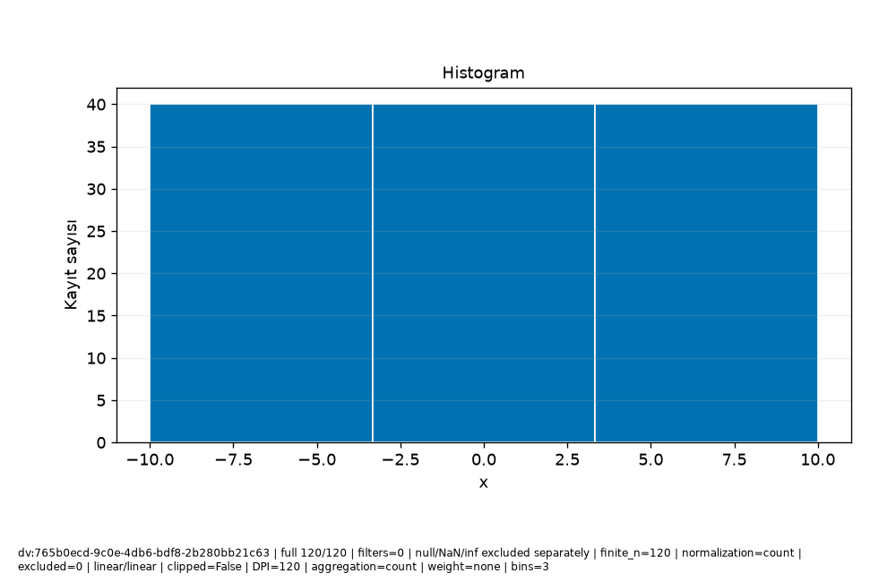

# Veri\_Ufku · Bilimsel rapor

Protokol: exploratory
Keşifsel inceleme; analiz birimi, seçim ve test kullanımını kayıtlı sonuçlarla değerlendirin.

Güncellik: Seçilen dataset/run için daha yeni kayıt bulunmadı; dış kaynağın canlı tazeliği doğrulanmadı.

Test kullanım defteri: []
Model seçim protokolü: kayıtlı method/model-card alanlarına bakın; alan yoksa not_recorded.

## Araştırma sorusu

**text**

```text
Soruyu ve analiz birimini kullanıcı olarak açıklayın.
```
**evidence**

```text
Kullanıcı metni; doğrulanmış hesap değildir.
```

## Yorum ve sınırlamalar

**text**

```text
Bulguyu yorumdan ayırın; nedensel çıkarım varsayımlarını açıkça yazın.
```
**evidence**

```text
Kullanıcı metni; doğrulanmış hesap değildir.
```

## Kaynakça


## method

**record_id**

```text
result:05228519-9e92-461c-8c52-3039e1cdcf8b
```
**capability_id**

```text
model.regression
```
**dataset_versions**

```text
[
  "dv:765b0ecd-9c0e-4db6-bdf8-2b280bb21c63"
]
```
**run_id**

```text
run:9e58bd00-8b96-4430-b228-2a517df52e82
```
**evidence**

```text
Kayıtlı alan projeksiyonu; yeni hesap veya otomatik yorum değildir.
```
**data**

```text
{
  "spec": {
    "availability": {
      "col:ca79571b-0d7e-470b-b74b-a3d864f8092d": {
        "note": "Önceden bilinir",
        "offset_seconds": 0
      }
    },
    "baseline": "auto",
    "entity_use": "new",
    "folds": 3,
    "horizon_seconds": 0,
    "method": "auto",
    "prediction_moment": "Ölçüm öncesi",
    "seed": 42,
    "structure": "independent",
    "test_fraction": 0.2,
    "validation_fraction": 0.2
  },
  "model_card": {
    "baseline": {
      "comparison": [
        {
          "metrics": [
            {
              "averaging": "per_record",
              "coverage": "all eligible records in this evaluation partition",
              "direction": "minimize",
              "metric": "mae",
              "n": 24,
              "scope": "validation",
              "status": "valid",
              "value": 15.105042016806722
            },
            {
              "averaging": "per_record",
              "coverage": "all eligible records in this evaluation partition",
              "direction": "minimize",
              "metric": "rmse",
              "n": 24,
              "scope": "validation",
              "status": "valid",
              "value": 17.131074485116738
            },
            {
              "averaging": "per_record",
              "coverage": "all eligible records in this evaluation partition",
              "direction": "maximize",
              "metric": "r2",
              "n": 24,
              "scope": "validation",
              "status": "valid",
              "value": -0.07031033705694889
            }
          ],
          "scope": "validation"
        },
        {
          "metrics": [
            {
              "averaging": "per_record",
              "coverage": "all eligible records in this evaluation partition",
              "direction": "minimize",
              "metric": "mae",
              "n": 32,
              "scope": "cv:1",
              "status": "valid",
              "value": 16.085215336134453
            },
            {
              "averaging": "per_record",
              "coverage": "all eligible records in this evaluation partition",
              "direction": "minimize",
              "metric": "rmse",
              "n": 32,
              "scope": "cv:1",
              "status": "valid",
              "value": 17.78349866194151
            },
            {
              "averaging": "per_record",
              "coverage": "all eligible records in this evaluation partition",
              "direction": "maximize",
              "metric": "r2",
              "n": 32,
              "scope": "cv:1",
              "status": "valid",
              "value": -0.08216532968157875
            }
          ],
          "scope": "cv:1"
        },
        {
          "metrics": [
            {
              "averaging": "per_record",
              "coverage": "all eligible records in this evaluation partition",
              "direction": "minimize",
              "metric": "mae",
              "n": 32,
              "scope": "cv:2",
              "status": "valid",
              "value": 14.063484768907566
            },
            {
              "averaging": "per_record",
              "coverage": "all eligible records in this evaluation partition",
              "direction": "minimize",
              "metric": "rmse",
              "n": 32,
              "scope": "cv:2",
              "status": "valid",
              "value": 16.834420290258713
            },
            {
              "averaging": "per_record",
              "coverage": "all eligible records in this evaluation partition",
              "direction": "maximize",
              "metric": "r2",
              "n": 32,
              "scope": "cv:2",
              "status": "valid",
              "value": -0.000592538052601066
            }
          ],
          "scope": "cv:2"
        },
        {
          "metrics": [
            {
              "averaging": "per_record",
              "coverage": "all eligible records in this evaluation partition",
              "direction": "minimize",
              "metric": "mae",
              "n": 32,
              "scope": "cv:3",
              "status": "valid",
              "value": 16.882878151260506
            },
            {
              "averaging": "per_record",
              "coverage": "all eligible records in this evaluation partition",
              "direction": "minimize",
              "metric": "rmse",
              "n": 32,
              "scope": "cv:3",
              "status": "valid",
              "value": 19.037369544238533
            },
            {
              "averaging": "per_record",
              "coverage": "all eligible records in this evaluation partition",
              "direction": "maximize",
              "metric": "r2",
              "n": 32,
              "scope": "cv:3",
              "status": "valid",
              "value": -0.084358201283397
            }
          ],
          "scope": "cv:3"
        }
      ],
      "limitation": "Final koşuda yeniden baseline seçimi yapılmaz; geliştirme koşusu kartına bakın.",
      "strategy": "mean"
    },
    "candidate_selection": {
      "parameters": {
        "alpha": 1.0,
        "candidates": [
          "baseline",
          "linear",
          "ridge",
          "forest"
        ],
        "depth": 8,
        "trees": 50,
        "unit": "TL"
      },
      "rule": "minimum development CV mean MAE; ties follow candidate order",
      "selected": "linear"
    },
    "columns": [
      {
        "id": "col:ca79571b-0d7e-470b-b74b-a3d864f8092d",
        "name": "x",
        "original_name": "x",
        "type": "Float64"
      },
      {
        "id": "col:ea4c35bf-398d-4480-9777-272e36159fe6",
        "name": "y",
        "original_name": "y",
        "type": "Float64"
      }
    ],
    "dataset_version": "dv:765b0ecd-9c0e-4db6-bdf8-2b280bb21c63",
    "decision": null,
    "estimator": "LinearRegression",
    "features": [
      {
        "id": "col:ca79571b-0d7e-470b-b74b-a3d864f8092d",
        "name": "x",
        "type": "Float64",
        "unit": ""
      }
    ],
    "fit_row_ids": [
      "row:4f15f117-d19f-40cc-a375-89d20590bdff",
      "row:7f59dca8-a814-488f-af5a-3377e6cb4f5c",
      "row:2be2369b-7b85-487d-8896-ccd3f4b20cc0",
      "row:c7139f33-9c10-49c2-b19a-1942c34f06e8",
      "row:30ca94e9-1c57-49bd-a765-58ebf7d8670f",
      "row:91ad83ef-70ac-43b3-8b88-e08d0575fe35",
      "row:8a6d5c6c-a9b3-496c-abd0-75602060e72c",
      "row:d4020068-debf-440e-a994-061f20de1704",
      "row:93088b7a-0208-44ce-b641-4e026bccf012",
      "row:1c7b2889-5f5a-4bec-bfb8-b938b36893f0",
      "row:6d82ae15-b62f-4934-84cc-25ba06ae75da",
      "row:3af2795d-2593-4bd4-88a7-7bb504bc5530",
      "row:3a1206df-805a-494d-8849-9b1f24485f82",
      "row:80a7277b-5ab1-4da7-b448-d4307d74fb6b",
      "row:c16960a1-3ace-46d5-945f-54104b368c58",
      "row:1a4b7690-c379-4f4c-bc55-1169d25522d0",
      "row:ca1fdeee-32d6-429e-a50e-18642bc96ffd",
      "row:616c1941-8af9-41b3-a2c1-79d155e55991",
      "row:a092e577-4cf9-4435-81c6-979b2af845d9",
      "row:dec5a617-ab33-49cd-8ba0-ed3d1c80c41d",
      "row:9b821bff-61bd-4525-9571-56bf54cd3e1e",
      "row:6acd4a3f-b5f9-49e5-a35d-4344284cae4b",
      "row:b1462e6f-7e2c-406e-a77a-35c8ee24ca62",
      "row:427b5649-f7f2-42e1-a67c-4fc9612acf1b",
      "row:aa1d7a36-df48-4fdc-a255-8732c831a2d8",
      "row:effd4cf6-9948-4ee8-a642-9a953b16cc77",
      "row:d644562a-794f-4637-baf7-3505a7521d78",
      "row:2fdc6b6a-f019-4d0b-b9ce-dc0003610265",
      "row:79f6d923-9ae7-4341-95e7-050acf6815e3",
      "row:f9b1d836-0058-4c17-8e09-950d89b0645e",
      "row:b73dc4fd-ac77-451b-bce1-f31996b1fcf2",
      "row:ce44ffb5-e2e9-4e09-9da1-6f5dadecd2d1",
      "row:f5e05d35-b8ad-4e05-8819-53c84c0bfa7a",
      "row:6ea04273-5bad-45d6-a023-1d5336d7eef4",
      "row:e314f321-d3e6-4384-a2ee-52dc3db1750c",
      "row:92427bb5-e847-484e-80f1-ba99093e4af3",
      "row:2ac5b3fe-f71d-4348-bf99-e095d478ea70",
      "row:1fe55249-e7ac-403d-b49f-c3ea76d73fc8",
      "row:0ea6f36b-6be0-4b5a-8f66-539b9ed9c3d0",
      "row:315506b6-4d19-4202-8011-1b4738f0334c",
      "row:74546597-d4ab-4b1e-a8eb-1df40c3555da",
      "row:ac41476c-d274-4f67-a61e-f1131588f145",
      "row:e7da553f-d4dd-4209-86c0-59d7190e5088",
      "row:4fe865cc-5b53-4720-bbc1-516b80697da1",
      "row:f0e52389-3454-4b80-ab37-037ff3e61280",
      "row:d25c8965-738f-4b94-851b-73c54bd1e626",
      "row:2621f88b-9a11-4409-a835-d55ce5662d34",
      "row:658c6272-00ed-4f8c-bb9f-0a90b2920ce7",
      "row:506f60af-420d-4ae6-86e2-54fce050793c",
      "row:da1b7acd-eb41-42f2-8122-da629a1c2b7c",
      "row:7898f20d-26f9-4581-a222-8f9ffed3ef28",
      "row:a675bf25-c862-4a71-adc6-0791d8eff0b5",
      "row:dbaa85d2-b4b8-463d-9f7e-443736949d2a",
      "row:4c18038c-452e-4456-88a6-695195c623df",
      "row:a2c8bf5b-d287-4752-8716-19deb92b07d3",
      "row:fb7faea9-ac65-481a-8fc8-153d71be323b",
      "row:f6111908-c4e4-47df-9be1-4648bfa368b2",
      "row:8f42ee80-31f2-4750-a361-75b00591bf38",
      "row:98839e9e-b1c4-4b6b-9cc4-b8cfac659335",
      "row:bf7b54a2-6928-496e-9e53-02524c0accfe",
      "row:2fd315db-13db-41b5-ae0a-25fa3ddedef5",
      "row:c9e7d5fe-49ba-4001-bb6a-e22a163ae9fc",
      "row:7e6622cb-0805-4138-ac10-a85ac22f7fba",
      "row:8946bda4-35e7-499d-a9fe-3f5b6847776c",
      "row:caa69972-fde1-42c7-9331-c2ceb1ee060f",
      "row:b6d73ae6-3f7e-4419-bb83-2555b4bd6917",
      "row:8ef169b2-7f58-4b6c-a2e6-03aac01ec217",
      "row:6899f330-36de-458f-9501-1cfdbddc63a5",
      "row:594536f6-eb8f-4c74-bf77-f40576b2769e",
      "row:936c51cc-9939-4ef5-a247-4b260fffebac",
      "row:16edeb3d-4429-4822-ad81-1756bae3f5e6",
      "row:1ccbfdac-82d1-45d2-b7ac-f10e83468ddc"
    ],
    "fit_scope": "development_train; validation previously used for selection",
    "fitted_preprocessing": {
      "1": {
        "kind": "impute_numeric",
        "statistics": [
          1.344537815126051
        ]
      },
      "2": {
        "kind": "standard_scale",
        "mean": [
          0.6092436974789925
        ],
        "scale": [
          5.948272597687973
        ]
      }
    },
    "importance": {
      "limitation": "İlişkili değişkenler önemi paylaşır/gizler; negatif önem mümkün. Nedensellik değildir; final test kullanılmadı.",
      "metric": "negative_MAE",
      "repeats": 3,
      "row_ids": [
        "row:bf4caffa-86f0-4075-884a-f677d6c3a448",
        "row:a951e579-3ad8-4771-886c-b42fb2f6635e",
        "row:b8a38568-f299-4456-bdbe-05009f8b5e9a",
        "row:914547a2-fdf2-4d6b-867b-a1c63fc94ef6",
        "row:c13c2621-38b4-48d3-86e7-381e7f296482",
        "row:32a2ea11-70cb-4fc8-84e0-357f1434559b",
        "row:472af745-1afb-4fcd-9b18-1ed276c1c06e",
        "row:b7facdf3-dd85-4aac-a601-c1365b58a62d",
        "row:0e0efb61-0b50-4982-ba3b-44fc222ae9d6",
        "row:da4da573-db6d-46de-906c-f1837d088513",
        "row:24909722-64e6-467c-8c6d-06d116496b5e",
        "row:874eb967-b38a-4667-a9ab-b390a91d63d7",
        "row:c0b130ca-bc86-4f42-bd3e-6697ad37999b",
        "row:f6eddd99-b6cd-4e86-98ec-18a7dc25ed62",
        "row:c6ad26e2-529b-4983-8bd4-80b5d5da6f17",
        "row:1b879896-2954-41f0-b74f-5804a733c985",
        "row:17f0c5ad-8923-4f7c-897c-a063e98f4b8f",
        "row:574eac26-5fef-42cb-89e7-df1f077014c7",
        "row:5fb50c16-fcc4-48d9-99b0-c735a1c288b8",
        "row:358b1351-3598-429b-a8d1-15525dde1253",
        "row:1d0bf7dd-df95-4e1b-83a2-de417c68e1ca",
        "row:a2bede32-4e9b-4441-bb84-be632b6d85ff",
        "row:174158ed-a339-4b00-8026-24cf2297d57a",
        "row:208ca13b-6591-4a7a-897a-a17616a37174"
      ],
      "scope": "validation; exploratory; already used for model/threshold selection",
      "seed": 42,
      "status": "available",
      "values": [
        {
          "column_id": "col:ca79571b-0d7e-470b-b74b-a3d864f8092d",
          "mean": 19.523809523809522,
          "name": "x",
          "std": 2.038091850261204
        }
      ]
    },
    "label_order": [],
    "limitations": "Katsayı ve önemler nedensel etki değildir. İlişkili özellikler önemi paylaşabilir veya gizleyebilir. Yeni veri dağılımı değişebilir; olasılık kesinlik veya kalibrasyon garantisi değildir. Küme ve anomali adayları gerçek sınıf/veri hatası değildir; otomatik silme yok.",
    "method": null,
    "metrics": [
      {
        "evaluation_n": 24,
        "metrics": [
          {
            "averaging": "per_record",
            "coverage": "all eligible records in this evaluation partition",
            "direction": "minimize",
            "metric": "mae",
            "n": 24,
            "scope": "validation",
            "status": "valid",
            "value": 4.810966440042345e-15
          },
          {
            "averaging": "per_record",
            "coverage": "all eligible records in this evaluation partition",
            "direction": "minimize",
            "metric": "rmse",
            "n": 24,
            "scope": "validation",
            "status": "valid",
            "value": 5.582114810376975e-15
          },
          {
            "averaging": "per_record",
            "coverage": "all eligible records in this evaluation partition",
            "direction": "maximize",
            "metric": "r2",
            "n": 24,
            "scope": "validation",
            "status": "valid",
            "value": 1.0
          }
        ],
        "scope": "validation",
        "status": "valid",
        "train_n": 72
      },
      {
        "evaluation_n": 32,
        "metrics": [
          {
            "averaging": "per_record",
            "coverage": "all eligible records in this evaluation partition",
            "direction": "minimize",
            "metric": "mae",
            "n": 32,
            "scope": "cv:1",
            "status": "valid",
            "value": 1.3877787807814457e-15
          },
          {
            "averaging": "per_record",
            "coverage": "all eligible records in this evaluation partition",
            "direction": "minimize",
            "metric": "rmse",
            "n": 32,
            "scope": "cv:1",
            "status": "valid",
            "value": 2.1413206232596582e-15
          },
          {
            "averaging": "per_record",
            "coverage": "all eligible records in this evaluation partition",
            "direction": "maximize",
            "metric": "r2",
            "n": 32,
            "scope": "cv:1",
            "status": "valid",
            "value": 1.0
          }
        ],
        "scope": "cv:1",
        "status": "valid",
        "train_n": 64
      },
      {
        "evaluation_n": 32,
        "metrics": [
          {
            "averaging": "per_record",
            "coverage": "all eligible records in this evaluation partition",
            "direction": "minimize",
            "metric": "mae",
            "n": 32,
            "scope": "cv:2",
            "status": "valid",
            "value": 5.828670879282072e-15
          },
          {
            "averaging": "per_record",
            "coverage": "all eligible records in this evaluation partition",
            "direction": "minimize",
            "metric": "rmse",
            "n": 32,
            "scope": "cv:2",
            "status": "valid",
            "value": 7.320740245935003e-15
          },
          {
            "averaging": "per_record",
            "coverage": "all eligible records in this evaluation partition",
            "direction": "maximize",
            "metric": "r2",
            "n": 32,
            "scope": "cv:2",
            "status": "valid",
            "value": 1.0
          }
        ],
        "scope": "cv:2",
        "status": "valid",
        "train_n": 64
      },
      {
        "evaluation_n": 32,
        "metrics": [
          {
            "averaging": "per_record",
            "coverage": "all eligible records in this evaluation partition",
            "direction": "minimize",
            "metric": "mae",
            "n": 32,
            "scope": "cv:3",
            "status": "valid",
            "value": 1.915134717478395e-15
          },
          {
            "averaging": "per_record",
            "coverage": "all eligible records in this evaluation partition",
            "direction": "minimize",
            "metric": "rmse",
            "n": 32,
            "scope": "cv:3",
            "status": "valid",
            "value": 2.687565378447544e-15
          },
          {
            "averaging": "per_record",
            "coverage": "all eligible records in this evaluation partition",
            "direction": "maximize",
            "metric": "r2",
            "n": 32,
            "scope": "cv:3",
            "status": "valid",
            "value": 1.0
          }
        ],
        "scope": "cv:3",
        "status": "valid",
        "train_n": 64
      }
    ],
    "preparation_spec": {
      "allow_identifiers": false,
      "categorical_imputation": "most_frequent",
      "date_features": true,
      "encoding": "onehot",
      "family": "linear",
      "features": [
        "col:ca79571b-0d7e-470b-b74b-a3d864f8092d"
      ],
      "group": "",
      "history_action": "review",
      "history_note": "",
      "invalid_numeric": "reject",
      "numeric_imputation": "median",
      "precision": "reject",
      "prediction_context": "",
      "purpose": "regression",
      "scaling": "standard",
      "selection": "none",
      "source_version": "dv:765b0ecd-9c0e-4db6-bdf8-2b280bb21c63",
      "target": "col:ea4c35bf-398d-4480-9777-272e36159fe6",
      "time": ""
    },
    "preprocessing": {
      "category_vocabulary": null,
      "column_lineage": [
        {
          "category_map": [],
          "input_column_id": "col:ca79571b-0d7e-470b-b74b-a3d864f8092d",
          "names_status": "structurally_known",
          "output_names": [
            "f_ca79571b0d7e470bb74ba3d864f8092d__numeric"
          ],
          "selected_after_fit": "all_planned",
          "source_dtype": "Float64",
          "source_name": "x"
        }
      ],
      "estimator_family": "linear",
      "feature_selection_mask": null,
      "fit_state": "not_fitted",
      "fitted_parameters": {},
      "schema": "PreparationPlan/v1",
      "steps": [
        {
          "input_column_ids": [
            "col:ca79571b-0d7e-470b-b74b-a3d864f8092d"
          ],
          "kind": "numeric",
          "learned_scope": "row_local",
          "output_names": [
            "f_ca79571b0d7e470bb74ba3d864f8092d__numeric"
          ],
          "parameters": {
            "nonfinite": "reject",
            "precision": "reject"
          },
          "reason": "Kimlik ölçüm değildir; Float64 kaybı gelecekte açık politika ile denetlenir.",
          "state": "planned"
        },
        {
          "input_column_ids": [
            "col:ca79571b-0d7e-470b-b74b-a3d864f8092d"
          ],
          "kind": "impute_numeric",
          "learned_scope": "training_fold",
          "output_names": [
            "f_ca79571b0d7e470bb74ba3d864f8092d__numeric"
          ],
          "parameters": {
            "all_missing": "error",
            "strategy": "median"
          },
          "reason": "Seçilen doldurma değeri yalnız eğitim katında öğrenilir; test/validation ortalaması kullanılmaz.",
          "state": "planned"
        },
        {
          "input_column_ids": [
            "col:ca79571b-0d7e-470b-b74b-a3d864f8092d"
          ],
          "kind": "standard_scale",
          "learned_scope": "training_fold",
          "output_names": [
            "f_ca79571b0d7e470bb74ba3d864f8092d__numeric"
          ],
          "parameters": {
            "explicit_override": false
          },
          "reason": "Uzaklıklar ve düzenlileştirilmiş doğrusal modeller ölçüm ölçeğine duyarlıdır; eğitim katında standardizasyon planlandı.",
          "state": "planned"
        }
      ],
      "training_dependency": "Requires a validated split/fold protocol in Phase16; no training performed",
      "version_id": "ml-pipeline:0e56bbda-4eab-4372-aafd-b9f4f3c07410"
    },
    "probability_supported": false,
    "purpose": "regression",
    "run_id": "run:9e58bd00-8b96-4430-b228-2a517df52e82",
    "schema": "ModelCard/v1",
    "seed": 42,
    "snapshot_fingerprint": {
      "sha256": "b84b3db3d5c76afd06b405071de35239197ba24dfb88cd8009189342a5d6c49e",
      "size": 11601
    },
    "split": {
      "invalid_folds": [],
      "membership": {
        "development": [
          "row:0e0efb61-0b50-4982-ba3b-44fc222ae9d6",
          "row:0ea6f36b-6be0-4b5a-8f66-539b9ed9c3d0",
          "row:16edeb3d-4429-4822-ad81-1756bae3f5e6",
          "row:174158ed-a339-4b00-8026-24cf2297d57a",
          "row:17f0c5ad-8923-4f7c-897c-a063e98f4b8f",
          "row:1a4b7690-c379-4f4c-bc55-1169d25522d0",
          "row:1b879896-2954-41f0-b74f-5804a733c985",
          "row:1c7b2889-5f5a-4bec-bfb8-b938b36893f0",
          "row:1ccbfdac-82d1-45d2-b7ac-f10e83468ddc",
          "row:1d0bf7dd-df95-4e1b-83a2-de417c68e1ca",
          "row:1fe55249-e7ac-403d-b49f-c3ea76d73fc8",
          "row:208ca13b-6591-4a7a-897a-a17616a37174",
          "row:24909722-64e6-467c-8c6d-06d116496b5e",
          "row:2621f88b-9a11-4409-a835-d55ce5662d34",
          "row:2ac5b3fe-f71d-4348-bf99-e095d478ea70",
          "row:2be2369b-7b85-487d-8896-ccd3f4b20cc0",
          "row:2fd315db-13db-41b5-ae0a-25fa3ddedef5",
          "row:2fdc6b6a-f019-4d0b-b9ce-dc0003610265",
          "row:30ca94e9-1c57-49bd-a765-58ebf7d8670f",
          "row:315506b6-4d19-4202-8011-1b4738f0334c",
          "row:32a2ea11-70cb-4fc8-84e0-357f1434559b",
          "row:358b1351-3598-429b-a8d1-15525dde1253",
          "row:3a1206df-805a-494d-8849-9b1f24485f82",
          "row:3af2795d-2593-4bd4-88a7-7bb504bc5530",
          "row:427b5649-f7f2-42e1-a67c-4fc9612acf1b",
          "row:472af745-1afb-4fcd-9b18-1ed276c1c06e",
          "row:4c18038c-452e-4456-88a6-695195c623df",
          "row:4f15f117-d19f-40cc-a375-89d20590bdff",
          "row:4fe865cc-5b53-4720-bbc1-516b80697da1",
          "row:506f60af-420d-4ae6-86e2-54fce050793c",
          "row:574eac26-5fef-42cb-89e7-df1f077014c7",
          "row:594536f6-eb8f-4c74-bf77-f40576b2769e",
          "row:5fb50c16-fcc4-48d9-99b0-c735a1c288b8",
          "row:616c1941-8af9-41b3-a2c1-79d155e55991",
          "row:658c6272-00ed-4f8c-bb9f-0a90b2920ce7",
          "row:6899f330-36de-458f-9501-1cfdbddc63a5",
          "row:6acd4a3f-b5f9-49e5-a35d-4344284cae4b",
          "row:6d82ae15-b62f-4934-84cc-25ba06ae75da",
          "row:6ea04273-5bad-45d6-a023-1d5336d7eef4",
          "row:74546597-d4ab-4b1e-a8eb-1df40c3555da",
          "row:7898f20d-26f9-4581-a222-8f9ffed3ef28",
          "row:79f6d923-9ae7-4341-95e7-050acf6815e3",
          "row:7e6622cb-0805-4138-ac10-a85ac22f7fba",
          "row:7f59dca8-a814-488f-af5a-3377e6cb4f5c",
          "row:80a7277b-5ab1-4da7-b448-d4307d74fb6b",
          "row:874eb967-b38a-4667-a9ab-b390a91d63d7",
          "row:8946bda4-35e7-499d-a9fe-3f5b6847776c",
          "row:8a6d5c6c-a9b3-496c-abd0-75602060e72c",
          "row:8ef169b2-7f58-4b6c-a2e6-03aac01ec217",
          "row:8f42ee80-31f2-4750-a361-75b00591bf38",
          "row:914547a2-fdf2-4d6b-867b-a1c63fc94ef6",
          "row:91ad83ef-70ac-43b3-8b88-e08d0575fe35",
          "row:92427bb5-e847-484e-80f1-ba99093e4af3",
          "row:93088b7a-0208-44ce-b641-4e026bccf012",
          "row:936c51cc-9939-4ef5-a247-4b260fffebac",
          "row:98839e9e-b1c4-4b6b-9cc4-b8cfac659335",
          "row:9b821bff-61bd-4525-9571-56bf54cd3e1e",
          "row:a092e577-4cf9-4435-81c6-979b2af845d9",
          "row:a2bede32-4e9b-4441-bb84-be632b6d85ff",
          "row:a2c8bf5b-d287-4752-8716-19deb92b07d3",
          "row:a675bf25-c862-4a71-adc6-0791d8eff0b5",
          "row:a951e579-3ad8-4771-886c-b42fb2f6635e",
          "row:aa1d7a36-df48-4fdc-a255-8732c831a2d8",
          "row:ac41476c-d274-4f67-a61e-f1131588f145",
          "row:b1462e6f-7e2c-406e-a77a-35c8ee24ca62",
          "row:b6d73ae6-3f7e-4419-bb83-2555b4bd6917",
          "row:b73dc4fd-ac77-451b-bce1-f31996b1fcf2",
          "row:b7facdf3-dd85-4aac-a601-c1365b58a62d",
          "row:b8a38568-f299-4456-bdbe-05009f8b5e9a",
          "row:bf4caffa-86f0-4075-884a-f677d6c3a448",
          "row:bf7b54a2-6928-496e-9e53-02524c0accfe",
          "row:c0b130ca-bc86-4f42-bd3e-6697ad37999b",
          "row:c13c2621-38b4-48d3-86e7-381e7f296482",
          "row:c16960a1-3ace-46d5-945f-54104b368c58",
          "row:c6ad26e2-529b-4983-8bd4-80b5d5da6f17",
          "row:c7139f33-9c10-49c2-b19a-1942c34f06e8",
          "row:c9e7d5fe-49ba-4001-bb6a-e22a163ae9fc",
          "row:ca1fdeee-32d6-429e-a50e-18642bc96ffd",
          "row:caa69972-fde1-42c7-9331-c2ceb1ee060f",
          "row:ce44ffb5-e2e9-4e09-9da1-6f5dadecd2d1",
          "row:d25c8965-738f-4b94-851b-73c54bd1e626",
          "row:d4020068-debf-440e-a994-061f20de1704",
          "row:d644562a-794f-4637-baf7-3505a7521d78",
          "row:da1b7acd-eb41-42f2-8122-da629a1c2b7c",
          "row:da4da573-db6d-46de-906c-f1837d088513",
          "row:dbaa85d2-b4b8-463d-9f7e-443736949d2a",
          "row:dec5a617-ab33-49cd-8ba0-ed3d1c80c41d",
          "row:e314f321-d3e6-4384-a2ee-52dc3db1750c",
          "row:e7da553f-d4dd-4209-86c0-59d7190e5088",
          "row:effd4cf6-9948-4ee8-a642-9a953b16cc77",
          "row:f0e52389-3454-4b80-ab37-037ff3e61280",
          "row:f5e05d35-b8ad-4e05-8819-53c84c0bfa7a",
          "row:f6111908-c4e4-47df-9be1-4648bfa368b2",
          "row:f6eddd99-b6cd-4e86-98ec-18a7dc25ed62",
          "row:f9b1d836-0058-4c17-8e09-950d89b0645e",
          "row:fb7faea9-ac65-481a-8fc8-153d71be323b"
        ],
        "folds": [
          {
            "status": "valid",
            "train": [
              "row:0ea6f36b-6be0-4b5a-8f66-539b9ed9c3d0",
              "row:16edeb3d-4429-4822-ad81-1756bae3f5e6",
              "row:1a4b7690-c379-4f4c-bc55-1169d25522d0",
              "row:1c7b2889-5f5a-4bec-bfb8-b938b36893f0",
              "row:1ccbfdac-82d1-45d2-b7ac-f10e83468ddc",
              "row:1fe55249-e7ac-403d-b49f-c3ea76d73fc8",
              "row:2621f88b-9a11-4409-a835-d55ce5662d34",
              "row:2ac5b3fe-f71d-4348-bf99-e095d478ea70",
              "row:2fd315db-13db-41b5-ae0a-25fa3ddedef5",
              "row:2fdc6b6a-f019-4d0b-b9ce-dc0003610265",
              "row:315506b6-4d19-4202-8011-1b4738f0334c",
              "row:3a1206df-805a-494d-8849-9b1f24485f82",
              "row:3af2795d-2593-4bd4-88a7-7bb504bc5530",
              "row:427b5649-f7f2-42e1-a67c-4fc9612acf1b",
              "row:4c18038c-452e-4456-88a6-695195c623df",
              "row:4fe865cc-5b53-4720-bbc1-516b80697da1",
              "row:506f60af-420d-4ae6-86e2-54fce050793c",
              "row:594536f6-eb8f-4c74-bf77-f40576b2769e",
              "row:616c1941-8af9-41b3-a2c1-79d155e55991",
              "row:658c6272-00ed-4f8c-bb9f-0a90b2920ce7",
              "row:6899f330-36de-458f-9501-1cfdbddc63a5",
              "row:6acd4a3f-b5f9-49e5-a35d-4344284cae4b",
              "row:6d82ae15-b62f-4934-84cc-25ba06ae75da",
              "row:6ea04273-5bad-45d6-a023-1d5336d7eef4",
              "row:74546597-d4ab-4b1e-a8eb-1df40c3555da",
              "row:7898f20d-26f9-4581-a222-8f9ffed3ef28",
              "row:79f6d923-9ae7-4341-95e7-050acf6815e3",
              "row:7e6622cb-0805-4138-ac10-a85ac22f7fba",
              "row:80a7277b-5ab1-4da7-b448-d4307d74fb6b",
              "row:8946bda4-35e7-499d-a9fe-3f5b6847776c",
              "row:8ef169b2-7f58-4b6c-a2e6-03aac01ec217",
              "row:8f42ee80-31f2-4750-a361-75b00591bf38",
              "row:92427bb5-e847-484e-80f1-ba99093e4af3",
              "row:93088b7a-0208-44ce-b641-4e026bccf012",
              "row:936c51cc-9939-4ef5-a247-4b260fffebac",
              "row:98839e9e-b1c4-4b6b-9cc4-b8cfac659335",
              "row:9b821bff-61bd-4525-9571-56bf54cd3e1e",
              "row:a092e577-4cf9-4435-81c6-979b2af845d9",
              "row:a2c8bf5b-d287-4752-8716-19deb92b07d3",
              "row:a675bf25-c862-4a71-adc6-0791d8eff0b5",
              "row:aa1d7a36-df48-4fdc-a255-8732c831a2d8",
              "row:ac41476c-d274-4f67-a61e-f1131588f145",
              "row:b1462e6f-7e2c-406e-a77a-35c8ee24ca62",
              "row:b6d73ae6-3f7e-4419-bb83-2555b4bd6917",
              "row:b73dc4fd-ac77-451b-bce1-f31996b1fcf2",
              "row:bf7b54a2-6928-496e-9e53-02524c0accfe",
              "row:c16960a1-3ace-46d5-945f-54104b368c58",
              "row:c9e7d5fe-49ba-4001-bb6a-e22a163ae9fc",
              "row:ca1fdeee-32d6-429e-a50e-18642bc96ffd",
              "row:caa69972-fde1-42c7-9331-c2ceb1ee060f",
              "row:ce44ffb5-e2e9-4e09-9da1-6f5dadecd2d1",
              "row:d25c8965-738f-4b94-851b-73c54bd1e626",
              "row:d644562a-794f-4637-baf7-3505a7521d78",
              "row:da1b7acd-eb41-42f2-8122-da629a1c2b7c",
              "row:dbaa85d2-b4b8-463d-9f7e-443736949d2a",
              "row:dec5a617-ab33-49cd-8ba0-ed3d1c80c41d",
              "row:e314f321-d3e6-4384-a2ee-52dc3db1750c",
              "row:e7da553f-d4dd-4209-86c0-59d7190e5088",
              "row:effd4cf6-9948-4ee8-a642-9a953b16cc77",
              "row:f0e52389-3454-4b80-ab37-037ff3e61280",
              "row:f5e05d35-b8ad-4e05-8819-53c84c0bfa7a",
              "row:f6111908-c4e4-47df-9be1-4648bfa368b2",
              "row:f9b1d836-0058-4c17-8e09-950d89b0645e",
              "row:fb7faea9-ac65-481a-8fc8-153d71be323b"
            ],
            "validation": [
              "row:0e0efb61-0b50-4982-ba3b-44fc222ae9d6",
              "row:174158ed-a339-4b00-8026-24cf2297d57a",
              "row:17f0c5ad-8923-4f7c-897c-a063e98f4b8f",
              "row:1b879896-2954-41f0-b74f-5804a733c985",
              "row:1d0bf7dd-df95-4e1b-83a2-de417c68e1ca",
              "row:208ca13b-6591-4a7a-897a-a17616a37174",
              "row:24909722-64e6-467c-8c6d-06d116496b5e",
              "row:2be2369b-7b85-487d-8896-ccd3f4b20cc0",
              "row:30ca94e9-1c57-49bd-a765-58ebf7d8670f",
              "row:32a2ea11-70cb-4fc8-84e0-357f1434559b",
              "row:358b1351-3598-429b-a8d1-15525dde1253",
              "row:472af745-1afb-4fcd-9b18-1ed276c1c06e",
              "row:4f15f117-d19f-40cc-a375-89d20590bdff",
              "row:574eac26-5fef-42cb-89e7-df1f077014c7",
              "row:5fb50c16-fcc4-48d9-99b0-c735a1c288b8",
              "row:7f59dca8-a814-488f-af5a-3377e6cb4f5c",
              "row:874eb967-b38a-4667-a9ab-b390a91d63d7",
              "row:8a6d5c6c-a9b3-496c-abd0-75602060e72c",
              "row:914547a2-fdf2-4d6b-867b-a1c63fc94ef6",
              "row:91ad83ef-70ac-43b3-8b88-e08d0575fe35",
              "row:a2bede32-4e9b-4441-bb84-be632b6d85ff",
              "row:a951e579-3ad8-4771-886c-b42fb2f6635e",
              "row:b7facdf3-dd85-4aac-a601-c1365b58a62d",
              "row:b8a38568-f299-4456-bdbe-05009f8b5e9a",
              "row:bf4caffa-86f0-4075-884a-f677d6c3a448",
              "row:c0b130ca-bc86-4f42-bd3e-6697ad37999b",
              "row:c13c2621-38b4-48d3-86e7-381e7f296482",
              "row:c6ad26e2-529b-4983-8bd4-80b5d5da6f17",
              "row:c7139f33-9c10-49c2-b19a-1942c34f06e8",
              "row:d4020068-debf-440e-a994-061f20de1704",
              "row:da4da573-db6d-46de-906c-f1837d088513",
              "row:f6eddd99-b6cd-4e86-98ec-18a7dc25ed62"
            ]
          },
          {
            "status": "valid",
            "train": [
              "row:0e0efb61-0b50-4982-ba3b-44fc222ae9d6",
              "row:16edeb3d-4429-4822-ad81-1756bae3f5e6",
              "row:174158ed-a339-4b00-8026-24cf2297d57a",
              "row:17f0c5ad-8923-4f7c-897c-a063e98f4b8f",
              "row:1b879896-2954-41f0-b74f-5804a733c985",
              "row:1ccbfdac-82d1-45d2-b7ac-f10e83468ddc",
              "row:1d0bf7dd-df95-4e1b-83a2-de417c68e1ca",
              "row:208ca13b-6591-4a7a-897a-a17616a37174",
              "row:24909722-64e6-467c-8c6d-06d116496b5e",
              "row:2621f88b-9a11-4409-a835-d55ce5662d34",
              "row:2be2369b-7b85-487d-8896-ccd3f4b20cc0",
              "row:2fd315db-13db-41b5-ae0a-25fa3ddedef5",
              "row:30ca94e9-1c57-49bd-a765-58ebf7d8670f",
              "row:32a2ea11-70cb-4fc8-84e0-357f1434559b",
              "row:358b1351-3598-429b-a8d1-15525dde1253",
              "row:472af745-1afb-4fcd-9b18-1ed276c1c06e",
              "row:4c18038c-452e-4456-88a6-695195c623df",
              "row:4f15f117-d19f-40cc-a375-89d20590bdff",
              "row:4fe865cc-5b53-4720-bbc1-516b80697da1",
              "row:506f60af-420d-4ae6-86e2-54fce050793c",
              "row:574eac26-5fef-42cb-89e7-df1f077014c7",
              "row:594536f6-eb8f-4c74-bf77-f40576b2769e",
              "row:5fb50c16-fcc4-48d9-99b0-c735a1c288b8",
              "row:658c6272-00ed-4f8c-bb9f-0a90b2920ce7",
              "row:6899f330-36de-458f-9501-1cfdbddc63a5",
              "row:74546597-d4ab-4b1e-a8eb-1df40c3555da",
              "row:7898f20d-26f9-4581-a222-8f9ffed3ef28",
              "row:7e6622cb-0805-4138-ac10-a85ac22f7fba",
              "row:7f59dca8-a814-488f-af5a-3377e6cb4f5c",
              "row:874eb967-b38a-4667-a9ab-b390a91d63d7",
              "row:8946bda4-35e7-499d-a9fe-3f5b6847776c",
              "row:8a6d5c6c-a9b3-496c-abd0-75602060e72c",
              "row:8ef169b2-7f58-4b6c-a2e6-03aac01ec217",
              "row:8f42ee80-31f2-4750-a361-75b00591bf38",
              "row:914547a2-fdf2-4d6b-867b-a1c63fc94ef6",
              "row:91ad83ef-70ac-43b3-8b88-e08d0575fe35",
              "row:936c51cc-9939-4ef5-a247-4b260fffebac",
              "row:98839e9e-b1c4-4b6b-9cc4-b8cfac659335",
              "row:a2bede32-4e9b-4441-bb84-be632b6d85ff",
              "row:a2c8bf5b-d287-4752-8716-19deb92b07d3",
              "row:a675bf25-c862-4a71-adc6-0791d8eff0b5",
              "row:a951e579-3ad8-4771-886c-b42fb2f6635e",
              "row:ac41476c-d274-4f67-a61e-f1131588f145",
              "row:b6d73ae6-3f7e-4419-bb83-2555b4bd6917",
              "row:b7facdf3-dd85-4aac-a601-c1365b58a62d",
              "row:b8a38568-f299-4456-bdbe-05009f8b5e9a",
              "row:bf4caffa-86f0-4075-884a-f677d6c3a448",
              "row:bf7b54a2-6928-496e-9e53-02524c0accfe",
              "row:c0b130ca-bc86-4f42-bd3e-6697ad37999b",
              "row:c13c2621-38b4-48d3-86e7-381e7f296482",
              "row:c6ad26e2-529b-4983-8bd4-80b5d5da6f17",
              "row:c7139f33-9c10-49c2-b19a-1942c34f06e8",
              "row:c9e7d5fe-49ba-4001-bb6a-e22a163ae9fc",
              "row:caa69972-fde1-42c7-9331-c2ceb1ee060f",
              "row:d25c8965-738f-4b94-851b-73c54bd1e626",
              "row:d4020068-debf-440e-a994-061f20de1704",
              "row:da1b7acd-eb41-42f2-8122-da629a1c2b7c",
              "row:da4da573-db6d-46de-906c-f1837d088513",
              "row:dbaa85d2-b4b8-463d-9f7e-443736949d2a",
              "row:e7da553f-d4dd-4209-86c0-59d7190e5088",
              "row:f0e52389-3454-4b80-ab37-037ff3e61280",
              "row:f6111908-c4e4-47df-9be1-4648bfa368b2",
              "row:f6eddd99-b6cd-4e86-98ec-18a7dc25ed62",
              "row:fb7faea9-ac65-481a-8fc8-153d71be323b"
            ],
            "validation": [
              "row:0ea6f36b-6be0-4b5a-8f66-539b9ed9c3d0",
              "row:1a4b7690-c379-4f4c-bc55-1169d25522d0",
              "row:1c7b2889-5f5a-4bec-bfb8-b938b36893f0",
              "row:1fe55249-e7ac-403d-b49f-c3ea76d73fc8",
              "row:2ac5b3fe-f71d-4348-bf99-e095d478ea70",
              "row:2fdc6b6a-f019-4d0b-b9ce-dc0003610265",
              "row:315506b6-4d19-4202-8011-1b4738f0334c",
              "row:3a1206df-805a-494d-8849-9b1f24485f82",
              "row:3af2795d-2593-4bd4-88a7-7bb504bc5530",
              "row:427b5649-f7f2-42e1-a67c-4fc9612acf1b",
              "row:616c1941-8af9-41b3-a2c1-79d155e55991",
              "row:6acd4a3f-b5f9-49e5-a35d-4344284cae4b",
              "row:6d82ae15-b62f-4934-84cc-25ba06ae75da",
              "row:6ea04273-5bad-45d6-a023-1d5336d7eef4",
              "row:79f6d923-9ae7-4341-95e7-050acf6815e3",
              "row:80a7277b-5ab1-4da7-b448-d4307d74fb6b",
              "row:92427bb5-e847-484e-80f1-ba99093e4af3",
              "row:93088b7a-0208-44ce-b641-4e026bccf012",
              "row:9b821bff-61bd-4525-9571-56bf54cd3e1e",
              "row:a092e577-4cf9-4435-81c6-979b2af845d9",
              "row:aa1d7a36-df48-4fdc-a255-8732c831a2d8",
              "row:b1462e6f-7e2c-406e-a77a-35c8ee24ca62",
              "row:b73dc4fd-ac77-451b-bce1-f31996b1fcf2",
              "row:c16960a1-3ace-46d5-945f-54104b368c58",
              "row:ca1fdeee-32d6-429e-a50e-18642bc96ffd",
              "row:ce44ffb5-e2e9-4e09-9da1-6f5dadecd2d1",
              "row:d644562a-794f-4637-baf7-3505a7521d78",
              "row:dec5a617-ab33-49cd-8ba0-ed3d1c80c41d",
              "row:e314f321-d3e6-4384-a2ee-52dc3db1750c",
              "row:effd4cf6-9948-4ee8-a642-9a953b16cc77",
              "row:f5e05d35-b8ad-4e05-8819-53c84c0bfa7a",
              "row:f9b1d836-0058-4c17-8e09-950d89b0645e"
            ]
          },
          {
            "status": "valid",
            "train": [
              "row:0e0efb61-0b50-4982-ba3b-44fc222ae9d6",
              "row:0ea6f36b-6be0-4b5a-8f66-539b9ed9c3d0",
              "row:174158ed-a339-4b00-8026-24cf2297d57a",
              "row:17f0c5ad-8923-4f7c-897c-a063e98f4b8f",
              "row:1a4b7690-c379-4f4c-bc55-1169d25522d0",
              "row:1b879896-2954-41f0-b74f-5804a733c985",
              "row:1c7b2889-5f5a-4bec-bfb8-b938b36893f0",
              "row:1d0bf7dd-df95-4e1b-83a2-de417c68e1ca",
              "row:1fe55249-e7ac-403d-b49f-c3ea76d73fc8",
              "row:208ca13b-6591-4a7a-897a-a17616a37174",
              "row:24909722-64e6-467c-8c6d-06d116496b5e",
              "row:2ac5b3fe-f71d-4348-bf99-e095d478ea70",
              "row:2be2369b-7b85-487d-8896-ccd3f4b20cc0",
              "row:2fdc6b6a-f019-4d0b-b9ce-dc0003610265",
              "row:30ca94e9-1c57-49bd-a765-58ebf7d8670f",
              "row:315506b6-4d19-4202-8011-1b4738f0334c",
              "row:32a2ea11-70cb-4fc8-84e0-357f1434559b",
              "row:358b1351-3598-429b-a8d1-15525dde1253",
              "row:3a1206df-805a-494d-8849-9b1f24485f82",
              "row:3af2795d-2593-4bd4-88a7-7bb504bc5530",
              "row:427b5649-f7f2-42e1-a67c-4fc9612acf1b",
              "row:472af745-1afb-4fcd-9b18-1ed276c1c06e",
              "row:4f15f117-d19f-40cc-a375-89d20590bdff",
              "row:574eac26-5fef-42cb-89e7-df1f077014c7",
              "row:5fb50c16-fcc4-48d9-99b0-c735a1c288b8",
              "row:616c1941-8af9-41b3-a2c1-79d155e55991",
              "row:6acd4a3f-b5f9-49e5-a35d-4344284cae4b",
              "row:6d82ae15-b62f-4934-84cc-25ba06ae75da",
              "row:6ea04273-5bad-45d6-a023-1d5336d7eef4",
              "row:79f6d923-9ae7-4341-95e7-050acf6815e3",
              "row:7f59dca8-a814-488f-af5a-3377e6cb4f5c",
              "row:80a7277b-5ab1-4da7-b448-d4307d74fb6b",
              "row:874eb967-b38a-4667-a9ab-b390a91d63d7",
              "row:8a6d5c6c-a9b3-496c-abd0-75602060e72c",
              "row:914547a2-fdf2-4d6b-867b-a1c63fc94ef6",
              "row:91ad83ef-70ac-43b3-8b88-e08d0575fe35",
              "row:92427bb5-e847-484e-80f1-ba99093e4af3",
              "row:93088b7a-0208-44ce-b641-4e026bccf012",
              "row:9b821bff-61bd-4525-9571-56bf54cd3e1e",
              "row:a092e577-4cf9-4435-81c6-979b2af845d9",
              "row:a2bede32-4e9b-4441-bb84-be632b6d85ff",
              "row:a951e579-3ad8-4771-886c-b42fb2f6635e",
              "row:aa1d7a36-df48-4fdc-a255-8732c831a2d8",
              "row:b1462e6f-7e2c-406e-a77a-35c8ee24ca62",
              "row:b73dc4fd-ac77-451b-bce1-f31996b1fcf2",
              "row:b7facdf3-dd85-4aac-a601-c1365b58a62d",
              "row:b8a38568-f299-4456-bdbe-05009f8b5e9a",
              "row:bf4caffa-86f0-4075-884a-f677d6c3a448",
              "row:c0b130ca-bc86-4f42-bd3e-6697ad37999b",
              "row:c13c2621-38b4-48d3-86e7-381e7f296482",
              "row:c16960a1-3ace-46d5-945f-54104b368c58",
              "row:c6ad26e2-529b-4983-8bd4-80b5d5da6f17",
              "row:c7139f33-9c10-49c2-b19a-1942c34f06e8",
              "row:ca1fdeee-32d6-429e-a50e-18642bc96ffd",
              "row:ce44ffb5-e2e9-4e09-9da1-6f5dadecd2d1",
              "row:d4020068-debf-440e-a994-061f20de1704",
              "row:d644562a-794f-4637-baf7-3505a7521d78",
              "row:da4da573-db6d-46de-906c-f1837d088513",
              "row:dec5a617-ab33-49cd-8ba0-ed3d1c80c41d",
              "row:e314f321-d3e6-4384-a2ee-52dc3db1750c",
              "row:effd4cf6-9948-4ee8-a642-9a953b16cc77",
              "row:f5e05d35-b8ad-4e05-8819-53c84c0bfa7a",
              "row:f6eddd99-b6cd-4e86-98ec-18a7dc25ed62",
              "row:f9b1d836-0058-4c17-8e09-950d89b0645e"
            ],
            "validation": [
              "row:16edeb3d-4429-4822-ad81-1756bae3f5e6",
              "row:1ccbfdac-82d1-45d2-b7ac-f10e83468ddc",
              "row:2621f88b-9a11-4409-a835-d55ce5662d34",
              "row:2fd315db-13db-41b5-ae0a-25fa3ddedef5",
              "row:4c18038c-452e-4456-88a6-695195c623df",
              "row:4fe865cc-5b53-4720-bbc1-516b80697da1",
              "row:506f60af-420d-4ae6-86e2-54fce050793c",
              "row:594536f6-eb8f-4c74-bf77-f40576b2769e",
              "row:658c6272-00ed-4f8c-bb9f-0a90b2920ce7",
              "row:6899f330-36de-458f-9501-1cfdbddc63a5",
              "row:74546597-d4ab-4b1e-a8eb-1df40c3555da",
              "row:7898f20d-26f9-4581-a222-8f9ffed3ef28",
              "row:7e6622cb-0805-4138-ac10-a85ac22f7fba",
              "row:8946bda4-35e7-499d-a9fe-3f5b6847776c",
              "row:8ef169b2-7f58-4b6c-a2e6-03aac01ec217",
              "row:8f42ee80-31f2-4750-a361-75b00591bf38",
              "row:936c51cc-9939-4ef5-a247-4b260fffebac",
              "row:98839e9e-b1c4-4b6b-9cc4-b8cfac659335",
              "row:a2c8bf5b-d287-4752-8716-19deb92b07d3",
              "row:a675bf25-c862-4a71-adc6-0791d8eff0b5",
              "row:ac41476c-d274-4f67-a61e-f1131588f145",
              "row:b6d73ae6-3f7e-4419-bb83-2555b4bd6917",
              "row:bf7b54a2-6928-496e-9e53-02524c0accfe",
              "row:c9e7d5fe-49ba-4001-bb6a-e22a163ae9fc",
              "row:caa69972-fde1-42c7-9331-c2ceb1ee060f",
              "row:d25c8965-738f-4b94-851b-73c54bd1e626",
              "row:da1b7acd-eb41-42f2-8122-da629a1c2b7c",
              "row:dbaa85d2-b4b8-463d-9f7e-443736949d2a",
              "row:e7da553f-d4dd-4209-86c0-59d7190e5088",
              "row:f0e52389-3454-4b80-ab37-037ff3e61280",
              "row:f6111908-c4e4-47df-9be1-4648bfa368b2",
              "row:fb7faea9-ac65-481a-8fc8-153d71be323b"
            ]
          }
        ],
        "purged": [],
        "test": [
          "row:002d10b2-ae16-4cc2-9e5b-d73d8f996fe7",
          "row:0afdb860-8e9e-4f53-9ac8-912cbed6f664",
          "row:0cd44682-f9c9-48c6-aec7-f6f8ab84fe2f",
          "row:1d834c38-63ab-4cb0-a196-75e286d688d4",
          "row:2563419a-f647-46e1-ab0a-da3bf77c5873",
          "row:2cab279e-f70f-4aa7-ad3a-a41e17f4f93f",
          "row:35dcefbb-18e1-4b90-8733-9246c9abd6fc",
          "row:49f47dd2-1062-48fa-91d3-8bffaa71c726",
          "row:4ffbe3c1-51a7-4dff-8755-fdcf45f5558f",
          "row:5573219c-7ecf-4ba6-bc01-e85a466528f6",
          "row:5d0a6d7b-fb50-477a-8b96-6d12ded404b4",
          "row:6ad6a12b-b300-4342-917e-7415b843343d",
          "row:7190333e-8e09-4700-85f1-76129c3ed3c3",
          "row:73d507d4-0e5c-405f-951f-d0b45e7cd0d6",
          "row:8ad2db78-be1a-42e7-a4d5-46dde88349fe",
          "row:8c7343c4-8e1e-41b0-923b-4a166d93aa1e",
          "row:955219ce-d832-4af2-9d98-1f48ce0873ed",
          "row:b2c9eabb-37f4-4d63-bf03-43e4ca841bdf",
          "row:b520329e-7d39-4599-a3b4-7e8d5f1613d3",
          "row:cf4d25d0-d3b4-46c9-9b8d-c37cafac713f",
          "row:d9fa74a3-729e-4cef-9e17-befd6058f7c0",
          "row:e01b99f8-28f1-4fea-8ccc-c3e351526c08",
          "row:ed1536fb-b1df-4be3-a96e-d1207cc31d77",
          "row:efabfb21-3ce0-4f28-8ac7-27594648a7bb"
        ],
        "train": [
          "row:0ea6f36b-6be0-4b5a-8f66-539b9ed9c3d0",
          "row:16edeb3d-4429-4822-ad81-1756bae3f5e6",
          "row:1a4b7690-c379-4f4c-bc55-1169d25522d0",
          "row:1c7b2889-5f5a-4bec-bfb8-b938b36893f0",
          "row:1ccbfdac-82d1-45d2-b7ac-f10e83468ddc",
          "row:1fe55249-e7ac-403d-b49f-c3ea76d73fc8",
          "row:2621f88b-9a11-4409-a835-d55ce5662d34",
          "row:2ac5b3fe-f71d-4348-bf99-e095d478ea70",
          "row:2be2369b-7b85-487d-8896-ccd3f4b20cc0",
          "row:2fd315db-13db-41b5-ae0a-25fa3ddedef5",
          "row:2fdc6b6a-f019-4d0b-b9ce-dc0003610265",
          "row:30ca94e9-1c57-49bd-a765-58ebf7d8670f",
          "row:315506b6-4d19-4202-8011-1b4738f0334c",
          "row:3a1206df-805a-494d-8849-9b1f24485f82",
          "row:3af2795d-2593-4bd4-88a7-7bb504bc5530",
          "row:427b5649-f7f2-42e1-a67c-4fc9612acf1b",
          "row:4c18038c-452e-4456-88a6-695195c623df",
          "row:4f15f117-d19f-40cc-a375-89d20590bdff",
          "row:4fe865cc-5b53-4720-bbc1-516b80697da1",
          "row:506f60af-420d-4ae6-86e2-54fce050793c",
          "row:594536f6-eb8f-4c74-bf77-f40576b2769e",
          "row:616c1941-8af9-41b3-a2c1-79d155e55991",
          "row:658c6272-00ed-4f8c-bb9f-0a90b2920ce7",
          "row:6899f330-36de-458f-9501-1cfdbddc63a5",
          "row:6acd4a3f-b5f9-49e5-a35d-4344284cae4b",
          "row:6d82ae15-b62f-4934-84cc-25ba06ae75da",
          "row:6ea04273-5bad-45d6-a023-1d5336d7eef4",
          "row:74546597-d4ab-4b1e-a8eb-1df40c3555da",
          "row:7898f20d-26f9-4581-a222-8f9ffed3ef28",
          "row:79f6d923-9ae7-4341-95e7-050acf6815e3",
          "row:7e6622cb-0805-4138-ac10-a85ac22f7fba",
          "row:7f59dca8-a814-488f-af5a-3377e6cb4f5c",
          "row:80a7277b-5ab1-4da7-b448-d4307d74fb6b",
          "row:8946bda4-35e7-499d-a9fe-3f5b6847776c",
          "row:8a6d5c6c-a9b3-496c-abd0-75602060e72c",
          "row:8ef169b2-7f58-4b6c-a2e6-03aac01ec217",
          "row:8f42ee80-31f2-4750-a361-75b00591bf38",
          "row:91ad83ef-70ac-43b3-8b88-e08d0575fe35",
          "row:92427bb5-e847-484e-80f1-ba99093e4af3",
          "row:93088b7a-0208-44ce-b641-4e026bccf012",
          "row:936c51cc-9939-4ef5-a247-4b260fffebac",
          "row:98839e9e-b1c4-4b6b-9cc4-b8cfac659335",
          "row:9b821bff-61bd-4525-9571-56bf54cd3e1e",
          "row:a092e577-4cf9-4435-81c6-979b2af845d9",
          "row:a2c8bf5b-d287-4752-8716-19deb92b07d3",
          "row:a675bf25-c862-4a71-adc6-0791d8eff0b5",
          "row:aa1d7a36-df48-4fdc-a255-8732c831a2d8",
          "row:ac41476c-d274-4f67-a61e-f1131588f145",
          "row:b1462e6f-7e2c-406e-a77a-35c8ee24ca62",
          "row:b6d73ae6-3f7e-4419-bb83-2555b4bd6917",
          "row:b73dc4fd-ac77-451b-bce1-f31996b1fcf2",
          "row:bf7b54a2-6928-496e-9e53-02524c0accfe",
          "row:c16960a1-3ace-46d5-945f-54104b368c58",
          "row:c7139f33-9c10-49c2-b19a-1942c34f06e8",
          "row:c9e7d5fe-49ba-4001-bb6a-e22a163ae9fc",
          "row:ca1fdeee-32d6-429e-a50e-18642bc96ffd",
          "row:caa69972-fde1-42c7-9331-c2ceb1ee060f",
          "row:ce44ffb5-e2e9-4e09-9da1-6f5dadecd2d1",
          "row:d25c8965-738f-4b94-851b-73c54bd1e626",
          "row:d4020068-debf-440e-a994-061f20de1704",
          "row:d644562a-794f-4637-baf7-3505a7521d78",
          "row:da1b7acd-eb41-42f2-8122-da629a1c2b7c",
          "row:dbaa85d2-b4b8-463d-9f7e-443736949d2a",
          "row:dec5a617-ab33-49cd-8ba0-ed3d1c80c41d",
          "row:e314f321-d3e6-4384-a2ee-52dc3db1750c",
          "row:e7da553f-d4dd-4209-86c0-59d7190e5088",
          "row:effd4cf6-9948-4ee8-a642-9a953b16cc77",
          "row:f0e52389-3454-4b80-ab37-037ff3e61280",
          "row:f5e05d35-b8ad-4e05-8819-53c84c0bfa7a",
          "row:f6111908-c4e4-47df-9be1-4648bfa368b2",
          "row:f9b1d836-0058-4c17-8e09-950d89b0645e",
          "row:fb7faea9-ac65-481a-8fc8-153d71be323b"
        ],
        "validation": [
          "row:0e0efb61-0b50-4982-ba3b-44fc222ae9d6",
          "row:174158ed-a339-4b00-8026-24cf2297d57a",
          "row:17f0c5ad-8923-4f7c-897c-a063e98f4b8f",
          "row:1b879896-2954-41f0-b74f-5804a733c985",
          "row:1d0bf7dd-df95-4e1b-83a2-de417c68e1ca",
          "row:208ca13b-6591-4a7a-897a-a17616a37174",
          "row:24909722-64e6-467c-8c6d-06d116496b5e",
          "row:32a2ea11-70cb-4fc8-84e0-357f1434559b",
          "row:358b1351-3598-429b-a8d1-15525dde1253",
          "row:472af745-1afb-4fcd-9b18-1ed276c1c06e",
          "row:574eac26-5fef-42cb-89e7-df1f077014c7",
          "row:5fb50c16-fcc4-48d9-99b0-c735a1c288b8",
          "row:874eb967-b38a-4667-a9ab-b390a91d63d7",
          "row:914547a2-fdf2-4d6b-867b-a1c63fc94ef6",
          "row:a2bede32-4e9b-4441-bb84-be632b6d85ff",
          "row:a951e579-3ad8-4771-886c-b42fb2f6635e",
          "row:b7facdf3-dd85-4aac-a601-c1365b58a62d",
          "row:b8a38568-f299-4456-bdbe-05009f8b5e9a",
          "row:bf4caffa-86f0-4075-884a-f677d6c3a448",
          "row:c0b130ca-bc86-4f42-bd3e-6697ad37999b",
          "row:c13c2621-38b4-48d3-86e7-381e7f296482",
          "row:c6ad26e2-529b-4983-8bd4-80b5d5da6f17",
          "row:da4da573-db6d-46de-906c-f1837d088513",
          "row:f6eddd99-b6cd-4e86-98ec-18a7dc25ed62"
        ]
      },
      "method": "random",
      "protocol_id": "protocol:0e0112d47a37e8b4c36d298cc8236eb75957ae569be19fe4593c5618a5e4a7b3",
      "schema": "ValidationPlan/v1",
      "split_id": "split:47d4add72ba7a06c2740d99f3783b330f271cf058a573af53ca3474db445a61c"
    },
    "target": {
      "id": "col:ea4c35bf-398d-4480-9777-272e36159fe6",
      "name": "y",
      "original_name": "y",
      "type": "Float64",
      "unit": "TL"
    },
    "threshold": null,
    "versions": {
      "numpy": "2.5.3",
      "polars": "2.0.0",
      "python": "3.13.15",
      "scikit-learn": "1.9.1",
      "scipy": "1.18.0",
      "skops": "0.16.0",
      "veri-ufku": "0.1.0"
    }
  },
  "status": "completed",
  "cv_summary": [
    {
      "aggregation": "unweighted fold mean; not pooled record error",
      "ddof": 1,
      "direction": "minimize",
      "invalid_folds": 0,
      "mean": 3.0438614591806376e-15,
      "metric": "mae",
      "scope": "development_cv",
      "standard_deviation": 2.4260871172953877e-15,
      "valid_folds": 3
    },
    {
      "aggregation": "unweighted fold mean; not pooled record error",
      "ddof": 1,
      "direction": "minimize",
      "invalid_folds": 0,
      "mean": 4.049875415880735e-15,
      "metric": "rmse",
      "scope": "development_cv",
      "standard_deviation": 2.845788710622596e-15,
      "valid_folds": 3
    },
    {
      "aggregation": "unweighted fold mean; not pooled record error",
      "ddof": 1,
      "direction": "maximize",
      "invalid_folds": 0,
      "mean": 1.0,
      "metric": "r2",
      "scope": "development_cv",
      "standard_deviation": 0.0,
      "valid_folds": 3
    }
  ],
  "plan": {
    "invalid_folds": [],
    "membership": {
      "development": [
        "row:0e0efb61-0b50-4982-ba3b-44fc222ae9d6",
        "row:0ea6f36b-6be0-4b5a-8f66-539b9ed9c3d0",
        "row:16edeb3d-4429-4822-ad81-1756bae3f5e6",
        "row:174158ed-a339-4b00-8026-24cf2297d57a",
        "row:17f0c5ad-8923-4f7c-897c-a063e98f4b8f",
        "row:1a4b7690-c379-4f4c-bc55-1169d25522d0",
        "row:1b879896-2954-41f0-b74f-5804a733c985",
        "row:1c7b2889-5f5a-4bec-bfb8-b938b36893f0",
        "row:1ccbfdac-82d1-45d2-b7ac-f10e83468ddc",
        "row:1d0bf7dd-df95-4e1b-83a2-de417c68e1ca",
        "row:1fe55249-e7ac-403d-b49f-c3ea76d73fc8",
        "row:208ca13b-6591-4a7a-897a-a17616a37174",
        "row:24909722-64e6-467c-8c6d-06d116496b5e",
        "row:2621f88b-9a11-4409-a835-d55ce5662d34",
        "row:2ac5b3fe-f71d-4348-bf99-e095d478ea70",
        "row:2be2369b-7b85-487d-8896-ccd3f4b20cc0",
        "row:2fd315db-13db-41b5-ae0a-25fa3ddedef5",
        "row:2fdc6b6a-f019-4d0b-b9ce-dc0003610265",
        "row:30ca94e9-1c57-49bd-a765-58ebf7d8670f",
        "row:315506b6-4d19-4202-8011-1b4738f0334c",
        "row:32a2ea11-70cb-4fc8-84e0-357f1434559b",
        "row:358b1351-3598-429b-a8d1-15525dde1253",
        "row:3a1206df-805a-494d-8849-9b1f24485f82",
        "row:3af2795d-2593-4bd4-88a7-7bb504bc5530",
        "row:427b5649-f7f2-42e1-a67c-4fc9612acf1b",
        "row:472af745-1afb-4fcd-9b18-1ed276c1c06e",
        "row:4c18038c-452e-4456-88a6-695195c623df",
        "row:4f15f117-d19f-40cc-a375-89d20590bdff",
        "row:4fe865cc-5b53-4720-bbc1-516b80697da1",
        "row:506f60af-420d-4ae6-86e2-54fce050793c",
        "row:574eac26-5fef-42cb-89e7-df1f077014c7",
        "row:594536f6-eb8f-4c74-bf77-f40576b2769e",
        "row:5fb50c16-fcc4-48d9-99b0-c735a1c288b8",
        "row:616c1941-8af9-41b3-a2c1-79d155e55991",
        "row:658c6272-00ed-4f8c-bb9f-0a90b2920ce7",
        "row:6899f330-36de-458f-9501-1cfdbddc63a5",
        "row:6acd4a3f-b5f9-49e5-a35d-4344284cae4b",
        "row:6d82ae15-b62f-4934-84cc-25ba06ae75da",
        "row:6ea04273-5bad-45d6-a023-1d5336d7eef4",
        "row:74546597-d4ab-4b1e-a8eb-1df40c3555da",
        "row:7898f20d-26f9-4581-a222-8f9ffed3ef28",
        "row:79f6d923-9ae7-4341-95e7-050acf6815e3",
        "row:7e6622cb-0805-4138-ac10-a85ac22f7fba",
        "row:7f59dca8-a814-488f-af5a-3377e6cb4f5c",
        "row:80a7277b-5ab1-4da7-b448-d4307d74fb6b",
        "row:874eb967-b38a-4667-a9ab-b390a91d63d7",
        "row:8946bda4-35e7-499d-a9fe-3f5b6847776c",
        "row:8a6d5c6c-a9b3-496c-abd0-75602060e72c",
        "row:8ef169b2-7f58-4b6c-a2e6-03aac01ec217",
        "row:8f42ee80-31f2-4750-a361-75b00591bf38",
        "row:914547a2-fdf2-4d6b-867b-a1c63fc94ef6",
        "row:91ad83ef-70ac-43b3-8b88-e08d0575fe35",
        "row:92427bb5-e847-484e-80f1-ba99093e4af3",
        "row:93088b7a-0208-44ce-b641-4e026bccf012",
        "row:936c51cc-9939-4ef5-a247-4b260fffebac",
        "row:98839e9e-b1c4-4b6b-9cc4-b8cfac659335",
        "row:9b821bff-61bd-4525-9571-56bf54cd3e1e",
        "row:a092e577-4cf9-4435-81c6-979b2af845d9",
        "row:a2bede32-4e9b-4441-bb84-be632b6d85ff",
        "row:a2c8bf5b-d287-4752-8716-19deb92b07d3",
        "row:a675bf25-c862-4a71-adc6-0791d8eff0b5",
        "row:a951e579-3ad8-4771-886c-b42fb2f6635e",
        "row:aa1d7a36-df48-4fdc-a255-8732c831a2d8",
        "row:ac41476c-d274-4f67-a61e-f1131588f145",
        "row:b1462e6f-7e2c-406e-a77a-35c8ee24ca62",
        "row:b6d73ae6-3f7e-4419-bb83-2555b4bd6917",
        "row:b73dc4fd-ac77-451b-bce1-f31996b1fcf2",
        "row:b7facdf3-dd85-4aac-a601-c1365b58a62d",
        "row:b8a38568-f299-4456-bdbe-05009f8b5e9a",
        "row:bf4caffa-86f0-4075-884a-f677d6c3a448",
        "row:bf7b54a2-6928-496e-9e53-02524c0accfe",
        "row:c0b130ca-bc86-4f42-bd3e-6697ad37999b",
        "row:c13c2621-38b4-48d3-86e7-381e7f296482",
        "row:c16960a1-3ace-46d5-945f-54104b368c58",
        "row:c6ad26e2-529b-4983-8bd4-80b5d5da6f17",
        "row:c7139f33-9c10-49c2-b19a-1942c34f06e8",
        "row:c9e7d5fe-49ba-4001-bb6a-e22a163ae9fc",
        "row:ca1fdeee-32d6-429e-a50e-18642bc96ffd",
        "row:caa69972-fde1-42c7-9331-c2ceb1ee060f",
        "row:ce44ffb5-e2e9-4e09-9da1-6f5dadecd2d1",
        "row:d25c8965-738f-4b94-851b-73c54bd1e626",
        "row:d4020068-debf-440e-a994-061f20de1704",
        "row:d644562a-794f-4637-baf7-3505a7521d78",
        "row:da1b7acd-eb41-42f2-8122-da629a1c2b7c",
        "row:da4da573-db6d-46de-906c-f1837d088513",
        "row:dbaa85d2-b4b8-463d-9f7e-443736949d2a",
        "row:dec5a617-ab33-49cd-8ba0-ed3d1c80c41d",
        "row:e314f321-d3e6-4384-a2ee-52dc3db1750c",
        "row:e7da553f-d4dd-4209-86c0-59d7190e5088",
        "row:effd4cf6-9948-4ee8-a642-9a953b16cc77",
        "row:f0e52389-3454-4b80-ab37-037ff3e61280",
        "row:f5e05d35-b8ad-4e05-8819-53c84c0bfa7a",
        "row:f6111908-c4e4-47df-9be1-4648bfa368b2",
        "row:f6eddd99-b6cd-4e86-98ec-18a7dc25ed62",
        "row:f9b1d836-0058-4c17-8e09-950d89b0645e",
        "row:fb7faea9-ac65-481a-8fc8-153d71be323b"
      ],
      "folds": [
        {
          "status": "valid",
          "train": [
            "row:0ea6f36b-6be0-4b5a-8f66-539b9ed9c3d0",
            "row:16edeb3d-4429-4822-ad81-1756bae3f5e6",
            "row:1a4b7690-c379-4f4c-bc55-1169d25522d0",
            "row:1c7b2889-5f5a-4bec-bfb8-b938b36893f0",
            "row:1ccbfdac-82d1-45d2-b7ac-f10e83468ddc",
            "row:1fe55249-e7ac-403d-b49f-c3ea76d73fc8",
            "row:2621f88b-9a11-4409-a835-d55ce5662d34",
            "row:2ac5b3fe-f71d-4348-bf99-e095d478ea70",
            "row:2fd315db-13db-41b5-ae0a-25fa3ddedef5",
            "row:2fdc6b6a-f019-4d0b-b9ce-dc0003610265",
            "row:315506b6-4d19-4202-8011-1b4738f0334c",
            "row:3a1206df-805a-494d-8849-9b1f24485f82",
            "row:3af2795d-2593-4bd4-88a7-7bb504bc5530",
            "row:427b5649-f7f2-42e1-a67c-4fc9612acf1b",
            "row:4c18038c-452e-4456-88a6-695195c623df",
            "row:4fe865cc-5b53-4720-bbc1-516b80697da1",
            "row:506f60af-420d-4ae6-86e2-54fce050793c",
            "row:594536f6-eb8f-4c74-bf77-f40576b2769e",
            "row:616c1941-8af9-41b3-a2c1-79d155e55991",
            "row:658c6272-00ed-4f8c-bb9f-0a90b2920ce7",
            "row:6899f330-36de-458f-9501-1cfdbddc63a5",
            "row:6acd4a3f-b5f9-49e5-a35d-4344284cae4b",
            "row:6d82ae15-b62f-4934-84cc-25ba06ae75da",
            "row:6ea04273-5bad-45d6-a023-1d5336d7eef4",
            "row:74546597-d4ab-4b1e-a8eb-1df40c3555da",
            "row:7898f20d-26f9-4581-a222-8f9ffed3ef28",
            "row:79f6d923-9ae7-4341-95e7-050acf6815e3",
            "row:7e6622cb-0805-4138-ac10-a85ac22f7fba",
            "row:80a7277b-5ab1-4da7-b448-d4307d74fb6b",
            "row:8946bda4-35e7-499d-a9fe-3f5b6847776c",
            "row:8ef169b2-7f58-4b6c-a2e6-03aac01ec217",
            "row:8f42ee80-31f2-4750-a361-75b00591bf38",
            "row:92427bb5-e847-484e-80f1-ba99093e4af3",
            "row:93088b7a-0208-44ce-b641-4e026bccf012",
            "row:936c51cc-9939-4ef5-a247-4b260fffebac",
            "row:98839e9e-b1c4-4b6b-9cc4-b8cfac659335",
            "row:9b821bff-61bd-4525-9571-56bf54cd3e1e",
            "row:a092e577-4cf9-4435-81c6-979b2af845d9",
            "row:a2c8bf5b-d287-4752-8716-19deb92b07d3",
            "row:a675bf25-c862-4a71-adc6-0791d8eff0b5",
            "row:aa1d7a36-df48-4fdc-a255-8732c831a2d8",
            "row:ac41476c-d274-4f67-a61e-f1131588f145",
            "row:b1462e6f-7e2c-406e-a77a-35c8ee24ca62",
            "row:b6d73ae6-3f7e-4419-bb83-2555b4bd6917",
            "row:b73dc4fd-ac77-451b-bce1-f31996b1fcf2",
            "row:bf7b54a2-6928-496e-9e53-02524c0accfe",
            "row:c16960a1-3ace-46d5-945f-54104b368c58",
            "row:c9e7d5fe-49ba-4001-bb6a-e22a163ae9fc",
            "row:ca1fdeee-32d6-429e-a50e-18642bc96ffd",
            "row:caa69972-fde1-42c7-9331-c2ceb1ee060f",
            "row:ce44ffb5-e2e9-4e09-9da1-6f5dadecd2d1",
            "row:d25c8965-738f-4b94-851b-73c54bd1e626",
            "row:d644562a-794f-4637-baf7-3505a7521d78",
            "row:da1b7acd-eb41-42f2-8122-da629a1c2b7c",
            "row:dbaa85d2-b4b8-463d-9f7e-443736949d2a",
            "row:dec5a617-ab33-49cd-8ba0-ed3d1c80c41d",
            "row:e314f321-d3e6-4384-a2ee-52dc3db1750c",
            "row:e7da553f-d4dd-4209-86c0-59d7190e5088",
            "row:effd4cf6-9948-4ee8-a642-9a953b16cc77",
            "row:f0e52389-3454-4b80-ab37-037ff3e61280",
            "row:f5e05d35-b8ad-4e05-8819-53c84c0bfa7a",
            "row:f6111908-c4e4-47df-9be1-4648bfa368b2",
            "row:f9b1d836-0058-4c17-8e09-950d89b0645e",
            "row:fb7faea9-ac65-481a-8fc8-153d71be323b"
          ],
          "validation": [
            "row:0e0efb61-0b50-4982-ba3b-44fc222ae9d6",
            "row:174158ed-a339-4b00-8026-24cf2297d57a",
            "row:17f0c5ad-8923-4f7c-897c-a063e98f4b8f",
            "row:1b879896-2954-41f0-b74f-5804a733c985",
            "row:1d0bf7dd-df95-4e1b-83a2-de417c68e1ca",
            "row:208ca13b-6591-4a7a-897a-a17616a37174",
            "row:24909722-64e6-467c-8c6d-06d116496b5e",
            "row:2be2369b-7b85-487d-8896-ccd3f4b20cc0",
            "row:30ca94e9-1c57-49bd-a765-58ebf7d8670f",
            "row:32a2ea11-70cb-4fc8-84e0-357f1434559b",
            "row:358b1351-3598-429b-a8d1-15525dde1253",
            "row:472af745-1afb-4fcd-9b18-1ed276c1c06e",
            "row:4f15f117-d19f-40cc-a375-89d20590bdff",
            "row:574eac26-5fef-42cb-89e7-df1f077014c7",
            "row:5fb50c16-fcc4-48d9-99b0-c735a1c288b8",
            "row:7f59dca8-a814-488f-af5a-3377e6cb4f5c",
            "row:874eb967-b38a-4667-a9ab-b390a91d63d7",
            "row:8a6d5c6c-a9b3-496c-abd0-75602060e72c",
            "row:914547a2-fdf2-4d6b-867b-a1c63fc94ef6",
            "row:91ad83ef-70ac-43b3-8b88-e08d0575fe35",
            "row:a2bede32-4e9b-4441-bb84-be632b6d85ff",
            "row:a951e579-3ad8-4771-886c-b42fb2f6635e",
            "row:b7facdf3-dd85-4aac-a601-c1365b58a62d",
            "row:b8a38568-f299-4456-bdbe-05009f8b5e9a",
            "row:bf4caffa-86f0-4075-884a-f677d6c3a448",
            "row:c0b130ca-bc86-4f42-bd3e-6697ad37999b",
            "row:c13c2621-38b4-48d3-86e7-381e7f296482",
            "row:c6ad26e2-529b-4983-8bd4-80b5d5da6f17",
            "row:c7139f33-9c10-49c2-b19a-1942c34f06e8",
            "row:d4020068-debf-440e-a994-061f20de1704",
            "row:da4da573-db6d-46de-906c-f1837d088513",
            "row:f6eddd99-b6cd-4e86-98ec-18a7dc25ed62"
          ]
        },
        {
          "status": "valid",
          "train": [
            "row:0e0efb61-0b50-4982-ba3b-44fc222ae9d6",
            "row:16edeb3d-4429-4822-ad81-1756bae3f5e6",
            "row:174158ed-a339-4b00-8026-24cf2297d57a",
            "row:17f0c5ad-8923-4f7c-897c-a063e98f4b8f",
            "row:1b879896-2954-41f0-b74f-5804a733c985",
            "row:1ccbfdac-82d1-45d2-b7ac-f10e83468ddc",
            "row:1d0bf7dd-df95-4e1b-83a2-de417c68e1ca",
            "row:208ca13b-6591-4a7a-897a-a17616a37174",
            "row:24909722-64e6-467c-8c6d-06d116496b5e",
            "row:2621f88b-9a11-4409-a835-d55ce5662d34",
            "row:2be2369b-7b85-487d-8896-ccd3f4b20cc0",
            "row:2fd315db-13db-41b5-ae0a-25fa3ddedef5",
            "row:30ca94e9-1c57-49bd-a765-58ebf7d8670f",
            "row:32a2ea11-70cb-4fc8-84e0-357f1434559b",
            "row:358b1351-3598-429b-a8d1-15525dde1253",
            "row:472af745-1afb-4fcd-9b18-1ed276c1c06e",
            "row:4c18038c-452e-4456-88a6-695195c623df",
            "row:4f15f117-d19f-40cc-a375-89d20590bdff",
            "row:4fe865cc-5b53-4720-bbc1-516b80697da1",
            "row:506f60af-420d-4ae6-86e2-54fce050793c",
            "row:574eac26-5fef-42cb-89e7-df1f077014c7",
            "row:594536f6-eb8f-4c74-bf77-f40576b2769e",
            "row:5fb50c16-fcc4-48d9-99b0-c735a1c288b8",
            "row:658c6272-00ed-4f8c-bb9f-0a90b2920ce7",
            "row:6899f330-36de-458f-9501-1cfdbddc63a5",
            "row:74546597-d4ab-4b1e-a8eb-1df40c3555da",
            "row:7898f20d-26f9-4581-a222-8f9ffed3ef28",
            "row:7e6622cb-0805-4138-ac10-a85ac22f7fba",
            "row:7f59dca8-a814-488f-af5a-3377e6cb4f5c",
            "row:874eb967-b38a-4667-a9ab-b390a91d63d7",
            "row:8946bda4-35e7-499d-a9fe-3f5b6847776c",
            "row:8a6d5c6c-a9b3-496c-abd0-75602060e72c",
            "row:8ef169b2-7f58-4b6c-a2e6-03aac01ec217",
            "row:8f42ee80-31f2-4750-a361-75b00591bf38",
            "row:914547a2-fdf2-4d6b-867b-a1c63fc94ef6",
            "row:91ad83ef-70ac-43b3-8b88-e08d0575fe35",
            "row:936c51cc-9939-4ef5-a247-4b260fffebac",
            "row:98839e9e-b1c4-4b6b-9cc4-b8cfac659335",
            "row:a2bede32-4e9b-4441-bb84-be632b6d85ff",
            "row:a2c8bf5b-d287-4752-8716-19deb92b07d3",
            "row:a675bf25-c862-4a71-adc6-0791d8eff0b5",
            "row:a951e579-3ad8-4771-886c-b42fb2f6635e",
            "row:ac41476c-d274-4f67-a61e-f1131588f145",
            "row:b6d73ae6-3f7e-4419-bb83-2555b4bd6917",
            "row:b7facdf3-dd85-4aac-a601-c1365b58a62d",
            "row:b8a38568-f299-4456-bdbe-05009f8b5e9a",
            "row:bf4caffa-86f0-4075-884a-f677d6c3a448",
            "row:bf7b54a2-6928-496e-9e53-02524c0accfe",
            "row:c0b130ca-bc86-4f42-bd3e-6697ad37999b",
            "row:c13c2621-38b4-48d3-86e7-381e7f296482",
            "row:c6ad26e2-529b-4983-8bd4-80b5d5da6f17",
            "row:c7139f33-9c10-49c2-b19a-1942c34f06e8",
            "row:c9e7d5fe-49ba-4001-bb6a-e22a163ae9fc",
            "row:caa69972-fde1-42c7-9331-c2ceb1ee060f",
            "row:d25c8965-738f-4b94-851b-73c54bd1e626",
            "row:d4020068-debf-440e-a994-061f20de1704",
            "row:da1b7acd-eb41-42f2-8122-da629a1c2b7c",
            "row:da4da573-db6d-46de-906c-f1837d088513",
            "row:dbaa85d2-b4b8-463d-9f7e-443736949d2a",
            "row:e7da553f-d4dd-4209-86c0-59d7190e5088",
            "row:f0e52389-3454-4b80-ab37-037ff3e61280",
            "row:f6111908-c4e4-47df-9be1-4648bfa368b2",
            "row:f6eddd99-b6cd-4e86-98ec-18a7dc25ed62",
            "row:fb7faea9-ac65-481a-8fc8-153d71be323b"
          ],
          "validation": [
            "row:0ea6f36b-6be0-4b5a-8f66-539b9ed9c3d0",
            "row:1a4b7690-c379-4f4c-bc55-1169d25522d0",
            "row:1c7b2889-5f5a-4bec-bfb8-b938b36893f0",
            "row:1fe55249-e7ac-403d-b49f-c3ea76d73fc8",
            "row:2ac5b3fe-f71d-4348-bf99-e095d478ea70",
            "row:2fdc6b6a-f019-4d0b-b9ce-dc0003610265",
            "row:315506b6-4d19-4202-8011-1b4738f0334c",
            "row:3a1206df-805a-494d-8849-9b1f24485f82",
            "row:3af2795d-2593-4bd4-88a7-7bb504bc5530",
            "row:427b5649-f7f2-42e1-a67c-4fc9612acf1b",
            "row:616c1941-8af9-41b3-a2c1-79d155e55991",
            "row:6acd4a3f-b5f9-49e5-a35d-4344284cae4b",
            "row:6d82ae15-b62f-4934-84cc-25ba06ae75da",
            "row:6ea04273-5bad-45d6-a023-1d5336d7eef4",
            "row:79f6d923-9ae7-4341-95e7-050acf6815e3",
            "row:80a7277b-5ab1-4da7-b448-d4307d74fb6b",
            "row:92427bb5-e847-484e-80f1-ba99093e4af3",
            "row:93088b7a-0208-44ce-b641-4e026bccf012",
            "row:9b821bff-61bd-4525-9571-56bf54cd3e1e",
            "row:a092e577-4cf9-4435-81c6-979b2af845d9",
            "row:aa1d7a36-df48-4fdc-a255-8732c831a2d8",
            "row:b1462e6f-7e2c-406e-a77a-35c8ee24ca62",
            "row:b73dc4fd-ac77-451b-bce1-f31996b1fcf2",
            "row:c16960a1-3ace-46d5-945f-54104b368c58",
            "row:ca1fdeee-32d6-429e-a50e-18642bc96ffd",
            "row:ce44ffb5-e2e9-4e09-9da1-6f5dadecd2d1",
            "row:d644562a-794f-4637-baf7-3505a7521d78",
            "row:dec5a617-ab33-49cd-8ba0-ed3d1c80c41d",
            "row:e314f321-d3e6-4384-a2ee-52dc3db1750c",
            "row:effd4cf6-9948-4ee8-a642-9a953b16cc77",
            "row:f5e05d35-b8ad-4e05-8819-53c84c0bfa7a",
            "row:f9b1d836-0058-4c17-8e09-950d89b0645e"
          ]
        },
        {
          "status": "valid",
          "train": [
            "row:0e0efb61-0b50-4982-ba3b-44fc222ae9d6",
            "row:0ea6f36b-6be0-4b5a-8f66-539b9ed9c3d0",
            "row:174158ed-a339-4b00-8026-24cf2297d57a",
            "row:17f0c5ad-8923-4f7c-897c-a063e98f4b8f",
            "row:1a4b7690-c379-4f4c-bc55-1169d25522d0",
            "row:1b879896-2954-41f0-b74f-5804a733c985",
            "row:1c7b2889-5f5a-4bec-bfb8-b938b36893f0",
            "row:1d0bf7dd-df95-4e1b-83a2-de417c68e1ca",
            "row:1fe55249-e7ac-403d-b49f-c3ea76d73fc8",
            "row:208ca13b-6591-4a7a-897a-a17616a37174",
            "row:24909722-64e6-467c-8c6d-06d116496b5e",
            "row:2ac5b3fe-f71d-4348-bf99-e095d478ea70",
            "row:2be2369b-7b85-487d-8896-ccd3f4b20cc0",
            "row:2fdc6b6a-f019-4d0b-b9ce-dc0003610265",
            "row:30ca94e9-1c57-49bd-a765-58ebf7d8670f",
            "row:315506b6-4d19-4202-8011-1b4738f0334c",
            "row:32a2ea11-70cb-4fc8-84e0-357f1434559b",
            "row:358b1351-3598-429b-a8d1-15525dde1253",
            "row:3a1206df-805a-494d-8849-9b1f24485f82",
            "row:3af2795d-2593-4bd4-88a7-7bb504bc5530",
            "row:427b5649-f7f2-42e1-a67c-4fc9612acf1b",
            "row:472af745-1afb-4fcd-9b18-1ed276c1c06e",
            "row:4f15f117-d19f-40cc-a375-89d20590bdff",
            "row:574eac26-5fef-42cb-89e7-df1f077014c7",
            "row:5fb50c16-fcc4-48d9-99b0-c735a1c288b8",
            "row:616c1941-8af9-41b3-a2c1-79d155e55991",
            "row:6acd4a3f-b5f9-49e5-a35d-4344284cae4b",
            "row:6d82ae15-b62f-4934-84cc-25ba06ae75da",
            "row:6ea04273-5bad-45d6-a023-1d5336d7eef4",
            "row:79f6d923-9ae7-4341-95e7-050acf6815e3",
            "row:7f59dca8-a814-488f-af5a-3377e6cb4f5c",
            "row:80a7277b-5ab1-4da7-b448-d4307d74fb6b",
            "row:874eb967-b38a-4667-a9ab-b390a91d63d7",
            "row:8a6d5c6c-a9b3-496c-abd0-75602060e72c",
            "row:914547a2-fdf2-4d6b-867b-a1c63fc94ef6",
            "row:91ad83ef-70ac-43b3-8b88-e08d0575fe35",
            "row:92427bb5-e847-484e-80f1-ba99093e4af3",
            "row:93088b7a-0208-44ce-b641-4e026bccf012",
            "row:9b821bff-61bd-4525-9571-56bf54cd3e1e",
            "row:a092e577-4cf9-4435-81c6-979b2af845d9",
            "row:a2bede32-4e9b-4441-bb84-be632b6d85ff",
            "row:a951e579-3ad8-4771-886c-b42fb2f6635e",
            "row:aa1d7a36-df48-4fdc-a255-8732c831a2d8",
            "row:b1462e6f-7e2c-406e-a77a-35c8ee24ca62",
            "row:b73dc4fd-ac77-451b-bce1-f31996b1fcf2",
            "row:b7facdf3-dd85-4aac-a601-c1365b58a62d",
            "row:b8a38568-f299-4456-bdbe-05009f8b5e9a",
            "row:bf4caffa-86f0-4075-884a-f677d6c3a448",
            "row:c0b130ca-bc86-4f42-bd3e-6697ad37999b",
            "row:c13c2621-38b4-48d3-86e7-381e7f296482",
            "row:c16960a1-3ace-46d5-945f-54104b368c58",
            "row:c6ad26e2-529b-4983-8bd4-80b5d5da6f17",
            "row:c7139f33-9c10-49c2-b19a-1942c34f06e8",
            "row:ca1fdeee-32d6-429e-a50e-18642bc96ffd",
            "row:ce44ffb5-e2e9-4e09-9da1-6f5dadecd2d1",
            "row:d4020068-debf-440e-a994-061f20de1704",
            "row:d644562a-794f-4637-baf7-3505a7521d78",
            "row:da4da573-db6d-46de-906c-f1837d088513",
            "row:dec5a617-ab33-49cd-8ba0-ed3d1c80c41d",
            "row:e314f321-d3e6-4384-a2ee-52dc3db1750c",
            "row:effd4cf6-9948-4ee8-a642-9a953b16cc77",
            "row:f5e05d35-b8ad-4e05-8819-53c84c0bfa7a",
            "row:f6eddd99-b6cd-4e86-98ec-18a7dc25ed62",
            "row:f9b1d836-0058-4c17-8e09-950d89b0645e"
          ],
          "validation": [
            "row:16edeb3d-4429-4822-ad81-1756bae3f5e6",
            "row:1ccbfdac-82d1-45d2-b7ac-f10e83468ddc",
            "row:2621f88b-9a11-4409-a835-d55ce5662d34",
            "row:2fd315db-13db-41b5-ae0a-25fa3ddedef5",
            "row:4c18038c-452e-4456-88a6-695195c623df",
            "row:4fe865cc-5b53-4720-bbc1-516b80697da1",
            "row:506f60af-420d-4ae6-86e2-54fce050793c",
            "row:594536f6-eb8f-4c74-bf77-f40576b2769e",
            "row:658c6272-00ed-4f8c-bb9f-0a90b2920ce7",
            "row:6899f330-36de-458f-9501-1cfdbddc63a5",
            "row:74546597-d4ab-4b1e-a8eb-1df40c3555da",
            "row:7898f20d-26f9-4581-a222-8f9ffed3ef28",
            "row:7e6622cb-0805-4138-ac10-a85ac22f7fba",
            "row:8946bda4-35e7-499d-a9fe-3f5b6847776c",
            "row:8ef169b2-7f58-4b6c-a2e6-03aac01ec217",
            "row:8f42ee80-31f2-4750-a361-75b00591bf38",
            "row:936c51cc-9939-4ef5-a247-4b260fffebac",
            "row:98839e9e-b1c4-4b6b-9cc4-b8cfac659335",
            "row:a2c8bf5b-d287-4752-8716-19deb92b07d3",
            "row:a675bf25-c862-4a71-adc6-0791d8eff0b5",
            "row:ac41476c-d274-4f67-a61e-f1131588f145",
            "row:b6d73ae6-3f7e-4419-bb83-2555b4bd6917",
            "row:bf7b54a2-6928-496e-9e53-02524c0accfe",
            "row:c9e7d5fe-49ba-4001-bb6a-e22a163ae9fc",
            "row:caa69972-fde1-42c7-9331-c2ceb1ee060f",
            "row:d25c8965-738f-4b94-851b-73c54bd1e626",
            "row:da1b7acd-eb41-42f2-8122-da629a1c2b7c",
            "row:dbaa85d2-b4b8-463d-9f7e-443736949d2a",
            "row:e7da553f-d4dd-4209-86c0-59d7190e5088",
            "row:f0e52389-3454-4b80-ab37-037ff3e61280",
            "row:f6111908-c4e4-47df-9be1-4648bfa368b2",
            "row:fb7faea9-ac65-481a-8fc8-153d71be323b"
          ]
        }
      ],
      "purged": [],
      "test": [
        "row:002d10b2-ae16-4cc2-9e5b-d73d8f996fe7",
        "row:0afdb860-8e9e-4f53-9ac8-912cbed6f664",
        "row:0cd44682-f9c9-48c6-aec7-f6f8ab84fe2f",
        "row:1d834c38-63ab-4cb0-a196-75e286d688d4",
        "row:2563419a-f647-46e1-ab0a-da3bf77c5873",
        "row:2cab279e-f70f-4aa7-ad3a-a41e17f4f93f",
        "row:35dcefbb-18e1-4b90-8733-9246c9abd6fc",
        "row:49f47dd2-1062-48fa-91d3-8bffaa71c726",
        "row:4ffbe3c1-51a7-4dff-8755-fdcf45f5558f",
        "row:5573219c-7ecf-4ba6-bc01-e85a466528f6",
        "row:5d0a6d7b-fb50-477a-8b96-6d12ded404b4",
        "row:6ad6a12b-b300-4342-917e-7415b843343d",
        "row:7190333e-8e09-4700-85f1-76129c3ed3c3",
        "row:73d507d4-0e5c-405f-951f-d0b45e7cd0d6",
        "row:8ad2db78-be1a-42e7-a4d5-46dde88349fe",
        "row:8c7343c4-8e1e-41b0-923b-4a166d93aa1e",
        "row:955219ce-d832-4af2-9d98-1f48ce0873ed",
        "row:b2c9eabb-37f4-4d63-bf03-43e4ca841bdf",
        "row:b520329e-7d39-4599-a3b4-7e8d5f1613d3",
        "row:cf4d25d0-d3b4-46c9-9b8d-c37cafac713f",
        "row:d9fa74a3-729e-4cef-9e17-befd6058f7c0",
        "row:e01b99f8-28f1-4fea-8ccc-c3e351526c08",
        "row:ed1536fb-b1df-4be3-a96e-d1207cc31d77",
        "row:efabfb21-3ce0-4f28-8ac7-27594648a7bb"
      ],
      "train": [
        "row:0ea6f36b-6be0-4b5a-8f66-539b9ed9c3d0",
        "row:16edeb3d-4429-4822-ad81-1756bae3f5e6",
        "row:1a4b7690-c379-4f4c-bc55-1169d25522d0",
        "row:1c7b2889-5f5a-4bec-bfb8-b938b36893f0",
        "row:1ccbfdac-82d1-45d2-b7ac-f10e83468ddc",
        "row:1fe55249-e7ac-403d-b49f-c3ea76d73fc8",
        "row:2621f88b-9a11-4409-a835-d55ce5662d34",
        "row:2ac5b3fe-f71d-4348-bf99-e095d478ea70",
        "row:2be2369b-7b85-487d-8896-ccd3f4b20cc0",
        "row:2fd315db-13db-41b5-ae0a-25fa3ddedef5",
        "row:2fdc6b6a-f019-4d0b-b9ce-dc0003610265",
        "row:30ca94e9-1c57-49bd-a765-58ebf7d8670f",
        "row:315506b6-4d19-4202-8011-1b4738f0334c",
        "row:3a1206df-805a-494d-8849-9b1f24485f82",
        "row:3af2795d-2593-4bd4-88a7-7bb504bc5530",
        "row:427b5649-f7f2-42e1-a67c-4fc9612acf1b",
        "row:4c18038c-452e-4456-88a6-695195c623df",
        "row:4f15f117-d19f-40cc-a375-89d20590bdff",
        "row:4fe865cc-5b53-4720-bbc1-516b80697da1",
        "row:506f60af-420d-4ae6-86e2-54fce050793c",
        "row:594536f6-eb8f-4c74-bf77-f40576b2769e",
        "row:616c1941-8af9-41b3-a2c1-79d155e55991",
        "row:658c6272-00ed-4f8c-bb9f-0a90b2920ce7",
        "row:6899f330-36de-458f-9501-1cfdbddc63a5",
        "row:6acd4a3f-b5f9-49e5-a35d-4344284cae4b",
        "row:6d82ae15-b62f-4934-84cc-25ba06ae75da",
        "row:6ea04273-5bad-45d6-a023-1d5336d7eef4",
        "row:74546597-d4ab-4b1e-a8eb-1df40c3555da",
        "row:7898f20d-26f9-4581-a222-8f9ffed3ef28",
        "row:79f6d923-9ae7-4341-95e7-050acf6815e3",
        "row:7e6622cb-0805-4138-ac10-a85ac22f7fba",
        "row:7f59dca8-a814-488f-af5a-3377e6cb4f5c",
        "row:80a7277b-5ab1-4da7-b448-d4307d74fb6b",
        "row:8946bda4-35e7-499d-a9fe-3f5b6847776c",
        "row:8a6d5c6c-a9b3-496c-abd0-75602060e72c",
        "row:8ef169b2-7f58-4b6c-a2e6-03aac01ec217",
        "row:8f42ee80-31f2-4750-a361-75b00591bf38",
        "row:91ad83ef-70ac-43b3-8b88-e08d0575fe35",
        "row:92427bb5-e847-484e-80f1-ba99093e4af3",
        "row:93088b7a-0208-44ce-b641-4e026bccf012",
        "row:936c51cc-9939-4ef5-a247-4b260fffebac",
        "row:98839e9e-b1c4-4b6b-9cc4-b8cfac659335",
        "row:9b821bff-61bd-4525-9571-56bf54cd3e1e",
        "row:a092e577-4cf9-4435-81c6-979b2af845d9",
        "row:a2c8bf5b-d287-4752-8716-19deb92b07d3",
        "row:a675bf25-c862-4a71-adc6-0791d8eff0b5",
        "row:aa1d7a36-df48-4fdc-a255-8732c831a2d8",
        "row:ac41476c-d274-4f67-a61e-f1131588f145",
        "row:b1462e6f-7e2c-406e-a77a-35c8ee24ca62",
        "row:b6d73ae6-3f7e-4419-bb83-2555b4bd6917",
        "row:b73dc4fd-ac77-451b-bce1-f31996b1fcf2",
        "row:bf7b54a2-6928-496e-9e53-02524c0accfe",
        "row:c16960a1-3ace-46d5-945f-54104b368c58",
        "row:c7139f33-9c10-49c2-b19a-1942c34f06e8",
        "row:c9e7d5fe-49ba-4001-bb6a-e22a163ae9fc",
        "row:ca1fdeee-32d6-429e-a50e-18642bc96ffd",
        "row:caa69972-fde1-42c7-9331-c2ceb1ee060f",
        "row:ce44ffb5-e2e9-4e09-9da1-6f5dadecd2d1",
        "row:d25c8965-738f-4b94-851b-73c54bd1e626",
        "row:d4020068-debf-440e-a994-061f20de1704",
        "row:d644562a-794f-4637-baf7-3505a7521d78",
        "row:da1b7acd-eb41-42f2-8122-da629a1c2b7c",
        "row:dbaa85d2-b4b8-463d-9f7e-443736949d2a",
        "row:dec5a617-ab33-49cd-8ba0-ed3d1c80c41d",
        "row:e314f321-d3e6-4384-a2ee-52dc3db1750c",
        "row:e7da553f-d4dd-4209-86c0-59d7190e5088",
        "row:effd4cf6-9948-4ee8-a642-9a953b16cc77",
        "row:f0e52389-3454-4b80-ab37-037ff3e61280",
        "row:f5e05d35-b8ad-4e05-8819-53c84c0bfa7a",
        "row:f6111908-c4e4-47df-9be1-4648bfa368b2",
        "row:f9b1d836-0058-4c17-8e09-950d89b0645e",
        "row:fb7faea9-ac65-481a-8fc8-153d71be323b"
      ],
      "validation": [
        "row:0e0efb61-0b50-4982-ba3b-44fc222ae9d6",
        "row:174158ed-a339-4b00-8026-24cf2297d57a",
        "row:17f0c5ad-8923-4f7c-897c-a063e98f4b8f",
        "row:1b879896-2954-41f0-b74f-5804a733c985",
        "row:1d0bf7dd-df95-4e1b-83a2-de417c68e1ca",
        "row:208ca13b-6591-4a7a-897a-a17616a37174",
        "row:24909722-64e6-467c-8c6d-06d116496b5e",
        "row:32a2ea11-70cb-4fc8-84e0-357f1434559b",
        "row:358b1351-3598-429b-a8d1-15525dde1253",
        "row:472af745-1afb-4fcd-9b18-1ed276c1c06e",
        "row:574eac26-5fef-42cb-89e7-df1f077014c7",
        "row:5fb50c16-fcc4-48d9-99b0-c735a1c288b8",
        "row:874eb967-b38a-4667-a9ab-b390a91d63d7",
        "row:914547a2-fdf2-4d6b-867b-a1c63fc94ef6",
        "row:a2bede32-4e9b-4441-bb84-be632b6d85ff",
        "row:a951e579-3ad8-4771-886c-b42fb2f6635e",
        "row:b7facdf3-dd85-4aac-a601-c1365b58a62d",
        "row:b8a38568-f299-4456-bdbe-05009f8b5e9a",
        "row:bf4caffa-86f0-4075-884a-f677d6c3a448",
        "row:c0b130ca-bc86-4f42-bd3e-6697ad37999b",
        "row:c13c2621-38b4-48d3-86e7-381e7f296482",
        "row:c6ad26e2-529b-4983-8bd4-80b5d5da6f17",
        "row:da4da573-db6d-46de-906c-f1837d088513",
        "row:f6eddd99-b6cd-4e86-98ec-18a7dc25ed62"
      ]
    },
    "method": "random",
    "protocol_id": "protocol:0e0112d47a37e8b4c36d298cc8236eb75957ae569be19fe4593c5618a5e4a7b3",
    "schema": "ValidationPlan/v1",
    "split_id": "split:47d4add72ba7a06c2740d99f3783b330f271cf058a573af53ca3474db445a61c"
  },
  "evaluations": [
    {
      "baseline_center": null,
      "elapsed_seconds": 0.0035964349990535993,
      "evaluation_n": 24,
      "fit_row_ids": [
        "row:4f15f117-d19f-40cc-a375-89d20590bdff",
        "row:7f59dca8-a814-488f-af5a-3377e6cb4f5c",
        "row:2be2369b-7b85-487d-8896-ccd3f4b20cc0",
        "row:c7139f33-9c10-49c2-b19a-1942c34f06e8",
        "row:30ca94e9-1c57-49bd-a765-58ebf7d8670f",
        "row:91ad83ef-70ac-43b3-8b88-e08d0575fe35",
        "row:8a6d5c6c-a9b3-496c-abd0-75602060e72c",
        "row:d4020068-debf-440e-a994-061f20de1704",
        "row:93088b7a-0208-44ce-b641-4e026bccf012",
        "row:1c7b2889-5f5a-4bec-bfb8-b938b36893f0",
        "row:6d82ae15-b62f-4934-84cc-25ba06ae75da",
        "row:3af2795d-2593-4bd4-88a7-7bb504bc5530",
        "row:3a1206df-805a-494d-8849-9b1f24485f82",
        "row:80a7277b-5ab1-4da7-b448-d4307d74fb6b",
        "row:c16960a1-3ace-46d5-945f-54104b368c58",
        "row:1a4b7690-c379-4f4c-bc55-1169d25522d0",
        "row:ca1fdeee-32d6-429e-a50e-18642bc96ffd",
        "row:616c1941-8af9-41b3-a2c1-79d155e55991",
        "row:a092e577-4cf9-4435-81c6-979b2af845d9",
        "row:dec5a617-ab33-49cd-8ba0-ed3d1c80c41d",
        "row:9b821bff-61bd-4525-9571-56bf54cd3e1e",
        "row:6acd4a3f-b5f9-49e5-a35d-4344284cae4b",
        "row:b1462e6f-7e2c-406e-a77a-35c8ee24ca62",
        "row:427b5649-f7f2-42e1-a67c-4fc9612acf1b",
        "row:aa1d7a36-df48-4fdc-a255-8732c831a2d8",
        "row:effd4cf6-9948-4ee8-a642-9a953b16cc77",
        "row:d644562a-794f-4637-baf7-3505a7521d78",
        "row:2fdc6b6a-f019-4d0b-b9ce-dc0003610265",
        "row:79f6d923-9ae7-4341-95e7-050acf6815e3",
        "row:f9b1d836-0058-4c17-8e09-950d89b0645e",
        "row:b73dc4fd-ac77-451b-bce1-f31996b1fcf2",
        "row:ce44ffb5-e2e9-4e09-9da1-6f5dadecd2d1",
        "row:f5e05d35-b8ad-4e05-8819-53c84c0bfa7a",
        "row:6ea04273-5bad-45d6-a023-1d5336d7eef4",
        "row:e314f321-d3e6-4384-a2ee-52dc3db1750c",
        "row:92427bb5-e847-484e-80f1-ba99093e4af3",
        "row:2ac5b3fe-f71d-4348-bf99-e095d478ea70",
        "row:1fe55249-e7ac-403d-b49f-c3ea76d73fc8",
        "row:0ea6f36b-6be0-4b5a-8f66-539b9ed9c3d0",
        "row:315506b6-4d19-4202-8011-1b4738f0334c",
        "row:74546597-d4ab-4b1e-a8eb-1df40c3555da",
        "row:ac41476c-d274-4f67-a61e-f1131588f145",
        "row:e7da553f-d4dd-4209-86c0-59d7190e5088",
        "row:4fe865cc-5b53-4720-bbc1-516b80697da1",
        "row:f0e52389-3454-4b80-ab37-037ff3e61280",
        "row:d25c8965-738f-4b94-851b-73c54bd1e626",
        "row:2621f88b-9a11-4409-a835-d55ce5662d34",
        "row:658c6272-00ed-4f8c-bb9f-0a90b2920ce7",
        "row:506f60af-420d-4ae6-86e2-54fce050793c",
        "row:da1b7acd-eb41-42f2-8122-da629a1c2b7c",
        "row:7898f20d-26f9-4581-a222-8f9ffed3ef28",
        "row:a675bf25-c862-4a71-adc6-0791d8eff0b5",
        "row:dbaa85d2-b4b8-463d-9f7e-443736949d2a",
        "row:4c18038c-452e-4456-88a6-695195c623df",
        "row:a2c8bf5b-d287-4752-8716-19deb92b07d3",
        "row:fb7faea9-ac65-481a-8fc8-153d71be323b",
        "row:f6111908-c4e4-47df-9be1-4648bfa368b2",
        "row:8f42ee80-31f2-4750-a361-75b00591bf38",
        "row:98839e9e-b1c4-4b6b-9cc4-b8cfac659335",
        "row:bf7b54a2-6928-496e-9e53-02524c0accfe",
        "row:2fd315db-13db-41b5-ae0a-25fa3ddedef5",
        "row:c9e7d5fe-49ba-4001-bb6a-e22a163ae9fc",
        "row:7e6622cb-0805-4138-ac10-a85ac22f7fba",
        "row:8946bda4-35e7-499d-a9fe-3f5b6847776c",
        "row:caa69972-fde1-42c7-9331-c2ceb1ee060f",
        "row:b6d73ae6-3f7e-4419-bb83-2555b4bd6917",
        "row:8ef169b2-7f58-4b6c-a2e6-03aac01ec217",
        "row:6899f330-36de-458f-9501-1cfdbddc63a5",
        "row:594536f6-eb8f-4c74-bf77-f40576b2769e",
        "row:936c51cc-9939-4ef5-a247-4b260fffebac",
        "row:16edeb3d-4429-4822-ad81-1756bae3f5e6",
        "row:1ccbfdac-82d1-45d2-b7ac-f10e83468ddc"
      ],
      "fitted_parameters": {
        "1": {
          "kind": "impute_numeric",
          "statistics": [
            1.344537815126051
          ]
        },
        "2": {
          "kind": "standard_scale",
          "mean": [
            0.6092436974789925
          ],
          "scale": [
            5.948272597687973
          ]
        }
      },
      "metrics": [
        {
          "averaging": "per_record",
          "coverage": "all eligible records in this evaluation partition",
          "direction": "minimize",
          "metric": "mae",
          "n": 24,
          "scope": "validation",
          "status": "valid",
          "value": 4.810966440042345e-15
        },
        {
          "averaging": "per_record",
          "coverage": "all eligible records in this evaluation partition",
          "direction": "minimize",
          "metric": "rmse",
          "n": 24,
          "scope": "validation",
          "status": "valid",
          "value": 5.582114810376975e-15
        },
        {
          "averaging": "per_record",
          "coverage": "all eligible records in this evaluation partition",
          "direction": "maximize",
          "metric": "r2",
          "n": 24,
          "scope": "validation",
          "status": "valid",
          "value": 1.0
        }
      ],
      "prediction_coverage": {
        "displayed": 24,
        "sampling": "evenly spaced partition positions; not a random fit sample",
        "total": 24
      },
      "predictions": [
        {
          "actual": 28.932773109243705,
          "predicted": 28.93277310924371,
          "residual": -3.552713678800501e-15,
          "row_id": "row:bf4caffa-86f0-4075-884a-f677d6c3a448"
        },
        {
          "actual": -12.411764705882355,
          "predicted": -12.411764705882362,
          "residual": 7.105427357601002e-15,
          "row_id": "row:a951e579-3ad8-4771-886c-b42fb2f6635e"
        },
        {
          "actual": -8.3781512605042,
          "predicted": -8.378151260504207,
          "residual": 7.105427357601002e-15,
          "row_id": "row:b8a38568-f299-4456-bdbe-05009f8b5e9a"
        },
        {
          "actual": 2.714285714285719,
          "predicted": 2.714285714285716,
          "residual": 2.6645352591003757e-15,
          "row_id": "row:914547a2-fdf2-4d6b-867b-a1c63fc94ef6"
        },
        {
          "actual": -1.319327731092434,
          "predicted": -1.3193277310924376,
          "residual": 3.552713678800501e-15,
          "row_id": "row:c13c2621-38b4-48d3-86e7-381e7f296482"
        },
        {
          "actual": -11.403361344537814,
          "predicted": -11.403361344537824,
          "residual": 1.0658141036401503e-14,
          "row_id": "row:32a2ea11-70cb-4fc8-84e0-357f1434559b"
        },
        {
          "actual": 6.747899159663866,
          "predicted": 6.7478991596638656,
          "residual": 8.881784197001252e-16,
          "row_id": "row:472af745-1afb-4fcd-9b18-1ed276c1c06e"
        },
        {
          "actual": -16.445378151260503,
          "predicted": -16.44537815126051,
          "residual": 7.105427357601002e-15,
          "row_id": "row:b7facdf3-dd85-4aac-a601-c1365b58a62d"
        },
        {
          "actual": -1.823529411764703,
          "predicted": -1.8235294117647065,
          "residual": 3.552713678800501e-15,
          "row_id": "row:0e0efb61-0b50-4982-ba3b-44fc222ae9d6"
        },
        {
          "actual": 5.23529411764706,
          "predicted": 5.235294117647058,
          "residual": 1.7763568394002505e-15,
          "row_id": "row:da4da573-db6d-46de-906c-f1837d088513"
        },
        {
          "actual": 27.92436974789916,
          "predicted": 27.924369747899167,
          "residual": -7.105427357601002e-15,
          "row_id": "row:24909722-64e6-467c-8c6d-06d116496b5e"
        },
        {
          "actual": -5.857142857142858,
          "predicted": -5.857142857142861,
          "residual": 3.552713678800501e-15,
          "row_id": "row:874eb967-b38a-4667-a9ab-b390a91d63d7"
        },
        {
          "actual": 11.789915966386559,
          "predicted": 11.789915966386559,
          "residual": 0.0,
          "row_id": "row:c0b130ca-bc86-4f42-bd3e-6697ad37999b"
        },
        {
          "actual": 15.31932773109244,
          "predicted": 15.319327731092441,
          "residual": -1.7763568394002505e-15,
          "row_id": "row:f6eddd99-b6cd-4e86-98ec-18a7dc25ed62"
        },
        {
          "actual": 33.97478991596638,
          "predicted": 33.97478991596639,
          "residual": -7.105427357601002e-15,
          "row_id": "row:c6ad26e2-529b-4983-8bd4-80b5d5da6f17"
        },
        {
          "actual": 1.7058823529411793,
          "predicted": 1.7058823529411766,
          "residual": 2.6645352591003757e-15,
          "row_id": "row:1b879896-2954-41f0-b74f-5804a733c985"
        },
        {
          "actual": -7.87394957983193,
          "predicted": -7.873949579831933,
          "residual": 3.552713678800501e-15,
          "row_id": "row:17f0c5ad-8923-4f7c-897c-a063e98f4b8f"
        },
        {
          "actual": -20.478991596638654,
          "predicted": -20.478991596638664,
          "residual": 1.0658141036401503e-14,
          "row_id": "row:574eac26-5fef-42cb-89e7-df1f077014c7"
        },
        {
          "actual": 2.2100840336134464,
          "predicted": 2.2100840336134437,
          "residual": 2.6645352591003757e-15,
          "row_id": "row:5fb50c16-fcc4-48d9-99b0-c735a1c288b8"
        },
        {
          "actual": 20.361344537815132,
          "predicted": 20.361344537815135,
          "residual": -3.552713678800501e-15,
          "row_id": "row:358b1351-3598-429b-a8d1-15525dde1253"
        },
        {
          "actual": 27.420168067226893,
          "predicted": 27.420168067226896,
          "residual": -3.552713678800501e-15,
          "row_id": "row:1d0bf7dd-df95-4e1b-83a2-de417c68e1ca"
        },
        {
          "actual": -6.865546218487394,
          "predicted": -6.865546218487401,
          "residual": 7.105427357601002e-15,
          "row_id": "row:a2bede32-4e9b-4441-bb84-be632b6d85ff"
        },
        {
          "actual": -18.46218487394958,
          "predicted": -18.46218487394959,
          "residual": 7.105427357601002e-15,
          "row_id": "row:174158ed-a339-4b00-8026-24cf2297d57a"
        },
        {
          "actual": 33.470588235294116,
          "predicted": 33.47058823529412,
          "residual": -7.105427357601002e-15,
          "row_id": "row:208ca13b-6591-4a7a-897a-a17616a37174"
        }
      ],
      "scope": "validation",
      "status": "valid",
      "train_n": 72
    },
    {
      "baseline_center": null,
      "elapsed_seconds": 0.0039045970006554853,
      "evaluation_n": 32,
      "fit_row_ids": [
        "row:8f42ee80-31f2-4750-a361-75b00591bf38",
        "row:2fd315db-13db-41b5-ae0a-25fa3ddedef5",
        "row:effd4cf6-9948-4ee8-a642-9a953b16cc77",
        "row:1c7b2889-5f5a-4bec-bfb8-b938b36893f0",
        "row:b73dc4fd-ac77-451b-bce1-f31996b1fcf2",
        "row:ca1fdeee-32d6-429e-a50e-18642bc96ffd",
        "row:79f6d923-9ae7-4341-95e7-050acf6815e3",
        "row:427b5649-f7f2-42e1-a67c-4fc9612acf1b",
        "row:936c51cc-9939-4ef5-a247-4b260fffebac",
        "row:80a7277b-5ab1-4da7-b448-d4307d74fb6b",
        "row:d644562a-794f-4637-baf7-3505a7521d78",
        "row:dec5a617-ab33-49cd-8ba0-ed3d1c80c41d",
        "row:8ef169b2-7f58-4b6c-a2e6-03aac01ec217",
        "row:bf7b54a2-6928-496e-9e53-02524c0accfe",
        "row:c9e7d5fe-49ba-4001-bb6a-e22a163ae9fc",
        "row:aa1d7a36-df48-4fdc-a255-8732c831a2d8",
        "row:6acd4a3f-b5f9-49e5-a35d-4344284cae4b",
        "row:a092e577-4cf9-4435-81c6-979b2af845d9",
        "row:f6111908-c4e4-47df-9be1-4648bfa368b2",
        "row:7898f20d-26f9-4581-a222-8f9ffed3ef28",
        "row:1a4b7690-c379-4f4c-bc55-1169d25522d0",
        "row:3a1206df-805a-494d-8849-9b1f24485f82",
        "row:f5e05d35-b8ad-4e05-8819-53c84c0bfa7a",
        "row:fb7faea9-ac65-481a-8fc8-153d71be323b",
        "row:2fdc6b6a-f019-4d0b-b9ce-dc0003610265",
        "row:d25c8965-738f-4b94-851b-73c54bd1e626",
        "row:1fe55249-e7ac-403d-b49f-c3ea76d73fc8",
        "row:6d82ae15-b62f-4934-84cc-25ba06ae75da",
        "row:74546597-d4ab-4b1e-a8eb-1df40c3555da",
        "row:c16960a1-3ace-46d5-945f-54104b368c58",
        "row:658c6272-00ed-4f8c-bb9f-0a90b2920ce7",
        "row:3af2795d-2593-4bd4-88a7-7bb504bc5530",
        "row:0ea6f36b-6be0-4b5a-8f66-539b9ed9c3d0",
        "row:1ccbfdac-82d1-45d2-b7ac-f10e83468ddc",
        "row:98839e9e-b1c4-4b6b-9cc4-b8cfac659335",
        "row:2ac5b3fe-f71d-4348-bf99-e095d478ea70",
        "row:e314f321-d3e6-4384-a2ee-52dc3db1750c",
        "row:da1b7acd-eb41-42f2-8122-da629a1c2b7c",
        "row:2621f88b-9a11-4409-a835-d55ce5662d34",
        "row:dbaa85d2-b4b8-463d-9f7e-443736949d2a",
        "row:6899f330-36de-458f-9501-1cfdbddc63a5",
        "row:e7da553f-d4dd-4209-86c0-59d7190e5088",
        "row:ce44ffb5-e2e9-4e09-9da1-6f5dadecd2d1",
        "row:4c18038c-452e-4456-88a6-695195c623df",
        "row:315506b6-4d19-4202-8011-1b4738f0334c",
        "row:ac41476c-d274-4f67-a61e-f1131588f145",
        "row:93088b7a-0208-44ce-b641-4e026bccf012",
        "row:594536f6-eb8f-4c74-bf77-f40576b2769e",
        "row:8946bda4-35e7-499d-a9fe-3f5b6847776c",
        "row:f9b1d836-0058-4c17-8e09-950d89b0645e",
        "row:f0e52389-3454-4b80-ab37-037ff3e61280",
        "row:9b821bff-61bd-4525-9571-56bf54cd3e1e",
        "row:a2c8bf5b-d287-4752-8716-19deb92b07d3",
        "row:b6d73ae6-3f7e-4419-bb83-2555b4bd6917",
        "row:506f60af-420d-4ae6-86e2-54fce050793c",
        "row:6ea04273-5bad-45d6-a023-1d5336d7eef4",
        "row:caa69972-fde1-42c7-9331-c2ceb1ee060f",
        "row:7e6622cb-0805-4138-ac10-a85ac22f7fba",
        "row:b1462e6f-7e2c-406e-a77a-35c8ee24ca62",
        "row:a675bf25-c862-4a71-adc6-0791d8eff0b5",
        "row:616c1941-8af9-41b3-a2c1-79d155e55991",
        "row:16edeb3d-4429-4822-ad81-1756bae3f5e6",
        "row:4fe865cc-5b53-4720-bbc1-516b80697da1",
        "row:92427bb5-e847-484e-80f1-ba99093e4af3"
      ],
      "fitted_parameters": {
        "1": {
          "kind": "impute_numeric",
          "statistics": [
            1.6806722689075633
          ]
        },
        "2": {
          "kind": "standard_scale",
          "mean": [
            0.7878151260504211
          ],
          "scale": [
            5.891265382167167
          ]
        }
      },
      "metrics": [
        {
          "averaging": "per_record",
          "coverage": "all eligible records in this evaluation partition",
          "direction": "minimize",
          "metric": "mae",
          "n": 32,
          "scope": "cv:1",
          "status": "valid",
          "value": 1.3877787807814457e-15
        },
        {
          "averaging": "per_record",
          "coverage": "all eligible records in this evaluation partition",
          "direction": "minimize",
          "metric": "rmse",
          "n": 32,
          "scope": "cv:1",
          "status": "valid",
          "value": 2.1413206232596582e-15
        },
        {
          "averaging": "per_record",
          "coverage": "all eligible records in this evaluation partition",
          "direction": "maximize",
          "metric": "r2",
          "n": 32,
          "scope": "cv:1",
          "status": "valid",
          "value": 1.0
        }
      ],
      "prediction_coverage": {
        "displayed": 32,
        "sampling": "evenly spaced partition positions; not a random fit sample",
        "total": 32
      },
      "predictions": [
        {
          "actual": -1.823529411764703,
          "predicted": -1.823529411764703,
          "residual": 0.0,
          "row_id": "row:0e0efb61-0b50-4982-ba3b-44fc222ae9d6"
        },
        {
          "actual": 15.31932773109244,
          "predicted": 15.31932773109244,
          "residual": 0.0,
          "row_id": "row:f6eddd99-b6cd-4e86-98ec-18a7dc25ed62"
        },
        {
          "actual": 25.403361344537814,
          "predicted": 25.403361344537814,
          "residual": 0.0,
          "row_id": "row:7f59dca8-a814-488f-af5a-3377e6cb4f5c"
        },
        {
          "actual": 5.23529411764706,
          "predicted": 5.23529411764706,
          "residual": 0.0,
          "row_id": "row:da4da573-db6d-46de-906c-f1837d088513"
        },
        {
          "actual": 32.46218487394958,
          "predicted": 32.46218487394959,
          "residual": -7.105427357601002e-15,
          "row_id": "row:c7139f33-9c10-49c2-b19a-1942c34f06e8"
        },
        {
          "actual": -7.87394957983193,
          "predicted": -7.8739495798319314,
          "residual": 1.7763568394002505e-15,
          "row_id": "row:17f0c5ad-8923-4f7c-897c-a063e98f4b8f"
        },
        {
          "actual": -18.46218487394958,
          "predicted": -18.46218487394958,
          "residual": 0.0,
          "row_id": "row:174158ed-a339-4b00-8026-24cf2297d57a"
        },
        {
          "actual": 11.789915966386559,
          "predicted": 11.789915966386559,
          "residual": 0.0,
          "row_id": "row:c0b130ca-bc86-4f42-bd3e-6697ad37999b"
        },
        {
          "actual": -20.478991596638654,
          "predicted": -20.478991596638657,
          "residual": 3.552713678800501e-15,
          "row_id": "row:574eac26-5fef-42cb-89e7-df1f077014c7"
        },
        {
          "actual": 1.7058823529411793,
          "predicted": 1.7058823529411793,
          "residual": 0.0,
          "row_id": "row:1b879896-2954-41f0-b74f-5804a733c985"
        },
        {
          "actual": -14.932773109243698,
          "predicted": -14.932773109243696,
          "residual": -1.7763568394002505e-15,
          "row_id": "row:8a6d5c6c-a9b3-496c-abd0-75602060e72c"
        },
        {
          "actual": -5.857142857142858,
          "predicted": -5.857142857142856,
          "residual": -1.7763568394002505e-15,
          "row_id": "row:874eb967-b38a-4667-a9ab-b390a91d63d7"
        },
        {
          "actual": 33.97478991596638,
          "predicted": 33.97478991596638,
          "residual": 0.0,
          "row_id": "row:c6ad26e2-529b-4983-8bd4-80b5d5da6f17"
        },
        {
          "actual": -1.319327731092434,
          "predicted": -1.319327731092434,
          "residual": 0.0,
          "row_id": "row:c13c2621-38b4-48d3-86e7-381e7f296482"
        },
        {
          "actual": 24.899159663865554,
          "predicted": 24.899159663865554,
          "residual": 0.0,
          "row_id": "row:2be2369b-7b85-487d-8896-ccd3f4b20cc0"
        },
        {
          "actual": 27.420168067226893,
          "predicted": 27.42016806722689,
          "residual": 3.552713678800501e-15,
          "row_id": "row:1d0bf7dd-df95-4e1b-83a2-de417c68e1ca"
        },
        {
          "actual": -16.445378151260503,
          "predicted": -16.445378151260506,
          "residual": 3.552713678800501e-15,
          "row_id": "row:b7facdf3-dd85-4aac-a601-c1365b58a62d"
        },
        {
          "actual": -14.428571428571427,
          "predicted": -14.428571428571425,
          "residual": -1.7763568394002505e-15,
          "row_id": "row:30ca94e9-1c57-49bd-a765-58ebf7d8670f"
        },
        {
          "actual": 2.2100840336134464,
          "predicted": 2.2100840336134473,
          "residual": -8.881784197001252e-16,
          "row_id": "row:5fb50c16-fcc4-48d9-99b0-c735a1c288b8"
        },
        {
          "actual": 0.19327731092437261,
          "predicted": 0.1932773109243744,
          "residual": -1.7763568394002505e-15,
          "row_id": "row:91ad83ef-70ac-43b3-8b88-e08d0575fe35"
        },
        {
          "actual": 27.92436974789916,
          "predicted": 27.924369747899163,
          "residual": -3.552713678800501e-15,
          "row_id": "row:24909722-64e6-467c-8c6d-06d116496b5e"
        },
        {
          "actual": -6.865546218487394,
          "predicted": -6.865546218487394,
          "residual": 0.0,
          "row_id": "row:a2bede32-4e9b-4441-bb84-be632b6d85ff"
        },
        {
          "actual": 33.470588235294116,
          "predicted": 33.470588235294116,
          "residual": 0.0,
          "row_id": "row:208ca13b-6591-4a7a-897a-a17616a37174"
        },
        {
          "actual": 6.747899159663866,
          "predicted": 6.747899159663866,
          "residual": 0.0,
          "row_id": "row:472af745-1afb-4fcd-9b18-1ed276c1c06e"
        },
        {
          "actual": -4.344537815126049,
          "predicted": -4.344537815126051,
          "residual": 1.7763568394002505e-15,
          "row_id": "row:d4020068-debf-440e-a994-061f20de1704"
        },
        {
          "actual": -8.3781512605042,
          "predicted": -8.378151260504202,
          "residual": 1.7763568394002505e-15,
          "row_id": "row:b8a38568-f299-4456-bdbe-05009f8b5e9a"
        },
        {
          "actual": -12.411764705882355,
          "predicted": -12.411764705882353,
          "residual": -1.7763568394002505e-15,
          "row_id": "row:a951e579-3ad8-4771-886c-b42fb2f6635e"
        },
        {
          "actual": -11.403361344537814,
          "predicted": -11.403361344537812,
          "residual": -1.7763568394002505e-15,
          "row_id": "row:32a2ea11-70cb-4fc8-84e0-357f1434559b"
        },
        {
          "actual": 28.932773109243705,
          "predicted": 28.932773109243705,
          "residual": 0.0,
          "row_id": "row:bf4caffa-86f0-4075-884a-f677d6c3a448"
        },
        {
          "actual": 20.361344537815132,
          "predicted": 20.361344537815135,
          "residual": -3.552713678800501e-15,
          "row_id": "row:358b1351-3598-429b-a8d1-15525dde1253"
        },
        {
          "actual": -12.915966386554622,
          "predicted": -12.91596638655462,
          "residual": -1.7763568394002505e-15,
          "row_id": "row:4f15f117-d19f-40cc-a375-89d20590bdff"
        },
        {
          "actual": 2.714285714285719,
          "predicted": 2.7142857142857197,
          "residual": -8.881784197001252e-16,
          "row_id": "row:914547a2-fdf2-4d6b-867b-a1c63fc94ef6"
        }
      ],
      "scope": "cv:1",
      "status": "valid",
      "train_n": 64
    },
    {
      "baseline_center": null,
      "elapsed_seconds": 0.004137007999815978,
      "evaluation_n": 32,
      "fit_row_ids": [
        "row:0e0efb61-0b50-4982-ba3b-44fc222ae9d6",
        "row:8f42ee80-31f2-4750-a361-75b00591bf38",
        "row:2fd315db-13db-41b5-ae0a-25fa3ddedef5",
        "row:f6eddd99-b6cd-4e86-98ec-18a7dc25ed62",
        "row:7f59dca8-a814-488f-af5a-3377e6cb4f5c",
        "row:da4da573-db6d-46de-906c-f1837d088513",
        "row:c7139f33-9c10-49c2-b19a-1942c34f06e8",
        "row:17f0c5ad-8923-4f7c-897c-a063e98f4b8f",
        "row:936c51cc-9939-4ef5-a247-4b260fffebac",
        "row:174158ed-a339-4b00-8026-24cf2297d57a",
        "row:c0b130ca-bc86-4f42-bd3e-6697ad37999b",
        "row:8ef169b2-7f58-4b6c-a2e6-03aac01ec217",
        "row:bf7b54a2-6928-496e-9e53-02524c0accfe",
        "row:574eac26-5fef-42cb-89e7-df1f077014c7",
        "row:c9e7d5fe-49ba-4001-bb6a-e22a163ae9fc",
        "row:1b879896-2954-41f0-b74f-5804a733c985",
        "row:8a6d5c6c-a9b3-496c-abd0-75602060e72c",
        "row:f6111908-c4e4-47df-9be1-4648bfa368b2",
        "row:874eb967-b38a-4667-a9ab-b390a91d63d7",
        "row:c6ad26e2-529b-4983-8bd4-80b5d5da6f17",
        "row:7898f20d-26f9-4581-a222-8f9ffed3ef28",
        "row:c13c2621-38b4-48d3-86e7-381e7f296482",
        "row:fb7faea9-ac65-481a-8fc8-153d71be323b",
        "row:2be2369b-7b85-487d-8896-ccd3f4b20cc0",
        "row:1d0bf7dd-df95-4e1b-83a2-de417c68e1ca",
        "row:d25c8965-738f-4b94-851b-73c54bd1e626",
        "row:b7facdf3-dd85-4aac-a601-c1365b58a62d",
        "row:30ca94e9-1c57-49bd-a765-58ebf7d8670f",
        "row:74546597-d4ab-4b1e-a8eb-1df40c3555da",
        "row:658c6272-00ed-4f8c-bb9f-0a90b2920ce7",
        "row:1ccbfdac-82d1-45d2-b7ac-f10e83468ddc",
        "row:98839e9e-b1c4-4b6b-9cc4-b8cfac659335",
        "row:5fb50c16-fcc4-48d9-99b0-c735a1c288b8",
        "row:91ad83ef-70ac-43b3-8b88-e08d0575fe35",
        "row:da1b7acd-eb41-42f2-8122-da629a1c2b7c",
        "row:2621f88b-9a11-4409-a835-d55ce5662d34",
        "row:dbaa85d2-b4b8-463d-9f7e-443736949d2a",
        "row:6899f330-36de-458f-9501-1cfdbddc63a5",
        "row:e7da553f-d4dd-4209-86c0-59d7190e5088",
        "row:4c18038c-452e-4456-88a6-695195c623df",
        "row:24909722-64e6-467c-8c6d-06d116496b5e",
        "row:ac41476c-d274-4f67-a61e-f1131588f145",
        "row:a2bede32-4e9b-4441-bb84-be632b6d85ff",
        "row:208ca13b-6591-4a7a-897a-a17616a37174",
        "row:472af745-1afb-4fcd-9b18-1ed276c1c06e",
        "row:594536f6-eb8f-4c74-bf77-f40576b2769e",
        "row:d4020068-debf-440e-a994-061f20de1704",
        "row:b8a38568-f299-4456-bdbe-05009f8b5e9a",
        "row:8946bda4-35e7-499d-a9fe-3f5b6847776c",
        "row:f0e52389-3454-4b80-ab37-037ff3e61280",
        "row:a951e579-3ad8-4771-886c-b42fb2f6635e",
        "row:32a2ea11-70cb-4fc8-84e0-357f1434559b",
        "row:bf4caffa-86f0-4075-884a-f677d6c3a448",
        "row:a2c8bf5b-d287-4752-8716-19deb92b07d3",
        "row:b6d73ae6-3f7e-4419-bb83-2555b4bd6917",
        "row:506f60af-420d-4ae6-86e2-54fce050793c",
        "row:358b1351-3598-429b-a8d1-15525dde1253",
        "row:caa69972-fde1-42c7-9331-c2ceb1ee060f",
        "row:7e6622cb-0805-4138-ac10-a85ac22f7fba",
        "row:4f15f117-d19f-40cc-a375-89d20590bdff",
        "row:a675bf25-c862-4a71-adc6-0791d8eff0b5",
        "row:16edeb3d-4429-4822-ad81-1756bae3f5e6",
        "row:4fe865cc-5b53-4720-bbc1-516b80697da1",
        "row:914547a2-fdf2-4d6b-867b-a1c63fc94ef6"
      ],
      "fitted_parameters": {
        "1": {
          "kind": "impute_numeric",
          "statistics": [
            -0.3361344537815123
          ]
        },
        "2": {
          "kind": "standard_scale",
          "mean": [
            0.28886554621848815
          ],
          "scale": [
            6.007556262639732
          ]
        }
      },
      "metrics": [
        {
          "averaging": "per_record",
          "coverage": "all eligible records in this evaluation partition",
          "direction": "minimize",
          "metric": "mae",
          "n": 32,
          "scope": "cv:2",
          "status": "valid",
          "value": 5.828670879282072e-15
        },
        {
          "averaging": "per_record",
          "coverage": "all eligible records in this evaluation partition",
          "direction": "minimize",
          "metric": "rmse",
          "n": 32,
          "scope": "cv:2",
          "status": "valid",
          "value": 7.320740245935003e-15
        },
        {
          "averaging": "per_record",
          "coverage": "all eligible records in this evaluation partition",
          "direction": "maximize",
          "metric": "r2",
          "n": 32,
          "scope": "cv:2",
          "status": "valid",
          "value": 1.0
        }
      ],
      "prediction_coverage": {
        "displayed": 32,
        "sampling": "evenly spaced partition positions; not a random fit sample",
        "total": 32
      },
      "predictions": [
        {
          "actual": 34.478991596638664,
          "predicted": 34.47899159663867,
          "residual": -7.105427357601002e-15,
          "row_id": "row:effd4cf6-9948-4ee8-a642-9a953b16cc77"
        },
        {
          "actual": 25.90756302521009,
          "predicted": 25.907563025210095,
          "residual": -3.552713678800501e-15,
          "row_id": "row:1c7b2889-5f5a-4bec-bfb8-b938b36893f0"
        },
        {
          "actual": -10.899159663865547,
          "predicted": -10.899159663865559,
          "residual": 1.2434497875801753e-14,
          "row_id": "row:b73dc4fd-ac77-451b-bce1-f31996b1fcf2"
        },
        {
          "actual": 16.327731092436977,
          "predicted": 16.327731092436984,
          "residual": -7.105427357601002e-15,
          "row_id": "row:ca1fdeee-32d6-429e-a50e-18642bc96ffd"
        },
        {
          "actual": -11.907563025210084,
          "predicted": -11.90756302521009,
          "residual": 5.329070518200751e-15,
          "row_id": "row:79f6d923-9ae7-4341-95e7-050acf6815e3"
        },
        {
          "actual": 3.722689075630253,
          "predicted": 3.7226890756302504,
          "residual": 2.6645352591003757e-15,
          "row_id": "row:427b5649-f7f2-42e1-a67c-4fc9612acf1b"
        },
        {
          "actual": -6.361344537815125,
          "predicted": -6.36134453781513,
          "residual": 5.329070518200751e-15,
          "row_id": "row:80a7277b-5ab1-4da7-b448-d4307d74fb6b"
        },
        {
          "actual": -10.394957983193276,
          "predicted": -10.394957983193285,
          "residual": 8.881784197001252e-15,
          "row_id": "row:d644562a-794f-4637-baf7-3505a7521d78"
        },
        {
          "actual": -8.882352941176471,
          "predicted": -8.882352941176476,
          "residual": 5.329070518200751e-15,
          "row_id": "row:dec5a617-ab33-49cd-8ba0-ed3d1c80c41d"
        },
        {
          "actual": 11.285714285714286,
          "predicted": 11.285714285714288,
          "residual": -1.7763568394002505e-15,
          "row_id": "row:aa1d7a36-df48-4fdc-a255-8732c831a2d8"
        },
        {
          "actual": -3.3361344537815114,
          "predicted": -3.336134453781515,
          "residual": 3.552713678800501e-15,
          "row_id": "row:6acd4a3f-b5f9-49e5-a35d-4344284cae4b"
        },
        {
          "actual": -5.352941176470587,
          "predicted": -5.352941176470596,
          "residual": 8.881784197001252e-15,
          "row_id": "row:a092e577-4cf9-4435-81c6-979b2af845d9"
        },
        {
          "actual": 13.302521008403366,
          "predicted": 13.302521008403367,
          "residual": -1.7763568394002505e-15,
          "row_id": "row:1a4b7690-c379-4f4c-bc55-1169d25522d0"
        },
        {
          "actual": 10.78151260504202,
          "predicted": 10.781512605042021,
          "residual": -1.7763568394002505e-15,
          "row_id": "row:3a1206df-805a-494d-8849-9b1f24485f82"
        },
        {
          "actual": 18.848739495798327,
          "predicted": 18.84873949579833,
          "residual": -3.552713678800501e-15,
          "row_id": "row:f5e05d35-b8ad-4e05-8819-53c84c0bfa7a"
        },
        {
          "actual": -13.42016806722689,
          "predicted": -13.420168067226902,
          "residual": 1.2434497875801753e-14,
          "row_id": "row:2fdc6b6a-f019-4d0b-b9ce-dc0003610265"
        },
        {
          "actual": 19.352941176470594,
          "predicted": 19.352941176470594,
          "residual": 0.0,
          "row_id": "row:1fe55249-e7ac-403d-b49f-c3ea76d73fc8"
        },
        {
          "actual": -21.48739495798319,
          "predicted": -21.487394957983206,
          "residual": 1.4210854715202004e-14,
          "row_id": "row:6d82ae15-b62f-4934-84cc-25ba06ae75da"
        },
        {
          "actual": 35.991596638655466,
          "predicted": 35.99159663865547,
          "residual": -7.105427357601002e-15,
          "row_id": "row:c16960a1-3ace-46d5-945f-54104b368c58"
        },
        {
          "actual": 15.823529411764707,
          "predicted": 15.82352941176471,
          "residual": -3.552713678800501e-15,
          "row_id": "row:3af2795d-2593-4bd4-88a7-7bb504bc5530"
        },
        {
          "actual": 32.96638655462185,
          "predicted": 32.96638655462186,
          "residual": -1.4210854715202004e-14,
          "row_id": "row:0ea6f36b-6be0-4b5a-8f66-539b9ed9c3d0"
        },
        {
          "actual": 17.33613445378152,
          "predicted": 17.336134453781522,
          "residual": -3.552713678800501e-15,
          "row_id": "row:2ac5b3fe-f71d-4348-bf99-e095d478ea70"
        },
        {
          "actual": 17.840336134453786,
          "predicted": 17.84033613445379,
          "residual": -3.552713678800501e-15,
          "row_id": "row:e314f321-d3e6-4384-a2ee-52dc3db1750c"
        },
        {
          "actual": 6.243697478991599,
          "predicted": 6.2436974789915975,
          "residual": 1.7763568394002505e-15,
          "row_id": "row:ce44ffb5-e2e9-4e09-9da1-6f5dadecd2d1"
        },
        {
          "actual": 5.739495798319332,
          "predicted": 5.73949579831933,
          "residual": 1.7763568394002505e-15,
          "row_id": "row:315506b6-4d19-4202-8011-1b4738f0334c"
        },
        {
          "actual": 8.764705882352946,
          "predicted": 8.764705882352946,
          "residual": 0.0,
          "row_id": "row:93088b7a-0208-44ce-b641-4e026bccf012"
        },
        {
          "actual": -22.495798319327733,
          "predicted": -22.495798319327747,
          "residual": 1.4210854715202004e-14,
          "row_id": "row:f9b1d836-0058-4c17-8e09-950d89b0645e"
        },
        {
          "actual": -21.99159663865546,
          "predicted": -21.991596638655473,
          "residual": 1.4210854715202004e-14,
          "row_id": "row:9b821bff-61bd-4525-9571-56bf54cd3e1e"
        },
        {
          "actual": 14.3109243697479,
          "predicted": 14.310924369747902,
          "residual": -1.7763568394002505e-15,
          "row_id": "row:6ea04273-5bad-45d6-a023-1d5336d7eef4"
        },
        {
          "actual": 7.252100840336139,
          "predicted": 7.252100840336138,
          "residual": 8.881784197001252e-16,
          "row_id": "row:b1462e6f-7e2c-406e-a77a-35c8ee24ca62"
        },
        {
          "actual": 30.445378151260506,
          "predicted": 30.445378151260513,
          "residual": -7.105427357601002e-15,
          "row_id": "row:616c1941-8af9-41b3-a2c1-79d155e55991"
        },
        {
          "actual": 28.428571428571438,
          "predicted": 28.428571428571445,
          "residual": -7.105427357601002e-15,
          "row_id": "row:92427bb5-e847-484e-80f1-ba99093e4af3"
        }
      ],
      "scope": "cv:2",
      "status": "valid",
      "train_n": 64
    },
    {
      "baseline_center": null,
      "elapsed_seconds": 0.003415598999708891,
      "evaluation_n": 32,
      "fit_row_ids": [
        "row:0e0efb61-0b50-4982-ba3b-44fc222ae9d6",
        "row:effd4cf6-9948-4ee8-a642-9a953b16cc77",
        "row:f6eddd99-b6cd-4e86-98ec-18a7dc25ed62",
        "row:1c7b2889-5f5a-4bec-bfb8-b938b36893f0",
        "row:b73dc4fd-ac77-451b-bce1-f31996b1fcf2",
        "row:ca1fdeee-32d6-429e-a50e-18642bc96ffd",
        "row:79f6d923-9ae7-4341-95e7-050acf6815e3",
        "row:7f59dca8-a814-488f-af5a-3377e6cb4f5c",
        "row:da4da573-db6d-46de-906c-f1837d088513",
        "row:c7139f33-9c10-49c2-b19a-1942c34f06e8",
        "row:17f0c5ad-8923-4f7c-897c-a063e98f4b8f",
        "row:427b5649-f7f2-42e1-a67c-4fc9612acf1b",
        "row:174158ed-a339-4b00-8026-24cf2297d57a",
        "row:80a7277b-5ab1-4da7-b448-d4307d74fb6b",
        "row:d644562a-794f-4637-baf7-3505a7521d78",
        "row:c0b130ca-bc86-4f42-bd3e-6697ad37999b",
        "row:dec5a617-ab33-49cd-8ba0-ed3d1c80c41d",
        "row:574eac26-5fef-42cb-89e7-df1f077014c7",
        "row:aa1d7a36-df48-4fdc-a255-8732c831a2d8",
        "row:6acd4a3f-b5f9-49e5-a35d-4344284cae4b",
        "row:1b879896-2954-41f0-b74f-5804a733c985",
        "row:a092e577-4cf9-4435-81c6-979b2af845d9",
        "row:8a6d5c6c-a9b3-496c-abd0-75602060e72c",
        "row:874eb967-b38a-4667-a9ab-b390a91d63d7",
        "row:c6ad26e2-529b-4983-8bd4-80b5d5da6f17",
        "row:c13c2621-38b4-48d3-86e7-381e7f296482",
        "row:1a4b7690-c379-4f4c-bc55-1169d25522d0",
        "row:3a1206df-805a-494d-8849-9b1f24485f82",
        "row:f5e05d35-b8ad-4e05-8819-53c84c0bfa7a",
        "row:2fdc6b6a-f019-4d0b-b9ce-dc0003610265",
        "row:2be2369b-7b85-487d-8896-ccd3f4b20cc0",
        "row:1d0bf7dd-df95-4e1b-83a2-de417c68e1ca",
        "row:b7facdf3-dd85-4aac-a601-c1365b58a62d",
        "row:1fe55249-e7ac-403d-b49f-c3ea76d73fc8",
        "row:6d82ae15-b62f-4934-84cc-25ba06ae75da",
        "row:30ca94e9-1c57-49bd-a765-58ebf7d8670f",
        "row:c16960a1-3ace-46d5-945f-54104b368c58",
        "row:3af2795d-2593-4bd4-88a7-7bb504bc5530",
        "row:0ea6f36b-6be0-4b5a-8f66-539b9ed9c3d0",
        "row:5fb50c16-fcc4-48d9-99b0-c735a1c288b8",
        "row:2ac5b3fe-f71d-4348-bf99-e095d478ea70",
        "row:91ad83ef-70ac-43b3-8b88-e08d0575fe35",
        "row:e314f321-d3e6-4384-a2ee-52dc3db1750c",
        "row:ce44ffb5-e2e9-4e09-9da1-6f5dadecd2d1",
        "row:24909722-64e6-467c-8c6d-06d116496b5e",
        "row:315506b6-4d19-4202-8011-1b4738f0334c",
        "row:a2bede32-4e9b-4441-bb84-be632b6d85ff",
        "row:208ca13b-6591-4a7a-897a-a17616a37174",
        "row:472af745-1afb-4fcd-9b18-1ed276c1c06e",
        "row:93088b7a-0208-44ce-b641-4e026bccf012",
        "row:d4020068-debf-440e-a994-061f20de1704",
        "row:b8a38568-f299-4456-bdbe-05009f8b5e9a",
        "row:f9b1d836-0058-4c17-8e09-950d89b0645e",
        "row:a951e579-3ad8-4771-886c-b42fb2f6635e",
        "row:9b821bff-61bd-4525-9571-56bf54cd3e1e",
        "row:32a2ea11-70cb-4fc8-84e0-357f1434559b",
        "row:bf4caffa-86f0-4075-884a-f677d6c3a448",
        "row:6ea04273-5bad-45d6-a023-1d5336d7eef4",
        "row:358b1351-3598-429b-a8d1-15525dde1253",
        "row:4f15f117-d19f-40cc-a375-89d20590bdff",
        "row:b1462e6f-7e2c-406e-a77a-35c8ee24ca62",
        "row:616c1941-8af9-41b3-a2c1-79d155e55991",
        "row:914547a2-fdf2-4d6b-867b-a1c63fc94ef6",
        "row:92427bb5-e847-484e-80f1-ba99093e4af3"
      ],
      "fitted_parameters": {
        "1": {
          "kind": "impute_numeric",
          "statistics": [
            -0.504201680672268
          ]
        },
        "2": {
          "kind": "standard_scale",
          "mean": [
            -0.3466386554621841
          ],
          "scale": [
            5.676226055105291
          ]
        }
      },
      "metrics": [
        {
          "averaging": "per_record",
          "coverage": "all eligible records in this evaluation partition",
          "direction": "minimize",
          "metric": "mae",
          "n": 32,
          "scope": "cv:3",
          "status": "valid",
          "value": 1.915134717478395e-15
        },
        {
          "averaging": "per_record",
          "coverage": "all eligible records in this evaluation partition",
          "direction": "minimize",
          "metric": "rmse",
          "n": 32,
          "scope": "cv:3",
          "status": "valid",
          "value": 2.687565378447544e-15
        },
        {
          "averaging": "per_record",
          "coverage": "all eligible records in this evaluation partition",
          "direction": "maximize",
          "metric": "r2",
          "n": 32,
          "scope": "cv:3",
          "status": "valid",
          "value": 1.0
        }
      ],
      "prediction_coverage": {
        "displayed": 32,
        "sampling": "evenly spaced partition positions; not a random fit sample",
        "total": 32
      },
      "predictions": [
        {
          "actual": -16.949579831932773,
          "predicted": -16.949579831932773,
          "residual": 0.0,
          "row_id": "row:8f42ee80-31f2-4750-a361-75b00591bf38"
        },
        {
          "actual": -15.436974789915965,
          "predicted": -15.436974789915968,
          "residual": 3.552713678800501e-15,
          "row_id": "row:2fd315db-13db-41b5-ae0a-25fa3ddedef5"
        },
        {
          "actual": 36.49579831932773,
          "predicted": 36.49579831932773,
          "residual": 0.0,
          "row_id": "row:936c51cc-9939-4ef5-a247-4b260fffebac"
        },
        {
          "actual": 26.41176470588236,
          "predicted": 26.411764705882362,
          "residual": -3.552713678800501e-15,
          "row_id": "row:8ef169b2-7f58-4b6c-a2e6-03aac01ec217"
        },
        {
          "actual": 19.85714285714286,
          "predicted": 19.85714285714286,
          "residual": 0.0,
          "row_id": "row:bf7b54a2-6928-496e-9e53-02524c0accfe"
        },
        {
          "actual": 22.378151260504204,
          "predicted": 22.378151260504207,
          "residual": -3.552713678800501e-15,
          "row_id": "row:c9e7d5fe-49ba-4001-bb6a-e22a163ae9fc"
        },
        {
          "actual": 10.277310924369752,
          "predicted": 10.277310924369752,
          "residual": 0.0,
          "row_id": "row:f6111908-c4e4-47df-9be1-4648bfa368b2"
        },
        {
          "actual": -19.47058823529412,
          "predicted": -19.47058823529412,
          "residual": 0.0,
          "row_id": "row:7898f20d-26f9-4581-a222-8f9ffed3ef28"
        },
        {
          "actual": -9.386554621848738,
          "predicted": -9.386554621848742,
          "residual": 3.552713678800501e-15,
          "row_id": "row:fb7faea9-ac65-481a-8fc8-153d71be323b"
        },
        {
          "actual": -18.96638655462185,
          "predicted": -18.966386554621845,
          "residual": -3.552713678800501e-15,
          "row_id": "row:d25c8965-738f-4b94-851b-73c54bd1e626"
        },
        {
          "actual": -3.8403361344537803,
          "predicted": -3.840336134453781,
          "residual": 8.881784197001252e-16,
          "row_id": "row:74546597-d4ab-4b1e-a8eb-1df40c3555da"
        },
        {
          "actual": -19.974789915966387,
          "predicted": -19.974789915966387,
          "residual": 0.0,
          "row_id": "row:658c6272-00ed-4f8c-bb9f-0a90b2920ce7"
        },
        {
          "actual": 24.39495798319328,
          "predicted": 24.394957983193283,
          "residual": -3.552713678800501e-15,
          "row_id": "row:1ccbfdac-82d1-45d2-b7ac-f10e83468ddc"
        },
        {
          "actual": 4.2268907563025255,
          "predicted": 4.226890756302525,
          "residual": 8.881784197001252e-16,
          "row_id": "row:98839e9e-b1c4-4b6b-9cc4-b8cfac659335"
        },
        {
          "actual": 7.756302521008406,
          "predicted": 7.756302521008406,
          "residual": 0.0,
          "row_id": "row:da1b7acd-eb41-42f2-8122-da629a1c2b7c"
        },
        {
          "actual": 35.4873949579832,
          "predicted": 35.4873949579832,
          "residual": 0.0,
          "row_id": "row:2621f88b-9a11-4409-a835-d55ce5662d34"
        },
        {
          "actual": 16.831932773109244,
          "predicted": 16.831932773109248,
          "residual": -3.552713678800501e-15,
          "row_id": "row:dbaa85d2-b4b8-463d-9f7e-443736949d2a"
        },
        {
          "actual": 23.890756302521012,
          "predicted": 23.890756302521016,
          "residual": -3.552713678800501e-15,
          "row_id": "row:6899f330-36de-458f-9501-1cfdbddc63a5"
        },
        {
          "actual": -2.3277310924369736,
          "predicted": -2.3277310924369745,
          "residual": 8.881784197001252e-16,
          "row_id": "row:e7da553f-d4dd-4209-86c0-59d7190e5088"
        },
        {
          "actual": 1.2016806722689068,
          "predicted": 1.201680672268906,
          "residual": 8.881784197001252e-16,
          "row_id": "row:4c18038c-452e-4456-88a6-695195c623df"
        },
        {
          "actual": 14.815126050420172,
          "predicted": 14.815126050420172,
          "residual": 0.0,
          "row_id": "row:ac41476c-d274-4f67-a61e-f1131588f145"
        },
        {
          "actual": 29.94117647058824,
          "predicted": 29.941176470588243,
          "residual": -3.552713678800501e-15,
          "row_id": "row:594536f6-eb8f-4c74-bf77-f40576b2769e"
        },
        {
          "actual": 34.98319327731093,
          "predicted": 34.98319327731093,
          "residual": 0.0,
          "row_id": "row:8946bda4-35e7-499d-a9fe-3f5b6847776c"
        },
        {
          "actual": 3.218487394957986,
          "predicted": 3.218487394957985,
          "residual": 8.881784197001252e-16,
          "row_id": "row:f0e52389-3454-4b80-ab37-037ff3e61280"
        },
        {
          "actual": 26.915966386554626,
          "predicted": 26.91596638655463,
          "residual": -3.552713678800501e-15,
          "row_id": "row:a2c8bf5b-d287-4752-8716-19deb92b07d3"
        },
        {
          "actual": 20.8655462184874,
          "predicted": 20.865546218487403,
          "residual": -3.552713678800501e-15,
          "row_id": "row:b6d73ae6-3f7e-4419-bb83-2555b4bd6917"
        },
        {
          "actual": 31.45378151260505,
          "predicted": 31.453781512605055,
          "residual": -3.552713678800501e-15,
          "row_id": "row:506f60af-420d-4ae6-86e2-54fce050793c"
        },
        {
          "actual": 18.344537815126053,
          "predicted": 18.344537815126056,
          "residual": -3.552713678800501e-15,
          "row_id": "row:caa69972-fde1-42c7-9331-c2ceb1ee060f"
        },
        {
          "actual": 37.0,
          "predicted": 37.00000000000001,
          "residual": -7.105427357601002e-15,
          "row_id": "row:7e6622cb-0805-4138-ac10-a85ac22f7fba"
        },
        {
          "actual": 12.798319327731093,
          "predicted": 12.798319327731093,
          "residual": 0.0,
          "row_id": "row:a675bf25-c862-4a71-adc6-0791d8eff0b5"
        },
        {
          "actual": -15.941176470588232,
          "predicted": -15.941176470588232,
          "residual": 0.0,
          "row_id": "row:16edeb3d-4429-4822-ad81-1756bae3f5e6"
        },
        {
          "actual": 23.386554621848745,
          "predicted": 23.38655462184875,
          "residual": -3.552713678800501e-15,
          "row_id": "row:4fe865cc-5b53-4720-bbc1-516b80697da1"
        }
      ],
      "scope": "cv:3",
      "status": "valid",
      "train_n": 64
    }
  ],
  "data_access_at": "2026-10-16T11:14:30.092893+00:00",
  "evaluated_at": "2026-10-16T11:14:30.243458+00:00"
}
```
**narrative**

```text
[
  "Kayıtlı bulgu: cv_summary/0/ddof = 1 · kaynak result:05228519-9e92-461c-8c52-3039e1cdcf8b/cv_summary/0/ddof",
  "Kayıtlı bulgu: cv_summary/0/invalid_folds = 0 · kaynak result:05228519-9e92-461c-8c52-3039e1cdcf8b/cv_summary/0/invalid_folds",
  "Kayıtlı bulgu: cv_summary/0/mean = 3.0438614591806376e-15 · kaynak result:05228519-9e92-461c-8c52-3039e1cdcf8b/cv_summary/0/mean",
  "Kayıtlı bulgu: cv_summary/0/standard_deviation = 2.4260871172953877e-15 · kaynak result:05228519-9e92-461c-8c52-3039e1cdcf8b/cv_summary/0/standard_deviation",
  "Kayıtlı bulgu: cv_summary/0/valid_folds = 3 · kaynak result:05228519-9e92-461c-8c52-3039e1cdcf8b/cv_summary/0/valid_folds",
  "Kayıtlı bulgu: cv_summary/1/ddof = 1 · kaynak result:05228519-9e92-461c-8c52-3039e1cdcf8b/cv_summary/1/ddof",
  "Kayıtlı bulgu: cv_summary/1/invalid_folds = 0 · kaynak result:05228519-9e92-461c-8c52-3039e1cdcf8b/cv_summary/1/invalid_folds",
  "Kayıtlı bulgu: cv_summary/1/mean = 4.049875415880735e-15 · kaynak result:05228519-9e92-461c-8c52-3039e1cdcf8b/cv_summary/1/mean",
  "Kayıtlı bulgu: cv_summary/1/standard_deviation = 2.845788710622596e-15 · kaynak result:05228519-9e92-461c-8c52-3039e1cdcf8b/cv_summary/1/standard_deviation",
  "Kayıtlı bulgu: cv_summary/1/valid_folds = 3 · kaynak result:05228519-9e92-461c-8c52-3039e1cdcf8b/cv_summary/1/valid_folds",
  "Kayıtlı bulgu: cv_summary/2/ddof = 1 · kaynak result:05228519-9e92-461c-8c52-3039e1cdcf8b/cv_summary/2/ddof",
  "Kayıtlı bulgu: cv_summary/2/invalid_folds = 0 · kaynak result:05228519-9e92-461c-8c52-3039e1cdcf8b/cv_summary/2/invalid_folds",
  "Kayıtlı bulgu: cv_summary/2/mean = 1.0 · kaynak result:05228519-9e92-461c-8c52-3039e1cdcf8b/cv_summary/2/mean",
  "Kayıtlı bulgu: cv_summary/2/standard_deviation = 0.0 · kaynak result:05228519-9e92-461c-8c52-3039e1cdcf8b/cv_summary/2/standard_deviation",
  "Kayıtlı bulgu: cv_summary/2/valid_folds = 3 · kaynak result:05228519-9e92-461c-8c52-3039e1cdcf8b/cv_summary/2/valid_folds"
]
```
**narrative_scope**

```text
İlk40 numeric alanın birebir değeri; bütün kayıtlı ayrıntılar data alanında. İstatistiksel yorum/hesap yapılmaz.
```
**field_references**

```text
{
  "spec": "result:05228519-9e92-461c-8c52-3039e1cdcf8b/spec",
  "model_card": "result:05228519-9e92-461c-8c52-3039e1cdcf8b/model_card",
  "status": "result:05228519-9e92-461c-8c52-3039e1cdcf8b/status",
  "cv_summary": "result:05228519-9e92-461c-8c52-3039e1cdcf8b/cv_summary",
  "plan": "result:05228519-9e92-461c-8c52-3039e1cdcf8b/plan",
  "evaluations": "result:05228519-9e92-461c-8c52-3039e1cdcf8b/evaluations",
  "data_access_at": "result:05228519-9e92-461c-8c52-3039e1cdcf8b/data_access_at",
  "evaluated_at": "result:05228519-9e92-461c-8c52-3039e1cdcf8b/evaluated_at"
}
```

## model-card

**record_id**

```text
result:05228519-9e92-461c-8c52-3039e1cdcf8b
```
**capability_id**

```text
model.regression
```
**dataset_versions**

```text
[
  "dv:765b0ecd-9c0e-4db6-bdf8-2b280bb21c63"
]
```
**run_id**

```text
run:9e58bd00-8b96-4430-b228-2a517df52e82
```
**evidence**

```text
Kayıtlı alan projeksiyonu; yeni hesap veya otomatik yorum değildir.
```
**data**

```text
{
  "model_card": {
    "baseline": {
      "comparison": [
        {
          "metrics": [
            {
              "averaging": "per_record",
              "coverage": "all eligible records in this evaluation partition",
              "direction": "minimize",
              "metric": "mae",
              "n": 24,
              "scope": "validation",
              "status": "valid",
              "value": 15.105042016806722
            },
            {
              "averaging": "per_record",
              "coverage": "all eligible records in this evaluation partition",
              "direction": "minimize",
              "metric": "rmse",
              "n": 24,
              "scope": "validation",
              "status": "valid",
              "value": 17.131074485116738
            },
            {
              "averaging": "per_record",
              "coverage": "all eligible records in this evaluation partition",
              "direction": "maximize",
              "metric": "r2",
              "n": 24,
              "scope": "validation",
              "status": "valid",
              "value": -0.07031033705694889
            }
          ],
          "scope": "validation"
        },
        {
          "metrics": [
            {
              "averaging": "per_record",
              "coverage": "all eligible records in this evaluation partition",
              "direction": "minimize",
              "metric": "mae",
              "n": 32,
              "scope": "cv:1",
              "status": "valid",
              "value": 16.085215336134453
            },
            {
              "averaging": "per_record",
              "coverage": "all eligible records in this evaluation partition",
              "direction": "minimize",
              "metric": "rmse",
              "n": 32,
              "scope": "cv:1",
              "status": "valid",
              "value": 17.78349866194151
            },
            {
              "averaging": "per_record",
              "coverage": "all eligible records in this evaluation partition",
              "direction": "maximize",
              "metric": "r2",
              "n": 32,
              "scope": "cv:1",
              "status": "valid",
              "value": -0.08216532968157875
            }
          ],
          "scope": "cv:1"
        },
        {
          "metrics": [
            {
              "averaging": "per_record",
              "coverage": "all eligible records in this evaluation partition",
              "direction": "minimize",
              "metric": "mae",
              "n": 32,
              "scope": "cv:2",
              "status": "valid",
              "value": 14.063484768907566
            },
            {
              "averaging": "per_record",
              "coverage": "all eligible records in this evaluation partition",
              "direction": "minimize",
              "metric": "rmse",
              "n": 32,
              "scope": "cv:2",
              "status": "valid",
              "value": 16.834420290258713
            },
            {
              "averaging": "per_record",
              "coverage": "all eligible records in this evaluation partition",
              "direction": "maximize",
              "metric": "r2",
              "n": 32,
              "scope": "cv:2",
              "status": "valid",
              "value": -0.000592538052601066
            }
          ],
          "scope": "cv:2"
        },
        {
          "metrics": [
            {
              "averaging": "per_record",
              "coverage": "all eligible records in this evaluation partition",
              "direction": "minimize",
              "metric": "mae",
              "n": 32,
              "scope": "cv:3",
              "status": "valid",
              "value": 16.882878151260506
            },
            {
              "averaging": "per_record",
              "coverage": "all eligible records in this evaluation partition",
              "direction": "minimize",
              "metric": "rmse",
              "n": 32,
              "scope": "cv:3",
              "status": "valid",
              "value": 19.037369544238533
            },
            {
              "averaging": "per_record",
              "coverage": "all eligible records in this evaluation partition",
              "direction": "maximize",
              "metric": "r2",
              "n": 32,
              "scope": "cv:3",
              "status": "valid",
              "value": -0.084358201283397
            }
          ],
          "scope": "cv:3"
        }
      ],
      "limitation": "Final koşuda yeniden baseline seçimi yapılmaz; geliştirme koşusu kartına bakın.",
      "strategy": "mean"
    },
    "candidate_selection": {
      "parameters": {
        "alpha": 1.0,
        "candidates": [
          "baseline",
          "linear",
          "ridge",
          "forest"
        ],
        "depth": 8,
        "trees": 50,
        "unit": "TL"
      },
      "rule": "minimum development CV mean MAE; ties follow candidate order",
      "selected": "linear"
    },
    "columns": [
      {
        "id": "col:ca79571b-0d7e-470b-b74b-a3d864f8092d",
        "name": "x",
        "original_name": "x",
        "type": "Float64"
      },
      {
        "id": "col:ea4c35bf-398d-4480-9777-272e36159fe6",
        "name": "y",
        "original_name": "y",
        "type": "Float64"
      }
    ],
    "dataset_version": "dv:765b0ecd-9c0e-4db6-bdf8-2b280bb21c63",
    "decision": null,
    "estimator": "LinearRegression",
    "features": [
      {
        "id": "col:ca79571b-0d7e-470b-b74b-a3d864f8092d",
        "name": "x",
        "type": "Float64",
        "unit": ""
      }
    ],
    "fit_row_ids": [
      "row:4f15f117-d19f-40cc-a375-89d20590bdff",
      "row:7f59dca8-a814-488f-af5a-3377e6cb4f5c",
      "row:2be2369b-7b85-487d-8896-ccd3f4b20cc0",
      "row:c7139f33-9c10-49c2-b19a-1942c34f06e8",
      "row:30ca94e9-1c57-49bd-a765-58ebf7d8670f",
      "row:91ad83ef-70ac-43b3-8b88-e08d0575fe35",
      "row:8a6d5c6c-a9b3-496c-abd0-75602060e72c",
      "row:d4020068-debf-440e-a994-061f20de1704",
      "row:93088b7a-0208-44ce-b641-4e026bccf012",
      "row:1c7b2889-5f5a-4bec-bfb8-b938b36893f0",
      "row:6d82ae15-b62f-4934-84cc-25ba06ae75da",
      "row:3af2795d-2593-4bd4-88a7-7bb504bc5530",
      "row:3a1206df-805a-494d-8849-9b1f24485f82",
      "row:80a7277b-5ab1-4da7-b448-d4307d74fb6b",
      "row:c16960a1-3ace-46d5-945f-54104b368c58",
      "row:1a4b7690-c379-4f4c-bc55-1169d25522d0",
      "row:ca1fdeee-32d6-429e-a50e-18642bc96ffd",
      "row:616c1941-8af9-41b3-a2c1-79d155e55991",
      "row:a092e577-4cf9-4435-81c6-979b2af845d9",
      "row:dec5a617-ab33-49cd-8ba0-ed3d1c80c41d",
      "row:9b821bff-61bd-4525-9571-56bf54cd3e1e",
      "row:6acd4a3f-b5f9-49e5-a35d-4344284cae4b",
      "row:b1462e6f-7e2c-406e-a77a-35c8ee24ca62",
      "row:427b5649-f7f2-42e1-a67c-4fc9612acf1b",
      "row:aa1d7a36-df48-4fdc-a255-8732c831a2d8",
      "row:effd4cf6-9948-4ee8-a642-9a953b16cc77",
      "row:d644562a-794f-4637-baf7-3505a7521d78",
      "row:2fdc6b6a-f019-4d0b-b9ce-dc0003610265",
      "row:79f6d923-9ae7-4341-95e7-050acf6815e3",
      "row:f9b1d836-0058-4c17-8e09-950d89b0645e",
      "row:b73dc4fd-ac77-451b-bce1-f31996b1fcf2",
      "row:ce44ffb5-e2e9-4e09-9da1-6f5dadecd2d1",
      "row:f5e05d35-b8ad-4e05-8819-53c84c0bfa7a",
      "row:6ea04273-5bad-45d6-a023-1d5336d7eef4",
      "row:e314f321-d3e6-4384-a2ee-52dc3db1750c",
      "row:92427bb5-e847-484e-80f1-ba99093e4af3",
      "row:2ac5b3fe-f71d-4348-bf99-e095d478ea70",
      "row:1fe55249-e7ac-403d-b49f-c3ea76d73fc8",
      "row:0ea6f36b-6be0-4b5a-8f66-539b9ed9c3d0",
      "row:315506b6-4d19-4202-8011-1b4738f0334c",
      "row:74546597-d4ab-4b1e-a8eb-1df40c3555da",
      "row:ac41476c-d274-4f67-a61e-f1131588f145",
      "row:e7da553f-d4dd-4209-86c0-59d7190e5088",
      "row:4fe865cc-5b53-4720-bbc1-516b80697da1",
      "row:f0e52389-3454-4b80-ab37-037ff3e61280",
      "row:d25c8965-738f-4b94-851b-73c54bd1e626",
      "row:2621f88b-9a11-4409-a835-d55ce5662d34",
      "row:658c6272-00ed-4f8c-bb9f-0a90b2920ce7",
      "row:506f60af-420d-4ae6-86e2-54fce050793c",
      "row:da1b7acd-eb41-42f2-8122-da629a1c2b7c",
      "row:7898f20d-26f9-4581-a222-8f9ffed3ef28",
      "row:a675bf25-c862-4a71-adc6-0791d8eff0b5",
      "row:dbaa85d2-b4b8-463d-9f7e-443736949d2a",
      "row:4c18038c-452e-4456-88a6-695195c623df",
      "row:a2c8bf5b-d287-4752-8716-19deb92b07d3",
      "row:fb7faea9-ac65-481a-8fc8-153d71be323b",
      "row:f6111908-c4e4-47df-9be1-4648bfa368b2",
      "row:8f42ee80-31f2-4750-a361-75b00591bf38",
      "row:98839e9e-b1c4-4b6b-9cc4-b8cfac659335",
      "row:bf7b54a2-6928-496e-9e53-02524c0accfe",
      "row:2fd315db-13db-41b5-ae0a-25fa3ddedef5",
      "row:c9e7d5fe-49ba-4001-bb6a-e22a163ae9fc",
      "row:7e6622cb-0805-4138-ac10-a85ac22f7fba",
      "row:8946bda4-35e7-499d-a9fe-3f5b6847776c",
      "row:caa69972-fde1-42c7-9331-c2ceb1ee060f",
      "row:b6d73ae6-3f7e-4419-bb83-2555b4bd6917",
      "row:8ef169b2-7f58-4b6c-a2e6-03aac01ec217",
      "row:6899f330-36de-458f-9501-1cfdbddc63a5",
      "row:594536f6-eb8f-4c74-bf77-f40576b2769e",
      "row:936c51cc-9939-4ef5-a247-4b260fffebac",
      "row:16edeb3d-4429-4822-ad81-1756bae3f5e6",
      "row:1ccbfdac-82d1-45d2-b7ac-f10e83468ddc"
    ],
    "fit_scope": "development_train; validation previously used for selection",
    "fitted_preprocessing": {
      "1": {
        "kind": "impute_numeric",
        "statistics": [
          1.344537815126051
        ]
      },
      "2": {
        "kind": "standard_scale",
        "mean": [
          0.6092436974789925
        ],
        "scale": [
          5.948272597687973
        ]
      }
    },
    "importance": {
      "limitation": "İlişkili değişkenler önemi paylaşır/gizler; negatif önem mümkün. Nedensellik değildir; final test kullanılmadı.",
      "metric": "negative_MAE",
      "repeats": 3,
      "row_ids": [
        "row:bf4caffa-86f0-4075-884a-f677d6c3a448",
        "row:a951e579-3ad8-4771-886c-b42fb2f6635e",
        "row:b8a38568-f299-4456-bdbe-05009f8b5e9a",
        "row:914547a2-fdf2-4d6b-867b-a1c63fc94ef6",
        "row:c13c2621-38b4-48d3-86e7-381e7f296482",
        "row:32a2ea11-70cb-4fc8-84e0-357f1434559b",
        "row:472af745-1afb-4fcd-9b18-1ed276c1c06e",
        "row:b7facdf3-dd85-4aac-a601-c1365b58a62d",
        "row:0e0efb61-0b50-4982-ba3b-44fc222ae9d6",
        "row:da4da573-db6d-46de-906c-f1837d088513",
        "row:24909722-64e6-467c-8c6d-06d116496b5e",
        "row:874eb967-b38a-4667-a9ab-b390a91d63d7",
        "row:c0b130ca-bc86-4f42-bd3e-6697ad37999b",
        "row:f6eddd99-b6cd-4e86-98ec-18a7dc25ed62",
        "row:c6ad26e2-529b-4983-8bd4-80b5d5da6f17",
        "row:1b879896-2954-41f0-b74f-5804a733c985",
        "row:17f0c5ad-8923-4f7c-897c-a063e98f4b8f",
        "row:574eac26-5fef-42cb-89e7-df1f077014c7",
        "row:5fb50c16-fcc4-48d9-99b0-c735a1c288b8",
        "row:358b1351-3598-429b-a8d1-15525dde1253",
        "row:1d0bf7dd-df95-4e1b-83a2-de417c68e1ca",
        "row:a2bede32-4e9b-4441-bb84-be632b6d85ff",
        "row:174158ed-a339-4b00-8026-24cf2297d57a",
        "row:208ca13b-6591-4a7a-897a-a17616a37174"
      ],
      "scope": "validation; exploratory; already used for model/threshold selection",
      "seed": 42,
      "status": "available",
      "values": [
        {
          "column_id": "col:ca79571b-0d7e-470b-b74b-a3d864f8092d",
          "mean": 19.523809523809522,
          "name": "x",
          "std": 2.038091850261204
        }
      ]
    },
    "label_order": [],
    "limitations": "Katsayı ve önemler nedensel etki değildir. İlişkili özellikler önemi paylaşabilir veya gizleyebilir. Yeni veri dağılımı değişebilir; olasılık kesinlik veya kalibrasyon garantisi değildir. Küme ve anomali adayları gerçek sınıf/veri hatası değildir; otomatik silme yok.",
    "method": null,
    "metrics": [
      {
        "evaluation_n": 24,
        "metrics": [
          {
            "averaging": "per_record",
            "coverage": "all eligible records in this evaluation partition",
            "direction": "minimize",
            "metric": "mae",
            "n": 24,
            "scope": "validation",
            "status": "valid",
            "value": 4.810966440042345e-15
          },
          {
            "averaging": "per_record",
            "coverage": "all eligible records in this evaluation partition",
            "direction": "minimize",
            "metric": "rmse",
            "n": 24,
            "scope": "validation",
            "status": "valid",
            "value": 5.582114810376975e-15
          },
          {
            "averaging": "per_record",
            "coverage": "all eligible records in this evaluation partition",
            "direction": "maximize",
            "metric": "r2",
            "n": 24,
            "scope": "validation",
            "status": "valid",
            "value": 1.0
          }
        ],
        "scope": "validation",
        "status": "valid",
        "train_n": 72
      },
      {
        "evaluation_n": 32,
        "metrics": [
          {
            "averaging": "per_record",
            "coverage": "all eligible records in this evaluation partition",
            "direction": "minimize",
            "metric": "mae",
            "n": 32,
            "scope": "cv:1",
            "status": "valid",
            "value": 1.3877787807814457e-15
          },
          {
            "averaging": "per_record",
            "coverage": "all eligible records in this evaluation partition",
            "direction": "minimize",
            "metric": "rmse",
            "n": 32,
            "scope": "cv:1",
            "status": "valid",
            "value": 2.1413206232596582e-15
          },
          {
            "averaging": "per_record",
            "coverage": "all eligible records in this evaluation partition",
            "direction": "maximize",
            "metric": "r2",
            "n": 32,
            "scope": "cv:1",
            "status": "valid",
            "value": 1.0
          }
        ],
        "scope": "cv:1",
        "status": "valid",
        "train_n": 64
      },
      {
        "evaluation_n": 32,
        "metrics": [
          {
            "averaging": "per_record",
            "coverage": "all eligible records in this evaluation partition",
            "direction": "minimize",
            "metric": "mae",
            "n": 32,
            "scope": "cv:2",
            "status": "valid",
            "value": 5.828670879282072e-15
          },
          {
            "averaging": "per_record",
            "coverage": "all eligible records in this evaluation partition",
            "direction": "minimize",
            "metric": "rmse",
            "n": 32,
            "scope": "cv:2",
            "status": "valid",
            "value": 7.320740245935003e-15
          },
          {
            "averaging": "per_record",
            "coverage": "all eligible records in this evaluation partition",
            "direction": "maximize",
            "metric": "r2",
            "n": 32,
            "scope": "cv:2",
            "status": "valid",
            "value": 1.0
          }
        ],
        "scope": "cv:2",
        "status": "valid",
        "train_n": 64
      },
      {
        "evaluation_n": 32,
        "metrics": [
          {
            "averaging": "per_record",
            "coverage": "all eligible records in this evaluation partition",
            "direction": "minimize",
            "metric": "mae",
            "n": 32,
            "scope": "cv:3",
            "status": "valid",
            "value": 1.915134717478395e-15
          },
          {
            "averaging": "per_record",
            "coverage": "all eligible records in this evaluation partition",
            "direction": "minimize",
            "metric": "rmse",
            "n": 32,
            "scope": "cv:3",
            "status": "valid",
            "value": 2.687565378447544e-15
          },
          {
            "averaging": "per_record",
            "coverage": "all eligible records in this evaluation partition",
            "direction": "maximize",
            "metric": "r2",
            "n": 32,
            "scope": "cv:3",
            "status": "valid",
            "value": 1.0
          }
        ],
        "scope": "cv:3",
        "status": "valid",
        "train_n": 64
      }
    ],
    "preparation_spec": {
      "allow_identifiers": false,
      "categorical_imputation": "most_frequent",
      "date_features": true,
      "encoding": "onehot",
      "family": "linear",
      "features": [
        "col:ca79571b-0d7e-470b-b74b-a3d864f8092d"
      ],
      "group": "",
      "history_action": "review",
      "history_note": "",
      "invalid_numeric": "reject",
      "numeric_imputation": "median",
      "precision": "reject",
      "prediction_context": "",
      "purpose": "regression",
      "scaling": "standard",
      "selection": "none",
      "source_version": "dv:765b0ecd-9c0e-4db6-bdf8-2b280bb21c63",
      "target": "col:ea4c35bf-398d-4480-9777-272e36159fe6",
      "time": ""
    },
    "preprocessing": {
      "category_vocabulary": null,
      "column_lineage": [
        {
          "category_map": [],
          "input_column_id": "col:ca79571b-0d7e-470b-b74b-a3d864f8092d",
          "names_status": "structurally_known",
          "output_names": [
            "f_ca79571b0d7e470bb74ba3d864f8092d__numeric"
          ],
          "selected_after_fit": "all_planned",
          "source_dtype": "Float64",
          "source_name": "x"
        }
      ],
      "estimator_family": "linear",
      "feature_selection_mask": null,
      "fit_state": "not_fitted",
      "fitted_parameters": {},
      "schema": "PreparationPlan/v1",
      "steps": [
        {
          "input_column_ids": [
            "col:ca79571b-0d7e-470b-b74b-a3d864f8092d"
          ],
          "kind": "numeric",
          "learned_scope": "row_local",
          "output_names": [
            "f_ca79571b0d7e470bb74ba3d864f8092d__numeric"
          ],
          "parameters": {
            "nonfinite": "reject",
            "precision": "reject"
          },
          "reason": "Kimlik ölçüm değildir; Float64 kaybı gelecekte açık politika ile denetlenir.",
          "state": "planned"
        },
        {
          "input_column_ids": [
            "col:ca79571b-0d7e-470b-b74b-a3d864f8092d"
          ],
          "kind": "impute_numeric",
          "learned_scope": "training_fold",
          "output_names": [
            "f_ca79571b0d7e470bb74ba3d864f8092d__numeric"
          ],
          "parameters": {
            "all_missing": "error",
            "strategy": "median"
          },
          "reason": "Seçilen doldurma değeri yalnız eğitim katında öğrenilir; test/validation ortalaması kullanılmaz.",
          "state": "planned"
        },
        {
          "input_column_ids": [
            "col:ca79571b-0d7e-470b-b74b-a3d864f8092d"
          ],
          "kind": "standard_scale",
          "learned_scope": "training_fold",
          "output_names": [
            "f_ca79571b0d7e470bb74ba3d864f8092d__numeric"
          ],
          "parameters": {
            "explicit_override": false
          },
          "reason": "Uzaklıklar ve düzenlileştirilmiş doğrusal modeller ölçüm ölçeğine duyarlıdır; eğitim katında standardizasyon planlandı.",
          "state": "planned"
        }
      ],
      "training_dependency": "Requires a validated split/fold protocol in Phase16; no training performed",
      "version_id": "ml-pipeline:0e56bbda-4eab-4372-aafd-b9f4f3c07410"
    },
    "probability_supported": false,
    "purpose": "regression",
    "run_id": "run:9e58bd00-8b96-4430-b228-2a517df52e82",
    "schema": "ModelCard/v1",
    "seed": 42,
    "snapshot_fingerprint": {
      "sha256": "b84b3db3d5c76afd06b405071de35239197ba24dfb88cd8009189342a5d6c49e",
      "size": 11601
    },
    "split": {
      "invalid_folds": [],
      "membership": {
        "development": [
          "row:0e0efb61-0b50-4982-ba3b-44fc222ae9d6",
          "row:0ea6f36b-6be0-4b5a-8f66-539b9ed9c3d0",
          "row:16edeb3d-4429-4822-ad81-1756bae3f5e6",
          "row:174158ed-a339-4b00-8026-24cf2297d57a",
          "row:17f0c5ad-8923-4f7c-897c-a063e98f4b8f",
          "row:1a4b7690-c379-4f4c-bc55-1169d25522d0",
          "row:1b879896-2954-41f0-b74f-5804a733c985",
          "row:1c7b2889-5f5a-4bec-bfb8-b938b36893f0",
          "row:1ccbfdac-82d1-45d2-b7ac-f10e83468ddc",
          "row:1d0bf7dd-df95-4e1b-83a2-de417c68e1ca",
          "row:1fe55249-e7ac-403d-b49f-c3ea76d73fc8",
          "row:208ca13b-6591-4a7a-897a-a17616a37174",
          "row:24909722-64e6-467c-8c6d-06d116496b5e",
          "row:2621f88b-9a11-4409-a835-d55ce5662d34",
          "row:2ac5b3fe-f71d-4348-bf99-e095d478ea70",
          "row:2be2369b-7b85-487d-8896-ccd3f4b20cc0",
          "row:2fd315db-13db-41b5-ae0a-25fa3ddedef5",
          "row:2fdc6b6a-f019-4d0b-b9ce-dc0003610265",
          "row:30ca94e9-1c57-49bd-a765-58ebf7d8670f",
          "row:315506b6-4d19-4202-8011-1b4738f0334c",
          "row:32a2ea11-70cb-4fc8-84e0-357f1434559b",
          "row:358b1351-3598-429b-a8d1-15525dde1253",
          "row:3a1206df-805a-494d-8849-9b1f24485f82",
          "row:3af2795d-2593-4bd4-88a7-7bb504bc5530",
          "row:427b5649-f7f2-42e1-a67c-4fc9612acf1b",
          "row:472af745-1afb-4fcd-9b18-1ed276c1c06e",
          "row:4c18038c-452e-4456-88a6-695195c623df",
          "row:4f15f117-d19f-40cc-a375-89d20590bdff",
          "row:4fe865cc-5b53-4720-bbc1-516b80697da1",
          "row:506f60af-420d-4ae6-86e2-54fce050793c",
          "row:574eac26-5fef-42cb-89e7-df1f077014c7",
          "row:594536f6-eb8f-4c74-bf77-f40576b2769e",
          "row:5fb50c16-fcc4-48d9-99b0-c735a1c288b8",
          "row:616c1941-8af9-41b3-a2c1-79d155e55991",
          "row:658c6272-00ed-4f8c-bb9f-0a90b2920ce7",
          "row:6899f330-36de-458f-9501-1cfdbddc63a5",
          "row:6acd4a3f-b5f9-49e5-a35d-4344284cae4b",
          "row:6d82ae15-b62f-4934-84cc-25ba06ae75da",
          "row:6ea04273-5bad-45d6-a023-1d5336d7eef4",
          "row:74546597-d4ab-4b1e-a8eb-1df40c3555da",
          "row:7898f20d-26f9-4581-a222-8f9ffed3ef28",
          "row:79f6d923-9ae7-4341-95e7-050acf6815e3",
          "row:7e6622cb-0805-4138-ac10-a85ac22f7fba",
          "row:7f59dca8-a814-488f-af5a-3377e6cb4f5c",
          "row:80a7277b-5ab1-4da7-b448-d4307d74fb6b",
          "row:874eb967-b38a-4667-a9ab-b390a91d63d7",
          "row:8946bda4-35e7-499d-a9fe-3f5b6847776c",
          "row:8a6d5c6c-a9b3-496c-abd0-75602060e72c",
          "row:8ef169b2-7f58-4b6c-a2e6-03aac01ec217",
          "row:8f42ee80-31f2-4750-a361-75b00591bf38",
          "row:914547a2-fdf2-4d6b-867b-a1c63fc94ef6",
          "row:91ad83ef-70ac-43b3-8b88-e08d0575fe35",
          "row:92427bb5-e847-484e-80f1-ba99093e4af3",
          "row:93088b7a-0208-44ce-b641-4e026bccf012",
          "row:936c51cc-9939-4ef5-a247-4b260fffebac",
          "row:98839e9e-b1c4-4b6b-9cc4-b8cfac659335",
          "row:9b821bff-61bd-4525-9571-56bf54cd3e1e",
          "row:a092e577-4cf9-4435-81c6-979b2af845d9",
          "row:a2bede32-4e9b-4441-bb84-be632b6d85ff",
          "row:a2c8bf5b-d287-4752-8716-19deb92b07d3",
          "row:a675bf25-c862-4a71-adc6-0791d8eff0b5",
          "row:a951e579-3ad8-4771-886c-b42fb2f6635e",
          "row:aa1d7a36-df48-4fdc-a255-8732c831a2d8",
          "row:ac41476c-d274-4f67-a61e-f1131588f145",
          "row:b1462e6f-7e2c-406e-a77a-35c8ee24ca62",
          "row:b6d73ae6-3f7e-4419-bb83-2555b4bd6917",
          "row:b73dc4fd-ac77-451b-bce1-f31996b1fcf2",
          "row:b7facdf3-dd85-4aac-a601-c1365b58a62d",
          "row:b8a38568-f299-4456-bdbe-05009f8b5e9a",
          "row:bf4caffa-86f0-4075-884a-f677d6c3a448",
          "row:bf7b54a2-6928-496e-9e53-02524c0accfe",
          "row:c0b130ca-bc86-4f42-bd3e-6697ad37999b",
          "row:c13c2621-38b4-48d3-86e7-381e7f296482",
          "row:c16960a1-3ace-46d5-945f-54104b368c58",
          "row:c6ad26e2-529b-4983-8bd4-80b5d5da6f17",
          "row:c7139f33-9c10-49c2-b19a-1942c34f06e8",
          "row:c9e7d5fe-49ba-4001-bb6a-e22a163ae9fc",
          "row:ca1fdeee-32d6-429e-a50e-18642bc96ffd",
          "row:caa69972-fde1-42c7-9331-c2ceb1ee060f",
          "row:ce44ffb5-e2e9-4e09-9da1-6f5dadecd2d1",
          "row:d25c8965-738f-4b94-851b-73c54bd1e626",
          "row:d4020068-debf-440e-a994-061f20de1704",
          "row:d644562a-794f-4637-baf7-3505a7521d78",
          "row:da1b7acd-eb41-42f2-8122-da629a1c2b7c",
          "row:da4da573-db6d-46de-906c-f1837d088513",
          "row:dbaa85d2-b4b8-463d-9f7e-443736949d2a",
          "row:dec5a617-ab33-49cd-8ba0-ed3d1c80c41d",
          "row:e314f321-d3e6-4384-a2ee-52dc3db1750c",
          "row:e7da553f-d4dd-4209-86c0-59d7190e5088",
          "row:effd4cf6-9948-4ee8-a642-9a953b16cc77",
          "row:f0e52389-3454-4b80-ab37-037ff3e61280",
          "row:f5e05d35-b8ad-4e05-8819-53c84c0bfa7a",
          "row:f6111908-c4e4-47df-9be1-4648bfa368b2",
          "row:f6eddd99-b6cd-4e86-98ec-18a7dc25ed62",
          "row:f9b1d836-0058-4c17-8e09-950d89b0645e",
          "row:fb7faea9-ac65-481a-8fc8-153d71be323b"
        ],
        "folds": [
          {
            "status": "valid",
            "train": [
              "row:0ea6f36b-6be0-4b5a-8f66-539b9ed9c3d0",
              "row:16edeb3d-4429-4822-ad81-1756bae3f5e6",
              "row:1a4b7690-c379-4f4c-bc55-1169d25522d0",
              "row:1c7b2889-5f5a-4bec-bfb8-b938b36893f0",
              "row:1ccbfdac-82d1-45d2-b7ac-f10e83468ddc",
              "row:1fe55249-e7ac-403d-b49f-c3ea76d73fc8",
              "row:2621f88b-9a11-4409-a835-d55ce5662d34",
              "row:2ac5b3fe-f71d-4348-bf99-e095d478ea70",
              "row:2fd315db-13db-41b5-ae0a-25fa3ddedef5",
              "row:2fdc6b6a-f019-4d0b-b9ce-dc0003610265",
              "row:315506b6-4d19-4202-8011-1b4738f0334c",
              "row:3a1206df-805a-494d-8849-9b1f24485f82",
              "row:3af2795d-2593-4bd4-88a7-7bb504bc5530",
              "row:427b5649-f7f2-42e1-a67c-4fc9612acf1b",
              "row:4c18038c-452e-4456-88a6-695195c623df",
              "row:4fe865cc-5b53-4720-bbc1-516b80697da1",
              "row:506f60af-420d-4ae6-86e2-54fce050793c",
              "row:594536f6-eb8f-4c74-bf77-f40576b2769e",
              "row:616c1941-8af9-41b3-a2c1-79d155e55991",
              "row:658c6272-00ed-4f8c-bb9f-0a90b2920ce7",
              "row:6899f330-36de-458f-9501-1cfdbddc63a5",
              "row:6acd4a3f-b5f9-49e5-a35d-4344284cae4b",
              "row:6d82ae15-b62f-4934-84cc-25ba06ae75da",
              "row:6ea04273-5bad-45d6-a023-1d5336d7eef4",
              "row:74546597-d4ab-4b1e-a8eb-1df40c3555da",
              "row:7898f20d-26f9-4581-a222-8f9ffed3ef28",
              "row:79f6d923-9ae7-4341-95e7-050acf6815e3",
              "row:7e6622cb-0805-4138-ac10-a85ac22f7fba",
              "row:80a7277b-5ab1-4da7-b448-d4307d74fb6b",
              "row:8946bda4-35e7-499d-a9fe-3f5b6847776c",
              "row:8ef169b2-7f58-4b6c-a2e6-03aac01ec217",
              "row:8f42ee80-31f2-4750-a361-75b00591bf38",
              "row:92427bb5-e847-484e-80f1-ba99093e4af3",
              "row:93088b7a-0208-44ce-b641-4e026bccf012",
              "row:936c51cc-9939-4ef5-a247-4b260fffebac",
              "row:98839e9e-b1c4-4b6b-9cc4-b8cfac659335",
              "row:9b821bff-61bd-4525-9571-56bf54cd3e1e",
              "row:a092e577-4cf9-4435-81c6-979b2af845d9",
              "row:a2c8bf5b-d287-4752-8716-19deb92b07d3",
              "row:a675bf25-c862-4a71-adc6-0791d8eff0b5",
              "row:aa1d7a36-df48-4fdc-a255-8732c831a2d8",
              "row:ac41476c-d274-4f67-a61e-f1131588f145",
              "row:b1462e6f-7e2c-406e-a77a-35c8ee24ca62",
              "row:b6d73ae6-3f7e-4419-bb83-2555b4bd6917",
              "row:b73dc4fd-ac77-451b-bce1-f31996b1fcf2",
              "row:bf7b54a2-6928-496e-9e53-02524c0accfe",
              "row:c16960a1-3ace-46d5-945f-54104b368c58",
              "row:c9e7d5fe-49ba-4001-bb6a-e22a163ae9fc",
              "row:ca1fdeee-32d6-429e-a50e-18642bc96ffd",
              "row:caa69972-fde1-42c7-9331-c2ceb1ee060f",
              "row:ce44ffb5-e2e9-4e09-9da1-6f5dadecd2d1",
              "row:d25c8965-738f-4b94-851b-73c54bd1e626",
              "row:d644562a-794f-4637-baf7-3505a7521d78",
              "row:da1b7acd-eb41-42f2-8122-da629a1c2b7c",
              "row:dbaa85d2-b4b8-463d-9f7e-443736949d2a",
              "row:dec5a617-ab33-49cd-8ba0-ed3d1c80c41d",
              "row:e314f321-d3e6-4384-a2ee-52dc3db1750c",
              "row:e7da553f-d4dd-4209-86c0-59d7190e5088",
              "row:effd4cf6-9948-4ee8-a642-9a953b16cc77",
              "row:f0e52389-3454-4b80-ab37-037ff3e61280",
              "row:f5e05d35-b8ad-4e05-8819-53c84c0bfa7a",
              "row:f6111908-c4e4-47df-9be1-4648bfa368b2",
              "row:f9b1d836-0058-4c17-8e09-950d89b0645e",
              "row:fb7faea9-ac65-481a-8fc8-153d71be323b"
            ],
            "validation": [
              "row:0e0efb61-0b50-4982-ba3b-44fc222ae9d6",
              "row:174158ed-a339-4b00-8026-24cf2297d57a",
              "row:17f0c5ad-8923-4f7c-897c-a063e98f4b8f",
              "row:1b879896-2954-41f0-b74f-5804a733c985",
              "row:1d0bf7dd-df95-4e1b-83a2-de417c68e1ca",
              "row:208ca13b-6591-4a7a-897a-a17616a37174",
              "row:24909722-64e6-467c-8c6d-06d116496b5e",
              "row:2be2369b-7b85-487d-8896-ccd3f4b20cc0",
              "row:30ca94e9-1c57-49bd-a765-58ebf7d8670f",
              "row:32a2ea11-70cb-4fc8-84e0-357f1434559b",
              "row:358b1351-3598-429b-a8d1-15525dde1253",
              "row:472af745-1afb-4fcd-9b18-1ed276c1c06e",
              "row:4f15f117-d19f-40cc-a375-89d20590bdff",
              "row:574eac26-5fef-42cb-89e7-df1f077014c7",
              "row:5fb50c16-fcc4-48d9-99b0-c735a1c288b8",
              "row:7f59dca8-a814-488f-af5a-3377e6cb4f5c",
              "row:874eb967-b38a-4667-a9ab-b390a91d63d7",
              "row:8a6d5c6c-a9b3-496c-abd0-75602060e72c",
              "row:914547a2-fdf2-4d6b-867b-a1c63fc94ef6",
              "row:91ad83ef-70ac-43b3-8b88-e08d0575fe35",
              "row:a2bede32-4e9b-4441-bb84-be632b6d85ff",
              "row:a951e579-3ad8-4771-886c-b42fb2f6635e",
              "row:b7facdf3-dd85-4aac-a601-c1365b58a62d",
              "row:b8a38568-f299-4456-bdbe-05009f8b5e9a",
              "row:bf4caffa-86f0-4075-884a-f677d6c3a448",
              "row:c0b130ca-bc86-4f42-bd3e-6697ad37999b",
              "row:c13c2621-38b4-48d3-86e7-381e7f296482",
              "row:c6ad26e2-529b-4983-8bd4-80b5d5da6f17",
              "row:c7139f33-9c10-49c2-b19a-1942c34f06e8",
              "row:d4020068-debf-440e-a994-061f20de1704",
              "row:da4da573-db6d-46de-906c-f1837d088513",
              "row:f6eddd99-b6cd-4e86-98ec-18a7dc25ed62"
            ]
          },
          {
            "status": "valid",
            "train": [
              "row:0e0efb61-0b50-4982-ba3b-44fc222ae9d6",
              "row:16edeb3d-4429-4822-ad81-1756bae3f5e6",
              "row:174158ed-a339-4b00-8026-24cf2297d57a",
              "row:17f0c5ad-8923-4f7c-897c-a063e98f4b8f",
              "row:1b879896-2954-41f0-b74f-5804a733c985",
              "row:1ccbfdac-82d1-45d2-b7ac-f10e83468ddc",
              "row:1d0bf7dd-df95-4e1b-83a2-de417c68e1ca",
              "row:208ca13b-6591-4a7a-897a-a17616a37174",
              "row:24909722-64e6-467c-8c6d-06d116496b5e",
              "row:2621f88b-9a11-4409-a835-d55ce5662d34",
              "row:2be2369b-7b85-487d-8896-ccd3f4b20cc0",
              "row:2fd315db-13db-41b5-ae0a-25fa3ddedef5",
              "row:30ca94e9-1c57-49bd-a765-58ebf7d8670f",
              "row:32a2ea11-70cb-4fc8-84e0-357f1434559b",
              "row:358b1351-3598-429b-a8d1-15525dde1253",
              "row:472af745-1afb-4fcd-9b18-1ed276c1c06e",
              "row:4c18038c-452e-4456-88a6-695195c623df",
              "row:4f15f117-d19f-40cc-a375-89d20590bdff",
              "row:4fe865cc-5b53-4720-bbc1-516b80697da1",
              "row:506f60af-420d-4ae6-86e2-54fce050793c",
              "row:574eac26-5fef-42cb-89e7-df1f077014c7",
              "row:594536f6-eb8f-4c74-bf77-f40576b2769e",
              "row:5fb50c16-fcc4-48d9-99b0-c735a1c288b8",
              "row:658c6272-00ed-4f8c-bb9f-0a90b2920ce7",
              "row:6899f330-36de-458f-9501-1cfdbddc63a5",
              "row:74546597-d4ab-4b1e-a8eb-1df40c3555da",
              "row:7898f20d-26f9-4581-a222-8f9ffed3ef28",
              "row:7e6622cb-0805-4138-ac10-a85ac22f7fba",
              "row:7f59dca8-a814-488f-af5a-3377e6cb4f5c",
              "row:874eb967-b38a-4667-a9ab-b390a91d63d7",
              "row:8946bda4-35e7-499d-a9fe-3f5b6847776c",
              "row:8a6d5c6c-a9b3-496c-abd0-75602060e72c",
              "row:8ef169b2-7f58-4b6c-a2e6-03aac01ec217",
              "row:8f42ee80-31f2-4750-a361-75b00591bf38",
              "row:914547a2-fdf2-4d6b-867b-a1c63fc94ef6",
              "row:91ad83ef-70ac-43b3-8b88-e08d0575fe35",
              "row:936c51cc-9939-4ef5-a247-4b260fffebac",
              "row:98839e9e-b1c4-4b6b-9cc4-b8cfac659335",
              "row:a2bede32-4e9b-4441-bb84-be632b6d85ff",
              "row:a2c8bf5b-d287-4752-8716-19deb92b07d3",
              "row:a675bf25-c862-4a71-adc6-0791d8eff0b5",
              "row:a951e579-3ad8-4771-886c-b42fb2f6635e",
              "row:ac41476c-d274-4f67-a61e-f1131588f145",
              "row:b6d73ae6-3f7e-4419-bb83-2555b4bd6917",
              "row:b7facdf3-dd85-4aac-a601-c1365b58a62d",
              "row:b8a38568-f299-4456-bdbe-05009f8b5e9a",
              "row:bf4caffa-86f0-4075-884a-f677d6c3a448",
              "row:bf7b54a2-6928-496e-9e53-02524c0accfe",
              "row:c0b130ca-bc86-4f42-bd3e-6697ad37999b",
              "row:c13c2621-38b4-48d3-86e7-381e7f296482",
              "row:c6ad26e2-529b-4983-8bd4-80b5d5da6f17",
              "row:c7139f33-9c10-49c2-b19a-1942c34f06e8",
              "row:c9e7d5fe-49ba-4001-bb6a-e22a163ae9fc",
              "row:caa69972-fde1-42c7-9331-c2ceb1ee060f",
              "row:d25c8965-738f-4b94-851b-73c54bd1e626",
              "row:d4020068-debf-440e-a994-061f20de1704",
              "row:da1b7acd-eb41-42f2-8122-da629a1c2b7c",
              "row:da4da573-db6d-46de-906c-f1837d088513",
              "row:dbaa85d2-b4b8-463d-9f7e-443736949d2a",
              "row:e7da553f-d4dd-4209-86c0-59d7190e5088",
              "row:f0e52389-3454-4b80-ab37-037ff3e61280",
              "row:f6111908-c4e4-47df-9be1-4648bfa368b2",
              "row:f6eddd99-b6cd-4e86-98ec-18a7dc25ed62",
              "row:fb7faea9-ac65-481a-8fc8-153d71be323b"
            ],
            "validation": [
              "row:0ea6f36b-6be0-4b5a-8f66-539b9ed9c3d0",
              "row:1a4b7690-c379-4f4c-bc55-1169d25522d0",
              "row:1c7b2889-5f5a-4bec-bfb8-b938b36893f0",
              "row:1fe55249-e7ac-403d-b49f-c3ea76d73fc8",
              "row:2ac5b3fe-f71d-4348-bf99-e095d478ea70",
              "row:2fdc6b6a-f019-4d0b-b9ce-dc0003610265",
              "row:315506b6-4d19-4202-8011-1b4738f0334c",
              "row:3a1206df-805a-494d-8849-9b1f24485f82",
              "row:3af2795d-2593-4bd4-88a7-7bb504bc5530",
              "row:427b5649-f7f2-42e1-a67c-4fc9612acf1b",
              "row:616c1941-8af9-41b3-a2c1-79d155e55991",
              "row:6acd4a3f-b5f9-49e5-a35d-4344284cae4b",
              "row:6d82ae15-b62f-4934-84cc-25ba06ae75da",
              "row:6ea04273-5bad-45d6-a023-1d5336d7eef4",
              "row:79f6d923-9ae7-4341-95e7-050acf6815e3",
              "row:80a7277b-5ab1-4da7-b448-d4307d74fb6b",
              "row:92427bb5-e847-484e-80f1-ba99093e4af3",
              "row:93088b7a-0208-44ce-b641-4e026bccf012",
              "row:9b821bff-61bd-4525-9571-56bf54cd3e1e",
              "row:a092e577-4cf9-4435-81c6-979b2af845d9",
              "row:aa1d7a36-df48-4fdc-a255-8732c831a2d8",
              "row:b1462e6f-7e2c-406e-a77a-35c8ee24ca62",
              "row:b73dc4fd-ac77-451b-bce1-f31996b1fcf2",
              "row:c16960a1-3ace-46d5-945f-54104b368c58",
              "row:ca1fdeee-32d6-429e-a50e-18642bc96ffd",
              "row:ce44ffb5-e2e9-4e09-9da1-6f5dadecd2d1",
              "row:d644562a-794f-4637-baf7-3505a7521d78",
              "row:dec5a617-ab33-49cd-8ba0-ed3d1c80c41d",
              "row:e314f321-d3e6-4384-a2ee-52dc3db1750c",
              "row:effd4cf6-9948-4ee8-a642-9a953b16cc77",
              "row:f5e05d35-b8ad-4e05-8819-53c84c0bfa7a",
              "row:f9b1d836-0058-4c17-8e09-950d89b0645e"
            ]
          },
          {
            "status": "valid",
            "train": [
              "row:0e0efb61-0b50-4982-ba3b-44fc222ae9d6",
              "row:0ea6f36b-6be0-4b5a-8f66-539b9ed9c3d0",
              "row:174158ed-a339-4b00-8026-24cf2297d57a",
              "row:17f0c5ad-8923-4f7c-897c-a063e98f4b8f",
              "row:1a4b7690-c379-4f4c-bc55-1169d25522d0",
              "row:1b879896-2954-41f0-b74f-5804a733c985",
              "row:1c7b2889-5f5a-4bec-bfb8-b938b36893f0",
              "row:1d0bf7dd-df95-4e1b-83a2-de417c68e1ca",
              "row:1fe55249-e7ac-403d-b49f-c3ea76d73fc8",
              "row:208ca13b-6591-4a7a-897a-a17616a37174",
              "row:24909722-64e6-467c-8c6d-06d116496b5e",
              "row:2ac5b3fe-f71d-4348-bf99-e095d478ea70",
              "row:2be2369b-7b85-487d-8896-ccd3f4b20cc0",
              "row:2fdc6b6a-f019-4d0b-b9ce-dc0003610265",
              "row:30ca94e9-1c57-49bd-a765-58ebf7d8670f",
              "row:315506b6-4d19-4202-8011-1b4738f0334c",
              "row:32a2ea11-70cb-4fc8-84e0-357f1434559b",
              "row:358b1351-3598-429b-a8d1-15525dde1253",
              "row:3a1206df-805a-494d-8849-9b1f24485f82",
              "row:3af2795d-2593-4bd4-88a7-7bb504bc5530",
              "row:427b5649-f7f2-42e1-a67c-4fc9612acf1b",
              "row:472af745-1afb-4fcd-9b18-1ed276c1c06e",
              "row:4f15f117-d19f-40cc-a375-89d20590bdff",
              "row:574eac26-5fef-42cb-89e7-df1f077014c7",
              "row:5fb50c16-fcc4-48d9-99b0-c735a1c288b8",
              "row:616c1941-8af9-41b3-a2c1-79d155e55991",
              "row:6acd4a3f-b5f9-49e5-a35d-4344284cae4b",
              "row:6d82ae15-b62f-4934-84cc-25ba06ae75da",
              "row:6ea04273-5bad-45d6-a023-1d5336d7eef4",
              "row:79f6d923-9ae7-4341-95e7-050acf6815e3",
              "row:7f59dca8-a814-488f-af5a-3377e6cb4f5c",
              "row:80a7277b-5ab1-4da7-b448-d4307d74fb6b",
              "row:874eb967-b38a-4667-a9ab-b390a91d63d7",
              "row:8a6d5c6c-a9b3-496c-abd0-75602060e72c",
              "row:914547a2-fdf2-4d6b-867b-a1c63fc94ef6",
              "row:91ad83ef-70ac-43b3-8b88-e08d0575fe35",
              "row:92427bb5-e847-484e-80f1-ba99093e4af3",
              "row:93088b7a-0208-44ce-b641-4e026bccf012",
              "row:9b821bff-61bd-4525-9571-56bf54cd3e1e",
              "row:a092e577-4cf9-4435-81c6-979b2af845d9",
              "row:a2bede32-4e9b-4441-bb84-be632b6d85ff",
              "row:a951e579-3ad8-4771-886c-b42fb2f6635e",
              "row:aa1d7a36-df48-4fdc-a255-8732c831a2d8",
              "row:b1462e6f-7e2c-406e-a77a-35c8ee24ca62",
              "row:b73dc4fd-ac77-451b-bce1-f31996b1fcf2",
              "row:b7facdf3-dd85-4aac-a601-c1365b58a62d",
              "row:b8a38568-f299-4456-bdbe-05009f8b5e9a",
              "row:bf4caffa-86f0-4075-884a-f677d6c3a448",
              "row:c0b130ca-bc86-4f42-bd3e-6697ad37999b",
              "row:c13c2621-38b4-48d3-86e7-381e7f296482",
              "row:c16960a1-3ace-46d5-945f-54104b368c58",
              "row:c6ad26e2-529b-4983-8bd4-80b5d5da6f17",
              "row:c7139f33-9c10-49c2-b19a-1942c34f06e8",
              "row:ca1fdeee-32d6-429e-a50e-18642bc96ffd",
              "row:ce44ffb5-e2e9-4e09-9da1-6f5dadecd2d1",
              "row:d4020068-debf-440e-a994-061f20de1704",
              "row:d644562a-794f-4637-baf7-3505a7521d78",
              "row:da4da573-db6d-46de-906c-f1837d088513",
              "row:dec5a617-ab33-49cd-8ba0-ed3d1c80c41d",
              "row:e314f321-d3e6-4384-a2ee-52dc3db1750c",
              "row:effd4cf6-9948-4ee8-a642-9a953b16cc77",
              "row:f5e05d35-b8ad-4e05-8819-53c84c0bfa7a",
              "row:f6eddd99-b6cd-4e86-98ec-18a7dc25ed62",
              "row:f9b1d836-0058-4c17-8e09-950d89b0645e"
            ],
            "validation": [
              "row:16edeb3d-4429-4822-ad81-1756bae3f5e6",
              "row:1ccbfdac-82d1-45d2-b7ac-f10e83468ddc",
              "row:2621f88b-9a11-4409-a835-d55ce5662d34",
              "row:2fd315db-13db-41b5-ae0a-25fa3ddedef5",
              "row:4c18038c-452e-4456-88a6-695195c623df",
              "row:4fe865cc-5b53-4720-bbc1-516b80697da1",
              "row:506f60af-420d-4ae6-86e2-54fce050793c",
              "row:594536f6-eb8f-4c74-bf77-f40576b2769e",
              "row:658c6272-00ed-4f8c-bb9f-0a90b2920ce7",
              "row:6899f330-36de-458f-9501-1cfdbddc63a5",
              "row:74546597-d4ab-4b1e-a8eb-1df40c3555da",
              "row:7898f20d-26f9-4581-a222-8f9ffed3ef28",
              "row:7e6622cb-0805-4138-ac10-a85ac22f7fba",
              "row:8946bda4-35e7-499d-a9fe-3f5b6847776c",
              "row:8ef169b2-7f58-4b6c-a2e6-03aac01ec217",
              "row:8f42ee80-31f2-4750-a361-75b00591bf38",
              "row:936c51cc-9939-4ef5-a247-4b260fffebac",
              "row:98839e9e-b1c4-4b6b-9cc4-b8cfac659335",
              "row:a2c8bf5b-d287-4752-8716-19deb92b07d3",
              "row:a675bf25-c862-4a71-adc6-0791d8eff0b5",
              "row:ac41476c-d274-4f67-a61e-f1131588f145",
              "row:b6d73ae6-3f7e-4419-bb83-2555b4bd6917",
              "row:bf7b54a2-6928-496e-9e53-02524c0accfe",
              "row:c9e7d5fe-49ba-4001-bb6a-e22a163ae9fc",
              "row:caa69972-fde1-42c7-9331-c2ceb1ee060f",
              "row:d25c8965-738f-4b94-851b-73c54bd1e626",
              "row:da1b7acd-eb41-42f2-8122-da629a1c2b7c",
              "row:dbaa85d2-b4b8-463d-9f7e-443736949d2a",
              "row:e7da553f-d4dd-4209-86c0-59d7190e5088",
              "row:f0e52389-3454-4b80-ab37-037ff3e61280",
              "row:f6111908-c4e4-47df-9be1-4648bfa368b2",
              "row:fb7faea9-ac65-481a-8fc8-153d71be323b"
            ]
          }
        ],
        "purged": [],
        "test": [
          "row:002d10b2-ae16-4cc2-9e5b-d73d8f996fe7",
          "row:0afdb860-8e9e-4f53-9ac8-912cbed6f664",
          "row:0cd44682-f9c9-48c6-aec7-f6f8ab84fe2f",
          "row:1d834c38-63ab-4cb0-a196-75e286d688d4",
          "row:2563419a-f647-46e1-ab0a-da3bf77c5873",
          "row:2cab279e-f70f-4aa7-ad3a-a41e17f4f93f",
          "row:35dcefbb-18e1-4b90-8733-9246c9abd6fc",
          "row:49f47dd2-1062-48fa-91d3-8bffaa71c726",
          "row:4ffbe3c1-51a7-4dff-8755-fdcf45f5558f",
          "row:5573219c-7ecf-4ba6-bc01-e85a466528f6",
          "row:5d0a6d7b-fb50-477a-8b96-6d12ded404b4",
          "row:6ad6a12b-b300-4342-917e-7415b843343d",
          "row:7190333e-8e09-4700-85f1-76129c3ed3c3",
          "row:73d507d4-0e5c-405f-951f-d0b45e7cd0d6",
          "row:8ad2db78-be1a-42e7-a4d5-46dde88349fe",
          "row:8c7343c4-8e1e-41b0-923b-4a166d93aa1e",
          "row:955219ce-d832-4af2-9d98-1f48ce0873ed",
          "row:b2c9eabb-37f4-4d63-bf03-43e4ca841bdf",
          "row:b520329e-7d39-4599-a3b4-7e8d5f1613d3",
          "row:cf4d25d0-d3b4-46c9-9b8d-c37cafac713f",
          "row:d9fa74a3-729e-4cef-9e17-befd6058f7c0",
          "row:e01b99f8-28f1-4fea-8ccc-c3e351526c08",
          "row:ed1536fb-b1df-4be3-a96e-d1207cc31d77",
          "row:efabfb21-3ce0-4f28-8ac7-27594648a7bb"
        ],
        "train": [
          "row:0ea6f36b-6be0-4b5a-8f66-539b9ed9c3d0",
          "row:16edeb3d-4429-4822-ad81-1756bae3f5e6",
          "row:1a4b7690-c379-4f4c-bc55-1169d25522d0",
          "row:1c7b2889-5f5a-4bec-bfb8-b938b36893f0",
          "row:1ccbfdac-82d1-45d2-b7ac-f10e83468ddc",
          "row:1fe55249-e7ac-403d-b49f-c3ea76d73fc8",
          "row:2621f88b-9a11-4409-a835-d55ce5662d34",
          "row:2ac5b3fe-f71d-4348-bf99-e095d478ea70",
          "row:2be2369b-7b85-487d-8896-ccd3f4b20cc0",
          "row:2fd315db-13db-41b5-ae0a-25fa3ddedef5",
          "row:2fdc6b6a-f019-4d0b-b9ce-dc0003610265",
          "row:30ca94e9-1c57-49bd-a765-58ebf7d8670f",
          "row:315506b6-4d19-4202-8011-1b4738f0334c",
          "row:3a1206df-805a-494d-8849-9b1f24485f82",
          "row:3af2795d-2593-4bd4-88a7-7bb504bc5530",
          "row:427b5649-f7f2-42e1-a67c-4fc9612acf1b",
          "row:4c18038c-452e-4456-88a6-695195c623df",
          "row:4f15f117-d19f-40cc-a375-89d20590bdff",
          "row:4fe865cc-5b53-4720-bbc1-516b80697da1",
          "row:506f60af-420d-4ae6-86e2-54fce050793c",
          "row:594536f6-eb8f-4c74-bf77-f40576b2769e",
          "row:616c1941-8af9-41b3-a2c1-79d155e55991",
          "row:658c6272-00ed-4f8c-bb9f-0a90b2920ce7",
          "row:6899f330-36de-458f-9501-1cfdbddc63a5",
          "row:6acd4a3f-b5f9-49e5-a35d-4344284cae4b",
          "row:6d82ae15-b62f-4934-84cc-25ba06ae75da",
          "row:6ea04273-5bad-45d6-a023-1d5336d7eef4",
          "row:74546597-d4ab-4b1e-a8eb-1df40c3555da",
          "row:7898f20d-26f9-4581-a222-8f9ffed3ef28",
          "row:79f6d923-9ae7-4341-95e7-050acf6815e3",
          "row:7e6622cb-0805-4138-ac10-a85ac22f7fba",
          "row:7f59dca8-a814-488f-af5a-3377e6cb4f5c",
          "row:80a7277b-5ab1-4da7-b448-d4307d74fb6b",
          "row:8946bda4-35e7-499d-a9fe-3f5b6847776c",
          "row:8a6d5c6c-a9b3-496c-abd0-75602060e72c",
          "row:8ef169b2-7f58-4b6c-a2e6-03aac01ec217",
          "row:8f42ee80-31f2-4750-a361-75b00591bf38",
          "row:91ad83ef-70ac-43b3-8b88-e08d0575fe35",
          "row:92427bb5-e847-484e-80f1-ba99093e4af3",
          "row:93088b7a-0208-44ce-b641-4e026bccf012",
          "row:936c51cc-9939-4ef5-a247-4b260fffebac",
          "row:98839e9e-b1c4-4b6b-9cc4-b8cfac659335",
          "row:9b821bff-61bd-4525-9571-56bf54cd3e1e",
          "row:a092e577-4cf9-4435-81c6-979b2af845d9",
          "row:a2c8bf5b-d287-4752-8716-19deb92b07d3",
          "row:a675bf25-c862-4a71-adc6-0791d8eff0b5",
          "row:aa1d7a36-df48-4fdc-a255-8732c831a2d8",
          "row:ac41476c-d274-4f67-a61e-f1131588f145",
          "row:b1462e6f-7e2c-406e-a77a-35c8ee24ca62",
          "row:b6d73ae6-3f7e-4419-bb83-2555b4bd6917",
          "row:b73dc4fd-ac77-451b-bce1-f31996b1fcf2",
          "row:bf7b54a2-6928-496e-9e53-02524c0accfe",
          "row:c16960a1-3ace-46d5-945f-54104b368c58",
          "row:c7139f33-9c10-49c2-b19a-1942c34f06e8",
          "row:c9e7d5fe-49ba-4001-bb6a-e22a163ae9fc",
          "row:ca1fdeee-32d6-429e-a50e-18642bc96ffd",
          "row:caa69972-fde1-42c7-9331-c2ceb1ee060f",
          "row:ce44ffb5-e2e9-4e09-9da1-6f5dadecd2d1",
          "row:d25c8965-738f-4b94-851b-73c54bd1e626",
          "row:d4020068-debf-440e-a994-061f20de1704",
          "row:d644562a-794f-4637-baf7-3505a7521d78",
          "row:da1b7acd-eb41-42f2-8122-da629a1c2b7c",
          "row:dbaa85d2-b4b8-463d-9f7e-443736949d2a",
          "row:dec5a617-ab33-49cd-8ba0-ed3d1c80c41d",
          "row:e314f321-d3e6-4384-a2ee-52dc3db1750c",
          "row:e7da553f-d4dd-4209-86c0-59d7190e5088",
          "row:effd4cf6-9948-4ee8-a642-9a953b16cc77",
          "row:f0e52389-3454-4b80-ab37-037ff3e61280",
          "row:f5e05d35-b8ad-4e05-8819-53c84c0bfa7a",
          "row:f6111908-c4e4-47df-9be1-4648bfa368b2",
          "row:f9b1d836-0058-4c17-8e09-950d89b0645e",
          "row:fb7faea9-ac65-481a-8fc8-153d71be323b"
        ],
        "validation": [
          "row:0e0efb61-0b50-4982-ba3b-44fc222ae9d6",
          "row:174158ed-a339-4b00-8026-24cf2297d57a",
          "row:17f0c5ad-8923-4f7c-897c-a063e98f4b8f",
          "row:1b879896-2954-41f0-b74f-5804a733c985",
          "row:1d0bf7dd-df95-4e1b-83a2-de417c68e1ca",
          "row:208ca13b-6591-4a7a-897a-a17616a37174",
          "row:24909722-64e6-467c-8c6d-06d116496b5e",
          "row:32a2ea11-70cb-4fc8-84e0-357f1434559b",
          "row:358b1351-3598-429b-a8d1-15525dde1253",
          "row:472af745-1afb-4fcd-9b18-1ed276c1c06e",
          "row:574eac26-5fef-42cb-89e7-df1f077014c7",
          "row:5fb50c16-fcc4-48d9-99b0-c735a1c288b8",
          "row:874eb967-b38a-4667-a9ab-b390a91d63d7",
          "row:914547a2-fdf2-4d6b-867b-a1c63fc94ef6",
          "row:a2bede32-4e9b-4441-bb84-be632b6d85ff",
          "row:a951e579-3ad8-4771-886c-b42fb2f6635e",
          "row:b7facdf3-dd85-4aac-a601-c1365b58a62d",
          "row:b8a38568-f299-4456-bdbe-05009f8b5e9a",
          "row:bf4caffa-86f0-4075-884a-f677d6c3a448",
          "row:c0b130ca-bc86-4f42-bd3e-6697ad37999b",
          "row:c13c2621-38b4-48d3-86e7-381e7f296482",
          "row:c6ad26e2-529b-4983-8bd4-80b5d5da6f17",
          "row:da4da573-db6d-46de-906c-f1837d088513",
          "row:f6eddd99-b6cd-4e86-98ec-18a7dc25ed62"
        ]
      },
      "method": "random",
      "protocol_id": "protocol:0e0112d47a37e8b4c36d298cc8236eb75957ae569be19fe4593c5618a5e4a7b3",
      "schema": "ValidationPlan/v1",
      "split_id": "split:47d4add72ba7a06c2740d99f3783b330f271cf058a573af53ca3474db445a61c"
    },
    "target": {
      "id": "col:ea4c35bf-398d-4480-9777-272e36159fe6",
      "name": "y",
      "original_name": "y",
      "type": "Float64",
      "unit": "TL"
    },
    "threshold": null,
    "versions": {
      "numpy": "2.5.3",
      "polars": "2.0.0",
      "python": "3.13.15",
      "scikit-learn": "1.9.1",
      "scipy": "1.18.0",
      "skops": "0.16.0",
      "veri-ufku": "0.1.0"
    }
  }
}
```
**narrative**

```text
[
  "Bu blokta şablonun desteklediği sayısal alan yok; kayıtlı ayrıntılara bakın. Yeni metrik hesaplanmadı."
]
```
**narrative_scope**

```text
İlk40 numeric alanın birebir değeri; bütün kayıtlı ayrıntılar data alanında. İstatistiksel yorum/hesap yapılmaz.
```
**field_references**

```text
{
  "model_card": "result:05228519-9e92-461c-8c52-3039e1cdcf8b/model_card"
}
```

## result

**record_id**

```text
result:05228519-9e92-461c-8c52-3039e1cdcf8b
```
**capability_id**

```text
model.regression
```
**dataset_versions**

```text
[
  "dv:765b0ecd-9c0e-4db6-bdf8-2b280bb21c63"
]
```
**run_id**

```text
run:9e58bd00-8b96-4430-b228-2a517df52e82
```
**evidence**

```text
Kayıtlı alan projeksiyonu; yeni hesap veya otomatik yorum değildir.
```
**data**

```text
{
  "spec": {
    "availability": {
      "col:ca79571b-0d7e-470b-b74b-a3d864f8092d": {
        "note": "Önceden bilinir",
        "offset_seconds": 0
      }
    },
    "baseline": "auto",
    "entity_use": "new",
    "folds": 3,
    "horizon_seconds": 0,
    "method": "auto",
    "prediction_moment": "Ölçüm öncesi",
    "seed": 42,
    "structure": "independent",
    "test_fraction": 0.2,
    "validation_fraction": 0.2
  },
  "model_card": {
    "baseline": {
      "comparison": [
        {
          "metrics": [
            {
              "averaging": "per_record",
              "coverage": "all eligible records in this evaluation partition",
              "direction": "minimize",
              "metric": "mae",
              "n": 24,
              "scope": "validation",
              "status": "valid",
              "value": 15.105042016806722
            },
            {
              "averaging": "per_record",
              "coverage": "all eligible records in this evaluation partition",
              "direction": "minimize",
              "metric": "rmse",
              "n": 24,
              "scope": "validation",
              "status": "valid",
              "value": 17.131074485116738
            },
            {
              "averaging": "per_record",
              "coverage": "all eligible records in this evaluation partition",
              "direction": "maximize",
              "metric": "r2",
              "n": 24,
              "scope": "validation",
              "status": "valid",
              "value": -0.07031033705694889
            }
          ],
          "scope": "validation"
        },
        {
          "metrics": [
            {
              "averaging": "per_record",
              "coverage": "all eligible records in this evaluation partition",
              "direction": "minimize",
              "metric": "mae",
              "n": 32,
              "scope": "cv:1",
              "status": "valid",
              "value": 16.085215336134453
            },
            {
              "averaging": "per_record",
              "coverage": "all eligible records in this evaluation partition",
              "direction": "minimize",
              "metric": "rmse",
              "n": 32,
              "scope": "cv:1",
              "status": "valid",
              "value": 17.78349866194151
            },
            {
              "averaging": "per_record",
              "coverage": "all eligible records in this evaluation partition",
              "direction": "maximize",
              "metric": "r2",
              "n": 32,
              "scope": "cv:1",
              "status": "valid",
              "value": -0.08216532968157875
            }
          ],
          "scope": "cv:1"
        },
        {
          "metrics": [
            {
              "averaging": "per_record",
              "coverage": "all eligible records in this evaluation partition",
              "direction": "minimize",
              "metric": "mae",
              "n": 32,
              "scope": "cv:2",
              "status": "valid",
              "value": 14.063484768907566
            },
            {
              "averaging": "per_record",
              "coverage": "all eligible records in this evaluation partition",
              "direction": "minimize",
              "metric": "rmse",
              "n": 32,
              "scope": "cv:2",
              "status": "valid",
              "value": 16.834420290258713
            },
            {
              "averaging": "per_record",
              "coverage": "all eligible records in this evaluation partition",
              "direction": "maximize",
              "metric": "r2",
              "n": 32,
              "scope": "cv:2",
              "status": "valid",
              "value": -0.000592538052601066
            }
          ],
          "scope": "cv:2"
        },
        {
          "metrics": [
            {
              "averaging": "per_record",
              "coverage": "all eligible records in this evaluation partition",
              "direction": "minimize",
              "metric": "mae",
              "n": 32,
              "scope": "cv:3",
              "status": "valid",
              "value": 16.882878151260506
            },
            {
              "averaging": "per_record",
              "coverage": "all eligible records in this evaluation partition",
              "direction": "minimize",
              "metric": "rmse",
              "n": 32,
              "scope": "cv:3",
              "status": "valid",
              "value": 19.037369544238533
            },
            {
              "averaging": "per_record",
              "coverage": "all eligible records in this evaluation partition",
              "direction": "maximize",
              "metric": "r2",
              "n": 32,
              "scope": "cv:3",
              "status": "valid",
              "value": -0.084358201283397
            }
          ],
          "scope": "cv:3"
        }
      ],
      "limitation": "Final koşuda yeniden baseline seçimi yapılmaz; geliştirme koşusu kartına bakın.",
      "strategy": "mean"
    },
    "candidate_selection": {
      "parameters": {
        "alpha": 1.0,
        "candidates": [
          "baseline",
          "linear",
          "ridge",
          "forest"
        ],
        "depth": 8,
        "trees": 50,
        "unit": "TL"
      },
      "rule": "minimum development CV mean MAE; ties follow candidate order",
      "selected": "linear"
    },
    "columns": [
      {
        "id": "col:ca79571b-0d7e-470b-b74b-a3d864f8092d",
        "name": "x",
        "original_name": "x",
        "type": "Float64"
      },
      {
        "id": "col:ea4c35bf-398d-4480-9777-272e36159fe6",
        "name": "y",
        "original_name": "y",
        "type": "Float64"
      }
    ],
    "dataset_version": "dv:765b0ecd-9c0e-4db6-bdf8-2b280bb21c63",
    "decision": null,
    "estimator": "LinearRegression",
    "features": [
      {
        "id": "col:ca79571b-0d7e-470b-b74b-a3d864f8092d",
        "name": "x",
        "type": "Float64",
        "unit": ""
      }
    ],
    "fit_row_ids": [
      "row:4f15f117-d19f-40cc-a375-89d20590bdff",
      "row:7f59dca8-a814-488f-af5a-3377e6cb4f5c",
      "row:2be2369b-7b85-487d-8896-ccd3f4b20cc0",
      "row:c7139f33-9c10-49c2-b19a-1942c34f06e8",
      "row:30ca94e9-1c57-49bd-a765-58ebf7d8670f",
      "row:91ad83ef-70ac-43b3-8b88-e08d0575fe35",
      "row:8a6d5c6c-a9b3-496c-abd0-75602060e72c",
      "row:d4020068-debf-440e-a994-061f20de1704",
      "row:93088b7a-0208-44ce-b641-4e026bccf012",
      "row:1c7b2889-5f5a-4bec-bfb8-b938b36893f0",
      "row:6d82ae15-b62f-4934-84cc-25ba06ae75da",
      "row:3af2795d-2593-4bd4-88a7-7bb504bc5530",
      "row:3a1206df-805a-494d-8849-9b1f24485f82",
      "row:80a7277b-5ab1-4da7-b448-d4307d74fb6b",
      "row:c16960a1-3ace-46d5-945f-54104b368c58",
      "row:1a4b7690-c379-4f4c-bc55-1169d25522d0",
      "row:ca1fdeee-32d6-429e-a50e-18642bc96ffd",
      "row:616c1941-8af9-41b3-a2c1-79d155e55991",
      "row:a092e577-4cf9-4435-81c6-979b2af845d9",
      "row:dec5a617-ab33-49cd-8ba0-ed3d1c80c41d",
      "row:9b821bff-61bd-4525-9571-56bf54cd3e1e",
      "row:6acd4a3f-b5f9-49e5-a35d-4344284cae4b",
      "row:b1462e6f-7e2c-406e-a77a-35c8ee24ca62",
      "row:427b5649-f7f2-42e1-a67c-4fc9612acf1b",
      "row:aa1d7a36-df48-4fdc-a255-8732c831a2d8",
      "row:effd4cf6-9948-4ee8-a642-9a953b16cc77",
      "row:d644562a-794f-4637-baf7-3505a7521d78",
      "row:2fdc6b6a-f019-4d0b-b9ce-dc0003610265",
      "row:79f6d923-9ae7-4341-95e7-050acf6815e3",
      "row:f9b1d836-0058-4c17-8e09-950d89b0645e",
      "row:b73dc4fd-ac77-451b-bce1-f31996b1fcf2",
      "row:ce44ffb5-e2e9-4e09-9da1-6f5dadecd2d1",
      "row:f5e05d35-b8ad-4e05-8819-53c84c0bfa7a",
      "row:6ea04273-5bad-45d6-a023-1d5336d7eef4",
      "row:e314f321-d3e6-4384-a2ee-52dc3db1750c",
      "row:92427bb5-e847-484e-80f1-ba99093e4af3",
      "row:2ac5b3fe-f71d-4348-bf99-e095d478ea70",
      "row:1fe55249-e7ac-403d-b49f-c3ea76d73fc8",
      "row:0ea6f36b-6be0-4b5a-8f66-539b9ed9c3d0",
      "row:315506b6-4d19-4202-8011-1b4738f0334c",
      "row:74546597-d4ab-4b1e-a8eb-1df40c3555da",
      "row:ac41476c-d274-4f67-a61e-f1131588f145",
      "row:e7da553f-d4dd-4209-86c0-59d7190e5088",
      "row:4fe865cc-5b53-4720-bbc1-516b80697da1",
      "row:f0e52389-3454-4b80-ab37-037ff3e61280",
      "row:d25c8965-738f-4b94-851b-73c54bd1e626",
      "row:2621f88b-9a11-4409-a835-d55ce5662d34",
      "row:658c6272-00ed-4f8c-bb9f-0a90b2920ce7",
      "row:506f60af-420d-4ae6-86e2-54fce050793c",
      "row:da1b7acd-eb41-42f2-8122-da629a1c2b7c",
      "row:7898f20d-26f9-4581-a222-8f9ffed3ef28",
      "row:a675bf25-c862-4a71-adc6-0791d8eff0b5",
      "row:dbaa85d2-b4b8-463d-9f7e-443736949d2a",
      "row:4c18038c-452e-4456-88a6-695195c623df",
      "row:a2c8bf5b-d287-4752-8716-19deb92b07d3",
      "row:fb7faea9-ac65-481a-8fc8-153d71be323b",
      "row:f6111908-c4e4-47df-9be1-4648bfa368b2",
      "row:8f42ee80-31f2-4750-a361-75b00591bf38",
      "row:98839e9e-b1c4-4b6b-9cc4-b8cfac659335",
      "row:bf7b54a2-6928-496e-9e53-02524c0accfe",
      "row:2fd315db-13db-41b5-ae0a-25fa3ddedef5",
      "row:c9e7d5fe-49ba-4001-bb6a-e22a163ae9fc",
      "row:7e6622cb-0805-4138-ac10-a85ac22f7fba",
      "row:8946bda4-35e7-499d-a9fe-3f5b6847776c",
      "row:caa69972-fde1-42c7-9331-c2ceb1ee060f",
      "row:b6d73ae6-3f7e-4419-bb83-2555b4bd6917",
      "row:8ef169b2-7f58-4b6c-a2e6-03aac01ec217",
      "row:6899f330-36de-458f-9501-1cfdbddc63a5",
      "row:594536f6-eb8f-4c74-bf77-f40576b2769e",
      "row:936c51cc-9939-4ef5-a247-4b260fffebac",
      "row:16edeb3d-4429-4822-ad81-1756bae3f5e6",
      "row:1ccbfdac-82d1-45d2-b7ac-f10e83468ddc"
    ],
    "fit_scope": "development_train; validation previously used for selection",
    "fitted_preprocessing": {
      "1": {
        "kind": "impute_numeric",
        "statistics": [
          1.344537815126051
        ]
      },
      "2": {
        "kind": "standard_scale",
        "mean": [
          0.6092436974789925
        ],
        "scale": [
          5.948272597687973
        ]
      }
    },
    "importance": {
      "limitation": "İlişkili değişkenler önemi paylaşır/gizler; negatif önem mümkün. Nedensellik değildir; final test kullanılmadı.",
      "metric": "negative_MAE",
      "repeats": 3,
      "row_ids": [
        "row:bf4caffa-86f0-4075-884a-f677d6c3a448",
        "row:a951e579-3ad8-4771-886c-b42fb2f6635e",
        "row:b8a38568-f299-4456-bdbe-05009f8b5e9a",
        "row:914547a2-fdf2-4d6b-867b-a1c63fc94ef6",
        "row:c13c2621-38b4-48d3-86e7-381e7f296482",
        "row:32a2ea11-70cb-4fc8-84e0-357f1434559b",
        "row:472af745-1afb-4fcd-9b18-1ed276c1c06e",
        "row:b7facdf3-dd85-4aac-a601-c1365b58a62d",
        "row:0e0efb61-0b50-4982-ba3b-44fc222ae9d6",
        "row:da4da573-db6d-46de-906c-f1837d088513",
        "row:24909722-64e6-467c-8c6d-06d116496b5e",
        "row:874eb967-b38a-4667-a9ab-b390a91d63d7",
        "row:c0b130ca-bc86-4f42-bd3e-6697ad37999b",
        "row:f6eddd99-b6cd-4e86-98ec-18a7dc25ed62",
        "row:c6ad26e2-529b-4983-8bd4-80b5d5da6f17",
        "row:1b879896-2954-41f0-b74f-5804a733c985",
        "row:17f0c5ad-8923-4f7c-897c-a063e98f4b8f",
        "row:574eac26-5fef-42cb-89e7-df1f077014c7",
        "row:5fb50c16-fcc4-48d9-99b0-c735a1c288b8",
        "row:358b1351-3598-429b-a8d1-15525dde1253",
        "row:1d0bf7dd-df95-4e1b-83a2-de417c68e1ca",
        "row:a2bede32-4e9b-4441-bb84-be632b6d85ff",
        "row:174158ed-a339-4b00-8026-24cf2297d57a",
        "row:208ca13b-6591-4a7a-897a-a17616a37174"
      ],
      "scope": "validation; exploratory; already used for model/threshold selection",
      "seed": 42,
      "status": "available",
      "values": [
        {
          "column_id": "col:ca79571b-0d7e-470b-b74b-a3d864f8092d",
          "mean": 19.523809523809522,
          "name": "x",
          "std": 2.038091850261204
        }
      ]
    },
    "label_order": [],
    "limitations": "Katsayı ve önemler nedensel etki değildir. İlişkili özellikler önemi paylaşabilir veya gizleyebilir. Yeni veri dağılımı değişebilir; olasılık kesinlik veya kalibrasyon garantisi değildir. Küme ve anomali adayları gerçek sınıf/veri hatası değildir; otomatik silme yok.",
    "method": null,
    "metrics": [
      {
        "evaluation_n": 24,
        "metrics": [
          {
            "averaging": "per_record",
            "coverage": "all eligible records in this evaluation partition",
            "direction": "minimize",
            "metric": "mae",
            "n": 24,
            "scope": "validation",
            "status": "valid",
            "value": 4.810966440042345e-15
          },
          {
            "averaging": "per_record",
            "coverage": "all eligible records in this evaluation partition",
            "direction": "minimize",
            "metric": "rmse",
            "n": 24,
            "scope": "validation",
            "status": "valid",
            "value": 5.582114810376975e-15
          },
          {
            "averaging": "per_record",
            "coverage": "all eligible records in this evaluation partition",
            "direction": "maximize",
            "metric": "r2",
            "n": 24,
            "scope": "validation",
            "status": "valid",
            "value": 1.0
          }
        ],
        "scope": "validation",
        "status": "valid",
        "train_n": 72
      },
      {
        "evaluation_n": 32,
        "metrics": [
          {
            "averaging": "per_record",
            "coverage": "all eligible records in this evaluation partition",
            "direction": "minimize",
            "metric": "mae",
            "n": 32,
            "scope": "cv:1",
            "status": "valid",
            "value": 1.3877787807814457e-15
          },
          {
            "averaging": "per_record",
            "coverage": "all eligible records in this evaluation partition",
            "direction": "minimize",
            "metric": "rmse",
            "n": 32,
            "scope": "cv:1",
            "status": "valid",
            "value": 2.1413206232596582e-15
          },
          {
            "averaging": "per_record",
            "coverage": "all eligible records in this evaluation partition",
            "direction": "maximize",
            "metric": "r2",
            "n": 32,
            "scope": "cv:1",
            "status": "valid",
            "value": 1.0
          }
        ],
        "scope": "cv:1",
        "status": "valid",
        "train_n": 64
      },
      {
        "evaluation_n": 32,
        "metrics": [
          {
            "averaging": "per_record",
            "coverage": "all eligible records in this evaluation partition",
            "direction": "minimize",
            "metric": "mae",
            "n": 32,
            "scope": "cv:2",
            "status": "valid",
            "value": 5.828670879282072e-15
          },
          {
            "averaging": "per_record",
            "coverage": "all eligible records in this evaluation partition",
            "direction": "minimize",
            "metric": "rmse",
            "n": 32,
            "scope": "cv:2",
            "status": "valid",
            "value": 7.320740245935003e-15
          },
          {
            "averaging": "per_record",
            "coverage": "all eligible records in this evaluation partition",
            "direction": "maximize",
            "metric": "r2",
            "n": 32,
            "scope": "cv:2",
            "status": "valid",
            "value": 1.0
          }
        ],
        "scope": "cv:2",
        "status": "valid",
        "train_n": 64
      },
      {
        "evaluation_n": 32,
        "metrics": [
          {
            "averaging": "per_record",
            "coverage": "all eligible records in this evaluation partition",
            "direction": "minimize",
            "metric": "mae",
            "n": 32,
            "scope": "cv:3",
            "status": "valid",
            "value": 1.915134717478395e-15
          },
          {
            "averaging": "per_record",
            "coverage": "all eligible records in this evaluation partition",
            "direction": "minimize",
            "metric": "rmse",
            "n": 32,
            "scope": "cv:3",
            "status": "valid",
            "value": 2.687565378447544e-15
          },
          {
            "averaging": "per_record",
            "coverage": "all eligible records in this evaluation partition",
            "direction": "maximize",
            "metric": "r2",
            "n": 32,
            "scope": "cv:3",
            "status": "valid",
            "value": 1.0
          }
        ],
        "scope": "cv:3",
        "status": "valid",
        "train_n": 64
      }
    ],
    "preparation_spec": {
      "allow_identifiers": false,
      "categorical_imputation": "most_frequent",
      "date_features": true,
      "encoding": "onehot",
      "family": "linear",
      "features": [
        "col:ca79571b-0d7e-470b-b74b-a3d864f8092d"
      ],
      "group": "",
      "history_action": "review",
      "history_note": "",
      "invalid_numeric": "reject",
      "numeric_imputation": "median",
      "precision": "reject",
      "prediction_context": "",
      "purpose": "regression",
      "scaling": "standard",
      "selection": "none",
      "source_version": "dv:765b0ecd-9c0e-4db6-bdf8-2b280bb21c63",
      "target": "col:ea4c35bf-398d-4480-9777-272e36159fe6",
      "time": ""
    },
    "preprocessing": {
      "category_vocabulary": null,
      "column_lineage": [
        {
          "category_map": [],
          "input_column_id": "col:ca79571b-0d7e-470b-b74b-a3d864f8092d",
          "names_status": "structurally_known",
          "output_names": [
            "f_ca79571b0d7e470bb74ba3d864f8092d__numeric"
          ],
          "selected_after_fit": "all_planned",
          "source_dtype": "Float64",
          "source_name": "x"
        }
      ],
      "estimator_family": "linear",
      "feature_selection_mask": null,
      "fit_state": "not_fitted",
      "fitted_parameters": {},
      "schema": "PreparationPlan/v1",
      "steps": [
        {
          "input_column_ids": [
            "col:ca79571b-0d7e-470b-b74b-a3d864f8092d"
          ],
          "kind": "numeric",
          "learned_scope": "row_local",
          "output_names": [
            "f_ca79571b0d7e470bb74ba3d864f8092d__numeric"
          ],
          "parameters": {
            "nonfinite": "reject",
            "precision": "reject"
          },
          "reason": "Kimlik ölçüm değildir; Float64 kaybı gelecekte açık politika ile denetlenir.",
          "state": "planned"
        },
        {
          "input_column_ids": [
            "col:ca79571b-0d7e-470b-b74b-a3d864f8092d"
          ],
          "kind": "impute_numeric",
          "learned_scope": "training_fold",
          "output_names": [
            "f_ca79571b0d7e470bb74ba3d864f8092d__numeric"
          ],
          "parameters": {
            "all_missing": "error",
            "strategy": "median"
          },
          "reason": "Seçilen doldurma değeri yalnız eğitim katında öğrenilir; test/validation ortalaması kullanılmaz.",
          "state": "planned"
        },
        {
          "input_column_ids": [
            "col:ca79571b-0d7e-470b-b74b-a3d864f8092d"
          ],
          "kind": "standard_scale",
          "learned_scope": "training_fold",
          "output_names": [
            "f_ca79571b0d7e470bb74ba3d864f8092d__numeric"
          ],
          "parameters": {
            "explicit_override": false
          },
          "reason": "Uzaklıklar ve düzenlileştirilmiş doğrusal modeller ölçüm ölçeğine duyarlıdır; eğitim katında standardizasyon planlandı.",
          "state": "planned"
        }
      ],
      "training_dependency": "Requires a validated split/fold protocol in Phase16; no training performed",
      "version_id": "ml-pipeline:0e56bbda-4eab-4372-aafd-b9f4f3c07410"
    },
    "probability_supported": false,
    "purpose": "regression",
    "run_id": "run:9e58bd00-8b96-4430-b228-2a517df52e82",
    "schema": "ModelCard/v1",
    "seed": 42,
    "snapshot_fingerprint": {
      "sha256": "b84b3db3d5c76afd06b405071de35239197ba24dfb88cd8009189342a5d6c49e",
      "size": 11601
    },
    "split": {
      "invalid_folds": [],
      "membership": {
        "development": [
          "row:0e0efb61-0b50-4982-ba3b-44fc222ae9d6",
          "row:0ea6f36b-6be0-4b5a-8f66-539b9ed9c3d0",
          "row:16edeb3d-4429-4822-ad81-1756bae3f5e6",
          "row:174158ed-a339-4b00-8026-24cf2297d57a",
          "row:17f0c5ad-8923-4f7c-897c-a063e98f4b8f",
          "row:1a4b7690-c379-4f4c-bc55-1169d25522d0",
          "row:1b879896-2954-41f0-b74f-5804a733c985",
          "row:1c7b2889-5f5a-4bec-bfb8-b938b36893f0",
          "row:1ccbfdac-82d1-45d2-b7ac-f10e83468ddc",
          "row:1d0bf7dd-df95-4e1b-83a2-de417c68e1ca",
          "row:1fe55249-e7ac-403d-b49f-c3ea76d73fc8",
          "row:208ca13b-6591-4a7a-897a-a17616a37174",
          "row:24909722-64e6-467c-8c6d-06d116496b5e",
          "row:2621f88b-9a11-4409-a835-d55ce5662d34",
          "row:2ac5b3fe-f71d-4348-bf99-e095d478ea70",
          "row:2be2369b-7b85-487d-8896-ccd3f4b20cc0",
          "row:2fd315db-13db-41b5-ae0a-25fa3ddedef5",
          "row:2fdc6b6a-f019-4d0b-b9ce-dc0003610265",
          "row:30ca94e9-1c57-49bd-a765-58ebf7d8670f",
          "row:315506b6-4d19-4202-8011-1b4738f0334c",
          "row:32a2ea11-70cb-4fc8-84e0-357f1434559b",
          "row:358b1351-3598-429b-a8d1-15525dde1253",
          "row:3a1206df-805a-494d-8849-9b1f24485f82",
          "row:3af2795d-2593-4bd4-88a7-7bb504bc5530",
          "row:427b5649-f7f2-42e1-a67c-4fc9612acf1b",
          "row:472af745-1afb-4fcd-9b18-1ed276c1c06e",
          "row:4c18038c-452e-4456-88a6-695195c623df",
          "row:4f15f117-d19f-40cc-a375-89d20590bdff",
          "row:4fe865cc-5b53-4720-bbc1-516b80697da1",
          "row:506f60af-420d-4ae6-86e2-54fce050793c",
          "row:574eac26-5fef-42cb-89e7-df1f077014c7",
          "row:594536f6-eb8f-4c74-bf77-f40576b2769e",
          "row:5fb50c16-fcc4-48d9-99b0-c735a1c288b8",
          "row:616c1941-8af9-41b3-a2c1-79d155e55991",
          "row:658c6272-00ed-4f8c-bb9f-0a90b2920ce7",
          "row:6899f330-36de-458f-9501-1cfdbddc63a5",
          "row:6acd4a3f-b5f9-49e5-a35d-4344284cae4b",
          "row:6d82ae15-b62f-4934-84cc-25ba06ae75da",
          "row:6ea04273-5bad-45d6-a023-1d5336d7eef4",
          "row:74546597-d4ab-4b1e-a8eb-1df40c3555da",
          "row:7898f20d-26f9-4581-a222-8f9ffed3ef28",
          "row:79f6d923-9ae7-4341-95e7-050acf6815e3",
          "row:7e6622cb-0805-4138-ac10-a85ac22f7fba",
          "row:7f59dca8-a814-488f-af5a-3377e6cb4f5c",
          "row:80a7277b-5ab1-4da7-b448-d4307d74fb6b",
          "row:874eb967-b38a-4667-a9ab-b390a91d63d7",
          "row:8946bda4-35e7-499d-a9fe-3f5b6847776c",
          "row:8a6d5c6c-a9b3-496c-abd0-75602060e72c",
          "row:8ef169b2-7f58-4b6c-a2e6-03aac01ec217",
          "row:8f42ee80-31f2-4750-a361-75b00591bf38",
          "row:914547a2-fdf2-4d6b-867b-a1c63fc94ef6",
          "row:91ad83ef-70ac-43b3-8b88-e08d0575fe35",
          "row:92427bb5-e847-484e-80f1-ba99093e4af3",
          "row:93088b7a-0208-44ce-b641-4e026bccf012",
          "row:936c51cc-9939-4ef5-a247-4b260fffebac",
          "row:98839e9e-b1c4-4b6b-9cc4-b8cfac659335",
          "row:9b821bff-61bd-4525-9571-56bf54cd3e1e",
          "row:a092e577-4cf9-4435-81c6-979b2af845d9",
          "row:a2bede32-4e9b-4441-bb84-be632b6d85ff",
          "row:a2c8bf5b-d287-4752-8716-19deb92b07d3",
          "row:a675bf25-c862-4a71-adc6-0791d8eff0b5",
          "row:a951e579-3ad8-4771-886c-b42fb2f6635e",
          "row:aa1d7a36-df48-4fdc-a255-8732c831a2d8",
          "row:ac41476c-d274-4f67-a61e-f1131588f145",
          "row:b1462e6f-7e2c-406e-a77a-35c8ee24ca62",
          "row:b6d73ae6-3f7e-4419-bb83-2555b4bd6917",
          "row:b73dc4fd-ac77-451b-bce1-f31996b1fcf2",
          "row:b7facdf3-dd85-4aac-a601-c1365b58a62d",
          "row:b8a38568-f299-4456-bdbe-05009f8b5e9a",
          "row:bf4caffa-86f0-4075-884a-f677d6c3a448",
          "row:bf7b54a2-6928-496e-9e53-02524c0accfe",
          "row:c0b130ca-bc86-4f42-bd3e-6697ad37999b",
          "row:c13c2621-38b4-48d3-86e7-381e7f296482",
          "row:c16960a1-3ace-46d5-945f-54104b368c58",
          "row:c6ad26e2-529b-4983-8bd4-80b5d5da6f17",
          "row:c7139f33-9c10-49c2-b19a-1942c34f06e8",
          "row:c9e7d5fe-49ba-4001-bb6a-e22a163ae9fc",
          "row:ca1fdeee-32d6-429e-a50e-18642bc96ffd",
          "row:caa69972-fde1-42c7-9331-c2ceb1ee060f",
          "row:ce44ffb5-e2e9-4e09-9da1-6f5dadecd2d1",
          "row:d25c8965-738f-4b94-851b-73c54bd1e626",
          "row:d4020068-debf-440e-a994-061f20de1704",
          "row:d644562a-794f-4637-baf7-3505a7521d78",
          "row:da1b7acd-eb41-42f2-8122-da629a1c2b7c",
          "row:da4da573-db6d-46de-906c-f1837d088513",
          "row:dbaa85d2-b4b8-463d-9f7e-443736949d2a",
          "row:dec5a617-ab33-49cd-8ba0-ed3d1c80c41d",
          "row:e314f321-d3e6-4384-a2ee-52dc3db1750c",
          "row:e7da553f-d4dd-4209-86c0-59d7190e5088",
          "row:effd4cf6-9948-4ee8-a642-9a953b16cc77",
          "row:f0e52389-3454-4b80-ab37-037ff3e61280",
          "row:f5e05d35-b8ad-4e05-8819-53c84c0bfa7a",
          "row:f6111908-c4e4-47df-9be1-4648bfa368b2",
          "row:f6eddd99-b6cd-4e86-98ec-18a7dc25ed62",
          "row:f9b1d836-0058-4c17-8e09-950d89b0645e",
          "row:fb7faea9-ac65-481a-8fc8-153d71be323b"
        ],
        "folds": [
          {
            "status": "valid",
            "train": [
              "row:0ea6f36b-6be0-4b5a-8f66-539b9ed9c3d0",
              "row:16edeb3d-4429-4822-ad81-1756bae3f5e6",
              "row:1a4b7690-c379-4f4c-bc55-1169d25522d0",
              "row:1c7b2889-5f5a-4bec-bfb8-b938b36893f0",
              "row:1ccbfdac-82d1-45d2-b7ac-f10e83468ddc",
              "row:1fe55249-e7ac-403d-b49f-c3ea76d73fc8",
              "row:2621f88b-9a11-4409-a835-d55ce5662d34",
              "row:2ac5b3fe-f71d-4348-bf99-e095d478ea70",
              "row:2fd315db-13db-41b5-ae0a-25fa3ddedef5",
              "row:2fdc6b6a-f019-4d0b-b9ce-dc0003610265",
              "row:315506b6-4d19-4202-8011-1b4738f0334c",
              "row:3a1206df-805a-494d-8849-9b1f24485f82",
              "row:3af2795d-2593-4bd4-88a7-7bb504bc5530",
              "row:427b5649-f7f2-42e1-a67c-4fc9612acf1b",
              "row:4c18038c-452e-4456-88a6-695195c623df",
              "row:4fe865cc-5b53-4720-bbc1-516b80697da1",
              "row:506f60af-420d-4ae6-86e2-54fce050793c",
              "row:594536f6-eb8f-4c74-bf77-f40576b2769e",
              "row:616c1941-8af9-41b3-a2c1-79d155e55991",
              "row:658c6272-00ed-4f8c-bb9f-0a90b2920ce7",
              "row:6899f330-36de-458f-9501-1cfdbddc63a5",
              "row:6acd4a3f-b5f9-49e5-a35d-4344284cae4b",
              "row:6d82ae15-b62f-4934-84cc-25ba06ae75da",
              "row:6ea04273-5bad-45d6-a023-1d5336d7eef4",
              "row:74546597-d4ab-4b1e-a8eb-1df40c3555da",
              "row:7898f20d-26f9-4581-a222-8f9ffed3ef28",
              "row:79f6d923-9ae7-4341-95e7-050acf6815e3",
              "row:7e6622cb-0805-4138-ac10-a85ac22f7fba",
              "row:80a7277b-5ab1-4da7-b448-d4307d74fb6b",
              "row:8946bda4-35e7-499d-a9fe-3f5b6847776c",
              "row:8ef169b2-7f58-4b6c-a2e6-03aac01ec217",
              "row:8f42ee80-31f2-4750-a361-75b00591bf38",
              "row:92427bb5-e847-484e-80f1-ba99093e4af3",
              "row:93088b7a-0208-44ce-b641-4e026bccf012",
              "row:936c51cc-9939-4ef5-a247-4b260fffebac",
              "row:98839e9e-b1c4-4b6b-9cc4-b8cfac659335",
              "row:9b821bff-61bd-4525-9571-56bf54cd3e1e",
              "row:a092e577-4cf9-4435-81c6-979b2af845d9",
              "row:a2c8bf5b-d287-4752-8716-19deb92b07d3",
              "row:a675bf25-c862-4a71-adc6-0791d8eff0b5",
              "row:aa1d7a36-df48-4fdc-a255-8732c831a2d8",
              "row:ac41476c-d274-4f67-a61e-f1131588f145",
              "row:b1462e6f-7e2c-406e-a77a-35c8ee24ca62",
              "row:b6d73ae6-3f7e-4419-bb83-2555b4bd6917",
              "row:b73dc4fd-ac77-451b-bce1-f31996b1fcf2",
              "row:bf7b54a2-6928-496e-9e53-02524c0accfe",
              "row:c16960a1-3ace-46d5-945f-54104b368c58",
              "row:c9e7d5fe-49ba-4001-bb6a-e22a163ae9fc",
              "row:ca1fdeee-32d6-429e-a50e-18642bc96ffd",
              "row:caa69972-fde1-42c7-9331-c2ceb1ee060f",
              "row:ce44ffb5-e2e9-4e09-9da1-6f5dadecd2d1",
              "row:d25c8965-738f-4b94-851b-73c54bd1e626",
              "row:d644562a-794f-4637-baf7-3505a7521d78",
              "row:da1b7acd-eb41-42f2-8122-da629a1c2b7c",
              "row:dbaa85d2-b4b8-463d-9f7e-443736949d2a",
              "row:dec5a617-ab33-49cd-8ba0-ed3d1c80c41d",
              "row:e314f321-d3e6-4384-a2ee-52dc3db1750c",
              "row:e7da553f-d4dd-4209-86c0-59d7190e5088",
              "row:effd4cf6-9948-4ee8-a642-9a953b16cc77",
              "row:f0e52389-3454-4b80-ab37-037ff3e61280",
              "row:f5e05d35-b8ad-4e05-8819-53c84c0bfa7a",
              "row:f6111908-c4e4-47df-9be1-4648bfa368b2",
              "row:f9b1d836-0058-4c17-8e09-950d89b0645e",
              "row:fb7faea9-ac65-481a-8fc8-153d71be323b"
            ],
            "validation": [
              "row:0e0efb61-0b50-4982-ba3b-44fc222ae9d6",
              "row:174158ed-a339-4b00-8026-24cf2297d57a",
              "row:17f0c5ad-8923-4f7c-897c-a063e98f4b8f",
              "row:1b879896-2954-41f0-b74f-5804a733c985",
              "row:1d0bf7dd-df95-4e1b-83a2-de417c68e1ca",
              "row:208ca13b-6591-4a7a-897a-a17616a37174",
              "row:24909722-64e6-467c-8c6d-06d116496b5e",
              "row:2be2369b-7b85-487d-8896-ccd3f4b20cc0",
              "row:30ca94e9-1c57-49bd-a765-58ebf7d8670f",
              "row:32a2ea11-70cb-4fc8-84e0-357f1434559b",
              "row:358b1351-3598-429b-a8d1-15525dde1253",
              "row:472af745-1afb-4fcd-9b18-1ed276c1c06e",
              "row:4f15f117-d19f-40cc-a375-89d20590bdff",
              "row:574eac26-5fef-42cb-89e7-df1f077014c7",
              "row:5fb50c16-fcc4-48d9-99b0-c735a1c288b8",
              "row:7f59dca8-a814-488f-af5a-3377e6cb4f5c",
              "row:874eb967-b38a-4667-a9ab-b390a91d63d7",
              "row:8a6d5c6c-a9b3-496c-abd0-75602060e72c",
              "row:914547a2-fdf2-4d6b-867b-a1c63fc94ef6",
              "row:91ad83ef-70ac-43b3-8b88-e08d0575fe35",
              "row:a2bede32-4e9b-4441-bb84-be632b6d85ff",
              "row:a951e579-3ad8-4771-886c-b42fb2f6635e",
              "row:b7facdf3-dd85-4aac-a601-c1365b58a62d",
              "row:b8a38568-f299-4456-bdbe-05009f8b5e9a",
              "row:bf4caffa-86f0-4075-884a-f677d6c3a448",
              "row:c0b130ca-bc86-4f42-bd3e-6697ad37999b",
              "row:c13c2621-38b4-48d3-86e7-381e7f296482",
              "row:c6ad26e2-529b-4983-8bd4-80b5d5da6f17",
              "row:c7139f33-9c10-49c2-b19a-1942c34f06e8",
              "row:d4020068-debf-440e-a994-061f20de1704",
              "row:da4da573-db6d-46de-906c-f1837d088513",
              "row:f6eddd99-b6cd-4e86-98ec-18a7dc25ed62"
            ]
          },
          {
            "status": "valid",
            "train": [
              "row:0e0efb61-0b50-4982-ba3b-44fc222ae9d6",
              "row:16edeb3d-4429-4822-ad81-1756bae3f5e6",
              "row:174158ed-a339-4b00-8026-24cf2297d57a",
              "row:17f0c5ad-8923-4f7c-897c-a063e98f4b8f",
              "row:1b879896-2954-41f0-b74f-5804a733c985",
              "row:1ccbfdac-82d1-45d2-b7ac-f10e83468ddc",
              "row:1d0bf7dd-df95-4e1b-83a2-de417c68e1ca",
              "row:208ca13b-6591-4a7a-897a-a17616a37174",
              "row:24909722-64e6-467c-8c6d-06d116496b5e",
              "row:2621f88b-9a11-4409-a835-d55ce5662d34",
              "row:2be2369b-7b85-487d-8896-ccd3f4b20cc0",
              "row:2fd315db-13db-41b5-ae0a-25fa3ddedef5",
              "row:30ca94e9-1c57-49bd-a765-58ebf7d8670f",
              "row:32a2ea11-70cb-4fc8-84e0-357f1434559b",
              "row:358b1351-3598-429b-a8d1-15525dde1253",
              "row:472af745-1afb-4fcd-9b18-1ed276c1c06e",
              "row:4c18038c-452e-4456-88a6-695195c623df",
              "row:4f15f117-d19f-40cc-a375-89d20590bdff",
              "row:4fe865cc-5b53-4720-bbc1-516b80697da1",
              "row:506f60af-420d-4ae6-86e2-54fce050793c",
              "row:574eac26-5fef-42cb-89e7-df1f077014c7",
              "row:594536f6-eb8f-4c74-bf77-f40576b2769e",
              "row:5fb50c16-fcc4-48d9-99b0-c735a1c288b8",
              "row:658c6272-00ed-4f8c-bb9f-0a90b2920ce7",
              "row:6899f330-36de-458f-9501-1cfdbddc63a5",
              "row:74546597-d4ab-4b1e-a8eb-1df40c3555da",
              "row:7898f20d-26f9-4581-a222-8f9ffed3ef28",
              "row:7e6622cb-0805-4138-ac10-a85ac22f7fba",
              "row:7f59dca8-a814-488f-af5a-3377e6cb4f5c",
              "row:874eb967-b38a-4667-a9ab-b390a91d63d7",
              "row:8946bda4-35e7-499d-a9fe-3f5b6847776c",
              "row:8a6d5c6c-a9b3-496c-abd0-75602060e72c",
              "row:8ef169b2-7f58-4b6c-a2e6-03aac01ec217",
              "row:8f42ee80-31f2-4750-a361-75b00591bf38",
              "row:914547a2-fdf2-4d6b-867b-a1c63fc94ef6",
              "row:91ad83ef-70ac-43b3-8b88-e08d0575fe35",
              "row:936c51cc-9939-4ef5-a247-4b260fffebac",
              "row:98839e9e-b1c4-4b6b-9cc4-b8cfac659335",
              "row:a2bede32-4e9b-4441-bb84-be632b6d85ff",
              "row:a2c8bf5b-d287-4752-8716-19deb92b07d3",
              "row:a675bf25-c862-4a71-adc6-0791d8eff0b5",
              "row:a951e579-3ad8-4771-886c-b42fb2f6635e",
              "row:ac41476c-d274-4f67-a61e-f1131588f145",
              "row:b6d73ae6-3f7e-4419-bb83-2555b4bd6917",
              "row:b7facdf3-dd85-4aac-a601-c1365b58a62d",
              "row:b8a38568-f299-4456-bdbe-05009f8b5e9a",
              "row:bf4caffa-86f0-4075-884a-f677d6c3a448",
              "row:bf7b54a2-6928-496e-9e53-02524c0accfe",
              "row:c0b130ca-bc86-4f42-bd3e-6697ad37999b",
              "row:c13c2621-38b4-48d3-86e7-381e7f296482",
              "row:c6ad26e2-529b-4983-8bd4-80b5d5da6f17",
              "row:c7139f33-9c10-49c2-b19a-1942c34f06e8",
              "row:c9e7d5fe-49ba-4001-bb6a-e22a163ae9fc",
              "row:caa69972-fde1-42c7-9331-c2ceb1ee060f",
              "row:d25c8965-738f-4b94-851b-73c54bd1e626",
              "row:d4020068-debf-440e-a994-061f20de1704",
              "row:da1b7acd-eb41-42f2-8122-da629a1c2b7c",
              "row:da4da573-db6d-46de-906c-f1837d088513",
              "row:dbaa85d2-b4b8-463d-9f7e-443736949d2a",
              "row:e7da553f-d4dd-4209-86c0-59d7190e5088",
              "row:f0e52389-3454-4b80-ab37-037ff3e61280",
              "row:f6111908-c4e4-47df-9be1-4648bfa368b2",
              "row:f6eddd99-b6cd-4e86-98ec-18a7dc25ed62",
              "row:fb7faea9-ac65-481a-8fc8-153d71be323b"
            ],
            "validation": [
              "row:0ea6f36b-6be0-4b5a-8f66-539b9ed9c3d0",
              "row:1a4b7690-c379-4f4c-bc55-1169d25522d0",
              "row:1c7b2889-5f5a-4bec-bfb8-b938b36893f0",
              "row:1fe55249-e7ac-403d-b49f-c3ea76d73fc8",
              "row:2ac5b3fe-f71d-4348-bf99-e095d478ea70",
              "row:2fdc6b6a-f019-4d0b-b9ce-dc0003610265",
              "row:315506b6-4d19-4202-8011-1b4738f0334c",
              "row:3a1206df-805a-494d-8849-9b1f24485f82",
              "row:3af2795d-2593-4bd4-88a7-7bb504bc5530",
              "row:427b5649-f7f2-42e1-a67c-4fc9612acf1b",
              "row:616c1941-8af9-41b3-a2c1-79d155e55991",
              "row:6acd4a3f-b5f9-49e5-a35d-4344284cae4b",
              "row:6d82ae15-b62f-4934-84cc-25ba06ae75da",
              "row:6ea04273-5bad-45d6-a023-1d5336d7eef4",
              "row:79f6d923-9ae7-4341-95e7-050acf6815e3",
              "row:80a7277b-5ab1-4da7-b448-d4307d74fb6b",
              "row:92427bb5-e847-484e-80f1-ba99093e4af3",
              "row:93088b7a-0208-44ce-b641-4e026bccf012",
              "row:9b821bff-61bd-4525-9571-56bf54cd3e1e",
              "row:a092e577-4cf9-4435-81c6-979b2af845d9",
              "row:aa1d7a36-df48-4fdc-a255-8732c831a2d8",
              "row:b1462e6f-7e2c-406e-a77a-35c8ee24ca62",
              "row:b73dc4fd-ac77-451b-bce1-f31996b1fcf2",
              "row:c16960a1-3ace-46d5-945f-54104b368c58",
              "row:ca1fdeee-32d6-429e-a50e-18642bc96ffd",
              "row:ce44ffb5-e2e9-4e09-9da1-6f5dadecd2d1",
              "row:d644562a-794f-4637-baf7-3505a7521d78",
              "row:dec5a617-ab33-49cd-8ba0-ed3d1c80c41d",
              "row:e314f321-d3e6-4384-a2ee-52dc3db1750c",
              "row:effd4cf6-9948-4ee8-a642-9a953b16cc77",
              "row:f5e05d35-b8ad-4e05-8819-53c84c0bfa7a",
              "row:f9b1d836-0058-4c17-8e09-950d89b0645e"
            ]
          },
          {
            "status": "valid",
            "train": [
              "row:0e0efb61-0b50-4982-ba3b-44fc222ae9d6",
              "row:0ea6f36b-6be0-4b5a-8f66-539b9ed9c3d0",
              "row:174158ed-a339-4b00-8026-24cf2297d57a",
              "row:17f0c5ad-8923-4f7c-897c-a063e98f4b8f",
              "row:1a4b7690-c379-4f4c-bc55-1169d25522d0",
              "row:1b879896-2954-41f0-b74f-5804a733c985",
              "row:1c7b2889-5f5a-4bec-bfb8-b938b36893f0",
              "row:1d0bf7dd-df95-4e1b-83a2-de417c68e1ca",
              "row:1fe55249-e7ac-403d-b49f-c3ea76d73fc8",
              "row:208ca13b-6591-4a7a-897a-a17616a37174",
              "row:24909722-64e6-467c-8c6d-06d116496b5e",
              "row:2ac5b3fe-f71d-4348-bf99-e095d478ea70",
              "row:2be2369b-7b85-487d-8896-ccd3f4b20cc0",
              "row:2fdc6b6a-f019-4d0b-b9ce-dc0003610265",
              "row:30ca94e9-1c57-49bd-a765-58ebf7d8670f",
              "row:315506b6-4d19-4202-8011-1b4738f0334c",
              "row:32a2ea11-70cb-4fc8-84e0-357f1434559b",
              "row:358b1351-3598-429b-a8d1-15525dde1253",
              "row:3a1206df-805a-494d-8849-9b1f24485f82",
              "row:3af2795d-2593-4bd4-88a7-7bb504bc5530",
              "row:427b5649-f7f2-42e1-a67c-4fc9612acf1b",
              "row:472af745-1afb-4fcd-9b18-1ed276c1c06e",
              "row:4f15f117-d19f-40cc-a375-89d20590bdff",
              "row:574eac26-5fef-42cb-89e7-df1f077014c7",
              "row:5fb50c16-fcc4-48d9-99b0-c735a1c288b8",
              "row:616c1941-8af9-41b3-a2c1-79d155e55991",
              "row:6acd4a3f-b5f9-49e5-a35d-4344284cae4b",
              "row:6d82ae15-b62f-4934-84cc-25ba06ae75da",
              "row:6ea04273-5bad-45d6-a023-1d5336d7eef4",
              "row:79f6d923-9ae7-4341-95e7-050acf6815e3",
              "row:7f59dca8-a814-488f-af5a-3377e6cb4f5c",
              "row:80a7277b-5ab1-4da7-b448-d4307d74fb6b",
              "row:874eb967-b38a-4667-a9ab-b390a91d63d7",
              "row:8a6d5c6c-a9b3-496c-abd0-75602060e72c",
              "row:914547a2-fdf2-4d6b-867b-a1c63fc94ef6",
              "row:91ad83ef-70ac-43b3-8b88-e08d0575fe35",
              "row:92427bb5-e847-484e-80f1-ba99093e4af3",
              "row:93088b7a-0208-44ce-b641-4e026bccf012",
              "row:9b821bff-61bd-4525-9571-56bf54cd3e1e",
              "row:a092e577-4cf9-4435-81c6-979b2af845d9",
              "row:a2bede32-4e9b-4441-bb84-be632b6d85ff",
              "row:a951e579-3ad8-4771-886c-b42fb2f6635e",
              "row:aa1d7a36-df48-4fdc-a255-8732c831a2d8",
              "row:b1462e6f-7e2c-406e-a77a-35c8ee24ca62",
              "row:b73dc4fd-ac77-451b-bce1-f31996b1fcf2",
              "row:b7facdf3-dd85-4aac-a601-c1365b58a62d",
              "row:b8a38568-f299-4456-bdbe-05009f8b5e9a",
              "row:bf4caffa-86f0-4075-884a-f677d6c3a448",
              "row:c0b130ca-bc86-4f42-bd3e-6697ad37999b",
              "row:c13c2621-38b4-48d3-86e7-381e7f296482",
              "row:c16960a1-3ace-46d5-945f-54104b368c58",
              "row:c6ad26e2-529b-4983-8bd4-80b5d5da6f17",
              "row:c7139f33-9c10-49c2-b19a-1942c34f06e8",
              "row:ca1fdeee-32d6-429e-a50e-18642bc96ffd",
              "row:ce44ffb5-e2e9-4e09-9da1-6f5dadecd2d1",
              "row:d4020068-debf-440e-a994-061f20de1704",
              "row:d644562a-794f-4637-baf7-3505a7521d78",
              "row:da4da573-db6d-46de-906c-f1837d088513",
              "row:dec5a617-ab33-49cd-8ba0-ed3d1c80c41d",
              "row:e314f321-d3e6-4384-a2ee-52dc3db1750c",
              "row:effd4cf6-9948-4ee8-a642-9a953b16cc77",
              "row:f5e05d35-b8ad-4e05-8819-53c84c0bfa7a",
              "row:f6eddd99-b6cd-4e86-98ec-18a7dc25ed62",
              "row:f9b1d836-0058-4c17-8e09-950d89b0645e"
            ],
            "validation": [
              "row:16edeb3d-4429-4822-ad81-1756bae3f5e6",
              "row:1ccbfdac-82d1-45d2-b7ac-f10e83468ddc",
              "row:2621f88b-9a11-4409-a835-d55ce5662d34",
              "row:2fd315db-13db-41b5-ae0a-25fa3ddedef5",
              "row:4c18038c-452e-4456-88a6-695195c623df",
              "row:4fe865cc-5b53-4720-bbc1-516b80697da1",
              "row:506f60af-420d-4ae6-86e2-54fce050793c",
              "row:594536f6-eb8f-4c74-bf77-f40576b2769e",
              "row:658c6272-00ed-4f8c-bb9f-0a90b2920ce7",
              "row:6899f330-36de-458f-9501-1cfdbddc63a5",
              "row:74546597-d4ab-4b1e-a8eb-1df40c3555da",
              "row:7898f20d-26f9-4581-a222-8f9ffed3ef28",
              "row:7e6622cb-0805-4138-ac10-a85ac22f7fba",
              "row:8946bda4-35e7-499d-a9fe-3f5b6847776c",
              "row:8ef169b2-7f58-4b6c-a2e6-03aac01ec217",
              "row:8f42ee80-31f2-4750-a361-75b00591bf38",
              "row:936c51cc-9939-4ef5-a247-4b260fffebac",
              "row:98839e9e-b1c4-4b6b-9cc4-b8cfac659335",
              "row:a2c8bf5b-d287-4752-8716-19deb92b07d3",
              "row:a675bf25-c862-4a71-adc6-0791d8eff0b5",
              "row:ac41476c-d274-4f67-a61e-f1131588f145",
              "row:b6d73ae6-3f7e-4419-bb83-2555b4bd6917",
              "row:bf7b54a2-6928-496e-9e53-02524c0accfe",
              "row:c9e7d5fe-49ba-4001-bb6a-e22a163ae9fc",
              "row:caa69972-fde1-42c7-9331-c2ceb1ee060f",
              "row:d25c8965-738f-4b94-851b-73c54bd1e626",
              "row:da1b7acd-eb41-42f2-8122-da629a1c2b7c",
              "row:dbaa85d2-b4b8-463d-9f7e-443736949d2a",
              "row:e7da553f-d4dd-4209-86c0-59d7190e5088",
              "row:f0e52389-3454-4b80-ab37-037ff3e61280",
              "row:f6111908-c4e4-47df-9be1-4648bfa368b2",
              "row:fb7faea9-ac65-481a-8fc8-153d71be323b"
            ]
          }
        ],
        "purged": [],
        "test": [
          "row:002d10b2-ae16-4cc2-9e5b-d73d8f996fe7",
          "row:0afdb860-8e9e-4f53-9ac8-912cbed6f664",
          "row:0cd44682-f9c9-48c6-aec7-f6f8ab84fe2f",
          "row:1d834c38-63ab-4cb0-a196-75e286d688d4",
          "row:2563419a-f647-46e1-ab0a-da3bf77c5873",
          "row:2cab279e-f70f-4aa7-ad3a-a41e17f4f93f",
          "row:35dcefbb-18e1-4b90-8733-9246c9abd6fc",
          "row:49f47dd2-1062-48fa-91d3-8bffaa71c726",
          "row:4ffbe3c1-51a7-4dff-8755-fdcf45f5558f",
          "row:5573219c-7ecf-4ba6-bc01-e85a466528f6",
          "row:5d0a6d7b-fb50-477a-8b96-6d12ded404b4",
          "row:6ad6a12b-b300-4342-917e-7415b843343d",
          "row:7190333e-8e09-4700-85f1-76129c3ed3c3",
          "row:73d507d4-0e5c-405f-951f-d0b45e7cd0d6",
          "row:8ad2db78-be1a-42e7-a4d5-46dde88349fe",
          "row:8c7343c4-8e1e-41b0-923b-4a166d93aa1e",
          "row:955219ce-d832-4af2-9d98-1f48ce0873ed",
          "row:b2c9eabb-37f4-4d63-bf03-43e4ca841bdf",
          "row:b520329e-7d39-4599-a3b4-7e8d5f1613d3",
          "row:cf4d25d0-d3b4-46c9-9b8d-c37cafac713f",
          "row:d9fa74a3-729e-4cef-9e17-befd6058f7c0",
          "row:e01b99f8-28f1-4fea-8ccc-c3e351526c08",
          "row:ed1536fb-b1df-4be3-a96e-d1207cc31d77",
          "row:efabfb21-3ce0-4f28-8ac7-27594648a7bb"
        ],
        "train": [
          "row:0ea6f36b-6be0-4b5a-8f66-539b9ed9c3d0",
          "row:16edeb3d-4429-4822-ad81-1756bae3f5e6",
          "row:1a4b7690-c379-4f4c-bc55-1169d25522d0",
          "row:1c7b2889-5f5a-4bec-bfb8-b938b36893f0",
          "row:1ccbfdac-82d1-45d2-b7ac-f10e83468ddc",
          "row:1fe55249-e7ac-403d-b49f-c3ea76d73fc8",
          "row:2621f88b-9a11-4409-a835-d55ce5662d34",
          "row:2ac5b3fe-f71d-4348-bf99-e095d478ea70",
          "row:2be2369b-7b85-487d-8896-ccd3f4b20cc0",
          "row:2fd315db-13db-41b5-ae0a-25fa3ddedef5",
          "row:2fdc6b6a-f019-4d0b-b9ce-dc0003610265",
          "row:30ca94e9-1c57-49bd-a765-58ebf7d8670f",
          "row:315506b6-4d19-4202-8011-1b4738f0334c",
          "row:3a1206df-805a-494d-8849-9b1f24485f82",
          "row:3af2795d-2593-4bd4-88a7-7bb504bc5530",
          "row:427b5649-f7f2-42e1-a67c-4fc9612acf1b",
          "row:4c18038c-452e-4456-88a6-695195c623df",
          "row:4f15f117-d19f-40cc-a375-89d20590bdff",
          "row:4fe865cc-5b53-4720-bbc1-516b80697da1",
          "row:506f60af-420d-4ae6-86e2-54fce050793c",
          "row:594536f6-eb8f-4c74-bf77-f40576b2769e",
          "row:616c1941-8af9-41b3-a2c1-79d155e55991",
          "row:658c6272-00ed-4f8c-bb9f-0a90b2920ce7",
          "row:6899f330-36de-458f-9501-1cfdbddc63a5",
          "row:6acd4a3f-b5f9-49e5-a35d-4344284cae4b",
          "row:6d82ae15-b62f-4934-84cc-25ba06ae75da",
          "row:6ea04273-5bad-45d6-a023-1d5336d7eef4",
          "row:74546597-d4ab-4b1e-a8eb-1df40c3555da",
          "row:7898f20d-26f9-4581-a222-8f9ffed3ef28",
          "row:79f6d923-9ae7-4341-95e7-050acf6815e3",
          "row:7e6622cb-0805-4138-ac10-a85ac22f7fba",
          "row:7f59dca8-a814-488f-af5a-3377e6cb4f5c",
          "row:80a7277b-5ab1-4da7-b448-d4307d74fb6b",
          "row:8946bda4-35e7-499d-a9fe-3f5b6847776c",
          "row:8a6d5c6c-a9b3-496c-abd0-75602060e72c",
          "row:8ef169b2-7f58-4b6c-a2e6-03aac01ec217",
          "row:8f42ee80-31f2-4750-a361-75b00591bf38",
          "row:91ad83ef-70ac-43b3-8b88-e08d0575fe35",
          "row:92427bb5-e847-484e-80f1-ba99093e4af3",
          "row:93088b7a-0208-44ce-b641-4e026bccf012",
          "row:936c51cc-9939-4ef5-a247-4b260fffebac",
          "row:98839e9e-b1c4-4b6b-9cc4-b8cfac659335",
          "row:9b821bff-61bd-4525-9571-56bf54cd3e1e",
          "row:a092e577-4cf9-4435-81c6-979b2af845d9",
          "row:a2c8bf5b-d287-4752-8716-19deb92b07d3",
          "row:a675bf25-c862-4a71-adc6-0791d8eff0b5",
          "row:aa1d7a36-df48-4fdc-a255-8732c831a2d8",
          "row:ac41476c-d274-4f67-a61e-f1131588f145",
          "row:b1462e6f-7e2c-406e-a77a-35c8ee24ca62",
          "row:b6d73ae6-3f7e-4419-bb83-2555b4bd6917",
          "row:b73dc4fd-ac77-451b-bce1-f31996b1fcf2",
          "row:bf7b54a2-6928-496e-9e53-02524c0accfe",
          "row:c16960a1-3ace-46d5-945f-54104b368c58",
          "row:c7139f33-9c10-49c2-b19a-1942c34f06e8",
          "row:c9e7d5fe-49ba-4001-bb6a-e22a163ae9fc",
          "row:ca1fdeee-32d6-429e-a50e-18642bc96ffd",
          "row:caa69972-fde1-42c7-9331-c2ceb1ee060f",
          "row:ce44ffb5-e2e9-4e09-9da1-6f5dadecd2d1",
          "row:d25c8965-738f-4b94-851b-73c54bd1e626",
          "row:d4020068-debf-440e-a994-061f20de1704",
          "row:d644562a-794f-4637-baf7-3505a7521d78",
          "row:da1b7acd-eb41-42f2-8122-da629a1c2b7c",
          "row:dbaa85d2-b4b8-463d-9f7e-443736949d2a",
          "row:dec5a617-ab33-49cd-8ba0-ed3d1c80c41d",
          "row:e314f321-d3e6-4384-a2ee-52dc3db1750c",
          "row:e7da553f-d4dd-4209-86c0-59d7190e5088",
          "row:effd4cf6-9948-4ee8-a642-9a953b16cc77",
          "row:f0e52389-3454-4b80-ab37-037ff3e61280",
          "row:f5e05d35-b8ad-4e05-8819-53c84c0bfa7a",
          "row:f6111908-c4e4-47df-9be1-4648bfa368b2",
          "row:f9b1d836-0058-4c17-8e09-950d89b0645e",
          "row:fb7faea9-ac65-481a-8fc8-153d71be323b"
        ],
        "validation": [
          "row:0e0efb61-0b50-4982-ba3b-44fc222ae9d6",
          "row:174158ed-a339-4b00-8026-24cf2297d57a",
          "row:17f0c5ad-8923-4f7c-897c-a063e98f4b8f",
          "row:1b879896-2954-41f0-b74f-5804a733c985",
          "row:1d0bf7dd-df95-4e1b-83a2-de417c68e1ca",
          "row:208ca13b-6591-4a7a-897a-a17616a37174",
          "row:24909722-64e6-467c-8c6d-06d116496b5e",
          "row:32a2ea11-70cb-4fc8-84e0-357f1434559b",
          "row:358b1351-3598-429b-a8d1-15525dde1253",
          "row:472af745-1afb-4fcd-9b18-1ed276c1c06e",
          "row:574eac26-5fef-42cb-89e7-df1f077014c7",
          "row:5fb50c16-fcc4-48d9-99b0-c735a1c288b8",
          "row:874eb967-b38a-4667-a9ab-b390a91d63d7",
          "row:914547a2-fdf2-4d6b-867b-a1c63fc94ef6",
          "row:a2bede32-4e9b-4441-bb84-be632b6d85ff",
          "row:a951e579-3ad8-4771-886c-b42fb2f6635e",
          "row:b7facdf3-dd85-4aac-a601-c1365b58a62d",
          "row:b8a38568-f299-4456-bdbe-05009f8b5e9a",
          "row:bf4caffa-86f0-4075-884a-f677d6c3a448",
          "row:c0b130ca-bc86-4f42-bd3e-6697ad37999b",
          "row:c13c2621-38b4-48d3-86e7-381e7f296482",
          "row:c6ad26e2-529b-4983-8bd4-80b5d5da6f17",
          "row:da4da573-db6d-46de-906c-f1837d088513",
          "row:f6eddd99-b6cd-4e86-98ec-18a7dc25ed62"
        ]
      },
      "method": "random",
      "protocol_id": "protocol:0e0112d47a37e8b4c36d298cc8236eb75957ae569be19fe4593c5618a5e4a7b3",
      "schema": "ValidationPlan/v1",
      "split_id": "split:47d4add72ba7a06c2740d99f3783b330f271cf058a573af53ca3474db445a61c"
    },
    "target": {
      "id": "col:ea4c35bf-398d-4480-9777-272e36159fe6",
      "name": "y",
      "original_name": "y",
      "type": "Float64",
      "unit": "TL"
    },
    "threshold": null,
    "versions": {
      "numpy": "2.5.3",
      "polars": "2.0.0",
      "python": "3.13.15",
      "scikit-learn": "1.9.1",
      "scipy": "1.18.0",
      "skops": "0.16.0",
      "veri-ufku": "0.1.0"
    }
  },
  "status": "completed",
  "cv_summary": [
    {
      "aggregation": "unweighted fold mean; not pooled record error",
      "ddof": 1,
      "direction": "minimize",
      "invalid_folds": 0,
      "mean": 3.0438614591806376e-15,
      "metric": "mae",
      "scope": "development_cv",
      "standard_deviation": 2.4260871172953877e-15,
      "valid_folds": 3
    },
    {
      "aggregation": "unweighted fold mean; not pooled record error",
      "ddof": 1,
      "direction": "minimize",
      "invalid_folds": 0,
      "mean": 4.049875415880735e-15,
      "metric": "rmse",
      "scope": "development_cv",
      "standard_deviation": 2.845788710622596e-15,
      "valid_folds": 3
    },
    {
      "aggregation": "unweighted fold mean; not pooled record error",
      "ddof": 1,
      "direction": "maximize",
      "invalid_folds": 0,
      "mean": 1.0,
      "metric": "r2",
      "scope": "development_cv",
      "standard_deviation": 0.0,
      "valid_folds": 3
    }
  ],
  "plan": {
    "invalid_folds": [],
    "membership": {
      "development": [
        "row:0e0efb61-0b50-4982-ba3b-44fc222ae9d6",
        "row:0ea6f36b-6be0-4b5a-8f66-539b9ed9c3d0",
        "row:16edeb3d-4429-4822-ad81-1756bae3f5e6",
        "row:174158ed-a339-4b00-8026-24cf2297d57a",
        "row:17f0c5ad-8923-4f7c-897c-a063e98f4b8f",
        "row:1a4b7690-c379-4f4c-bc55-1169d25522d0",
        "row:1b879896-2954-41f0-b74f-5804a733c985",
        "row:1c7b2889-5f5a-4bec-bfb8-b938b36893f0",
        "row:1ccbfdac-82d1-45d2-b7ac-f10e83468ddc",
        "row:1d0bf7dd-df95-4e1b-83a2-de417c68e1ca",
        "row:1fe55249-e7ac-403d-b49f-c3ea76d73fc8",
        "row:208ca13b-6591-4a7a-897a-a17616a37174",
        "row:24909722-64e6-467c-8c6d-06d116496b5e",
        "row:2621f88b-9a11-4409-a835-d55ce5662d34",
        "row:2ac5b3fe-f71d-4348-bf99-e095d478ea70",
        "row:2be2369b-7b85-487d-8896-ccd3f4b20cc0",
        "row:2fd315db-13db-41b5-ae0a-25fa3ddedef5",
        "row:2fdc6b6a-f019-4d0b-b9ce-dc0003610265",
        "row:30ca94e9-1c57-49bd-a765-58ebf7d8670f",
        "row:315506b6-4d19-4202-8011-1b4738f0334c",
        "row:32a2ea11-70cb-4fc8-84e0-357f1434559b",
        "row:358b1351-3598-429b-a8d1-15525dde1253",
        "row:3a1206df-805a-494d-8849-9b1f24485f82",
        "row:3af2795d-2593-4bd4-88a7-7bb504bc5530",
        "row:427b5649-f7f2-42e1-a67c-4fc9612acf1b",
        "row:472af745-1afb-4fcd-9b18-1ed276c1c06e",
        "row:4c18038c-452e-4456-88a6-695195c623df",
        "row:4f15f117-d19f-40cc-a375-89d20590bdff",
        "row:4fe865cc-5b53-4720-bbc1-516b80697da1",
        "row:506f60af-420d-4ae6-86e2-54fce050793c",
        "row:574eac26-5fef-42cb-89e7-df1f077014c7",
        "row:594536f6-eb8f-4c74-bf77-f40576b2769e",
        "row:5fb50c16-fcc4-48d9-99b0-c735a1c288b8",
        "row:616c1941-8af9-41b3-a2c1-79d155e55991",
        "row:658c6272-00ed-4f8c-bb9f-0a90b2920ce7",
        "row:6899f330-36de-458f-9501-1cfdbddc63a5",
        "row:6acd4a3f-b5f9-49e5-a35d-4344284cae4b",
        "row:6d82ae15-b62f-4934-84cc-25ba06ae75da",
        "row:6ea04273-5bad-45d6-a023-1d5336d7eef4",
        "row:74546597-d4ab-4b1e-a8eb-1df40c3555da",
        "row:7898f20d-26f9-4581-a222-8f9ffed3ef28",
        "row:79f6d923-9ae7-4341-95e7-050acf6815e3",
        "row:7e6622cb-0805-4138-ac10-a85ac22f7fba",
        "row:7f59dca8-a814-488f-af5a-3377e6cb4f5c",
        "row:80a7277b-5ab1-4da7-b448-d4307d74fb6b",
        "row:874eb967-b38a-4667-a9ab-b390a91d63d7",
        "row:8946bda4-35e7-499d-a9fe-3f5b6847776c",
        "row:8a6d5c6c-a9b3-496c-abd0-75602060e72c",
        "row:8ef169b2-7f58-4b6c-a2e6-03aac01ec217",
        "row:8f42ee80-31f2-4750-a361-75b00591bf38",
        "row:914547a2-fdf2-4d6b-867b-a1c63fc94ef6",
        "row:91ad83ef-70ac-43b3-8b88-e08d0575fe35",
        "row:92427bb5-e847-484e-80f1-ba99093e4af3",
        "row:93088b7a-0208-44ce-b641-4e026bccf012",
        "row:936c51cc-9939-4ef5-a247-4b260fffebac",
        "row:98839e9e-b1c4-4b6b-9cc4-b8cfac659335",
        "row:9b821bff-61bd-4525-9571-56bf54cd3e1e",
        "row:a092e577-4cf9-4435-81c6-979b2af845d9",
        "row:a2bede32-4e9b-4441-bb84-be632b6d85ff",
        "row:a2c8bf5b-d287-4752-8716-19deb92b07d3",
        "row:a675bf25-c862-4a71-adc6-0791d8eff0b5",
        "row:a951e579-3ad8-4771-886c-b42fb2f6635e",
        "row:aa1d7a36-df48-4fdc-a255-8732c831a2d8",
        "row:ac41476c-d274-4f67-a61e-f1131588f145",
        "row:b1462e6f-7e2c-406e-a77a-35c8ee24ca62",
        "row:b6d73ae6-3f7e-4419-bb83-2555b4bd6917",
        "row:b73dc4fd-ac77-451b-bce1-f31996b1fcf2",
        "row:b7facdf3-dd85-4aac-a601-c1365b58a62d",
        "row:b8a38568-f299-4456-bdbe-05009f8b5e9a",
        "row:bf4caffa-86f0-4075-884a-f677d6c3a448",
        "row:bf7b54a2-6928-496e-9e53-02524c0accfe",
        "row:c0b130ca-bc86-4f42-bd3e-6697ad37999b",
        "row:c13c2621-38b4-48d3-86e7-381e7f296482",
        "row:c16960a1-3ace-46d5-945f-54104b368c58",
        "row:c6ad26e2-529b-4983-8bd4-80b5d5da6f17",
        "row:c7139f33-9c10-49c2-b19a-1942c34f06e8",
        "row:c9e7d5fe-49ba-4001-bb6a-e22a163ae9fc",
        "row:ca1fdeee-32d6-429e-a50e-18642bc96ffd",
        "row:caa69972-fde1-42c7-9331-c2ceb1ee060f",
        "row:ce44ffb5-e2e9-4e09-9da1-6f5dadecd2d1",
        "row:d25c8965-738f-4b94-851b-73c54bd1e626",
        "row:d4020068-debf-440e-a994-061f20de1704",
        "row:d644562a-794f-4637-baf7-3505a7521d78",
        "row:da1b7acd-eb41-42f2-8122-da629a1c2b7c",
        "row:da4da573-db6d-46de-906c-f1837d088513",
        "row:dbaa85d2-b4b8-463d-9f7e-443736949d2a",
        "row:dec5a617-ab33-49cd-8ba0-ed3d1c80c41d",
        "row:e314f321-d3e6-4384-a2ee-52dc3db1750c",
        "row:e7da553f-d4dd-4209-86c0-59d7190e5088",
        "row:effd4cf6-9948-4ee8-a642-9a953b16cc77",
        "row:f0e52389-3454-4b80-ab37-037ff3e61280",
        "row:f5e05d35-b8ad-4e05-8819-53c84c0bfa7a",
        "row:f6111908-c4e4-47df-9be1-4648bfa368b2",
        "row:f6eddd99-b6cd-4e86-98ec-18a7dc25ed62",
        "row:f9b1d836-0058-4c17-8e09-950d89b0645e",
        "row:fb7faea9-ac65-481a-8fc8-153d71be323b"
      ],
      "folds": [
        {
          "status": "valid",
          "train": [
            "row:0ea6f36b-6be0-4b5a-8f66-539b9ed9c3d0",
            "row:16edeb3d-4429-4822-ad81-1756bae3f5e6",
            "row:1a4b7690-c379-4f4c-bc55-1169d25522d0",
            "row:1c7b2889-5f5a-4bec-bfb8-b938b36893f0",
            "row:1ccbfdac-82d1-45d2-b7ac-f10e83468ddc",
            "row:1fe55249-e7ac-403d-b49f-c3ea76d73fc8",
            "row:2621f88b-9a11-4409-a835-d55ce5662d34",
            "row:2ac5b3fe-f71d-4348-bf99-e095d478ea70",
            "row:2fd315db-13db-41b5-ae0a-25fa3ddedef5",
            "row:2fdc6b6a-f019-4d0b-b9ce-dc0003610265",
            "row:315506b6-4d19-4202-8011-1b4738f0334c",
            "row:3a1206df-805a-494d-8849-9b1f24485f82",
            "row:3af2795d-2593-4bd4-88a7-7bb504bc5530",
            "row:427b5649-f7f2-42e1-a67c-4fc9612acf1b",
            "row:4c18038c-452e-4456-88a6-695195c623df",
            "row:4fe865cc-5b53-4720-bbc1-516b80697da1",
            "row:506f60af-420d-4ae6-86e2-54fce050793c",
            "row:594536f6-eb8f-4c74-bf77-f40576b2769e",
            "row:616c1941-8af9-41b3-a2c1-79d155e55991",
            "row:658c6272-00ed-4f8c-bb9f-0a90b2920ce7",
            "row:6899f330-36de-458f-9501-1cfdbddc63a5",
            "row:6acd4a3f-b5f9-49e5-a35d-4344284cae4b",
            "row:6d82ae15-b62f-4934-84cc-25ba06ae75da",
            "row:6ea04273-5bad-45d6-a023-1d5336d7eef4",
            "row:74546597-d4ab-4b1e-a8eb-1df40c3555da",
            "row:7898f20d-26f9-4581-a222-8f9ffed3ef28",
            "row:79f6d923-9ae7-4341-95e7-050acf6815e3",
            "row:7e6622cb-0805-4138-ac10-a85ac22f7fba",
            "row:80a7277b-5ab1-4da7-b448-d4307d74fb6b",
            "row:8946bda4-35e7-499d-a9fe-3f5b6847776c",
            "row:8ef169b2-7f58-4b6c-a2e6-03aac01ec217",
            "row:8f42ee80-31f2-4750-a361-75b00591bf38",
            "row:92427bb5-e847-484e-80f1-ba99093e4af3",
            "row:93088b7a-0208-44ce-b641-4e026bccf012",
            "row:936c51cc-9939-4ef5-a247-4b260fffebac",
            "row:98839e9e-b1c4-4b6b-9cc4-b8cfac659335",
            "row:9b821bff-61bd-4525-9571-56bf54cd3e1e",
            "row:a092e577-4cf9-4435-81c6-979b2af845d9",
            "row:a2c8bf5b-d287-4752-8716-19deb92b07d3",
            "row:a675bf25-c862-4a71-adc6-0791d8eff0b5",
            "row:aa1d7a36-df48-4fdc-a255-8732c831a2d8",
            "row:ac41476c-d274-4f67-a61e-f1131588f145",
            "row:b1462e6f-7e2c-406e-a77a-35c8ee24ca62",
            "row:b6d73ae6-3f7e-4419-bb83-2555b4bd6917",
            "row:b73dc4fd-ac77-451b-bce1-f31996b1fcf2",
            "row:bf7b54a2-6928-496e-9e53-02524c0accfe",
            "row:c16960a1-3ace-46d5-945f-54104b368c58",
            "row:c9e7d5fe-49ba-4001-bb6a-e22a163ae9fc",
            "row:ca1fdeee-32d6-429e-a50e-18642bc96ffd",
            "row:caa69972-fde1-42c7-9331-c2ceb1ee060f",
            "row:ce44ffb5-e2e9-4e09-9da1-6f5dadecd2d1",
            "row:d25c8965-738f-4b94-851b-73c54bd1e626",
            "row:d644562a-794f-4637-baf7-3505a7521d78",
            "row:da1b7acd-eb41-42f2-8122-da629a1c2b7c",
            "row:dbaa85d2-b4b8-463d-9f7e-443736949d2a",
            "row:dec5a617-ab33-49cd-8ba0-ed3d1c80c41d",
            "row:e314f321-d3e6-4384-a2ee-52dc3db1750c",
            "row:e7da553f-d4dd-4209-86c0-59d7190e5088",
            "row:effd4cf6-9948-4ee8-a642-9a953b16cc77",
            "row:f0e52389-3454-4b80-ab37-037ff3e61280",
            "row:f5e05d35-b8ad-4e05-8819-53c84c0bfa7a",
            "row:f6111908-c4e4-47df-9be1-4648bfa368b2",
            "row:f9b1d836-0058-4c17-8e09-950d89b0645e",
            "row:fb7faea9-ac65-481a-8fc8-153d71be323b"
          ],
          "validation": [
            "row:0e0efb61-0b50-4982-ba3b-44fc222ae9d6",
            "row:174158ed-a339-4b00-8026-24cf2297d57a",
            "row:17f0c5ad-8923-4f7c-897c-a063e98f4b8f",
            "row:1b879896-2954-41f0-b74f-5804a733c985",
            "row:1d0bf7dd-df95-4e1b-83a2-de417c68e1ca",
            "row:208ca13b-6591-4a7a-897a-a17616a37174",
            "row:24909722-64e6-467c-8c6d-06d116496b5e",
            "row:2be2369b-7b85-487d-8896-ccd3f4b20cc0",
            "row:30ca94e9-1c57-49bd-a765-58ebf7d8670f",
            "row:32a2ea11-70cb-4fc8-84e0-357f1434559b",
            "row:358b1351-3598-429b-a8d1-15525dde1253",
            "row:472af745-1afb-4fcd-9b18-1ed276c1c06e",
            "row:4f15f117-d19f-40cc-a375-89d20590bdff",
            "row:574eac26-5fef-42cb-89e7-df1f077014c7",
            "row:5fb50c16-fcc4-48d9-99b0-c735a1c288b8",
            "row:7f59dca8-a814-488f-af5a-3377e6cb4f5c",
            "row:874eb967-b38a-4667-a9ab-b390a91d63d7",
            "row:8a6d5c6c-a9b3-496c-abd0-75602060e72c",
            "row:914547a2-fdf2-4d6b-867b-a1c63fc94ef6",
            "row:91ad83ef-70ac-43b3-8b88-e08d0575fe35",
            "row:a2bede32-4e9b-4441-bb84-be632b6d85ff",
            "row:a951e579-3ad8-4771-886c-b42fb2f6635e",
            "row:b7facdf3-dd85-4aac-a601-c1365b58a62d",
            "row:b8a38568-f299-4456-bdbe-05009f8b5e9a",
            "row:bf4caffa-86f0-4075-884a-f677d6c3a448",
            "row:c0b130ca-bc86-4f42-bd3e-6697ad37999b",
            "row:c13c2621-38b4-48d3-86e7-381e7f296482",
            "row:c6ad26e2-529b-4983-8bd4-80b5d5da6f17",
            "row:c7139f33-9c10-49c2-b19a-1942c34f06e8",
            "row:d4020068-debf-440e-a994-061f20de1704",
            "row:da4da573-db6d-46de-906c-f1837d088513",
            "row:f6eddd99-b6cd-4e86-98ec-18a7dc25ed62"
          ]
        },
        {
          "status": "valid",
          "train": [
            "row:0e0efb61-0b50-4982-ba3b-44fc222ae9d6",
            "row:16edeb3d-4429-4822-ad81-1756bae3f5e6",
            "row:174158ed-a339-4b00-8026-24cf2297d57a",
            "row:17f0c5ad-8923-4f7c-897c-a063e98f4b8f",
            "row:1b879896-2954-41f0-b74f-5804a733c985",
            "row:1ccbfdac-82d1-45d2-b7ac-f10e83468ddc",
            "row:1d0bf7dd-df95-4e1b-83a2-de417c68e1ca",
            "row:208ca13b-6591-4a7a-897a-a17616a37174",
            "row:24909722-64e6-467c-8c6d-06d116496b5e",
            "row:2621f88b-9a11-4409-a835-d55ce5662d34",
            "row:2be2369b-7b85-487d-8896-ccd3f4b20cc0",
            "row:2fd315db-13db-41b5-ae0a-25fa3ddedef5",
            "row:30ca94e9-1c57-49bd-a765-58ebf7d8670f",
            "row:32a2ea11-70cb-4fc8-84e0-357f1434559b",
            "row:358b1351-3598-429b-a8d1-15525dde1253",
            "row:472af745-1afb-4fcd-9b18-1ed276c1c06e",
            "row:4c18038c-452e-4456-88a6-695195c623df",
            "row:4f15f117-d19f-40cc-a375-89d20590bdff",
            "row:4fe865cc-5b53-4720-bbc1-516b80697da1",
            "row:506f60af-420d-4ae6-86e2-54fce050793c",
            "row:574eac26-5fef-42cb-89e7-df1f077014c7",
            "row:594536f6-eb8f-4c74-bf77-f40576b2769e",
            "row:5fb50c16-fcc4-48d9-99b0-c735a1c288b8",
            "row:658c6272-00ed-4f8c-bb9f-0a90b2920ce7",
            "row:6899f330-36de-458f-9501-1cfdbddc63a5",
            "row:74546597-d4ab-4b1e-a8eb-1df40c3555da",
            "row:7898f20d-26f9-4581-a222-8f9ffed3ef28",
            "row:7e6622cb-0805-4138-ac10-a85ac22f7fba",
            "row:7f59dca8-a814-488f-af5a-3377e6cb4f5c",
            "row:874eb967-b38a-4667-a9ab-b390a91d63d7",
            "row:8946bda4-35e7-499d-a9fe-3f5b6847776c",
            "row:8a6d5c6c-a9b3-496c-abd0-75602060e72c",
            "row:8ef169b2-7f58-4b6c-a2e6-03aac01ec217",
            "row:8f42ee80-31f2-4750-a361-75b00591bf38",
            "row:914547a2-fdf2-4d6b-867b-a1c63fc94ef6",
            "row:91ad83ef-70ac-43b3-8b88-e08d0575fe35",
            "row:936c51cc-9939-4ef5-a247-4b260fffebac",
            "row:98839e9e-b1c4-4b6b-9cc4-b8cfac659335",
            "row:a2bede32-4e9b-4441-bb84-be632b6d85ff",
            "row:a2c8bf5b-d287-4752-8716-19deb92b07d3",
            "row:a675bf25-c862-4a71-adc6-0791d8eff0b5",
            "row:a951e579-3ad8-4771-886c-b42fb2f6635e",
            "row:ac41476c-d274-4f67-a61e-f1131588f145",
            "row:b6d73ae6-3f7e-4419-bb83-2555b4bd6917",
            "row:b7facdf3-dd85-4aac-a601-c1365b58a62d",
            "row:b8a38568-f299-4456-bdbe-05009f8b5e9a",
            "row:bf4caffa-86f0-4075-884a-f677d6c3a448",
            "row:bf7b54a2-6928-496e-9e53-02524c0accfe",
            "row:c0b130ca-bc86-4f42-bd3e-6697ad37999b",
            "row:c13c2621-38b4-48d3-86e7-381e7f296482",
            "row:c6ad26e2-529b-4983-8bd4-80b5d5da6f17",
            "row:c7139f33-9c10-49c2-b19a-1942c34f06e8",
            "row:c9e7d5fe-49ba-4001-bb6a-e22a163ae9fc",
            "row:caa69972-fde1-42c7-9331-c2ceb1ee060f",
            "row:d25c8965-738f-4b94-851b-73c54bd1e626",
            "row:d4020068-debf-440e-a994-061f20de1704",
            "row:da1b7acd-eb41-42f2-8122-da629a1c2b7c",
            "row:da4da573-db6d-46de-906c-f1837d088513",
            "row:dbaa85d2-b4b8-463d-9f7e-443736949d2a",
            "row:e7da553f-d4dd-4209-86c0-59d7190e5088",
            "row:f0e52389-3454-4b80-ab37-037ff3e61280",
            "row:f6111908-c4e4-47df-9be1-4648bfa368b2",
            "row:f6eddd99-b6cd-4e86-98ec-18a7dc25ed62",
            "row:fb7faea9-ac65-481a-8fc8-153d71be323b"
          ],
          "validation": [
            "row:0ea6f36b-6be0-4b5a-8f66-539b9ed9c3d0",
            "row:1a4b7690-c379-4f4c-bc55-1169d25522d0",
            "row:1c7b2889-5f5a-4bec-bfb8-b938b36893f0",
            "row:1fe55249-e7ac-403d-b49f-c3ea76d73fc8",
            "row:2ac5b3fe-f71d-4348-bf99-e095d478ea70",
            "row:2fdc6b6a-f019-4d0b-b9ce-dc0003610265",
            "row:315506b6-4d19-4202-8011-1b4738f0334c",
            "row:3a1206df-805a-494d-8849-9b1f24485f82",
            "row:3af2795d-2593-4bd4-88a7-7bb504bc5530",
            "row:427b5649-f7f2-42e1-a67c-4fc9612acf1b",
            "row:616c1941-8af9-41b3-a2c1-79d155e55991",
            "row:6acd4a3f-b5f9-49e5-a35d-4344284cae4b",
            "row:6d82ae15-b62f-4934-84cc-25ba06ae75da",
            "row:6ea04273-5bad-45d6-a023-1d5336d7eef4",
            "row:79f6d923-9ae7-4341-95e7-050acf6815e3",
            "row:80a7277b-5ab1-4da7-b448-d4307d74fb6b",
            "row:92427bb5-e847-484e-80f1-ba99093e4af3",
            "row:93088b7a-0208-44ce-b641-4e026bccf012",
            "row:9b821bff-61bd-4525-9571-56bf54cd3e1e",
            "row:a092e577-4cf9-4435-81c6-979b2af845d9",
            "row:aa1d7a36-df48-4fdc-a255-8732c831a2d8",
            "row:b1462e6f-7e2c-406e-a77a-35c8ee24ca62",
            "row:b73dc4fd-ac77-451b-bce1-f31996b1fcf2",
            "row:c16960a1-3ace-46d5-945f-54104b368c58",
            "row:ca1fdeee-32d6-429e-a50e-18642bc96ffd",
            "row:ce44ffb5-e2e9-4e09-9da1-6f5dadecd2d1",
            "row:d644562a-794f-4637-baf7-3505a7521d78",
            "row:dec5a617-ab33-49cd-8ba0-ed3d1c80c41d",
            "row:e314f321-d3e6-4384-a2ee-52dc3db1750c",
            "row:effd4cf6-9948-4ee8-a642-9a953b16cc77",
            "row:f5e05d35-b8ad-4e05-8819-53c84c0bfa7a",
            "row:f9b1d836-0058-4c17-8e09-950d89b0645e"
          ]
        },
        {
          "status": "valid",
          "train": [
            "row:0e0efb61-0b50-4982-ba3b-44fc222ae9d6",
            "row:0ea6f36b-6be0-4b5a-8f66-539b9ed9c3d0",
            "row:174158ed-a339-4b00-8026-24cf2297d57a",
            "row:17f0c5ad-8923-4f7c-897c-a063e98f4b8f",
            "row:1a4b7690-c379-4f4c-bc55-1169d25522d0",
            "row:1b879896-2954-41f0-b74f-5804a733c985",
            "row:1c7b2889-5f5a-4bec-bfb8-b938b36893f0",
            "row:1d0bf7dd-df95-4e1b-83a2-de417c68e1ca",
            "row:1fe55249-e7ac-403d-b49f-c3ea76d73fc8",
            "row:208ca13b-6591-4a7a-897a-a17616a37174",
            "row:24909722-64e6-467c-8c6d-06d116496b5e",
            "row:2ac5b3fe-f71d-4348-bf99-e095d478ea70",
            "row:2be2369b-7b85-487d-8896-ccd3f4b20cc0",
            "row:2fdc6b6a-f019-4d0b-b9ce-dc0003610265",
            "row:30ca94e9-1c57-49bd-a765-58ebf7d8670f",
            "row:315506b6-4d19-4202-8011-1b4738f0334c",
            "row:32a2ea11-70cb-4fc8-84e0-357f1434559b",
            "row:358b1351-3598-429b-a8d1-15525dde1253",
            "row:3a1206df-805a-494d-8849-9b1f24485f82",
            "row:3af2795d-2593-4bd4-88a7-7bb504bc5530",
            "row:427b5649-f7f2-42e1-a67c-4fc9612acf1b",
            "row:472af745-1afb-4fcd-9b18-1ed276c1c06e",
            "row:4f15f117-d19f-40cc-a375-89d20590bdff",
            "row:574eac26-5fef-42cb-89e7-df1f077014c7",
            "row:5fb50c16-fcc4-48d9-99b0-c735a1c288b8",
            "row:616c1941-8af9-41b3-a2c1-79d155e55991",
            "row:6acd4a3f-b5f9-49e5-a35d-4344284cae4b",
            "row:6d82ae15-b62f-4934-84cc-25ba06ae75da",
            "row:6ea04273-5bad-45d6-a023-1d5336d7eef4",
            "row:79f6d923-9ae7-4341-95e7-050acf6815e3",
            "row:7f59dca8-a814-488f-af5a-3377e6cb4f5c",
            "row:80a7277b-5ab1-4da7-b448-d4307d74fb6b",
            "row:874eb967-b38a-4667-a9ab-b390a91d63d7",
            "row:8a6d5c6c-a9b3-496c-abd0-75602060e72c",
            "row:914547a2-fdf2-4d6b-867b-a1c63fc94ef6",
            "row:91ad83ef-70ac-43b3-8b88-e08d0575fe35",
            "row:92427bb5-e847-484e-80f1-ba99093e4af3",
            "row:93088b7a-0208-44ce-b641-4e026bccf012",
            "row:9b821bff-61bd-4525-9571-56bf54cd3e1e",
            "row:a092e577-4cf9-4435-81c6-979b2af845d9",
            "row:a2bede32-4e9b-4441-bb84-be632b6d85ff",
            "row:a951e579-3ad8-4771-886c-b42fb2f6635e",
            "row:aa1d7a36-df48-4fdc-a255-8732c831a2d8",
            "row:b1462e6f-7e2c-406e-a77a-35c8ee24ca62",
            "row:b73dc4fd-ac77-451b-bce1-f31996b1fcf2",
            "row:b7facdf3-dd85-4aac-a601-c1365b58a62d",
            "row:b8a38568-f299-4456-bdbe-05009f8b5e9a",
            "row:bf4caffa-86f0-4075-884a-f677d6c3a448",
            "row:c0b130ca-bc86-4f42-bd3e-6697ad37999b",
            "row:c13c2621-38b4-48d3-86e7-381e7f296482",
            "row:c16960a1-3ace-46d5-945f-54104b368c58",
            "row:c6ad26e2-529b-4983-8bd4-80b5d5da6f17",
            "row:c7139f33-9c10-49c2-b19a-1942c34f06e8",
            "row:ca1fdeee-32d6-429e-a50e-18642bc96ffd",
            "row:ce44ffb5-e2e9-4e09-9da1-6f5dadecd2d1",
            "row:d4020068-debf-440e-a994-061f20de1704",
            "row:d644562a-794f-4637-baf7-3505a7521d78",
            "row:da4da573-db6d-46de-906c-f1837d088513",
            "row:dec5a617-ab33-49cd-8ba0-ed3d1c80c41d",
            "row:e314f321-d3e6-4384-a2ee-52dc3db1750c",
            "row:effd4cf6-9948-4ee8-a642-9a953b16cc77",
            "row:f5e05d35-b8ad-4e05-8819-53c84c0bfa7a",
            "row:f6eddd99-b6cd-4e86-98ec-18a7dc25ed62",
            "row:f9b1d836-0058-4c17-8e09-950d89b0645e"
          ],
          "validation": [
            "row:16edeb3d-4429-4822-ad81-1756bae3f5e6",
            "row:1ccbfdac-82d1-45d2-b7ac-f10e83468ddc",
            "row:2621f88b-9a11-4409-a835-d55ce5662d34",
            "row:2fd315db-13db-41b5-ae0a-25fa3ddedef5",
            "row:4c18038c-452e-4456-88a6-695195c623df",
            "row:4fe865cc-5b53-4720-bbc1-516b80697da1",
            "row:506f60af-420d-4ae6-86e2-54fce050793c",
            "row:594536f6-eb8f-4c74-bf77-f40576b2769e",
            "row:658c6272-00ed-4f8c-bb9f-0a90b2920ce7",
            "row:6899f330-36de-458f-9501-1cfdbddc63a5",
            "row:74546597-d4ab-4b1e-a8eb-1df40c3555da",
            "row:7898f20d-26f9-4581-a222-8f9ffed3ef28",
            "row:7e6622cb-0805-4138-ac10-a85ac22f7fba",
            "row:8946bda4-35e7-499d-a9fe-3f5b6847776c",
            "row:8ef169b2-7f58-4b6c-a2e6-03aac01ec217",
            "row:8f42ee80-31f2-4750-a361-75b00591bf38",
            "row:936c51cc-9939-4ef5-a247-4b260fffebac",
            "row:98839e9e-b1c4-4b6b-9cc4-b8cfac659335",
            "row:a2c8bf5b-d287-4752-8716-19deb92b07d3",
            "row:a675bf25-c862-4a71-adc6-0791d8eff0b5",
            "row:ac41476c-d274-4f67-a61e-f1131588f145",
            "row:b6d73ae6-3f7e-4419-bb83-2555b4bd6917",
            "row:bf7b54a2-6928-496e-9e53-02524c0accfe",
            "row:c9e7d5fe-49ba-4001-bb6a-e22a163ae9fc",
            "row:caa69972-fde1-42c7-9331-c2ceb1ee060f",
            "row:d25c8965-738f-4b94-851b-73c54bd1e626",
            "row:da1b7acd-eb41-42f2-8122-da629a1c2b7c",
            "row:dbaa85d2-b4b8-463d-9f7e-443736949d2a",
            "row:e7da553f-d4dd-4209-86c0-59d7190e5088",
            "row:f0e52389-3454-4b80-ab37-037ff3e61280",
            "row:f6111908-c4e4-47df-9be1-4648bfa368b2",
            "row:fb7faea9-ac65-481a-8fc8-153d71be323b"
          ]
        }
      ],
      "purged": [],
      "test": [
        "row:002d10b2-ae16-4cc2-9e5b-d73d8f996fe7",
        "row:0afdb860-8e9e-4f53-9ac8-912cbed6f664",
        "row:0cd44682-f9c9-48c6-aec7-f6f8ab84fe2f",
        "row:1d834c38-63ab-4cb0-a196-75e286d688d4",
        "row:2563419a-f647-46e1-ab0a-da3bf77c5873",
        "row:2cab279e-f70f-4aa7-ad3a-a41e17f4f93f",
        "row:35dcefbb-18e1-4b90-8733-9246c9abd6fc",
        "row:49f47dd2-1062-48fa-91d3-8bffaa71c726",
        "row:4ffbe3c1-51a7-4dff-8755-fdcf45f5558f",
        "row:5573219c-7ecf-4ba6-bc01-e85a466528f6",
        "row:5d0a6d7b-fb50-477a-8b96-6d12ded404b4",
        "row:6ad6a12b-b300-4342-917e-7415b843343d",
        "row:7190333e-8e09-4700-85f1-76129c3ed3c3",
        "row:73d507d4-0e5c-405f-951f-d0b45e7cd0d6",
        "row:8ad2db78-be1a-42e7-a4d5-46dde88349fe",
        "row:8c7343c4-8e1e-41b0-923b-4a166d93aa1e",
        "row:955219ce-d832-4af2-9d98-1f48ce0873ed",
        "row:b2c9eabb-37f4-4d63-bf03-43e4ca841bdf",
        "row:b520329e-7d39-4599-a3b4-7e8d5f1613d3",
        "row:cf4d25d0-d3b4-46c9-9b8d-c37cafac713f",
        "row:d9fa74a3-729e-4cef-9e17-befd6058f7c0",
        "row:e01b99f8-28f1-4fea-8ccc-c3e351526c08",
        "row:ed1536fb-b1df-4be3-a96e-d1207cc31d77",
        "row:efabfb21-3ce0-4f28-8ac7-27594648a7bb"
      ],
      "train": [
        "row:0ea6f36b-6be0-4b5a-8f66-539b9ed9c3d0",
        "row:16edeb3d-4429-4822-ad81-1756bae3f5e6",
        "row:1a4b7690-c379-4f4c-bc55-1169d25522d0",
        "row:1c7b2889-5f5a-4bec-bfb8-b938b36893f0",
        "row:1ccbfdac-82d1-45d2-b7ac-f10e83468ddc",
        "row:1fe55249-e7ac-403d-b49f-c3ea76d73fc8",
        "row:2621f88b-9a11-4409-a835-d55ce5662d34",
        "row:2ac5b3fe-f71d-4348-bf99-e095d478ea70",
        "row:2be2369b-7b85-487d-8896-ccd3f4b20cc0",
        "row:2fd315db-13db-41b5-ae0a-25fa3ddedef5",
        "row:2fdc6b6a-f019-4d0b-b9ce-dc0003610265",
        "row:30ca94e9-1c57-49bd-a765-58ebf7d8670f",
        "row:315506b6-4d19-4202-8011-1b4738f0334c",
        "row:3a1206df-805a-494d-8849-9b1f24485f82",
        "row:3af2795d-2593-4bd4-88a7-7bb504bc5530",
        "row:427b5649-f7f2-42e1-a67c-4fc9612acf1b",
        "row:4c18038c-452e-4456-88a6-695195c623df",
        "row:4f15f117-d19f-40cc-a375-89d20590bdff",
        "row:4fe865cc-5b53-4720-bbc1-516b80697da1",
        "row:506f60af-420d-4ae6-86e2-54fce050793c",
        "row:594536f6-eb8f-4c74-bf77-f40576b2769e",
        "row:616c1941-8af9-41b3-a2c1-79d155e55991",
        "row:658c6272-00ed-4f8c-bb9f-0a90b2920ce7",
        "row:6899f330-36de-458f-9501-1cfdbddc63a5",
        "row:6acd4a3f-b5f9-49e5-a35d-4344284cae4b",
        "row:6d82ae15-b62f-4934-84cc-25ba06ae75da",
        "row:6ea04273-5bad-45d6-a023-1d5336d7eef4",
        "row:74546597-d4ab-4b1e-a8eb-1df40c3555da",
        "row:7898f20d-26f9-4581-a222-8f9ffed3ef28",
        "row:79f6d923-9ae7-4341-95e7-050acf6815e3",
        "row:7e6622cb-0805-4138-ac10-a85ac22f7fba",
        "row:7f59dca8-a814-488f-af5a-3377e6cb4f5c",
        "row:80a7277b-5ab1-4da7-b448-d4307d74fb6b",
        "row:8946bda4-35e7-499d-a9fe-3f5b6847776c",
        "row:8a6d5c6c-a9b3-496c-abd0-75602060e72c",
        "row:8ef169b2-7f58-4b6c-a2e6-03aac01ec217",
        "row:8f42ee80-31f2-4750-a361-75b00591bf38",
        "row:91ad83ef-70ac-43b3-8b88-e08d0575fe35",
        "row:92427bb5-e847-484e-80f1-ba99093e4af3",
        "row:93088b7a-0208-44ce-b641-4e026bccf012",
        "row:936c51cc-9939-4ef5-a247-4b260fffebac",
        "row:98839e9e-b1c4-4b6b-9cc4-b8cfac659335",
        "row:9b821bff-61bd-4525-9571-56bf54cd3e1e",
        "row:a092e577-4cf9-4435-81c6-979b2af845d9",
        "row:a2c8bf5b-d287-4752-8716-19deb92b07d3",
        "row:a675bf25-c862-4a71-adc6-0791d8eff0b5",
        "row:aa1d7a36-df48-4fdc-a255-8732c831a2d8",
        "row:ac41476c-d274-4f67-a61e-f1131588f145",
        "row:b1462e6f-7e2c-406e-a77a-35c8ee24ca62",
        "row:b6d73ae6-3f7e-4419-bb83-2555b4bd6917",
        "row:b73dc4fd-ac77-451b-bce1-f31996b1fcf2",
        "row:bf7b54a2-6928-496e-9e53-02524c0accfe",
        "row:c16960a1-3ace-46d5-945f-54104b368c58",
        "row:c7139f33-9c10-49c2-b19a-1942c34f06e8",
        "row:c9e7d5fe-49ba-4001-bb6a-e22a163ae9fc",
        "row:ca1fdeee-32d6-429e-a50e-18642bc96ffd",
        "row:caa69972-fde1-42c7-9331-c2ceb1ee060f",
        "row:ce44ffb5-e2e9-4e09-9da1-6f5dadecd2d1",
        "row:d25c8965-738f-4b94-851b-73c54bd1e626",
        "row:d4020068-debf-440e-a994-061f20de1704",
        "row:d644562a-794f-4637-baf7-3505a7521d78",
        "row:da1b7acd-eb41-42f2-8122-da629a1c2b7c",
        "row:dbaa85d2-b4b8-463d-9f7e-443736949d2a",
        "row:dec5a617-ab33-49cd-8ba0-ed3d1c80c41d",
        "row:e314f321-d3e6-4384-a2ee-52dc3db1750c",
        "row:e7da553f-d4dd-4209-86c0-59d7190e5088",
        "row:effd4cf6-9948-4ee8-a642-9a953b16cc77",
        "row:f0e52389-3454-4b80-ab37-037ff3e61280",
        "row:f5e05d35-b8ad-4e05-8819-53c84c0bfa7a",
        "row:f6111908-c4e4-47df-9be1-4648bfa368b2",
        "row:f9b1d836-0058-4c17-8e09-950d89b0645e",
        "row:fb7faea9-ac65-481a-8fc8-153d71be323b"
      ],
      "validation": [
        "row:0e0efb61-0b50-4982-ba3b-44fc222ae9d6",
        "row:174158ed-a339-4b00-8026-24cf2297d57a",
        "row:17f0c5ad-8923-4f7c-897c-a063e98f4b8f",
        "row:1b879896-2954-41f0-b74f-5804a733c985",
        "row:1d0bf7dd-df95-4e1b-83a2-de417c68e1ca",
        "row:208ca13b-6591-4a7a-897a-a17616a37174",
        "row:24909722-64e6-467c-8c6d-06d116496b5e",
        "row:32a2ea11-70cb-4fc8-84e0-357f1434559b",
        "row:358b1351-3598-429b-a8d1-15525dde1253",
        "row:472af745-1afb-4fcd-9b18-1ed276c1c06e",
        "row:574eac26-5fef-42cb-89e7-df1f077014c7",
        "row:5fb50c16-fcc4-48d9-99b0-c735a1c288b8",
        "row:874eb967-b38a-4667-a9ab-b390a91d63d7",
        "row:914547a2-fdf2-4d6b-867b-a1c63fc94ef6",
        "row:a2bede32-4e9b-4441-bb84-be632b6d85ff",
        "row:a951e579-3ad8-4771-886c-b42fb2f6635e",
        "row:b7facdf3-dd85-4aac-a601-c1365b58a62d",
        "row:b8a38568-f299-4456-bdbe-05009f8b5e9a",
        "row:bf4caffa-86f0-4075-884a-f677d6c3a448",
        "row:c0b130ca-bc86-4f42-bd3e-6697ad37999b",
        "row:c13c2621-38b4-48d3-86e7-381e7f296482",
        "row:c6ad26e2-529b-4983-8bd4-80b5d5da6f17",
        "row:da4da573-db6d-46de-906c-f1837d088513",
        "row:f6eddd99-b6cd-4e86-98ec-18a7dc25ed62"
      ]
    },
    "method": "random",
    "protocol_id": "protocol:0e0112d47a37e8b4c36d298cc8236eb75957ae569be19fe4593c5618a5e4a7b3",
    "schema": "ValidationPlan/v1",
    "split_id": "split:47d4add72ba7a06c2740d99f3783b330f271cf058a573af53ca3474db445a61c"
  },
  "evaluations": [
    {
      "baseline_center": null,
      "elapsed_seconds": 0.0035964349990535993,
      "evaluation_n": 24,
      "fit_row_ids": [
        "row:4f15f117-d19f-40cc-a375-89d20590bdff",
        "row:7f59dca8-a814-488f-af5a-3377e6cb4f5c",
        "row:2be2369b-7b85-487d-8896-ccd3f4b20cc0",
        "row:c7139f33-9c10-49c2-b19a-1942c34f06e8",
        "row:30ca94e9-1c57-49bd-a765-58ebf7d8670f",
        "row:91ad83ef-70ac-43b3-8b88-e08d0575fe35",
        "row:8a6d5c6c-a9b3-496c-abd0-75602060e72c",
        "row:d4020068-debf-440e-a994-061f20de1704",
        "row:93088b7a-0208-44ce-b641-4e026bccf012",
        "row:1c7b2889-5f5a-4bec-bfb8-b938b36893f0",
        "row:6d82ae15-b62f-4934-84cc-25ba06ae75da",
        "row:3af2795d-2593-4bd4-88a7-7bb504bc5530",
        "row:3a1206df-805a-494d-8849-9b1f24485f82",
        "row:80a7277b-5ab1-4da7-b448-d4307d74fb6b",
        "row:c16960a1-3ace-46d5-945f-54104b368c58",
        "row:1a4b7690-c379-4f4c-bc55-1169d25522d0",
        "row:ca1fdeee-32d6-429e-a50e-18642bc96ffd",
        "row:616c1941-8af9-41b3-a2c1-79d155e55991",
        "row:a092e577-4cf9-4435-81c6-979b2af845d9",
        "row:dec5a617-ab33-49cd-8ba0-ed3d1c80c41d",
        "row:9b821bff-61bd-4525-9571-56bf54cd3e1e",
        "row:6acd4a3f-b5f9-49e5-a35d-4344284cae4b",
        "row:b1462e6f-7e2c-406e-a77a-35c8ee24ca62",
        "row:427b5649-f7f2-42e1-a67c-4fc9612acf1b",
        "row:aa1d7a36-df48-4fdc-a255-8732c831a2d8",
        "row:effd4cf6-9948-4ee8-a642-9a953b16cc77",
        "row:d644562a-794f-4637-baf7-3505a7521d78",
        "row:2fdc6b6a-f019-4d0b-b9ce-dc0003610265",
        "row:79f6d923-9ae7-4341-95e7-050acf6815e3",
        "row:f9b1d836-0058-4c17-8e09-950d89b0645e",
        "row:b73dc4fd-ac77-451b-bce1-f31996b1fcf2",
        "row:ce44ffb5-e2e9-4e09-9da1-6f5dadecd2d1",
        "row:f5e05d35-b8ad-4e05-8819-53c84c0bfa7a",
        "row:6ea04273-5bad-45d6-a023-1d5336d7eef4",
        "row:e314f321-d3e6-4384-a2ee-52dc3db1750c",
        "row:92427bb5-e847-484e-80f1-ba99093e4af3",
        "row:2ac5b3fe-f71d-4348-bf99-e095d478ea70",
        "row:1fe55249-e7ac-403d-b49f-c3ea76d73fc8",
        "row:0ea6f36b-6be0-4b5a-8f66-539b9ed9c3d0",
        "row:315506b6-4d19-4202-8011-1b4738f0334c",
        "row:74546597-d4ab-4b1e-a8eb-1df40c3555da",
        "row:ac41476c-d274-4f67-a61e-f1131588f145",
        "row:e7da553f-d4dd-4209-86c0-59d7190e5088",
        "row:4fe865cc-5b53-4720-bbc1-516b80697da1",
        "row:f0e52389-3454-4b80-ab37-037ff3e61280",
        "row:d25c8965-738f-4b94-851b-73c54bd1e626",
        "row:2621f88b-9a11-4409-a835-d55ce5662d34",
        "row:658c6272-00ed-4f8c-bb9f-0a90b2920ce7",
        "row:506f60af-420d-4ae6-86e2-54fce050793c",
        "row:da1b7acd-eb41-42f2-8122-da629a1c2b7c",
        "row:7898f20d-26f9-4581-a222-8f9ffed3ef28",
        "row:a675bf25-c862-4a71-adc6-0791d8eff0b5",
        "row:dbaa85d2-b4b8-463d-9f7e-443736949d2a",
        "row:4c18038c-452e-4456-88a6-695195c623df",
        "row:a2c8bf5b-d287-4752-8716-19deb92b07d3",
        "row:fb7faea9-ac65-481a-8fc8-153d71be323b",
        "row:f6111908-c4e4-47df-9be1-4648bfa368b2",
        "row:8f42ee80-31f2-4750-a361-75b00591bf38",
        "row:98839e9e-b1c4-4b6b-9cc4-b8cfac659335",
        "row:bf7b54a2-6928-496e-9e53-02524c0accfe",
        "row:2fd315db-13db-41b5-ae0a-25fa3ddedef5",
        "row:c9e7d5fe-49ba-4001-bb6a-e22a163ae9fc",
        "row:7e6622cb-0805-4138-ac10-a85ac22f7fba",
        "row:8946bda4-35e7-499d-a9fe-3f5b6847776c",
        "row:caa69972-fde1-42c7-9331-c2ceb1ee060f",
        "row:b6d73ae6-3f7e-4419-bb83-2555b4bd6917",
        "row:8ef169b2-7f58-4b6c-a2e6-03aac01ec217",
        "row:6899f330-36de-458f-9501-1cfdbddc63a5",
        "row:594536f6-eb8f-4c74-bf77-f40576b2769e",
        "row:936c51cc-9939-4ef5-a247-4b260fffebac",
        "row:16edeb3d-4429-4822-ad81-1756bae3f5e6",
        "row:1ccbfdac-82d1-45d2-b7ac-f10e83468ddc"
      ],
      "fitted_parameters": {
        "1": {
          "kind": "impute_numeric",
          "statistics": [
            1.344537815126051
          ]
        },
        "2": {
          "kind": "standard_scale",
          "mean": [
            0.6092436974789925
          ],
          "scale": [
            5.948272597687973
          ]
        }
      },
      "metrics": [
        {
          "averaging": "per_record",
          "coverage": "all eligible records in this evaluation partition",
          "direction": "minimize",
          "metric": "mae",
          "n": 24,
          "scope": "validation",
          "status": "valid",
          "value": 4.810966440042345e-15
        },
        {
          "averaging": "per_record",
          "coverage": "all eligible records in this evaluation partition",
          "direction": "minimize",
          "metric": "rmse",
          "n": 24,
          "scope": "validation",
          "status": "valid",
          "value": 5.582114810376975e-15
        },
        {
          "averaging": "per_record",
          "coverage": "all eligible records in this evaluation partition",
          "direction": "maximize",
          "metric": "r2",
          "n": 24,
          "scope": "validation",
          "status": "valid",
          "value": 1.0
        }
      ],
      "prediction_coverage": {
        "displayed": 24,
        "sampling": "evenly spaced partition positions; not a random fit sample",
        "total": 24
      },
      "predictions": [
        {
          "actual": 28.932773109243705,
          "predicted": 28.93277310924371,
          "residual": -3.552713678800501e-15,
          "row_id": "row:bf4caffa-86f0-4075-884a-f677d6c3a448"
        },
        {
          "actual": -12.411764705882355,
          "predicted": -12.411764705882362,
          "residual": 7.105427357601002e-15,
          "row_id": "row:a951e579-3ad8-4771-886c-b42fb2f6635e"
        },
        {
          "actual": -8.3781512605042,
          "predicted": -8.378151260504207,
          "residual": 7.105427357601002e-15,
          "row_id": "row:b8a38568-f299-4456-bdbe-05009f8b5e9a"
        },
        {
          "actual": 2.714285714285719,
          "predicted": 2.714285714285716,
          "residual": 2.6645352591003757e-15,
          "row_id": "row:914547a2-fdf2-4d6b-867b-a1c63fc94ef6"
        },
        {
          "actual": -1.319327731092434,
          "predicted": -1.3193277310924376,
          "residual": 3.552713678800501e-15,
          "row_id": "row:c13c2621-38b4-48d3-86e7-381e7f296482"
        },
        {
          "actual": -11.403361344537814,
          "predicted": -11.403361344537824,
          "residual": 1.0658141036401503e-14,
          "row_id": "row:32a2ea11-70cb-4fc8-84e0-357f1434559b"
        },
        {
          "actual": 6.747899159663866,
          "predicted": 6.7478991596638656,
          "residual": 8.881784197001252e-16,
          "row_id": "row:472af745-1afb-4fcd-9b18-1ed276c1c06e"
        },
        {
          "actual": -16.445378151260503,
          "predicted": -16.44537815126051,
          "residual": 7.105427357601002e-15,
          "row_id": "row:b7facdf3-dd85-4aac-a601-c1365b58a62d"
        },
        {
          "actual": -1.823529411764703,
          "predicted": -1.8235294117647065,
          "residual": 3.552713678800501e-15,
          "row_id": "row:0e0efb61-0b50-4982-ba3b-44fc222ae9d6"
        },
        {
          "actual": 5.23529411764706,
          "predicted": 5.235294117647058,
          "residual": 1.7763568394002505e-15,
          "row_id": "row:da4da573-db6d-46de-906c-f1837d088513"
        },
        {
          "actual": 27.92436974789916,
          "predicted": 27.924369747899167,
          "residual": -7.105427357601002e-15,
          "row_id": "row:24909722-64e6-467c-8c6d-06d116496b5e"
        },
        {
          "actual": -5.857142857142858,
          "predicted": -5.857142857142861,
          "residual": 3.552713678800501e-15,
          "row_id": "row:874eb967-b38a-4667-a9ab-b390a91d63d7"
        },
        {
          "actual": 11.789915966386559,
          "predicted": 11.789915966386559,
          "residual": 0.0,
          "row_id": "row:c0b130ca-bc86-4f42-bd3e-6697ad37999b"
        },
        {
          "actual": 15.31932773109244,
          "predicted": 15.319327731092441,
          "residual": -1.7763568394002505e-15,
          "row_id": "row:f6eddd99-b6cd-4e86-98ec-18a7dc25ed62"
        },
        {
          "actual": 33.97478991596638,
          "predicted": 33.97478991596639,
          "residual": -7.105427357601002e-15,
          "row_id": "row:c6ad26e2-529b-4983-8bd4-80b5d5da6f17"
        },
        {
          "actual": 1.7058823529411793,
          "predicted": 1.7058823529411766,
          "residual": 2.6645352591003757e-15,
          "row_id": "row:1b879896-2954-41f0-b74f-5804a733c985"
        },
        {
          "actual": -7.87394957983193,
          "predicted": -7.873949579831933,
          "residual": 3.552713678800501e-15,
          "row_id": "row:17f0c5ad-8923-4f7c-897c-a063e98f4b8f"
        },
        {
          "actual": -20.478991596638654,
          "predicted": -20.478991596638664,
          "residual": 1.0658141036401503e-14,
          "row_id": "row:574eac26-5fef-42cb-89e7-df1f077014c7"
        },
        {
          "actual": 2.2100840336134464,
          "predicted": 2.2100840336134437,
          "residual": 2.6645352591003757e-15,
          "row_id": "row:5fb50c16-fcc4-48d9-99b0-c735a1c288b8"
        },
        {
          "actual": 20.361344537815132,
          "predicted": 20.361344537815135,
          "residual": -3.552713678800501e-15,
          "row_id": "row:358b1351-3598-429b-a8d1-15525dde1253"
        },
        {
          "actual": 27.420168067226893,
          "predicted": 27.420168067226896,
          "residual": -3.552713678800501e-15,
          "row_id": "row:1d0bf7dd-df95-4e1b-83a2-de417c68e1ca"
        },
        {
          "actual": -6.865546218487394,
          "predicted": -6.865546218487401,
          "residual": 7.105427357601002e-15,
          "row_id": "row:a2bede32-4e9b-4441-bb84-be632b6d85ff"
        },
        {
          "actual": -18.46218487394958,
          "predicted": -18.46218487394959,
          "residual": 7.105427357601002e-15,
          "row_id": "row:174158ed-a339-4b00-8026-24cf2297d57a"
        },
        {
          "actual": 33.470588235294116,
          "predicted": 33.47058823529412,
          "residual": -7.105427357601002e-15,
          "row_id": "row:208ca13b-6591-4a7a-897a-a17616a37174"
        }
      ],
      "scope": "validation",
      "status": "valid",
      "train_n": 72
    },
    {
      "baseline_center": null,
      "elapsed_seconds": 0.0039045970006554853,
      "evaluation_n": 32,
      "fit_row_ids": [
        "row:8f42ee80-31f2-4750-a361-75b00591bf38",
        "row:2fd315db-13db-41b5-ae0a-25fa3ddedef5",
        "row:effd4cf6-9948-4ee8-a642-9a953b16cc77",
        "row:1c7b2889-5f5a-4bec-bfb8-b938b36893f0",
        "row:b73dc4fd-ac77-451b-bce1-f31996b1fcf2",
        "row:ca1fdeee-32d6-429e-a50e-18642bc96ffd",
        "row:79f6d923-9ae7-4341-95e7-050acf6815e3",
        "row:427b5649-f7f2-42e1-a67c-4fc9612acf1b",
        "row:936c51cc-9939-4ef5-a247-4b260fffebac",
        "row:80a7277b-5ab1-4da7-b448-d4307d74fb6b",
        "row:d644562a-794f-4637-baf7-3505a7521d78",
        "row:dec5a617-ab33-49cd-8ba0-ed3d1c80c41d",
        "row:8ef169b2-7f58-4b6c-a2e6-03aac01ec217",
        "row:bf7b54a2-6928-496e-9e53-02524c0accfe",
        "row:c9e7d5fe-49ba-4001-bb6a-e22a163ae9fc",
        "row:aa1d7a36-df48-4fdc-a255-8732c831a2d8",
        "row:6acd4a3f-b5f9-49e5-a35d-4344284cae4b",
        "row:a092e577-4cf9-4435-81c6-979b2af845d9",
        "row:f6111908-c4e4-47df-9be1-4648bfa368b2",
        "row:7898f20d-26f9-4581-a222-8f9ffed3ef28",
        "row:1a4b7690-c379-4f4c-bc55-1169d25522d0",
        "row:3a1206df-805a-494d-8849-9b1f24485f82",
        "row:f5e05d35-b8ad-4e05-8819-53c84c0bfa7a",
        "row:fb7faea9-ac65-481a-8fc8-153d71be323b",
        "row:2fdc6b6a-f019-4d0b-b9ce-dc0003610265",
        "row:d25c8965-738f-4b94-851b-73c54bd1e626",
        "row:1fe55249-e7ac-403d-b49f-c3ea76d73fc8",
        "row:6d82ae15-b62f-4934-84cc-25ba06ae75da",
        "row:74546597-d4ab-4b1e-a8eb-1df40c3555da",
        "row:c16960a1-3ace-46d5-945f-54104b368c58",
        "row:658c6272-00ed-4f8c-bb9f-0a90b2920ce7",
        "row:3af2795d-2593-4bd4-88a7-7bb504bc5530",
        "row:0ea6f36b-6be0-4b5a-8f66-539b9ed9c3d0",
        "row:1ccbfdac-82d1-45d2-b7ac-f10e83468ddc",
        "row:98839e9e-b1c4-4b6b-9cc4-b8cfac659335",
        "row:2ac5b3fe-f71d-4348-bf99-e095d478ea70",
        "row:e314f321-d3e6-4384-a2ee-52dc3db1750c",
        "row:da1b7acd-eb41-42f2-8122-da629a1c2b7c",
        "row:2621f88b-9a11-4409-a835-d55ce5662d34",
        "row:dbaa85d2-b4b8-463d-9f7e-443736949d2a",
        "row:6899f330-36de-458f-9501-1cfdbddc63a5",
        "row:e7da553f-d4dd-4209-86c0-59d7190e5088",
        "row:ce44ffb5-e2e9-4e09-9da1-6f5dadecd2d1",
        "row:4c18038c-452e-4456-88a6-695195c623df",
        "row:315506b6-4d19-4202-8011-1b4738f0334c",
        "row:ac41476c-d274-4f67-a61e-f1131588f145",
        "row:93088b7a-0208-44ce-b641-4e026bccf012",
        "row:594536f6-eb8f-4c74-bf77-f40576b2769e",
        "row:8946bda4-35e7-499d-a9fe-3f5b6847776c",
        "row:f9b1d836-0058-4c17-8e09-950d89b0645e",
        "row:f0e52389-3454-4b80-ab37-037ff3e61280",
        "row:9b821bff-61bd-4525-9571-56bf54cd3e1e",
        "row:a2c8bf5b-d287-4752-8716-19deb92b07d3",
        "row:b6d73ae6-3f7e-4419-bb83-2555b4bd6917",
        "row:506f60af-420d-4ae6-86e2-54fce050793c",
        "row:6ea04273-5bad-45d6-a023-1d5336d7eef4",
        "row:caa69972-fde1-42c7-9331-c2ceb1ee060f",
        "row:7e6622cb-0805-4138-ac10-a85ac22f7fba",
        "row:b1462e6f-7e2c-406e-a77a-35c8ee24ca62",
        "row:a675bf25-c862-4a71-adc6-0791d8eff0b5",
        "row:616c1941-8af9-41b3-a2c1-79d155e55991",
        "row:16edeb3d-4429-4822-ad81-1756bae3f5e6",
        "row:4fe865cc-5b53-4720-bbc1-516b80697da1",
        "row:92427bb5-e847-484e-80f1-ba99093e4af3"
      ],
      "fitted_parameters": {
        "1": {
          "kind": "impute_numeric",
          "statistics": [
            1.6806722689075633
          ]
        },
        "2": {
          "kind": "standard_scale",
          "mean": [
            0.7878151260504211
          ],
          "scale": [
            5.891265382167167
          ]
        }
      },
      "metrics": [
        {
          "averaging": "per_record",
          "coverage": "all eligible records in this evaluation partition",
          "direction": "minimize",
          "metric": "mae",
          "n": 32,
          "scope": "cv:1",
          "status": "valid",
          "value": 1.3877787807814457e-15
        },
        {
          "averaging": "per_record",
          "coverage": "all eligible records in this evaluation partition",
          "direction": "minimize",
          "metric": "rmse",
          "n": 32,
          "scope": "cv:1",
          "status": "valid",
          "value": 2.1413206232596582e-15
        },
        {
          "averaging": "per_record",
          "coverage": "all eligible records in this evaluation partition",
          "direction": "maximize",
          "metric": "r2",
          "n": 32,
          "scope": "cv:1",
          "status": "valid",
          "value": 1.0
        }
      ],
      "prediction_coverage": {
        "displayed": 32,
        "sampling": "evenly spaced partition positions; not a random fit sample",
        "total": 32
      },
      "predictions": [
        {
          "actual": -1.823529411764703,
          "predicted": -1.823529411764703,
          "residual": 0.0,
          "row_id": "row:0e0efb61-0b50-4982-ba3b-44fc222ae9d6"
        },
        {
          "actual": 15.31932773109244,
          "predicted": 15.31932773109244,
          "residual": 0.0,
          "row_id": "row:f6eddd99-b6cd-4e86-98ec-18a7dc25ed62"
        },
        {
          "actual": 25.403361344537814,
          "predicted": 25.403361344537814,
          "residual": 0.0,
          "row_id": "row:7f59dca8-a814-488f-af5a-3377e6cb4f5c"
        },
        {
          "actual": 5.23529411764706,
          "predicted": 5.23529411764706,
          "residual": 0.0,
          "row_id": "row:da4da573-db6d-46de-906c-f1837d088513"
        },
        {
          "actual": 32.46218487394958,
          "predicted": 32.46218487394959,
          "residual": -7.105427357601002e-15,
          "row_id": "row:c7139f33-9c10-49c2-b19a-1942c34f06e8"
        },
        {
          "actual": -7.87394957983193,
          "predicted": -7.8739495798319314,
          "residual": 1.7763568394002505e-15,
          "row_id": "row:17f0c5ad-8923-4f7c-897c-a063e98f4b8f"
        },
        {
          "actual": -18.46218487394958,
          "predicted": -18.46218487394958,
          "residual": 0.0,
          "row_id": "row:174158ed-a339-4b00-8026-24cf2297d57a"
        },
        {
          "actual": 11.789915966386559,
          "predicted": 11.789915966386559,
          "residual": 0.0,
          "row_id": "row:c0b130ca-bc86-4f42-bd3e-6697ad37999b"
        },
        {
          "actual": -20.478991596638654,
          "predicted": -20.478991596638657,
          "residual": 3.552713678800501e-15,
          "row_id": "row:574eac26-5fef-42cb-89e7-df1f077014c7"
        },
        {
          "actual": 1.7058823529411793,
          "predicted": 1.7058823529411793,
          "residual": 0.0,
          "row_id": "row:1b879896-2954-41f0-b74f-5804a733c985"
        },
        {
          "actual": -14.932773109243698,
          "predicted": -14.932773109243696,
          "residual": -1.7763568394002505e-15,
          "row_id": "row:8a6d5c6c-a9b3-496c-abd0-75602060e72c"
        },
        {
          "actual": -5.857142857142858,
          "predicted": -5.857142857142856,
          "residual": -1.7763568394002505e-15,
          "row_id": "row:874eb967-b38a-4667-a9ab-b390a91d63d7"
        },
        {
          "actual": 33.97478991596638,
          "predicted": 33.97478991596638,
          "residual": 0.0,
          "row_id": "row:c6ad26e2-529b-4983-8bd4-80b5d5da6f17"
        },
        {
          "actual": -1.319327731092434,
          "predicted": -1.319327731092434,
          "residual": 0.0,
          "row_id": "row:c13c2621-38b4-48d3-86e7-381e7f296482"
        },
        {
          "actual": 24.899159663865554,
          "predicted": 24.899159663865554,
          "residual": 0.0,
          "row_id": "row:2be2369b-7b85-487d-8896-ccd3f4b20cc0"
        },
        {
          "actual": 27.420168067226893,
          "predicted": 27.42016806722689,
          "residual": 3.552713678800501e-15,
          "row_id": "row:1d0bf7dd-df95-4e1b-83a2-de417c68e1ca"
        },
        {
          "actual": -16.445378151260503,
          "predicted": -16.445378151260506,
          "residual": 3.552713678800501e-15,
          "row_id": "row:b7facdf3-dd85-4aac-a601-c1365b58a62d"
        },
        {
          "actual": -14.428571428571427,
          "predicted": -14.428571428571425,
          "residual": -1.7763568394002505e-15,
          "row_id": "row:30ca94e9-1c57-49bd-a765-58ebf7d8670f"
        },
        {
          "actual": 2.2100840336134464,
          "predicted": 2.2100840336134473,
          "residual": -8.881784197001252e-16,
          "row_id": "row:5fb50c16-fcc4-48d9-99b0-c735a1c288b8"
        },
        {
          "actual": 0.19327731092437261,
          "predicted": 0.1932773109243744,
          "residual": -1.7763568394002505e-15,
          "row_id": "row:91ad83ef-70ac-43b3-8b88-e08d0575fe35"
        },
        {
          "actual": 27.92436974789916,
          "predicted": 27.924369747899163,
          "residual": -3.552713678800501e-15,
          "row_id": "row:24909722-64e6-467c-8c6d-06d116496b5e"
        },
        {
          "actual": -6.865546218487394,
          "predicted": -6.865546218487394,
          "residual": 0.0,
          "row_id": "row:a2bede32-4e9b-4441-bb84-be632b6d85ff"
        },
        {
          "actual": 33.470588235294116,
          "predicted": 33.470588235294116,
          "residual": 0.0,
          "row_id": "row:208ca13b-6591-4a7a-897a-a17616a37174"
        },
        {
          "actual": 6.747899159663866,
          "predicted": 6.747899159663866,
          "residual": 0.0,
          "row_id": "row:472af745-1afb-4fcd-9b18-1ed276c1c06e"
        },
        {
          "actual": -4.344537815126049,
          "predicted": -4.344537815126051,
          "residual": 1.7763568394002505e-15,
          "row_id": "row:d4020068-debf-440e-a994-061f20de1704"
        },
        {
          "actual": -8.3781512605042,
          "predicted": -8.378151260504202,
          "residual": 1.7763568394002505e-15,
          "row_id": "row:b8a38568-f299-4456-bdbe-05009f8b5e9a"
        },
        {
          "actual": -12.411764705882355,
          "predicted": -12.411764705882353,
          "residual": -1.7763568394002505e-15,
          "row_id": "row:a951e579-3ad8-4771-886c-b42fb2f6635e"
        },
        {
          "actual": -11.403361344537814,
          "predicted": -11.403361344537812,
          "residual": -1.7763568394002505e-15,
          "row_id": "row:32a2ea11-70cb-4fc8-84e0-357f1434559b"
        },
        {
          "actual": 28.932773109243705,
          "predicted": 28.932773109243705,
          "residual": 0.0,
          "row_id": "row:bf4caffa-86f0-4075-884a-f677d6c3a448"
        },
        {
          "actual": 20.361344537815132,
          "predicted": 20.361344537815135,
          "residual": -3.552713678800501e-15,
          "row_id": "row:358b1351-3598-429b-a8d1-15525dde1253"
        },
        {
          "actual": -12.915966386554622,
          "predicted": -12.91596638655462,
          "residual": -1.7763568394002505e-15,
          "row_id": "row:4f15f117-d19f-40cc-a375-89d20590bdff"
        },
        {
          "actual": 2.714285714285719,
          "predicted": 2.7142857142857197,
          "residual": -8.881784197001252e-16,
          "row_id": "row:914547a2-fdf2-4d6b-867b-a1c63fc94ef6"
        }
      ],
      "scope": "cv:1",
      "status": "valid",
      "train_n": 64
    },
    {
      "baseline_center": null,
      "elapsed_seconds": 0.004137007999815978,
      "evaluation_n": 32,
      "fit_row_ids": [
        "row:0e0efb61-0b50-4982-ba3b-44fc222ae9d6",
        "row:8f42ee80-31f2-4750-a361-75b00591bf38",
        "row:2fd315db-13db-41b5-ae0a-25fa3ddedef5",
        "row:f6eddd99-b6cd-4e86-98ec-18a7dc25ed62",
        "row:7f59dca8-a814-488f-af5a-3377e6cb4f5c",
        "row:da4da573-db6d-46de-906c-f1837d088513",
        "row:c7139f33-9c10-49c2-b19a-1942c34f06e8",
        "row:17f0c5ad-8923-4f7c-897c-a063e98f4b8f",
        "row:936c51cc-9939-4ef5-a247-4b260fffebac",
        "row:174158ed-a339-4b00-8026-24cf2297d57a",
        "row:c0b130ca-bc86-4f42-bd3e-6697ad37999b",
        "row:8ef169b2-7f58-4b6c-a2e6-03aac01ec217",
        "row:bf7b54a2-6928-496e-9e53-02524c0accfe",
        "row:574eac26-5fef-42cb-89e7-df1f077014c7",
        "row:c9e7d5fe-49ba-4001-bb6a-e22a163ae9fc",
        "row:1b879896-2954-41f0-b74f-5804a733c985",
        "row:8a6d5c6c-a9b3-496c-abd0-75602060e72c",
        "row:f6111908-c4e4-47df-9be1-4648bfa368b2",
        "row:874eb967-b38a-4667-a9ab-b390a91d63d7",
        "row:c6ad26e2-529b-4983-8bd4-80b5d5da6f17",
        "row:7898f20d-26f9-4581-a222-8f9ffed3ef28",
        "row:c13c2621-38b4-48d3-86e7-381e7f296482",
        "row:fb7faea9-ac65-481a-8fc8-153d71be323b",
        "row:2be2369b-7b85-487d-8896-ccd3f4b20cc0",
        "row:1d0bf7dd-df95-4e1b-83a2-de417c68e1ca",
        "row:d25c8965-738f-4b94-851b-73c54bd1e626",
        "row:b7facdf3-dd85-4aac-a601-c1365b58a62d",
        "row:30ca94e9-1c57-49bd-a765-58ebf7d8670f",
        "row:74546597-d4ab-4b1e-a8eb-1df40c3555da",
        "row:658c6272-00ed-4f8c-bb9f-0a90b2920ce7",
        "row:1ccbfdac-82d1-45d2-b7ac-f10e83468ddc",
        "row:98839e9e-b1c4-4b6b-9cc4-b8cfac659335",
        "row:5fb50c16-fcc4-48d9-99b0-c735a1c288b8",
        "row:91ad83ef-70ac-43b3-8b88-e08d0575fe35",
        "row:da1b7acd-eb41-42f2-8122-da629a1c2b7c",
        "row:2621f88b-9a11-4409-a835-d55ce5662d34",
        "row:dbaa85d2-b4b8-463d-9f7e-443736949d2a",
        "row:6899f330-36de-458f-9501-1cfdbddc63a5",
        "row:e7da553f-d4dd-4209-86c0-59d7190e5088",
        "row:4c18038c-452e-4456-88a6-695195c623df",
        "row:24909722-64e6-467c-8c6d-06d116496b5e",
        "row:ac41476c-d274-4f67-a61e-f1131588f145",
        "row:a2bede32-4e9b-4441-bb84-be632b6d85ff",
        "row:208ca13b-6591-4a7a-897a-a17616a37174",
        "row:472af745-1afb-4fcd-9b18-1ed276c1c06e",
        "row:594536f6-eb8f-4c74-bf77-f40576b2769e",
        "row:d4020068-debf-440e-a994-061f20de1704",
        "row:b8a38568-f299-4456-bdbe-05009f8b5e9a",
        "row:8946bda4-35e7-499d-a9fe-3f5b6847776c",
        "row:f0e52389-3454-4b80-ab37-037ff3e61280",
        "row:a951e579-3ad8-4771-886c-b42fb2f6635e",
        "row:32a2ea11-70cb-4fc8-84e0-357f1434559b",
        "row:bf4caffa-86f0-4075-884a-f677d6c3a448",
        "row:a2c8bf5b-d287-4752-8716-19deb92b07d3",
        "row:b6d73ae6-3f7e-4419-bb83-2555b4bd6917",
        "row:506f60af-420d-4ae6-86e2-54fce050793c",
        "row:358b1351-3598-429b-a8d1-15525dde1253",
        "row:caa69972-fde1-42c7-9331-c2ceb1ee060f",
        "row:7e6622cb-0805-4138-ac10-a85ac22f7fba",
        "row:4f15f117-d19f-40cc-a375-89d20590bdff",
        "row:a675bf25-c862-4a71-adc6-0791d8eff0b5",
        "row:16edeb3d-4429-4822-ad81-1756bae3f5e6",
        "row:4fe865cc-5b53-4720-bbc1-516b80697da1",
        "row:914547a2-fdf2-4d6b-867b-a1c63fc94ef6"
      ],
      "fitted_parameters": {
        "1": {
          "kind": "impute_numeric",
          "statistics": [
            -0.3361344537815123
          ]
        },
        "2": {
          "kind": "standard_scale",
          "mean": [
            0.28886554621848815
          ],
          "scale": [
            6.007556262639732
          ]
        }
      },
      "metrics": [
        {
          "averaging": "per_record",
          "coverage": "all eligible records in this evaluation partition",
          "direction": "minimize",
          "metric": "mae",
          "n": 32,
          "scope": "cv:2",
          "status": "valid",
          "value": 5.828670879282072e-15
        },
        {
          "averaging": "per_record",
          "coverage": "all eligible records in this evaluation partition",
          "direction": "minimize",
          "metric": "rmse",
          "n": 32,
          "scope": "cv:2",
          "status": "valid",
          "value": 7.320740245935003e-15
        },
        {
          "averaging": "per_record",
          "coverage": "all eligible records in this evaluation partition",
          "direction": "maximize",
          "metric": "r2",
          "n": 32,
          "scope": "cv:2",
          "status": "valid",
          "value": 1.0
        }
      ],
      "prediction_coverage": {
        "displayed": 32,
        "sampling": "evenly spaced partition positions; not a random fit sample",
        "total": 32
      },
      "predictions": [
        {
          "actual": 34.478991596638664,
          "predicted": 34.47899159663867,
          "residual": -7.105427357601002e-15,
          "row_id": "row:effd4cf6-9948-4ee8-a642-9a953b16cc77"
        },
        {
          "actual": 25.90756302521009,
          "predicted": 25.907563025210095,
          "residual": -3.552713678800501e-15,
          "row_id": "row:1c7b2889-5f5a-4bec-bfb8-b938b36893f0"
        },
        {
          "actual": -10.899159663865547,
          "predicted": -10.899159663865559,
          "residual": 1.2434497875801753e-14,
          "row_id": "row:b73dc4fd-ac77-451b-bce1-f31996b1fcf2"
        },
        {
          "actual": 16.327731092436977,
          "predicted": 16.327731092436984,
          "residual": -7.105427357601002e-15,
          "row_id": "row:ca1fdeee-32d6-429e-a50e-18642bc96ffd"
        },
        {
          "actual": -11.907563025210084,
          "predicted": -11.90756302521009,
          "residual": 5.329070518200751e-15,
          "row_id": "row:79f6d923-9ae7-4341-95e7-050acf6815e3"
        },
        {
          "actual": 3.722689075630253,
          "predicted": 3.7226890756302504,
          "residual": 2.6645352591003757e-15,
          "row_id": "row:427b5649-f7f2-42e1-a67c-4fc9612acf1b"
        },
        {
          "actual": -6.361344537815125,
          "predicted": -6.36134453781513,
          "residual": 5.329070518200751e-15,
          "row_id": "row:80a7277b-5ab1-4da7-b448-d4307d74fb6b"
        },
        {
          "actual": -10.394957983193276,
          "predicted": -10.394957983193285,
          "residual": 8.881784197001252e-15,
          "row_id": "row:d644562a-794f-4637-baf7-3505a7521d78"
        },
        {
          "actual": -8.882352941176471,
          "predicted": -8.882352941176476,
          "residual": 5.329070518200751e-15,
          "row_id": "row:dec5a617-ab33-49cd-8ba0-ed3d1c80c41d"
        },
        {
          "actual": 11.285714285714286,
          "predicted": 11.285714285714288,
          "residual": -1.7763568394002505e-15,
          "row_id": "row:aa1d7a36-df48-4fdc-a255-8732c831a2d8"
        },
        {
          "actual": -3.3361344537815114,
          "predicted": -3.336134453781515,
          "residual": 3.552713678800501e-15,
          "row_id": "row:6acd4a3f-b5f9-49e5-a35d-4344284cae4b"
        },
        {
          "actual": -5.352941176470587,
          "predicted": -5.352941176470596,
          "residual": 8.881784197001252e-15,
          "row_id": "row:a092e577-4cf9-4435-81c6-979b2af845d9"
        },
        {
          "actual": 13.302521008403366,
          "predicted": 13.302521008403367,
          "residual": -1.7763568394002505e-15,
          "row_id": "row:1a4b7690-c379-4f4c-bc55-1169d25522d0"
        },
        {
          "actual": 10.78151260504202,
          "predicted": 10.781512605042021,
          "residual": -1.7763568394002505e-15,
          "row_id": "row:3a1206df-805a-494d-8849-9b1f24485f82"
        },
        {
          "actual": 18.848739495798327,
          "predicted": 18.84873949579833,
          "residual": -3.552713678800501e-15,
          "row_id": "row:f5e05d35-b8ad-4e05-8819-53c84c0bfa7a"
        },
        {
          "actual": -13.42016806722689,
          "predicted": -13.420168067226902,
          "residual": 1.2434497875801753e-14,
          "row_id": "row:2fdc6b6a-f019-4d0b-b9ce-dc0003610265"
        },
        {
          "actual": 19.352941176470594,
          "predicted": 19.352941176470594,
          "residual": 0.0,
          "row_id": "row:1fe55249-e7ac-403d-b49f-c3ea76d73fc8"
        },
        {
          "actual": -21.48739495798319,
          "predicted": -21.487394957983206,
          "residual": 1.4210854715202004e-14,
          "row_id": "row:6d82ae15-b62f-4934-84cc-25ba06ae75da"
        },
        {
          "actual": 35.991596638655466,
          "predicted": 35.99159663865547,
          "residual": -7.105427357601002e-15,
          "row_id": "row:c16960a1-3ace-46d5-945f-54104b368c58"
        },
        {
          "actual": 15.823529411764707,
          "predicted": 15.82352941176471,
          "residual": -3.552713678800501e-15,
          "row_id": "row:3af2795d-2593-4bd4-88a7-7bb504bc5530"
        },
        {
          "actual": 32.96638655462185,
          "predicted": 32.96638655462186,
          "residual": -1.4210854715202004e-14,
          "row_id": "row:0ea6f36b-6be0-4b5a-8f66-539b9ed9c3d0"
        },
        {
          "actual": 17.33613445378152,
          "predicted": 17.336134453781522,
          "residual": -3.552713678800501e-15,
          "row_id": "row:2ac5b3fe-f71d-4348-bf99-e095d478ea70"
        },
        {
          "actual": 17.840336134453786,
          "predicted": 17.84033613445379,
          "residual": -3.552713678800501e-15,
          "row_id": "row:e314f321-d3e6-4384-a2ee-52dc3db1750c"
        },
        {
          "actual": 6.243697478991599,
          "predicted": 6.2436974789915975,
          "residual": 1.7763568394002505e-15,
          "row_id": "row:ce44ffb5-e2e9-4e09-9da1-6f5dadecd2d1"
        },
        {
          "actual": 5.739495798319332,
          "predicted": 5.73949579831933,
          "residual": 1.7763568394002505e-15,
          "row_id": "row:315506b6-4d19-4202-8011-1b4738f0334c"
        },
        {
          "actual": 8.764705882352946,
          "predicted": 8.764705882352946,
          "residual": 0.0,
          "row_id": "row:93088b7a-0208-44ce-b641-4e026bccf012"
        },
        {
          "actual": -22.495798319327733,
          "predicted": -22.495798319327747,
          "residual": 1.4210854715202004e-14,
          "row_id": "row:f9b1d836-0058-4c17-8e09-950d89b0645e"
        },
        {
          "actual": -21.99159663865546,
          "predicted": -21.991596638655473,
          "residual": 1.4210854715202004e-14,
          "row_id": "row:9b821bff-61bd-4525-9571-56bf54cd3e1e"
        },
        {
          "actual": 14.3109243697479,
          "predicted": 14.310924369747902,
          "residual": -1.7763568394002505e-15,
          "row_id": "row:6ea04273-5bad-45d6-a023-1d5336d7eef4"
        },
        {
          "actual": 7.252100840336139,
          "predicted": 7.252100840336138,
          "residual": 8.881784197001252e-16,
          "row_id": "row:b1462e6f-7e2c-406e-a77a-35c8ee24ca62"
        },
        {
          "actual": 30.445378151260506,
          "predicted": 30.445378151260513,
          "residual": -7.105427357601002e-15,
          "row_id": "row:616c1941-8af9-41b3-a2c1-79d155e55991"
        },
        {
          "actual": 28.428571428571438,
          "predicted": 28.428571428571445,
          "residual": -7.105427357601002e-15,
          "row_id": "row:92427bb5-e847-484e-80f1-ba99093e4af3"
        }
      ],
      "scope": "cv:2",
      "status": "valid",
      "train_n": 64
    },
    {
      "baseline_center": null,
      "elapsed_seconds": 0.003415598999708891,
      "evaluation_n": 32,
      "fit_row_ids": [
        "row:0e0efb61-0b50-4982-ba3b-44fc222ae9d6",
        "row:effd4cf6-9948-4ee8-a642-9a953b16cc77",
        "row:f6eddd99-b6cd-4e86-98ec-18a7dc25ed62",
        "row:1c7b2889-5f5a-4bec-bfb8-b938b36893f0",
        "row:b73dc4fd-ac77-451b-bce1-f31996b1fcf2",
        "row:ca1fdeee-32d6-429e-a50e-18642bc96ffd",
        "row:79f6d923-9ae7-4341-95e7-050acf6815e3",
        "row:7f59dca8-a814-488f-af5a-3377e6cb4f5c",
        "row:da4da573-db6d-46de-906c-f1837d088513",
        "row:c7139f33-9c10-49c2-b19a-1942c34f06e8",
        "row:17f0c5ad-8923-4f7c-897c-a063e98f4b8f",
        "row:427b5649-f7f2-42e1-a67c-4fc9612acf1b",
        "row:174158ed-a339-4b00-8026-24cf2297d57a",
        "row:80a7277b-5ab1-4da7-b448-d4307d74fb6b",
        "row:d644562a-794f-4637-baf7-3505a7521d78",
        "row:c0b130ca-bc86-4f42-bd3e-6697ad37999b",
        "row:dec5a617-ab33-49cd-8ba0-ed3d1c80c41d",
        "row:574eac26-5fef-42cb-89e7-df1f077014c7",
        "row:aa1d7a36-df48-4fdc-a255-8732c831a2d8",
        "row:6acd4a3f-b5f9-49e5-a35d-4344284cae4b",
        "row:1b879896-2954-41f0-b74f-5804a733c985",
        "row:a092e577-4cf9-4435-81c6-979b2af845d9",
        "row:8a6d5c6c-a9b3-496c-abd0-75602060e72c",
        "row:874eb967-b38a-4667-a9ab-b390a91d63d7",
        "row:c6ad26e2-529b-4983-8bd4-80b5d5da6f17",
        "row:c13c2621-38b4-48d3-86e7-381e7f296482",
        "row:1a4b7690-c379-4f4c-bc55-1169d25522d0",
        "row:3a1206df-805a-494d-8849-9b1f24485f82",
        "row:f5e05d35-b8ad-4e05-8819-53c84c0bfa7a",
        "row:2fdc6b6a-f019-4d0b-b9ce-dc0003610265",
        "row:2be2369b-7b85-487d-8896-ccd3f4b20cc0",
        "row:1d0bf7dd-df95-4e1b-83a2-de417c68e1ca",
        "row:b7facdf3-dd85-4aac-a601-c1365b58a62d",
        "row:1fe55249-e7ac-403d-b49f-c3ea76d73fc8",
        "row:6d82ae15-b62f-4934-84cc-25ba06ae75da",
        "row:30ca94e9-1c57-49bd-a765-58ebf7d8670f",
        "row:c16960a1-3ace-46d5-945f-54104b368c58",
        "row:3af2795d-2593-4bd4-88a7-7bb504bc5530",
        "row:0ea6f36b-6be0-4b5a-8f66-539b9ed9c3d0",
        "row:5fb50c16-fcc4-48d9-99b0-c735a1c288b8",
        "row:2ac5b3fe-f71d-4348-bf99-e095d478ea70",
        "row:91ad83ef-70ac-43b3-8b88-e08d0575fe35",
        "row:e314f321-d3e6-4384-a2ee-52dc3db1750c",
        "row:ce44ffb5-e2e9-4e09-9da1-6f5dadecd2d1",
        "row:24909722-64e6-467c-8c6d-06d116496b5e",
        "row:315506b6-4d19-4202-8011-1b4738f0334c",
        "row:a2bede32-4e9b-4441-bb84-be632b6d85ff",
        "row:208ca13b-6591-4a7a-897a-a17616a37174",
        "row:472af745-1afb-4fcd-9b18-1ed276c1c06e",
        "row:93088b7a-0208-44ce-b641-4e026bccf012",
        "row:d4020068-debf-440e-a994-061f20de1704",
        "row:b8a38568-f299-4456-bdbe-05009f8b5e9a",
        "row:f9b1d836-0058-4c17-8e09-950d89b0645e",
        "row:a951e579-3ad8-4771-886c-b42fb2f6635e",
        "row:9b821bff-61bd-4525-9571-56bf54cd3e1e",
        "row:32a2ea11-70cb-4fc8-84e0-357f1434559b",
        "row:bf4caffa-86f0-4075-884a-f677d6c3a448",
        "row:6ea04273-5bad-45d6-a023-1d5336d7eef4",
        "row:358b1351-3598-429b-a8d1-15525dde1253",
        "row:4f15f117-d19f-40cc-a375-89d20590bdff",
        "row:b1462e6f-7e2c-406e-a77a-35c8ee24ca62",
        "row:616c1941-8af9-41b3-a2c1-79d155e55991",
        "row:914547a2-fdf2-4d6b-867b-a1c63fc94ef6",
        "row:92427bb5-e847-484e-80f1-ba99093e4af3"
      ],
      "fitted_parameters": {
        "1": {
          "kind": "impute_numeric",
          "statistics": [
            -0.504201680672268
          ]
        },
        "2": {
          "kind": "standard_scale",
          "mean": [
            -0.3466386554621841
          ],
          "scale": [
            5.676226055105291
          ]
        }
      },
      "metrics": [
        {
          "averaging": "per_record",
          "coverage": "all eligible records in this evaluation partition",
          "direction": "minimize",
          "metric": "mae",
          "n": 32,
          "scope": "cv:3",
          "status": "valid",
          "value": 1.915134717478395e-15
        },
        {
          "averaging": "per_record",
          "coverage": "all eligible records in this evaluation partition",
          "direction": "minimize",
          "metric": "rmse",
          "n": 32,
          "scope": "cv:3",
          "status": "valid",
          "value": 2.687565378447544e-15
        },
        {
          "averaging": "per_record",
          "coverage": "all eligible records in this evaluation partition",
          "direction": "maximize",
          "metric": "r2",
          "n": 32,
          "scope": "cv:3",
          "status": "valid",
          "value": 1.0
        }
      ],
      "prediction_coverage": {
        "displayed": 32,
        "sampling": "evenly spaced partition positions; not a random fit sample",
        "total": 32
      },
      "predictions": [
        {
          "actual": -16.949579831932773,
          "predicted": -16.949579831932773,
          "residual": 0.0,
          "row_id": "row:8f42ee80-31f2-4750-a361-75b00591bf38"
        },
        {
          "actual": -15.436974789915965,
          "predicted": -15.436974789915968,
          "residual": 3.552713678800501e-15,
          "row_id": "row:2fd315db-13db-41b5-ae0a-25fa3ddedef5"
        },
        {
          "actual": 36.49579831932773,
          "predicted": 36.49579831932773,
          "residual": 0.0,
          "row_id": "row:936c51cc-9939-4ef5-a247-4b260fffebac"
        },
        {
          "actual": 26.41176470588236,
          "predicted": 26.411764705882362,
          "residual": -3.552713678800501e-15,
          "row_id": "row:8ef169b2-7f58-4b6c-a2e6-03aac01ec217"
        },
        {
          "actual": 19.85714285714286,
          "predicted": 19.85714285714286,
          "residual": 0.0,
          "row_id": "row:bf7b54a2-6928-496e-9e53-02524c0accfe"
        },
        {
          "actual": 22.378151260504204,
          "predicted": 22.378151260504207,
          "residual": -3.552713678800501e-15,
          "row_id": "row:c9e7d5fe-49ba-4001-bb6a-e22a163ae9fc"
        },
        {
          "actual": 10.277310924369752,
          "predicted": 10.277310924369752,
          "residual": 0.0,
          "row_id": "row:f6111908-c4e4-47df-9be1-4648bfa368b2"
        },
        {
          "actual": -19.47058823529412,
          "predicted": -19.47058823529412,
          "residual": 0.0,
          "row_id": "row:7898f20d-26f9-4581-a222-8f9ffed3ef28"
        },
        {
          "actual": -9.386554621848738,
          "predicted": -9.386554621848742,
          "residual": 3.552713678800501e-15,
          "row_id": "row:fb7faea9-ac65-481a-8fc8-153d71be323b"
        },
        {
          "actual": -18.96638655462185,
          "predicted": -18.966386554621845,
          "residual": -3.552713678800501e-15,
          "row_id": "row:d25c8965-738f-4b94-851b-73c54bd1e626"
        },
        {
          "actual": -3.8403361344537803,
          "predicted": -3.840336134453781,
          "residual": 8.881784197001252e-16,
          "row_id": "row:74546597-d4ab-4b1e-a8eb-1df40c3555da"
        },
        {
          "actual": -19.974789915966387,
          "predicted": -19.974789915966387,
          "residual": 0.0,
          "row_id": "row:658c6272-00ed-4f8c-bb9f-0a90b2920ce7"
        },
        {
          "actual": 24.39495798319328,
          "predicted": 24.394957983193283,
          "residual": -3.552713678800501e-15,
          "row_id": "row:1ccbfdac-82d1-45d2-b7ac-f10e83468ddc"
        },
        {
          "actual": 4.2268907563025255,
          "predicted": 4.226890756302525,
          "residual": 8.881784197001252e-16,
          "row_id": "row:98839e9e-b1c4-4b6b-9cc4-b8cfac659335"
        },
        {
          "actual": 7.756302521008406,
          "predicted": 7.756302521008406,
          "residual": 0.0,
          "row_id": "row:da1b7acd-eb41-42f2-8122-da629a1c2b7c"
        },
        {
          "actual": 35.4873949579832,
          "predicted": 35.4873949579832,
          "residual": 0.0,
          "row_id": "row:2621f88b-9a11-4409-a835-d55ce5662d34"
        },
        {
          "actual": 16.831932773109244,
          "predicted": 16.831932773109248,
          "residual": -3.552713678800501e-15,
          "row_id": "row:dbaa85d2-b4b8-463d-9f7e-443736949d2a"
        },
        {
          "actual": 23.890756302521012,
          "predicted": 23.890756302521016,
          "residual": -3.552713678800501e-15,
          "row_id": "row:6899f330-36de-458f-9501-1cfdbddc63a5"
        },
        {
          "actual": -2.3277310924369736,
          "predicted": -2.3277310924369745,
          "residual": 8.881784197001252e-16,
          "row_id": "row:e7da553f-d4dd-4209-86c0-59d7190e5088"
        },
        {
          "actual": 1.2016806722689068,
          "predicted": 1.201680672268906,
          "residual": 8.881784197001252e-16,
          "row_id": "row:4c18038c-452e-4456-88a6-695195c623df"
        },
        {
          "actual": 14.815126050420172,
          "predicted": 14.815126050420172,
          "residual": 0.0,
          "row_id": "row:ac41476c-d274-4f67-a61e-f1131588f145"
        },
        {
          "actual": 29.94117647058824,
          "predicted": 29.941176470588243,
          "residual": -3.552713678800501e-15,
          "row_id": "row:594536f6-eb8f-4c74-bf77-f40576b2769e"
        },
        {
          "actual": 34.98319327731093,
          "predicted": 34.98319327731093,
          "residual": 0.0,
          "row_id": "row:8946bda4-35e7-499d-a9fe-3f5b6847776c"
        },
        {
          "actual": 3.218487394957986,
          "predicted": 3.218487394957985,
          "residual": 8.881784197001252e-16,
          "row_id": "row:f0e52389-3454-4b80-ab37-037ff3e61280"
        },
        {
          "actual": 26.915966386554626,
          "predicted": 26.91596638655463,
          "residual": -3.552713678800501e-15,
          "row_id": "row:a2c8bf5b-d287-4752-8716-19deb92b07d3"
        },
        {
          "actual": 20.8655462184874,
          "predicted": 20.865546218487403,
          "residual": -3.552713678800501e-15,
          "row_id": "row:b6d73ae6-3f7e-4419-bb83-2555b4bd6917"
        },
        {
          "actual": 31.45378151260505,
          "predicted": 31.453781512605055,
          "residual": -3.552713678800501e-15,
          "row_id": "row:506f60af-420d-4ae6-86e2-54fce050793c"
        },
        {
          "actual": 18.344537815126053,
          "predicted": 18.344537815126056,
          "residual": -3.552713678800501e-15,
          "row_id": "row:caa69972-fde1-42c7-9331-c2ceb1ee060f"
        },
        {
          "actual": 37.0,
          "predicted": 37.00000000000001,
          "residual": -7.105427357601002e-15,
          "row_id": "row:7e6622cb-0805-4138-ac10-a85ac22f7fba"
        },
        {
          "actual": 12.798319327731093,
          "predicted": 12.798319327731093,
          "residual": 0.0,
          "row_id": "row:a675bf25-c862-4a71-adc6-0791d8eff0b5"
        },
        {
          "actual": -15.941176470588232,
          "predicted": -15.941176470588232,
          "residual": 0.0,
          "row_id": "row:16edeb3d-4429-4822-ad81-1756bae3f5e6"
        },
        {
          "actual": 23.386554621848745,
          "predicted": 23.38655462184875,
          "residual": -3.552713678800501e-15,
          "row_id": "row:4fe865cc-5b53-4720-bbc1-516b80697da1"
        }
      ],
      "scope": "cv:3",
      "status": "valid",
      "train_n": 64
    }
  ],
  "data_access_at": "2026-10-16T11:14:30.092893+00:00",
  "evaluated_at": "2026-10-16T11:14:30.243458+00:00"
}
```
**narrative**

```text
[
  "Kayıtlı bulgu: cv_summary/0/ddof = 1 · kaynak result:05228519-9e92-461c-8c52-3039e1cdcf8b/cv_summary/0/ddof",
  "Kayıtlı bulgu: cv_summary/0/invalid_folds = 0 · kaynak result:05228519-9e92-461c-8c52-3039e1cdcf8b/cv_summary/0/invalid_folds",
  "Kayıtlı bulgu: cv_summary/0/mean = 3.0438614591806376e-15 · kaynak result:05228519-9e92-461c-8c52-3039e1cdcf8b/cv_summary/0/mean",
  "Kayıtlı bulgu: cv_summary/0/standard_deviation = 2.4260871172953877e-15 · kaynak result:05228519-9e92-461c-8c52-3039e1cdcf8b/cv_summary/0/standard_deviation",
  "Kayıtlı bulgu: cv_summary/0/valid_folds = 3 · kaynak result:05228519-9e92-461c-8c52-3039e1cdcf8b/cv_summary/0/valid_folds",
  "Kayıtlı bulgu: cv_summary/1/ddof = 1 · kaynak result:05228519-9e92-461c-8c52-3039e1cdcf8b/cv_summary/1/ddof",
  "Kayıtlı bulgu: cv_summary/1/invalid_folds = 0 · kaynak result:05228519-9e92-461c-8c52-3039e1cdcf8b/cv_summary/1/invalid_folds",
  "Kayıtlı bulgu: cv_summary/1/mean = 4.049875415880735e-15 · kaynak result:05228519-9e92-461c-8c52-3039e1cdcf8b/cv_summary/1/mean",
  "Kayıtlı bulgu: cv_summary/1/standard_deviation = 2.845788710622596e-15 · kaynak result:05228519-9e92-461c-8c52-3039e1cdcf8b/cv_summary/1/standard_deviation",
  "Kayıtlı bulgu: cv_summary/1/valid_folds = 3 · kaynak result:05228519-9e92-461c-8c52-3039e1cdcf8b/cv_summary/1/valid_folds",
  "Kayıtlı bulgu: cv_summary/2/ddof = 1 · kaynak result:05228519-9e92-461c-8c52-3039e1cdcf8b/cv_summary/2/ddof",
  "Kayıtlı bulgu: cv_summary/2/invalid_folds = 0 · kaynak result:05228519-9e92-461c-8c52-3039e1cdcf8b/cv_summary/2/invalid_folds",
  "Kayıtlı bulgu: cv_summary/2/mean = 1.0 · kaynak result:05228519-9e92-461c-8c52-3039e1cdcf8b/cv_summary/2/mean",
  "Kayıtlı bulgu: cv_summary/2/standard_deviation = 0.0 · kaynak result:05228519-9e92-461c-8c52-3039e1cdcf8b/cv_summary/2/standard_deviation",
  "Kayıtlı bulgu: cv_summary/2/valid_folds = 3 · kaynak result:05228519-9e92-461c-8c52-3039e1cdcf8b/cv_summary/2/valid_folds"
]
```
**narrative_scope**

```text
İlk40 numeric alanın birebir değeri; bütün kayıtlı ayrıntılar data alanında. İstatistiksel yorum/hesap yapılmaz.
```
**field_references**

```text
{
  "spec": "result:05228519-9e92-461c-8c52-3039e1cdcf8b/spec",
  "model_card": "result:05228519-9e92-461c-8c52-3039e1cdcf8b/model_card",
  "status": "result:05228519-9e92-461c-8c52-3039e1cdcf8b/status",
  "cv_summary": "result:05228519-9e92-461c-8c52-3039e1cdcf8b/cv_summary",
  "plan": "result:05228519-9e92-461c-8c52-3039e1cdcf8b/plan",
  "evaluations": "result:05228519-9e92-461c-8c52-3039e1cdcf8b/evaluations",
  "data_access_at": "result:05228519-9e92-461c-8c52-3039e1cdcf8b/data_access_at",
  "evaluated_at": "result:05228519-9e92-461c-8c52-3039e1cdcf8b/evaluated_at"
}
```

## uncertainty

**record_id**

```text
result:05228519-9e92-461c-8c52-3039e1cdcf8b
```
**capability_id**

```text
model.regression
```
**dataset_versions**

```text
[
  "dv:765b0ecd-9c0e-4db6-bdf8-2b280bb21c63"
]
```
**run_id**

```text
run:9e58bd00-8b96-4430-b228-2a517df52e82
```
**evidence**

```text
Kayıtlı alan projeksiyonu; yeni hesap veya otomatik yorum değildir.
```
**data**

```text
{
  "status": "not_recorded"
}
```
**narrative**

```text
[
  "Bu blokta şablonun desteklediği sayısal alan yok; kayıtlı ayrıntılara bakın. Yeni metrik hesaplanmadı."
]
```
**narrative_scope**

```text
İlk40 numeric alanın birebir değeri; bütün kayıtlı ayrıntılar data alanında. İstatistiksel yorum/hesap yapılmaz.
```
**field_references**

```text
{
  "status": "result:05228519-9e92-461c-8c52-3039e1cdcf8b/status"
}
```

## diagnostic

**record_id**

```text
result:05228519-9e92-461c-8c52-3039e1cdcf8b
```
**capability_id**

```text
model.regression
```
**dataset_versions**

```text
[
  "dv:765b0ecd-9c0e-4db6-bdf8-2b280bb21c63"
]
```
**run_id**

```text
run:9e58bd00-8b96-4430-b228-2a517df52e82
```
**evidence**

```text
Kayıtlı alan projeksiyonu; yeni hesap veya otomatik yorum değildir.
```
**data**

```text
{
  "status": "not_recorded"
}
```
**narrative**

```text
[
  "Bu blokta şablonun desteklediği sayısal alan yok; kayıtlı ayrıntılara bakın. Yeni metrik hesaplanmadı."
]
```
**narrative_scope**

```text
İlk40 numeric alanın birebir değeri; bütün kayıtlı ayrıntılar data alanında. İstatistiksel yorum/hesap yapılmaz.
```
**field_references**

```text
{
  "status": "result:05228519-9e92-461c-8c52-3039e1cdcf8b/status"
}
```

## Varsayım

**text**

```text
Model fit ve seçim kapsamı ile sınırlı değerlendirme.
```
**evidence**

```text
Kullanıcı metni; doğrulanmış hesap değildir.
```

## Eğitim kaynağı dağılımı

**record_id**

```text
result:ffa982a7-dba5-49e8-8ca3-0a8f99fe3f90
```
**capability_id**

```text
chart.histogram
```
**dataset_versions**

```text
[
  "dv:765b0ecd-9c0e-4db6-bdf8-2b280bb21c63"
]
```
**run_id**

```text
not_recorded
```
**evidence**

```text
Kayıtlı alan projeksiyonu; yeni hesap veya otomatik yorum değildir.
```
**data**

```text
{
  "spec": {
    "advanced": false,
    "aggregation": "count",
    "annotation": "",
    "bandwidth": "scott",
    "bandwidth_factor": 1.0,
    "bins": 3,
    "bounds": [],
    "bubble_encoding": "area",
    "category_order": [],
    "cluster_method": "average",
    "columns": [],
    "confidence": 0.95,
    "correlation": "pearson",
    "dpi": 120,
    "entity": "",
    "facet": "",
    "facet_scale": "shared",
    "font": "DejaVu Sans",
    "font_size": 11,
    "funnel_unit": "people",
    "geo_classification": "equal",
    "geo_crs": "",
    "geo_denominator": "",
    "geo_measure": "",
    "geo_measure_mode": "count",
    "geo_thresholds": [],
    "geometry": "",
    "grid_bins": 40,
    "group": "",
    "heatmap_order": "input",
    "heatmap_scale": "raw",
    "height": 650,
    "kind": "histogram",
    "legend": true,
    "linthresh": 1.0,
    "missing_category": "include",
    "normalization": "count",
    "null_policy": "exclude_nonfinite; category_null_separate; missing_null_only",
    "palette": "accessible",
    "parent": "",
    "point_limit": 10000,
    "precision": "reject",
    "purpose": "distribution",
    "radar_scale": "minmax",
    "sample_rows": 10000,
    "scatter_mode": "systematic",
    "schema_version": 1,
    "scope": "view",
    "size": "",
    "target": "",
    "title": "",
    "top_n": 20,
    "uncertainty": "ci",
    "view": {},
    "waterfall_role": "",
    "weight": "",
    "weight_type": "none",
    "width": 1000,
    "x": "col:ca79571b-0d7e-470b-b74b-a3d864f8092d",
    "xlabel": "",
    "xscale": "linear",
    "xunit": "",
    "y": "",
    "ylabel": "",
    "yscale": "linear",
    "yunit": ""
  },
  "warnings": [],
  "details": {
    "aggregation": "count",
    "bin_edges": [
      -10.0,
      -3.333333333333333,
      3.333333333333334,
      10.0
    ],
    "bin_rule": "left closed/right open; final right closed",
    "display": {
      "annotation": "",
      "bounds": [],
      "clipped": false,
      "export_dpi": 120,
      "font": "DejaVu Sans",
      "font_size": 11,
      "linthresh": 1.0,
      "palette": "accessible",
      "xscale": "linear",
      "yscale": "linear"
    },
    "excluded_rows": 0,
    "exclusions": {
      "col:ca79571b-0d7e-470b-b74b-a3d864f8092d": {
        "nan": 0,
        "negative_infinity": 0,
        "null": 0,
        "positive_infinity": 0
      }
    },
    "included_n": 120,
    "normalization": "count",
    "other_categories": 0,
    "other_rows": 0,
    "precision_loss_values": 0
  },
  "dataset_n": 120,
  "population_n": 120,
  "used_n": 120,
  "scope": "full",
  "filters": [],
  "summary": [
    {
      "column_count": 2,
      "column_id": "col:ca79571b-0d7e-470b-b74b-a3d864f8092d",
      "column_name": "x",
      "counts": {
        "empty_string": 0,
        "nan": 0,
        "negative_infinity": 0,
        "null": 0,
        "positive_infinity": 0,
        "valid": 120
      },
      "dataset_rows": 120,
      "dataset_version": "dv:765b0ecd-9c0e-4db6-bdf8-2b280bb21c63",
      "date_range": null,
      "examples": [
        "-10.0",
        "-9.831932773109244",
        "-9.663865546218487",
        "-9.495798319327731",
        "-9.327731092436975"
      ],
      "filters": [],
      "frequencies": [
        {
          "count": 1,
          "value": "-10.0"
        },
        {
          "count": 1,
          "value": "-9.831932773109244"
        },
        {
          "count": 1,
          "value": "-9.663865546218487"
        },
        {
          "count": 1,
          "value": "-9.495798319327731"
        },
        {
          "count": 1,
          "value": "-9.327731092436975"
        },
        {
          "count": 1,
          "value": "-9.159663865546218"
        },
        {
          "count": 1,
          "value": "-8.991596638655462"
        },
        {
          "count": 1,
          "value": "-8.823529411764707"
        },
        {
          "count": 1,
          "value": "-8.655462184873949"
        },
        {
          "count": 1,
          "value": "-8.487394957983193"
        },
        {
          "count": 1,
          "value": "-8.319327731092436"
        },
        {
          "count": 1,
          "value": "-8.15126050420168"
        },
        {
          "count": 1,
          "value": "-7.983193277310924"
        },
        {
          "count": 1,
          "value": "-7.815126050420168"
        },
        {
          "count": 1,
          "value": "-7.647058823529411"
        },
        {
          "count": 1,
          "value": "-7.4789915966386555"
        },
        {
          "count": 1,
          "value": "-7.310924369747899"
        },
        {
          "count": 1,
          "value": "-7.142857142857142"
        },
        {
          "count": 1,
          "value": "-6.974789915966387"
        },
        {
          "count": 1,
          "value": "-6.80672268907563"
        }
      ],
      "frequency_other_count": 100,
      "null_rate": 0.0,
      "numeric": {
        "arithmetic": "Decimal precision80; sqrt rounded half-even",
        "ddof": 1,
        "exclusions": "null, NaN, +infinity, -infinity",
        "finite_n": 120,
        "maximum": "10",
        "mean": "8.14163551391781462977329889933268229166666666666666666666666666534E-16",
        "median": "8.8817841970012523233890533447265625E-16",
        "minimum": "-10",
        "quantile_method": "linear h=(n-1)*q",
        "quantiles": {
          "0.05": "-9.00000000000000000000000000000000000000000000000000",
          "0.25": "-4.9999999999999993338661852249060757458209991455078125",
          "0.5": "8.8817841970012523233890533447265625E-16",
          "0.75": "5.000000000000001776356839400250464677810668945312500",
          "0.95": "9.00000000000000017763568394002504646778106689453125"
        },
        "std": "5.8462276070339790544271037264853676434839086437545619525880970189476647725779493",
        "suppressed": false
      },
      "parent_scope": "full",
      "physical_type": "Float64",
      "population_n": 120,
      "provenance": {
        "capability_id": "dataset.profile",
        "column_lineage_ref": "col:ca79571b-0d7e-470b-b74b-a3d864f8092d",
        "config_revision": 0,
        "created_at": "2026-10-16T11:14:30.354958+00:00",
        "dataset_versions": [
          "dv:765b0ecd-9c0e-4db6-bdf8-2b280bb21c63"
        ],
        "environment": [
          [
            "polars",
            "2.0.0"
          ],
          [
            "arithmetic",
            "Decimal precision80"
          ]
        ],
        "exclusions": [
          "null",
          "NaN",
          "+infinity",
          "-infinity"
        ],
        "filters": [],
        "learning_content_version": "6",
        "method_version": 1,
        "parameters_hash": "78fb64aec4aaf0e76cfb9f4227be3c0920cc96d8a01457afc36dff55d90d0e3c",
        "provenance_id": "prov:40377c39-145f-47cf-b6b4-a1fd43919618",
        "row_lineage_ref": "snapshots/8a33254d-1bd5-4fb5-9d09-ab171c50c990.parquet",
        "scope": "full",
        "seed": null,
        "seed_reason": "Tam tarama; örnekleme yok",
        "source_snapshot_ids": [
          "snapshot:797e1904-f9e0-4b81-a2fe-0814c6d3a5f1"
        ]
      },
      "representative_sample": null,
      "role": "measurement",
      "role_proposal": "measurement",
      "role_reason": "Sayısal fiziksel tür; kimlik veya kategori ise rolü düzeltin.",
      "sampling_method": "none",
      "scope": "full",
      "snapshot_fingerprint": {
        "sha256": "b84b3db3d5c76afd06b405071de35239197ba24dfb88cd8009189342a5d6c49e",
        "size": 11601
      },
      "target": "view",
      "unique": 120,
      "unique_matching": 120,
      "unique_method": "exact non-null; NaN collapsed; +/-inf separate; -0=+0",
      "unique_offset": 0,
      "unique_query": "",
      "unique_values": [
        {
          "count": 1,
          "value": "-10.0"
        },
        {
          "count": 1,
          "value": "-9.831932773109244"
        },
        {
          "count": 1,
          "value": "-9.663865546218487"
        },
        {
          "count": 1,
          "value": "-9.495798319327731"
        },
        {
          "count": 1,
          "value": "-9.327731092436975"
        },
        {
          "count": 1,
          "value": "-9.159663865546218"
        },
        {
          "count": 1,
          "value": "-8.991596638655462"
        },
        {
          "count": 1,
          "value": "-8.823529411764707"
        },
        {
          "count": 1,
          "value": "-8.655462184873949"
        },
        {
          "count": 1,
          "value": "-8.487394957983193"
        },
        {
          "count": 1,
          "value": "-8.319327731092436"
        },
        {
          "count": 1,
          "value": "-8.15126050420168"
        },
        {
          "count": 1,
          "value": "-7.983193277310924"
        },
        {
          "count": 1,
          "value": "-7.815126050420168"
        },
        {
          "count": 1,
          "value": "-7.647058823529411"
        },
        {
          "count": 1,
          "value": "-7.4789915966386555"
        },
        {
          "count": 1,
          "value": "-7.310924369747899"
        },
        {
          "count": 1,
          "value": "-7.142857142857142"
        },
        {
          "count": 1,
          "value": "-6.974789915966387"
        },
        {
          "count": 1,
          "value": "-6.80672268907563"
        },
        {
          "count": 1,
          "value": "-6.6386554621848735"
        },
        {
          "count": 1,
          "value": "-6.470588235294118"
        },
        {
          "count": 1,
          "value": "-6.302521008403361"
        },
        {
          "count": 1,
          "value": "-6.134453781512605"
        },
        {
          "count": 1,
          "value": "-5.966386554621849"
        },
        {
          "count": 1,
          "value": "-5.798319327731092"
        },
        {
          "count": 1,
          "value": "-5.630252100840336"
        },
        {
          "count": 1,
          "value": "-5.462184873949579"
        },
        {
          "count": 1,
          "value": "-5.294117647058823"
        },
        {
          "count": 1,
          "value": "-5.126050420168067"
        },
        {
          "count": 1,
          "value": "-4.95798319327731"
        },
        {
          "count": 1,
          "value": "-4.7899159663865545"
        },
        {
          "count": 1,
          "value": "-4.621848739495798"
        },
        {
          "count": 1,
          "value": "-4.453781512605041"
        },
        {
          "count": 1,
          "value": "-4.285714285714286"
        },
        {
          "count": 1,
          "value": "-4.117647058823529"
        },
        {
          "count": 1,
          "value": "-3.9495798319327724"
        },
        {
          "count": 1,
          "value": "-3.7815126050420167"
        },
        {
          "count": 1,
          "value": "-3.61344537815126"
        },
        {
          "count": 1,
          "value": "-3.4453781512605035"
        },
        {
          "count": 1,
          "value": "-3.277310924369747"
        },
        {
          "count": 1,
          "value": "-3.109243697478991"
        },
        {
          "count": 1,
          "value": "-2.9411764705882346"
        },
        {
          "count": 1,
          "value": "-2.773109243697478"
        },
        {
          "count": 1,
          "value": "-2.6050420168067223"
        },
        {
          "count": 1,
          "value": "-2.4369747899159657"
        },
        {
          "count": 1,
          "value": "-2.268907563025209"
        },
        {
          "count": 1,
          "value": "-2.1008403361344534"
        },
        {
          "count": 1,
          "value": "-1.9327731092436977"
        },
        {
          "count": 1,
          "value": "-1.7647058823529402"
        },
        {
          "count": 1,
          "value": "-1.5966386554621845"
        },
        {
          "count": 1,
          "value": "-1.428571428571427"
        },
        {
          "count": 1,
          "value": "-1.2605042016806713"
        },
        {
          "count": 1,
          "value": "-1.0924369747899156"
        },
        {
          "count": 1,
          "value": "-0.9243697478991582"
        },
        {
          "count": 1,
          "value": "-0.7563025210084025"
        },
        {
          "count": 1,
          "value": "-0.5882352941176467"
        },
        {
          "count": 1,
          "value": "-0.42016806722688926"
        },
        {
          "count": 1,
          "value": "-0.25210084033613356"
        },
        {
          "count": 1,
          "value": "-0.08403361344537785"
        },
        {
          "count": 1,
          "value": "0.08403361344537963"
        },
        {
          "count": 1,
          "value": "0.25210084033613533"
        },
        {
          "count": 1,
          "value": "0.42016806722689104"
        },
        {
          "count": 1,
          "value": "0.5882352941176485"
        },
        {
          "count": 1,
          "value": "0.7563025210084042"
        },
        {
          "count": 1,
          "value": "0.9243697478991599"
        },
        {
          "count": 1,
          "value": "1.0924369747899174"
        },
        {
          "count": 1,
          "value": "1.2605042016806731"
        },
        {
          "count": 1,
          "value": "1.4285714285714288"
        },
        {
          "count": 1,
          "value": "1.5966386554621863"
        },
        {
          "count": 1,
          "value": "1.764705882352942"
        },
        {
          "count": 1,
          "value": "1.9327731092436977"
        },
        {
          "count": 1,
          "value": "2.100840336134455"
        },
        {
          "count": 1,
          "value": "2.268907563025211"
        },
        {
          "count": 1,
          "value": "2.4369747899159666"
        },
        {
          "count": 1,
          "value": "2.605042016806724"
        },
        {
          "count": 1,
          "value": "2.77310924369748"
        },
        {
          "count": 1,
          "value": "2.9411764705882355"
        },
        {
          "count": 1,
          "value": "3.109243697478993"
        },
        {
          "count": 1,
          "value": "3.2773109243697487"
        },
        {
          "count": 1,
          "value": "3.445378151260506"
        },
        {
          "count": 1,
          "value": "3.613445378151262"
        },
        {
          "count": 1,
          "value": "3.7815126050420176"
        },
        {
          "count": 1,
          "value": "3.949579831932775"
        },
        {
          "count": 1,
          "value": "4.117647058823531"
        },
        {
          "count": 1,
          "value": "4.2857142857142865"
        },
        {
          "count": 1,
          "value": "4.453781512605044"
        },
        {
          "count": 1,
          "value": "4.6218487394958"
        },
        {
          "count": 1,
          "value": "4.789915966386555"
        },
        {
          "count": 1,
          "value": "4.957983193277313"
        },
        {
          "count": 1,
          "value": "5.1260504201680686"
        },
        {
          "count": 1,
          "value": "5.294117647058824"
        },
        {
          "count": 1,
          "value": "5.462184873949582"
        },
        {
          "count": 1,
          "value": "5.6302521008403374"
        },
        {
          "count": 1,
          "value": "5.798319327731093"
        },
        {
          "count": 1,
          "value": "5.966386554621851"
        },
        {
          "count": 1,
          "value": "6.134453781512605"
        },
        {
          "count": 1,
          "value": "6.302521008403364"
        },
        {
          "count": 1,
          "value": "6.4705882352941195"
        },
        {
          "count": 1,
          "value": "6.638655462184875"
        },
        {
          "count": 1,
          "value": "6.806722689075631"
        },
        {
          "count": 1,
          "value": "6.974789915966387"
        },
        {
          "count": 1,
          "value": "7.142857142857146"
        },
        {
          "count": 1,
          "value": "7.310924369747902"
        },
        {
          "count": 1,
          "value": "7.478991596638657"
        },
        {
          "count": 1,
          "value": "7.647058823529413"
        },
        {
          "count": 1,
          "value": "7.815126050420169"
        },
        {
          "count": 1,
          "value": "7.983193277310924"
        },
        {
          "count": 1,
          "value": "8.151260504201684"
        },
        {
          "count": 1,
          "value": "8.31932773109244"
        },
        {
          "count": 1,
          "value": "8.487394957983195"
        },
        {
          "count": 1,
          "value": "8.65546218487395"
        },
        {
          "count": 1,
          "value": "8.823529411764707"
        },
        {
          "count": 1,
          "value": "8.991596638655462"
        },
        {
          "count": 1,
          "value": "9.159663865546221"
        },
        {
          "count": 1,
          "value": "9.327731092436977"
        },
        {
          "count": 1,
          "value": "9.495798319327733"
        },
        {
          "count": 1,
          "value": "9.663865546218489"
        },
        {
          "count": 1,
          "value": "9.831932773109244"
        },
        {
          "count": 1,
          "value": "10.0"
        }
      ],
      "used_n": 120,
      "warnings": []
    }
  ],
  "render": {
    "accessibility": {
      "correlation_encoding": "BrBG diverging + numeric values when <=10 columns",
      "group_encoding": "bar hatch / line dash+marker / scatter marker",
      "numeric_alternative": "points and membership table",
      "palette": "Okabe-Ito subset"
    },
    "axes_rect": [
      130.00000000000003,
      97.5,
      950.0000000000001,
      494.0
    ],
    "bounds": [
      -11.0,
      11.0,
      0.0,
      42.0
    ],
    "display": {
      "annotation": "",
      "bounds": [],
      "clipped": false,
      "export_dpi": 120,
      "font": "DejaVu Sans",
      "font_size": 11,
      "linthresh": 1.0,
      "palette": "accessible",
      "xscale": "linear",
      "yscale": "linear"
    },
    "facets": 1,
    "height": 650,
    "highlight": [],
    "hit_regions": [
      {
        "bottom": 494.0,
        "left": 167.2727272727273,
        "point_id": 0,
        "right": 415.75757575757586,
        "top": 116.38095238095241
      },
      {
        "bottom": 494.0,
        "left": 415.75757575757586,
        "point_id": 1,
        "right": 664.2424242424244,
        "top": 116.38095238095241
      },
      {
        "bottom": 494.0,
        "left": 664.2424242424244,
        "point_id": 2,
        "right": 912.727272727273,
        "top": 116.38095238095241
      }
    ],
    "panel_axes": [
      {
        "bounds": [
          -11.0,
          11.0,
          0.0,
          42.0
        ],
        "index": 0
      }
    ],
    "pixels": [
      {
        "point_id": 0,
        "x": 291.5151515151516,
        "y": 116.38095238095241
      },
      {
        "point_id": 1,
        "x": 540.0000000000001,
        "y": 116.38095238095241
      },
      {
        "point_id": 2,
        "x": 788.4848484848487,
        "y": 116.38095238095241
      }
    ],
    "selection_context": {},
    "view_bounds": [],
    "width": 1000
  }
}
```
**narrative**

```text
[
  "Bu blokta şablonun desteklediği sayısal alan yok; kayıtlı ayrıntılara bakın. Yeni metrik hesaplanmadı."
]
```
**narrative_scope**

```text
İlk40 numeric alanın birebir değeri; bütün kayıtlı ayrıntılar data alanında. İstatistiksel yorum/hesap yapılmaz.
```
**field_references**

```text
{
  "spec": "result:ffa982a7-dba5-49e8-8ca3-0a8f99fe3f90/spec",
  "warnings": "result:ffa982a7-dba5-49e8-8ca3-0a8f99fe3f90/warnings",
  "details": "result:ffa982a7-dba5-49e8-8ca3-0a8f99fe3f90/details",
  "dataset_n": "result:ffa982a7-dba5-49e8-8ca3-0a8f99fe3f90/dataset_n",
  "population_n": "result:ffa982a7-dba5-49e8-8ca3-0a8f99fe3f90/population_n",
  "used_n": "result:ffa982a7-dba5-49e8-8ca3-0a8f99fe3f90/used_n",
  "scope": "result:ffa982a7-dba5-49e8-8ca3-0a8f99fe3f90/scope",
  "filters": "result:ffa982a7-dba5-49e8-8ca3-0a8f99fe3f90/filters",
  "summary": "result:ffa982a7-dba5-49e8-8ca3-0a8f99fe3f90/summary",
  "render": "result:ffa982a7-dba5-49e8-8ca3-0a8f99fe3f90/render"
}
```
**caption**

```text
Üç bin; n/filtre bilgisi native kayıtla bağlı.
```

[figure-9.svg](figure-9.svg)
[figure-9.pdf](figure-9.pdf)

## Sınırlamalar
Bulgular seçilen immutable kayıtların değerleridir; bu rapor analiz/modeli yeniden hesaplamaz.
Keşifsel/doğrulayıcı sınıfı kullanıcı beyanıdır; confirmatory seçmek tasarımın geçerliliğini kanıtlamaz.
Kullanıcı notu/yorum/varsayım manuel metindir; doğrulanmış sayısal bulgu veya nedensel etki diye etiketlenmez.
Eksik metrik, belirsizlik veya tanılama üretilmez; not_recorded olarak görünür.
Redaction desen ve açık ColumnId seçimine dayanır; anonimlik veya bütün serbest metindeki sırları bulma garantisi değildir.
Statik grafikte örnekleme/filtre/caption bağlamı korunur; kaynak değişimi eski raporu güncel kanıt yapmaz.
Markdown/HTML/PDF bağımsız dosyada attachment bağlantıları yalnız paketle aynı dizine açıldığında çalışır; ZIP taşınabilir tam teslimdir.
PDF yerel A4 Türkçe font kullanır; HTML/Markdown/PDF düzenleri birebir aynı değildir. DOCX/local LLM/remote service desteklenmiyor.
