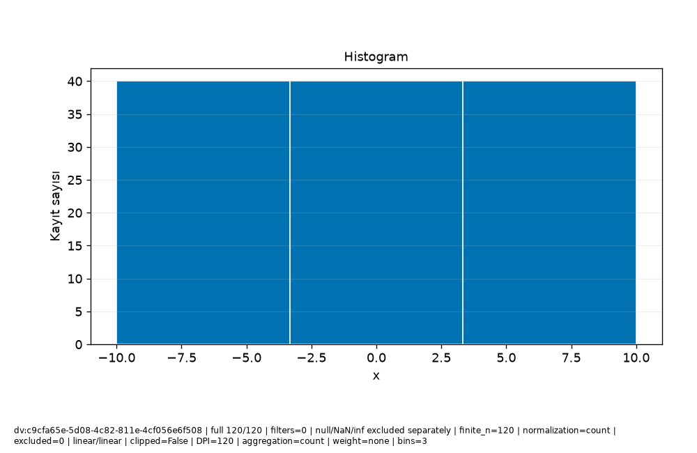

# Veri\_Ufku · Bilimsel rapor

Protokol: exploratory
Keşifsel inceleme; analiz birimi, seçim ve test kullanımını kayıtlı sonuçlarla değerlendirin.

Güncellik: Seçilen dataset/run için daha yeni kayıt bulunmadı; dış kaynağın canlı tazeliği doğrulanmadı.

Test kullanım defteri: []
Model seçim protokolü: kayıtlı method/model-card alanlarına bakın; alan yoksa not_recorded.

## Araştırma sorusu

**text**

```text
Soruyu ve analiz birimini kullanıcı olarak açıklayın.
```
**evidence**

```text
Kullanıcı metni; doğrulanmış hesap değildir.
```

## Yorum ve sınırlamalar

**text**

```text
Bulguyu yorumdan ayırın; nedensel çıkarım varsayımlarını açıkça yazın.
```
**evidence**

```text
Kullanıcı metni; doğrulanmış hesap değildir.
```

## Kaynakça


## method

**record_id**

```text
result:3432eeb6-1f08-406c-bfe5-6521c72a6b48
```
**capability_id**

```text
model.regression
```
**dataset_versions**

```text
[
  "dv:c9cfa65e-5d08-4c82-811e-4cf056e6f508"
]
```
**run_id**

```text
run:93729eeb-c001-437a-8269-c3687f528115
```
**evidence**

```text
Kayıtlı alan projeksiyonu; yeni hesap veya otomatik yorum değildir.
```
**data**

```text
{
  "spec": {
    "availability": {
      "col:30788e18-5790-4e37-b5f6-3f760934f7fa": {
        "note": "Önceden bilinir",
        "offset_seconds": 0
      }
    },
    "baseline": "auto",
    "entity_use": "new",
    "folds": 3,
    "horizon_seconds": 0,
    "method": "auto",
    "prediction_moment": "Ölçüm öncesi",
    "seed": 42,
    "structure": "independent",
    "test_fraction": 0.2,
    "validation_fraction": 0.2
  },
  "model_card": {
    "baseline": {
      "comparison": [
        {
          "metrics": [
            {
              "averaging": "per_record",
              "coverage": "all eligible records in this evaluation partition",
              "direction": "minimize",
              "metric": "mae",
              "n": 24,
              "scope": "validation",
              "status": "valid",
              "value": 15.105042016806722
            },
            {
              "averaging": "per_record",
              "coverage": "all eligible records in this evaluation partition",
              "direction": "minimize",
              "metric": "rmse",
              "n": 24,
              "scope": "validation",
              "status": "valid",
              "value": 17.131074485116738
            },
            {
              "averaging": "per_record",
              "coverage": "all eligible records in this evaluation partition",
              "direction": "maximize",
              "metric": "r2",
              "n": 24,
              "scope": "validation",
              "status": "valid",
              "value": -0.07031033705694889
            }
          ],
          "scope": "validation"
        },
        {
          "metrics": [
            {
              "averaging": "per_record",
              "coverage": "all eligible records in this evaluation partition",
              "direction": "minimize",
              "metric": "mae",
              "n": 32,
              "scope": "cv:1",
              "status": "valid",
              "value": 16.085215336134453
            },
            {
              "averaging": "per_record",
              "coverage": "all eligible records in this evaluation partition",
              "direction": "minimize",
              "metric": "rmse",
              "n": 32,
              "scope": "cv:1",
              "status": "valid",
              "value": 17.78349866194151
            },
            {
              "averaging": "per_record",
              "coverage": "all eligible records in this evaluation partition",
              "direction": "maximize",
              "metric": "r2",
              "n": 32,
              "scope": "cv:1",
              "status": "valid",
              "value": -0.08216532968157875
            }
          ],
          "scope": "cv:1"
        },
        {
          "metrics": [
            {
              "averaging": "per_record",
              "coverage": "all eligible records in this evaluation partition",
              "direction": "minimize",
              "metric": "mae",
              "n": 32,
              "scope": "cv:2",
              "status": "valid",
              "value": 14.063484768907566
            },
            {
              "averaging": "per_record",
              "coverage": "all eligible records in this evaluation partition",
              "direction": "minimize",
              "metric": "rmse",
              "n": 32,
              "scope": "cv:2",
              "status": "valid",
              "value": 16.834420290258713
            },
            {
              "averaging": "per_record",
              "coverage": "all eligible records in this evaluation partition",
              "direction": "maximize",
              "metric": "r2",
              "n": 32,
              "scope": "cv:2",
              "status": "valid",
              "value": -0.000592538052601066
            }
          ],
          "scope": "cv:2"
        },
        {
          "metrics": [
            {
              "averaging": "per_record",
              "coverage": "all eligible records in this evaluation partition",
              "direction": "minimize",
              "metric": "mae",
              "n": 32,
              "scope": "cv:3",
              "status": "valid",
              "value": 16.882878151260506
            },
            {
              "averaging": "per_record",
              "coverage": "all eligible records in this evaluation partition",
              "direction": "minimize",
              "metric": "rmse",
              "n": 32,
              "scope": "cv:3",
              "status": "valid",
              "value": 19.037369544238533
            },
            {
              "averaging": "per_record",
              "coverage": "all eligible records in this evaluation partition",
              "direction": "maximize",
              "metric": "r2",
              "n": 32,
              "scope": "cv:3",
              "status": "valid",
              "value": -0.084358201283397
            }
          ],
          "scope": "cv:3"
        }
      ],
      "limitation": "Final koşuda yeniden baseline seçimi yapılmaz; geliştirme koşusu kartına bakın.",
      "strategy": "mean"
    },
    "candidate_selection": {
      "parameters": {
        "alpha": 1.0,
        "candidates": [
          "baseline",
          "linear",
          "ridge",
          "forest"
        ],
        "depth": 8,
        "trees": 50,
        "unit": "TL"
      },
      "rule": "minimum development CV mean MAE; ties follow candidate order",
      "selected": "linear"
    },
    "columns": [
      {
        "id": "col:30788e18-5790-4e37-b5f6-3f760934f7fa",
        "name": "x",
        "original_name": "x",
        "type": "Float64"
      },
      {
        "id": "col:f3ac7490-1b7d-43bf-b6eb-d38de7cbc3d3",
        "name": "y",
        "original_name": "y",
        "type": "Float64"
      }
    ],
    "dataset_version": "dv:c9cfa65e-5d08-4c82-811e-4cf056e6f508",
    "decision": null,
    "estimator": "LinearRegression",
    "features": [
      {
        "id": "col:30788e18-5790-4e37-b5f6-3f760934f7fa",
        "name": "x",
        "type": "Float64",
        "unit": ""
      }
    ],
    "fit_row_ids": [
      "row:7d95f830-fa2e-4407-8538-ea9ce069d5d4",
      "row:58ddbff5-ce6f-4ce1-854a-56a5650a9861",
      "row:ad7d7f78-80a2-4eee-b4c2-11bc4967a8cc",
      "row:845a6800-8679-4f0a-9d07-98a003c603c3",
      "row:7dd219ab-a73f-4f9c-a71e-246a543396c9",
      "row:54d25c6f-9abf-47c6-98dc-5f7c5517eb11",
      "row:3fbe8dd3-744a-4a9a-b49c-d64685af23fd",
      "row:8e930b88-b8aa-44d7-a904-53bfedeeab65",
      "row:405a97e8-f646-46ac-858f-b42d06ef6131",
      "row:81ef5f16-5495-4108-9450-fc39dc4ecc6a",
      "row:878f9c09-947a-4070-9163-0c704f673793",
      "row:7d70338d-d2df-473e-ba60-53f65e63b980",
      "row:8e9cf8a1-cfad-40f0-b344-17dbb35abf56",
      "row:b28dd797-3238-458e-9f29-7ec541ec2317",
      "row:3b4c47de-626c-4499-85b7-b656dd3d96e4",
      "row:8078be3c-ed7b-4c90-b772-19a0e8e2cd5e",
      "row:1862957e-504b-4ec8-a8c1-4ff66199f82b",
      "row:ac626aaa-aeb3-4202-9db7-12a3cd7a9108",
      "row:30d09198-1ce0-4f69-91c1-07936460db9b",
      "row:f7506a9f-ab78-4d3e-b682-69d84de6c900",
      "row:6a9a1cbc-2a3e-4840-b0a7-f793e2f98eb8",
      "row:08e4955d-4452-4099-a6bc-80b5a50684e1",
      "row:ca7fe7b0-09ea-47ee-a801-8b7634150130",
      "row:b0a4b892-1a73-4b78-91df-04e75eb38600",
      "row:12415229-21ce-4907-996e-2c7e783407f9",
      "row:8042c309-cdd9-4a3c-bf63-c4ee68da3382",
      "row:40b3b232-641a-413d-a9b8-c89c0e5145ca",
      "row:b6153c82-048a-4a8f-8be2-61d9795dd199",
      "row:37ceb6c7-e709-4a18-b854-d639ba61b588",
      "row:d95af4fc-aa11-4382-ac32-90f8be01949a",
      "row:a024af07-77cd-42a4-964c-e12a97f69934",
      "row:6f9f3ae0-4b3c-46ea-8990-f9101b57b7e5",
      "row:86034173-52ec-4b44-91de-3d02968c6058",
      "row:570e0ad4-e4fa-4ec9-be24-82753bb11094",
      "row:6e72ac43-5fbb-4c36-909e-74a277327993",
      "row:808d3b02-3490-43e1-be9f-8fcbb59f0fa1",
      "row:148a36fb-2c4c-4b15-acd2-2f3777b730e9",
      "row:9677ee56-782c-475c-bce1-9e99856f1e51",
      "row:0efeeaa4-0657-40e2-86d2-b545d6896e7c",
      "row:9c5395c7-b55a-423c-ad16-793b3727368a",
      "row:6abbfa4f-6c87-4f2d-a696-3197322b2e3e",
      "row:f318065b-8e73-4909-aa02-577659184f3d",
      "row:e0354a74-670e-4f0d-97c0-35d353d3704d",
      "row:1a6d243c-9439-4389-808c-cebaa93e0709",
      "row:8e6f68e5-1dba-431e-b9be-d152ffdce13a",
      "row:85e5e05f-8b57-40af-9b44-d7dc8c7b235e",
      "row:a0f425ae-a3c8-4f59-a445-e6d2c8d5875e",
      "row:b2846d5a-c37c-4cea-8774-23ba703e4900",
      "row:1e33e608-3c76-4057-842e-03c460fbad34",
      "row:e91f9eb3-2f5a-487c-b62e-74ba621fad24",
      "row:b5061de9-878a-42b0-9644-b4cbad79379a",
      "row:bc1c0eae-7fca-4de5-a37c-f1b3ac729533",
      "row:c7bfac54-c61a-43c2-97a4-1c042763e617",
      "row:39c0343f-473a-4570-b30a-16553d8f0da4",
      "row:9cf153b4-a78f-4bbc-acdb-169165e31472",
      "row:b1399391-6132-47b9-92c4-e08934d0cd02",
      "row:0dec2789-ec6d-48fd-ab7d-f5ad83c27c4e",
      "row:3af61baa-c675-4d74-b4a7-5ef398fadb3b",
      "row:7661e9e0-c67c-46cf-a9be-78cb31bb37d7",
      "row:192b6057-4775-4f0e-9371-66686b1e4c6c",
      "row:766131ba-b8f3-4c81-a877-236192f28938",
      "row:a5417e31-5c52-4af6-82ad-dcc8d6400746",
      "row:78fc767d-26e9-4f4e-8d40-7d09ddc4e572",
      "row:c463d93a-44ba-498c-bf68-cbf8c29e935a",
      "row:e8251e42-3557-4a1e-9c4f-4e48e1b7367e",
      "row:4b206d13-496c-4508-b7c0-c2009c63b66a",
      "row:932c05c2-87c1-4487-8430-c3542adecaf4",
      "row:a3ace222-ec61-4004-864b-c33a8048794a",
      "row:23e7415b-759e-409e-9689-ad90c37f3a58",
      "row:7a52f44a-9e5e-488f-85a6-45c6c59f973b",
      "row:a16e5a14-5a18-4569-92bf-dc42c411a197",
      "row:56276848-fa70-4848-801a-1a1e1ccf04d7"
    ],
    "fit_scope": "development_train; validation previously used for selection",
    "fitted_preprocessing": {
      "1": {
        "kind": "impute_numeric",
        "statistics": [
          1.344537815126051
        ]
      },
      "2": {
        "kind": "standard_scale",
        "mean": [
          0.6092436974789925
        ],
        "scale": [
          5.948272597687973
        ]
      }
    },
    "importance": {
      "limitation": "İlişkili değişkenler önemi paylaşır/gizler; negatif önem mümkün. Nedensellik değildir; final test kullanılmadı.",
      "metric": "negative_MAE",
      "repeats": 3,
      "row_ids": [
        "row:22367327-5d85-4c02-8bc7-99e98f763e39",
        "row:53ec7ce7-d2f0-46ef-a6f2-aa6ef5c68e4e",
        "row:087bd1cb-bb8f-4f1c-8192-34ccd0da061b",
        "row:05d0d7ad-a200-4bea-81ca-a7a748a23c23",
        "row:3d5794c6-68ff-4e87-be75-a75fd12aa86a",
        "row:311421a1-7e0c-4efb-974e-9a7036d5c2bd",
        "row:34be653c-c8b2-431b-8175-fba0f3e8274e",
        "row:6e2cdfe7-198b-4085-b669-5c74fc0dab74",
        "row:5cc8454f-932a-48f2-9934-729fcc5ea85f",
        "row:8886914a-f3e8-44dd-8cb2-cac28a3a73ac",
        "row:d515e867-a08a-43b5-9297-f547dd4da90d",
        "row:de47de2a-43f5-417e-b88b-66eaee3e4554",
        "row:f2ce3d3b-9e3f-493b-944e-0680d269a2be",
        "row:088f2ec7-1103-42e6-aa95-c70165f07717",
        "row:bf8709f4-e315-49e3-90bf-254864f915e4",
        "row:f7dca873-6781-43da-878a-ceeeb279c60e",
        "row:e497ae6e-8a34-4d7a-b5fd-11cafa782548",
        "row:048b7c77-fc52-4acd-a99d-06565e087d8c",
        "row:8d1949b1-a27a-4e0e-a82f-68f984a59e44",
        "row:ffc78a22-9734-4647-84aa-3e1207c3f229",
        "row:9bbf1c0b-8d4a-48ff-ace6-aa5a79555020",
        "row:0a1ca735-f2e5-47d4-8e76-840d6432aedb",
        "row:a7bafb93-cbea-40c3-9072-7bee5d04769f",
        "row:88c7a011-50c0-43a1-bf53-02a7f1066bf9"
      ],
      "scope": "validation; exploratory; already used for model/threshold selection",
      "seed": 42,
      "status": "available",
      "values": [
        {
          "column_id": "col:30788e18-5790-4e37-b5f6-3f760934f7fa",
          "mean": 19.523809523809522,
          "name": "x",
          "std": 2.038091850261204
        }
      ]
    },
    "label_order": [],
    "limitations": "Katsayı ve önemler nedensel etki değildir. İlişkili özellikler önemi paylaşabilir veya gizleyebilir. Yeni veri dağılımı değişebilir; olasılık kesinlik veya kalibrasyon garantisi değildir. Küme ve anomali adayları gerçek sınıf/veri hatası değildir; otomatik silme yok.",
    "method": null,
    "metrics": [
      {
        "evaluation_n": 24,
        "metrics": [
          {
            "averaging": "per_record",
            "coverage": "all eligible records in this evaluation partition",
            "direction": "minimize",
            "metric": "mae",
            "n": 24,
            "scope": "validation",
            "status": "valid",
            "value": 4.810966440042345e-15
          },
          {
            "averaging": "per_record",
            "coverage": "all eligible records in this evaluation partition",
            "direction": "minimize",
            "metric": "rmse",
            "n": 24,
            "scope": "validation",
            "status": "valid",
            "value": 5.582114810376975e-15
          },
          {
            "averaging": "per_record",
            "coverage": "all eligible records in this evaluation partition",
            "direction": "maximize",
            "metric": "r2",
            "n": 24,
            "scope": "validation",
            "status": "valid",
            "value": 1.0
          }
        ],
        "scope": "validation",
        "status": "valid",
        "train_n": 72
      },
      {
        "evaluation_n": 32,
        "metrics": [
          {
            "averaging": "per_record",
            "coverage": "all eligible records in this evaluation partition",
            "direction": "minimize",
            "metric": "mae",
            "n": 32,
            "scope": "cv:1",
            "status": "valid",
            "value": 1.3877787807814457e-15
          },
          {
            "averaging": "per_record",
            "coverage": "all eligible records in this evaluation partition",
            "direction": "minimize",
            "metric": "rmse",
            "n": 32,
            "scope": "cv:1",
            "status": "valid",
            "value": 2.1413206232596582e-15
          },
          {
            "averaging": "per_record",
            "coverage": "all eligible records in this evaluation partition",
            "direction": "maximize",
            "metric": "r2",
            "n": 32,
            "scope": "cv:1",
            "status": "valid",
            "value": 1.0
          }
        ],
        "scope": "cv:1",
        "status": "valid",
        "train_n": 64
      },
      {
        "evaluation_n": 32,
        "metrics": [
          {
            "averaging": "per_record",
            "coverage": "all eligible records in this evaluation partition",
            "direction": "minimize",
            "metric": "mae",
            "n": 32,
            "scope": "cv:2",
            "status": "valid",
            "value": 5.828670879282072e-15
          },
          {
            "averaging": "per_record",
            "coverage": "all eligible records in this evaluation partition",
            "direction": "minimize",
            "metric": "rmse",
            "n": 32,
            "scope": "cv:2",
            "status": "valid",
            "value": 7.320740245935003e-15
          },
          {
            "averaging": "per_record",
            "coverage": "all eligible records in this evaluation partition",
            "direction": "maximize",
            "metric": "r2",
            "n": 32,
            "scope": "cv:2",
            "status": "valid",
            "value": 1.0
          }
        ],
        "scope": "cv:2",
        "status": "valid",
        "train_n": 64
      },
      {
        "evaluation_n": 32,
        "metrics": [
          {
            "averaging": "per_record",
            "coverage": "all eligible records in this evaluation partition",
            "direction": "minimize",
            "metric": "mae",
            "n": 32,
            "scope": "cv:3",
            "status": "valid",
            "value": 1.915134717478395e-15
          },
          {
            "averaging": "per_record",
            "coverage": "all eligible records in this evaluation partition",
            "direction": "minimize",
            "metric": "rmse",
            "n": 32,
            "scope": "cv:3",
            "status": "valid",
            "value": 2.687565378447544e-15
          },
          {
            "averaging": "per_record",
            "coverage": "all eligible records in this evaluation partition",
            "direction": "maximize",
            "metric": "r2",
            "n": 32,
            "scope": "cv:3",
            "status": "valid",
            "value": 1.0
          }
        ],
        "scope": "cv:3",
        "status": "valid",
        "train_n": 64
      }
    ],
    "preparation_spec": {
      "allow_identifiers": false,
      "categorical_imputation": "most_frequent",
      "date_features": true,
      "encoding": "onehot",
      "family": "linear",
      "features": [
        "col:30788e18-5790-4e37-b5f6-3f760934f7fa"
      ],
      "group": "",
      "history_action": "review",
      "history_note": "",
      "invalid_numeric": "reject",
      "numeric_imputation": "median",
      "precision": "reject",
      "prediction_context": "",
      "purpose": "regression",
      "scaling": "standard",
      "selection": "none",
      "source_version": "dv:c9cfa65e-5d08-4c82-811e-4cf056e6f508",
      "target": "col:f3ac7490-1b7d-43bf-b6eb-d38de7cbc3d3",
      "time": ""
    },
    "preprocessing": {
      "category_vocabulary": null,
      "column_lineage": [
        {
          "category_map": [],
          "input_column_id": "col:30788e18-5790-4e37-b5f6-3f760934f7fa",
          "names_status": "structurally_known",
          "output_names": [
            "f_30788e1857904e37b5f63f760934f7fa__numeric"
          ],
          "selected_after_fit": "all_planned",
          "source_dtype": "Float64",
          "source_name": "x"
        }
      ],
      "estimator_family": "linear",
      "feature_selection_mask": null,
      "fit_state": "not_fitted",
      "fitted_parameters": {},
      "schema": "PreparationPlan/v1",
      "steps": [
        {
          "input_column_ids": [
            "col:30788e18-5790-4e37-b5f6-3f760934f7fa"
          ],
          "kind": "numeric",
          "learned_scope": "row_local",
          "output_names": [
            "f_30788e1857904e37b5f63f760934f7fa__numeric"
          ],
          "parameters": {
            "nonfinite": "reject",
            "precision": "reject"
          },
          "reason": "Kimlik ölçüm değildir; Float64 kaybı gelecekte açık politika ile denetlenir.",
          "state": "planned"
        },
        {
          "input_column_ids": [
            "col:30788e18-5790-4e37-b5f6-3f760934f7fa"
          ],
          "kind": "impute_numeric",
          "learned_scope": "training_fold",
          "output_names": [
            "f_30788e1857904e37b5f63f760934f7fa__numeric"
          ],
          "parameters": {
            "all_missing": "error",
            "strategy": "median"
          },
          "reason": "Seçilen doldurma değeri yalnız eğitim katında öğrenilir; test/validation ortalaması kullanılmaz.",
          "state": "planned"
        },
        {
          "input_column_ids": [
            "col:30788e18-5790-4e37-b5f6-3f760934f7fa"
          ],
          "kind": "standard_scale",
          "learned_scope": "training_fold",
          "output_names": [
            "f_30788e1857904e37b5f63f760934f7fa__numeric"
          ],
          "parameters": {
            "explicit_override": false
          },
          "reason": "Uzaklıklar ve düzenlileştirilmiş doğrusal modeller ölçüm ölçeğine duyarlıdır; eğitim katında standardizasyon planlandı.",
          "state": "planned"
        }
      ],
      "training_dependency": "Requires a validated split/fold protocol in Phase16; no training performed",
      "version_id": "ml-pipeline:25eb31d7-5a76-47ad-a9f0-24c2eea2ceb7"
    },
    "probability_supported": false,
    "purpose": "regression",
    "run_id": "run:93729eeb-c001-437a-8269-c3687f528115",
    "schema": "ModelCard/v1",
    "seed": 42,
    "snapshot_fingerprint": {
      "sha256": "0b6ea09efb2a34e52ac88edbdfefc3e18360b52221d6e3f0dbdcc5879d4d92ea",
      "size": 11582
    },
    "split": {
      "invalid_folds": [],
      "membership": {
        "development": [
          "row:048b7c77-fc52-4acd-a99d-06565e087d8c",
          "row:05d0d7ad-a200-4bea-81ca-a7a748a23c23",
          "row:087bd1cb-bb8f-4f1c-8192-34ccd0da061b",
          "row:088f2ec7-1103-42e6-aa95-c70165f07717",
          "row:08e4955d-4452-4099-a6bc-80b5a50684e1",
          "row:0a1ca735-f2e5-47d4-8e76-840d6432aedb",
          "row:0dec2789-ec6d-48fd-ab7d-f5ad83c27c4e",
          "row:0efeeaa4-0657-40e2-86d2-b545d6896e7c",
          "row:12415229-21ce-4907-996e-2c7e783407f9",
          "row:148a36fb-2c4c-4b15-acd2-2f3777b730e9",
          "row:1862957e-504b-4ec8-a8c1-4ff66199f82b",
          "row:192b6057-4775-4f0e-9371-66686b1e4c6c",
          "row:1a6d243c-9439-4389-808c-cebaa93e0709",
          "row:1e33e608-3c76-4057-842e-03c460fbad34",
          "row:22367327-5d85-4c02-8bc7-99e98f763e39",
          "row:23e7415b-759e-409e-9689-ad90c37f3a58",
          "row:30d09198-1ce0-4f69-91c1-07936460db9b",
          "row:311421a1-7e0c-4efb-974e-9a7036d5c2bd",
          "row:34be653c-c8b2-431b-8175-fba0f3e8274e",
          "row:37ceb6c7-e709-4a18-b854-d639ba61b588",
          "row:39c0343f-473a-4570-b30a-16553d8f0da4",
          "row:3af61baa-c675-4d74-b4a7-5ef398fadb3b",
          "row:3b4c47de-626c-4499-85b7-b656dd3d96e4",
          "row:3d5794c6-68ff-4e87-be75-a75fd12aa86a",
          "row:3fbe8dd3-744a-4a9a-b49c-d64685af23fd",
          "row:405a97e8-f646-46ac-858f-b42d06ef6131",
          "row:40b3b232-641a-413d-a9b8-c89c0e5145ca",
          "row:4b206d13-496c-4508-b7c0-c2009c63b66a",
          "row:53ec7ce7-d2f0-46ef-a6f2-aa6ef5c68e4e",
          "row:54d25c6f-9abf-47c6-98dc-5f7c5517eb11",
          "row:56276848-fa70-4848-801a-1a1e1ccf04d7",
          "row:570e0ad4-e4fa-4ec9-be24-82753bb11094",
          "row:58ddbff5-ce6f-4ce1-854a-56a5650a9861",
          "row:5cc8454f-932a-48f2-9934-729fcc5ea85f",
          "row:6a9a1cbc-2a3e-4840-b0a7-f793e2f98eb8",
          "row:6abbfa4f-6c87-4f2d-a696-3197322b2e3e",
          "row:6e2cdfe7-198b-4085-b669-5c74fc0dab74",
          "row:6e72ac43-5fbb-4c36-909e-74a277327993",
          "row:6f9f3ae0-4b3c-46ea-8990-f9101b57b7e5",
          "row:766131ba-b8f3-4c81-a877-236192f28938",
          "row:7661e9e0-c67c-46cf-a9be-78cb31bb37d7",
          "row:78fc767d-26e9-4f4e-8d40-7d09ddc4e572",
          "row:7a52f44a-9e5e-488f-85a6-45c6c59f973b",
          "row:7d70338d-d2df-473e-ba60-53f65e63b980",
          "row:7d95f830-fa2e-4407-8538-ea9ce069d5d4",
          "row:7dd219ab-a73f-4f9c-a71e-246a543396c9",
          "row:8042c309-cdd9-4a3c-bf63-c4ee68da3382",
          "row:8078be3c-ed7b-4c90-b772-19a0e8e2cd5e",
          "row:808d3b02-3490-43e1-be9f-8fcbb59f0fa1",
          "row:81ef5f16-5495-4108-9450-fc39dc4ecc6a",
          "row:845a6800-8679-4f0a-9d07-98a003c603c3",
          "row:85e5e05f-8b57-40af-9b44-d7dc8c7b235e",
          "row:86034173-52ec-4b44-91de-3d02968c6058",
          "row:878f9c09-947a-4070-9163-0c704f673793",
          "row:8886914a-f3e8-44dd-8cb2-cac28a3a73ac",
          "row:88c7a011-50c0-43a1-bf53-02a7f1066bf9",
          "row:8d1949b1-a27a-4e0e-a82f-68f984a59e44",
          "row:8e6f68e5-1dba-431e-b9be-d152ffdce13a",
          "row:8e930b88-b8aa-44d7-a904-53bfedeeab65",
          "row:8e9cf8a1-cfad-40f0-b344-17dbb35abf56",
          "row:932c05c2-87c1-4487-8430-c3542adecaf4",
          "row:9677ee56-782c-475c-bce1-9e99856f1e51",
          "row:9bbf1c0b-8d4a-48ff-ace6-aa5a79555020",
          "row:9c5395c7-b55a-423c-ad16-793b3727368a",
          "row:9cf153b4-a78f-4bbc-acdb-169165e31472",
          "row:a024af07-77cd-42a4-964c-e12a97f69934",
          "row:a0f425ae-a3c8-4f59-a445-e6d2c8d5875e",
          "row:a16e5a14-5a18-4569-92bf-dc42c411a197",
          "row:a3ace222-ec61-4004-864b-c33a8048794a",
          "row:a5417e31-5c52-4af6-82ad-dcc8d6400746",
          "row:a7bafb93-cbea-40c3-9072-7bee5d04769f",
          "row:ac626aaa-aeb3-4202-9db7-12a3cd7a9108",
          "row:ad7d7f78-80a2-4eee-b4c2-11bc4967a8cc",
          "row:b0a4b892-1a73-4b78-91df-04e75eb38600",
          "row:b1399391-6132-47b9-92c4-e08934d0cd02",
          "row:b2846d5a-c37c-4cea-8774-23ba703e4900",
          "row:b28dd797-3238-458e-9f29-7ec541ec2317",
          "row:b5061de9-878a-42b0-9644-b4cbad79379a",
          "row:b6153c82-048a-4a8f-8be2-61d9795dd199",
          "row:bc1c0eae-7fca-4de5-a37c-f1b3ac729533",
          "row:bf8709f4-e315-49e3-90bf-254864f915e4",
          "row:c463d93a-44ba-498c-bf68-cbf8c29e935a",
          "row:c7bfac54-c61a-43c2-97a4-1c042763e617",
          "row:ca7fe7b0-09ea-47ee-a801-8b7634150130",
          "row:d515e867-a08a-43b5-9297-f547dd4da90d",
          "row:d95af4fc-aa11-4382-ac32-90f8be01949a",
          "row:de47de2a-43f5-417e-b88b-66eaee3e4554",
          "row:e0354a74-670e-4f0d-97c0-35d353d3704d",
          "row:e497ae6e-8a34-4d7a-b5fd-11cafa782548",
          "row:e8251e42-3557-4a1e-9c4f-4e48e1b7367e",
          "row:e91f9eb3-2f5a-487c-b62e-74ba621fad24",
          "row:f2ce3d3b-9e3f-493b-944e-0680d269a2be",
          "row:f318065b-8e73-4909-aa02-577659184f3d",
          "row:f7506a9f-ab78-4d3e-b682-69d84de6c900",
          "row:f7dca873-6781-43da-878a-ceeeb279c60e",
          "row:ffc78a22-9734-4647-84aa-3e1207c3f229"
        ],
        "folds": [
          {
            "status": "valid",
            "train": [
              "row:08e4955d-4452-4099-a6bc-80b5a50684e1",
              "row:0dec2789-ec6d-48fd-ab7d-f5ad83c27c4e",
              "row:0efeeaa4-0657-40e2-86d2-b545d6896e7c",
              "row:12415229-21ce-4907-996e-2c7e783407f9",
              "row:148a36fb-2c4c-4b15-acd2-2f3777b730e9",
              "row:1862957e-504b-4ec8-a8c1-4ff66199f82b",
              "row:192b6057-4775-4f0e-9371-66686b1e4c6c",
              "row:1a6d243c-9439-4389-808c-cebaa93e0709",
              "row:1e33e608-3c76-4057-842e-03c460fbad34",
              "row:23e7415b-759e-409e-9689-ad90c37f3a58",
              "row:30d09198-1ce0-4f69-91c1-07936460db9b",
              "row:37ceb6c7-e709-4a18-b854-d639ba61b588",
              "row:39c0343f-473a-4570-b30a-16553d8f0da4",
              "row:3af61baa-c675-4d74-b4a7-5ef398fadb3b",
              "row:3b4c47de-626c-4499-85b7-b656dd3d96e4",
              "row:405a97e8-f646-46ac-858f-b42d06ef6131",
              "row:40b3b232-641a-413d-a9b8-c89c0e5145ca",
              "row:4b206d13-496c-4508-b7c0-c2009c63b66a",
              "row:56276848-fa70-4848-801a-1a1e1ccf04d7",
              "row:570e0ad4-e4fa-4ec9-be24-82753bb11094",
              "row:6a9a1cbc-2a3e-4840-b0a7-f793e2f98eb8",
              "row:6abbfa4f-6c87-4f2d-a696-3197322b2e3e",
              "row:6e72ac43-5fbb-4c36-909e-74a277327993",
              "row:6f9f3ae0-4b3c-46ea-8990-f9101b57b7e5",
              "row:766131ba-b8f3-4c81-a877-236192f28938",
              "row:7661e9e0-c67c-46cf-a9be-78cb31bb37d7",
              "row:78fc767d-26e9-4f4e-8d40-7d09ddc4e572",
              "row:7a52f44a-9e5e-488f-85a6-45c6c59f973b",
              "row:7d70338d-d2df-473e-ba60-53f65e63b980",
              "row:8042c309-cdd9-4a3c-bf63-c4ee68da3382",
              "row:8078be3c-ed7b-4c90-b772-19a0e8e2cd5e",
              "row:808d3b02-3490-43e1-be9f-8fcbb59f0fa1",
              "row:81ef5f16-5495-4108-9450-fc39dc4ecc6a",
              "row:85e5e05f-8b57-40af-9b44-d7dc8c7b235e",
              "row:86034173-52ec-4b44-91de-3d02968c6058",
              "row:878f9c09-947a-4070-9163-0c704f673793",
              "row:8e6f68e5-1dba-431e-b9be-d152ffdce13a",
              "row:8e9cf8a1-cfad-40f0-b344-17dbb35abf56",
              "row:932c05c2-87c1-4487-8430-c3542adecaf4",
              "row:9677ee56-782c-475c-bce1-9e99856f1e51",
              "row:9c5395c7-b55a-423c-ad16-793b3727368a",
              "row:9cf153b4-a78f-4bbc-acdb-169165e31472",
              "row:a024af07-77cd-42a4-964c-e12a97f69934",
              "row:a0f425ae-a3c8-4f59-a445-e6d2c8d5875e",
              "row:a16e5a14-5a18-4569-92bf-dc42c411a197",
              "row:a3ace222-ec61-4004-864b-c33a8048794a",
              "row:a5417e31-5c52-4af6-82ad-dcc8d6400746",
              "row:ac626aaa-aeb3-4202-9db7-12a3cd7a9108",
              "row:b0a4b892-1a73-4b78-91df-04e75eb38600",
              "row:b1399391-6132-47b9-92c4-e08934d0cd02",
              "row:b2846d5a-c37c-4cea-8774-23ba703e4900",
              "row:b28dd797-3238-458e-9f29-7ec541ec2317",
              "row:b5061de9-878a-42b0-9644-b4cbad79379a",
              "row:b6153c82-048a-4a8f-8be2-61d9795dd199",
              "row:bc1c0eae-7fca-4de5-a37c-f1b3ac729533",
              "row:c463d93a-44ba-498c-bf68-cbf8c29e935a",
              "row:c7bfac54-c61a-43c2-97a4-1c042763e617",
              "row:ca7fe7b0-09ea-47ee-a801-8b7634150130",
              "row:d95af4fc-aa11-4382-ac32-90f8be01949a",
              "row:e0354a74-670e-4f0d-97c0-35d353d3704d",
              "row:e8251e42-3557-4a1e-9c4f-4e48e1b7367e",
              "row:e91f9eb3-2f5a-487c-b62e-74ba621fad24",
              "row:f318065b-8e73-4909-aa02-577659184f3d",
              "row:f7506a9f-ab78-4d3e-b682-69d84de6c900"
            ],
            "validation": [
              "row:048b7c77-fc52-4acd-a99d-06565e087d8c",
              "row:05d0d7ad-a200-4bea-81ca-a7a748a23c23",
              "row:087bd1cb-bb8f-4f1c-8192-34ccd0da061b",
              "row:088f2ec7-1103-42e6-aa95-c70165f07717",
              "row:0a1ca735-f2e5-47d4-8e76-840d6432aedb",
              "row:22367327-5d85-4c02-8bc7-99e98f763e39",
              "row:311421a1-7e0c-4efb-974e-9a7036d5c2bd",
              "row:34be653c-c8b2-431b-8175-fba0f3e8274e",
              "row:3d5794c6-68ff-4e87-be75-a75fd12aa86a",
              "row:3fbe8dd3-744a-4a9a-b49c-d64685af23fd",
              "row:53ec7ce7-d2f0-46ef-a6f2-aa6ef5c68e4e",
              "row:54d25c6f-9abf-47c6-98dc-5f7c5517eb11",
              "row:58ddbff5-ce6f-4ce1-854a-56a5650a9861",
              "row:5cc8454f-932a-48f2-9934-729fcc5ea85f",
              "row:6e2cdfe7-198b-4085-b669-5c74fc0dab74",
              "row:7d95f830-fa2e-4407-8538-ea9ce069d5d4",
              "row:7dd219ab-a73f-4f9c-a71e-246a543396c9",
              "row:845a6800-8679-4f0a-9d07-98a003c603c3",
              "row:8886914a-f3e8-44dd-8cb2-cac28a3a73ac",
              "row:88c7a011-50c0-43a1-bf53-02a7f1066bf9",
              "row:8d1949b1-a27a-4e0e-a82f-68f984a59e44",
              "row:8e930b88-b8aa-44d7-a904-53bfedeeab65",
              "row:9bbf1c0b-8d4a-48ff-ace6-aa5a79555020",
              "row:a7bafb93-cbea-40c3-9072-7bee5d04769f",
              "row:ad7d7f78-80a2-4eee-b4c2-11bc4967a8cc",
              "row:bf8709f4-e315-49e3-90bf-254864f915e4",
              "row:d515e867-a08a-43b5-9297-f547dd4da90d",
              "row:de47de2a-43f5-417e-b88b-66eaee3e4554",
              "row:e497ae6e-8a34-4d7a-b5fd-11cafa782548",
              "row:f2ce3d3b-9e3f-493b-944e-0680d269a2be",
              "row:f7dca873-6781-43da-878a-ceeeb279c60e",
              "row:ffc78a22-9734-4647-84aa-3e1207c3f229"
            ]
          },
          {
            "status": "valid",
            "train": [
              "row:048b7c77-fc52-4acd-a99d-06565e087d8c",
              "row:05d0d7ad-a200-4bea-81ca-a7a748a23c23",
              "row:087bd1cb-bb8f-4f1c-8192-34ccd0da061b",
              "row:088f2ec7-1103-42e6-aa95-c70165f07717",
              "row:0a1ca735-f2e5-47d4-8e76-840d6432aedb",
              "row:0dec2789-ec6d-48fd-ab7d-f5ad83c27c4e",
              "row:192b6057-4775-4f0e-9371-66686b1e4c6c",
              "row:1a6d243c-9439-4389-808c-cebaa93e0709",
              "row:1e33e608-3c76-4057-842e-03c460fbad34",
              "row:22367327-5d85-4c02-8bc7-99e98f763e39",
              "row:23e7415b-759e-409e-9689-ad90c37f3a58",
              "row:311421a1-7e0c-4efb-974e-9a7036d5c2bd",
              "row:34be653c-c8b2-431b-8175-fba0f3e8274e",
              "row:39c0343f-473a-4570-b30a-16553d8f0da4",
              "row:3af61baa-c675-4d74-b4a7-5ef398fadb3b",
              "row:3d5794c6-68ff-4e87-be75-a75fd12aa86a",
              "row:3fbe8dd3-744a-4a9a-b49c-d64685af23fd",
              "row:4b206d13-496c-4508-b7c0-c2009c63b66a",
              "row:53ec7ce7-d2f0-46ef-a6f2-aa6ef5c68e4e",
              "row:54d25c6f-9abf-47c6-98dc-5f7c5517eb11",
              "row:56276848-fa70-4848-801a-1a1e1ccf04d7",
              "row:58ddbff5-ce6f-4ce1-854a-56a5650a9861",
              "row:5cc8454f-932a-48f2-9934-729fcc5ea85f",
              "row:6abbfa4f-6c87-4f2d-a696-3197322b2e3e",
              "row:6e2cdfe7-198b-4085-b669-5c74fc0dab74",
              "row:766131ba-b8f3-4c81-a877-236192f28938",
              "row:7661e9e0-c67c-46cf-a9be-78cb31bb37d7",
              "row:78fc767d-26e9-4f4e-8d40-7d09ddc4e572",
              "row:7a52f44a-9e5e-488f-85a6-45c6c59f973b",
              "row:7d95f830-fa2e-4407-8538-ea9ce069d5d4",
              "row:7dd219ab-a73f-4f9c-a71e-246a543396c9",
              "row:845a6800-8679-4f0a-9d07-98a003c603c3",
              "row:85e5e05f-8b57-40af-9b44-d7dc8c7b235e",
              "row:8886914a-f3e8-44dd-8cb2-cac28a3a73ac",
              "row:88c7a011-50c0-43a1-bf53-02a7f1066bf9",
              "row:8d1949b1-a27a-4e0e-a82f-68f984a59e44",
              "row:8e6f68e5-1dba-431e-b9be-d152ffdce13a",
              "row:8e930b88-b8aa-44d7-a904-53bfedeeab65",
              "row:932c05c2-87c1-4487-8430-c3542adecaf4",
              "row:9bbf1c0b-8d4a-48ff-ace6-aa5a79555020",
              "row:9cf153b4-a78f-4bbc-acdb-169165e31472",
              "row:a0f425ae-a3c8-4f59-a445-e6d2c8d5875e",
              "row:a16e5a14-5a18-4569-92bf-dc42c411a197",
              "row:a3ace222-ec61-4004-864b-c33a8048794a",
              "row:a5417e31-5c52-4af6-82ad-dcc8d6400746",
              "row:a7bafb93-cbea-40c3-9072-7bee5d04769f",
              "row:ad7d7f78-80a2-4eee-b4c2-11bc4967a8cc",
              "row:b1399391-6132-47b9-92c4-e08934d0cd02",
              "row:b2846d5a-c37c-4cea-8774-23ba703e4900",
              "row:b5061de9-878a-42b0-9644-b4cbad79379a",
              "row:bc1c0eae-7fca-4de5-a37c-f1b3ac729533",
              "row:bf8709f4-e315-49e3-90bf-254864f915e4",
              "row:c463d93a-44ba-498c-bf68-cbf8c29e935a",
              "row:c7bfac54-c61a-43c2-97a4-1c042763e617",
              "row:d515e867-a08a-43b5-9297-f547dd4da90d",
              "row:de47de2a-43f5-417e-b88b-66eaee3e4554",
              "row:e0354a74-670e-4f0d-97c0-35d353d3704d",
              "row:e497ae6e-8a34-4d7a-b5fd-11cafa782548",
              "row:e8251e42-3557-4a1e-9c4f-4e48e1b7367e",
              "row:e91f9eb3-2f5a-487c-b62e-74ba621fad24",
              "row:f2ce3d3b-9e3f-493b-944e-0680d269a2be",
              "row:f318065b-8e73-4909-aa02-577659184f3d",
              "row:f7dca873-6781-43da-878a-ceeeb279c60e",
              "row:ffc78a22-9734-4647-84aa-3e1207c3f229"
            ],
            "validation": [
              "row:08e4955d-4452-4099-a6bc-80b5a50684e1",
              "row:0efeeaa4-0657-40e2-86d2-b545d6896e7c",
              "row:12415229-21ce-4907-996e-2c7e783407f9",
              "row:148a36fb-2c4c-4b15-acd2-2f3777b730e9",
              "row:1862957e-504b-4ec8-a8c1-4ff66199f82b",
              "row:30d09198-1ce0-4f69-91c1-07936460db9b",
              "row:37ceb6c7-e709-4a18-b854-d639ba61b588",
              "row:3b4c47de-626c-4499-85b7-b656dd3d96e4",
              "row:405a97e8-f646-46ac-858f-b42d06ef6131",
              "row:40b3b232-641a-413d-a9b8-c89c0e5145ca",
              "row:570e0ad4-e4fa-4ec9-be24-82753bb11094",
              "row:6a9a1cbc-2a3e-4840-b0a7-f793e2f98eb8",
              "row:6e72ac43-5fbb-4c36-909e-74a277327993",
              "row:6f9f3ae0-4b3c-46ea-8990-f9101b57b7e5",
              "row:7d70338d-d2df-473e-ba60-53f65e63b980",
              "row:8042c309-cdd9-4a3c-bf63-c4ee68da3382",
              "row:8078be3c-ed7b-4c90-b772-19a0e8e2cd5e",
              "row:808d3b02-3490-43e1-be9f-8fcbb59f0fa1",
              "row:81ef5f16-5495-4108-9450-fc39dc4ecc6a",
              "row:86034173-52ec-4b44-91de-3d02968c6058",
              "row:878f9c09-947a-4070-9163-0c704f673793",
              "row:8e9cf8a1-cfad-40f0-b344-17dbb35abf56",
              "row:9677ee56-782c-475c-bce1-9e99856f1e51",
              "row:9c5395c7-b55a-423c-ad16-793b3727368a",
              "row:a024af07-77cd-42a4-964c-e12a97f69934",
              "row:ac626aaa-aeb3-4202-9db7-12a3cd7a9108",
              "row:b0a4b892-1a73-4b78-91df-04e75eb38600",
              "row:b28dd797-3238-458e-9f29-7ec541ec2317",
              "row:b6153c82-048a-4a8f-8be2-61d9795dd199",
              "row:ca7fe7b0-09ea-47ee-a801-8b7634150130",
              "row:d95af4fc-aa11-4382-ac32-90f8be01949a",
              "row:f7506a9f-ab78-4d3e-b682-69d84de6c900"
            ]
          },
          {
            "status": "valid",
            "train": [
              "row:048b7c77-fc52-4acd-a99d-06565e087d8c",
              "row:05d0d7ad-a200-4bea-81ca-a7a748a23c23",
              "row:087bd1cb-bb8f-4f1c-8192-34ccd0da061b",
              "row:088f2ec7-1103-42e6-aa95-c70165f07717",
              "row:08e4955d-4452-4099-a6bc-80b5a50684e1",
              "row:0a1ca735-f2e5-47d4-8e76-840d6432aedb",
              "row:0efeeaa4-0657-40e2-86d2-b545d6896e7c",
              "row:12415229-21ce-4907-996e-2c7e783407f9",
              "row:148a36fb-2c4c-4b15-acd2-2f3777b730e9",
              "row:1862957e-504b-4ec8-a8c1-4ff66199f82b",
              "row:22367327-5d85-4c02-8bc7-99e98f763e39",
              "row:30d09198-1ce0-4f69-91c1-07936460db9b",
              "row:311421a1-7e0c-4efb-974e-9a7036d5c2bd",
              "row:34be653c-c8b2-431b-8175-fba0f3e8274e",
              "row:37ceb6c7-e709-4a18-b854-d639ba61b588",
              "row:3b4c47de-626c-4499-85b7-b656dd3d96e4",
              "row:3d5794c6-68ff-4e87-be75-a75fd12aa86a",
              "row:3fbe8dd3-744a-4a9a-b49c-d64685af23fd",
              "row:405a97e8-f646-46ac-858f-b42d06ef6131",
              "row:40b3b232-641a-413d-a9b8-c89c0e5145ca",
              "row:53ec7ce7-d2f0-46ef-a6f2-aa6ef5c68e4e",
              "row:54d25c6f-9abf-47c6-98dc-5f7c5517eb11",
              "row:570e0ad4-e4fa-4ec9-be24-82753bb11094",
              "row:58ddbff5-ce6f-4ce1-854a-56a5650a9861",
              "row:5cc8454f-932a-48f2-9934-729fcc5ea85f",
              "row:6a9a1cbc-2a3e-4840-b0a7-f793e2f98eb8",
              "row:6e2cdfe7-198b-4085-b669-5c74fc0dab74",
              "row:6e72ac43-5fbb-4c36-909e-74a277327993",
              "row:6f9f3ae0-4b3c-46ea-8990-f9101b57b7e5",
              "row:7d70338d-d2df-473e-ba60-53f65e63b980",
              "row:7d95f830-fa2e-4407-8538-ea9ce069d5d4",
              "row:7dd219ab-a73f-4f9c-a71e-246a543396c9",
              "row:8042c309-cdd9-4a3c-bf63-c4ee68da3382",
              "row:8078be3c-ed7b-4c90-b772-19a0e8e2cd5e",
              "row:808d3b02-3490-43e1-be9f-8fcbb59f0fa1",
              "row:81ef5f16-5495-4108-9450-fc39dc4ecc6a",
              "row:845a6800-8679-4f0a-9d07-98a003c603c3",
              "row:86034173-52ec-4b44-91de-3d02968c6058",
              "row:878f9c09-947a-4070-9163-0c704f673793",
              "row:8886914a-f3e8-44dd-8cb2-cac28a3a73ac",
              "row:88c7a011-50c0-43a1-bf53-02a7f1066bf9",
              "row:8d1949b1-a27a-4e0e-a82f-68f984a59e44",
              "row:8e930b88-b8aa-44d7-a904-53bfedeeab65",
              "row:8e9cf8a1-cfad-40f0-b344-17dbb35abf56",
              "row:9677ee56-782c-475c-bce1-9e99856f1e51",
              "row:9bbf1c0b-8d4a-48ff-ace6-aa5a79555020",
              "row:9c5395c7-b55a-423c-ad16-793b3727368a",
              "row:a024af07-77cd-42a4-964c-e12a97f69934",
              "row:a7bafb93-cbea-40c3-9072-7bee5d04769f",
              "row:ac626aaa-aeb3-4202-9db7-12a3cd7a9108",
              "row:ad7d7f78-80a2-4eee-b4c2-11bc4967a8cc",
              "row:b0a4b892-1a73-4b78-91df-04e75eb38600",
              "row:b28dd797-3238-458e-9f29-7ec541ec2317",
              "row:b6153c82-048a-4a8f-8be2-61d9795dd199",
              "row:bf8709f4-e315-49e3-90bf-254864f915e4",
              "row:ca7fe7b0-09ea-47ee-a801-8b7634150130",
              "row:d515e867-a08a-43b5-9297-f547dd4da90d",
              "row:d95af4fc-aa11-4382-ac32-90f8be01949a",
              "row:de47de2a-43f5-417e-b88b-66eaee3e4554",
              "row:e497ae6e-8a34-4d7a-b5fd-11cafa782548",
              "row:f2ce3d3b-9e3f-493b-944e-0680d269a2be",
              "row:f7506a9f-ab78-4d3e-b682-69d84de6c900",
              "row:f7dca873-6781-43da-878a-ceeeb279c60e",
              "row:ffc78a22-9734-4647-84aa-3e1207c3f229"
            ],
            "validation": [
              "row:0dec2789-ec6d-48fd-ab7d-f5ad83c27c4e",
              "row:192b6057-4775-4f0e-9371-66686b1e4c6c",
              "row:1a6d243c-9439-4389-808c-cebaa93e0709",
              "row:1e33e608-3c76-4057-842e-03c460fbad34",
              "row:23e7415b-759e-409e-9689-ad90c37f3a58",
              "row:39c0343f-473a-4570-b30a-16553d8f0da4",
              "row:3af61baa-c675-4d74-b4a7-5ef398fadb3b",
              "row:4b206d13-496c-4508-b7c0-c2009c63b66a",
              "row:56276848-fa70-4848-801a-1a1e1ccf04d7",
              "row:6abbfa4f-6c87-4f2d-a696-3197322b2e3e",
              "row:766131ba-b8f3-4c81-a877-236192f28938",
              "row:7661e9e0-c67c-46cf-a9be-78cb31bb37d7",
              "row:78fc767d-26e9-4f4e-8d40-7d09ddc4e572",
              "row:7a52f44a-9e5e-488f-85a6-45c6c59f973b",
              "row:85e5e05f-8b57-40af-9b44-d7dc8c7b235e",
              "row:8e6f68e5-1dba-431e-b9be-d152ffdce13a",
              "row:932c05c2-87c1-4487-8430-c3542adecaf4",
              "row:9cf153b4-a78f-4bbc-acdb-169165e31472",
              "row:a0f425ae-a3c8-4f59-a445-e6d2c8d5875e",
              "row:a16e5a14-5a18-4569-92bf-dc42c411a197",
              "row:a3ace222-ec61-4004-864b-c33a8048794a",
              "row:a5417e31-5c52-4af6-82ad-dcc8d6400746",
              "row:b1399391-6132-47b9-92c4-e08934d0cd02",
              "row:b2846d5a-c37c-4cea-8774-23ba703e4900",
              "row:b5061de9-878a-42b0-9644-b4cbad79379a",
              "row:bc1c0eae-7fca-4de5-a37c-f1b3ac729533",
              "row:c463d93a-44ba-498c-bf68-cbf8c29e935a",
              "row:c7bfac54-c61a-43c2-97a4-1c042763e617",
              "row:e0354a74-670e-4f0d-97c0-35d353d3704d",
              "row:e8251e42-3557-4a1e-9c4f-4e48e1b7367e",
              "row:e91f9eb3-2f5a-487c-b62e-74ba621fad24",
              "row:f318065b-8e73-4909-aa02-577659184f3d"
            ]
          }
        ],
        "purged": [],
        "test": [
          "row:0adf22b0-84df-4f4f-9b62-1e86a0d47989",
          "row:1040cb91-5467-4fb3-847e-a443714fa795",
          "row:2e4afb90-583c-4956-9cbd-f4657a11726b",
          "row:3f327b00-fed9-44f5-ad59-cf71c56e8eb6",
          "row:4512a71d-3cf4-43ae-a336-65e000f151b1",
          "row:5e9c2423-63ee-4d2b-b456-415f8e8eabc2",
          "row:626e7100-e363-4a26-a83e-d84a303e6e83",
          "row:6afbc1d5-68eb-4338-90db-b1c3ba3538fb",
          "row:7647599b-37b9-497e-8395-b96a3a5ad54f",
          "row:77a6fb02-8c78-41fe-a2f4-8055834e21dc",
          "row:8680fb71-6da5-4693-9381-6d8e56077526",
          "row:87d089a8-e60a-4da5-99cd-337ce4256e01",
          "row:9c580458-de83-412e-94e4-15072806d019",
          "row:a93f1ed6-e430-46a4-aa30-173c61dae929",
          "row:bc0db392-a2da-4916-9a5c-fe1a3d8a4023",
          "row:c25e8e34-ed3a-49cf-b80e-1c89c5b6f28e",
          "row:c622e84d-8a86-4fe9-a343-ca794b46796e",
          "row:c7929326-c937-42fb-8de9-ede6da49ce01",
          "row:d48bc98a-acc9-4a12-8cc0-05a0d0bb53e6",
          "row:e8b44fd0-2f3b-4b5f-b350-1050f797135e",
          "row:ed877a62-2eaf-4320-8102-7f556b0e58cc",
          "row:f0d35ffe-33bd-49d4-8592-e5d1b6278f91",
          "row:fc2661ae-159e-47a9-ba17-301b3a6a5971",
          "row:ff3e0418-18ca-47e6-a3df-d30121d6a2f0"
        ],
        "train": [
          "row:08e4955d-4452-4099-a6bc-80b5a50684e1",
          "row:0dec2789-ec6d-48fd-ab7d-f5ad83c27c4e",
          "row:0efeeaa4-0657-40e2-86d2-b545d6896e7c",
          "row:12415229-21ce-4907-996e-2c7e783407f9",
          "row:148a36fb-2c4c-4b15-acd2-2f3777b730e9",
          "row:1862957e-504b-4ec8-a8c1-4ff66199f82b",
          "row:192b6057-4775-4f0e-9371-66686b1e4c6c",
          "row:1a6d243c-9439-4389-808c-cebaa93e0709",
          "row:1e33e608-3c76-4057-842e-03c460fbad34",
          "row:23e7415b-759e-409e-9689-ad90c37f3a58",
          "row:30d09198-1ce0-4f69-91c1-07936460db9b",
          "row:37ceb6c7-e709-4a18-b854-d639ba61b588",
          "row:39c0343f-473a-4570-b30a-16553d8f0da4",
          "row:3af61baa-c675-4d74-b4a7-5ef398fadb3b",
          "row:3b4c47de-626c-4499-85b7-b656dd3d96e4",
          "row:3fbe8dd3-744a-4a9a-b49c-d64685af23fd",
          "row:405a97e8-f646-46ac-858f-b42d06ef6131",
          "row:40b3b232-641a-413d-a9b8-c89c0e5145ca",
          "row:4b206d13-496c-4508-b7c0-c2009c63b66a",
          "row:54d25c6f-9abf-47c6-98dc-5f7c5517eb11",
          "row:56276848-fa70-4848-801a-1a1e1ccf04d7",
          "row:570e0ad4-e4fa-4ec9-be24-82753bb11094",
          "row:58ddbff5-ce6f-4ce1-854a-56a5650a9861",
          "row:6a9a1cbc-2a3e-4840-b0a7-f793e2f98eb8",
          "row:6abbfa4f-6c87-4f2d-a696-3197322b2e3e",
          "row:6e72ac43-5fbb-4c36-909e-74a277327993",
          "row:6f9f3ae0-4b3c-46ea-8990-f9101b57b7e5",
          "row:766131ba-b8f3-4c81-a877-236192f28938",
          "row:7661e9e0-c67c-46cf-a9be-78cb31bb37d7",
          "row:78fc767d-26e9-4f4e-8d40-7d09ddc4e572",
          "row:7a52f44a-9e5e-488f-85a6-45c6c59f973b",
          "row:7d70338d-d2df-473e-ba60-53f65e63b980",
          "row:7d95f830-fa2e-4407-8538-ea9ce069d5d4",
          "row:7dd219ab-a73f-4f9c-a71e-246a543396c9",
          "row:8042c309-cdd9-4a3c-bf63-c4ee68da3382",
          "row:8078be3c-ed7b-4c90-b772-19a0e8e2cd5e",
          "row:808d3b02-3490-43e1-be9f-8fcbb59f0fa1",
          "row:81ef5f16-5495-4108-9450-fc39dc4ecc6a",
          "row:845a6800-8679-4f0a-9d07-98a003c603c3",
          "row:85e5e05f-8b57-40af-9b44-d7dc8c7b235e",
          "row:86034173-52ec-4b44-91de-3d02968c6058",
          "row:878f9c09-947a-4070-9163-0c704f673793",
          "row:8e6f68e5-1dba-431e-b9be-d152ffdce13a",
          "row:8e930b88-b8aa-44d7-a904-53bfedeeab65",
          "row:8e9cf8a1-cfad-40f0-b344-17dbb35abf56",
          "row:932c05c2-87c1-4487-8430-c3542adecaf4",
          "row:9677ee56-782c-475c-bce1-9e99856f1e51",
          "row:9c5395c7-b55a-423c-ad16-793b3727368a",
          "row:9cf153b4-a78f-4bbc-acdb-169165e31472",
          "row:a024af07-77cd-42a4-964c-e12a97f69934",
          "row:a0f425ae-a3c8-4f59-a445-e6d2c8d5875e",
          "row:a16e5a14-5a18-4569-92bf-dc42c411a197",
          "row:a3ace222-ec61-4004-864b-c33a8048794a",
          "row:a5417e31-5c52-4af6-82ad-dcc8d6400746",
          "row:ac626aaa-aeb3-4202-9db7-12a3cd7a9108",
          "row:ad7d7f78-80a2-4eee-b4c2-11bc4967a8cc",
          "row:b0a4b892-1a73-4b78-91df-04e75eb38600",
          "row:b1399391-6132-47b9-92c4-e08934d0cd02",
          "row:b2846d5a-c37c-4cea-8774-23ba703e4900",
          "row:b28dd797-3238-458e-9f29-7ec541ec2317",
          "row:b5061de9-878a-42b0-9644-b4cbad79379a",
          "row:b6153c82-048a-4a8f-8be2-61d9795dd199",
          "row:bc1c0eae-7fca-4de5-a37c-f1b3ac729533",
          "row:c463d93a-44ba-498c-bf68-cbf8c29e935a",
          "row:c7bfac54-c61a-43c2-97a4-1c042763e617",
          "row:ca7fe7b0-09ea-47ee-a801-8b7634150130",
          "row:d95af4fc-aa11-4382-ac32-90f8be01949a",
          "row:e0354a74-670e-4f0d-97c0-35d353d3704d",
          "row:e8251e42-3557-4a1e-9c4f-4e48e1b7367e",
          "row:e91f9eb3-2f5a-487c-b62e-74ba621fad24",
          "row:f318065b-8e73-4909-aa02-577659184f3d",
          "row:f7506a9f-ab78-4d3e-b682-69d84de6c900"
        ],
        "validation": [
          "row:048b7c77-fc52-4acd-a99d-06565e087d8c",
          "row:05d0d7ad-a200-4bea-81ca-a7a748a23c23",
          "row:087bd1cb-bb8f-4f1c-8192-34ccd0da061b",
          "row:088f2ec7-1103-42e6-aa95-c70165f07717",
          "row:0a1ca735-f2e5-47d4-8e76-840d6432aedb",
          "row:22367327-5d85-4c02-8bc7-99e98f763e39",
          "row:311421a1-7e0c-4efb-974e-9a7036d5c2bd",
          "row:34be653c-c8b2-431b-8175-fba0f3e8274e",
          "row:3d5794c6-68ff-4e87-be75-a75fd12aa86a",
          "row:53ec7ce7-d2f0-46ef-a6f2-aa6ef5c68e4e",
          "row:5cc8454f-932a-48f2-9934-729fcc5ea85f",
          "row:6e2cdfe7-198b-4085-b669-5c74fc0dab74",
          "row:8886914a-f3e8-44dd-8cb2-cac28a3a73ac",
          "row:88c7a011-50c0-43a1-bf53-02a7f1066bf9",
          "row:8d1949b1-a27a-4e0e-a82f-68f984a59e44",
          "row:9bbf1c0b-8d4a-48ff-ace6-aa5a79555020",
          "row:a7bafb93-cbea-40c3-9072-7bee5d04769f",
          "row:bf8709f4-e315-49e3-90bf-254864f915e4",
          "row:d515e867-a08a-43b5-9297-f547dd4da90d",
          "row:de47de2a-43f5-417e-b88b-66eaee3e4554",
          "row:e497ae6e-8a34-4d7a-b5fd-11cafa782548",
          "row:f2ce3d3b-9e3f-493b-944e-0680d269a2be",
          "row:f7dca873-6781-43da-878a-ceeeb279c60e",
          "row:ffc78a22-9734-4647-84aa-3e1207c3f229"
        ]
      },
      "method": "random",
      "protocol_id": "protocol:066bb9cf4cc06099cd229135d49dbc43f0d5f6dde052743ebf308f160da3a52c",
      "schema": "ValidationPlan/v1",
      "split_id": "split:3bc39d7cbcd93104bfa66f8ff816f3c3333803255b9661b6c8800b2013d75cb1"
    },
    "target": {
      "id": "col:f3ac7490-1b7d-43bf-b6eb-d38de7cbc3d3",
      "name": "y",
      "original_name": "y",
      "type": "Float64",
      "unit": "TL"
    },
    "threshold": null,
    "versions": {
      "numpy": "2.5.3",
      "polars": "2.0.0",
      "python": "3.13.15",
      "scikit-learn": "1.9.1",
      "scipy": "1.18.0",
      "skops": "0.16.0",
      "veri-ufku": "0.1.0"
    }
  },
  "status": "completed",
  "cv_summary": [
    {
      "aggregation": "unweighted fold mean; not pooled record error",
      "ddof": 1,
      "direction": "minimize",
      "invalid_folds": 0,
      "mean": 3.0438614591806376e-15,
      "metric": "mae",
      "scope": "development_cv",
      "standard_deviation": 2.4260871172953877e-15,
      "valid_folds": 3
    },
    {
      "aggregation": "unweighted fold mean; not pooled record error",
      "ddof": 1,
      "direction": "minimize",
      "invalid_folds": 0,
      "mean": 4.049875415880735e-15,
      "metric": "rmse",
      "scope": "development_cv",
      "standard_deviation": 2.845788710622596e-15,
      "valid_folds": 3
    },
    {
      "aggregation": "unweighted fold mean; not pooled record error",
      "ddof": 1,
      "direction": "maximize",
      "invalid_folds": 0,
      "mean": 1.0,
      "metric": "r2",
      "scope": "development_cv",
      "standard_deviation": 0.0,
      "valid_folds": 3
    }
  ],
  "plan": {
    "invalid_folds": [],
    "membership": {
      "development": [
        "row:048b7c77-fc52-4acd-a99d-06565e087d8c",
        "row:05d0d7ad-a200-4bea-81ca-a7a748a23c23",
        "row:087bd1cb-bb8f-4f1c-8192-34ccd0da061b",
        "row:088f2ec7-1103-42e6-aa95-c70165f07717",
        "row:08e4955d-4452-4099-a6bc-80b5a50684e1",
        "row:0a1ca735-f2e5-47d4-8e76-840d6432aedb",
        "row:0dec2789-ec6d-48fd-ab7d-f5ad83c27c4e",
        "row:0efeeaa4-0657-40e2-86d2-b545d6896e7c",
        "row:12415229-21ce-4907-996e-2c7e783407f9",
        "row:148a36fb-2c4c-4b15-acd2-2f3777b730e9",
        "row:1862957e-504b-4ec8-a8c1-4ff66199f82b",
        "row:192b6057-4775-4f0e-9371-66686b1e4c6c",
        "row:1a6d243c-9439-4389-808c-cebaa93e0709",
        "row:1e33e608-3c76-4057-842e-03c460fbad34",
        "row:22367327-5d85-4c02-8bc7-99e98f763e39",
        "row:23e7415b-759e-409e-9689-ad90c37f3a58",
        "row:30d09198-1ce0-4f69-91c1-07936460db9b",
        "row:311421a1-7e0c-4efb-974e-9a7036d5c2bd",
        "row:34be653c-c8b2-431b-8175-fba0f3e8274e",
        "row:37ceb6c7-e709-4a18-b854-d639ba61b588",
        "row:39c0343f-473a-4570-b30a-16553d8f0da4",
        "row:3af61baa-c675-4d74-b4a7-5ef398fadb3b",
        "row:3b4c47de-626c-4499-85b7-b656dd3d96e4",
        "row:3d5794c6-68ff-4e87-be75-a75fd12aa86a",
        "row:3fbe8dd3-744a-4a9a-b49c-d64685af23fd",
        "row:405a97e8-f646-46ac-858f-b42d06ef6131",
        "row:40b3b232-641a-413d-a9b8-c89c0e5145ca",
        "row:4b206d13-496c-4508-b7c0-c2009c63b66a",
        "row:53ec7ce7-d2f0-46ef-a6f2-aa6ef5c68e4e",
        "row:54d25c6f-9abf-47c6-98dc-5f7c5517eb11",
        "row:56276848-fa70-4848-801a-1a1e1ccf04d7",
        "row:570e0ad4-e4fa-4ec9-be24-82753bb11094",
        "row:58ddbff5-ce6f-4ce1-854a-56a5650a9861",
        "row:5cc8454f-932a-48f2-9934-729fcc5ea85f",
        "row:6a9a1cbc-2a3e-4840-b0a7-f793e2f98eb8",
        "row:6abbfa4f-6c87-4f2d-a696-3197322b2e3e",
        "row:6e2cdfe7-198b-4085-b669-5c74fc0dab74",
        "row:6e72ac43-5fbb-4c36-909e-74a277327993",
        "row:6f9f3ae0-4b3c-46ea-8990-f9101b57b7e5",
        "row:766131ba-b8f3-4c81-a877-236192f28938",
        "row:7661e9e0-c67c-46cf-a9be-78cb31bb37d7",
        "row:78fc767d-26e9-4f4e-8d40-7d09ddc4e572",
        "row:7a52f44a-9e5e-488f-85a6-45c6c59f973b",
        "row:7d70338d-d2df-473e-ba60-53f65e63b980",
        "row:7d95f830-fa2e-4407-8538-ea9ce069d5d4",
        "row:7dd219ab-a73f-4f9c-a71e-246a543396c9",
        "row:8042c309-cdd9-4a3c-bf63-c4ee68da3382",
        "row:8078be3c-ed7b-4c90-b772-19a0e8e2cd5e",
        "row:808d3b02-3490-43e1-be9f-8fcbb59f0fa1",
        "row:81ef5f16-5495-4108-9450-fc39dc4ecc6a",
        "row:845a6800-8679-4f0a-9d07-98a003c603c3",
        "row:85e5e05f-8b57-40af-9b44-d7dc8c7b235e",
        "row:86034173-52ec-4b44-91de-3d02968c6058",
        "row:878f9c09-947a-4070-9163-0c704f673793",
        "row:8886914a-f3e8-44dd-8cb2-cac28a3a73ac",
        "row:88c7a011-50c0-43a1-bf53-02a7f1066bf9",
        "row:8d1949b1-a27a-4e0e-a82f-68f984a59e44",
        "row:8e6f68e5-1dba-431e-b9be-d152ffdce13a",
        "row:8e930b88-b8aa-44d7-a904-53bfedeeab65",
        "row:8e9cf8a1-cfad-40f0-b344-17dbb35abf56",
        "row:932c05c2-87c1-4487-8430-c3542adecaf4",
        "row:9677ee56-782c-475c-bce1-9e99856f1e51",
        "row:9bbf1c0b-8d4a-48ff-ace6-aa5a79555020",
        "row:9c5395c7-b55a-423c-ad16-793b3727368a",
        "row:9cf153b4-a78f-4bbc-acdb-169165e31472",
        "row:a024af07-77cd-42a4-964c-e12a97f69934",
        "row:a0f425ae-a3c8-4f59-a445-e6d2c8d5875e",
        "row:a16e5a14-5a18-4569-92bf-dc42c411a197",
        "row:a3ace222-ec61-4004-864b-c33a8048794a",
        "row:a5417e31-5c52-4af6-82ad-dcc8d6400746",
        "row:a7bafb93-cbea-40c3-9072-7bee5d04769f",
        "row:ac626aaa-aeb3-4202-9db7-12a3cd7a9108",
        "row:ad7d7f78-80a2-4eee-b4c2-11bc4967a8cc",
        "row:b0a4b892-1a73-4b78-91df-04e75eb38600",
        "row:b1399391-6132-47b9-92c4-e08934d0cd02",
        "row:b2846d5a-c37c-4cea-8774-23ba703e4900",
        "row:b28dd797-3238-458e-9f29-7ec541ec2317",
        "row:b5061de9-878a-42b0-9644-b4cbad79379a",
        "row:b6153c82-048a-4a8f-8be2-61d9795dd199",
        "row:bc1c0eae-7fca-4de5-a37c-f1b3ac729533",
        "row:bf8709f4-e315-49e3-90bf-254864f915e4",
        "row:c463d93a-44ba-498c-bf68-cbf8c29e935a",
        "row:c7bfac54-c61a-43c2-97a4-1c042763e617",
        "row:ca7fe7b0-09ea-47ee-a801-8b7634150130",
        "row:d515e867-a08a-43b5-9297-f547dd4da90d",
        "row:d95af4fc-aa11-4382-ac32-90f8be01949a",
        "row:de47de2a-43f5-417e-b88b-66eaee3e4554",
        "row:e0354a74-670e-4f0d-97c0-35d353d3704d",
        "row:e497ae6e-8a34-4d7a-b5fd-11cafa782548",
        "row:e8251e42-3557-4a1e-9c4f-4e48e1b7367e",
        "row:e91f9eb3-2f5a-487c-b62e-74ba621fad24",
        "row:f2ce3d3b-9e3f-493b-944e-0680d269a2be",
        "row:f318065b-8e73-4909-aa02-577659184f3d",
        "row:f7506a9f-ab78-4d3e-b682-69d84de6c900",
        "row:f7dca873-6781-43da-878a-ceeeb279c60e",
        "row:ffc78a22-9734-4647-84aa-3e1207c3f229"
      ],
      "folds": [
        {
          "status": "valid",
          "train": [
            "row:08e4955d-4452-4099-a6bc-80b5a50684e1",
            "row:0dec2789-ec6d-48fd-ab7d-f5ad83c27c4e",
            "row:0efeeaa4-0657-40e2-86d2-b545d6896e7c",
            "row:12415229-21ce-4907-996e-2c7e783407f9",
            "row:148a36fb-2c4c-4b15-acd2-2f3777b730e9",
            "row:1862957e-504b-4ec8-a8c1-4ff66199f82b",
            "row:192b6057-4775-4f0e-9371-66686b1e4c6c",
            "row:1a6d243c-9439-4389-808c-cebaa93e0709",
            "row:1e33e608-3c76-4057-842e-03c460fbad34",
            "row:23e7415b-759e-409e-9689-ad90c37f3a58",
            "row:30d09198-1ce0-4f69-91c1-07936460db9b",
            "row:37ceb6c7-e709-4a18-b854-d639ba61b588",
            "row:39c0343f-473a-4570-b30a-16553d8f0da4",
            "row:3af61baa-c675-4d74-b4a7-5ef398fadb3b",
            "row:3b4c47de-626c-4499-85b7-b656dd3d96e4",
            "row:405a97e8-f646-46ac-858f-b42d06ef6131",
            "row:40b3b232-641a-413d-a9b8-c89c0e5145ca",
            "row:4b206d13-496c-4508-b7c0-c2009c63b66a",
            "row:56276848-fa70-4848-801a-1a1e1ccf04d7",
            "row:570e0ad4-e4fa-4ec9-be24-82753bb11094",
            "row:6a9a1cbc-2a3e-4840-b0a7-f793e2f98eb8",
            "row:6abbfa4f-6c87-4f2d-a696-3197322b2e3e",
            "row:6e72ac43-5fbb-4c36-909e-74a277327993",
            "row:6f9f3ae0-4b3c-46ea-8990-f9101b57b7e5",
            "row:766131ba-b8f3-4c81-a877-236192f28938",
            "row:7661e9e0-c67c-46cf-a9be-78cb31bb37d7",
            "row:78fc767d-26e9-4f4e-8d40-7d09ddc4e572",
            "row:7a52f44a-9e5e-488f-85a6-45c6c59f973b",
            "row:7d70338d-d2df-473e-ba60-53f65e63b980",
            "row:8042c309-cdd9-4a3c-bf63-c4ee68da3382",
            "row:8078be3c-ed7b-4c90-b772-19a0e8e2cd5e",
            "row:808d3b02-3490-43e1-be9f-8fcbb59f0fa1",
            "row:81ef5f16-5495-4108-9450-fc39dc4ecc6a",
            "row:85e5e05f-8b57-40af-9b44-d7dc8c7b235e",
            "row:86034173-52ec-4b44-91de-3d02968c6058",
            "row:878f9c09-947a-4070-9163-0c704f673793",
            "row:8e6f68e5-1dba-431e-b9be-d152ffdce13a",
            "row:8e9cf8a1-cfad-40f0-b344-17dbb35abf56",
            "row:932c05c2-87c1-4487-8430-c3542adecaf4",
            "row:9677ee56-782c-475c-bce1-9e99856f1e51",
            "row:9c5395c7-b55a-423c-ad16-793b3727368a",
            "row:9cf153b4-a78f-4bbc-acdb-169165e31472",
            "row:a024af07-77cd-42a4-964c-e12a97f69934",
            "row:a0f425ae-a3c8-4f59-a445-e6d2c8d5875e",
            "row:a16e5a14-5a18-4569-92bf-dc42c411a197",
            "row:a3ace222-ec61-4004-864b-c33a8048794a",
            "row:a5417e31-5c52-4af6-82ad-dcc8d6400746",
            "row:ac626aaa-aeb3-4202-9db7-12a3cd7a9108",
            "row:b0a4b892-1a73-4b78-91df-04e75eb38600",
            "row:b1399391-6132-47b9-92c4-e08934d0cd02",
            "row:b2846d5a-c37c-4cea-8774-23ba703e4900",
            "row:b28dd797-3238-458e-9f29-7ec541ec2317",
            "row:b5061de9-878a-42b0-9644-b4cbad79379a",
            "row:b6153c82-048a-4a8f-8be2-61d9795dd199",
            "row:bc1c0eae-7fca-4de5-a37c-f1b3ac729533",
            "row:c463d93a-44ba-498c-bf68-cbf8c29e935a",
            "row:c7bfac54-c61a-43c2-97a4-1c042763e617",
            "row:ca7fe7b0-09ea-47ee-a801-8b7634150130",
            "row:d95af4fc-aa11-4382-ac32-90f8be01949a",
            "row:e0354a74-670e-4f0d-97c0-35d353d3704d",
            "row:e8251e42-3557-4a1e-9c4f-4e48e1b7367e",
            "row:e91f9eb3-2f5a-487c-b62e-74ba621fad24",
            "row:f318065b-8e73-4909-aa02-577659184f3d",
            "row:f7506a9f-ab78-4d3e-b682-69d84de6c900"
          ],
          "validation": [
            "row:048b7c77-fc52-4acd-a99d-06565e087d8c",
            "row:05d0d7ad-a200-4bea-81ca-a7a748a23c23",
            "row:087bd1cb-bb8f-4f1c-8192-34ccd0da061b",
            "row:088f2ec7-1103-42e6-aa95-c70165f07717",
            "row:0a1ca735-f2e5-47d4-8e76-840d6432aedb",
            "row:22367327-5d85-4c02-8bc7-99e98f763e39",
            "row:311421a1-7e0c-4efb-974e-9a7036d5c2bd",
            "row:34be653c-c8b2-431b-8175-fba0f3e8274e",
            "row:3d5794c6-68ff-4e87-be75-a75fd12aa86a",
            "row:3fbe8dd3-744a-4a9a-b49c-d64685af23fd",
            "row:53ec7ce7-d2f0-46ef-a6f2-aa6ef5c68e4e",
            "row:54d25c6f-9abf-47c6-98dc-5f7c5517eb11",
            "row:58ddbff5-ce6f-4ce1-854a-56a5650a9861",
            "row:5cc8454f-932a-48f2-9934-729fcc5ea85f",
            "row:6e2cdfe7-198b-4085-b669-5c74fc0dab74",
            "row:7d95f830-fa2e-4407-8538-ea9ce069d5d4",
            "row:7dd219ab-a73f-4f9c-a71e-246a543396c9",
            "row:845a6800-8679-4f0a-9d07-98a003c603c3",
            "row:8886914a-f3e8-44dd-8cb2-cac28a3a73ac",
            "row:88c7a011-50c0-43a1-bf53-02a7f1066bf9",
            "row:8d1949b1-a27a-4e0e-a82f-68f984a59e44",
            "row:8e930b88-b8aa-44d7-a904-53bfedeeab65",
            "row:9bbf1c0b-8d4a-48ff-ace6-aa5a79555020",
            "row:a7bafb93-cbea-40c3-9072-7bee5d04769f",
            "row:ad7d7f78-80a2-4eee-b4c2-11bc4967a8cc",
            "row:bf8709f4-e315-49e3-90bf-254864f915e4",
            "row:d515e867-a08a-43b5-9297-f547dd4da90d",
            "row:de47de2a-43f5-417e-b88b-66eaee3e4554",
            "row:e497ae6e-8a34-4d7a-b5fd-11cafa782548",
            "row:f2ce3d3b-9e3f-493b-944e-0680d269a2be",
            "row:f7dca873-6781-43da-878a-ceeeb279c60e",
            "row:ffc78a22-9734-4647-84aa-3e1207c3f229"
          ]
        },
        {
          "status": "valid",
          "train": [
            "row:048b7c77-fc52-4acd-a99d-06565e087d8c",
            "row:05d0d7ad-a200-4bea-81ca-a7a748a23c23",
            "row:087bd1cb-bb8f-4f1c-8192-34ccd0da061b",
            "row:088f2ec7-1103-42e6-aa95-c70165f07717",
            "row:0a1ca735-f2e5-47d4-8e76-840d6432aedb",
            "row:0dec2789-ec6d-48fd-ab7d-f5ad83c27c4e",
            "row:192b6057-4775-4f0e-9371-66686b1e4c6c",
            "row:1a6d243c-9439-4389-808c-cebaa93e0709",
            "row:1e33e608-3c76-4057-842e-03c460fbad34",
            "row:22367327-5d85-4c02-8bc7-99e98f763e39",
            "row:23e7415b-759e-409e-9689-ad90c37f3a58",
            "row:311421a1-7e0c-4efb-974e-9a7036d5c2bd",
            "row:34be653c-c8b2-431b-8175-fba0f3e8274e",
            "row:39c0343f-473a-4570-b30a-16553d8f0da4",
            "row:3af61baa-c675-4d74-b4a7-5ef398fadb3b",
            "row:3d5794c6-68ff-4e87-be75-a75fd12aa86a",
            "row:3fbe8dd3-744a-4a9a-b49c-d64685af23fd",
            "row:4b206d13-496c-4508-b7c0-c2009c63b66a",
            "row:53ec7ce7-d2f0-46ef-a6f2-aa6ef5c68e4e",
            "row:54d25c6f-9abf-47c6-98dc-5f7c5517eb11",
            "row:56276848-fa70-4848-801a-1a1e1ccf04d7",
            "row:58ddbff5-ce6f-4ce1-854a-56a5650a9861",
            "row:5cc8454f-932a-48f2-9934-729fcc5ea85f",
            "row:6abbfa4f-6c87-4f2d-a696-3197322b2e3e",
            "row:6e2cdfe7-198b-4085-b669-5c74fc0dab74",
            "row:766131ba-b8f3-4c81-a877-236192f28938",
            "row:7661e9e0-c67c-46cf-a9be-78cb31bb37d7",
            "row:78fc767d-26e9-4f4e-8d40-7d09ddc4e572",
            "row:7a52f44a-9e5e-488f-85a6-45c6c59f973b",
            "row:7d95f830-fa2e-4407-8538-ea9ce069d5d4",
            "row:7dd219ab-a73f-4f9c-a71e-246a543396c9",
            "row:845a6800-8679-4f0a-9d07-98a003c603c3",
            "row:85e5e05f-8b57-40af-9b44-d7dc8c7b235e",
            "row:8886914a-f3e8-44dd-8cb2-cac28a3a73ac",
            "row:88c7a011-50c0-43a1-bf53-02a7f1066bf9",
            "row:8d1949b1-a27a-4e0e-a82f-68f984a59e44",
            "row:8e6f68e5-1dba-431e-b9be-d152ffdce13a",
            "row:8e930b88-b8aa-44d7-a904-53bfedeeab65",
            "row:932c05c2-87c1-4487-8430-c3542adecaf4",
            "row:9bbf1c0b-8d4a-48ff-ace6-aa5a79555020",
            "row:9cf153b4-a78f-4bbc-acdb-169165e31472",
            "row:a0f425ae-a3c8-4f59-a445-e6d2c8d5875e",
            "row:a16e5a14-5a18-4569-92bf-dc42c411a197",
            "row:a3ace222-ec61-4004-864b-c33a8048794a",
            "row:a5417e31-5c52-4af6-82ad-dcc8d6400746",
            "row:a7bafb93-cbea-40c3-9072-7bee5d04769f",
            "row:ad7d7f78-80a2-4eee-b4c2-11bc4967a8cc",
            "row:b1399391-6132-47b9-92c4-e08934d0cd02",
            "row:b2846d5a-c37c-4cea-8774-23ba703e4900",
            "row:b5061de9-878a-42b0-9644-b4cbad79379a",
            "row:bc1c0eae-7fca-4de5-a37c-f1b3ac729533",
            "row:bf8709f4-e315-49e3-90bf-254864f915e4",
            "row:c463d93a-44ba-498c-bf68-cbf8c29e935a",
            "row:c7bfac54-c61a-43c2-97a4-1c042763e617",
            "row:d515e867-a08a-43b5-9297-f547dd4da90d",
            "row:de47de2a-43f5-417e-b88b-66eaee3e4554",
            "row:e0354a74-670e-4f0d-97c0-35d353d3704d",
            "row:e497ae6e-8a34-4d7a-b5fd-11cafa782548",
            "row:e8251e42-3557-4a1e-9c4f-4e48e1b7367e",
            "row:e91f9eb3-2f5a-487c-b62e-74ba621fad24",
            "row:f2ce3d3b-9e3f-493b-944e-0680d269a2be",
            "row:f318065b-8e73-4909-aa02-577659184f3d",
            "row:f7dca873-6781-43da-878a-ceeeb279c60e",
            "row:ffc78a22-9734-4647-84aa-3e1207c3f229"
          ],
          "validation": [
            "row:08e4955d-4452-4099-a6bc-80b5a50684e1",
            "row:0efeeaa4-0657-40e2-86d2-b545d6896e7c",
            "row:12415229-21ce-4907-996e-2c7e783407f9",
            "row:148a36fb-2c4c-4b15-acd2-2f3777b730e9",
            "row:1862957e-504b-4ec8-a8c1-4ff66199f82b",
            "row:30d09198-1ce0-4f69-91c1-07936460db9b",
            "row:37ceb6c7-e709-4a18-b854-d639ba61b588",
            "row:3b4c47de-626c-4499-85b7-b656dd3d96e4",
            "row:405a97e8-f646-46ac-858f-b42d06ef6131",
            "row:40b3b232-641a-413d-a9b8-c89c0e5145ca",
            "row:570e0ad4-e4fa-4ec9-be24-82753bb11094",
            "row:6a9a1cbc-2a3e-4840-b0a7-f793e2f98eb8",
            "row:6e72ac43-5fbb-4c36-909e-74a277327993",
            "row:6f9f3ae0-4b3c-46ea-8990-f9101b57b7e5",
            "row:7d70338d-d2df-473e-ba60-53f65e63b980",
            "row:8042c309-cdd9-4a3c-bf63-c4ee68da3382",
            "row:8078be3c-ed7b-4c90-b772-19a0e8e2cd5e",
            "row:808d3b02-3490-43e1-be9f-8fcbb59f0fa1",
            "row:81ef5f16-5495-4108-9450-fc39dc4ecc6a",
            "row:86034173-52ec-4b44-91de-3d02968c6058",
            "row:878f9c09-947a-4070-9163-0c704f673793",
            "row:8e9cf8a1-cfad-40f0-b344-17dbb35abf56",
            "row:9677ee56-782c-475c-bce1-9e99856f1e51",
            "row:9c5395c7-b55a-423c-ad16-793b3727368a",
            "row:a024af07-77cd-42a4-964c-e12a97f69934",
            "row:ac626aaa-aeb3-4202-9db7-12a3cd7a9108",
            "row:b0a4b892-1a73-4b78-91df-04e75eb38600",
            "row:b28dd797-3238-458e-9f29-7ec541ec2317",
            "row:b6153c82-048a-4a8f-8be2-61d9795dd199",
            "row:ca7fe7b0-09ea-47ee-a801-8b7634150130",
            "row:d95af4fc-aa11-4382-ac32-90f8be01949a",
            "row:f7506a9f-ab78-4d3e-b682-69d84de6c900"
          ]
        },
        {
          "status": "valid",
          "train": [
            "row:048b7c77-fc52-4acd-a99d-06565e087d8c",
            "row:05d0d7ad-a200-4bea-81ca-a7a748a23c23",
            "row:087bd1cb-bb8f-4f1c-8192-34ccd0da061b",
            "row:088f2ec7-1103-42e6-aa95-c70165f07717",
            "row:08e4955d-4452-4099-a6bc-80b5a50684e1",
            "row:0a1ca735-f2e5-47d4-8e76-840d6432aedb",
            "row:0efeeaa4-0657-40e2-86d2-b545d6896e7c",
            "row:12415229-21ce-4907-996e-2c7e783407f9",
            "row:148a36fb-2c4c-4b15-acd2-2f3777b730e9",
            "row:1862957e-504b-4ec8-a8c1-4ff66199f82b",
            "row:22367327-5d85-4c02-8bc7-99e98f763e39",
            "row:30d09198-1ce0-4f69-91c1-07936460db9b",
            "row:311421a1-7e0c-4efb-974e-9a7036d5c2bd",
            "row:34be653c-c8b2-431b-8175-fba0f3e8274e",
            "row:37ceb6c7-e709-4a18-b854-d639ba61b588",
            "row:3b4c47de-626c-4499-85b7-b656dd3d96e4",
            "row:3d5794c6-68ff-4e87-be75-a75fd12aa86a",
            "row:3fbe8dd3-744a-4a9a-b49c-d64685af23fd",
            "row:405a97e8-f646-46ac-858f-b42d06ef6131",
            "row:40b3b232-641a-413d-a9b8-c89c0e5145ca",
            "row:53ec7ce7-d2f0-46ef-a6f2-aa6ef5c68e4e",
            "row:54d25c6f-9abf-47c6-98dc-5f7c5517eb11",
            "row:570e0ad4-e4fa-4ec9-be24-82753bb11094",
            "row:58ddbff5-ce6f-4ce1-854a-56a5650a9861",
            "row:5cc8454f-932a-48f2-9934-729fcc5ea85f",
            "row:6a9a1cbc-2a3e-4840-b0a7-f793e2f98eb8",
            "row:6e2cdfe7-198b-4085-b669-5c74fc0dab74",
            "row:6e72ac43-5fbb-4c36-909e-74a277327993",
            "row:6f9f3ae0-4b3c-46ea-8990-f9101b57b7e5",
            "row:7d70338d-d2df-473e-ba60-53f65e63b980",
            "row:7d95f830-fa2e-4407-8538-ea9ce069d5d4",
            "row:7dd219ab-a73f-4f9c-a71e-246a543396c9",
            "row:8042c309-cdd9-4a3c-bf63-c4ee68da3382",
            "row:8078be3c-ed7b-4c90-b772-19a0e8e2cd5e",
            "row:808d3b02-3490-43e1-be9f-8fcbb59f0fa1",
            "row:81ef5f16-5495-4108-9450-fc39dc4ecc6a",
            "row:845a6800-8679-4f0a-9d07-98a003c603c3",
            "row:86034173-52ec-4b44-91de-3d02968c6058",
            "row:878f9c09-947a-4070-9163-0c704f673793",
            "row:8886914a-f3e8-44dd-8cb2-cac28a3a73ac",
            "row:88c7a011-50c0-43a1-bf53-02a7f1066bf9",
            "row:8d1949b1-a27a-4e0e-a82f-68f984a59e44",
            "row:8e930b88-b8aa-44d7-a904-53bfedeeab65",
            "row:8e9cf8a1-cfad-40f0-b344-17dbb35abf56",
            "row:9677ee56-782c-475c-bce1-9e99856f1e51",
            "row:9bbf1c0b-8d4a-48ff-ace6-aa5a79555020",
            "row:9c5395c7-b55a-423c-ad16-793b3727368a",
            "row:a024af07-77cd-42a4-964c-e12a97f69934",
            "row:a7bafb93-cbea-40c3-9072-7bee5d04769f",
            "row:ac626aaa-aeb3-4202-9db7-12a3cd7a9108",
            "row:ad7d7f78-80a2-4eee-b4c2-11bc4967a8cc",
            "row:b0a4b892-1a73-4b78-91df-04e75eb38600",
            "row:b28dd797-3238-458e-9f29-7ec541ec2317",
            "row:b6153c82-048a-4a8f-8be2-61d9795dd199",
            "row:bf8709f4-e315-49e3-90bf-254864f915e4",
            "row:ca7fe7b0-09ea-47ee-a801-8b7634150130",
            "row:d515e867-a08a-43b5-9297-f547dd4da90d",
            "row:d95af4fc-aa11-4382-ac32-90f8be01949a",
            "row:de47de2a-43f5-417e-b88b-66eaee3e4554",
            "row:e497ae6e-8a34-4d7a-b5fd-11cafa782548",
            "row:f2ce3d3b-9e3f-493b-944e-0680d269a2be",
            "row:f7506a9f-ab78-4d3e-b682-69d84de6c900",
            "row:f7dca873-6781-43da-878a-ceeeb279c60e",
            "row:ffc78a22-9734-4647-84aa-3e1207c3f229"
          ],
          "validation": [
            "row:0dec2789-ec6d-48fd-ab7d-f5ad83c27c4e",
            "row:192b6057-4775-4f0e-9371-66686b1e4c6c",
            "row:1a6d243c-9439-4389-808c-cebaa93e0709",
            "row:1e33e608-3c76-4057-842e-03c460fbad34",
            "row:23e7415b-759e-409e-9689-ad90c37f3a58",
            "row:39c0343f-473a-4570-b30a-16553d8f0da4",
            "row:3af61baa-c675-4d74-b4a7-5ef398fadb3b",
            "row:4b206d13-496c-4508-b7c0-c2009c63b66a",
            "row:56276848-fa70-4848-801a-1a1e1ccf04d7",
            "row:6abbfa4f-6c87-4f2d-a696-3197322b2e3e",
            "row:766131ba-b8f3-4c81-a877-236192f28938",
            "row:7661e9e0-c67c-46cf-a9be-78cb31bb37d7",
            "row:78fc767d-26e9-4f4e-8d40-7d09ddc4e572",
            "row:7a52f44a-9e5e-488f-85a6-45c6c59f973b",
            "row:85e5e05f-8b57-40af-9b44-d7dc8c7b235e",
            "row:8e6f68e5-1dba-431e-b9be-d152ffdce13a",
            "row:932c05c2-87c1-4487-8430-c3542adecaf4",
            "row:9cf153b4-a78f-4bbc-acdb-169165e31472",
            "row:a0f425ae-a3c8-4f59-a445-e6d2c8d5875e",
            "row:a16e5a14-5a18-4569-92bf-dc42c411a197",
            "row:a3ace222-ec61-4004-864b-c33a8048794a",
            "row:a5417e31-5c52-4af6-82ad-dcc8d6400746",
            "row:b1399391-6132-47b9-92c4-e08934d0cd02",
            "row:b2846d5a-c37c-4cea-8774-23ba703e4900",
            "row:b5061de9-878a-42b0-9644-b4cbad79379a",
            "row:bc1c0eae-7fca-4de5-a37c-f1b3ac729533",
            "row:c463d93a-44ba-498c-bf68-cbf8c29e935a",
            "row:c7bfac54-c61a-43c2-97a4-1c042763e617",
            "row:e0354a74-670e-4f0d-97c0-35d353d3704d",
            "row:e8251e42-3557-4a1e-9c4f-4e48e1b7367e",
            "row:e91f9eb3-2f5a-487c-b62e-74ba621fad24",
            "row:f318065b-8e73-4909-aa02-577659184f3d"
          ]
        }
      ],
      "purged": [],
      "test": [
        "row:0adf22b0-84df-4f4f-9b62-1e86a0d47989",
        "row:1040cb91-5467-4fb3-847e-a443714fa795",
        "row:2e4afb90-583c-4956-9cbd-f4657a11726b",
        "row:3f327b00-fed9-44f5-ad59-cf71c56e8eb6",
        "row:4512a71d-3cf4-43ae-a336-65e000f151b1",
        "row:5e9c2423-63ee-4d2b-b456-415f8e8eabc2",
        "row:626e7100-e363-4a26-a83e-d84a303e6e83",
        "row:6afbc1d5-68eb-4338-90db-b1c3ba3538fb",
        "row:7647599b-37b9-497e-8395-b96a3a5ad54f",
        "row:77a6fb02-8c78-41fe-a2f4-8055834e21dc",
        "row:8680fb71-6da5-4693-9381-6d8e56077526",
        "row:87d089a8-e60a-4da5-99cd-337ce4256e01",
        "row:9c580458-de83-412e-94e4-15072806d019",
        "row:a93f1ed6-e430-46a4-aa30-173c61dae929",
        "row:bc0db392-a2da-4916-9a5c-fe1a3d8a4023",
        "row:c25e8e34-ed3a-49cf-b80e-1c89c5b6f28e",
        "row:c622e84d-8a86-4fe9-a343-ca794b46796e",
        "row:c7929326-c937-42fb-8de9-ede6da49ce01",
        "row:d48bc98a-acc9-4a12-8cc0-05a0d0bb53e6",
        "row:e8b44fd0-2f3b-4b5f-b350-1050f797135e",
        "row:ed877a62-2eaf-4320-8102-7f556b0e58cc",
        "row:f0d35ffe-33bd-49d4-8592-e5d1b6278f91",
        "row:fc2661ae-159e-47a9-ba17-301b3a6a5971",
        "row:ff3e0418-18ca-47e6-a3df-d30121d6a2f0"
      ],
      "train": [
        "row:08e4955d-4452-4099-a6bc-80b5a50684e1",
        "row:0dec2789-ec6d-48fd-ab7d-f5ad83c27c4e",
        "row:0efeeaa4-0657-40e2-86d2-b545d6896e7c",
        "row:12415229-21ce-4907-996e-2c7e783407f9",
        "row:148a36fb-2c4c-4b15-acd2-2f3777b730e9",
        "row:1862957e-504b-4ec8-a8c1-4ff66199f82b",
        "row:192b6057-4775-4f0e-9371-66686b1e4c6c",
        "row:1a6d243c-9439-4389-808c-cebaa93e0709",
        "row:1e33e608-3c76-4057-842e-03c460fbad34",
        "row:23e7415b-759e-409e-9689-ad90c37f3a58",
        "row:30d09198-1ce0-4f69-91c1-07936460db9b",
        "row:37ceb6c7-e709-4a18-b854-d639ba61b588",
        "row:39c0343f-473a-4570-b30a-16553d8f0da4",
        "row:3af61baa-c675-4d74-b4a7-5ef398fadb3b",
        "row:3b4c47de-626c-4499-85b7-b656dd3d96e4",
        "row:3fbe8dd3-744a-4a9a-b49c-d64685af23fd",
        "row:405a97e8-f646-46ac-858f-b42d06ef6131",
        "row:40b3b232-641a-413d-a9b8-c89c0e5145ca",
        "row:4b206d13-496c-4508-b7c0-c2009c63b66a",
        "row:54d25c6f-9abf-47c6-98dc-5f7c5517eb11",
        "row:56276848-fa70-4848-801a-1a1e1ccf04d7",
        "row:570e0ad4-e4fa-4ec9-be24-82753bb11094",
        "row:58ddbff5-ce6f-4ce1-854a-56a5650a9861",
        "row:6a9a1cbc-2a3e-4840-b0a7-f793e2f98eb8",
        "row:6abbfa4f-6c87-4f2d-a696-3197322b2e3e",
        "row:6e72ac43-5fbb-4c36-909e-74a277327993",
        "row:6f9f3ae0-4b3c-46ea-8990-f9101b57b7e5",
        "row:766131ba-b8f3-4c81-a877-236192f28938",
        "row:7661e9e0-c67c-46cf-a9be-78cb31bb37d7",
        "row:78fc767d-26e9-4f4e-8d40-7d09ddc4e572",
        "row:7a52f44a-9e5e-488f-85a6-45c6c59f973b",
        "row:7d70338d-d2df-473e-ba60-53f65e63b980",
        "row:7d95f830-fa2e-4407-8538-ea9ce069d5d4",
        "row:7dd219ab-a73f-4f9c-a71e-246a543396c9",
        "row:8042c309-cdd9-4a3c-bf63-c4ee68da3382",
        "row:8078be3c-ed7b-4c90-b772-19a0e8e2cd5e",
        "row:808d3b02-3490-43e1-be9f-8fcbb59f0fa1",
        "row:81ef5f16-5495-4108-9450-fc39dc4ecc6a",
        "row:845a6800-8679-4f0a-9d07-98a003c603c3",
        "row:85e5e05f-8b57-40af-9b44-d7dc8c7b235e",
        "row:86034173-52ec-4b44-91de-3d02968c6058",
        "row:878f9c09-947a-4070-9163-0c704f673793",
        "row:8e6f68e5-1dba-431e-b9be-d152ffdce13a",
        "row:8e930b88-b8aa-44d7-a904-53bfedeeab65",
        "row:8e9cf8a1-cfad-40f0-b344-17dbb35abf56",
        "row:932c05c2-87c1-4487-8430-c3542adecaf4",
        "row:9677ee56-782c-475c-bce1-9e99856f1e51",
        "row:9c5395c7-b55a-423c-ad16-793b3727368a",
        "row:9cf153b4-a78f-4bbc-acdb-169165e31472",
        "row:a024af07-77cd-42a4-964c-e12a97f69934",
        "row:a0f425ae-a3c8-4f59-a445-e6d2c8d5875e",
        "row:a16e5a14-5a18-4569-92bf-dc42c411a197",
        "row:a3ace222-ec61-4004-864b-c33a8048794a",
        "row:a5417e31-5c52-4af6-82ad-dcc8d6400746",
        "row:ac626aaa-aeb3-4202-9db7-12a3cd7a9108",
        "row:ad7d7f78-80a2-4eee-b4c2-11bc4967a8cc",
        "row:b0a4b892-1a73-4b78-91df-04e75eb38600",
        "row:b1399391-6132-47b9-92c4-e08934d0cd02",
        "row:b2846d5a-c37c-4cea-8774-23ba703e4900",
        "row:b28dd797-3238-458e-9f29-7ec541ec2317",
        "row:b5061de9-878a-42b0-9644-b4cbad79379a",
        "row:b6153c82-048a-4a8f-8be2-61d9795dd199",
        "row:bc1c0eae-7fca-4de5-a37c-f1b3ac729533",
        "row:c463d93a-44ba-498c-bf68-cbf8c29e935a",
        "row:c7bfac54-c61a-43c2-97a4-1c042763e617",
        "row:ca7fe7b0-09ea-47ee-a801-8b7634150130",
        "row:d95af4fc-aa11-4382-ac32-90f8be01949a",
        "row:e0354a74-670e-4f0d-97c0-35d353d3704d",
        "row:e8251e42-3557-4a1e-9c4f-4e48e1b7367e",
        "row:e91f9eb3-2f5a-487c-b62e-74ba621fad24",
        "row:f318065b-8e73-4909-aa02-577659184f3d",
        "row:f7506a9f-ab78-4d3e-b682-69d84de6c900"
      ],
      "validation": [
        "row:048b7c77-fc52-4acd-a99d-06565e087d8c",
        "row:05d0d7ad-a200-4bea-81ca-a7a748a23c23",
        "row:087bd1cb-bb8f-4f1c-8192-34ccd0da061b",
        "row:088f2ec7-1103-42e6-aa95-c70165f07717",
        "row:0a1ca735-f2e5-47d4-8e76-840d6432aedb",
        "row:22367327-5d85-4c02-8bc7-99e98f763e39",
        "row:311421a1-7e0c-4efb-974e-9a7036d5c2bd",
        "row:34be653c-c8b2-431b-8175-fba0f3e8274e",
        "row:3d5794c6-68ff-4e87-be75-a75fd12aa86a",
        "row:53ec7ce7-d2f0-46ef-a6f2-aa6ef5c68e4e",
        "row:5cc8454f-932a-48f2-9934-729fcc5ea85f",
        "row:6e2cdfe7-198b-4085-b669-5c74fc0dab74",
        "row:8886914a-f3e8-44dd-8cb2-cac28a3a73ac",
        "row:88c7a011-50c0-43a1-bf53-02a7f1066bf9",
        "row:8d1949b1-a27a-4e0e-a82f-68f984a59e44",
        "row:9bbf1c0b-8d4a-48ff-ace6-aa5a79555020",
        "row:a7bafb93-cbea-40c3-9072-7bee5d04769f",
        "row:bf8709f4-e315-49e3-90bf-254864f915e4",
        "row:d515e867-a08a-43b5-9297-f547dd4da90d",
        "row:de47de2a-43f5-417e-b88b-66eaee3e4554",
        "row:e497ae6e-8a34-4d7a-b5fd-11cafa782548",
        "row:f2ce3d3b-9e3f-493b-944e-0680d269a2be",
        "row:f7dca873-6781-43da-878a-ceeeb279c60e",
        "row:ffc78a22-9734-4647-84aa-3e1207c3f229"
      ]
    },
    "method": "random",
    "protocol_id": "protocol:066bb9cf4cc06099cd229135d49dbc43f0d5f6dde052743ebf308f160da3a52c",
    "schema": "ValidationPlan/v1",
    "split_id": "split:3bc39d7cbcd93104bfa66f8ff816f3c3333803255b9661b6c8800b2013d75cb1"
  },
  "evaluations": [
    {
      "baseline_center": null,
      "elapsed_seconds": 0.0026672860003600363,
      "evaluation_n": 24,
      "fit_row_ids": [
        "row:7d95f830-fa2e-4407-8538-ea9ce069d5d4",
        "row:58ddbff5-ce6f-4ce1-854a-56a5650a9861",
        "row:ad7d7f78-80a2-4eee-b4c2-11bc4967a8cc",
        "row:845a6800-8679-4f0a-9d07-98a003c603c3",
        "row:7dd219ab-a73f-4f9c-a71e-246a543396c9",
        "row:54d25c6f-9abf-47c6-98dc-5f7c5517eb11",
        "row:3fbe8dd3-744a-4a9a-b49c-d64685af23fd",
        "row:8e930b88-b8aa-44d7-a904-53bfedeeab65",
        "row:405a97e8-f646-46ac-858f-b42d06ef6131",
        "row:81ef5f16-5495-4108-9450-fc39dc4ecc6a",
        "row:878f9c09-947a-4070-9163-0c704f673793",
        "row:7d70338d-d2df-473e-ba60-53f65e63b980",
        "row:8e9cf8a1-cfad-40f0-b344-17dbb35abf56",
        "row:b28dd797-3238-458e-9f29-7ec541ec2317",
        "row:3b4c47de-626c-4499-85b7-b656dd3d96e4",
        "row:8078be3c-ed7b-4c90-b772-19a0e8e2cd5e",
        "row:1862957e-504b-4ec8-a8c1-4ff66199f82b",
        "row:ac626aaa-aeb3-4202-9db7-12a3cd7a9108",
        "row:30d09198-1ce0-4f69-91c1-07936460db9b",
        "row:f7506a9f-ab78-4d3e-b682-69d84de6c900",
        "row:6a9a1cbc-2a3e-4840-b0a7-f793e2f98eb8",
        "row:08e4955d-4452-4099-a6bc-80b5a50684e1",
        "row:ca7fe7b0-09ea-47ee-a801-8b7634150130",
        "row:b0a4b892-1a73-4b78-91df-04e75eb38600",
        "row:12415229-21ce-4907-996e-2c7e783407f9",
        "row:8042c309-cdd9-4a3c-bf63-c4ee68da3382",
        "row:40b3b232-641a-413d-a9b8-c89c0e5145ca",
        "row:b6153c82-048a-4a8f-8be2-61d9795dd199",
        "row:37ceb6c7-e709-4a18-b854-d639ba61b588",
        "row:d95af4fc-aa11-4382-ac32-90f8be01949a",
        "row:a024af07-77cd-42a4-964c-e12a97f69934",
        "row:6f9f3ae0-4b3c-46ea-8990-f9101b57b7e5",
        "row:86034173-52ec-4b44-91de-3d02968c6058",
        "row:570e0ad4-e4fa-4ec9-be24-82753bb11094",
        "row:6e72ac43-5fbb-4c36-909e-74a277327993",
        "row:808d3b02-3490-43e1-be9f-8fcbb59f0fa1",
        "row:148a36fb-2c4c-4b15-acd2-2f3777b730e9",
        "row:9677ee56-782c-475c-bce1-9e99856f1e51",
        "row:0efeeaa4-0657-40e2-86d2-b545d6896e7c",
        "row:9c5395c7-b55a-423c-ad16-793b3727368a",
        "row:6abbfa4f-6c87-4f2d-a696-3197322b2e3e",
        "row:f318065b-8e73-4909-aa02-577659184f3d",
        "row:e0354a74-670e-4f0d-97c0-35d353d3704d",
        "row:1a6d243c-9439-4389-808c-cebaa93e0709",
        "row:8e6f68e5-1dba-431e-b9be-d152ffdce13a",
        "row:85e5e05f-8b57-40af-9b44-d7dc8c7b235e",
        "row:a0f425ae-a3c8-4f59-a445-e6d2c8d5875e",
        "row:b2846d5a-c37c-4cea-8774-23ba703e4900",
        "row:1e33e608-3c76-4057-842e-03c460fbad34",
        "row:e91f9eb3-2f5a-487c-b62e-74ba621fad24",
        "row:b5061de9-878a-42b0-9644-b4cbad79379a",
        "row:bc1c0eae-7fca-4de5-a37c-f1b3ac729533",
        "row:c7bfac54-c61a-43c2-97a4-1c042763e617",
        "row:39c0343f-473a-4570-b30a-16553d8f0da4",
        "row:9cf153b4-a78f-4bbc-acdb-169165e31472",
        "row:b1399391-6132-47b9-92c4-e08934d0cd02",
        "row:0dec2789-ec6d-48fd-ab7d-f5ad83c27c4e",
        "row:3af61baa-c675-4d74-b4a7-5ef398fadb3b",
        "row:7661e9e0-c67c-46cf-a9be-78cb31bb37d7",
        "row:192b6057-4775-4f0e-9371-66686b1e4c6c",
        "row:766131ba-b8f3-4c81-a877-236192f28938",
        "row:a5417e31-5c52-4af6-82ad-dcc8d6400746",
        "row:78fc767d-26e9-4f4e-8d40-7d09ddc4e572",
        "row:c463d93a-44ba-498c-bf68-cbf8c29e935a",
        "row:e8251e42-3557-4a1e-9c4f-4e48e1b7367e",
        "row:4b206d13-496c-4508-b7c0-c2009c63b66a",
        "row:932c05c2-87c1-4487-8430-c3542adecaf4",
        "row:a3ace222-ec61-4004-864b-c33a8048794a",
        "row:23e7415b-759e-409e-9689-ad90c37f3a58",
        "row:7a52f44a-9e5e-488f-85a6-45c6c59f973b",
        "row:a16e5a14-5a18-4569-92bf-dc42c411a197",
        "row:56276848-fa70-4848-801a-1a1e1ccf04d7"
      ],
      "fitted_parameters": {
        "1": {
          "kind": "impute_numeric",
          "statistics": [
            1.344537815126051
          ]
        },
        "2": {
          "kind": "standard_scale",
          "mean": [
            0.6092436974789925
          ],
          "scale": [
            5.948272597687973
          ]
        }
      },
      "metrics": [
        {
          "averaging": "per_record",
          "coverage": "all eligible records in this evaluation partition",
          "direction": "minimize",
          "metric": "mae",
          "n": 24,
          "scope": "validation",
          "status": "valid",
          "value": 4.810966440042345e-15
        },
        {
          "averaging": "per_record",
          "coverage": "all eligible records in this evaluation partition",
          "direction": "minimize",
          "metric": "rmse",
          "n": 24,
          "scope": "validation",
          "status": "valid",
          "value": 5.582114810376975e-15
        },
        {
          "averaging": "per_record",
          "coverage": "all eligible records in this evaluation partition",
          "direction": "maximize",
          "metric": "r2",
          "n": 24,
          "scope": "validation",
          "status": "valid",
          "value": 1.0
        }
      ],
      "prediction_coverage": {
        "displayed": 24,
        "sampling": "evenly spaced partition positions; not a random fit sample",
        "total": 24
      },
      "predictions": [
        {
          "actual": 28.932773109243705,
          "predicted": 28.93277310924371,
          "residual": -3.552713678800501e-15,
          "row_id": "row:22367327-5d85-4c02-8bc7-99e98f763e39"
        },
        {
          "actual": -12.411764705882355,
          "predicted": -12.411764705882362,
          "residual": 7.105427357601002e-15,
          "row_id": "row:53ec7ce7-d2f0-46ef-a6f2-aa6ef5c68e4e"
        },
        {
          "actual": -8.3781512605042,
          "predicted": -8.378151260504207,
          "residual": 7.105427357601002e-15,
          "row_id": "row:087bd1cb-bb8f-4f1c-8192-34ccd0da061b"
        },
        {
          "actual": 2.714285714285719,
          "predicted": 2.714285714285716,
          "residual": 2.6645352591003757e-15,
          "row_id": "row:05d0d7ad-a200-4bea-81ca-a7a748a23c23"
        },
        {
          "actual": -1.319327731092434,
          "predicted": -1.3193277310924376,
          "residual": 3.552713678800501e-15,
          "row_id": "row:3d5794c6-68ff-4e87-be75-a75fd12aa86a"
        },
        {
          "actual": -11.403361344537814,
          "predicted": -11.403361344537824,
          "residual": 1.0658141036401503e-14,
          "row_id": "row:311421a1-7e0c-4efb-974e-9a7036d5c2bd"
        },
        {
          "actual": 6.747899159663866,
          "predicted": 6.7478991596638656,
          "residual": 8.881784197001252e-16,
          "row_id": "row:34be653c-c8b2-431b-8175-fba0f3e8274e"
        },
        {
          "actual": -16.445378151260503,
          "predicted": -16.44537815126051,
          "residual": 7.105427357601002e-15,
          "row_id": "row:6e2cdfe7-198b-4085-b669-5c74fc0dab74"
        },
        {
          "actual": -1.823529411764703,
          "predicted": -1.8235294117647065,
          "residual": 3.552713678800501e-15,
          "row_id": "row:5cc8454f-932a-48f2-9934-729fcc5ea85f"
        },
        {
          "actual": 5.23529411764706,
          "predicted": 5.235294117647058,
          "residual": 1.7763568394002505e-15,
          "row_id": "row:8886914a-f3e8-44dd-8cb2-cac28a3a73ac"
        },
        {
          "actual": 27.92436974789916,
          "predicted": 27.924369747899167,
          "residual": -7.105427357601002e-15,
          "row_id": "row:d515e867-a08a-43b5-9297-f547dd4da90d"
        },
        {
          "actual": -5.857142857142858,
          "predicted": -5.857142857142861,
          "residual": 3.552713678800501e-15,
          "row_id": "row:de47de2a-43f5-417e-b88b-66eaee3e4554"
        },
        {
          "actual": 11.789915966386559,
          "predicted": 11.789915966386559,
          "residual": 0.0,
          "row_id": "row:f2ce3d3b-9e3f-493b-944e-0680d269a2be"
        },
        {
          "actual": 15.31932773109244,
          "predicted": 15.319327731092441,
          "residual": -1.7763568394002505e-15,
          "row_id": "row:088f2ec7-1103-42e6-aa95-c70165f07717"
        },
        {
          "actual": 33.97478991596638,
          "predicted": 33.97478991596639,
          "residual": -7.105427357601002e-15,
          "row_id": "row:bf8709f4-e315-49e3-90bf-254864f915e4"
        },
        {
          "actual": 1.7058823529411793,
          "predicted": 1.7058823529411766,
          "residual": 2.6645352591003757e-15,
          "row_id": "row:f7dca873-6781-43da-878a-ceeeb279c60e"
        },
        {
          "actual": -7.87394957983193,
          "predicted": -7.873949579831933,
          "residual": 3.552713678800501e-15,
          "row_id": "row:e497ae6e-8a34-4d7a-b5fd-11cafa782548"
        },
        {
          "actual": -20.478991596638654,
          "predicted": -20.478991596638664,
          "residual": 1.0658141036401503e-14,
          "row_id": "row:048b7c77-fc52-4acd-a99d-06565e087d8c"
        },
        {
          "actual": 2.2100840336134464,
          "predicted": 2.2100840336134437,
          "residual": 2.6645352591003757e-15,
          "row_id": "row:8d1949b1-a27a-4e0e-a82f-68f984a59e44"
        },
        {
          "actual": 20.361344537815132,
          "predicted": 20.361344537815135,
          "residual": -3.552713678800501e-15,
          "row_id": "row:ffc78a22-9734-4647-84aa-3e1207c3f229"
        },
        {
          "actual": 27.420168067226893,
          "predicted": 27.420168067226896,
          "residual": -3.552713678800501e-15,
          "row_id": "row:9bbf1c0b-8d4a-48ff-ace6-aa5a79555020"
        },
        {
          "actual": -6.865546218487394,
          "predicted": -6.865546218487401,
          "residual": 7.105427357601002e-15,
          "row_id": "row:0a1ca735-f2e5-47d4-8e76-840d6432aedb"
        },
        {
          "actual": -18.46218487394958,
          "predicted": -18.46218487394959,
          "residual": 7.105427357601002e-15,
          "row_id": "row:a7bafb93-cbea-40c3-9072-7bee5d04769f"
        },
        {
          "actual": 33.470588235294116,
          "predicted": 33.47058823529412,
          "residual": -7.105427357601002e-15,
          "row_id": "row:88c7a011-50c0-43a1-bf53-02a7f1066bf9"
        }
      ],
      "scope": "validation",
      "status": "valid",
      "train_n": 72
    },
    {
      "baseline_center": null,
      "elapsed_seconds": 0.0024997340005938895,
      "evaluation_n": 32,
      "fit_row_ids": [
        "row:3af61baa-c675-4d74-b4a7-5ef398fadb3b",
        "row:766131ba-b8f3-4c81-a877-236192f28938",
        "row:8042c309-cdd9-4a3c-bf63-c4ee68da3382",
        "row:81ef5f16-5495-4108-9450-fc39dc4ecc6a",
        "row:a024af07-77cd-42a4-964c-e12a97f69934",
        "row:1862957e-504b-4ec8-a8c1-4ff66199f82b",
        "row:37ceb6c7-e709-4a18-b854-d639ba61b588",
        "row:b0a4b892-1a73-4b78-91df-04e75eb38600",
        "row:7a52f44a-9e5e-488f-85a6-45c6c59f973b",
        "row:b28dd797-3238-458e-9f29-7ec541ec2317",
        "row:40b3b232-641a-413d-a9b8-c89c0e5145ca",
        "row:f7506a9f-ab78-4d3e-b682-69d84de6c900",
        "row:932c05c2-87c1-4487-8430-c3542adecaf4",
        "row:192b6057-4775-4f0e-9371-66686b1e4c6c",
        "row:a5417e31-5c52-4af6-82ad-dcc8d6400746",
        "row:12415229-21ce-4907-996e-2c7e783407f9",
        "row:08e4955d-4452-4099-a6bc-80b5a50684e1",
        "row:30d09198-1ce0-4f69-91c1-07936460db9b",
        "row:0dec2789-ec6d-48fd-ab7d-f5ad83c27c4e",
        "row:b5061de9-878a-42b0-9644-b4cbad79379a",
        "row:8078be3c-ed7b-4c90-b772-19a0e8e2cd5e",
        "row:8e9cf8a1-cfad-40f0-b344-17dbb35abf56",
        "row:86034173-52ec-4b44-91de-3d02968c6058",
        "row:b1399391-6132-47b9-92c4-e08934d0cd02",
        "row:b6153c82-048a-4a8f-8be2-61d9795dd199",
        "row:85e5e05f-8b57-40af-9b44-d7dc8c7b235e",
        "row:9677ee56-782c-475c-bce1-9e99856f1e51",
        "row:878f9c09-947a-4070-9163-0c704f673793",
        "row:6abbfa4f-6c87-4f2d-a696-3197322b2e3e",
        "row:3b4c47de-626c-4499-85b7-b656dd3d96e4",
        "row:b2846d5a-c37c-4cea-8774-23ba703e4900",
        "row:7d70338d-d2df-473e-ba60-53f65e63b980",
        "row:0efeeaa4-0657-40e2-86d2-b545d6896e7c",
        "row:56276848-fa70-4848-801a-1a1e1ccf04d7",
        "row:7661e9e0-c67c-46cf-a9be-78cb31bb37d7",
        "row:148a36fb-2c4c-4b15-acd2-2f3777b730e9",
        "row:6e72ac43-5fbb-4c36-909e-74a277327993",
        "row:e91f9eb3-2f5a-487c-b62e-74ba621fad24",
        "row:a0f425ae-a3c8-4f59-a445-e6d2c8d5875e",
        "row:c7bfac54-c61a-43c2-97a4-1c042763e617",
        "row:a3ace222-ec61-4004-864b-c33a8048794a",
        "row:e0354a74-670e-4f0d-97c0-35d353d3704d",
        "row:6f9f3ae0-4b3c-46ea-8990-f9101b57b7e5",
        "row:39c0343f-473a-4570-b30a-16553d8f0da4",
        "row:9c5395c7-b55a-423c-ad16-793b3727368a",
        "row:f318065b-8e73-4909-aa02-577659184f3d",
        "row:405a97e8-f646-46ac-858f-b42d06ef6131",
        "row:23e7415b-759e-409e-9689-ad90c37f3a58",
        "row:c463d93a-44ba-498c-bf68-cbf8c29e935a",
        "row:d95af4fc-aa11-4382-ac32-90f8be01949a",
        "row:8e6f68e5-1dba-431e-b9be-d152ffdce13a",
        "row:6a9a1cbc-2a3e-4840-b0a7-f793e2f98eb8",
        "row:9cf153b4-a78f-4bbc-acdb-169165e31472",
        "row:4b206d13-496c-4508-b7c0-c2009c63b66a",
        "row:1e33e608-3c76-4057-842e-03c460fbad34",
        "row:570e0ad4-e4fa-4ec9-be24-82753bb11094",
        "row:e8251e42-3557-4a1e-9c4f-4e48e1b7367e",
        "row:78fc767d-26e9-4f4e-8d40-7d09ddc4e572",
        "row:ca7fe7b0-09ea-47ee-a801-8b7634150130",
        "row:bc1c0eae-7fca-4de5-a37c-f1b3ac729533",
        "row:ac626aaa-aeb3-4202-9db7-12a3cd7a9108",
        "row:a16e5a14-5a18-4569-92bf-dc42c411a197",
        "row:1a6d243c-9439-4389-808c-cebaa93e0709",
        "row:808d3b02-3490-43e1-be9f-8fcbb59f0fa1"
      ],
      "fitted_parameters": {
        "1": {
          "kind": "impute_numeric",
          "statistics": [
            1.6806722689075633
          ]
        },
        "2": {
          "kind": "standard_scale",
          "mean": [
            0.7878151260504211
          ],
          "scale": [
            5.891265382167167
          ]
        }
      },
      "metrics": [
        {
          "averaging": "per_record",
          "coverage": "all eligible records in this evaluation partition",
          "direction": "minimize",
          "metric": "mae",
          "n": 32,
          "scope": "cv:1",
          "status": "valid",
          "value": 1.3877787807814457e-15
        },
        {
          "averaging": "per_record",
          "coverage": "all eligible records in this evaluation partition",
          "direction": "minimize",
          "metric": "rmse",
          "n": 32,
          "scope": "cv:1",
          "status": "valid",
          "value": 2.1413206232596582e-15
        },
        {
          "averaging": "per_record",
          "coverage": "all eligible records in this evaluation partition",
          "direction": "maximize",
          "metric": "r2",
          "n": 32,
          "scope": "cv:1",
          "status": "valid",
          "value": 1.0
        }
      ],
      "prediction_coverage": {
        "displayed": 32,
        "sampling": "evenly spaced partition positions; not a random fit sample",
        "total": 32
      },
      "predictions": [
        {
          "actual": -1.823529411764703,
          "predicted": -1.823529411764703,
          "residual": 0.0,
          "row_id": "row:5cc8454f-932a-48f2-9934-729fcc5ea85f"
        },
        {
          "actual": 15.31932773109244,
          "predicted": 15.31932773109244,
          "residual": 0.0,
          "row_id": "row:088f2ec7-1103-42e6-aa95-c70165f07717"
        },
        {
          "actual": 25.403361344537814,
          "predicted": 25.403361344537814,
          "residual": 0.0,
          "row_id": "row:58ddbff5-ce6f-4ce1-854a-56a5650a9861"
        },
        {
          "actual": 5.23529411764706,
          "predicted": 5.23529411764706,
          "residual": 0.0,
          "row_id": "row:8886914a-f3e8-44dd-8cb2-cac28a3a73ac"
        },
        {
          "actual": 32.46218487394958,
          "predicted": 32.46218487394959,
          "residual": -7.105427357601002e-15,
          "row_id": "row:845a6800-8679-4f0a-9d07-98a003c603c3"
        },
        {
          "actual": -7.87394957983193,
          "predicted": -7.8739495798319314,
          "residual": 1.7763568394002505e-15,
          "row_id": "row:e497ae6e-8a34-4d7a-b5fd-11cafa782548"
        },
        {
          "actual": -18.46218487394958,
          "predicted": -18.46218487394958,
          "residual": 0.0,
          "row_id": "row:a7bafb93-cbea-40c3-9072-7bee5d04769f"
        },
        {
          "actual": 11.789915966386559,
          "predicted": 11.789915966386559,
          "residual": 0.0,
          "row_id": "row:f2ce3d3b-9e3f-493b-944e-0680d269a2be"
        },
        {
          "actual": -20.478991596638654,
          "predicted": -20.478991596638657,
          "residual": 3.552713678800501e-15,
          "row_id": "row:048b7c77-fc52-4acd-a99d-06565e087d8c"
        },
        {
          "actual": 1.7058823529411793,
          "predicted": 1.7058823529411793,
          "residual": 0.0,
          "row_id": "row:f7dca873-6781-43da-878a-ceeeb279c60e"
        },
        {
          "actual": -14.932773109243698,
          "predicted": -14.932773109243696,
          "residual": -1.7763568394002505e-15,
          "row_id": "row:3fbe8dd3-744a-4a9a-b49c-d64685af23fd"
        },
        {
          "actual": -5.857142857142858,
          "predicted": -5.857142857142856,
          "residual": -1.7763568394002505e-15,
          "row_id": "row:de47de2a-43f5-417e-b88b-66eaee3e4554"
        },
        {
          "actual": 33.97478991596638,
          "predicted": 33.97478991596638,
          "residual": 0.0,
          "row_id": "row:bf8709f4-e315-49e3-90bf-254864f915e4"
        },
        {
          "actual": -1.319327731092434,
          "predicted": -1.319327731092434,
          "residual": 0.0,
          "row_id": "row:3d5794c6-68ff-4e87-be75-a75fd12aa86a"
        },
        {
          "actual": 24.899159663865554,
          "predicted": 24.899159663865554,
          "residual": 0.0,
          "row_id": "row:ad7d7f78-80a2-4eee-b4c2-11bc4967a8cc"
        },
        {
          "actual": 27.420168067226893,
          "predicted": 27.42016806722689,
          "residual": 3.552713678800501e-15,
          "row_id": "row:9bbf1c0b-8d4a-48ff-ace6-aa5a79555020"
        },
        {
          "actual": -16.445378151260503,
          "predicted": -16.445378151260506,
          "residual": 3.552713678800501e-15,
          "row_id": "row:6e2cdfe7-198b-4085-b669-5c74fc0dab74"
        },
        {
          "actual": -14.428571428571427,
          "predicted": -14.428571428571425,
          "residual": -1.7763568394002505e-15,
          "row_id": "row:7dd219ab-a73f-4f9c-a71e-246a543396c9"
        },
        {
          "actual": 2.2100840336134464,
          "predicted": 2.2100840336134473,
          "residual": -8.881784197001252e-16,
          "row_id": "row:8d1949b1-a27a-4e0e-a82f-68f984a59e44"
        },
        {
          "actual": 0.19327731092437261,
          "predicted": 0.1932773109243744,
          "residual": -1.7763568394002505e-15,
          "row_id": "row:54d25c6f-9abf-47c6-98dc-5f7c5517eb11"
        },
        {
          "actual": 27.92436974789916,
          "predicted": 27.924369747899163,
          "residual": -3.552713678800501e-15,
          "row_id": "row:d515e867-a08a-43b5-9297-f547dd4da90d"
        },
        {
          "actual": -6.865546218487394,
          "predicted": -6.865546218487394,
          "residual": 0.0,
          "row_id": "row:0a1ca735-f2e5-47d4-8e76-840d6432aedb"
        },
        {
          "actual": 33.470588235294116,
          "predicted": 33.470588235294116,
          "residual": 0.0,
          "row_id": "row:88c7a011-50c0-43a1-bf53-02a7f1066bf9"
        },
        {
          "actual": 6.747899159663866,
          "predicted": 6.747899159663866,
          "residual": 0.0,
          "row_id": "row:34be653c-c8b2-431b-8175-fba0f3e8274e"
        },
        {
          "actual": -4.344537815126049,
          "predicted": -4.344537815126051,
          "residual": 1.7763568394002505e-15,
          "row_id": "row:8e930b88-b8aa-44d7-a904-53bfedeeab65"
        },
        {
          "actual": -8.3781512605042,
          "predicted": -8.378151260504202,
          "residual": 1.7763568394002505e-15,
          "row_id": "row:087bd1cb-bb8f-4f1c-8192-34ccd0da061b"
        },
        {
          "actual": -12.411764705882355,
          "predicted": -12.411764705882353,
          "residual": -1.7763568394002505e-15,
          "row_id": "row:53ec7ce7-d2f0-46ef-a6f2-aa6ef5c68e4e"
        },
        {
          "actual": -11.403361344537814,
          "predicted": -11.403361344537812,
          "residual": -1.7763568394002505e-15,
          "row_id": "row:311421a1-7e0c-4efb-974e-9a7036d5c2bd"
        },
        {
          "actual": 28.932773109243705,
          "predicted": 28.932773109243705,
          "residual": 0.0,
          "row_id": "row:22367327-5d85-4c02-8bc7-99e98f763e39"
        },
        {
          "actual": 20.361344537815132,
          "predicted": 20.361344537815135,
          "residual": -3.552713678800501e-15,
          "row_id": "row:ffc78a22-9734-4647-84aa-3e1207c3f229"
        },
        {
          "actual": -12.915966386554622,
          "predicted": -12.91596638655462,
          "residual": -1.7763568394002505e-15,
          "row_id": "row:7d95f830-fa2e-4407-8538-ea9ce069d5d4"
        },
        {
          "actual": 2.714285714285719,
          "predicted": 2.7142857142857197,
          "residual": -8.881784197001252e-16,
          "row_id": "row:05d0d7ad-a200-4bea-81ca-a7a748a23c23"
        }
      ],
      "scope": "cv:1",
      "status": "valid",
      "train_n": 64
    },
    {
      "baseline_center": null,
      "elapsed_seconds": 0.0025144619976344984,
      "evaluation_n": 32,
      "fit_row_ids": [
        "row:5cc8454f-932a-48f2-9934-729fcc5ea85f",
        "row:3af61baa-c675-4d74-b4a7-5ef398fadb3b",
        "row:766131ba-b8f3-4c81-a877-236192f28938",
        "row:088f2ec7-1103-42e6-aa95-c70165f07717",
        "row:58ddbff5-ce6f-4ce1-854a-56a5650a9861",
        "row:8886914a-f3e8-44dd-8cb2-cac28a3a73ac",
        "row:845a6800-8679-4f0a-9d07-98a003c603c3",
        "row:e497ae6e-8a34-4d7a-b5fd-11cafa782548",
        "row:7a52f44a-9e5e-488f-85a6-45c6c59f973b",
        "row:a7bafb93-cbea-40c3-9072-7bee5d04769f",
        "row:f2ce3d3b-9e3f-493b-944e-0680d269a2be",
        "row:932c05c2-87c1-4487-8430-c3542adecaf4",
        "row:192b6057-4775-4f0e-9371-66686b1e4c6c",
        "row:048b7c77-fc52-4acd-a99d-06565e087d8c",
        "row:a5417e31-5c52-4af6-82ad-dcc8d6400746",
        "row:f7dca873-6781-43da-878a-ceeeb279c60e",
        "row:3fbe8dd3-744a-4a9a-b49c-d64685af23fd",
        "row:0dec2789-ec6d-48fd-ab7d-f5ad83c27c4e",
        "row:de47de2a-43f5-417e-b88b-66eaee3e4554",
        "row:bf8709f4-e315-49e3-90bf-254864f915e4",
        "row:b5061de9-878a-42b0-9644-b4cbad79379a",
        "row:3d5794c6-68ff-4e87-be75-a75fd12aa86a",
        "row:b1399391-6132-47b9-92c4-e08934d0cd02",
        "row:ad7d7f78-80a2-4eee-b4c2-11bc4967a8cc",
        "row:9bbf1c0b-8d4a-48ff-ace6-aa5a79555020",
        "row:85e5e05f-8b57-40af-9b44-d7dc8c7b235e",
        "row:6e2cdfe7-198b-4085-b669-5c74fc0dab74",
        "row:7dd219ab-a73f-4f9c-a71e-246a543396c9",
        "row:6abbfa4f-6c87-4f2d-a696-3197322b2e3e",
        "row:b2846d5a-c37c-4cea-8774-23ba703e4900",
        "row:56276848-fa70-4848-801a-1a1e1ccf04d7",
        "row:7661e9e0-c67c-46cf-a9be-78cb31bb37d7",
        "row:8d1949b1-a27a-4e0e-a82f-68f984a59e44",
        "row:54d25c6f-9abf-47c6-98dc-5f7c5517eb11",
        "row:e91f9eb3-2f5a-487c-b62e-74ba621fad24",
        "row:a0f425ae-a3c8-4f59-a445-e6d2c8d5875e",
        "row:c7bfac54-c61a-43c2-97a4-1c042763e617",
        "row:a3ace222-ec61-4004-864b-c33a8048794a",
        "row:e0354a74-670e-4f0d-97c0-35d353d3704d",
        "row:39c0343f-473a-4570-b30a-16553d8f0da4",
        "row:d515e867-a08a-43b5-9297-f547dd4da90d",
        "row:f318065b-8e73-4909-aa02-577659184f3d",
        "row:0a1ca735-f2e5-47d4-8e76-840d6432aedb",
        "row:88c7a011-50c0-43a1-bf53-02a7f1066bf9",
        "row:34be653c-c8b2-431b-8175-fba0f3e8274e",
        "row:23e7415b-759e-409e-9689-ad90c37f3a58",
        "row:8e930b88-b8aa-44d7-a904-53bfedeeab65",
        "row:087bd1cb-bb8f-4f1c-8192-34ccd0da061b",
        "row:c463d93a-44ba-498c-bf68-cbf8c29e935a",
        "row:8e6f68e5-1dba-431e-b9be-d152ffdce13a",
        "row:53ec7ce7-d2f0-46ef-a6f2-aa6ef5c68e4e",
        "row:311421a1-7e0c-4efb-974e-9a7036d5c2bd",
        "row:22367327-5d85-4c02-8bc7-99e98f763e39",
        "row:9cf153b4-a78f-4bbc-acdb-169165e31472",
        "row:4b206d13-496c-4508-b7c0-c2009c63b66a",
        "row:1e33e608-3c76-4057-842e-03c460fbad34",
        "row:ffc78a22-9734-4647-84aa-3e1207c3f229",
        "row:e8251e42-3557-4a1e-9c4f-4e48e1b7367e",
        "row:78fc767d-26e9-4f4e-8d40-7d09ddc4e572",
        "row:7d95f830-fa2e-4407-8538-ea9ce069d5d4",
        "row:bc1c0eae-7fca-4de5-a37c-f1b3ac729533",
        "row:a16e5a14-5a18-4569-92bf-dc42c411a197",
        "row:1a6d243c-9439-4389-808c-cebaa93e0709",
        "row:05d0d7ad-a200-4bea-81ca-a7a748a23c23"
      ],
      "fitted_parameters": {
        "1": {
          "kind": "impute_numeric",
          "statistics": [
            -0.3361344537815123
          ]
        },
        "2": {
          "kind": "standard_scale",
          "mean": [
            0.28886554621848815
          ],
          "scale": [
            6.007556262639732
          ]
        }
      },
      "metrics": [
        {
          "averaging": "per_record",
          "coverage": "all eligible records in this evaluation partition",
          "direction": "minimize",
          "metric": "mae",
          "n": 32,
          "scope": "cv:2",
          "status": "valid",
          "value": 5.828670879282072e-15
        },
        {
          "averaging": "per_record",
          "coverage": "all eligible records in this evaluation partition",
          "direction": "minimize",
          "metric": "rmse",
          "n": 32,
          "scope": "cv:2",
          "status": "valid",
          "value": 7.320740245935003e-15
        },
        {
          "averaging": "per_record",
          "coverage": "all eligible records in this evaluation partition",
          "direction": "maximize",
          "metric": "r2",
          "n": 32,
          "scope": "cv:2",
          "status": "valid",
          "value": 1.0
        }
      ],
      "prediction_coverage": {
        "displayed": 32,
        "sampling": "evenly spaced partition positions; not a random fit sample",
        "total": 32
      },
      "predictions": [
        {
          "actual": 34.478991596638664,
          "predicted": 34.47899159663867,
          "residual": -7.105427357601002e-15,
          "row_id": "row:8042c309-cdd9-4a3c-bf63-c4ee68da3382"
        },
        {
          "actual": 25.90756302521009,
          "predicted": 25.907563025210095,
          "residual": -3.552713678800501e-15,
          "row_id": "row:81ef5f16-5495-4108-9450-fc39dc4ecc6a"
        },
        {
          "actual": -10.899159663865547,
          "predicted": -10.899159663865559,
          "residual": 1.2434497875801753e-14,
          "row_id": "row:a024af07-77cd-42a4-964c-e12a97f69934"
        },
        {
          "actual": 16.327731092436977,
          "predicted": 16.327731092436984,
          "residual": -7.105427357601002e-15,
          "row_id": "row:1862957e-504b-4ec8-a8c1-4ff66199f82b"
        },
        {
          "actual": -11.907563025210084,
          "predicted": -11.90756302521009,
          "residual": 5.329070518200751e-15,
          "row_id": "row:37ceb6c7-e709-4a18-b854-d639ba61b588"
        },
        {
          "actual": 3.722689075630253,
          "predicted": 3.7226890756302504,
          "residual": 2.6645352591003757e-15,
          "row_id": "row:b0a4b892-1a73-4b78-91df-04e75eb38600"
        },
        {
          "actual": -6.361344537815125,
          "predicted": -6.36134453781513,
          "residual": 5.329070518200751e-15,
          "row_id": "row:b28dd797-3238-458e-9f29-7ec541ec2317"
        },
        {
          "actual": -10.394957983193276,
          "predicted": -10.394957983193285,
          "residual": 8.881784197001252e-15,
          "row_id": "row:40b3b232-641a-413d-a9b8-c89c0e5145ca"
        },
        {
          "actual": -8.882352941176471,
          "predicted": -8.882352941176476,
          "residual": 5.329070518200751e-15,
          "row_id": "row:f7506a9f-ab78-4d3e-b682-69d84de6c900"
        },
        {
          "actual": 11.285714285714286,
          "predicted": 11.285714285714288,
          "residual": -1.7763568394002505e-15,
          "row_id": "row:12415229-21ce-4907-996e-2c7e783407f9"
        },
        {
          "actual": -3.3361344537815114,
          "predicted": -3.336134453781515,
          "residual": 3.552713678800501e-15,
          "row_id": "row:08e4955d-4452-4099-a6bc-80b5a50684e1"
        },
        {
          "actual": -5.352941176470587,
          "predicted": -5.352941176470596,
          "residual": 8.881784197001252e-15,
          "row_id": "row:30d09198-1ce0-4f69-91c1-07936460db9b"
        },
        {
          "actual": 13.302521008403366,
          "predicted": 13.302521008403367,
          "residual": -1.7763568394002505e-15,
          "row_id": "row:8078be3c-ed7b-4c90-b772-19a0e8e2cd5e"
        },
        {
          "actual": 10.78151260504202,
          "predicted": 10.781512605042021,
          "residual": -1.7763568394002505e-15,
          "row_id": "row:8e9cf8a1-cfad-40f0-b344-17dbb35abf56"
        },
        {
          "actual": 18.848739495798327,
          "predicted": 18.84873949579833,
          "residual": -3.552713678800501e-15,
          "row_id": "row:86034173-52ec-4b44-91de-3d02968c6058"
        },
        {
          "actual": -13.42016806722689,
          "predicted": -13.420168067226902,
          "residual": 1.2434497875801753e-14,
          "row_id": "row:b6153c82-048a-4a8f-8be2-61d9795dd199"
        },
        {
          "actual": 19.352941176470594,
          "predicted": 19.352941176470594,
          "residual": 0.0,
          "row_id": "row:9677ee56-782c-475c-bce1-9e99856f1e51"
        },
        {
          "actual": -21.48739495798319,
          "predicted": -21.487394957983206,
          "residual": 1.4210854715202004e-14,
          "row_id": "row:878f9c09-947a-4070-9163-0c704f673793"
        },
        {
          "actual": 35.991596638655466,
          "predicted": 35.99159663865547,
          "residual": -7.105427357601002e-15,
          "row_id": "row:3b4c47de-626c-4499-85b7-b656dd3d96e4"
        },
        {
          "actual": 15.823529411764707,
          "predicted": 15.82352941176471,
          "residual": -3.552713678800501e-15,
          "row_id": "row:7d70338d-d2df-473e-ba60-53f65e63b980"
        },
        {
          "actual": 32.96638655462185,
          "predicted": 32.96638655462186,
          "residual": -1.4210854715202004e-14,
          "row_id": "row:0efeeaa4-0657-40e2-86d2-b545d6896e7c"
        },
        {
          "actual": 17.33613445378152,
          "predicted": 17.336134453781522,
          "residual": -3.552713678800501e-15,
          "row_id": "row:148a36fb-2c4c-4b15-acd2-2f3777b730e9"
        },
        {
          "actual": 17.840336134453786,
          "predicted": 17.84033613445379,
          "residual": -3.552713678800501e-15,
          "row_id": "row:6e72ac43-5fbb-4c36-909e-74a277327993"
        },
        {
          "actual": 6.243697478991599,
          "predicted": 6.2436974789915975,
          "residual": 1.7763568394002505e-15,
          "row_id": "row:6f9f3ae0-4b3c-46ea-8990-f9101b57b7e5"
        },
        {
          "actual": 5.739495798319332,
          "predicted": 5.73949579831933,
          "residual": 1.7763568394002505e-15,
          "row_id": "row:9c5395c7-b55a-423c-ad16-793b3727368a"
        },
        {
          "actual": 8.764705882352946,
          "predicted": 8.764705882352946,
          "residual": 0.0,
          "row_id": "row:405a97e8-f646-46ac-858f-b42d06ef6131"
        },
        {
          "actual": -22.495798319327733,
          "predicted": -22.495798319327747,
          "residual": 1.4210854715202004e-14,
          "row_id": "row:d95af4fc-aa11-4382-ac32-90f8be01949a"
        },
        {
          "actual": -21.99159663865546,
          "predicted": -21.991596638655473,
          "residual": 1.4210854715202004e-14,
          "row_id": "row:6a9a1cbc-2a3e-4840-b0a7-f793e2f98eb8"
        },
        {
          "actual": 14.3109243697479,
          "predicted": 14.310924369747902,
          "residual": -1.7763568394002505e-15,
          "row_id": "row:570e0ad4-e4fa-4ec9-be24-82753bb11094"
        },
        {
          "actual": 7.252100840336139,
          "predicted": 7.252100840336138,
          "residual": 8.881784197001252e-16,
          "row_id": "row:ca7fe7b0-09ea-47ee-a801-8b7634150130"
        },
        {
          "actual": 30.445378151260506,
          "predicted": 30.445378151260513,
          "residual": -7.105427357601002e-15,
          "row_id": "row:ac626aaa-aeb3-4202-9db7-12a3cd7a9108"
        },
        {
          "actual": 28.428571428571438,
          "predicted": 28.428571428571445,
          "residual": -7.105427357601002e-15,
          "row_id": "row:808d3b02-3490-43e1-be9f-8fcbb59f0fa1"
        }
      ],
      "scope": "cv:2",
      "status": "valid",
      "train_n": 64
    },
    {
      "baseline_center": null,
      "elapsed_seconds": 0.0025579319990356453,
      "evaluation_n": 32,
      "fit_row_ids": [
        "row:5cc8454f-932a-48f2-9934-729fcc5ea85f",
        "row:8042c309-cdd9-4a3c-bf63-c4ee68da3382",
        "row:088f2ec7-1103-42e6-aa95-c70165f07717",
        "row:81ef5f16-5495-4108-9450-fc39dc4ecc6a",
        "row:a024af07-77cd-42a4-964c-e12a97f69934",
        "row:1862957e-504b-4ec8-a8c1-4ff66199f82b",
        "row:37ceb6c7-e709-4a18-b854-d639ba61b588",
        "row:58ddbff5-ce6f-4ce1-854a-56a5650a9861",
        "row:8886914a-f3e8-44dd-8cb2-cac28a3a73ac",
        "row:845a6800-8679-4f0a-9d07-98a003c603c3",
        "row:e497ae6e-8a34-4d7a-b5fd-11cafa782548",
        "row:b0a4b892-1a73-4b78-91df-04e75eb38600",
        "row:a7bafb93-cbea-40c3-9072-7bee5d04769f",
        "row:b28dd797-3238-458e-9f29-7ec541ec2317",
        "row:40b3b232-641a-413d-a9b8-c89c0e5145ca",
        "row:f2ce3d3b-9e3f-493b-944e-0680d269a2be",
        "row:f7506a9f-ab78-4d3e-b682-69d84de6c900",
        "row:048b7c77-fc52-4acd-a99d-06565e087d8c",
        "row:12415229-21ce-4907-996e-2c7e783407f9",
        "row:08e4955d-4452-4099-a6bc-80b5a50684e1",
        "row:f7dca873-6781-43da-878a-ceeeb279c60e",
        "row:30d09198-1ce0-4f69-91c1-07936460db9b",
        "row:3fbe8dd3-744a-4a9a-b49c-d64685af23fd",
        "row:de47de2a-43f5-417e-b88b-66eaee3e4554",
        "row:bf8709f4-e315-49e3-90bf-254864f915e4",
        "row:3d5794c6-68ff-4e87-be75-a75fd12aa86a",
        "row:8078be3c-ed7b-4c90-b772-19a0e8e2cd5e",
        "row:8e9cf8a1-cfad-40f0-b344-17dbb35abf56",
        "row:86034173-52ec-4b44-91de-3d02968c6058",
        "row:b6153c82-048a-4a8f-8be2-61d9795dd199",
        "row:ad7d7f78-80a2-4eee-b4c2-11bc4967a8cc",
        "row:9bbf1c0b-8d4a-48ff-ace6-aa5a79555020",
        "row:6e2cdfe7-198b-4085-b669-5c74fc0dab74",
        "row:9677ee56-782c-475c-bce1-9e99856f1e51",
        "row:878f9c09-947a-4070-9163-0c704f673793",
        "row:7dd219ab-a73f-4f9c-a71e-246a543396c9",
        "row:3b4c47de-626c-4499-85b7-b656dd3d96e4",
        "row:7d70338d-d2df-473e-ba60-53f65e63b980",
        "row:0efeeaa4-0657-40e2-86d2-b545d6896e7c",
        "row:8d1949b1-a27a-4e0e-a82f-68f984a59e44",
        "row:148a36fb-2c4c-4b15-acd2-2f3777b730e9",
        "row:54d25c6f-9abf-47c6-98dc-5f7c5517eb11",
        "row:6e72ac43-5fbb-4c36-909e-74a277327993",
        "row:6f9f3ae0-4b3c-46ea-8990-f9101b57b7e5",
        "row:d515e867-a08a-43b5-9297-f547dd4da90d",
        "row:9c5395c7-b55a-423c-ad16-793b3727368a",
        "row:0a1ca735-f2e5-47d4-8e76-840d6432aedb",
        "row:88c7a011-50c0-43a1-bf53-02a7f1066bf9",
        "row:34be653c-c8b2-431b-8175-fba0f3e8274e",
        "row:405a97e8-f646-46ac-858f-b42d06ef6131",
        "row:8e930b88-b8aa-44d7-a904-53bfedeeab65",
        "row:087bd1cb-bb8f-4f1c-8192-34ccd0da061b",
        "row:d95af4fc-aa11-4382-ac32-90f8be01949a",
        "row:53ec7ce7-d2f0-46ef-a6f2-aa6ef5c68e4e",
        "row:6a9a1cbc-2a3e-4840-b0a7-f793e2f98eb8",
        "row:311421a1-7e0c-4efb-974e-9a7036d5c2bd",
        "row:22367327-5d85-4c02-8bc7-99e98f763e39",
        "row:570e0ad4-e4fa-4ec9-be24-82753bb11094",
        "row:ffc78a22-9734-4647-84aa-3e1207c3f229",
        "row:7d95f830-fa2e-4407-8538-ea9ce069d5d4",
        "row:ca7fe7b0-09ea-47ee-a801-8b7634150130",
        "row:ac626aaa-aeb3-4202-9db7-12a3cd7a9108",
        "row:05d0d7ad-a200-4bea-81ca-a7a748a23c23",
        "row:808d3b02-3490-43e1-be9f-8fcbb59f0fa1"
      ],
      "fitted_parameters": {
        "1": {
          "kind": "impute_numeric",
          "statistics": [
            -0.504201680672268
          ]
        },
        "2": {
          "kind": "standard_scale",
          "mean": [
            -0.3466386554621841
          ],
          "scale": [
            5.676226055105291
          ]
        }
      },
      "metrics": [
        {
          "averaging": "per_record",
          "coverage": "all eligible records in this evaluation partition",
          "direction": "minimize",
          "metric": "mae",
          "n": 32,
          "scope": "cv:3",
          "status": "valid",
          "value": 1.915134717478395e-15
        },
        {
          "averaging": "per_record",
          "coverage": "all eligible records in this evaluation partition",
          "direction": "minimize",
          "metric": "rmse",
          "n": 32,
          "scope": "cv:3",
          "status": "valid",
          "value": 2.687565378447544e-15
        },
        {
          "averaging": "per_record",
          "coverage": "all eligible records in this evaluation partition",
          "direction": "maximize",
          "metric": "r2",
          "n": 32,
          "scope": "cv:3",
          "status": "valid",
          "value": 1.0
        }
      ],
      "prediction_coverage": {
        "displayed": 32,
        "sampling": "evenly spaced partition positions; not a random fit sample",
        "total": 32
      },
      "predictions": [
        {
          "actual": -16.949579831932773,
          "predicted": -16.949579831932773,
          "residual": 0.0,
          "row_id": "row:3af61baa-c675-4d74-b4a7-5ef398fadb3b"
        },
        {
          "actual": -15.436974789915965,
          "predicted": -15.436974789915968,
          "residual": 3.552713678800501e-15,
          "row_id": "row:766131ba-b8f3-4c81-a877-236192f28938"
        },
        {
          "actual": 36.49579831932773,
          "predicted": 36.49579831932773,
          "residual": 0.0,
          "row_id": "row:7a52f44a-9e5e-488f-85a6-45c6c59f973b"
        },
        {
          "actual": 26.41176470588236,
          "predicted": 26.411764705882362,
          "residual": -3.552713678800501e-15,
          "row_id": "row:932c05c2-87c1-4487-8430-c3542adecaf4"
        },
        {
          "actual": 19.85714285714286,
          "predicted": 19.85714285714286,
          "residual": 0.0,
          "row_id": "row:192b6057-4775-4f0e-9371-66686b1e4c6c"
        },
        {
          "actual": 22.378151260504204,
          "predicted": 22.378151260504207,
          "residual": -3.552713678800501e-15,
          "row_id": "row:a5417e31-5c52-4af6-82ad-dcc8d6400746"
        },
        {
          "actual": 10.277310924369752,
          "predicted": 10.277310924369752,
          "residual": 0.0,
          "row_id": "row:0dec2789-ec6d-48fd-ab7d-f5ad83c27c4e"
        },
        {
          "actual": -19.47058823529412,
          "predicted": -19.47058823529412,
          "residual": 0.0,
          "row_id": "row:b5061de9-878a-42b0-9644-b4cbad79379a"
        },
        {
          "actual": -9.386554621848738,
          "predicted": -9.386554621848742,
          "residual": 3.552713678800501e-15,
          "row_id": "row:b1399391-6132-47b9-92c4-e08934d0cd02"
        },
        {
          "actual": -18.96638655462185,
          "predicted": -18.966386554621845,
          "residual": -3.552713678800501e-15,
          "row_id": "row:85e5e05f-8b57-40af-9b44-d7dc8c7b235e"
        },
        {
          "actual": -3.8403361344537803,
          "predicted": -3.840336134453781,
          "residual": 8.881784197001252e-16,
          "row_id": "row:6abbfa4f-6c87-4f2d-a696-3197322b2e3e"
        },
        {
          "actual": -19.974789915966387,
          "predicted": -19.974789915966387,
          "residual": 0.0,
          "row_id": "row:b2846d5a-c37c-4cea-8774-23ba703e4900"
        },
        {
          "actual": 24.39495798319328,
          "predicted": 24.394957983193283,
          "residual": -3.552713678800501e-15,
          "row_id": "row:56276848-fa70-4848-801a-1a1e1ccf04d7"
        },
        {
          "actual": 4.2268907563025255,
          "predicted": 4.226890756302525,
          "residual": 8.881784197001252e-16,
          "row_id": "row:7661e9e0-c67c-46cf-a9be-78cb31bb37d7"
        },
        {
          "actual": 7.756302521008406,
          "predicted": 7.756302521008406,
          "residual": 0.0,
          "row_id": "row:e91f9eb3-2f5a-487c-b62e-74ba621fad24"
        },
        {
          "actual": 35.4873949579832,
          "predicted": 35.4873949579832,
          "residual": 0.0,
          "row_id": "row:a0f425ae-a3c8-4f59-a445-e6d2c8d5875e"
        },
        {
          "actual": 16.831932773109244,
          "predicted": 16.831932773109248,
          "residual": -3.552713678800501e-15,
          "row_id": "row:c7bfac54-c61a-43c2-97a4-1c042763e617"
        },
        {
          "actual": 23.890756302521012,
          "predicted": 23.890756302521016,
          "residual": -3.552713678800501e-15,
          "row_id": "row:a3ace222-ec61-4004-864b-c33a8048794a"
        },
        {
          "actual": -2.3277310924369736,
          "predicted": -2.3277310924369745,
          "residual": 8.881784197001252e-16,
          "row_id": "row:e0354a74-670e-4f0d-97c0-35d353d3704d"
        },
        {
          "actual": 1.2016806722689068,
          "predicted": 1.201680672268906,
          "residual": 8.881784197001252e-16,
          "row_id": "row:39c0343f-473a-4570-b30a-16553d8f0da4"
        },
        {
          "actual": 14.815126050420172,
          "predicted": 14.815126050420172,
          "residual": 0.0,
          "row_id": "row:f318065b-8e73-4909-aa02-577659184f3d"
        },
        {
          "actual": 29.94117647058824,
          "predicted": 29.941176470588243,
          "residual": -3.552713678800501e-15,
          "row_id": "row:23e7415b-759e-409e-9689-ad90c37f3a58"
        },
        {
          "actual": 34.98319327731093,
          "predicted": 34.98319327731093,
          "residual": 0.0,
          "row_id": "row:c463d93a-44ba-498c-bf68-cbf8c29e935a"
        },
        {
          "actual": 3.218487394957986,
          "predicted": 3.218487394957985,
          "residual": 8.881784197001252e-16,
          "row_id": "row:8e6f68e5-1dba-431e-b9be-d152ffdce13a"
        },
        {
          "actual": 26.915966386554626,
          "predicted": 26.91596638655463,
          "residual": -3.552713678800501e-15,
          "row_id": "row:9cf153b4-a78f-4bbc-acdb-169165e31472"
        },
        {
          "actual": 20.8655462184874,
          "predicted": 20.865546218487403,
          "residual": -3.552713678800501e-15,
          "row_id": "row:4b206d13-496c-4508-b7c0-c2009c63b66a"
        },
        {
          "actual": 31.45378151260505,
          "predicted": 31.453781512605055,
          "residual": -3.552713678800501e-15,
          "row_id": "row:1e33e608-3c76-4057-842e-03c460fbad34"
        },
        {
          "actual": 18.344537815126053,
          "predicted": 18.344537815126056,
          "residual": -3.552713678800501e-15,
          "row_id": "row:e8251e42-3557-4a1e-9c4f-4e48e1b7367e"
        },
        {
          "actual": 37.0,
          "predicted": 37.00000000000001,
          "residual": -7.105427357601002e-15,
          "row_id": "row:78fc767d-26e9-4f4e-8d40-7d09ddc4e572"
        },
        {
          "actual": 12.798319327731093,
          "predicted": 12.798319327731093,
          "residual": 0.0,
          "row_id": "row:bc1c0eae-7fca-4de5-a37c-f1b3ac729533"
        },
        {
          "actual": -15.941176470588232,
          "predicted": -15.941176470588232,
          "residual": 0.0,
          "row_id": "row:a16e5a14-5a18-4569-92bf-dc42c411a197"
        },
        {
          "actual": 23.386554621848745,
          "predicted": 23.38655462184875,
          "residual": -3.552713678800501e-15,
          "row_id": "row:1a6d243c-9439-4389-808c-cebaa93e0709"
        }
      ],
      "scope": "cv:3",
      "status": "valid",
      "train_n": 64
    }
  ],
  "data_access_at": "2026-10-16T11:09:43.591907+00:00",
  "evaluated_at": "2026-10-16T11:09:43.732995+00:00"
}
```
**narrative**

```text
[
  "Kayıtlı bulgu: cv_summary/0/ddof = 1 · kaynak result:3432eeb6-1f08-406c-bfe5-6521c72a6b48/cv_summary/0/ddof",
  "Kayıtlı bulgu: cv_summary/0/invalid_folds = 0 · kaynak result:3432eeb6-1f08-406c-bfe5-6521c72a6b48/cv_summary/0/invalid_folds",
  "Kayıtlı bulgu: cv_summary/0/mean = 3.0438614591806376e-15 · kaynak result:3432eeb6-1f08-406c-bfe5-6521c72a6b48/cv_summary/0/mean",
  "Kayıtlı bulgu: cv_summary/0/standard_deviation = 2.4260871172953877e-15 · kaynak result:3432eeb6-1f08-406c-bfe5-6521c72a6b48/cv_summary/0/standard_deviation",
  "Kayıtlı bulgu: cv_summary/0/valid_folds = 3 · kaynak result:3432eeb6-1f08-406c-bfe5-6521c72a6b48/cv_summary/0/valid_folds",
  "Kayıtlı bulgu: cv_summary/1/ddof = 1 · kaynak result:3432eeb6-1f08-406c-bfe5-6521c72a6b48/cv_summary/1/ddof",
  "Kayıtlı bulgu: cv_summary/1/invalid_folds = 0 · kaynak result:3432eeb6-1f08-406c-bfe5-6521c72a6b48/cv_summary/1/invalid_folds",
  "Kayıtlı bulgu: cv_summary/1/mean = 4.049875415880735e-15 · kaynak result:3432eeb6-1f08-406c-bfe5-6521c72a6b48/cv_summary/1/mean",
  "Kayıtlı bulgu: cv_summary/1/standard_deviation = 2.845788710622596e-15 · kaynak result:3432eeb6-1f08-406c-bfe5-6521c72a6b48/cv_summary/1/standard_deviation",
  "Kayıtlı bulgu: cv_summary/1/valid_folds = 3 · kaynak result:3432eeb6-1f08-406c-bfe5-6521c72a6b48/cv_summary/1/valid_folds",
  "Kayıtlı bulgu: cv_summary/2/ddof = 1 · kaynak result:3432eeb6-1f08-406c-bfe5-6521c72a6b48/cv_summary/2/ddof",
  "Kayıtlı bulgu: cv_summary/2/invalid_folds = 0 · kaynak result:3432eeb6-1f08-406c-bfe5-6521c72a6b48/cv_summary/2/invalid_folds",
  "Kayıtlı bulgu: cv_summary/2/mean = 1.0 · kaynak result:3432eeb6-1f08-406c-bfe5-6521c72a6b48/cv_summary/2/mean",
  "Kayıtlı bulgu: cv_summary/2/standard_deviation = 0.0 · kaynak result:3432eeb6-1f08-406c-bfe5-6521c72a6b48/cv_summary/2/standard_deviation",
  "Kayıtlı bulgu: cv_summary/2/valid_folds = 3 · kaynak result:3432eeb6-1f08-406c-bfe5-6521c72a6b48/cv_summary/2/valid_folds"
]
```
**narrative_scope**

```text
İlk40 numeric alanın birebir değeri; bütün kayıtlı ayrıntılar data alanında. İstatistiksel yorum/hesap yapılmaz.
```
**field_references**

```text
{
  "spec": "result:3432eeb6-1f08-406c-bfe5-6521c72a6b48/spec",
  "model_card": "result:3432eeb6-1f08-406c-bfe5-6521c72a6b48/model_card",
  "status": "result:3432eeb6-1f08-406c-bfe5-6521c72a6b48/status",
  "cv_summary": "result:3432eeb6-1f08-406c-bfe5-6521c72a6b48/cv_summary",
  "plan": "result:3432eeb6-1f08-406c-bfe5-6521c72a6b48/plan",
  "evaluations": "result:3432eeb6-1f08-406c-bfe5-6521c72a6b48/evaluations",
  "data_access_at": "result:3432eeb6-1f08-406c-bfe5-6521c72a6b48/data_access_at",
  "evaluated_at": "result:3432eeb6-1f08-406c-bfe5-6521c72a6b48/evaluated_at"
}
```

## model-card

**record_id**

```text
result:3432eeb6-1f08-406c-bfe5-6521c72a6b48
```
**capability_id**

```text
model.regression
```
**dataset_versions**

```text
[
  "dv:c9cfa65e-5d08-4c82-811e-4cf056e6f508"
]
```
**run_id**

```text
run:93729eeb-c001-437a-8269-c3687f528115
```
**evidence**

```text
Kayıtlı alan projeksiyonu; yeni hesap veya otomatik yorum değildir.
```
**data**

```text
{
  "model_card": {
    "baseline": {
      "comparison": [
        {
          "metrics": [
            {
              "averaging": "per_record",
              "coverage": "all eligible records in this evaluation partition",
              "direction": "minimize",
              "metric": "mae",
              "n": 24,
              "scope": "validation",
              "status": "valid",
              "value": 15.105042016806722
            },
            {
              "averaging": "per_record",
              "coverage": "all eligible records in this evaluation partition",
              "direction": "minimize",
              "metric": "rmse",
              "n": 24,
              "scope": "validation",
              "status": "valid",
              "value": 17.131074485116738
            },
            {
              "averaging": "per_record",
              "coverage": "all eligible records in this evaluation partition",
              "direction": "maximize",
              "metric": "r2",
              "n": 24,
              "scope": "validation",
              "status": "valid",
              "value": -0.07031033705694889
            }
          ],
          "scope": "validation"
        },
        {
          "metrics": [
            {
              "averaging": "per_record",
              "coverage": "all eligible records in this evaluation partition",
              "direction": "minimize",
              "metric": "mae",
              "n": 32,
              "scope": "cv:1",
              "status": "valid",
              "value": 16.085215336134453
            },
            {
              "averaging": "per_record",
              "coverage": "all eligible records in this evaluation partition",
              "direction": "minimize",
              "metric": "rmse",
              "n": 32,
              "scope": "cv:1",
              "status": "valid",
              "value": 17.78349866194151
            },
            {
              "averaging": "per_record",
              "coverage": "all eligible records in this evaluation partition",
              "direction": "maximize",
              "metric": "r2",
              "n": 32,
              "scope": "cv:1",
              "status": "valid",
              "value": -0.08216532968157875
            }
          ],
          "scope": "cv:1"
        },
        {
          "metrics": [
            {
              "averaging": "per_record",
              "coverage": "all eligible records in this evaluation partition",
              "direction": "minimize",
              "metric": "mae",
              "n": 32,
              "scope": "cv:2",
              "status": "valid",
              "value": 14.063484768907566
            },
            {
              "averaging": "per_record",
              "coverage": "all eligible records in this evaluation partition",
              "direction": "minimize",
              "metric": "rmse",
              "n": 32,
              "scope": "cv:2",
              "status": "valid",
              "value": 16.834420290258713
            },
            {
              "averaging": "per_record",
              "coverage": "all eligible records in this evaluation partition",
              "direction": "maximize",
              "metric": "r2",
              "n": 32,
              "scope": "cv:2",
              "status": "valid",
              "value": -0.000592538052601066
            }
          ],
          "scope": "cv:2"
        },
        {
          "metrics": [
            {
              "averaging": "per_record",
              "coverage": "all eligible records in this evaluation partition",
              "direction": "minimize",
              "metric": "mae",
              "n": 32,
              "scope": "cv:3",
              "status": "valid",
              "value": 16.882878151260506
            },
            {
              "averaging": "per_record",
              "coverage": "all eligible records in this evaluation partition",
              "direction": "minimize",
              "metric": "rmse",
              "n": 32,
              "scope": "cv:3",
              "status": "valid",
              "value": 19.037369544238533
            },
            {
              "averaging": "per_record",
              "coverage": "all eligible records in this evaluation partition",
              "direction": "maximize",
              "metric": "r2",
              "n": 32,
              "scope": "cv:3",
              "status": "valid",
              "value": -0.084358201283397
            }
          ],
          "scope": "cv:3"
        }
      ],
      "limitation": "Final koşuda yeniden baseline seçimi yapılmaz; geliştirme koşusu kartına bakın.",
      "strategy": "mean"
    },
    "candidate_selection": {
      "parameters": {
        "alpha": 1.0,
        "candidates": [
          "baseline",
          "linear",
          "ridge",
          "forest"
        ],
        "depth": 8,
        "trees": 50,
        "unit": "TL"
      },
      "rule": "minimum development CV mean MAE; ties follow candidate order",
      "selected": "linear"
    },
    "columns": [
      {
        "id": "col:30788e18-5790-4e37-b5f6-3f760934f7fa",
        "name": "x",
        "original_name": "x",
        "type": "Float64"
      },
      {
        "id": "col:f3ac7490-1b7d-43bf-b6eb-d38de7cbc3d3",
        "name": "y",
        "original_name": "y",
        "type": "Float64"
      }
    ],
    "dataset_version": "dv:c9cfa65e-5d08-4c82-811e-4cf056e6f508",
    "decision": null,
    "estimator": "LinearRegression",
    "features": [
      {
        "id": "col:30788e18-5790-4e37-b5f6-3f760934f7fa",
        "name": "x",
        "type": "Float64",
        "unit": ""
      }
    ],
    "fit_row_ids": [
      "row:7d95f830-fa2e-4407-8538-ea9ce069d5d4",
      "row:58ddbff5-ce6f-4ce1-854a-56a5650a9861",
      "row:ad7d7f78-80a2-4eee-b4c2-11bc4967a8cc",
      "row:845a6800-8679-4f0a-9d07-98a003c603c3",
      "row:7dd219ab-a73f-4f9c-a71e-246a543396c9",
      "row:54d25c6f-9abf-47c6-98dc-5f7c5517eb11",
      "row:3fbe8dd3-744a-4a9a-b49c-d64685af23fd",
      "row:8e930b88-b8aa-44d7-a904-53bfedeeab65",
      "row:405a97e8-f646-46ac-858f-b42d06ef6131",
      "row:81ef5f16-5495-4108-9450-fc39dc4ecc6a",
      "row:878f9c09-947a-4070-9163-0c704f673793",
      "row:7d70338d-d2df-473e-ba60-53f65e63b980",
      "row:8e9cf8a1-cfad-40f0-b344-17dbb35abf56",
      "row:b28dd797-3238-458e-9f29-7ec541ec2317",
      "row:3b4c47de-626c-4499-85b7-b656dd3d96e4",
      "row:8078be3c-ed7b-4c90-b772-19a0e8e2cd5e",
      "row:1862957e-504b-4ec8-a8c1-4ff66199f82b",
      "row:ac626aaa-aeb3-4202-9db7-12a3cd7a9108",
      "row:30d09198-1ce0-4f69-91c1-07936460db9b",
      "row:f7506a9f-ab78-4d3e-b682-69d84de6c900",
      "row:6a9a1cbc-2a3e-4840-b0a7-f793e2f98eb8",
      "row:08e4955d-4452-4099-a6bc-80b5a50684e1",
      "row:ca7fe7b0-09ea-47ee-a801-8b7634150130",
      "row:b0a4b892-1a73-4b78-91df-04e75eb38600",
      "row:12415229-21ce-4907-996e-2c7e783407f9",
      "row:8042c309-cdd9-4a3c-bf63-c4ee68da3382",
      "row:40b3b232-641a-413d-a9b8-c89c0e5145ca",
      "row:b6153c82-048a-4a8f-8be2-61d9795dd199",
      "row:37ceb6c7-e709-4a18-b854-d639ba61b588",
      "row:d95af4fc-aa11-4382-ac32-90f8be01949a",
      "row:a024af07-77cd-42a4-964c-e12a97f69934",
      "row:6f9f3ae0-4b3c-46ea-8990-f9101b57b7e5",
      "row:86034173-52ec-4b44-91de-3d02968c6058",
      "row:570e0ad4-e4fa-4ec9-be24-82753bb11094",
      "row:6e72ac43-5fbb-4c36-909e-74a277327993",
      "row:808d3b02-3490-43e1-be9f-8fcbb59f0fa1",
      "row:148a36fb-2c4c-4b15-acd2-2f3777b730e9",
      "row:9677ee56-782c-475c-bce1-9e99856f1e51",
      "row:0efeeaa4-0657-40e2-86d2-b545d6896e7c",
      "row:9c5395c7-b55a-423c-ad16-793b3727368a",
      "row:6abbfa4f-6c87-4f2d-a696-3197322b2e3e",
      "row:f318065b-8e73-4909-aa02-577659184f3d",
      "row:e0354a74-670e-4f0d-97c0-35d353d3704d",
      "row:1a6d243c-9439-4389-808c-cebaa93e0709",
      "row:8e6f68e5-1dba-431e-b9be-d152ffdce13a",
      "row:85e5e05f-8b57-40af-9b44-d7dc8c7b235e",
      "row:a0f425ae-a3c8-4f59-a445-e6d2c8d5875e",
      "row:b2846d5a-c37c-4cea-8774-23ba703e4900",
      "row:1e33e608-3c76-4057-842e-03c460fbad34",
      "row:e91f9eb3-2f5a-487c-b62e-74ba621fad24",
      "row:b5061de9-878a-42b0-9644-b4cbad79379a",
      "row:bc1c0eae-7fca-4de5-a37c-f1b3ac729533",
      "row:c7bfac54-c61a-43c2-97a4-1c042763e617",
      "row:39c0343f-473a-4570-b30a-16553d8f0da4",
      "row:9cf153b4-a78f-4bbc-acdb-169165e31472",
      "row:b1399391-6132-47b9-92c4-e08934d0cd02",
      "row:0dec2789-ec6d-48fd-ab7d-f5ad83c27c4e",
      "row:3af61baa-c675-4d74-b4a7-5ef398fadb3b",
      "row:7661e9e0-c67c-46cf-a9be-78cb31bb37d7",
      "row:192b6057-4775-4f0e-9371-66686b1e4c6c",
      "row:766131ba-b8f3-4c81-a877-236192f28938",
      "row:a5417e31-5c52-4af6-82ad-dcc8d6400746",
      "row:78fc767d-26e9-4f4e-8d40-7d09ddc4e572",
      "row:c463d93a-44ba-498c-bf68-cbf8c29e935a",
      "row:e8251e42-3557-4a1e-9c4f-4e48e1b7367e",
      "row:4b206d13-496c-4508-b7c0-c2009c63b66a",
      "row:932c05c2-87c1-4487-8430-c3542adecaf4",
      "row:a3ace222-ec61-4004-864b-c33a8048794a",
      "row:23e7415b-759e-409e-9689-ad90c37f3a58",
      "row:7a52f44a-9e5e-488f-85a6-45c6c59f973b",
      "row:a16e5a14-5a18-4569-92bf-dc42c411a197",
      "row:56276848-fa70-4848-801a-1a1e1ccf04d7"
    ],
    "fit_scope": "development_train; validation previously used for selection",
    "fitted_preprocessing": {
      "1": {
        "kind": "impute_numeric",
        "statistics": [
          1.344537815126051
        ]
      },
      "2": {
        "kind": "standard_scale",
        "mean": [
          0.6092436974789925
        ],
        "scale": [
          5.948272597687973
        ]
      }
    },
    "importance": {
      "limitation": "İlişkili değişkenler önemi paylaşır/gizler; negatif önem mümkün. Nedensellik değildir; final test kullanılmadı.",
      "metric": "negative_MAE",
      "repeats": 3,
      "row_ids": [
        "row:22367327-5d85-4c02-8bc7-99e98f763e39",
        "row:53ec7ce7-d2f0-46ef-a6f2-aa6ef5c68e4e",
        "row:087bd1cb-bb8f-4f1c-8192-34ccd0da061b",
        "row:05d0d7ad-a200-4bea-81ca-a7a748a23c23",
        "row:3d5794c6-68ff-4e87-be75-a75fd12aa86a",
        "row:311421a1-7e0c-4efb-974e-9a7036d5c2bd",
        "row:34be653c-c8b2-431b-8175-fba0f3e8274e",
        "row:6e2cdfe7-198b-4085-b669-5c74fc0dab74",
        "row:5cc8454f-932a-48f2-9934-729fcc5ea85f",
        "row:8886914a-f3e8-44dd-8cb2-cac28a3a73ac",
        "row:d515e867-a08a-43b5-9297-f547dd4da90d",
        "row:de47de2a-43f5-417e-b88b-66eaee3e4554",
        "row:f2ce3d3b-9e3f-493b-944e-0680d269a2be",
        "row:088f2ec7-1103-42e6-aa95-c70165f07717",
        "row:bf8709f4-e315-49e3-90bf-254864f915e4",
        "row:f7dca873-6781-43da-878a-ceeeb279c60e",
        "row:e497ae6e-8a34-4d7a-b5fd-11cafa782548",
        "row:048b7c77-fc52-4acd-a99d-06565e087d8c",
        "row:8d1949b1-a27a-4e0e-a82f-68f984a59e44",
        "row:ffc78a22-9734-4647-84aa-3e1207c3f229",
        "row:9bbf1c0b-8d4a-48ff-ace6-aa5a79555020",
        "row:0a1ca735-f2e5-47d4-8e76-840d6432aedb",
        "row:a7bafb93-cbea-40c3-9072-7bee5d04769f",
        "row:88c7a011-50c0-43a1-bf53-02a7f1066bf9"
      ],
      "scope": "validation; exploratory; already used for model/threshold selection",
      "seed": 42,
      "status": "available",
      "values": [
        {
          "column_id": "col:30788e18-5790-4e37-b5f6-3f760934f7fa",
          "mean": 19.523809523809522,
          "name": "x",
          "std": 2.038091850261204
        }
      ]
    },
    "label_order": [],
    "limitations": "Katsayı ve önemler nedensel etki değildir. İlişkili özellikler önemi paylaşabilir veya gizleyebilir. Yeni veri dağılımı değişebilir; olasılık kesinlik veya kalibrasyon garantisi değildir. Küme ve anomali adayları gerçek sınıf/veri hatası değildir; otomatik silme yok.",
    "method": null,
    "metrics": [
      {
        "evaluation_n": 24,
        "metrics": [
          {
            "averaging": "per_record",
            "coverage": "all eligible records in this evaluation partition",
            "direction": "minimize",
            "metric": "mae",
            "n": 24,
            "scope": "validation",
            "status": "valid",
            "value": 4.810966440042345e-15
          },
          {
            "averaging": "per_record",
            "coverage": "all eligible records in this evaluation partition",
            "direction": "minimize",
            "metric": "rmse",
            "n": 24,
            "scope": "validation",
            "status": "valid",
            "value": 5.582114810376975e-15
          },
          {
            "averaging": "per_record",
            "coverage": "all eligible records in this evaluation partition",
            "direction": "maximize",
            "metric": "r2",
            "n": 24,
            "scope": "validation",
            "status": "valid",
            "value": 1.0
          }
        ],
        "scope": "validation",
        "status": "valid",
        "train_n": 72
      },
      {
        "evaluation_n": 32,
        "metrics": [
          {
            "averaging": "per_record",
            "coverage": "all eligible records in this evaluation partition",
            "direction": "minimize",
            "metric": "mae",
            "n": 32,
            "scope": "cv:1",
            "status": "valid",
            "value": 1.3877787807814457e-15
          },
          {
            "averaging": "per_record",
            "coverage": "all eligible records in this evaluation partition",
            "direction": "minimize",
            "metric": "rmse",
            "n": 32,
            "scope": "cv:1",
            "status": "valid",
            "value": 2.1413206232596582e-15
          },
          {
            "averaging": "per_record",
            "coverage": "all eligible records in this evaluation partition",
            "direction": "maximize",
            "metric": "r2",
            "n": 32,
            "scope": "cv:1",
            "status": "valid",
            "value": 1.0
          }
        ],
        "scope": "cv:1",
        "status": "valid",
        "train_n": 64
      },
      {
        "evaluation_n": 32,
        "metrics": [
          {
            "averaging": "per_record",
            "coverage": "all eligible records in this evaluation partition",
            "direction": "minimize",
            "metric": "mae",
            "n": 32,
            "scope": "cv:2",
            "status": "valid",
            "value": 5.828670879282072e-15
          },
          {
            "averaging": "per_record",
            "coverage": "all eligible records in this evaluation partition",
            "direction": "minimize",
            "metric": "rmse",
            "n": 32,
            "scope": "cv:2",
            "status": "valid",
            "value": 7.320740245935003e-15
          },
          {
            "averaging": "per_record",
            "coverage": "all eligible records in this evaluation partition",
            "direction": "maximize",
            "metric": "r2",
            "n": 32,
            "scope": "cv:2",
            "status": "valid",
            "value": 1.0
          }
        ],
        "scope": "cv:2",
        "status": "valid",
        "train_n": 64
      },
      {
        "evaluation_n": 32,
        "metrics": [
          {
            "averaging": "per_record",
            "coverage": "all eligible records in this evaluation partition",
            "direction": "minimize",
            "metric": "mae",
            "n": 32,
            "scope": "cv:3",
            "status": "valid",
            "value": 1.915134717478395e-15
          },
          {
            "averaging": "per_record",
            "coverage": "all eligible records in this evaluation partition",
            "direction": "minimize",
            "metric": "rmse",
            "n": 32,
            "scope": "cv:3",
            "status": "valid",
            "value": 2.687565378447544e-15
          },
          {
            "averaging": "per_record",
            "coverage": "all eligible records in this evaluation partition",
            "direction": "maximize",
            "metric": "r2",
            "n": 32,
            "scope": "cv:3",
            "status": "valid",
            "value": 1.0
          }
        ],
        "scope": "cv:3",
        "status": "valid",
        "train_n": 64
      }
    ],
    "preparation_spec": {
      "allow_identifiers": false,
      "categorical_imputation": "most_frequent",
      "date_features": true,
      "encoding": "onehot",
      "family": "linear",
      "features": [
        "col:30788e18-5790-4e37-b5f6-3f760934f7fa"
      ],
      "group": "",
      "history_action": "review",
      "history_note": "",
      "invalid_numeric": "reject",
      "numeric_imputation": "median",
      "precision": "reject",
      "prediction_context": "",
      "purpose": "regression",
      "scaling": "standard",
      "selection": "none",
      "source_version": "dv:c9cfa65e-5d08-4c82-811e-4cf056e6f508",
      "target": "col:f3ac7490-1b7d-43bf-b6eb-d38de7cbc3d3",
      "time": ""
    },
    "preprocessing": {
      "category_vocabulary": null,
      "column_lineage": [
        {
          "category_map": [],
          "input_column_id": "col:30788e18-5790-4e37-b5f6-3f760934f7fa",
          "names_status": "structurally_known",
          "output_names": [
            "f_30788e1857904e37b5f63f760934f7fa__numeric"
          ],
          "selected_after_fit": "all_planned",
          "source_dtype": "Float64",
          "source_name": "x"
        }
      ],
      "estimator_family": "linear",
      "feature_selection_mask": null,
      "fit_state": "not_fitted",
      "fitted_parameters": {},
      "schema": "PreparationPlan/v1",
      "steps": [
        {
          "input_column_ids": [
            "col:30788e18-5790-4e37-b5f6-3f760934f7fa"
          ],
          "kind": "numeric",
          "learned_scope": "row_local",
          "output_names": [
            "f_30788e1857904e37b5f63f760934f7fa__numeric"
          ],
          "parameters": {
            "nonfinite": "reject",
            "precision": "reject"
          },
          "reason": "Kimlik ölçüm değildir; Float64 kaybı gelecekte açık politika ile denetlenir.",
          "state": "planned"
        },
        {
          "input_column_ids": [
            "col:30788e18-5790-4e37-b5f6-3f760934f7fa"
          ],
          "kind": "impute_numeric",
          "learned_scope": "training_fold",
          "output_names": [
            "f_30788e1857904e37b5f63f760934f7fa__numeric"
          ],
          "parameters": {
            "all_missing": "error",
            "strategy": "median"
          },
          "reason": "Seçilen doldurma değeri yalnız eğitim katında öğrenilir; test/validation ortalaması kullanılmaz.",
          "state": "planned"
        },
        {
          "input_column_ids": [
            "col:30788e18-5790-4e37-b5f6-3f760934f7fa"
          ],
          "kind": "standard_scale",
          "learned_scope": "training_fold",
          "output_names": [
            "f_30788e1857904e37b5f63f760934f7fa__numeric"
          ],
          "parameters": {
            "explicit_override": false
          },
          "reason": "Uzaklıklar ve düzenlileştirilmiş doğrusal modeller ölçüm ölçeğine duyarlıdır; eğitim katında standardizasyon planlandı.",
          "state": "planned"
        }
      ],
      "training_dependency": "Requires a validated split/fold protocol in Phase16; no training performed",
      "version_id": "ml-pipeline:25eb31d7-5a76-47ad-a9f0-24c2eea2ceb7"
    },
    "probability_supported": false,
    "purpose": "regression",
    "run_id": "run:93729eeb-c001-437a-8269-c3687f528115",
    "schema": "ModelCard/v1",
    "seed": 42,
    "snapshot_fingerprint": {
      "sha256": "0b6ea09efb2a34e52ac88edbdfefc3e18360b52221d6e3f0dbdcc5879d4d92ea",
      "size": 11582
    },
    "split": {
      "invalid_folds": [],
      "membership": {
        "development": [
          "row:048b7c77-fc52-4acd-a99d-06565e087d8c",
          "row:05d0d7ad-a200-4bea-81ca-a7a748a23c23",
          "row:087bd1cb-bb8f-4f1c-8192-34ccd0da061b",
          "row:088f2ec7-1103-42e6-aa95-c70165f07717",
          "row:08e4955d-4452-4099-a6bc-80b5a50684e1",
          "row:0a1ca735-f2e5-47d4-8e76-840d6432aedb",
          "row:0dec2789-ec6d-48fd-ab7d-f5ad83c27c4e",
          "row:0efeeaa4-0657-40e2-86d2-b545d6896e7c",
          "row:12415229-21ce-4907-996e-2c7e783407f9",
          "row:148a36fb-2c4c-4b15-acd2-2f3777b730e9",
          "row:1862957e-504b-4ec8-a8c1-4ff66199f82b",
          "row:192b6057-4775-4f0e-9371-66686b1e4c6c",
          "row:1a6d243c-9439-4389-808c-cebaa93e0709",
          "row:1e33e608-3c76-4057-842e-03c460fbad34",
          "row:22367327-5d85-4c02-8bc7-99e98f763e39",
          "row:23e7415b-759e-409e-9689-ad90c37f3a58",
          "row:30d09198-1ce0-4f69-91c1-07936460db9b",
          "row:311421a1-7e0c-4efb-974e-9a7036d5c2bd",
          "row:34be653c-c8b2-431b-8175-fba0f3e8274e",
          "row:37ceb6c7-e709-4a18-b854-d639ba61b588",
          "row:39c0343f-473a-4570-b30a-16553d8f0da4",
          "row:3af61baa-c675-4d74-b4a7-5ef398fadb3b",
          "row:3b4c47de-626c-4499-85b7-b656dd3d96e4",
          "row:3d5794c6-68ff-4e87-be75-a75fd12aa86a",
          "row:3fbe8dd3-744a-4a9a-b49c-d64685af23fd",
          "row:405a97e8-f646-46ac-858f-b42d06ef6131",
          "row:40b3b232-641a-413d-a9b8-c89c0e5145ca",
          "row:4b206d13-496c-4508-b7c0-c2009c63b66a",
          "row:53ec7ce7-d2f0-46ef-a6f2-aa6ef5c68e4e",
          "row:54d25c6f-9abf-47c6-98dc-5f7c5517eb11",
          "row:56276848-fa70-4848-801a-1a1e1ccf04d7",
          "row:570e0ad4-e4fa-4ec9-be24-82753bb11094",
          "row:58ddbff5-ce6f-4ce1-854a-56a5650a9861",
          "row:5cc8454f-932a-48f2-9934-729fcc5ea85f",
          "row:6a9a1cbc-2a3e-4840-b0a7-f793e2f98eb8",
          "row:6abbfa4f-6c87-4f2d-a696-3197322b2e3e",
          "row:6e2cdfe7-198b-4085-b669-5c74fc0dab74",
          "row:6e72ac43-5fbb-4c36-909e-74a277327993",
          "row:6f9f3ae0-4b3c-46ea-8990-f9101b57b7e5",
          "row:766131ba-b8f3-4c81-a877-236192f28938",
          "row:7661e9e0-c67c-46cf-a9be-78cb31bb37d7",
          "row:78fc767d-26e9-4f4e-8d40-7d09ddc4e572",
          "row:7a52f44a-9e5e-488f-85a6-45c6c59f973b",
          "row:7d70338d-d2df-473e-ba60-53f65e63b980",
          "row:7d95f830-fa2e-4407-8538-ea9ce069d5d4",
          "row:7dd219ab-a73f-4f9c-a71e-246a543396c9",
          "row:8042c309-cdd9-4a3c-bf63-c4ee68da3382",
          "row:8078be3c-ed7b-4c90-b772-19a0e8e2cd5e",
          "row:808d3b02-3490-43e1-be9f-8fcbb59f0fa1",
          "row:81ef5f16-5495-4108-9450-fc39dc4ecc6a",
          "row:845a6800-8679-4f0a-9d07-98a003c603c3",
          "row:85e5e05f-8b57-40af-9b44-d7dc8c7b235e",
          "row:86034173-52ec-4b44-91de-3d02968c6058",
          "row:878f9c09-947a-4070-9163-0c704f673793",
          "row:8886914a-f3e8-44dd-8cb2-cac28a3a73ac",
          "row:88c7a011-50c0-43a1-bf53-02a7f1066bf9",
          "row:8d1949b1-a27a-4e0e-a82f-68f984a59e44",
          "row:8e6f68e5-1dba-431e-b9be-d152ffdce13a",
          "row:8e930b88-b8aa-44d7-a904-53bfedeeab65",
          "row:8e9cf8a1-cfad-40f0-b344-17dbb35abf56",
          "row:932c05c2-87c1-4487-8430-c3542adecaf4",
          "row:9677ee56-782c-475c-bce1-9e99856f1e51",
          "row:9bbf1c0b-8d4a-48ff-ace6-aa5a79555020",
          "row:9c5395c7-b55a-423c-ad16-793b3727368a",
          "row:9cf153b4-a78f-4bbc-acdb-169165e31472",
          "row:a024af07-77cd-42a4-964c-e12a97f69934",
          "row:a0f425ae-a3c8-4f59-a445-e6d2c8d5875e",
          "row:a16e5a14-5a18-4569-92bf-dc42c411a197",
          "row:a3ace222-ec61-4004-864b-c33a8048794a",
          "row:a5417e31-5c52-4af6-82ad-dcc8d6400746",
          "row:a7bafb93-cbea-40c3-9072-7bee5d04769f",
          "row:ac626aaa-aeb3-4202-9db7-12a3cd7a9108",
          "row:ad7d7f78-80a2-4eee-b4c2-11bc4967a8cc",
          "row:b0a4b892-1a73-4b78-91df-04e75eb38600",
          "row:b1399391-6132-47b9-92c4-e08934d0cd02",
          "row:b2846d5a-c37c-4cea-8774-23ba703e4900",
          "row:b28dd797-3238-458e-9f29-7ec541ec2317",
          "row:b5061de9-878a-42b0-9644-b4cbad79379a",
          "row:b6153c82-048a-4a8f-8be2-61d9795dd199",
          "row:bc1c0eae-7fca-4de5-a37c-f1b3ac729533",
          "row:bf8709f4-e315-49e3-90bf-254864f915e4",
          "row:c463d93a-44ba-498c-bf68-cbf8c29e935a",
          "row:c7bfac54-c61a-43c2-97a4-1c042763e617",
          "row:ca7fe7b0-09ea-47ee-a801-8b7634150130",
          "row:d515e867-a08a-43b5-9297-f547dd4da90d",
          "row:d95af4fc-aa11-4382-ac32-90f8be01949a",
          "row:de47de2a-43f5-417e-b88b-66eaee3e4554",
          "row:e0354a74-670e-4f0d-97c0-35d353d3704d",
          "row:e497ae6e-8a34-4d7a-b5fd-11cafa782548",
          "row:e8251e42-3557-4a1e-9c4f-4e48e1b7367e",
          "row:e91f9eb3-2f5a-487c-b62e-74ba621fad24",
          "row:f2ce3d3b-9e3f-493b-944e-0680d269a2be",
          "row:f318065b-8e73-4909-aa02-577659184f3d",
          "row:f7506a9f-ab78-4d3e-b682-69d84de6c900",
          "row:f7dca873-6781-43da-878a-ceeeb279c60e",
          "row:ffc78a22-9734-4647-84aa-3e1207c3f229"
        ],
        "folds": [
          {
            "status": "valid",
            "train": [
              "row:08e4955d-4452-4099-a6bc-80b5a50684e1",
              "row:0dec2789-ec6d-48fd-ab7d-f5ad83c27c4e",
              "row:0efeeaa4-0657-40e2-86d2-b545d6896e7c",
              "row:12415229-21ce-4907-996e-2c7e783407f9",
              "row:148a36fb-2c4c-4b15-acd2-2f3777b730e9",
              "row:1862957e-504b-4ec8-a8c1-4ff66199f82b",
              "row:192b6057-4775-4f0e-9371-66686b1e4c6c",
              "row:1a6d243c-9439-4389-808c-cebaa93e0709",
              "row:1e33e608-3c76-4057-842e-03c460fbad34",
              "row:23e7415b-759e-409e-9689-ad90c37f3a58",
              "row:30d09198-1ce0-4f69-91c1-07936460db9b",
              "row:37ceb6c7-e709-4a18-b854-d639ba61b588",
              "row:39c0343f-473a-4570-b30a-16553d8f0da4",
              "row:3af61baa-c675-4d74-b4a7-5ef398fadb3b",
              "row:3b4c47de-626c-4499-85b7-b656dd3d96e4",
              "row:405a97e8-f646-46ac-858f-b42d06ef6131",
              "row:40b3b232-641a-413d-a9b8-c89c0e5145ca",
              "row:4b206d13-496c-4508-b7c0-c2009c63b66a",
              "row:56276848-fa70-4848-801a-1a1e1ccf04d7",
              "row:570e0ad4-e4fa-4ec9-be24-82753bb11094",
              "row:6a9a1cbc-2a3e-4840-b0a7-f793e2f98eb8",
              "row:6abbfa4f-6c87-4f2d-a696-3197322b2e3e",
              "row:6e72ac43-5fbb-4c36-909e-74a277327993",
              "row:6f9f3ae0-4b3c-46ea-8990-f9101b57b7e5",
              "row:766131ba-b8f3-4c81-a877-236192f28938",
              "row:7661e9e0-c67c-46cf-a9be-78cb31bb37d7",
              "row:78fc767d-26e9-4f4e-8d40-7d09ddc4e572",
              "row:7a52f44a-9e5e-488f-85a6-45c6c59f973b",
              "row:7d70338d-d2df-473e-ba60-53f65e63b980",
              "row:8042c309-cdd9-4a3c-bf63-c4ee68da3382",
              "row:8078be3c-ed7b-4c90-b772-19a0e8e2cd5e",
              "row:808d3b02-3490-43e1-be9f-8fcbb59f0fa1",
              "row:81ef5f16-5495-4108-9450-fc39dc4ecc6a",
              "row:85e5e05f-8b57-40af-9b44-d7dc8c7b235e",
              "row:86034173-52ec-4b44-91de-3d02968c6058",
              "row:878f9c09-947a-4070-9163-0c704f673793",
              "row:8e6f68e5-1dba-431e-b9be-d152ffdce13a",
              "row:8e9cf8a1-cfad-40f0-b344-17dbb35abf56",
              "row:932c05c2-87c1-4487-8430-c3542adecaf4",
              "row:9677ee56-782c-475c-bce1-9e99856f1e51",
              "row:9c5395c7-b55a-423c-ad16-793b3727368a",
              "row:9cf153b4-a78f-4bbc-acdb-169165e31472",
              "row:a024af07-77cd-42a4-964c-e12a97f69934",
              "row:a0f425ae-a3c8-4f59-a445-e6d2c8d5875e",
              "row:a16e5a14-5a18-4569-92bf-dc42c411a197",
              "row:a3ace222-ec61-4004-864b-c33a8048794a",
              "row:a5417e31-5c52-4af6-82ad-dcc8d6400746",
              "row:ac626aaa-aeb3-4202-9db7-12a3cd7a9108",
              "row:b0a4b892-1a73-4b78-91df-04e75eb38600",
              "row:b1399391-6132-47b9-92c4-e08934d0cd02",
              "row:b2846d5a-c37c-4cea-8774-23ba703e4900",
              "row:b28dd797-3238-458e-9f29-7ec541ec2317",
              "row:b5061de9-878a-42b0-9644-b4cbad79379a",
              "row:b6153c82-048a-4a8f-8be2-61d9795dd199",
              "row:bc1c0eae-7fca-4de5-a37c-f1b3ac729533",
              "row:c463d93a-44ba-498c-bf68-cbf8c29e935a",
              "row:c7bfac54-c61a-43c2-97a4-1c042763e617",
              "row:ca7fe7b0-09ea-47ee-a801-8b7634150130",
              "row:d95af4fc-aa11-4382-ac32-90f8be01949a",
              "row:e0354a74-670e-4f0d-97c0-35d353d3704d",
              "row:e8251e42-3557-4a1e-9c4f-4e48e1b7367e",
              "row:e91f9eb3-2f5a-487c-b62e-74ba621fad24",
              "row:f318065b-8e73-4909-aa02-577659184f3d",
              "row:f7506a9f-ab78-4d3e-b682-69d84de6c900"
            ],
            "validation": [
              "row:048b7c77-fc52-4acd-a99d-06565e087d8c",
              "row:05d0d7ad-a200-4bea-81ca-a7a748a23c23",
              "row:087bd1cb-bb8f-4f1c-8192-34ccd0da061b",
              "row:088f2ec7-1103-42e6-aa95-c70165f07717",
              "row:0a1ca735-f2e5-47d4-8e76-840d6432aedb",
              "row:22367327-5d85-4c02-8bc7-99e98f763e39",
              "row:311421a1-7e0c-4efb-974e-9a7036d5c2bd",
              "row:34be653c-c8b2-431b-8175-fba0f3e8274e",
              "row:3d5794c6-68ff-4e87-be75-a75fd12aa86a",
              "row:3fbe8dd3-744a-4a9a-b49c-d64685af23fd",
              "row:53ec7ce7-d2f0-46ef-a6f2-aa6ef5c68e4e",
              "row:54d25c6f-9abf-47c6-98dc-5f7c5517eb11",
              "row:58ddbff5-ce6f-4ce1-854a-56a5650a9861",
              "row:5cc8454f-932a-48f2-9934-729fcc5ea85f",
              "row:6e2cdfe7-198b-4085-b669-5c74fc0dab74",
              "row:7d95f830-fa2e-4407-8538-ea9ce069d5d4",
              "row:7dd219ab-a73f-4f9c-a71e-246a543396c9",
              "row:845a6800-8679-4f0a-9d07-98a003c603c3",
              "row:8886914a-f3e8-44dd-8cb2-cac28a3a73ac",
              "row:88c7a011-50c0-43a1-bf53-02a7f1066bf9",
              "row:8d1949b1-a27a-4e0e-a82f-68f984a59e44",
              "row:8e930b88-b8aa-44d7-a904-53bfedeeab65",
              "row:9bbf1c0b-8d4a-48ff-ace6-aa5a79555020",
              "row:a7bafb93-cbea-40c3-9072-7bee5d04769f",
              "row:ad7d7f78-80a2-4eee-b4c2-11bc4967a8cc",
              "row:bf8709f4-e315-49e3-90bf-254864f915e4",
              "row:d515e867-a08a-43b5-9297-f547dd4da90d",
              "row:de47de2a-43f5-417e-b88b-66eaee3e4554",
              "row:e497ae6e-8a34-4d7a-b5fd-11cafa782548",
              "row:f2ce3d3b-9e3f-493b-944e-0680d269a2be",
              "row:f7dca873-6781-43da-878a-ceeeb279c60e",
              "row:ffc78a22-9734-4647-84aa-3e1207c3f229"
            ]
          },
          {
            "status": "valid",
            "train": [
              "row:048b7c77-fc52-4acd-a99d-06565e087d8c",
              "row:05d0d7ad-a200-4bea-81ca-a7a748a23c23",
              "row:087bd1cb-bb8f-4f1c-8192-34ccd0da061b",
              "row:088f2ec7-1103-42e6-aa95-c70165f07717",
              "row:0a1ca735-f2e5-47d4-8e76-840d6432aedb",
              "row:0dec2789-ec6d-48fd-ab7d-f5ad83c27c4e",
              "row:192b6057-4775-4f0e-9371-66686b1e4c6c",
              "row:1a6d243c-9439-4389-808c-cebaa93e0709",
              "row:1e33e608-3c76-4057-842e-03c460fbad34",
              "row:22367327-5d85-4c02-8bc7-99e98f763e39",
              "row:23e7415b-759e-409e-9689-ad90c37f3a58",
              "row:311421a1-7e0c-4efb-974e-9a7036d5c2bd",
              "row:34be653c-c8b2-431b-8175-fba0f3e8274e",
              "row:39c0343f-473a-4570-b30a-16553d8f0da4",
              "row:3af61baa-c675-4d74-b4a7-5ef398fadb3b",
              "row:3d5794c6-68ff-4e87-be75-a75fd12aa86a",
              "row:3fbe8dd3-744a-4a9a-b49c-d64685af23fd",
              "row:4b206d13-496c-4508-b7c0-c2009c63b66a",
              "row:53ec7ce7-d2f0-46ef-a6f2-aa6ef5c68e4e",
              "row:54d25c6f-9abf-47c6-98dc-5f7c5517eb11",
              "row:56276848-fa70-4848-801a-1a1e1ccf04d7",
              "row:58ddbff5-ce6f-4ce1-854a-56a5650a9861",
              "row:5cc8454f-932a-48f2-9934-729fcc5ea85f",
              "row:6abbfa4f-6c87-4f2d-a696-3197322b2e3e",
              "row:6e2cdfe7-198b-4085-b669-5c74fc0dab74",
              "row:766131ba-b8f3-4c81-a877-236192f28938",
              "row:7661e9e0-c67c-46cf-a9be-78cb31bb37d7",
              "row:78fc767d-26e9-4f4e-8d40-7d09ddc4e572",
              "row:7a52f44a-9e5e-488f-85a6-45c6c59f973b",
              "row:7d95f830-fa2e-4407-8538-ea9ce069d5d4",
              "row:7dd219ab-a73f-4f9c-a71e-246a543396c9",
              "row:845a6800-8679-4f0a-9d07-98a003c603c3",
              "row:85e5e05f-8b57-40af-9b44-d7dc8c7b235e",
              "row:8886914a-f3e8-44dd-8cb2-cac28a3a73ac",
              "row:88c7a011-50c0-43a1-bf53-02a7f1066bf9",
              "row:8d1949b1-a27a-4e0e-a82f-68f984a59e44",
              "row:8e6f68e5-1dba-431e-b9be-d152ffdce13a",
              "row:8e930b88-b8aa-44d7-a904-53bfedeeab65",
              "row:932c05c2-87c1-4487-8430-c3542adecaf4",
              "row:9bbf1c0b-8d4a-48ff-ace6-aa5a79555020",
              "row:9cf153b4-a78f-4bbc-acdb-169165e31472",
              "row:a0f425ae-a3c8-4f59-a445-e6d2c8d5875e",
              "row:a16e5a14-5a18-4569-92bf-dc42c411a197",
              "row:a3ace222-ec61-4004-864b-c33a8048794a",
              "row:a5417e31-5c52-4af6-82ad-dcc8d6400746",
              "row:a7bafb93-cbea-40c3-9072-7bee5d04769f",
              "row:ad7d7f78-80a2-4eee-b4c2-11bc4967a8cc",
              "row:b1399391-6132-47b9-92c4-e08934d0cd02",
              "row:b2846d5a-c37c-4cea-8774-23ba703e4900",
              "row:b5061de9-878a-42b0-9644-b4cbad79379a",
              "row:bc1c0eae-7fca-4de5-a37c-f1b3ac729533",
              "row:bf8709f4-e315-49e3-90bf-254864f915e4",
              "row:c463d93a-44ba-498c-bf68-cbf8c29e935a",
              "row:c7bfac54-c61a-43c2-97a4-1c042763e617",
              "row:d515e867-a08a-43b5-9297-f547dd4da90d",
              "row:de47de2a-43f5-417e-b88b-66eaee3e4554",
              "row:e0354a74-670e-4f0d-97c0-35d353d3704d",
              "row:e497ae6e-8a34-4d7a-b5fd-11cafa782548",
              "row:e8251e42-3557-4a1e-9c4f-4e48e1b7367e",
              "row:e91f9eb3-2f5a-487c-b62e-74ba621fad24",
              "row:f2ce3d3b-9e3f-493b-944e-0680d269a2be",
              "row:f318065b-8e73-4909-aa02-577659184f3d",
              "row:f7dca873-6781-43da-878a-ceeeb279c60e",
              "row:ffc78a22-9734-4647-84aa-3e1207c3f229"
            ],
            "validation": [
              "row:08e4955d-4452-4099-a6bc-80b5a50684e1",
              "row:0efeeaa4-0657-40e2-86d2-b545d6896e7c",
              "row:12415229-21ce-4907-996e-2c7e783407f9",
              "row:148a36fb-2c4c-4b15-acd2-2f3777b730e9",
              "row:1862957e-504b-4ec8-a8c1-4ff66199f82b",
              "row:30d09198-1ce0-4f69-91c1-07936460db9b",
              "row:37ceb6c7-e709-4a18-b854-d639ba61b588",
              "row:3b4c47de-626c-4499-85b7-b656dd3d96e4",
              "row:405a97e8-f646-46ac-858f-b42d06ef6131",
              "row:40b3b232-641a-413d-a9b8-c89c0e5145ca",
              "row:570e0ad4-e4fa-4ec9-be24-82753bb11094",
              "row:6a9a1cbc-2a3e-4840-b0a7-f793e2f98eb8",
              "row:6e72ac43-5fbb-4c36-909e-74a277327993",
              "row:6f9f3ae0-4b3c-46ea-8990-f9101b57b7e5",
              "row:7d70338d-d2df-473e-ba60-53f65e63b980",
              "row:8042c309-cdd9-4a3c-bf63-c4ee68da3382",
              "row:8078be3c-ed7b-4c90-b772-19a0e8e2cd5e",
              "row:808d3b02-3490-43e1-be9f-8fcbb59f0fa1",
              "row:81ef5f16-5495-4108-9450-fc39dc4ecc6a",
              "row:86034173-52ec-4b44-91de-3d02968c6058",
              "row:878f9c09-947a-4070-9163-0c704f673793",
              "row:8e9cf8a1-cfad-40f0-b344-17dbb35abf56",
              "row:9677ee56-782c-475c-bce1-9e99856f1e51",
              "row:9c5395c7-b55a-423c-ad16-793b3727368a",
              "row:a024af07-77cd-42a4-964c-e12a97f69934",
              "row:ac626aaa-aeb3-4202-9db7-12a3cd7a9108",
              "row:b0a4b892-1a73-4b78-91df-04e75eb38600",
              "row:b28dd797-3238-458e-9f29-7ec541ec2317",
              "row:b6153c82-048a-4a8f-8be2-61d9795dd199",
              "row:ca7fe7b0-09ea-47ee-a801-8b7634150130",
              "row:d95af4fc-aa11-4382-ac32-90f8be01949a",
              "row:f7506a9f-ab78-4d3e-b682-69d84de6c900"
            ]
          },
          {
            "status": "valid",
            "train": [
              "row:048b7c77-fc52-4acd-a99d-06565e087d8c",
              "row:05d0d7ad-a200-4bea-81ca-a7a748a23c23",
              "row:087bd1cb-bb8f-4f1c-8192-34ccd0da061b",
              "row:088f2ec7-1103-42e6-aa95-c70165f07717",
              "row:08e4955d-4452-4099-a6bc-80b5a50684e1",
              "row:0a1ca735-f2e5-47d4-8e76-840d6432aedb",
              "row:0efeeaa4-0657-40e2-86d2-b545d6896e7c",
              "row:12415229-21ce-4907-996e-2c7e783407f9",
              "row:148a36fb-2c4c-4b15-acd2-2f3777b730e9",
              "row:1862957e-504b-4ec8-a8c1-4ff66199f82b",
              "row:22367327-5d85-4c02-8bc7-99e98f763e39",
              "row:30d09198-1ce0-4f69-91c1-07936460db9b",
              "row:311421a1-7e0c-4efb-974e-9a7036d5c2bd",
              "row:34be653c-c8b2-431b-8175-fba0f3e8274e",
              "row:37ceb6c7-e709-4a18-b854-d639ba61b588",
              "row:3b4c47de-626c-4499-85b7-b656dd3d96e4",
              "row:3d5794c6-68ff-4e87-be75-a75fd12aa86a",
              "row:3fbe8dd3-744a-4a9a-b49c-d64685af23fd",
              "row:405a97e8-f646-46ac-858f-b42d06ef6131",
              "row:40b3b232-641a-413d-a9b8-c89c0e5145ca",
              "row:53ec7ce7-d2f0-46ef-a6f2-aa6ef5c68e4e",
              "row:54d25c6f-9abf-47c6-98dc-5f7c5517eb11",
              "row:570e0ad4-e4fa-4ec9-be24-82753bb11094",
              "row:58ddbff5-ce6f-4ce1-854a-56a5650a9861",
              "row:5cc8454f-932a-48f2-9934-729fcc5ea85f",
              "row:6a9a1cbc-2a3e-4840-b0a7-f793e2f98eb8",
              "row:6e2cdfe7-198b-4085-b669-5c74fc0dab74",
              "row:6e72ac43-5fbb-4c36-909e-74a277327993",
              "row:6f9f3ae0-4b3c-46ea-8990-f9101b57b7e5",
              "row:7d70338d-d2df-473e-ba60-53f65e63b980",
              "row:7d95f830-fa2e-4407-8538-ea9ce069d5d4",
              "row:7dd219ab-a73f-4f9c-a71e-246a543396c9",
              "row:8042c309-cdd9-4a3c-bf63-c4ee68da3382",
              "row:8078be3c-ed7b-4c90-b772-19a0e8e2cd5e",
              "row:808d3b02-3490-43e1-be9f-8fcbb59f0fa1",
              "row:81ef5f16-5495-4108-9450-fc39dc4ecc6a",
              "row:845a6800-8679-4f0a-9d07-98a003c603c3",
              "row:86034173-52ec-4b44-91de-3d02968c6058",
              "row:878f9c09-947a-4070-9163-0c704f673793",
              "row:8886914a-f3e8-44dd-8cb2-cac28a3a73ac",
              "row:88c7a011-50c0-43a1-bf53-02a7f1066bf9",
              "row:8d1949b1-a27a-4e0e-a82f-68f984a59e44",
              "row:8e930b88-b8aa-44d7-a904-53bfedeeab65",
              "row:8e9cf8a1-cfad-40f0-b344-17dbb35abf56",
              "row:9677ee56-782c-475c-bce1-9e99856f1e51",
              "row:9bbf1c0b-8d4a-48ff-ace6-aa5a79555020",
              "row:9c5395c7-b55a-423c-ad16-793b3727368a",
              "row:a024af07-77cd-42a4-964c-e12a97f69934",
              "row:a7bafb93-cbea-40c3-9072-7bee5d04769f",
              "row:ac626aaa-aeb3-4202-9db7-12a3cd7a9108",
              "row:ad7d7f78-80a2-4eee-b4c2-11bc4967a8cc",
              "row:b0a4b892-1a73-4b78-91df-04e75eb38600",
              "row:b28dd797-3238-458e-9f29-7ec541ec2317",
              "row:b6153c82-048a-4a8f-8be2-61d9795dd199",
              "row:bf8709f4-e315-49e3-90bf-254864f915e4",
              "row:ca7fe7b0-09ea-47ee-a801-8b7634150130",
              "row:d515e867-a08a-43b5-9297-f547dd4da90d",
              "row:d95af4fc-aa11-4382-ac32-90f8be01949a",
              "row:de47de2a-43f5-417e-b88b-66eaee3e4554",
              "row:e497ae6e-8a34-4d7a-b5fd-11cafa782548",
              "row:f2ce3d3b-9e3f-493b-944e-0680d269a2be",
              "row:f7506a9f-ab78-4d3e-b682-69d84de6c900",
              "row:f7dca873-6781-43da-878a-ceeeb279c60e",
              "row:ffc78a22-9734-4647-84aa-3e1207c3f229"
            ],
            "validation": [
              "row:0dec2789-ec6d-48fd-ab7d-f5ad83c27c4e",
              "row:192b6057-4775-4f0e-9371-66686b1e4c6c",
              "row:1a6d243c-9439-4389-808c-cebaa93e0709",
              "row:1e33e608-3c76-4057-842e-03c460fbad34",
              "row:23e7415b-759e-409e-9689-ad90c37f3a58",
              "row:39c0343f-473a-4570-b30a-16553d8f0da4",
              "row:3af61baa-c675-4d74-b4a7-5ef398fadb3b",
              "row:4b206d13-496c-4508-b7c0-c2009c63b66a",
              "row:56276848-fa70-4848-801a-1a1e1ccf04d7",
              "row:6abbfa4f-6c87-4f2d-a696-3197322b2e3e",
              "row:766131ba-b8f3-4c81-a877-236192f28938",
              "row:7661e9e0-c67c-46cf-a9be-78cb31bb37d7",
              "row:78fc767d-26e9-4f4e-8d40-7d09ddc4e572",
              "row:7a52f44a-9e5e-488f-85a6-45c6c59f973b",
              "row:85e5e05f-8b57-40af-9b44-d7dc8c7b235e",
              "row:8e6f68e5-1dba-431e-b9be-d152ffdce13a",
              "row:932c05c2-87c1-4487-8430-c3542adecaf4",
              "row:9cf153b4-a78f-4bbc-acdb-169165e31472",
              "row:a0f425ae-a3c8-4f59-a445-e6d2c8d5875e",
              "row:a16e5a14-5a18-4569-92bf-dc42c411a197",
              "row:a3ace222-ec61-4004-864b-c33a8048794a",
              "row:a5417e31-5c52-4af6-82ad-dcc8d6400746",
              "row:b1399391-6132-47b9-92c4-e08934d0cd02",
              "row:b2846d5a-c37c-4cea-8774-23ba703e4900",
              "row:b5061de9-878a-42b0-9644-b4cbad79379a",
              "row:bc1c0eae-7fca-4de5-a37c-f1b3ac729533",
              "row:c463d93a-44ba-498c-bf68-cbf8c29e935a",
              "row:c7bfac54-c61a-43c2-97a4-1c042763e617",
              "row:e0354a74-670e-4f0d-97c0-35d353d3704d",
              "row:e8251e42-3557-4a1e-9c4f-4e48e1b7367e",
              "row:e91f9eb3-2f5a-487c-b62e-74ba621fad24",
              "row:f318065b-8e73-4909-aa02-577659184f3d"
            ]
          }
        ],
        "purged": [],
        "test": [
          "row:0adf22b0-84df-4f4f-9b62-1e86a0d47989",
          "row:1040cb91-5467-4fb3-847e-a443714fa795",
          "row:2e4afb90-583c-4956-9cbd-f4657a11726b",
          "row:3f327b00-fed9-44f5-ad59-cf71c56e8eb6",
          "row:4512a71d-3cf4-43ae-a336-65e000f151b1",
          "row:5e9c2423-63ee-4d2b-b456-415f8e8eabc2",
          "row:626e7100-e363-4a26-a83e-d84a303e6e83",
          "row:6afbc1d5-68eb-4338-90db-b1c3ba3538fb",
          "row:7647599b-37b9-497e-8395-b96a3a5ad54f",
          "row:77a6fb02-8c78-41fe-a2f4-8055834e21dc",
          "row:8680fb71-6da5-4693-9381-6d8e56077526",
          "row:87d089a8-e60a-4da5-99cd-337ce4256e01",
          "row:9c580458-de83-412e-94e4-15072806d019",
          "row:a93f1ed6-e430-46a4-aa30-173c61dae929",
          "row:bc0db392-a2da-4916-9a5c-fe1a3d8a4023",
          "row:c25e8e34-ed3a-49cf-b80e-1c89c5b6f28e",
          "row:c622e84d-8a86-4fe9-a343-ca794b46796e",
          "row:c7929326-c937-42fb-8de9-ede6da49ce01",
          "row:d48bc98a-acc9-4a12-8cc0-05a0d0bb53e6",
          "row:e8b44fd0-2f3b-4b5f-b350-1050f797135e",
          "row:ed877a62-2eaf-4320-8102-7f556b0e58cc",
          "row:f0d35ffe-33bd-49d4-8592-e5d1b6278f91",
          "row:fc2661ae-159e-47a9-ba17-301b3a6a5971",
          "row:ff3e0418-18ca-47e6-a3df-d30121d6a2f0"
        ],
        "train": [
          "row:08e4955d-4452-4099-a6bc-80b5a50684e1",
          "row:0dec2789-ec6d-48fd-ab7d-f5ad83c27c4e",
          "row:0efeeaa4-0657-40e2-86d2-b545d6896e7c",
          "row:12415229-21ce-4907-996e-2c7e783407f9",
          "row:148a36fb-2c4c-4b15-acd2-2f3777b730e9",
          "row:1862957e-504b-4ec8-a8c1-4ff66199f82b",
          "row:192b6057-4775-4f0e-9371-66686b1e4c6c",
          "row:1a6d243c-9439-4389-808c-cebaa93e0709",
          "row:1e33e608-3c76-4057-842e-03c460fbad34",
          "row:23e7415b-759e-409e-9689-ad90c37f3a58",
          "row:30d09198-1ce0-4f69-91c1-07936460db9b",
          "row:37ceb6c7-e709-4a18-b854-d639ba61b588",
          "row:39c0343f-473a-4570-b30a-16553d8f0da4",
          "row:3af61baa-c675-4d74-b4a7-5ef398fadb3b",
          "row:3b4c47de-626c-4499-85b7-b656dd3d96e4",
          "row:3fbe8dd3-744a-4a9a-b49c-d64685af23fd",
          "row:405a97e8-f646-46ac-858f-b42d06ef6131",
          "row:40b3b232-641a-413d-a9b8-c89c0e5145ca",
          "row:4b206d13-496c-4508-b7c0-c2009c63b66a",
          "row:54d25c6f-9abf-47c6-98dc-5f7c5517eb11",
          "row:56276848-fa70-4848-801a-1a1e1ccf04d7",
          "row:570e0ad4-e4fa-4ec9-be24-82753bb11094",
          "row:58ddbff5-ce6f-4ce1-854a-56a5650a9861",
          "row:6a9a1cbc-2a3e-4840-b0a7-f793e2f98eb8",
          "row:6abbfa4f-6c87-4f2d-a696-3197322b2e3e",
          "row:6e72ac43-5fbb-4c36-909e-74a277327993",
          "row:6f9f3ae0-4b3c-46ea-8990-f9101b57b7e5",
          "row:766131ba-b8f3-4c81-a877-236192f28938",
          "row:7661e9e0-c67c-46cf-a9be-78cb31bb37d7",
          "row:78fc767d-26e9-4f4e-8d40-7d09ddc4e572",
          "row:7a52f44a-9e5e-488f-85a6-45c6c59f973b",
          "row:7d70338d-d2df-473e-ba60-53f65e63b980",
          "row:7d95f830-fa2e-4407-8538-ea9ce069d5d4",
          "row:7dd219ab-a73f-4f9c-a71e-246a543396c9",
          "row:8042c309-cdd9-4a3c-bf63-c4ee68da3382",
          "row:8078be3c-ed7b-4c90-b772-19a0e8e2cd5e",
          "row:808d3b02-3490-43e1-be9f-8fcbb59f0fa1",
          "row:81ef5f16-5495-4108-9450-fc39dc4ecc6a",
          "row:845a6800-8679-4f0a-9d07-98a003c603c3",
          "row:85e5e05f-8b57-40af-9b44-d7dc8c7b235e",
          "row:86034173-52ec-4b44-91de-3d02968c6058",
          "row:878f9c09-947a-4070-9163-0c704f673793",
          "row:8e6f68e5-1dba-431e-b9be-d152ffdce13a",
          "row:8e930b88-b8aa-44d7-a904-53bfedeeab65",
          "row:8e9cf8a1-cfad-40f0-b344-17dbb35abf56",
          "row:932c05c2-87c1-4487-8430-c3542adecaf4",
          "row:9677ee56-782c-475c-bce1-9e99856f1e51",
          "row:9c5395c7-b55a-423c-ad16-793b3727368a",
          "row:9cf153b4-a78f-4bbc-acdb-169165e31472",
          "row:a024af07-77cd-42a4-964c-e12a97f69934",
          "row:a0f425ae-a3c8-4f59-a445-e6d2c8d5875e",
          "row:a16e5a14-5a18-4569-92bf-dc42c411a197",
          "row:a3ace222-ec61-4004-864b-c33a8048794a",
          "row:a5417e31-5c52-4af6-82ad-dcc8d6400746",
          "row:ac626aaa-aeb3-4202-9db7-12a3cd7a9108",
          "row:ad7d7f78-80a2-4eee-b4c2-11bc4967a8cc",
          "row:b0a4b892-1a73-4b78-91df-04e75eb38600",
          "row:b1399391-6132-47b9-92c4-e08934d0cd02",
          "row:b2846d5a-c37c-4cea-8774-23ba703e4900",
          "row:b28dd797-3238-458e-9f29-7ec541ec2317",
          "row:b5061de9-878a-42b0-9644-b4cbad79379a",
          "row:b6153c82-048a-4a8f-8be2-61d9795dd199",
          "row:bc1c0eae-7fca-4de5-a37c-f1b3ac729533",
          "row:c463d93a-44ba-498c-bf68-cbf8c29e935a",
          "row:c7bfac54-c61a-43c2-97a4-1c042763e617",
          "row:ca7fe7b0-09ea-47ee-a801-8b7634150130",
          "row:d95af4fc-aa11-4382-ac32-90f8be01949a",
          "row:e0354a74-670e-4f0d-97c0-35d353d3704d",
          "row:e8251e42-3557-4a1e-9c4f-4e48e1b7367e",
          "row:e91f9eb3-2f5a-487c-b62e-74ba621fad24",
          "row:f318065b-8e73-4909-aa02-577659184f3d",
          "row:f7506a9f-ab78-4d3e-b682-69d84de6c900"
        ],
        "validation": [
          "row:048b7c77-fc52-4acd-a99d-06565e087d8c",
          "row:05d0d7ad-a200-4bea-81ca-a7a748a23c23",
          "row:087bd1cb-bb8f-4f1c-8192-34ccd0da061b",
          "row:088f2ec7-1103-42e6-aa95-c70165f07717",
          "row:0a1ca735-f2e5-47d4-8e76-840d6432aedb",
          "row:22367327-5d85-4c02-8bc7-99e98f763e39",
          "row:311421a1-7e0c-4efb-974e-9a7036d5c2bd",
          "row:34be653c-c8b2-431b-8175-fba0f3e8274e",
          "row:3d5794c6-68ff-4e87-be75-a75fd12aa86a",
          "row:53ec7ce7-d2f0-46ef-a6f2-aa6ef5c68e4e",
          "row:5cc8454f-932a-48f2-9934-729fcc5ea85f",
          "row:6e2cdfe7-198b-4085-b669-5c74fc0dab74",
          "row:8886914a-f3e8-44dd-8cb2-cac28a3a73ac",
          "row:88c7a011-50c0-43a1-bf53-02a7f1066bf9",
          "row:8d1949b1-a27a-4e0e-a82f-68f984a59e44",
          "row:9bbf1c0b-8d4a-48ff-ace6-aa5a79555020",
          "row:a7bafb93-cbea-40c3-9072-7bee5d04769f",
          "row:bf8709f4-e315-49e3-90bf-254864f915e4",
          "row:d515e867-a08a-43b5-9297-f547dd4da90d",
          "row:de47de2a-43f5-417e-b88b-66eaee3e4554",
          "row:e497ae6e-8a34-4d7a-b5fd-11cafa782548",
          "row:f2ce3d3b-9e3f-493b-944e-0680d269a2be",
          "row:f7dca873-6781-43da-878a-ceeeb279c60e",
          "row:ffc78a22-9734-4647-84aa-3e1207c3f229"
        ]
      },
      "method": "random",
      "protocol_id": "protocol:066bb9cf4cc06099cd229135d49dbc43f0d5f6dde052743ebf308f160da3a52c",
      "schema": "ValidationPlan/v1",
      "split_id": "split:3bc39d7cbcd93104bfa66f8ff816f3c3333803255b9661b6c8800b2013d75cb1"
    },
    "target": {
      "id": "col:f3ac7490-1b7d-43bf-b6eb-d38de7cbc3d3",
      "name": "y",
      "original_name": "y",
      "type": "Float64",
      "unit": "TL"
    },
    "threshold": null,
    "versions": {
      "numpy": "2.5.3",
      "polars": "2.0.0",
      "python": "3.13.15",
      "scikit-learn": "1.9.1",
      "scipy": "1.18.0",
      "skops": "0.16.0",
      "veri-ufku": "0.1.0"
    }
  }
}
```
**narrative**

```text
[
  "Bu blokta şablonun desteklediği sayısal alan yok; kayıtlı ayrıntılara bakın. Yeni metrik hesaplanmadı."
]
```
**narrative_scope**

```text
İlk40 numeric alanın birebir değeri; bütün kayıtlı ayrıntılar data alanında. İstatistiksel yorum/hesap yapılmaz.
```
**field_references**

```text
{
  "model_card": "result:3432eeb6-1f08-406c-bfe5-6521c72a6b48/model_card"
}
```

## result

**record_id**

```text
result:3432eeb6-1f08-406c-bfe5-6521c72a6b48
```
**capability_id**

```text
model.regression
```
**dataset_versions**

```text
[
  "dv:c9cfa65e-5d08-4c82-811e-4cf056e6f508"
]
```
**run_id**

```text
run:93729eeb-c001-437a-8269-c3687f528115
```
**evidence**

```text
Kayıtlı alan projeksiyonu; yeni hesap veya otomatik yorum değildir.
```
**data**

```text
{
  "spec": {
    "availability": {
      "col:30788e18-5790-4e37-b5f6-3f760934f7fa": {
        "note": "Önceden bilinir",
        "offset_seconds": 0
      }
    },
    "baseline": "auto",
    "entity_use": "new",
    "folds": 3,
    "horizon_seconds": 0,
    "method": "auto",
    "prediction_moment": "Ölçüm öncesi",
    "seed": 42,
    "structure": "independent",
    "test_fraction": 0.2,
    "validation_fraction": 0.2
  },
  "model_card": {
    "baseline": {
      "comparison": [
        {
          "metrics": [
            {
              "averaging": "per_record",
              "coverage": "all eligible records in this evaluation partition",
              "direction": "minimize",
              "metric": "mae",
              "n": 24,
              "scope": "validation",
              "status": "valid",
              "value": 15.105042016806722
            },
            {
              "averaging": "per_record",
              "coverage": "all eligible records in this evaluation partition",
              "direction": "minimize",
              "metric": "rmse",
              "n": 24,
              "scope": "validation",
              "status": "valid",
              "value": 17.131074485116738
            },
            {
              "averaging": "per_record",
              "coverage": "all eligible records in this evaluation partition",
              "direction": "maximize",
              "metric": "r2",
              "n": 24,
              "scope": "validation",
              "status": "valid",
              "value": -0.07031033705694889
            }
          ],
          "scope": "validation"
        },
        {
          "metrics": [
            {
              "averaging": "per_record",
              "coverage": "all eligible records in this evaluation partition",
              "direction": "minimize",
              "metric": "mae",
              "n": 32,
              "scope": "cv:1",
              "status": "valid",
              "value": 16.085215336134453
            },
            {
              "averaging": "per_record",
              "coverage": "all eligible records in this evaluation partition",
              "direction": "minimize",
              "metric": "rmse",
              "n": 32,
              "scope": "cv:1",
              "status": "valid",
              "value": 17.78349866194151
            },
            {
              "averaging": "per_record",
              "coverage": "all eligible records in this evaluation partition",
              "direction": "maximize",
              "metric": "r2",
              "n": 32,
              "scope": "cv:1",
              "status": "valid",
              "value": -0.08216532968157875
            }
          ],
          "scope": "cv:1"
        },
        {
          "metrics": [
            {
              "averaging": "per_record",
              "coverage": "all eligible records in this evaluation partition",
              "direction": "minimize",
              "metric": "mae",
              "n": 32,
              "scope": "cv:2",
              "status": "valid",
              "value": 14.063484768907566
            },
            {
              "averaging": "per_record",
              "coverage": "all eligible records in this evaluation partition",
              "direction": "minimize",
              "metric": "rmse",
              "n": 32,
              "scope": "cv:2",
              "status": "valid",
              "value": 16.834420290258713
            },
            {
              "averaging": "per_record",
              "coverage": "all eligible records in this evaluation partition",
              "direction": "maximize",
              "metric": "r2",
              "n": 32,
              "scope": "cv:2",
              "status": "valid",
              "value": -0.000592538052601066
            }
          ],
          "scope": "cv:2"
        },
        {
          "metrics": [
            {
              "averaging": "per_record",
              "coverage": "all eligible records in this evaluation partition",
              "direction": "minimize",
              "metric": "mae",
              "n": 32,
              "scope": "cv:3",
              "status": "valid",
              "value": 16.882878151260506
            },
            {
              "averaging": "per_record",
              "coverage": "all eligible records in this evaluation partition",
              "direction": "minimize",
              "metric": "rmse",
              "n": 32,
              "scope": "cv:3",
              "status": "valid",
              "value": 19.037369544238533
            },
            {
              "averaging": "per_record",
              "coverage": "all eligible records in this evaluation partition",
              "direction": "maximize",
              "metric": "r2",
              "n": 32,
              "scope": "cv:3",
              "status": "valid",
              "value": -0.084358201283397
            }
          ],
          "scope": "cv:3"
        }
      ],
      "limitation": "Final koşuda yeniden baseline seçimi yapılmaz; geliştirme koşusu kartına bakın.",
      "strategy": "mean"
    },
    "candidate_selection": {
      "parameters": {
        "alpha": 1.0,
        "candidates": [
          "baseline",
          "linear",
          "ridge",
          "forest"
        ],
        "depth": 8,
        "trees": 50,
        "unit": "TL"
      },
      "rule": "minimum development CV mean MAE; ties follow candidate order",
      "selected": "linear"
    },
    "columns": [
      {
        "id": "col:30788e18-5790-4e37-b5f6-3f760934f7fa",
        "name": "x",
        "original_name": "x",
        "type": "Float64"
      },
      {
        "id": "col:f3ac7490-1b7d-43bf-b6eb-d38de7cbc3d3",
        "name": "y",
        "original_name": "y",
        "type": "Float64"
      }
    ],
    "dataset_version": "dv:c9cfa65e-5d08-4c82-811e-4cf056e6f508",
    "decision": null,
    "estimator": "LinearRegression",
    "features": [
      {
        "id": "col:30788e18-5790-4e37-b5f6-3f760934f7fa",
        "name": "x",
        "type": "Float64",
        "unit": ""
      }
    ],
    "fit_row_ids": [
      "row:7d95f830-fa2e-4407-8538-ea9ce069d5d4",
      "row:58ddbff5-ce6f-4ce1-854a-56a5650a9861",
      "row:ad7d7f78-80a2-4eee-b4c2-11bc4967a8cc",
      "row:845a6800-8679-4f0a-9d07-98a003c603c3",
      "row:7dd219ab-a73f-4f9c-a71e-246a543396c9",
      "row:54d25c6f-9abf-47c6-98dc-5f7c5517eb11",
      "row:3fbe8dd3-744a-4a9a-b49c-d64685af23fd",
      "row:8e930b88-b8aa-44d7-a904-53bfedeeab65",
      "row:405a97e8-f646-46ac-858f-b42d06ef6131",
      "row:81ef5f16-5495-4108-9450-fc39dc4ecc6a",
      "row:878f9c09-947a-4070-9163-0c704f673793",
      "row:7d70338d-d2df-473e-ba60-53f65e63b980",
      "row:8e9cf8a1-cfad-40f0-b344-17dbb35abf56",
      "row:b28dd797-3238-458e-9f29-7ec541ec2317",
      "row:3b4c47de-626c-4499-85b7-b656dd3d96e4",
      "row:8078be3c-ed7b-4c90-b772-19a0e8e2cd5e",
      "row:1862957e-504b-4ec8-a8c1-4ff66199f82b",
      "row:ac626aaa-aeb3-4202-9db7-12a3cd7a9108",
      "row:30d09198-1ce0-4f69-91c1-07936460db9b",
      "row:f7506a9f-ab78-4d3e-b682-69d84de6c900",
      "row:6a9a1cbc-2a3e-4840-b0a7-f793e2f98eb8",
      "row:08e4955d-4452-4099-a6bc-80b5a50684e1",
      "row:ca7fe7b0-09ea-47ee-a801-8b7634150130",
      "row:b0a4b892-1a73-4b78-91df-04e75eb38600",
      "row:12415229-21ce-4907-996e-2c7e783407f9",
      "row:8042c309-cdd9-4a3c-bf63-c4ee68da3382",
      "row:40b3b232-641a-413d-a9b8-c89c0e5145ca",
      "row:b6153c82-048a-4a8f-8be2-61d9795dd199",
      "row:37ceb6c7-e709-4a18-b854-d639ba61b588",
      "row:d95af4fc-aa11-4382-ac32-90f8be01949a",
      "row:a024af07-77cd-42a4-964c-e12a97f69934",
      "row:6f9f3ae0-4b3c-46ea-8990-f9101b57b7e5",
      "row:86034173-52ec-4b44-91de-3d02968c6058",
      "row:570e0ad4-e4fa-4ec9-be24-82753bb11094",
      "row:6e72ac43-5fbb-4c36-909e-74a277327993",
      "row:808d3b02-3490-43e1-be9f-8fcbb59f0fa1",
      "row:148a36fb-2c4c-4b15-acd2-2f3777b730e9",
      "row:9677ee56-782c-475c-bce1-9e99856f1e51",
      "row:0efeeaa4-0657-40e2-86d2-b545d6896e7c",
      "row:9c5395c7-b55a-423c-ad16-793b3727368a",
      "row:6abbfa4f-6c87-4f2d-a696-3197322b2e3e",
      "row:f318065b-8e73-4909-aa02-577659184f3d",
      "row:e0354a74-670e-4f0d-97c0-35d353d3704d",
      "row:1a6d243c-9439-4389-808c-cebaa93e0709",
      "row:8e6f68e5-1dba-431e-b9be-d152ffdce13a",
      "row:85e5e05f-8b57-40af-9b44-d7dc8c7b235e",
      "row:a0f425ae-a3c8-4f59-a445-e6d2c8d5875e",
      "row:b2846d5a-c37c-4cea-8774-23ba703e4900",
      "row:1e33e608-3c76-4057-842e-03c460fbad34",
      "row:e91f9eb3-2f5a-487c-b62e-74ba621fad24",
      "row:b5061de9-878a-42b0-9644-b4cbad79379a",
      "row:bc1c0eae-7fca-4de5-a37c-f1b3ac729533",
      "row:c7bfac54-c61a-43c2-97a4-1c042763e617",
      "row:39c0343f-473a-4570-b30a-16553d8f0da4",
      "row:9cf153b4-a78f-4bbc-acdb-169165e31472",
      "row:b1399391-6132-47b9-92c4-e08934d0cd02",
      "row:0dec2789-ec6d-48fd-ab7d-f5ad83c27c4e",
      "row:3af61baa-c675-4d74-b4a7-5ef398fadb3b",
      "row:7661e9e0-c67c-46cf-a9be-78cb31bb37d7",
      "row:192b6057-4775-4f0e-9371-66686b1e4c6c",
      "row:766131ba-b8f3-4c81-a877-236192f28938",
      "row:a5417e31-5c52-4af6-82ad-dcc8d6400746",
      "row:78fc767d-26e9-4f4e-8d40-7d09ddc4e572",
      "row:c463d93a-44ba-498c-bf68-cbf8c29e935a",
      "row:e8251e42-3557-4a1e-9c4f-4e48e1b7367e",
      "row:4b206d13-496c-4508-b7c0-c2009c63b66a",
      "row:932c05c2-87c1-4487-8430-c3542adecaf4",
      "row:a3ace222-ec61-4004-864b-c33a8048794a",
      "row:23e7415b-759e-409e-9689-ad90c37f3a58",
      "row:7a52f44a-9e5e-488f-85a6-45c6c59f973b",
      "row:a16e5a14-5a18-4569-92bf-dc42c411a197",
      "row:56276848-fa70-4848-801a-1a1e1ccf04d7"
    ],
    "fit_scope": "development_train; validation previously used for selection",
    "fitted_preprocessing": {
      "1": {
        "kind": "impute_numeric",
        "statistics": [
          1.344537815126051
        ]
      },
      "2": {
        "kind": "standard_scale",
        "mean": [
          0.6092436974789925
        ],
        "scale": [
          5.948272597687973
        ]
      }
    },
    "importance": {
      "limitation": "İlişkili değişkenler önemi paylaşır/gizler; negatif önem mümkün. Nedensellik değildir; final test kullanılmadı.",
      "metric": "negative_MAE",
      "repeats": 3,
      "row_ids": [
        "row:22367327-5d85-4c02-8bc7-99e98f763e39",
        "row:53ec7ce7-d2f0-46ef-a6f2-aa6ef5c68e4e",
        "row:087bd1cb-bb8f-4f1c-8192-34ccd0da061b",
        "row:05d0d7ad-a200-4bea-81ca-a7a748a23c23",
        "row:3d5794c6-68ff-4e87-be75-a75fd12aa86a",
        "row:311421a1-7e0c-4efb-974e-9a7036d5c2bd",
        "row:34be653c-c8b2-431b-8175-fba0f3e8274e",
        "row:6e2cdfe7-198b-4085-b669-5c74fc0dab74",
        "row:5cc8454f-932a-48f2-9934-729fcc5ea85f",
        "row:8886914a-f3e8-44dd-8cb2-cac28a3a73ac",
        "row:d515e867-a08a-43b5-9297-f547dd4da90d",
        "row:de47de2a-43f5-417e-b88b-66eaee3e4554",
        "row:f2ce3d3b-9e3f-493b-944e-0680d269a2be",
        "row:088f2ec7-1103-42e6-aa95-c70165f07717",
        "row:bf8709f4-e315-49e3-90bf-254864f915e4",
        "row:f7dca873-6781-43da-878a-ceeeb279c60e",
        "row:e497ae6e-8a34-4d7a-b5fd-11cafa782548",
        "row:048b7c77-fc52-4acd-a99d-06565e087d8c",
        "row:8d1949b1-a27a-4e0e-a82f-68f984a59e44",
        "row:ffc78a22-9734-4647-84aa-3e1207c3f229",
        "row:9bbf1c0b-8d4a-48ff-ace6-aa5a79555020",
        "row:0a1ca735-f2e5-47d4-8e76-840d6432aedb",
        "row:a7bafb93-cbea-40c3-9072-7bee5d04769f",
        "row:88c7a011-50c0-43a1-bf53-02a7f1066bf9"
      ],
      "scope": "validation; exploratory; already used for model/threshold selection",
      "seed": 42,
      "status": "available",
      "values": [
        {
          "column_id": "col:30788e18-5790-4e37-b5f6-3f760934f7fa",
          "mean": 19.523809523809522,
          "name": "x",
          "std": 2.038091850261204
        }
      ]
    },
    "label_order": [],
    "limitations": "Katsayı ve önemler nedensel etki değildir. İlişkili özellikler önemi paylaşabilir veya gizleyebilir. Yeni veri dağılımı değişebilir; olasılık kesinlik veya kalibrasyon garantisi değildir. Küme ve anomali adayları gerçek sınıf/veri hatası değildir; otomatik silme yok.",
    "method": null,
    "metrics": [
      {
        "evaluation_n": 24,
        "metrics": [
          {
            "averaging": "per_record",
            "coverage": "all eligible records in this evaluation partition",
            "direction": "minimize",
            "metric": "mae",
            "n": 24,
            "scope": "validation",
            "status": "valid",
            "value": 4.810966440042345e-15
          },
          {
            "averaging": "per_record",
            "coverage": "all eligible records in this evaluation partition",
            "direction": "minimize",
            "metric": "rmse",
            "n": 24,
            "scope": "validation",
            "status": "valid",
            "value": 5.582114810376975e-15
          },
          {
            "averaging": "per_record",
            "coverage": "all eligible records in this evaluation partition",
            "direction": "maximize",
            "metric": "r2",
            "n": 24,
            "scope": "validation",
            "status": "valid",
            "value": 1.0
          }
        ],
        "scope": "validation",
        "status": "valid",
        "train_n": 72
      },
      {
        "evaluation_n": 32,
        "metrics": [
          {
            "averaging": "per_record",
            "coverage": "all eligible records in this evaluation partition",
            "direction": "minimize",
            "metric": "mae",
            "n": 32,
            "scope": "cv:1",
            "status": "valid",
            "value": 1.3877787807814457e-15
          },
          {
            "averaging": "per_record",
            "coverage": "all eligible records in this evaluation partition",
            "direction": "minimize",
            "metric": "rmse",
            "n": 32,
            "scope": "cv:1",
            "status": "valid",
            "value": 2.1413206232596582e-15
          },
          {
            "averaging": "per_record",
            "coverage": "all eligible records in this evaluation partition",
            "direction": "maximize",
            "metric": "r2",
            "n": 32,
            "scope": "cv:1",
            "status": "valid",
            "value": 1.0
          }
        ],
        "scope": "cv:1",
        "status": "valid",
        "train_n": 64
      },
      {
        "evaluation_n": 32,
        "metrics": [
          {
            "averaging": "per_record",
            "coverage": "all eligible records in this evaluation partition",
            "direction": "minimize",
            "metric": "mae",
            "n": 32,
            "scope": "cv:2",
            "status": "valid",
            "value": 5.828670879282072e-15
          },
          {
            "averaging": "per_record",
            "coverage": "all eligible records in this evaluation partition",
            "direction": "minimize",
            "metric": "rmse",
            "n": 32,
            "scope": "cv:2",
            "status": "valid",
            "value": 7.320740245935003e-15
          },
          {
            "averaging": "per_record",
            "coverage": "all eligible records in this evaluation partition",
            "direction": "maximize",
            "metric": "r2",
            "n": 32,
            "scope": "cv:2",
            "status": "valid",
            "value": 1.0
          }
        ],
        "scope": "cv:2",
        "status": "valid",
        "train_n": 64
      },
      {
        "evaluation_n": 32,
        "metrics": [
          {
            "averaging": "per_record",
            "coverage": "all eligible records in this evaluation partition",
            "direction": "minimize",
            "metric": "mae",
            "n": 32,
            "scope": "cv:3",
            "status": "valid",
            "value": 1.915134717478395e-15
          },
          {
            "averaging": "per_record",
            "coverage": "all eligible records in this evaluation partition",
            "direction": "minimize",
            "metric": "rmse",
            "n": 32,
            "scope": "cv:3",
            "status": "valid",
            "value": 2.687565378447544e-15
          },
          {
            "averaging": "per_record",
            "coverage": "all eligible records in this evaluation partition",
            "direction": "maximize",
            "metric": "r2",
            "n": 32,
            "scope": "cv:3",
            "status": "valid",
            "value": 1.0
          }
        ],
        "scope": "cv:3",
        "status": "valid",
        "train_n": 64
      }
    ],
    "preparation_spec": {
      "allow_identifiers": false,
      "categorical_imputation": "most_frequent",
      "date_features": true,
      "encoding": "onehot",
      "family": "linear",
      "features": [
        "col:30788e18-5790-4e37-b5f6-3f760934f7fa"
      ],
      "group": "",
      "history_action": "review",
      "history_note": "",
      "invalid_numeric": "reject",
      "numeric_imputation": "median",
      "precision": "reject",
      "prediction_context": "",
      "purpose": "regression",
      "scaling": "standard",
      "selection": "none",
      "source_version": "dv:c9cfa65e-5d08-4c82-811e-4cf056e6f508",
      "target": "col:f3ac7490-1b7d-43bf-b6eb-d38de7cbc3d3",
      "time": ""
    },
    "preprocessing": {
      "category_vocabulary": null,
      "column_lineage": [
        {
          "category_map": [],
          "input_column_id": "col:30788e18-5790-4e37-b5f6-3f760934f7fa",
          "names_status": "structurally_known",
          "output_names": [
            "f_30788e1857904e37b5f63f760934f7fa__numeric"
          ],
          "selected_after_fit": "all_planned",
          "source_dtype": "Float64",
          "source_name": "x"
        }
      ],
      "estimator_family": "linear",
      "feature_selection_mask": null,
      "fit_state": "not_fitted",
      "fitted_parameters": {},
      "schema": "PreparationPlan/v1",
      "steps": [
        {
          "input_column_ids": [
            "col:30788e18-5790-4e37-b5f6-3f760934f7fa"
          ],
          "kind": "numeric",
          "learned_scope": "row_local",
          "output_names": [
            "f_30788e1857904e37b5f63f760934f7fa__numeric"
          ],
          "parameters": {
            "nonfinite": "reject",
            "precision": "reject"
          },
          "reason": "Kimlik ölçüm değildir; Float64 kaybı gelecekte açık politika ile denetlenir.",
          "state": "planned"
        },
        {
          "input_column_ids": [
            "col:30788e18-5790-4e37-b5f6-3f760934f7fa"
          ],
          "kind": "impute_numeric",
          "learned_scope": "training_fold",
          "output_names": [
            "f_30788e1857904e37b5f63f760934f7fa__numeric"
          ],
          "parameters": {
            "all_missing": "error",
            "strategy": "median"
          },
          "reason": "Seçilen doldurma değeri yalnız eğitim katında öğrenilir; test/validation ortalaması kullanılmaz.",
          "state": "planned"
        },
        {
          "input_column_ids": [
            "col:30788e18-5790-4e37-b5f6-3f760934f7fa"
          ],
          "kind": "standard_scale",
          "learned_scope": "training_fold",
          "output_names": [
            "f_30788e1857904e37b5f63f760934f7fa__numeric"
          ],
          "parameters": {
            "explicit_override": false
          },
          "reason": "Uzaklıklar ve düzenlileştirilmiş doğrusal modeller ölçüm ölçeğine duyarlıdır; eğitim katında standardizasyon planlandı.",
          "state": "planned"
        }
      ],
      "training_dependency": "Requires a validated split/fold protocol in Phase16; no training performed",
      "version_id": "ml-pipeline:25eb31d7-5a76-47ad-a9f0-24c2eea2ceb7"
    },
    "probability_supported": false,
    "purpose": "regression",
    "run_id": "run:93729eeb-c001-437a-8269-c3687f528115",
    "schema": "ModelCard/v1",
    "seed": 42,
    "snapshot_fingerprint": {
      "sha256": "0b6ea09efb2a34e52ac88edbdfefc3e18360b52221d6e3f0dbdcc5879d4d92ea",
      "size": 11582
    },
    "split": {
      "invalid_folds": [],
      "membership": {
        "development": [
          "row:048b7c77-fc52-4acd-a99d-06565e087d8c",
          "row:05d0d7ad-a200-4bea-81ca-a7a748a23c23",
          "row:087bd1cb-bb8f-4f1c-8192-34ccd0da061b",
          "row:088f2ec7-1103-42e6-aa95-c70165f07717",
          "row:08e4955d-4452-4099-a6bc-80b5a50684e1",
          "row:0a1ca735-f2e5-47d4-8e76-840d6432aedb",
          "row:0dec2789-ec6d-48fd-ab7d-f5ad83c27c4e",
          "row:0efeeaa4-0657-40e2-86d2-b545d6896e7c",
          "row:12415229-21ce-4907-996e-2c7e783407f9",
          "row:148a36fb-2c4c-4b15-acd2-2f3777b730e9",
          "row:1862957e-504b-4ec8-a8c1-4ff66199f82b",
          "row:192b6057-4775-4f0e-9371-66686b1e4c6c",
          "row:1a6d243c-9439-4389-808c-cebaa93e0709",
          "row:1e33e608-3c76-4057-842e-03c460fbad34",
          "row:22367327-5d85-4c02-8bc7-99e98f763e39",
          "row:23e7415b-759e-409e-9689-ad90c37f3a58",
          "row:30d09198-1ce0-4f69-91c1-07936460db9b",
          "row:311421a1-7e0c-4efb-974e-9a7036d5c2bd",
          "row:34be653c-c8b2-431b-8175-fba0f3e8274e",
          "row:37ceb6c7-e709-4a18-b854-d639ba61b588",
          "row:39c0343f-473a-4570-b30a-16553d8f0da4",
          "row:3af61baa-c675-4d74-b4a7-5ef398fadb3b",
          "row:3b4c47de-626c-4499-85b7-b656dd3d96e4",
          "row:3d5794c6-68ff-4e87-be75-a75fd12aa86a",
          "row:3fbe8dd3-744a-4a9a-b49c-d64685af23fd",
          "row:405a97e8-f646-46ac-858f-b42d06ef6131",
          "row:40b3b232-641a-413d-a9b8-c89c0e5145ca",
          "row:4b206d13-496c-4508-b7c0-c2009c63b66a",
          "row:53ec7ce7-d2f0-46ef-a6f2-aa6ef5c68e4e",
          "row:54d25c6f-9abf-47c6-98dc-5f7c5517eb11",
          "row:56276848-fa70-4848-801a-1a1e1ccf04d7",
          "row:570e0ad4-e4fa-4ec9-be24-82753bb11094",
          "row:58ddbff5-ce6f-4ce1-854a-56a5650a9861",
          "row:5cc8454f-932a-48f2-9934-729fcc5ea85f",
          "row:6a9a1cbc-2a3e-4840-b0a7-f793e2f98eb8",
          "row:6abbfa4f-6c87-4f2d-a696-3197322b2e3e",
          "row:6e2cdfe7-198b-4085-b669-5c74fc0dab74",
          "row:6e72ac43-5fbb-4c36-909e-74a277327993",
          "row:6f9f3ae0-4b3c-46ea-8990-f9101b57b7e5",
          "row:766131ba-b8f3-4c81-a877-236192f28938",
          "row:7661e9e0-c67c-46cf-a9be-78cb31bb37d7",
          "row:78fc767d-26e9-4f4e-8d40-7d09ddc4e572",
          "row:7a52f44a-9e5e-488f-85a6-45c6c59f973b",
          "row:7d70338d-d2df-473e-ba60-53f65e63b980",
          "row:7d95f830-fa2e-4407-8538-ea9ce069d5d4",
          "row:7dd219ab-a73f-4f9c-a71e-246a543396c9",
          "row:8042c309-cdd9-4a3c-bf63-c4ee68da3382",
          "row:8078be3c-ed7b-4c90-b772-19a0e8e2cd5e",
          "row:808d3b02-3490-43e1-be9f-8fcbb59f0fa1",
          "row:81ef5f16-5495-4108-9450-fc39dc4ecc6a",
          "row:845a6800-8679-4f0a-9d07-98a003c603c3",
          "row:85e5e05f-8b57-40af-9b44-d7dc8c7b235e",
          "row:86034173-52ec-4b44-91de-3d02968c6058",
          "row:878f9c09-947a-4070-9163-0c704f673793",
          "row:8886914a-f3e8-44dd-8cb2-cac28a3a73ac",
          "row:88c7a011-50c0-43a1-bf53-02a7f1066bf9",
          "row:8d1949b1-a27a-4e0e-a82f-68f984a59e44",
          "row:8e6f68e5-1dba-431e-b9be-d152ffdce13a",
          "row:8e930b88-b8aa-44d7-a904-53bfedeeab65",
          "row:8e9cf8a1-cfad-40f0-b344-17dbb35abf56",
          "row:932c05c2-87c1-4487-8430-c3542adecaf4",
          "row:9677ee56-782c-475c-bce1-9e99856f1e51",
          "row:9bbf1c0b-8d4a-48ff-ace6-aa5a79555020",
          "row:9c5395c7-b55a-423c-ad16-793b3727368a",
          "row:9cf153b4-a78f-4bbc-acdb-169165e31472",
          "row:a024af07-77cd-42a4-964c-e12a97f69934",
          "row:a0f425ae-a3c8-4f59-a445-e6d2c8d5875e",
          "row:a16e5a14-5a18-4569-92bf-dc42c411a197",
          "row:a3ace222-ec61-4004-864b-c33a8048794a",
          "row:a5417e31-5c52-4af6-82ad-dcc8d6400746",
          "row:a7bafb93-cbea-40c3-9072-7bee5d04769f",
          "row:ac626aaa-aeb3-4202-9db7-12a3cd7a9108",
          "row:ad7d7f78-80a2-4eee-b4c2-11bc4967a8cc",
          "row:b0a4b892-1a73-4b78-91df-04e75eb38600",
          "row:b1399391-6132-47b9-92c4-e08934d0cd02",
          "row:b2846d5a-c37c-4cea-8774-23ba703e4900",
          "row:b28dd797-3238-458e-9f29-7ec541ec2317",
          "row:b5061de9-878a-42b0-9644-b4cbad79379a",
          "row:b6153c82-048a-4a8f-8be2-61d9795dd199",
          "row:bc1c0eae-7fca-4de5-a37c-f1b3ac729533",
          "row:bf8709f4-e315-49e3-90bf-254864f915e4",
          "row:c463d93a-44ba-498c-bf68-cbf8c29e935a",
          "row:c7bfac54-c61a-43c2-97a4-1c042763e617",
          "row:ca7fe7b0-09ea-47ee-a801-8b7634150130",
          "row:d515e867-a08a-43b5-9297-f547dd4da90d",
          "row:d95af4fc-aa11-4382-ac32-90f8be01949a",
          "row:de47de2a-43f5-417e-b88b-66eaee3e4554",
          "row:e0354a74-670e-4f0d-97c0-35d353d3704d",
          "row:e497ae6e-8a34-4d7a-b5fd-11cafa782548",
          "row:e8251e42-3557-4a1e-9c4f-4e48e1b7367e",
          "row:e91f9eb3-2f5a-487c-b62e-74ba621fad24",
          "row:f2ce3d3b-9e3f-493b-944e-0680d269a2be",
          "row:f318065b-8e73-4909-aa02-577659184f3d",
          "row:f7506a9f-ab78-4d3e-b682-69d84de6c900",
          "row:f7dca873-6781-43da-878a-ceeeb279c60e",
          "row:ffc78a22-9734-4647-84aa-3e1207c3f229"
        ],
        "folds": [
          {
            "status": "valid",
            "train": [
              "row:08e4955d-4452-4099-a6bc-80b5a50684e1",
              "row:0dec2789-ec6d-48fd-ab7d-f5ad83c27c4e",
              "row:0efeeaa4-0657-40e2-86d2-b545d6896e7c",
              "row:12415229-21ce-4907-996e-2c7e783407f9",
              "row:148a36fb-2c4c-4b15-acd2-2f3777b730e9",
              "row:1862957e-504b-4ec8-a8c1-4ff66199f82b",
              "row:192b6057-4775-4f0e-9371-66686b1e4c6c",
              "row:1a6d243c-9439-4389-808c-cebaa93e0709",
              "row:1e33e608-3c76-4057-842e-03c460fbad34",
              "row:23e7415b-759e-409e-9689-ad90c37f3a58",
              "row:30d09198-1ce0-4f69-91c1-07936460db9b",
              "row:37ceb6c7-e709-4a18-b854-d639ba61b588",
              "row:39c0343f-473a-4570-b30a-16553d8f0da4",
              "row:3af61baa-c675-4d74-b4a7-5ef398fadb3b",
              "row:3b4c47de-626c-4499-85b7-b656dd3d96e4",
              "row:405a97e8-f646-46ac-858f-b42d06ef6131",
              "row:40b3b232-641a-413d-a9b8-c89c0e5145ca",
              "row:4b206d13-496c-4508-b7c0-c2009c63b66a",
              "row:56276848-fa70-4848-801a-1a1e1ccf04d7",
              "row:570e0ad4-e4fa-4ec9-be24-82753bb11094",
              "row:6a9a1cbc-2a3e-4840-b0a7-f793e2f98eb8",
              "row:6abbfa4f-6c87-4f2d-a696-3197322b2e3e",
              "row:6e72ac43-5fbb-4c36-909e-74a277327993",
              "row:6f9f3ae0-4b3c-46ea-8990-f9101b57b7e5",
              "row:766131ba-b8f3-4c81-a877-236192f28938",
              "row:7661e9e0-c67c-46cf-a9be-78cb31bb37d7",
              "row:78fc767d-26e9-4f4e-8d40-7d09ddc4e572",
              "row:7a52f44a-9e5e-488f-85a6-45c6c59f973b",
              "row:7d70338d-d2df-473e-ba60-53f65e63b980",
              "row:8042c309-cdd9-4a3c-bf63-c4ee68da3382",
              "row:8078be3c-ed7b-4c90-b772-19a0e8e2cd5e",
              "row:808d3b02-3490-43e1-be9f-8fcbb59f0fa1",
              "row:81ef5f16-5495-4108-9450-fc39dc4ecc6a",
              "row:85e5e05f-8b57-40af-9b44-d7dc8c7b235e",
              "row:86034173-52ec-4b44-91de-3d02968c6058",
              "row:878f9c09-947a-4070-9163-0c704f673793",
              "row:8e6f68e5-1dba-431e-b9be-d152ffdce13a",
              "row:8e9cf8a1-cfad-40f0-b344-17dbb35abf56",
              "row:932c05c2-87c1-4487-8430-c3542adecaf4",
              "row:9677ee56-782c-475c-bce1-9e99856f1e51",
              "row:9c5395c7-b55a-423c-ad16-793b3727368a",
              "row:9cf153b4-a78f-4bbc-acdb-169165e31472",
              "row:a024af07-77cd-42a4-964c-e12a97f69934",
              "row:a0f425ae-a3c8-4f59-a445-e6d2c8d5875e",
              "row:a16e5a14-5a18-4569-92bf-dc42c411a197",
              "row:a3ace222-ec61-4004-864b-c33a8048794a",
              "row:a5417e31-5c52-4af6-82ad-dcc8d6400746",
              "row:ac626aaa-aeb3-4202-9db7-12a3cd7a9108",
              "row:b0a4b892-1a73-4b78-91df-04e75eb38600",
              "row:b1399391-6132-47b9-92c4-e08934d0cd02",
              "row:b2846d5a-c37c-4cea-8774-23ba703e4900",
              "row:b28dd797-3238-458e-9f29-7ec541ec2317",
              "row:b5061de9-878a-42b0-9644-b4cbad79379a",
              "row:b6153c82-048a-4a8f-8be2-61d9795dd199",
              "row:bc1c0eae-7fca-4de5-a37c-f1b3ac729533",
              "row:c463d93a-44ba-498c-bf68-cbf8c29e935a",
              "row:c7bfac54-c61a-43c2-97a4-1c042763e617",
              "row:ca7fe7b0-09ea-47ee-a801-8b7634150130",
              "row:d95af4fc-aa11-4382-ac32-90f8be01949a",
              "row:e0354a74-670e-4f0d-97c0-35d353d3704d",
              "row:e8251e42-3557-4a1e-9c4f-4e48e1b7367e",
              "row:e91f9eb3-2f5a-487c-b62e-74ba621fad24",
              "row:f318065b-8e73-4909-aa02-577659184f3d",
              "row:f7506a9f-ab78-4d3e-b682-69d84de6c900"
            ],
            "validation": [
              "row:048b7c77-fc52-4acd-a99d-06565e087d8c",
              "row:05d0d7ad-a200-4bea-81ca-a7a748a23c23",
              "row:087bd1cb-bb8f-4f1c-8192-34ccd0da061b",
              "row:088f2ec7-1103-42e6-aa95-c70165f07717",
              "row:0a1ca735-f2e5-47d4-8e76-840d6432aedb",
              "row:22367327-5d85-4c02-8bc7-99e98f763e39",
              "row:311421a1-7e0c-4efb-974e-9a7036d5c2bd",
              "row:34be653c-c8b2-431b-8175-fba0f3e8274e",
              "row:3d5794c6-68ff-4e87-be75-a75fd12aa86a",
              "row:3fbe8dd3-744a-4a9a-b49c-d64685af23fd",
              "row:53ec7ce7-d2f0-46ef-a6f2-aa6ef5c68e4e",
              "row:54d25c6f-9abf-47c6-98dc-5f7c5517eb11",
              "row:58ddbff5-ce6f-4ce1-854a-56a5650a9861",
              "row:5cc8454f-932a-48f2-9934-729fcc5ea85f",
              "row:6e2cdfe7-198b-4085-b669-5c74fc0dab74",
              "row:7d95f830-fa2e-4407-8538-ea9ce069d5d4",
              "row:7dd219ab-a73f-4f9c-a71e-246a543396c9",
              "row:845a6800-8679-4f0a-9d07-98a003c603c3",
              "row:8886914a-f3e8-44dd-8cb2-cac28a3a73ac",
              "row:88c7a011-50c0-43a1-bf53-02a7f1066bf9",
              "row:8d1949b1-a27a-4e0e-a82f-68f984a59e44",
              "row:8e930b88-b8aa-44d7-a904-53bfedeeab65",
              "row:9bbf1c0b-8d4a-48ff-ace6-aa5a79555020",
              "row:a7bafb93-cbea-40c3-9072-7bee5d04769f",
              "row:ad7d7f78-80a2-4eee-b4c2-11bc4967a8cc",
              "row:bf8709f4-e315-49e3-90bf-254864f915e4",
              "row:d515e867-a08a-43b5-9297-f547dd4da90d",
              "row:de47de2a-43f5-417e-b88b-66eaee3e4554",
              "row:e497ae6e-8a34-4d7a-b5fd-11cafa782548",
              "row:f2ce3d3b-9e3f-493b-944e-0680d269a2be",
              "row:f7dca873-6781-43da-878a-ceeeb279c60e",
              "row:ffc78a22-9734-4647-84aa-3e1207c3f229"
            ]
          },
          {
            "status": "valid",
            "train": [
              "row:048b7c77-fc52-4acd-a99d-06565e087d8c",
              "row:05d0d7ad-a200-4bea-81ca-a7a748a23c23",
              "row:087bd1cb-bb8f-4f1c-8192-34ccd0da061b",
              "row:088f2ec7-1103-42e6-aa95-c70165f07717",
              "row:0a1ca735-f2e5-47d4-8e76-840d6432aedb",
              "row:0dec2789-ec6d-48fd-ab7d-f5ad83c27c4e",
              "row:192b6057-4775-4f0e-9371-66686b1e4c6c",
              "row:1a6d243c-9439-4389-808c-cebaa93e0709",
              "row:1e33e608-3c76-4057-842e-03c460fbad34",
              "row:22367327-5d85-4c02-8bc7-99e98f763e39",
              "row:23e7415b-759e-409e-9689-ad90c37f3a58",
              "row:311421a1-7e0c-4efb-974e-9a7036d5c2bd",
              "row:34be653c-c8b2-431b-8175-fba0f3e8274e",
              "row:39c0343f-473a-4570-b30a-16553d8f0da4",
              "row:3af61baa-c675-4d74-b4a7-5ef398fadb3b",
              "row:3d5794c6-68ff-4e87-be75-a75fd12aa86a",
              "row:3fbe8dd3-744a-4a9a-b49c-d64685af23fd",
              "row:4b206d13-496c-4508-b7c0-c2009c63b66a",
              "row:53ec7ce7-d2f0-46ef-a6f2-aa6ef5c68e4e",
              "row:54d25c6f-9abf-47c6-98dc-5f7c5517eb11",
              "row:56276848-fa70-4848-801a-1a1e1ccf04d7",
              "row:58ddbff5-ce6f-4ce1-854a-56a5650a9861",
              "row:5cc8454f-932a-48f2-9934-729fcc5ea85f",
              "row:6abbfa4f-6c87-4f2d-a696-3197322b2e3e",
              "row:6e2cdfe7-198b-4085-b669-5c74fc0dab74",
              "row:766131ba-b8f3-4c81-a877-236192f28938",
              "row:7661e9e0-c67c-46cf-a9be-78cb31bb37d7",
              "row:78fc767d-26e9-4f4e-8d40-7d09ddc4e572",
              "row:7a52f44a-9e5e-488f-85a6-45c6c59f973b",
              "row:7d95f830-fa2e-4407-8538-ea9ce069d5d4",
              "row:7dd219ab-a73f-4f9c-a71e-246a543396c9",
              "row:845a6800-8679-4f0a-9d07-98a003c603c3",
              "row:85e5e05f-8b57-40af-9b44-d7dc8c7b235e",
              "row:8886914a-f3e8-44dd-8cb2-cac28a3a73ac",
              "row:88c7a011-50c0-43a1-bf53-02a7f1066bf9",
              "row:8d1949b1-a27a-4e0e-a82f-68f984a59e44",
              "row:8e6f68e5-1dba-431e-b9be-d152ffdce13a",
              "row:8e930b88-b8aa-44d7-a904-53bfedeeab65",
              "row:932c05c2-87c1-4487-8430-c3542adecaf4",
              "row:9bbf1c0b-8d4a-48ff-ace6-aa5a79555020",
              "row:9cf153b4-a78f-4bbc-acdb-169165e31472",
              "row:a0f425ae-a3c8-4f59-a445-e6d2c8d5875e",
              "row:a16e5a14-5a18-4569-92bf-dc42c411a197",
              "row:a3ace222-ec61-4004-864b-c33a8048794a",
              "row:a5417e31-5c52-4af6-82ad-dcc8d6400746",
              "row:a7bafb93-cbea-40c3-9072-7bee5d04769f",
              "row:ad7d7f78-80a2-4eee-b4c2-11bc4967a8cc",
              "row:b1399391-6132-47b9-92c4-e08934d0cd02",
              "row:b2846d5a-c37c-4cea-8774-23ba703e4900",
              "row:b5061de9-878a-42b0-9644-b4cbad79379a",
              "row:bc1c0eae-7fca-4de5-a37c-f1b3ac729533",
              "row:bf8709f4-e315-49e3-90bf-254864f915e4",
              "row:c463d93a-44ba-498c-bf68-cbf8c29e935a",
              "row:c7bfac54-c61a-43c2-97a4-1c042763e617",
              "row:d515e867-a08a-43b5-9297-f547dd4da90d",
              "row:de47de2a-43f5-417e-b88b-66eaee3e4554",
              "row:e0354a74-670e-4f0d-97c0-35d353d3704d",
              "row:e497ae6e-8a34-4d7a-b5fd-11cafa782548",
              "row:e8251e42-3557-4a1e-9c4f-4e48e1b7367e",
              "row:e91f9eb3-2f5a-487c-b62e-74ba621fad24",
              "row:f2ce3d3b-9e3f-493b-944e-0680d269a2be",
              "row:f318065b-8e73-4909-aa02-577659184f3d",
              "row:f7dca873-6781-43da-878a-ceeeb279c60e",
              "row:ffc78a22-9734-4647-84aa-3e1207c3f229"
            ],
            "validation": [
              "row:08e4955d-4452-4099-a6bc-80b5a50684e1",
              "row:0efeeaa4-0657-40e2-86d2-b545d6896e7c",
              "row:12415229-21ce-4907-996e-2c7e783407f9",
              "row:148a36fb-2c4c-4b15-acd2-2f3777b730e9",
              "row:1862957e-504b-4ec8-a8c1-4ff66199f82b",
              "row:30d09198-1ce0-4f69-91c1-07936460db9b",
              "row:37ceb6c7-e709-4a18-b854-d639ba61b588",
              "row:3b4c47de-626c-4499-85b7-b656dd3d96e4",
              "row:405a97e8-f646-46ac-858f-b42d06ef6131",
              "row:40b3b232-641a-413d-a9b8-c89c0e5145ca",
              "row:570e0ad4-e4fa-4ec9-be24-82753bb11094",
              "row:6a9a1cbc-2a3e-4840-b0a7-f793e2f98eb8",
              "row:6e72ac43-5fbb-4c36-909e-74a277327993",
              "row:6f9f3ae0-4b3c-46ea-8990-f9101b57b7e5",
              "row:7d70338d-d2df-473e-ba60-53f65e63b980",
              "row:8042c309-cdd9-4a3c-bf63-c4ee68da3382",
              "row:8078be3c-ed7b-4c90-b772-19a0e8e2cd5e",
              "row:808d3b02-3490-43e1-be9f-8fcbb59f0fa1",
              "row:81ef5f16-5495-4108-9450-fc39dc4ecc6a",
              "row:86034173-52ec-4b44-91de-3d02968c6058",
              "row:878f9c09-947a-4070-9163-0c704f673793",
              "row:8e9cf8a1-cfad-40f0-b344-17dbb35abf56",
              "row:9677ee56-782c-475c-bce1-9e99856f1e51",
              "row:9c5395c7-b55a-423c-ad16-793b3727368a",
              "row:a024af07-77cd-42a4-964c-e12a97f69934",
              "row:ac626aaa-aeb3-4202-9db7-12a3cd7a9108",
              "row:b0a4b892-1a73-4b78-91df-04e75eb38600",
              "row:b28dd797-3238-458e-9f29-7ec541ec2317",
              "row:b6153c82-048a-4a8f-8be2-61d9795dd199",
              "row:ca7fe7b0-09ea-47ee-a801-8b7634150130",
              "row:d95af4fc-aa11-4382-ac32-90f8be01949a",
              "row:f7506a9f-ab78-4d3e-b682-69d84de6c900"
            ]
          },
          {
            "status": "valid",
            "train": [
              "row:048b7c77-fc52-4acd-a99d-06565e087d8c",
              "row:05d0d7ad-a200-4bea-81ca-a7a748a23c23",
              "row:087bd1cb-bb8f-4f1c-8192-34ccd0da061b",
              "row:088f2ec7-1103-42e6-aa95-c70165f07717",
              "row:08e4955d-4452-4099-a6bc-80b5a50684e1",
              "row:0a1ca735-f2e5-47d4-8e76-840d6432aedb",
              "row:0efeeaa4-0657-40e2-86d2-b545d6896e7c",
              "row:12415229-21ce-4907-996e-2c7e783407f9",
              "row:148a36fb-2c4c-4b15-acd2-2f3777b730e9",
              "row:1862957e-504b-4ec8-a8c1-4ff66199f82b",
              "row:22367327-5d85-4c02-8bc7-99e98f763e39",
              "row:30d09198-1ce0-4f69-91c1-07936460db9b",
              "row:311421a1-7e0c-4efb-974e-9a7036d5c2bd",
              "row:34be653c-c8b2-431b-8175-fba0f3e8274e",
              "row:37ceb6c7-e709-4a18-b854-d639ba61b588",
              "row:3b4c47de-626c-4499-85b7-b656dd3d96e4",
              "row:3d5794c6-68ff-4e87-be75-a75fd12aa86a",
              "row:3fbe8dd3-744a-4a9a-b49c-d64685af23fd",
              "row:405a97e8-f646-46ac-858f-b42d06ef6131",
              "row:40b3b232-641a-413d-a9b8-c89c0e5145ca",
              "row:53ec7ce7-d2f0-46ef-a6f2-aa6ef5c68e4e",
              "row:54d25c6f-9abf-47c6-98dc-5f7c5517eb11",
              "row:570e0ad4-e4fa-4ec9-be24-82753bb11094",
              "row:58ddbff5-ce6f-4ce1-854a-56a5650a9861",
              "row:5cc8454f-932a-48f2-9934-729fcc5ea85f",
              "row:6a9a1cbc-2a3e-4840-b0a7-f793e2f98eb8",
              "row:6e2cdfe7-198b-4085-b669-5c74fc0dab74",
              "row:6e72ac43-5fbb-4c36-909e-74a277327993",
              "row:6f9f3ae0-4b3c-46ea-8990-f9101b57b7e5",
              "row:7d70338d-d2df-473e-ba60-53f65e63b980",
              "row:7d95f830-fa2e-4407-8538-ea9ce069d5d4",
              "row:7dd219ab-a73f-4f9c-a71e-246a543396c9",
              "row:8042c309-cdd9-4a3c-bf63-c4ee68da3382",
              "row:8078be3c-ed7b-4c90-b772-19a0e8e2cd5e",
              "row:808d3b02-3490-43e1-be9f-8fcbb59f0fa1",
              "row:81ef5f16-5495-4108-9450-fc39dc4ecc6a",
              "row:845a6800-8679-4f0a-9d07-98a003c603c3",
              "row:86034173-52ec-4b44-91de-3d02968c6058",
              "row:878f9c09-947a-4070-9163-0c704f673793",
              "row:8886914a-f3e8-44dd-8cb2-cac28a3a73ac",
              "row:88c7a011-50c0-43a1-bf53-02a7f1066bf9",
              "row:8d1949b1-a27a-4e0e-a82f-68f984a59e44",
              "row:8e930b88-b8aa-44d7-a904-53bfedeeab65",
              "row:8e9cf8a1-cfad-40f0-b344-17dbb35abf56",
              "row:9677ee56-782c-475c-bce1-9e99856f1e51",
              "row:9bbf1c0b-8d4a-48ff-ace6-aa5a79555020",
              "row:9c5395c7-b55a-423c-ad16-793b3727368a",
              "row:a024af07-77cd-42a4-964c-e12a97f69934",
              "row:a7bafb93-cbea-40c3-9072-7bee5d04769f",
              "row:ac626aaa-aeb3-4202-9db7-12a3cd7a9108",
              "row:ad7d7f78-80a2-4eee-b4c2-11bc4967a8cc",
              "row:b0a4b892-1a73-4b78-91df-04e75eb38600",
              "row:b28dd797-3238-458e-9f29-7ec541ec2317",
              "row:b6153c82-048a-4a8f-8be2-61d9795dd199",
              "row:bf8709f4-e315-49e3-90bf-254864f915e4",
              "row:ca7fe7b0-09ea-47ee-a801-8b7634150130",
              "row:d515e867-a08a-43b5-9297-f547dd4da90d",
              "row:d95af4fc-aa11-4382-ac32-90f8be01949a",
              "row:de47de2a-43f5-417e-b88b-66eaee3e4554",
              "row:e497ae6e-8a34-4d7a-b5fd-11cafa782548",
              "row:f2ce3d3b-9e3f-493b-944e-0680d269a2be",
              "row:f7506a9f-ab78-4d3e-b682-69d84de6c900",
              "row:f7dca873-6781-43da-878a-ceeeb279c60e",
              "row:ffc78a22-9734-4647-84aa-3e1207c3f229"
            ],
            "validation": [
              "row:0dec2789-ec6d-48fd-ab7d-f5ad83c27c4e",
              "row:192b6057-4775-4f0e-9371-66686b1e4c6c",
              "row:1a6d243c-9439-4389-808c-cebaa93e0709",
              "row:1e33e608-3c76-4057-842e-03c460fbad34",
              "row:23e7415b-759e-409e-9689-ad90c37f3a58",
              "row:39c0343f-473a-4570-b30a-16553d8f0da4",
              "row:3af61baa-c675-4d74-b4a7-5ef398fadb3b",
              "row:4b206d13-496c-4508-b7c0-c2009c63b66a",
              "row:56276848-fa70-4848-801a-1a1e1ccf04d7",
              "row:6abbfa4f-6c87-4f2d-a696-3197322b2e3e",
              "row:766131ba-b8f3-4c81-a877-236192f28938",
              "row:7661e9e0-c67c-46cf-a9be-78cb31bb37d7",
              "row:78fc767d-26e9-4f4e-8d40-7d09ddc4e572",
              "row:7a52f44a-9e5e-488f-85a6-45c6c59f973b",
              "row:85e5e05f-8b57-40af-9b44-d7dc8c7b235e",
              "row:8e6f68e5-1dba-431e-b9be-d152ffdce13a",
              "row:932c05c2-87c1-4487-8430-c3542adecaf4",
              "row:9cf153b4-a78f-4bbc-acdb-169165e31472",
              "row:a0f425ae-a3c8-4f59-a445-e6d2c8d5875e",
              "row:a16e5a14-5a18-4569-92bf-dc42c411a197",
              "row:a3ace222-ec61-4004-864b-c33a8048794a",
              "row:a5417e31-5c52-4af6-82ad-dcc8d6400746",
              "row:b1399391-6132-47b9-92c4-e08934d0cd02",
              "row:b2846d5a-c37c-4cea-8774-23ba703e4900",
              "row:b5061de9-878a-42b0-9644-b4cbad79379a",
              "row:bc1c0eae-7fca-4de5-a37c-f1b3ac729533",
              "row:c463d93a-44ba-498c-bf68-cbf8c29e935a",
              "row:c7bfac54-c61a-43c2-97a4-1c042763e617",
              "row:e0354a74-670e-4f0d-97c0-35d353d3704d",
              "row:e8251e42-3557-4a1e-9c4f-4e48e1b7367e",
              "row:e91f9eb3-2f5a-487c-b62e-74ba621fad24",
              "row:f318065b-8e73-4909-aa02-577659184f3d"
            ]
          }
        ],
        "purged": [],
        "test": [
          "row:0adf22b0-84df-4f4f-9b62-1e86a0d47989",
          "row:1040cb91-5467-4fb3-847e-a443714fa795",
          "row:2e4afb90-583c-4956-9cbd-f4657a11726b",
          "row:3f327b00-fed9-44f5-ad59-cf71c56e8eb6",
          "row:4512a71d-3cf4-43ae-a336-65e000f151b1",
          "row:5e9c2423-63ee-4d2b-b456-415f8e8eabc2",
          "row:626e7100-e363-4a26-a83e-d84a303e6e83",
          "row:6afbc1d5-68eb-4338-90db-b1c3ba3538fb",
          "row:7647599b-37b9-497e-8395-b96a3a5ad54f",
          "row:77a6fb02-8c78-41fe-a2f4-8055834e21dc",
          "row:8680fb71-6da5-4693-9381-6d8e56077526",
          "row:87d089a8-e60a-4da5-99cd-337ce4256e01",
          "row:9c580458-de83-412e-94e4-15072806d019",
          "row:a93f1ed6-e430-46a4-aa30-173c61dae929",
          "row:bc0db392-a2da-4916-9a5c-fe1a3d8a4023",
          "row:c25e8e34-ed3a-49cf-b80e-1c89c5b6f28e",
          "row:c622e84d-8a86-4fe9-a343-ca794b46796e",
          "row:c7929326-c937-42fb-8de9-ede6da49ce01",
          "row:d48bc98a-acc9-4a12-8cc0-05a0d0bb53e6",
          "row:e8b44fd0-2f3b-4b5f-b350-1050f797135e",
          "row:ed877a62-2eaf-4320-8102-7f556b0e58cc",
          "row:f0d35ffe-33bd-49d4-8592-e5d1b6278f91",
          "row:fc2661ae-159e-47a9-ba17-301b3a6a5971",
          "row:ff3e0418-18ca-47e6-a3df-d30121d6a2f0"
        ],
        "train": [
          "row:08e4955d-4452-4099-a6bc-80b5a50684e1",
          "row:0dec2789-ec6d-48fd-ab7d-f5ad83c27c4e",
          "row:0efeeaa4-0657-40e2-86d2-b545d6896e7c",
          "row:12415229-21ce-4907-996e-2c7e783407f9",
          "row:148a36fb-2c4c-4b15-acd2-2f3777b730e9",
          "row:1862957e-504b-4ec8-a8c1-4ff66199f82b",
          "row:192b6057-4775-4f0e-9371-66686b1e4c6c",
          "row:1a6d243c-9439-4389-808c-cebaa93e0709",
          "row:1e33e608-3c76-4057-842e-03c460fbad34",
          "row:23e7415b-759e-409e-9689-ad90c37f3a58",
          "row:30d09198-1ce0-4f69-91c1-07936460db9b",
          "row:37ceb6c7-e709-4a18-b854-d639ba61b588",
          "row:39c0343f-473a-4570-b30a-16553d8f0da4",
          "row:3af61baa-c675-4d74-b4a7-5ef398fadb3b",
          "row:3b4c47de-626c-4499-85b7-b656dd3d96e4",
          "row:3fbe8dd3-744a-4a9a-b49c-d64685af23fd",
          "row:405a97e8-f646-46ac-858f-b42d06ef6131",
          "row:40b3b232-641a-413d-a9b8-c89c0e5145ca",
          "row:4b206d13-496c-4508-b7c0-c2009c63b66a",
          "row:54d25c6f-9abf-47c6-98dc-5f7c5517eb11",
          "row:56276848-fa70-4848-801a-1a1e1ccf04d7",
          "row:570e0ad4-e4fa-4ec9-be24-82753bb11094",
          "row:58ddbff5-ce6f-4ce1-854a-56a5650a9861",
          "row:6a9a1cbc-2a3e-4840-b0a7-f793e2f98eb8",
          "row:6abbfa4f-6c87-4f2d-a696-3197322b2e3e",
          "row:6e72ac43-5fbb-4c36-909e-74a277327993",
          "row:6f9f3ae0-4b3c-46ea-8990-f9101b57b7e5",
          "row:766131ba-b8f3-4c81-a877-236192f28938",
          "row:7661e9e0-c67c-46cf-a9be-78cb31bb37d7",
          "row:78fc767d-26e9-4f4e-8d40-7d09ddc4e572",
          "row:7a52f44a-9e5e-488f-85a6-45c6c59f973b",
          "row:7d70338d-d2df-473e-ba60-53f65e63b980",
          "row:7d95f830-fa2e-4407-8538-ea9ce069d5d4",
          "row:7dd219ab-a73f-4f9c-a71e-246a543396c9",
          "row:8042c309-cdd9-4a3c-bf63-c4ee68da3382",
          "row:8078be3c-ed7b-4c90-b772-19a0e8e2cd5e",
          "row:808d3b02-3490-43e1-be9f-8fcbb59f0fa1",
          "row:81ef5f16-5495-4108-9450-fc39dc4ecc6a",
          "row:845a6800-8679-4f0a-9d07-98a003c603c3",
          "row:85e5e05f-8b57-40af-9b44-d7dc8c7b235e",
          "row:86034173-52ec-4b44-91de-3d02968c6058",
          "row:878f9c09-947a-4070-9163-0c704f673793",
          "row:8e6f68e5-1dba-431e-b9be-d152ffdce13a",
          "row:8e930b88-b8aa-44d7-a904-53bfedeeab65",
          "row:8e9cf8a1-cfad-40f0-b344-17dbb35abf56",
          "row:932c05c2-87c1-4487-8430-c3542adecaf4",
          "row:9677ee56-782c-475c-bce1-9e99856f1e51",
          "row:9c5395c7-b55a-423c-ad16-793b3727368a",
          "row:9cf153b4-a78f-4bbc-acdb-169165e31472",
          "row:a024af07-77cd-42a4-964c-e12a97f69934",
          "row:a0f425ae-a3c8-4f59-a445-e6d2c8d5875e",
          "row:a16e5a14-5a18-4569-92bf-dc42c411a197",
          "row:a3ace222-ec61-4004-864b-c33a8048794a",
          "row:a5417e31-5c52-4af6-82ad-dcc8d6400746",
          "row:ac626aaa-aeb3-4202-9db7-12a3cd7a9108",
          "row:ad7d7f78-80a2-4eee-b4c2-11bc4967a8cc",
          "row:b0a4b892-1a73-4b78-91df-04e75eb38600",
          "row:b1399391-6132-47b9-92c4-e08934d0cd02",
          "row:b2846d5a-c37c-4cea-8774-23ba703e4900",
          "row:b28dd797-3238-458e-9f29-7ec541ec2317",
          "row:b5061de9-878a-42b0-9644-b4cbad79379a",
          "row:b6153c82-048a-4a8f-8be2-61d9795dd199",
          "row:bc1c0eae-7fca-4de5-a37c-f1b3ac729533",
          "row:c463d93a-44ba-498c-bf68-cbf8c29e935a",
          "row:c7bfac54-c61a-43c2-97a4-1c042763e617",
          "row:ca7fe7b0-09ea-47ee-a801-8b7634150130",
          "row:d95af4fc-aa11-4382-ac32-90f8be01949a",
          "row:e0354a74-670e-4f0d-97c0-35d353d3704d",
          "row:e8251e42-3557-4a1e-9c4f-4e48e1b7367e",
          "row:e91f9eb3-2f5a-487c-b62e-74ba621fad24",
          "row:f318065b-8e73-4909-aa02-577659184f3d",
          "row:f7506a9f-ab78-4d3e-b682-69d84de6c900"
        ],
        "validation": [
          "row:048b7c77-fc52-4acd-a99d-06565e087d8c",
          "row:05d0d7ad-a200-4bea-81ca-a7a748a23c23",
          "row:087bd1cb-bb8f-4f1c-8192-34ccd0da061b",
          "row:088f2ec7-1103-42e6-aa95-c70165f07717",
          "row:0a1ca735-f2e5-47d4-8e76-840d6432aedb",
          "row:22367327-5d85-4c02-8bc7-99e98f763e39",
          "row:311421a1-7e0c-4efb-974e-9a7036d5c2bd",
          "row:34be653c-c8b2-431b-8175-fba0f3e8274e",
          "row:3d5794c6-68ff-4e87-be75-a75fd12aa86a",
          "row:53ec7ce7-d2f0-46ef-a6f2-aa6ef5c68e4e",
          "row:5cc8454f-932a-48f2-9934-729fcc5ea85f",
          "row:6e2cdfe7-198b-4085-b669-5c74fc0dab74",
          "row:8886914a-f3e8-44dd-8cb2-cac28a3a73ac",
          "row:88c7a011-50c0-43a1-bf53-02a7f1066bf9",
          "row:8d1949b1-a27a-4e0e-a82f-68f984a59e44",
          "row:9bbf1c0b-8d4a-48ff-ace6-aa5a79555020",
          "row:a7bafb93-cbea-40c3-9072-7bee5d04769f",
          "row:bf8709f4-e315-49e3-90bf-254864f915e4",
          "row:d515e867-a08a-43b5-9297-f547dd4da90d",
          "row:de47de2a-43f5-417e-b88b-66eaee3e4554",
          "row:e497ae6e-8a34-4d7a-b5fd-11cafa782548",
          "row:f2ce3d3b-9e3f-493b-944e-0680d269a2be",
          "row:f7dca873-6781-43da-878a-ceeeb279c60e",
          "row:ffc78a22-9734-4647-84aa-3e1207c3f229"
        ]
      },
      "method": "random",
      "protocol_id": "protocol:066bb9cf4cc06099cd229135d49dbc43f0d5f6dde052743ebf308f160da3a52c",
      "schema": "ValidationPlan/v1",
      "split_id": "split:3bc39d7cbcd93104bfa66f8ff816f3c3333803255b9661b6c8800b2013d75cb1"
    },
    "target": {
      "id": "col:f3ac7490-1b7d-43bf-b6eb-d38de7cbc3d3",
      "name": "y",
      "original_name": "y",
      "type": "Float64",
      "unit": "TL"
    },
    "threshold": null,
    "versions": {
      "numpy": "2.5.3",
      "polars": "2.0.0",
      "python": "3.13.15",
      "scikit-learn": "1.9.1",
      "scipy": "1.18.0",
      "skops": "0.16.0",
      "veri-ufku": "0.1.0"
    }
  },
  "status": "completed",
  "cv_summary": [
    {
      "aggregation": "unweighted fold mean; not pooled record error",
      "ddof": 1,
      "direction": "minimize",
      "invalid_folds": 0,
      "mean": 3.0438614591806376e-15,
      "metric": "mae",
      "scope": "development_cv",
      "standard_deviation": 2.4260871172953877e-15,
      "valid_folds": 3
    },
    {
      "aggregation": "unweighted fold mean; not pooled record error",
      "ddof": 1,
      "direction": "minimize",
      "invalid_folds": 0,
      "mean": 4.049875415880735e-15,
      "metric": "rmse",
      "scope": "development_cv",
      "standard_deviation": 2.845788710622596e-15,
      "valid_folds": 3
    },
    {
      "aggregation": "unweighted fold mean; not pooled record error",
      "ddof": 1,
      "direction": "maximize",
      "invalid_folds": 0,
      "mean": 1.0,
      "metric": "r2",
      "scope": "development_cv",
      "standard_deviation": 0.0,
      "valid_folds": 3
    }
  ],
  "plan": {
    "invalid_folds": [],
    "membership": {
      "development": [
        "row:048b7c77-fc52-4acd-a99d-06565e087d8c",
        "row:05d0d7ad-a200-4bea-81ca-a7a748a23c23",
        "row:087bd1cb-bb8f-4f1c-8192-34ccd0da061b",
        "row:088f2ec7-1103-42e6-aa95-c70165f07717",
        "row:08e4955d-4452-4099-a6bc-80b5a50684e1",
        "row:0a1ca735-f2e5-47d4-8e76-840d6432aedb",
        "row:0dec2789-ec6d-48fd-ab7d-f5ad83c27c4e",
        "row:0efeeaa4-0657-40e2-86d2-b545d6896e7c",
        "row:12415229-21ce-4907-996e-2c7e783407f9",
        "row:148a36fb-2c4c-4b15-acd2-2f3777b730e9",
        "row:1862957e-504b-4ec8-a8c1-4ff66199f82b",
        "row:192b6057-4775-4f0e-9371-66686b1e4c6c",
        "row:1a6d243c-9439-4389-808c-cebaa93e0709",
        "row:1e33e608-3c76-4057-842e-03c460fbad34",
        "row:22367327-5d85-4c02-8bc7-99e98f763e39",
        "row:23e7415b-759e-409e-9689-ad90c37f3a58",
        "row:30d09198-1ce0-4f69-91c1-07936460db9b",
        "row:311421a1-7e0c-4efb-974e-9a7036d5c2bd",
        "row:34be653c-c8b2-431b-8175-fba0f3e8274e",
        "row:37ceb6c7-e709-4a18-b854-d639ba61b588",
        "row:39c0343f-473a-4570-b30a-16553d8f0da4",
        "row:3af61baa-c675-4d74-b4a7-5ef398fadb3b",
        "row:3b4c47de-626c-4499-85b7-b656dd3d96e4",
        "row:3d5794c6-68ff-4e87-be75-a75fd12aa86a",
        "row:3fbe8dd3-744a-4a9a-b49c-d64685af23fd",
        "row:405a97e8-f646-46ac-858f-b42d06ef6131",
        "row:40b3b232-641a-413d-a9b8-c89c0e5145ca",
        "row:4b206d13-496c-4508-b7c0-c2009c63b66a",
        "row:53ec7ce7-d2f0-46ef-a6f2-aa6ef5c68e4e",
        "row:54d25c6f-9abf-47c6-98dc-5f7c5517eb11",
        "row:56276848-fa70-4848-801a-1a1e1ccf04d7",
        "row:570e0ad4-e4fa-4ec9-be24-82753bb11094",
        "row:58ddbff5-ce6f-4ce1-854a-56a5650a9861",
        "row:5cc8454f-932a-48f2-9934-729fcc5ea85f",
        "row:6a9a1cbc-2a3e-4840-b0a7-f793e2f98eb8",
        "row:6abbfa4f-6c87-4f2d-a696-3197322b2e3e",
        "row:6e2cdfe7-198b-4085-b669-5c74fc0dab74",
        "row:6e72ac43-5fbb-4c36-909e-74a277327993",
        "row:6f9f3ae0-4b3c-46ea-8990-f9101b57b7e5",
        "row:766131ba-b8f3-4c81-a877-236192f28938",
        "row:7661e9e0-c67c-46cf-a9be-78cb31bb37d7",
        "row:78fc767d-26e9-4f4e-8d40-7d09ddc4e572",
        "row:7a52f44a-9e5e-488f-85a6-45c6c59f973b",
        "row:7d70338d-d2df-473e-ba60-53f65e63b980",
        "row:7d95f830-fa2e-4407-8538-ea9ce069d5d4",
        "row:7dd219ab-a73f-4f9c-a71e-246a543396c9",
        "row:8042c309-cdd9-4a3c-bf63-c4ee68da3382",
        "row:8078be3c-ed7b-4c90-b772-19a0e8e2cd5e",
        "row:808d3b02-3490-43e1-be9f-8fcbb59f0fa1",
        "row:81ef5f16-5495-4108-9450-fc39dc4ecc6a",
        "row:845a6800-8679-4f0a-9d07-98a003c603c3",
        "row:85e5e05f-8b57-40af-9b44-d7dc8c7b235e",
        "row:86034173-52ec-4b44-91de-3d02968c6058",
        "row:878f9c09-947a-4070-9163-0c704f673793",
        "row:8886914a-f3e8-44dd-8cb2-cac28a3a73ac",
        "row:88c7a011-50c0-43a1-bf53-02a7f1066bf9",
        "row:8d1949b1-a27a-4e0e-a82f-68f984a59e44",
        "row:8e6f68e5-1dba-431e-b9be-d152ffdce13a",
        "row:8e930b88-b8aa-44d7-a904-53bfedeeab65",
        "row:8e9cf8a1-cfad-40f0-b344-17dbb35abf56",
        "row:932c05c2-87c1-4487-8430-c3542adecaf4",
        "row:9677ee56-782c-475c-bce1-9e99856f1e51",
        "row:9bbf1c0b-8d4a-48ff-ace6-aa5a79555020",
        "row:9c5395c7-b55a-423c-ad16-793b3727368a",
        "row:9cf153b4-a78f-4bbc-acdb-169165e31472",
        "row:a024af07-77cd-42a4-964c-e12a97f69934",
        "row:a0f425ae-a3c8-4f59-a445-e6d2c8d5875e",
        "row:a16e5a14-5a18-4569-92bf-dc42c411a197",
        "row:a3ace222-ec61-4004-864b-c33a8048794a",
        "row:a5417e31-5c52-4af6-82ad-dcc8d6400746",
        "row:a7bafb93-cbea-40c3-9072-7bee5d04769f",
        "row:ac626aaa-aeb3-4202-9db7-12a3cd7a9108",
        "row:ad7d7f78-80a2-4eee-b4c2-11bc4967a8cc",
        "row:b0a4b892-1a73-4b78-91df-04e75eb38600",
        "row:b1399391-6132-47b9-92c4-e08934d0cd02",
        "row:b2846d5a-c37c-4cea-8774-23ba703e4900",
        "row:b28dd797-3238-458e-9f29-7ec541ec2317",
        "row:b5061de9-878a-42b0-9644-b4cbad79379a",
        "row:b6153c82-048a-4a8f-8be2-61d9795dd199",
        "row:bc1c0eae-7fca-4de5-a37c-f1b3ac729533",
        "row:bf8709f4-e315-49e3-90bf-254864f915e4",
        "row:c463d93a-44ba-498c-bf68-cbf8c29e935a",
        "row:c7bfac54-c61a-43c2-97a4-1c042763e617",
        "row:ca7fe7b0-09ea-47ee-a801-8b7634150130",
        "row:d515e867-a08a-43b5-9297-f547dd4da90d",
        "row:d95af4fc-aa11-4382-ac32-90f8be01949a",
        "row:de47de2a-43f5-417e-b88b-66eaee3e4554",
        "row:e0354a74-670e-4f0d-97c0-35d353d3704d",
        "row:e497ae6e-8a34-4d7a-b5fd-11cafa782548",
        "row:e8251e42-3557-4a1e-9c4f-4e48e1b7367e",
        "row:e91f9eb3-2f5a-487c-b62e-74ba621fad24",
        "row:f2ce3d3b-9e3f-493b-944e-0680d269a2be",
        "row:f318065b-8e73-4909-aa02-577659184f3d",
        "row:f7506a9f-ab78-4d3e-b682-69d84de6c900",
        "row:f7dca873-6781-43da-878a-ceeeb279c60e",
        "row:ffc78a22-9734-4647-84aa-3e1207c3f229"
      ],
      "folds": [
        {
          "status": "valid",
          "train": [
            "row:08e4955d-4452-4099-a6bc-80b5a50684e1",
            "row:0dec2789-ec6d-48fd-ab7d-f5ad83c27c4e",
            "row:0efeeaa4-0657-40e2-86d2-b545d6896e7c",
            "row:12415229-21ce-4907-996e-2c7e783407f9",
            "row:148a36fb-2c4c-4b15-acd2-2f3777b730e9",
            "row:1862957e-504b-4ec8-a8c1-4ff66199f82b",
            "row:192b6057-4775-4f0e-9371-66686b1e4c6c",
            "row:1a6d243c-9439-4389-808c-cebaa93e0709",
            "row:1e33e608-3c76-4057-842e-03c460fbad34",
            "row:23e7415b-759e-409e-9689-ad90c37f3a58",
            "row:30d09198-1ce0-4f69-91c1-07936460db9b",
            "row:37ceb6c7-e709-4a18-b854-d639ba61b588",
            "row:39c0343f-473a-4570-b30a-16553d8f0da4",
            "row:3af61baa-c675-4d74-b4a7-5ef398fadb3b",
            "row:3b4c47de-626c-4499-85b7-b656dd3d96e4",
            "row:405a97e8-f646-46ac-858f-b42d06ef6131",
            "row:40b3b232-641a-413d-a9b8-c89c0e5145ca",
            "row:4b206d13-496c-4508-b7c0-c2009c63b66a",
            "row:56276848-fa70-4848-801a-1a1e1ccf04d7",
            "row:570e0ad4-e4fa-4ec9-be24-82753bb11094",
            "row:6a9a1cbc-2a3e-4840-b0a7-f793e2f98eb8",
            "row:6abbfa4f-6c87-4f2d-a696-3197322b2e3e",
            "row:6e72ac43-5fbb-4c36-909e-74a277327993",
            "row:6f9f3ae0-4b3c-46ea-8990-f9101b57b7e5",
            "row:766131ba-b8f3-4c81-a877-236192f28938",
            "row:7661e9e0-c67c-46cf-a9be-78cb31bb37d7",
            "row:78fc767d-26e9-4f4e-8d40-7d09ddc4e572",
            "row:7a52f44a-9e5e-488f-85a6-45c6c59f973b",
            "row:7d70338d-d2df-473e-ba60-53f65e63b980",
            "row:8042c309-cdd9-4a3c-bf63-c4ee68da3382",
            "row:8078be3c-ed7b-4c90-b772-19a0e8e2cd5e",
            "row:808d3b02-3490-43e1-be9f-8fcbb59f0fa1",
            "row:81ef5f16-5495-4108-9450-fc39dc4ecc6a",
            "row:85e5e05f-8b57-40af-9b44-d7dc8c7b235e",
            "row:86034173-52ec-4b44-91de-3d02968c6058",
            "row:878f9c09-947a-4070-9163-0c704f673793",
            "row:8e6f68e5-1dba-431e-b9be-d152ffdce13a",
            "row:8e9cf8a1-cfad-40f0-b344-17dbb35abf56",
            "row:932c05c2-87c1-4487-8430-c3542adecaf4",
            "row:9677ee56-782c-475c-bce1-9e99856f1e51",
            "row:9c5395c7-b55a-423c-ad16-793b3727368a",
            "row:9cf153b4-a78f-4bbc-acdb-169165e31472",
            "row:a024af07-77cd-42a4-964c-e12a97f69934",
            "row:a0f425ae-a3c8-4f59-a445-e6d2c8d5875e",
            "row:a16e5a14-5a18-4569-92bf-dc42c411a197",
            "row:a3ace222-ec61-4004-864b-c33a8048794a",
            "row:a5417e31-5c52-4af6-82ad-dcc8d6400746",
            "row:ac626aaa-aeb3-4202-9db7-12a3cd7a9108",
            "row:b0a4b892-1a73-4b78-91df-04e75eb38600",
            "row:b1399391-6132-47b9-92c4-e08934d0cd02",
            "row:b2846d5a-c37c-4cea-8774-23ba703e4900",
            "row:b28dd797-3238-458e-9f29-7ec541ec2317",
            "row:b5061de9-878a-42b0-9644-b4cbad79379a",
            "row:b6153c82-048a-4a8f-8be2-61d9795dd199",
            "row:bc1c0eae-7fca-4de5-a37c-f1b3ac729533",
            "row:c463d93a-44ba-498c-bf68-cbf8c29e935a",
            "row:c7bfac54-c61a-43c2-97a4-1c042763e617",
            "row:ca7fe7b0-09ea-47ee-a801-8b7634150130",
            "row:d95af4fc-aa11-4382-ac32-90f8be01949a",
            "row:e0354a74-670e-4f0d-97c0-35d353d3704d",
            "row:e8251e42-3557-4a1e-9c4f-4e48e1b7367e",
            "row:e91f9eb3-2f5a-487c-b62e-74ba621fad24",
            "row:f318065b-8e73-4909-aa02-577659184f3d",
            "row:f7506a9f-ab78-4d3e-b682-69d84de6c900"
          ],
          "validation": [
            "row:048b7c77-fc52-4acd-a99d-06565e087d8c",
            "row:05d0d7ad-a200-4bea-81ca-a7a748a23c23",
            "row:087bd1cb-bb8f-4f1c-8192-34ccd0da061b",
            "row:088f2ec7-1103-42e6-aa95-c70165f07717",
            "row:0a1ca735-f2e5-47d4-8e76-840d6432aedb",
            "row:22367327-5d85-4c02-8bc7-99e98f763e39",
            "row:311421a1-7e0c-4efb-974e-9a7036d5c2bd",
            "row:34be653c-c8b2-431b-8175-fba0f3e8274e",
            "row:3d5794c6-68ff-4e87-be75-a75fd12aa86a",
            "row:3fbe8dd3-744a-4a9a-b49c-d64685af23fd",
            "row:53ec7ce7-d2f0-46ef-a6f2-aa6ef5c68e4e",
            "row:54d25c6f-9abf-47c6-98dc-5f7c5517eb11",
            "row:58ddbff5-ce6f-4ce1-854a-56a5650a9861",
            "row:5cc8454f-932a-48f2-9934-729fcc5ea85f",
            "row:6e2cdfe7-198b-4085-b669-5c74fc0dab74",
            "row:7d95f830-fa2e-4407-8538-ea9ce069d5d4",
            "row:7dd219ab-a73f-4f9c-a71e-246a543396c9",
            "row:845a6800-8679-4f0a-9d07-98a003c603c3",
            "row:8886914a-f3e8-44dd-8cb2-cac28a3a73ac",
            "row:88c7a011-50c0-43a1-bf53-02a7f1066bf9",
            "row:8d1949b1-a27a-4e0e-a82f-68f984a59e44",
            "row:8e930b88-b8aa-44d7-a904-53bfedeeab65",
            "row:9bbf1c0b-8d4a-48ff-ace6-aa5a79555020",
            "row:a7bafb93-cbea-40c3-9072-7bee5d04769f",
            "row:ad7d7f78-80a2-4eee-b4c2-11bc4967a8cc",
            "row:bf8709f4-e315-49e3-90bf-254864f915e4",
            "row:d515e867-a08a-43b5-9297-f547dd4da90d",
            "row:de47de2a-43f5-417e-b88b-66eaee3e4554",
            "row:e497ae6e-8a34-4d7a-b5fd-11cafa782548",
            "row:f2ce3d3b-9e3f-493b-944e-0680d269a2be",
            "row:f7dca873-6781-43da-878a-ceeeb279c60e",
            "row:ffc78a22-9734-4647-84aa-3e1207c3f229"
          ]
        },
        {
          "status": "valid",
          "train": [
            "row:048b7c77-fc52-4acd-a99d-06565e087d8c",
            "row:05d0d7ad-a200-4bea-81ca-a7a748a23c23",
            "row:087bd1cb-bb8f-4f1c-8192-34ccd0da061b",
            "row:088f2ec7-1103-42e6-aa95-c70165f07717",
            "row:0a1ca735-f2e5-47d4-8e76-840d6432aedb",
            "row:0dec2789-ec6d-48fd-ab7d-f5ad83c27c4e",
            "row:192b6057-4775-4f0e-9371-66686b1e4c6c",
            "row:1a6d243c-9439-4389-808c-cebaa93e0709",
            "row:1e33e608-3c76-4057-842e-03c460fbad34",
            "row:22367327-5d85-4c02-8bc7-99e98f763e39",
            "row:23e7415b-759e-409e-9689-ad90c37f3a58",
            "row:311421a1-7e0c-4efb-974e-9a7036d5c2bd",
            "row:34be653c-c8b2-431b-8175-fba0f3e8274e",
            "row:39c0343f-473a-4570-b30a-16553d8f0da4",
            "row:3af61baa-c675-4d74-b4a7-5ef398fadb3b",
            "row:3d5794c6-68ff-4e87-be75-a75fd12aa86a",
            "row:3fbe8dd3-744a-4a9a-b49c-d64685af23fd",
            "row:4b206d13-496c-4508-b7c0-c2009c63b66a",
            "row:53ec7ce7-d2f0-46ef-a6f2-aa6ef5c68e4e",
            "row:54d25c6f-9abf-47c6-98dc-5f7c5517eb11",
            "row:56276848-fa70-4848-801a-1a1e1ccf04d7",
            "row:58ddbff5-ce6f-4ce1-854a-56a5650a9861",
            "row:5cc8454f-932a-48f2-9934-729fcc5ea85f",
            "row:6abbfa4f-6c87-4f2d-a696-3197322b2e3e",
            "row:6e2cdfe7-198b-4085-b669-5c74fc0dab74",
            "row:766131ba-b8f3-4c81-a877-236192f28938",
            "row:7661e9e0-c67c-46cf-a9be-78cb31bb37d7",
            "row:78fc767d-26e9-4f4e-8d40-7d09ddc4e572",
            "row:7a52f44a-9e5e-488f-85a6-45c6c59f973b",
            "row:7d95f830-fa2e-4407-8538-ea9ce069d5d4",
            "row:7dd219ab-a73f-4f9c-a71e-246a543396c9",
            "row:845a6800-8679-4f0a-9d07-98a003c603c3",
            "row:85e5e05f-8b57-40af-9b44-d7dc8c7b235e",
            "row:8886914a-f3e8-44dd-8cb2-cac28a3a73ac",
            "row:88c7a011-50c0-43a1-bf53-02a7f1066bf9",
            "row:8d1949b1-a27a-4e0e-a82f-68f984a59e44",
            "row:8e6f68e5-1dba-431e-b9be-d152ffdce13a",
            "row:8e930b88-b8aa-44d7-a904-53bfedeeab65",
            "row:932c05c2-87c1-4487-8430-c3542adecaf4",
            "row:9bbf1c0b-8d4a-48ff-ace6-aa5a79555020",
            "row:9cf153b4-a78f-4bbc-acdb-169165e31472",
            "row:a0f425ae-a3c8-4f59-a445-e6d2c8d5875e",
            "row:a16e5a14-5a18-4569-92bf-dc42c411a197",
            "row:a3ace222-ec61-4004-864b-c33a8048794a",
            "row:a5417e31-5c52-4af6-82ad-dcc8d6400746",
            "row:a7bafb93-cbea-40c3-9072-7bee5d04769f",
            "row:ad7d7f78-80a2-4eee-b4c2-11bc4967a8cc",
            "row:b1399391-6132-47b9-92c4-e08934d0cd02",
            "row:b2846d5a-c37c-4cea-8774-23ba703e4900",
            "row:b5061de9-878a-42b0-9644-b4cbad79379a",
            "row:bc1c0eae-7fca-4de5-a37c-f1b3ac729533",
            "row:bf8709f4-e315-49e3-90bf-254864f915e4",
            "row:c463d93a-44ba-498c-bf68-cbf8c29e935a",
            "row:c7bfac54-c61a-43c2-97a4-1c042763e617",
            "row:d515e867-a08a-43b5-9297-f547dd4da90d",
            "row:de47de2a-43f5-417e-b88b-66eaee3e4554",
            "row:e0354a74-670e-4f0d-97c0-35d353d3704d",
            "row:e497ae6e-8a34-4d7a-b5fd-11cafa782548",
            "row:e8251e42-3557-4a1e-9c4f-4e48e1b7367e",
            "row:e91f9eb3-2f5a-487c-b62e-74ba621fad24",
            "row:f2ce3d3b-9e3f-493b-944e-0680d269a2be",
            "row:f318065b-8e73-4909-aa02-577659184f3d",
            "row:f7dca873-6781-43da-878a-ceeeb279c60e",
            "row:ffc78a22-9734-4647-84aa-3e1207c3f229"
          ],
          "validation": [
            "row:08e4955d-4452-4099-a6bc-80b5a50684e1",
            "row:0efeeaa4-0657-40e2-86d2-b545d6896e7c",
            "row:12415229-21ce-4907-996e-2c7e783407f9",
            "row:148a36fb-2c4c-4b15-acd2-2f3777b730e9",
            "row:1862957e-504b-4ec8-a8c1-4ff66199f82b",
            "row:30d09198-1ce0-4f69-91c1-07936460db9b",
            "row:37ceb6c7-e709-4a18-b854-d639ba61b588",
            "row:3b4c47de-626c-4499-85b7-b656dd3d96e4",
            "row:405a97e8-f646-46ac-858f-b42d06ef6131",
            "row:40b3b232-641a-413d-a9b8-c89c0e5145ca",
            "row:570e0ad4-e4fa-4ec9-be24-82753bb11094",
            "row:6a9a1cbc-2a3e-4840-b0a7-f793e2f98eb8",
            "row:6e72ac43-5fbb-4c36-909e-74a277327993",
            "row:6f9f3ae0-4b3c-46ea-8990-f9101b57b7e5",
            "row:7d70338d-d2df-473e-ba60-53f65e63b980",
            "row:8042c309-cdd9-4a3c-bf63-c4ee68da3382",
            "row:8078be3c-ed7b-4c90-b772-19a0e8e2cd5e",
            "row:808d3b02-3490-43e1-be9f-8fcbb59f0fa1",
            "row:81ef5f16-5495-4108-9450-fc39dc4ecc6a",
            "row:86034173-52ec-4b44-91de-3d02968c6058",
            "row:878f9c09-947a-4070-9163-0c704f673793",
            "row:8e9cf8a1-cfad-40f0-b344-17dbb35abf56",
            "row:9677ee56-782c-475c-bce1-9e99856f1e51",
            "row:9c5395c7-b55a-423c-ad16-793b3727368a",
            "row:a024af07-77cd-42a4-964c-e12a97f69934",
            "row:ac626aaa-aeb3-4202-9db7-12a3cd7a9108",
            "row:b0a4b892-1a73-4b78-91df-04e75eb38600",
            "row:b28dd797-3238-458e-9f29-7ec541ec2317",
            "row:b6153c82-048a-4a8f-8be2-61d9795dd199",
            "row:ca7fe7b0-09ea-47ee-a801-8b7634150130",
            "row:d95af4fc-aa11-4382-ac32-90f8be01949a",
            "row:f7506a9f-ab78-4d3e-b682-69d84de6c900"
          ]
        },
        {
          "status": "valid",
          "train": [
            "row:048b7c77-fc52-4acd-a99d-06565e087d8c",
            "row:05d0d7ad-a200-4bea-81ca-a7a748a23c23",
            "row:087bd1cb-bb8f-4f1c-8192-34ccd0da061b",
            "row:088f2ec7-1103-42e6-aa95-c70165f07717",
            "row:08e4955d-4452-4099-a6bc-80b5a50684e1",
            "row:0a1ca735-f2e5-47d4-8e76-840d6432aedb",
            "row:0efeeaa4-0657-40e2-86d2-b545d6896e7c",
            "row:12415229-21ce-4907-996e-2c7e783407f9",
            "row:148a36fb-2c4c-4b15-acd2-2f3777b730e9",
            "row:1862957e-504b-4ec8-a8c1-4ff66199f82b",
            "row:22367327-5d85-4c02-8bc7-99e98f763e39",
            "row:30d09198-1ce0-4f69-91c1-07936460db9b",
            "row:311421a1-7e0c-4efb-974e-9a7036d5c2bd",
            "row:34be653c-c8b2-431b-8175-fba0f3e8274e",
            "row:37ceb6c7-e709-4a18-b854-d639ba61b588",
            "row:3b4c47de-626c-4499-85b7-b656dd3d96e4",
            "row:3d5794c6-68ff-4e87-be75-a75fd12aa86a",
            "row:3fbe8dd3-744a-4a9a-b49c-d64685af23fd",
            "row:405a97e8-f646-46ac-858f-b42d06ef6131",
            "row:40b3b232-641a-413d-a9b8-c89c0e5145ca",
            "row:53ec7ce7-d2f0-46ef-a6f2-aa6ef5c68e4e",
            "row:54d25c6f-9abf-47c6-98dc-5f7c5517eb11",
            "row:570e0ad4-e4fa-4ec9-be24-82753bb11094",
            "row:58ddbff5-ce6f-4ce1-854a-56a5650a9861",
            "row:5cc8454f-932a-48f2-9934-729fcc5ea85f",
            "row:6a9a1cbc-2a3e-4840-b0a7-f793e2f98eb8",
            "row:6e2cdfe7-198b-4085-b669-5c74fc0dab74",
            "row:6e72ac43-5fbb-4c36-909e-74a277327993",
            "row:6f9f3ae0-4b3c-46ea-8990-f9101b57b7e5",
            "row:7d70338d-d2df-473e-ba60-53f65e63b980",
            "row:7d95f830-fa2e-4407-8538-ea9ce069d5d4",
            "row:7dd219ab-a73f-4f9c-a71e-246a543396c9",
            "row:8042c309-cdd9-4a3c-bf63-c4ee68da3382",
            "row:8078be3c-ed7b-4c90-b772-19a0e8e2cd5e",
            "row:808d3b02-3490-43e1-be9f-8fcbb59f0fa1",
            "row:81ef5f16-5495-4108-9450-fc39dc4ecc6a",
            "row:845a6800-8679-4f0a-9d07-98a003c603c3",
            "row:86034173-52ec-4b44-91de-3d02968c6058",
            "row:878f9c09-947a-4070-9163-0c704f673793",
            "row:8886914a-f3e8-44dd-8cb2-cac28a3a73ac",
            "row:88c7a011-50c0-43a1-bf53-02a7f1066bf9",
            "row:8d1949b1-a27a-4e0e-a82f-68f984a59e44",
            "row:8e930b88-b8aa-44d7-a904-53bfedeeab65",
            "row:8e9cf8a1-cfad-40f0-b344-17dbb35abf56",
            "row:9677ee56-782c-475c-bce1-9e99856f1e51",
            "row:9bbf1c0b-8d4a-48ff-ace6-aa5a79555020",
            "row:9c5395c7-b55a-423c-ad16-793b3727368a",
            "row:a024af07-77cd-42a4-964c-e12a97f69934",
            "row:a7bafb93-cbea-40c3-9072-7bee5d04769f",
            "row:ac626aaa-aeb3-4202-9db7-12a3cd7a9108",
            "row:ad7d7f78-80a2-4eee-b4c2-11bc4967a8cc",
            "row:b0a4b892-1a73-4b78-91df-04e75eb38600",
            "row:b28dd797-3238-458e-9f29-7ec541ec2317",
            "row:b6153c82-048a-4a8f-8be2-61d9795dd199",
            "row:bf8709f4-e315-49e3-90bf-254864f915e4",
            "row:ca7fe7b0-09ea-47ee-a801-8b7634150130",
            "row:d515e867-a08a-43b5-9297-f547dd4da90d",
            "row:d95af4fc-aa11-4382-ac32-90f8be01949a",
            "row:de47de2a-43f5-417e-b88b-66eaee3e4554",
            "row:e497ae6e-8a34-4d7a-b5fd-11cafa782548",
            "row:f2ce3d3b-9e3f-493b-944e-0680d269a2be",
            "row:f7506a9f-ab78-4d3e-b682-69d84de6c900",
            "row:f7dca873-6781-43da-878a-ceeeb279c60e",
            "row:ffc78a22-9734-4647-84aa-3e1207c3f229"
          ],
          "validation": [
            "row:0dec2789-ec6d-48fd-ab7d-f5ad83c27c4e",
            "row:192b6057-4775-4f0e-9371-66686b1e4c6c",
            "row:1a6d243c-9439-4389-808c-cebaa93e0709",
            "row:1e33e608-3c76-4057-842e-03c460fbad34",
            "row:23e7415b-759e-409e-9689-ad90c37f3a58",
            "row:39c0343f-473a-4570-b30a-16553d8f0da4",
            "row:3af61baa-c675-4d74-b4a7-5ef398fadb3b",
            "row:4b206d13-496c-4508-b7c0-c2009c63b66a",
            "row:56276848-fa70-4848-801a-1a1e1ccf04d7",
            "row:6abbfa4f-6c87-4f2d-a696-3197322b2e3e",
            "row:766131ba-b8f3-4c81-a877-236192f28938",
            "row:7661e9e0-c67c-46cf-a9be-78cb31bb37d7",
            "row:78fc767d-26e9-4f4e-8d40-7d09ddc4e572",
            "row:7a52f44a-9e5e-488f-85a6-45c6c59f973b",
            "row:85e5e05f-8b57-40af-9b44-d7dc8c7b235e",
            "row:8e6f68e5-1dba-431e-b9be-d152ffdce13a",
            "row:932c05c2-87c1-4487-8430-c3542adecaf4",
            "row:9cf153b4-a78f-4bbc-acdb-169165e31472",
            "row:a0f425ae-a3c8-4f59-a445-e6d2c8d5875e",
            "row:a16e5a14-5a18-4569-92bf-dc42c411a197",
            "row:a3ace222-ec61-4004-864b-c33a8048794a",
            "row:a5417e31-5c52-4af6-82ad-dcc8d6400746",
            "row:b1399391-6132-47b9-92c4-e08934d0cd02",
            "row:b2846d5a-c37c-4cea-8774-23ba703e4900",
            "row:b5061de9-878a-42b0-9644-b4cbad79379a",
            "row:bc1c0eae-7fca-4de5-a37c-f1b3ac729533",
            "row:c463d93a-44ba-498c-bf68-cbf8c29e935a",
            "row:c7bfac54-c61a-43c2-97a4-1c042763e617",
            "row:e0354a74-670e-4f0d-97c0-35d353d3704d",
            "row:e8251e42-3557-4a1e-9c4f-4e48e1b7367e",
            "row:e91f9eb3-2f5a-487c-b62e-74ba621fad24",
            "row:f318065b-8e73-4909-aa02-577659184f3d"
          ]
        }
      ],
      "purged": [],
      "test": [
        "row:0adf22b0-84df-4f4f-9b62-1e86a0d47989",
        "row:1040cb91-5467-4fb3-847e-a443714fa795",
        "row:2e4afb90-583c-4956-9cbd-f4657a11726b",
        "row:3f327b00-fed9-44f5-ad59-cf71c56e8eb6",
        "row:4512a71d-3cf4-43ae-a336-65e000f151b1",
        "row:5e9c2423-63ee-4d2b-b456-415f8e8eabc2",
        "row:626e7100-e363-4a26-a83e-d84a303e6e83",
        "row:6afbc1d5-68eb-4338-90db-b1c3ba3538fb",
        "row:7647599b-37b9-497e-8395-b96a3a5ad54f",
        "row:77a6fb02-8c78-41fe-a2f4-8055834e21dc",
        "row:8680fb71-6da5-4693-9381-6d8e56077526",
        "row:87d089a8-e60a-4da5-99cd-337ce4256e01",
        "row:9c580458-de83-412e-94e4-15072806d019",
        "row:a93f1ed6-e430-46a4-aa30-173c61dae929",
        "row:bc0db392-a2da-4916-9a5c-fe1a3d8a4023",
        "row:c25e8e34-ed3a-49cf-b80e-1c89c5b6f28e",
        "row:c622e84d-8a86-4fe9-a343-ca794b46796e",
        "row:c7929326-c937-42fb-8de9-ede6da49ce01",
        "row:d48bc98a-acc9-4a12-8cc0-05a0d0bb53e6",
        "row:e8b44fd0-2f3b-4b5f-b350-1050f797135e",
        "row:ed877a62-2eaf-4320-8102-7f556b0e58cc",
        "row:f0d35ffe-33bd-49d4-8592-e5d1b6278f91",
        "row:fc2661ae-159e-47a9-ba17-301b3a6a5971",
        "row:ff3e0418-18ca-47e6-a3df-d30121d6a2f0"
      ],
      "train": [
        "row:08e4955d-4452-4099-a6bc-80b5a50684e1",
        "row:0dec2789-ec6d-48fd-ab7d-f5ad83c27c4e",
        "row:0efeeaa4-0657-40e2-86d2-b545d6896e7c",
        "row:12415229-21ce-4907-996e-2c7e783407f9",
        "row:148a36fb-2c4c-4b15-acd2-2f3777b730e9",
        "row:1862957e-504b-4ec8-a8c1-4ff66199f82b",
        "row:192b6057-4775-4f0e-9371-66686b1e4c6c",
        "row:1a6d243c-9439-4389-808c-cebaa93e0709",
        "row:1e33e608-3c76-4057-842e-03c460fbad34",
        "row:23e7415b-759e-409e-9689-ad90c37f3a58",
        "row:30d09198-1ce0-4f69-91c1-07936460db9b",
        "row:37ceb6c7-e709-4a18-b854-d639ba61b588",
        "row:39c0343f-473a-4570-b30a-16553d8f0da4",
        "row:3af61baa-c675-4d74-b4a7-5ef398fadb3b",
        "row:3b4c47de-626c-4499-85b7-b656dd3d96e4",
        "row:3fbe8dd3-744a-4a9a-b49c-d64685af23fd",
        "row:405a97e8-f646-46ac-858f-b42d06ef6131",
        "row:40b3b232-641a-413d-a9b8-c89c0e5145ca",
        "row:4b206d13-496c-4508-b7c0-c2009c63b66a",
        "row:54d25c6f-9abf-47c6-98dc-5f7c5517eb11",
        "row:56276848-fa70-4848-801a-1a1e1ccf04d7",
        "row:570e0ad4-e4fa-4ec9-be24-82753bb11094",
        "row:58ddbff5-ce6f-4ce1-854a-56a5650a9861",
        "row:6a9a1cbc-2a3e-4840-b0a7-f793e2f98eb8",
        "row:6abbfa4f-6c87-4f2d-a696-3197322b2e3e",
        "row:6e72ac43-5fbb-4c36-909e-74a277327993",
        "row:6f9f3ae0-4b3c-46ea-8990-f9101b57b7e5",
        "row:766131ba-b8f3-4c81-a877-236192f28938",
        "row:7661e9e0-c67c-46cf-a9be-78cb31bb37d7",
        "row:78fc767d-26e9-4f4e-8d40-7d09ddc4e572",
        "row:7a52f44a-9e5e-488f-85a6-45c6c59f973b",
        "row:7d70338d-d2df-473e-ba60-53f65e63b980",
        "row:7d95f830-fa2e-4407-8538-ea9ce069d5d4",
        "row:7dd219ab-a73f-4f9c-a71e-246a543396c9",
        "row:8042c309-cdd9-4a3c-bf63-c4ee68da3382",
        "row:8078be3c-ed7b-4c90-b772-19a0e8e2cd5e",
        "row:808d3b02-3490-43e1-be9f-8fcbb59f0fa1",
        "row:81ef5f16-5495-4108-9450-fc39dc4ecc6a",
        "row:845a6800-8679-4f0a-9d07-98a003c603c3",
        "row:85e5e05f-8b57-40af-9b44-d7dc8c7b235e",
        "row:86034173-52ec-4b44-91de-3d02968c6058",
        "row:878f9c09-947a-4070-9163-0c704f673793",
        "row:8e6f68e5-1dba-431e-b9be-d152ffdce13a",
        "row:8e930b88-b8aa-44d7-a904-53bfedeeab65",
        "row:8e9cf8a1-cfad-40f0-b344-17dbb35abf56",
        "row:932c05c2-87c1-4487-8430-c3542adecaf4",
        "row:9677ee56-782c-475c-bce1-9e99856f1e51",
        "row:9c5395c7-b55a-423c-ad16-793b3727368a",
        "row:9cf153b4-a78f-4bbc-acdb-169165e31472",
        "row:a024af07-77cd-42a4-964c-e12a97f69934",
        "row:a0f425ae-a3c8-4f59-a445-e6d2c8d5875e",
        "row:a16e5a14-5a18-4569-92bf-dc42c411a197",
        "row:a3ace222-ec61-4004-864b-c33a8048794a",
        "row:a5417e31-5c52-4af6-82ad-dcc8d6400746",
        "row:ac626aaa-aeb3-4202-9db7-12a3cd7a9108",
        "row:ad7d7f78-80a2-4eee-b4c2-11bc4967a8cc",
        "row:b0a4b892-1a73-4b78-91df-04e75eb38600",
        "row:b1399391-6132-47b9-92c4-e08934d0cd02",
        "row:b2846d5a-c37c-4cea-8774-23ba703e4900",
        "row:b28dd797-3238-458e-9f29-7ec541ec2317",
        "row:b5061de9-878a-42b0-9644-b4cbad79379a",
        "row:b6153c82-048a-4a8f-8be2-61d9795dd199",
        "row:bc1c0eae-7fca-4de5-a37c-f1b3ac729533",
        "row:c463d93a-44ba-498c-bf68-cbf8c29e935a",
        "row:c7bfac54-c61a-43c2-97a4-1c042763e617",
        "row:ca7fe7b0-09ea-47ee-a801-8b7634150130",
        "row:d95af4fc-aa11-4382-ac32-90f8be01949a",
        "row:e0354a74-670e-4f0d-97c0-35d353d3704d",
        "row:e8251e42-3557-4a1e-9c4f-4e48e1b7367e",
        "row:e91f9eb3-2f5a-487c-b62e-74ba621fad24",
        "row:f318065b-8e73-4909-aa02-577659184f3d",
        "row:f7506a9f-ab78-4d3e-b682-69d84de6c900"
      ],
      "validation": [
        "row:048b7c77-fc52-4acd-a99d-06565e087d8c",
        "row:05d0d7ad-a200-4bea-81ca-a7a748a23c23",
        "row:087bd1cb-bb8f-4f1c-8192-34ccd0da061b",
        "row:088f2ec7-1103-42e6-aa95-c70165f07717",
        "row:0a1ca735-f2e5-47d4-8e76-840d6432aedb",
        "row:22367327-5d85-4c02-8bc7-99e98f763e39",
        "row:311421a1-7e0c-4efb-974e-9a7036d5c2bd",
        "row:34be653c-c8b2-431b-8175-fba0f3e8274e",
        "row:3d5794c6-68ff-4e87-be75-a75fd12aa86a",
        "row:53ec7ce7-d2f0-46ef-a6f2-aa6ef5c68e4e",
        "row:5cc8454f-932a-48f2-9934-729fcc5ea85f",
        "row:6e2cdfe7-198b-4085-b669-5c74fc0dab74",
        "row:8886914a-f3e8-44dd-8cb2-cac28a3a73ac",
        "row:88c7a011-50c0-43a1-bf53-02a7f1066bf9",
        "row:8d1949b1-a27a-4e0e-a82f-68f984a59e44",
        "row:9bbf1c0b-8d4a-48ff-ace6-aa5a79555020",
        "row:a7bafb93-cbea-40c3-9072-7bee5d04769f",
        "row:bf8709f4-e315-49e3-90bf-254864f915e4",
        "row:d515e867-a08a-43b5-9297-f547dd4da90d",
        "row:de47de2a-43f5-417e-b88b-66eaee3e4554",
        "row:e497ae6e-8a34-4d7a-b5fd-11cafa782548",
        "row:f2ce3d3b-9e3f-493b-944e-0680d269a2be",
        "row:f7dca873-6781-43da-878a-ceeeb279c60e",
        "row:ffc78a22-9734-4647-84aa-3e1207c3f229"
      ]
    },
    "method": "random",
    "protocol_id": "protocol:066bb9cf4cc06099cd229135d49dbc43f0d5f6dde052743ebf308f160da3a52c",
    "schema": "ValidationPlan/v1",
    "split_id": "split:3bc39d7cbcd93104bfa66f8ff816f3c3333803255b9661b6c8800b2013d75cb1"
  },
  "evaluations": [
    {
      "baseline_center": null,
      "elapsed_seconds": 0.0026672860003600363,
      "evaluation_n": 24,
      "fit_row_ids": [
        "row:7d95f830-fa2e-4407-8538-ea9ce069d5d4",
        "row:58ddbff5-ce6f-4ce1-854a-56a5650a9861",
        "row:ad7d7f78-80a2-4eee-b4c2-11bc4967a8cc",
        "row:845a6800-8679-4f0a-9d07-98a003c603c3",
        "row:7dd219ab-a73f-4f9c-a71e-246a543396c9",
        "row:54d25c6f-9abf-47c6-98dc-5f7c5517eb11",
        "row:3fbe8dd3-744a-4a9a-b49c-d64685af23fd",
        "row:8e930b88-b8aa-44d7-a904-53bfedeeab65",
        "row:405a97e8-f646-46ac-858f-b42d06ef6131",
        "row:81ef5f16-5495-4108-9450-fc39dc4ecc6a",
        "row:878f9c09-947a-4070-9163-0c704f673793",
        "row:7d70338d-d2df-473e-ba60-53f65e63b980",
        "row:8e9cf8a1-cfad-40f0-b344-17dbb35abf56",
        "row:b28dd797-3238-458e-9f29-7ec541ec2317",
        "row:3b4c47de-626c-4499-85b7-b656dd3d96e4",
        "row:8078be3c-ed7b-4c90-b772-19a0e8e2cd5e",
        "row:1862957e-504b-4ec8-a8c1-4ff66199f82b",
        "row:ac626aaa-aeb3-4202-9db7-12a3cd7a9108",
        "row:30d09198-1ce0-4f69-91c1-07936460db9b",
        "row:f7506a9f-ab78-4d3e-b682-69d84de6c900",
        "row:6a9a1cbc-2a3e-4840-b0a7-f793e2f98eb8",
        "row:08e4955d-4452-4099-a6bc-80b5a50684e1",
        "row:ca7fe7b0-09ea-47ee-a801-8b7634150130",
        "row:b0a4b892-1a73-4b78-91df-04e75eb38600",
        "row:12415229-21ce-4907-996e-2c7e783407f9",
        "row:8042c309-cdd9-4a3c-bf63-c4ee68da3382",
        "row:40b3b232-641a-413d-a9b8-c89c0e5145ca",
        "row:b6153c82-048a-4a8f-8be2-61d9795dd199",
        "row:37ceb6c7-e709-4a18-b854-d639ba61b588",
        "row:d95af4fc-aa11-4382-ac32-90f8be01949a",
        "row:a024af07-77cd-42a4-964c-e12a97f69934",
        "row:6f9f3ae0-4b3c-46ea-8990-f9101b57b7e5",
        "row:86034173-52ec-4b44-91de-3d02968c6058",
        "row:570e0ad4-e4fa-4ec9-be24-82753bb11094",
        "row:6e72ac43-5fbb-4c36-909e-74a277327993",
        "row:808d3b02-3490-43e1-be9f-8fcbb59f0fa1",
        "row:148a36fb-2c4c-4b15-acd2-2f3777b730e9",
        "row:9677ee56-782c-475c-bce1-9e99856f1e51",
        "row:0efeeaa4-0657-40e2-86d2-b545d6896e7c",
        "row:9c5395c7-b55a-423c-ad16-793b3727368a",
        "row:6abbfa4f-6c87-4f2d-a696-3197322b2e3e",
        "row:f318065b-8e73-4909-aa02-577659184f3d",
        "row:e0354a74-670e-4f0d-97c0-35d353d3704d",
        "row:1a6d243c-9439-4389-808c-cebaa93e0709",
        "row:8e6f68e5-1dba-431e-b9be-d152ffdce13a",
        "row:85e5e05f-8b57-40af-9b44-d7dc8c7b235e",
        "row:a0f425ae-a3c8-4f59-a445-e6d2c8d5875e",
        "row:b2846d5a-c37c-4cea-8774-23ba703e4900",
        "row:1e33e608-3c76-4057-842e-03c460fbad34",
        "row:e91f9eb3-2f5a-487c-b62e-74ba621fad24",
        "row:b5061de9-878a-42b0-9644-b4cbad79379a",
        "row:bc1c0eae-7fca-4de5-a37c-f1b3ac729533",
        "row:c7bfac54-c61a-43c2-97a4-1c042763e617",
        "row:39c0343f-473a-4570-b30a-16553d8f0da4",
        "row:9cf153b4-a78f-4bbc-acdb-169165e31472",
        "row:b1399391-6132-47b9-92c4-e08934d0cd02",
        "row:0dec2789-ec6d-48fd-ab7d-f5ad83c27c4e",
        "row:3af61baa-c675-4d74-b4a7-5ef398fadb3b",
        "row:7661e9e0-c67c-46cf-a9be-78cb31bb37d7",
        "row:192b6057-4775-4f0e-9371-66686b1e4c6c",
        "row:766131ba-b8f3-4c81-a877-236192f28938",
        "row:a5417e31-5c52-4af6-82ad-dcc8d6400746",
        "row:78fc767d-26e9-4f4e-8d40-7d09ddc4e572",
        "row:c463d93a-44ba-498c-bf68-cbf8c29e935a",
        "row:e8251e42-3557-4a1e-9c4f-4e48e1b7367e",
        "row:4b206d13-496c-4508-b7c0-c2009c63b66a",
        "row:932c05c2-87c1-4487-8430-c3542adecaf4",
        "row:a3ace222-ec61-4004-864b-c33a8048794a",
        "row:23e7415b-759e-409e-9689-ad90c37f3a58",
        "row:7a52f44a-9e5e-488f-85a6-45c6c59f973b",
        "row:a16e5a14-5a18-4569-92bf-dc42c411a197",
        "row:56276848-fa70-4848-801a-1a1e1ccf04d7"
      ],
      "fitted_parameters": {
        "1": {
          "kind": "impute_numeric",
          "statistics": [
            1.344537815126051
          ]
        },
        "2": {
          "kind": "standard_scale",
          "mean": [
            0.6092436974789925
          ],
          "scale": [
            5.948272597687973
          ]
        }
      },
      "metrics": [
        {
          "averaging": "per_record",
          "coverage": "all eligible records in this evaluation partition",
          "direction": "minimize",
          "metric": "mae",
          "n": 24,
          "scope": "validation",
          "status": "valid",
          "value": 4.810966440042345e-15
        },
        {
          "averaging": "per_record",
          "coverage": "all eligible records in this evaluation partition",
          "direction": "minimize",
          "metric": "rmse",
          "n": 24,
          "scope": "validation",
          "status": "valid",
          "value": 5.582114810376975e-15
        },
        {
          "averaging": "per_record",
          "coverage": "all eligible records in this evaluation partition",
          "direction": "maximize",
          "metric": "r2",
          "n": 24,
          "scope": "validation",
          "status": "valid",
          "value": 1.0
        }
      ],
      "prediction_coverage": {
        "displayed": 24,
        "sampling": "evenly spaced partition positions; not a random fit sample",
        "total": 24
      },
      "predictions": [
        {
          "actual": 28.932773109243705,
          "predicted": 28.93277310924371,
          "residual": -3.552713678800501e-15,
          "row_id": "row:22367327-5d85-4c02-8bc7-99e98f763e39"
        },
        {
          "actual": -12.411764705882355,
          "predicted": -12.411764705882362,
          "residual": 7.105427357601002e-15,
          "row_id": "row:53ec7ce7-d2f0-46ef-a6f2-aa6ef5c68e4e"
        },
        {
          "actual": -8.3781512605042,
          "predicted": -8.378151260504207,
          "residual": 7.105427357601002e-15,
          "row_id": "row:087bd1cb-bb8f-4f1c-8192-34ccd0da061b"
        },
        {
          "actual": 2.714285714285719,
          "predicted": 2.714285714285716,
          "residual": 2.6645352591003757e-15,
          "row_id": "row:05d0d7ad-a200-4bea-81ca-a7a748a23c23"
        },
        {
          "actual": -1.319327731092434,
          "predicted": -1.3193277310924376,
          "residual": 3.552713678800501e-15,
          "row_id": "row:3d5794c6-68ff-4e87-be75-a75fd12aa86a"
        },
        {
          "actual": -11.403361344537814,
          "predicted": -11.403361344537824,
          "residual": 1.0658141036401503e-14,
          "row_id": "row:311421a1-7e0c-4efb-974e-9a7036d5c2bd"
        },
        {
          "actual": 6.747899159663866,
          "predicted": 6.7478991596638656,
          "residual": 8.881784197001252e-16,
          "row_id": "row:34be653c-c8b2-431b-8175-fba0f3e8274e"
        },
        {
          "actual": -16.445378151260503,
          "predicted": -16.44537815126051,
          "residual": 7.105427357601002e-15,
          "row_id": "row:6e2cdfe7-198b-4085-b669-5c74fc0dab74"
        },
        {
          "actual": -1.823529411764703,
          "predicted": -1.8235294117647065,
          "residual": 3.552713678800501e-15,
          "row_id": "row:5cc8454f-932a-48f2-9934-729fcc5ea85f"
        },
        {
          "actual": 5.23529411764706,
          "predicted": 5.235294117647058,
          "residual": 1.7763568394002505e-15,
          "row_id": "row:8886914a-f3e8-44dd-8cb2-cac28a3a73ac"
        },
        {
          "actual": 27.92436974789916,
          "predicted": 27.924369747899167,
          "residual": -7.105427357601002e-15,
          "row_id": "row:d515e867-a08a-43b5-9297-f547dd4da90d"
        },
        {
          "actual": -5.857142857142858,
          "predicted": -5.857142857142861,
          "residual": 3.552713678800501e-15,
          "row_id": "row:de47de2a-43f5-417e-b88b-66eaee3e4554"
        },
        {
          "actual": 11.789915966386559,
          "predicted": 11.789915966386559,
          "residual": 0.0,
          "row_id": "row:f2ce3d3b-9e3f-493b-944e-0680d269a2be"
        },
        {
          "actual": 15.31932773109244,
          "predicted": 15.319327731092441,
          "residual": -1.7763568394002505e-15,
          "row_id": "row:088f2ec7-1103-42e6-aa95-c70165f07717"
        },
        {
          "actual": 33.97478991596638,
          "predicted": 33.97478991596639,
          "residual": -7.105427357601002e-15,
          "row_id": "row:bf8709f4-e315-49e3-90bf-254864f915e4"
        },
        {
          "actual": 1.7058823529411793,
          "predicted": 1.7058823529411766,
          "residual": 2.6645352591003757e-15,
          "row_id": "row:f7dca873-6781-43da-878a-ceeeb279c60e"
        },
        {
          "actual": -7.87394957983193,
          "predicted": -7.873949579831933,
          "residual": 3.552713678800501e-15,
          "row_id": "row:e497ae6e-8a34-4d7a-b5fd-11cafa782548"
        },
        {
          "actual": -20.478991596638654,
          "predicted": -20.478991596638664,
          "residual": 1.0658141036401503e-14,
          "row_id": "row:048b7c77-fc52-4acd-a99d-06565e087d8c"
        },
        {
          "actual": 2.2100840336134464,
          "predicted": 2.2100840336134437,
          "residual": 2.6645352591003757e-15,
          "row_id": "row:8d1949b1-a27a-4e0e-a82f-68f984a59e44"
        },
        {
          "actual": 20.361344537815132,
          "predicted": 20.361344537815135,
          "residual": -3.552713678800501e-15,
          "row_id": "row:ffc78a22-9734-4647-84aa-3e1207c3f229"
        },
        {
          "actual": 27.420168067226893,
          "predicted": 27.420168067226896,
          "residual": -3.552713678800501e-15,
          "row_id": "row:9bbf1c0b-8d4a-48ff-ace6-aa5a79555020"
        },
        {
          "actual": -6.865546218487394,
          "predicted": -6.865546218487401,
          "residual": 7.105427357601002e-15,
          "row_id": "row:0a1ca735-f2e5-47d4-8e76-840d6432aedb"
        },
        {
          "actual": -18.46218487394958,
          "predicted": -18.46218487394959,
          "residual": 7.105427357601002e-15,
          "row_id": "row:a7bafb93-cbea-40c3-9072-7bee5d04769f"
        },
        {
          "actual": 33.470588235294116,
          "predicted": 33.47058823529412,
          "residual": -7.105427357601002e-15,
          "row_id": "row:88c7a011-50c0-43a1-bf53-02a7f1066bf9"
        }
      ],
      "scope": "validation",
      "status": "valid",
      "train_n": 72
    },
    {
      "baseline_center": null,
      "elapsed_seconds": 0.0024997340005938895,
      "evaluation_n": 32,
      "fit_row_ids": [
        "row:3af61baa-c675-4d74-b4a7-5ef398fadb3b",
        "row:766131ba-b8f3-4c81-a877-236192f28938",
        "row:8042c309-cdd9-4a3c-bf63-c4ee68da3382",
        "row:81ef5f16-5495-4108-9450-fc39dc4ecc6a",
        "row:a024af07-77cd-42a4-964c-e12a97f69934",
        "row:1862957e-504b-4ec8-a8c1-4ff66199f82b",
        "row:37ceb6c7-e709-4a18-b854-d639ba61b588",
        "row:b0a4b892-1a73-4b78-91df-04e75eb38600",
        "row:7a52f44a-9e5e-488f-85a6-45c6c59f973b",
        "row:b28dd797-3238-458e-9f29-7ec541ec2317",
        "row:40b3b232-641a-413d-a9b8-c89c0e5145ca",
        "row:f7506a9f-ab78-4d3e-b682-69d84de6c900",
        "row:932c05c2-87c1-4487-8430-c3542adecaf4",
        "row:192b6057-4775-4f0e-9371-66686b1e4c6c",
        "row:a5417e31-5c52-4af6-82ad-dcc8d6400746",
        "row:12415229-21ce-4907-996e-2c7e783407f9",
        "row:08e4955d-4452-4099-a6bc-80b5a50684e1",
        "row:30d09198-1ce0-4f69-91c1-07936460db9b",
        "row:0dec2789-ec6d-48fd-ab7d-f5ad83c27c4e",
        "row:b5061de9-878a-42b0-9644-b4cbad79379a",
        "row:8078be3c-ed7b-4c90-b772-19a0e8e2cd5e",
        "row:8e9cf8a1-cfad-40f0-b344-17dbb35abf56",
        "row:86034173-52ec-4b44-91de-3d02968c6058",
        "row:b1399391-6132-47b9-92c4-e08934d0cd02",
        "row:b6153c82-048a-4a8f-8be2-61d9795dd199",
        "row:85e5e05f-8b57-40af-9b44-d7dc8c7b235e",
        "row:9677ee56-782c-475c-bce1-9e99856f1e51",
        "row:878f9c09-947a-4070-9163-0c704f673793",
        "row:6abbfa4f-6c87-4f2d-a696-3197322b2e3e",
        "row:3b4c47de-626c-4499-85b7-b656dd3d96e4",
        "row:b2846d5a-c37c-4cea-8774-23ba703e4900",
        "row:7d70338d-d2df-473e-ba60-53f65e63b980",
        "row:0efeeaa4-0657-40e2-86d2-b545d6896e7c",
        "row:56276848-fa70-4848-801a-1a1e1ccf04d7",
        "row:7661e9e0-c67c-46cf-a9be-78cb31bb37d7",
        "row:148a36fb-2c4c-4b15-acd2-2f3777b730e9",
        "row:6e72ac43-5fbb-4c36-909e-74a277327993",
        "row:e91f9eb3-2f5a-487c-b62e-74ba621fad24",
        "row:a0f425ae-a3c8-4f59-a445-e6d2c8d5875e",
        "row:c7bfac54-c61a-43c2-97a4-1c042763e617",
        "row:a3ace222-ec61-4004-864b-c33a8048794a",
        "row:e0354a74-670e-4f0d-97c0-35d353d3704d",
        "row:6f9f3ae0-4b3c-46ea-8990-f9101b57b7e5",
        "row:39c0343f-473a-4570-b30a-16553d8f0da4",
        "row:9c5395c7-b55a-423c-ad16-793b3727368a",
        "row:f318065b-8e73-4909-aa02-577659184f3d",
        "row:405a97e8-f646-46ac-858f-b42d06ef6131",
        "row:23e7415b-759e-409e-9689-ad90c37f3a58",
        "row:c463d93a-44ba-498c-bf68-cbf8c29e935a",
        "row:d95af4fc-aa11-4382-ac32-90f8be01949a",
        "row:8e6f68e5-1dba-431e-b9be-d152ffdce13a",
        "row:6a9a1cbc-2a3e-4840-b0a7-f793e2f98eb8",
        "row:9cf153b4-a78f-4bbc-acdb-169165e31472",
        "row:4b206d13-496c-4508-b7c0-c2009c63b66a",
        "row:1e33e608-3c76-4057-842e-03c460fbad34",
        "row:570e0ad4-e4fa-4ec9-be24-82753bb11094",
        "row:e8251e42-3557-4a1e-9c4f-4e48e1b7367e",
        "row:78fc767d-26e9-4f4e-8d40-7d09ddc4e572",
        "row:ca7fe7b0-09ea-47ee-a801-8b7634150130",
        "row:bc1c0eae-7fca-4de5-a37c-f1b3ac729533",
        "row:ac626aaa-aeb3-4202-9db7-12a3cd7a9108",
        "row:a16e5a14-5a18-4569-92bf-dc42c411a197",
        "row:1a6d243c-9439-4389-808c-cebaa93e0709",
        "row:808d3b02-3490-43e1-be9f-8fcbb59f0fa1"
      ],
      "fitted_parameters": {
        "1": {
          "kind": "impute_numeric",
          "statistics": [
            1.6806722689075633
          ]
        },
        "2": {
          "kind": "standard_scale",
          "mean": [
            0.7878151260504211
          ],
          "scale": [
            5.891265382167167
          ]
        }
      },
      "metrics": [
        {
          "averaging": "per_record",
          "coverage": "all eligible records in this evaluation partition",
          "direction": "minimize",
          "metric": "mae",
          "n": 32,
          "scope": "cv:1",
          "status": "valid",
          "value": 1.3877787807814457e-15
        },
        {
          "averaging": "per_record",
          "coverage": "all eligible records in this evaluation partition",
          "direction": "minimize",
          "metric": "rmse",
          "n": 32,
          "scope": "cv:1",
          "status": "valid",
          "value": 2.1413206232596582e-15
        },
        {
          "averaging": "per_record",
          "coverage": "all eligible records in this evaluation partition",
          "direction": "maximize",
          "metric": "r2",
          "n": 32,
          "scope": "cv:1",
          "status": "valid",
          "value": 1.0
        }
      ],
      "prediction_coverage": {
        "displayed": 32,
        "sampling": "evenly spaced partition positions; not a random fit sample",
        "total": 32
      },
      "predictions": [
        {
          "actual": -1.823529411764703,
          "predicted": -1.823529411764703,
          "residual": 0.0,
          "row_id": "row:5cc8454f-932a-48f2-9934-729fcc5ea85f"
        },
        {
          "actual": 15.31932773109244,
          "predicted": 15.31932773109244,
          "residual": 0.0,
          "row_id": "row:088f2ec7-1103-42e6-aa95-c70165f07717"
        },
        {
          "actual": 25.403361344537814,
          "predicted": 25.403361344537814,
          "residual": 0.0,
          "row_id": "row:58ddbff5-ce6f-4ce1-854a-56a5650a9861"
        },
        {
          "actual": 5.23529411764706,
          "predicted": 5.23529411764706,
          "residual": 0.0,
          "row_id": "row:8886914a-f3e8-44dd-8cb2-cac28a3a73ac"
        },
        {
          "actual": 32.46218487394958,
          "predicted": 32.46218487394959,
          "residual": -7.105427357601002e-15,
          "row_id": "row:845a6800-8679-4f0a-9d07-98a003c603c3"
        },
        {
          "actual": -7.87394957983193,
          "predicted": -7.8739495798319314,
          "residual": 1.7763568394002505e-15,
          "row_id": "row:e497ae6e-8a34-4d7a-b5fd-11cafa782548"
        },
        {
          "actual": -18.46218487394958,
          "predicted": -18.46218487394958,
          "residual": 0.0,
          "row_id": "row:a7bafb93-cbea-40c3-9072-7bee5d04769f"
        },
        {
          "actual": 11.789915966386559,
          "predicted": 11.789915966386559,
          "residual": 0.0,
          "row_id": "row:f2ce3d3b-9e3f-493b-944e-0680d269a2be"
        },
        {
          "actual": -20.478991596638654,
          "predicted": -20.478991596638657,
          "residual": 3.552713678800501e-15,
          "row_id": "row:048b7c77-fc52-4acd-a99d-06565e087d8c"
        },
        {
          "actual": 1.7058823529411793,
          "predicted": 1.7058823529411793,
          "residual": 0.0,
          "row_id": "row:f7dca873-6781-43da-878a-ceeeb279c60e"
        },
        {
          "actual": -14.932773109243698,
          "predicted": -14.932773109243696,
          "residual": -1.7763568394002505e-15,
          "row_id": "row:3fbe8dd3-744a-4a9a-b49c-d64685af23fd"
        },
        {
          "actual": -5.857142857142858,
          "predicted": -5.857142857142856,
          "residual": -1.7763568394002505e-15,
          "row_id": "row:de47de2a-43f5-417e-b88b-66eaee3e4554"
        },
        {
          "actual": 33.97478991596638,
          "predicted": 33.97478991596638,
          "residual": 0.0,
          "row_id": "row:bf8709f4-e315-49e3-90bf-254864f915e4"
        },
        {
          "actual": -1.319327731092434,
          "predicted": -1.319327731092434,
          "residual": 0.0,
          "row_id": "row:3d5794c6-68ff-4e87-be75-a75fd12aa86a"
        },
        {
          "actual": 24.899159663865554,
          "predicted": 24.899159663865554,
          "residual": 0.0,
          "row_id": "row:ad7d7f78-80a2-4eee-b4c2-11bc4967a8cc"
        },
        {
          "actual": 27.420168067226893,
          "predicted": 27.42016806722689,
          "residual": 3.552713678800501e-15,
          "row_id": "row:9bbf1c0b-8d4a-48ff-ace6-aa5a79555020"
        },
        {
          "actual": -16.445378151260503,
          "predicted": -16.445378151260506,
          "residual": 3.552713678800501e-15,
          "row_id": "row:6e2cdfe7-198b-4085-b669-5c74fc0dab74"
        },
        {
          "actual": -14.428571428571427,
          "predicted": -14.428571428571425,
          "residual": -1.7763568394002505e-15,
          "row_id": "row:7dd219ab-a73f-4f9c-a71e-246a543396c9"
        },
        {
          "actual": 2.2100840336134464,
          "predicted": 2.2100840336134473,
          "residual": -8.881784197001252e-16,
          "row_id": "row:8d1949b1-a27a-4e0e-a82f-68f984a59e44"
        },
        {
          "actual": 0.19327731092437261,
          "predicted": 0.1932773109243744,
          "residual": -1.7763568394002505e-15,
          "row_id": "row:54d25c6f-9abf-47c6-98dc-5f7c5517eb11"
        },
        {
          "actual": 27.92436974789916,
          "predicted": 27.924369747899163,
          "residual": -3.552713678800501e-15,
          "row_id": "row:d515e867-a08a-43b5-9297-f547dd4da90d"
        },
        {
          "actual": -6.865546218487394,
          "predicted": -6.865546218487394,
          "residual": 0.0,
          "row_id": "row:0a1ca735-f2e5-47d4-8e76-840d6432aedb"
        },
        {
          "actual": 33.470588235294116,
          "predicted": 33.470588235294116,
          "residual": 0.0,
          "row_id": "row:88c7a011-50c0-43a1-bf53-02a7f1066bf9"
        },
        {
          "actual": 6.747899159663866,
          "predicted": 6.747899159663866,
          "residual": 0.0,
          "row_id": "row:34be653c-c8b2-431b-8175-fba0f3e8274e"
        },
        {
          "actual": -4.344537815126049,
          "predicted": -4.344537815126051,
          "residual": 1.7763568394002505e-15,
          "row_id": "row:8e930b88-b8aa-44d7-a904-53bfedeeab65"
        },
        {
          "actual": -8.3781512605042,
          "predicted": -8.378151260504202,
          "residual": 1.7763568394002505e-15,
          "row_id": "row:087bd1cb-bb8f-4f1c-8192-34ccd0da061b"
        },
        {
          "actual": -12.411764705882355,
          "predicted": -12.411764705882353,
          "residual": -1.7763568394002505e-15,
          "row_id": "row:53ec7ce7-d2f0-46ef-a6f2-aa6ef5c68e4e"
        },
        {
          "actual": -11.403361344537814,
          "predicted": -11.403361344537812,
          "residual": -1.7763568394002505e-15,
          "row_id": "row:311421a1-7e0c-4efb-974e-9a7036d5c2bd"
        },
        {
          "actual": 28.932773109243705,
          "predicted": 28.932773109243705,
          "residual": 0.0,
          "row_id": "row:22367327-5d85-4c02-8bc7-99e98f763e39"
        },
        {
          "actual": 20.361344537815132,
          "predicted": 20.361344537815135,
          "residual": -3.552713678800501e-15,
          "row_id": "row:ffc78a22-9734-4647-84aa-3e1207c3f229"
        },
        {
          "actual": -12.915966386554622,
          "predicted": -12.91596638655462,
          "residual": -1.7763568394002505e-15,
          "row_id": "row:7d95f830-fa2e-4407-8538-ea9ce069d5d4"
        },
        {
          "actual": 2.714285714285719,
          "predicted": 2.7142857142857197,
          "residual": -8.881784197001252e-16,
          "row_id": "row:05d0d7ad-a200-4bea-81ca-a7a748a23c23"
        }
      ],
      "scope": "cv:1",
      "status": "valid",
      "train_n": 64
    },
    {
      "baseline_center": null,
      "elapsed_seconds": 0.0025144619976344984,
      "evaluation_n": 32,
      "fit_row_ids": [
        "row:5cc8454f-932a-48f2-9934-729fcc5ea85f",
        "row:3af61baa-c675-4d74-b4a7-5ef398fadb3b",
        "row:766131ba-b8f3-4c81-a877-236192f28938",
        "row:088f2ec7-1103-42e6-aa95-c70165f07717",
        "row:58ddbff5-ce6f-4ce1-854a-56a5650a9861",
        "row:8886914a-f3e8-44dd-8cb2-cac28a3a73ac",
        "row:845a6800-8679-4f0a-9d07-98a003c603c3",
        "row:e497ae6e-8a34-4d7a-b5fd-11cafa782548",
        "row:7a52f44a-9e5e-488f-85a6-45c6c59f973b",
        "row:a7bafb93-cbea-40c3-9072-7bee5d04769f",
        "row:f2ce3d3b-9e3f-493b-944e-0680d269a2be",
        "row:932c05c2-87c1-4487-8430-c3542adecaf4",
        "row:192b6057-4775-4f0e-9371-66686b1e4c6c",
        "row:048b7c77-fc52-4acd-a99d-06565e087d8c",
        "row:a5417e31-5c52-4af6-82ad-dcc8d6400746",
        "row:f7dca873-6781-43da-878a-ceeeb279c60e",
        "row:3fbe8dd3-744a-4a9a-b49c-d64685af23fd",
        "row:0dec2789-ec6d-48fd-ab7d-f5ad83c27c4e",
        "row:de47de2a-43f5-417e-b88b-66eaee3e4554",
        "row:bf8709f4-e315-49e3-90bf-254864f915e4",
        "row:b5061de9-878a-42b0-9644-b4cbad79379a",
        "row:3d5794c6-68ff-4e87-be75-a75fd12aa86a",
        "row:b1399391-6132-47b9-92c4-e08934d0cd02",
        "row:ad7d7f78-80a2-4eee-b4c2-11bc4967a8cc",
        "row:9bbf1c0b-8d4a-48ff-ace6-aa5a79555020",
        "row:85e5e05f-8b57-40af-9b44-d7dc8c7b235e",
        "row:6e2cdfe7-198b-4085-b669-5c74fc0dab74",
        "row:7dd219ab-a73f-4f9c-a71e-246a543396c9",
        "row:6abbfa4f-6c87-4f2d-a696-3197322b2e3e",
        "row:b2846d5a-c37c-4cea-8774-23ba703e4900",
        "row:56276848-fa70-4848-801a-1a1e1ccf04d7",
        "row:7661e9e0-c67c-46cf-a9be-78cb31bb37d7",
        "row:8d1949b1-a27a-4e0e-a82f-68f984a59e44",
        "row:54d25c6f-9abf-47c6-98dc-5f7c5517eb11",
        "row:e91f9eb3-2f5a-487c-b62e-74ba621fad24",
        "row:a0f425ae-a3c8-4f59-a445-e6d2c8d5875e",
        "row:c7bfac54-c61a-43c2-97a4-1c042763e617",
        "row:a3ace222-ec61-4004-864b-c33a8048794a",
        "row:e0354a74-670e-4f0d-97c0-35d353d3704d",
        "row:39c0343f-473a-4570-b30a-16553d8f0da4",
        "row:d515e867-a08a-43b5-9297-f547dd4da90d",
        "row:f318065b-8e73-4909-aa02-577659184f3d",
        "row:0a1ca735-f2e5-47d4-8e76-840d6432aedb",
        "row:88c7a011-50c0-43a1-bf53-02a7f1066bf9",
        "row:34be653c-c8b2-431b-8175-fba0f3e8274e",
        "row:23e7415b-759e-409e-9689-ad90c37f3a58",
        "row:8e930b88-b8aa-44d7-a904-53bfedeeab65",
        "row:087bd1cb-bb8f-4f1c-8192-34ccd0da061b",
        "row:c463d93a-44ba-498c-bf68-cbf8c29e935a",
        "row:8e6f68e5-1dba-431e-b9be-d152ffdce13a",
        "row:53ec7ce7-d2f0-46ef-a6f2-aa6ef5c68e4e",
        "row:311421a1-7e0c-4efb-974e-9a7036d5c2bd",
        "row:22367327-5d85-4c02-8bc7-99e98f763e39",
        "row:9cf153b4-a78f-4bbc-acdb-169165e31472",
        "row:4b206d13-496c-4508-b7c0-c2009c63b66a",
        "row:1e33e608-3c76-4057-842e-03c460fbad34",
        "row:ffc78a22-9734-4647-84aa-3e1207c3f229",
        "row:e8251e42-3557-4a1e-9c4f-4e48e1b7367e",
        "row:78fc767d-26e9-4f4e-8d40-7d09ddc4e572",
        "row:7d95f830-fa2e-4407-8538-ea9ce069d5d4",
        "row:bc1c0eae-7fca-4de5-a37c-f1b3ac729533",
        "row:a16e5a14-5a18-4569-92bf-dc42c411a197",
        "row:1a6d243c-9439-4389-808c-cebaa93e0709",
        "row:05d0d7ad-a200-4bea-81ca-a7a748a23c23"
      ],
      "fitted_parameters": {
        "1": {
          "kind": "impute_numeric",
          "statistics": [
            -0.3361344537815123
          ]
        },
        "2": {
          "kind": "standard_scale",
          "mean": [
            0.28886554621848815
          ],
          "scale": [
            6.007556262639732
          ]
        }
      },
      "metrics": [
        {
          "averaging": "per_record",
          "coverage": "all eligible records in this evaluation partition",
          "direction": "minimize",
          "metric": "mae",
          "n": 32,
          "scope": "cv:2",
          "status": "valid",
          "value": 5.828670879282072e-15
        },
        {
          "averaging": "per_record",
          "coverage": "all eligible records in this evaluation partition",
          "direction": "minimize",
          "metric": "rmse",
          "n": 32,
          "scope": "cv:2",
          "status": "valid",
          "value": 7.320740245935003e-15
        },
        {
          "averaging": "per_record",
          "coverage": "all eligible records in this evaluation partition",
          "direction": "maximize",
          "metric": "r2",
          "n": 32,
          "scope": "cv:2",
          "status": "valid",
          "value": 1.0
        }
      ],
      "prediction_coverage": {
        "displayed": 32,
        "sampling": "evenly spaced partition positions; not a random fit sample",
        "total": 32
      },
      "predictions": [
        {
          "actual": 34.478991596638664,
          "predicted": 34.47899159663867,
          "residual": -7.105427357601002e-15,
          "row_id": "row:8042c309-cdd9-4a3c-bf63-c4ee68da3382"
        },
        {
          "actual": 25.90756302521009,
          "predicted": 25.907563025210095,
          "residual": -3.552713678800501e-15,
          "row_id": "row:81ef5f16-5495-4108-9450-fc39dc4ecc6a"
        },
        {
          "actual": -10.899159663865547,
          "predicted": -10.899159663865559,
          "residual": 1.2434497875801753e-14,
          "row_id": "row:a024af07-77cd-42a4-964c-e12a97f69934"
        },
        {
          "actual": 16.327731092436977,
          "predicted": 16.327731092436984,
          "residual": -7.105427357601002e-15,
          "row_id": "row:1862957e-504b-4ec8-a8c1-4ff66199f82b"
        },
        {
          "actual": -11.907563025210084,
          "predicted": -11.90756302521009,
          "residual": 5.329070518200751e-15,
          "row_id": "row:37ceb6c7-e709-4a18-b854-d639ba61b588"
        },
        {
          "actual": 3.722689075630253,
          "predicted": 3.7226890756302504,
          "residual": 2.6645352591003757e-15,
          "row_id": "row:b0a4b892-1a73-4b78-91df-04e75eb38600"
        },
        {
          "actual": -6.361344537815125,
          "predicted": -6.36134453781513,
          "residual": 5.329070518200751e-15,
          "row_id": "row:b28dd797-3238-458e-9f29-7ec541ec2317"
        },
        {
          "actual": -10.394957983193276,
          "predicted": -10.394957983193285,
          "residual": 8.881784197001252e-15,
          "row_id": "row:40b3b232-641a-413d-a9b8-c89c0e5145ca"
        },
        {
          "actual": -8.882352941176471,
          "predicted": -8.882352941176476,
          "residual": 5.329070518200751e-15,
          "row_id": "row:f7506a9f-ab78-4d3e-b682-69d84de6c900"
        },
        {
          "actual": 11.285714285714286,
          "predicted": 11.285714285714288,
          "residual": -1.7763568394002505e-15,
          "row_id": "row:12415229-21ce-4907-996e-2c7e783407f9"
        },
        {
          "actual": -3.3361344537815114,
          "predicted": -3.336134453781515,
          "residual": 3.552713678800501e-15,
          "row_id": "row:08e4955d-4452-4099-a6bc-80b5a50684e1"
        },
        {
          "actual": -5.352941176470587,
          "predicted": -5.352941176470596,
          "residual": 8.881784197001252e-15,
          "row_id": "row:30d09198-1ce0-4f69-91c1-07936460db9b"
        },
        {
          "actual": 13.302521008403366,
          "predicted": 13.302521008403367,
          "residual": -1.7763568394002505e-15,
          "row_id": "row:8078be3c-ed7b-4c90-b772-19a0e8e2cd5e"
        },
        {
          "actual": 10.78151260504202,
          "predicted": 10.781512605042021,
          "residual": -1.7763568394002505e-15,
          "row_id": "row:8e9cf8a1-cfad-40f0-b344-17dbb35abf56"
        },
        {
          "actual": 18.848739495798327,
          "predicted": 18.84873949579833,
          "residual": -3.552713678800501e-15,
          "row_id": "row:86034173-52ec-4b44-91de-3d02968c6058"
        },
        {
          "actual": -13.42016806722689,
          "predicted": -13.420168067226902,
          "residual": 1.2434497875801753e-14,
          "row_id": "row:b6153c82-048a-4a8f-8be2-61d9795dd199"
        },
        {
          "actual": 19.352941176470594,
          "predicted": 19.352941176470594,
          "residual": 0.0,
          "row_id": "row:9677ee56-782c-475c-bce1-9e99856f1e51"
        },
        {
          "actual": -21.48739495798319,
          "predicted": -21.487394957983206,
          "residual": 1.4210854715202004e-14,
          "row_id": "row:878f9c09-947a-4070-9163-0c704f673793"
        },
        {
          "actual": 35.991596638655466,
          "predicted": 35.99159663865547,
          "residual": -7.105427357601002e-15,
          "row_id": "row:3b4c47de-626c-4499-85b7-b656dd3d96e4"
        },
        {
          "actual": 15.823529411764707,
          "predicted": 15.82352941176471,
          "residual": -3.552713678800501e-15,
          "row_id": "row:7d70338d-d2df-473e-ba60-53f65e63b980"
        },
        {
          "actual": 32.96638655462185,
          "predicted": 32.96638655462186,
          "residual": -1.4210854715202004e-14,
          "row_id": "row:0efeeaa4-0657-40e2-86d2-b545d6896e7c"
        },
        {
          "actual": 17.33613445378152,
          "predicted": 17.336134453781522,
          "residual": -3.552713678800501e-15,
          "row_id": "row:148a36fb-2c4c-4b15-acd2-2f3777b730e9"
        },
        {
          "actual": 17.840336134453786,
          "predicted": 17.84033613445379,
          "residual": -3.552713678800501e-15,
          "row_id": "row:6e72ac43-5fbb-4c36-909e-74a277327993"
        },
        {
          "actual": 6.243697478991599,
          "predicted": 6.2436974789915975,
          "residual": 1.7763568394002505e-15,
          "row_id": "row:6f9f3ae0-4b3c-46ea-8990-f9101b57b7e5"
        },
        {
          "actual": 5.739495798319332,
          "predicted": 5.73949579831933,
          "residual": 1.7763568394002505e-15,
          "row_id": "row:9c5395c7-b55a-423c-ad16-793b3727368a"
        },
        {
          "actual": 8.764705882352946,
          "predicted": 8.764705882352946,
          "residual": 0.0,
          "row_id": "row:405a97e8-f646-46ac-858f-b42d06ef6131"
        },
        {
          "actual": -22.495798319327733,
          "predicted": -22.495798319327747,
          "residual": 1.4210854715202004e-14,
          "row_id": "row:d95af4fc-aa11-4382-ac32-90f8be01949a"
        },
        {
          "actual": -21.99159663865546,
          "predicted": -21.991596638655473,
          "residual": 1.4210854715202004e-14,
          "row_id": "row:6a9a1cbc-2a3e-4840-b0a7-f793e2f98eb8"
        },
        {
          "actual": 14.3109243697479,
          "predicted": 14.310924369747902,
          "residual": -1.7763568394002505e-15,
          "row_id": "row:570e0ad4-e4fa-4ec9-be24-82753bb11094"
        },
        {
          "actual": 7.252100840336139,
          "predicted": 7.252100840336138,
          "residual": 8.881784197001252e-16,
          "row_id": "row:ca7fe7b0-09ea-47ee-a801-8b7634150130"
        },
        {
          "actual": 30.445378151260506,
          "predicted": 30.445378151260513,
          "residual": -7.105427357601002e-15,
          "row_id": "row:ac626aaa-aeb3-4202-9db7-12a3cd7a9108"
        },
        {
          "actual": 28.428571428571438,
          "predicted": 28.428571428571445,
          "residual": -7.105427357601002e-15,
          "row_id": "row:808d3b02-3490-43e1-be9f-8fcbb59f0fa1"
        }
      ],
      "scope": "cv:2",
      "status": "valid",
      "train_n": 64
    },
    {
      "baseline_center": null,
      "elapsed_seconds": 0.0025579319990356453,
      "evaluation_n": 32,
      "fit_row_ids": [
        "row:5cc8454f-932a-48f2-9934-729fcc5ea85f",
        "row:8042c309-cdd9-4a3c-bf63-c4ee68da3382",
        "row:088f2ec7-1103-42e6-aa95-c70165f07717",
        "row:81ef5f16-5495-4108-9450-fc39dc4ecc6a",
        "row:a024af07-77cd-42a4-964c-e12a97f69934",
        "row:1862957e-504b-4ec8-a8c1-4ff66199f82b",
        "row:37ceb6c7-e709-4a18-b854-d639ba61b588",
        "row:58ddbff5-ce6f-4ce1-854a-56a5650a9861",
        "row:8886914a-f3e8-44dd-8cb2-cac28a3a73ac",
        "row:845a6800-8679-4f0a-9d07-98a003c603c3",
        "row:e497ae6e-8a34-4d7a-b5fd-11cafa782548",
        "row:b0a4b892-1a73-4b78-91df-04e75eb38600",
        "row:a7bafb93-cbea-40c3-9072-7bee5d04769f",
        "row:b28dd797-3238-458e-9f29-7ec541ec2317",
        "row:40b3b232-641a-413d-a9b8-c89c0e5145ca",
        "row:f2ce3d3b-9e3f-493b-944e-0680d269a2be",
        "row:f7506a9f-ab78-4d3e-b682-69d84de6c900",
        "row:048b7c77-fc52-4acd-a99d-06565e087d8c",
        "row:12415229-21ce-4907-996e-2c7e783407f9",
        "row:08e4955d-4452-4099-a6bc-80b5a50684e1",
        "row:f7dca873-6781-43da-878a-ceeeb279c60e",
        "row:30d09198-1ce0-4f69-91c1-07936460db9b",
        "row:3fbe8dd3-744a-4a9a-b49c-d64685af23fd",
        "row:de47de2a-43f5-417e-b88b-66eaee3e4554",
        "row:bf8709f4-e315-49e3-90bf-254864f915e4",
        "row:3d5794c6-68ff-4e87-be75-a75fd12aa86a",
        "row:8078be3c-ed7b-4c90-b772-19a0e8e2cd5e",
        "row:8e9cf8a1-cfad-40f0-b344-17dbb35abf56",
        "row:86034173-52ec-4b44-91de-3d02968c6058",
        "row:b6153c82-048a-4a8f-8be2-61d9795dd199",
        "row:ad7d7f78-80a2-4eee-b4c2-11bc4967a8cc",
        "row:9bbf1c0b-8d4a-48ff-ace6-aa5a79555020",
        "row:6e2cdfe7-198b-4085-b669-5c74fc0dab74",
        "row:9677ee56-782c-475c-bce1-9e99856f1e51",
        "row:878f9c09-947a-4070-9163-0c704f673793",
        "row:7dd219ab-a73f-4f9c-a71e-246a543396c9",
        "row:3b4c47de-626c-4499-85b7-b656dd3d96e4",
        "row:7d70338d-d2df-473e-ba60-53f65e63b980",
        "row:0efeeaa4-0657-40e2-86d2-b545d6896e7c",
        "row:8d1949b1-a27a-4e0e-a82f-68f984a59e44",
        "row:148a36fb-2c4c-4b15-acd2-2f3777b730e9",
        "row:54d25c6f-9abf-47c6-98dc-5f7c5517eb11",
        "row:6e72ac43-5fbb-4c36-909e-74a277327993",
        "row:6f9f3ae0-4b3c-46ea-8990-f9101b57b7e5",
        "row:d515e867-a08a-43b5-9297-f547dd4da90d",
        "row:9c5395c7-b55a-423c-ad16-793b3727368a",
        "row:0a1ca735-f2e5-47d4-8e76-840d6432aedb",
        "row:88c7a011-50c0-43a1-bf53-02a7f1066bf9",
        "row:34be653c-c8b2-431b-8175-fba0f3e8274e",
        "row:405a97e8-f646-46ac-858f-b42d06ef6131",
        "row:8e930b88-b8aa-44d7-a904-53bfedeeab65",
        "row:087bd1cb-bb8f-4f1c-8192-34ccd0da061b",
        "row:d95af4fc-aa11-4382-ac32-90f8be01949a",
        "row:53ec7ce7-d2f0-46ef-a6f2-aa6ef5c68e4e",
        "row:6a9a1cbc-2a3e-4840-b0a7-f793e2f98eb8",
        "row:311421a1-7e0c-4efb-974e-9a7036d5c2bd",
        "row:22367327-5d85-4c02-8bc7-99e98f763e39",
        "row:570e0ad4-e4fa-4ec9-be24-82753bb11094",
        "row:ffc78a22-9734-4647-84aa-3e1207c3f229",
        "row:7d95f830-fa2e-4407-8538-ea9ce069d5d4",
        "row:ca7fe7b0-09ea-47ee-a801-8b7634150130",
        "row:ac626aaa-aeb3-4202-9db7-12a3cd7a9108",
        "row:05d0d7ad-a200-4bea-81ca-a7a748a23c23",
        "row:808d3b02-3490-43e1-be9f-8fcbb59f0fa1"
      ],
      "fitted_parameters": {
        "1": {
          "kind": "impute_numeric",
          "statistics": [
            -0.504201680672268
          ]
        },
        "2": {
          "kind": "standard_scale",
          "mean": [
            -0.3466386554621841
          ],
          "scale": [
            5.676226055105291
          ]
        }
      },
      "metrics": [
        {
          "averaging": "per_record",
          "coverage": "all eligible records in this evaluation partition",
          "direction": "minimize",
          "metric": "mae",
          "n": 32,
          "scope": "cv:3",
          "status": "valid",
          "value": 1.915134717478395e-15
        },
        {
          "averaging": "per_record",
          "coverage": "all eligible records in this evaluation partition",
          "direction": "minimize",
          "metric": "rmse",
          "n": 32,
          "scope": "cv:3",
          "status": "valid",
          "value": 2.687565378447544e-15
        },
        {
          "averaging": "per_record",
          "coverage": "all eligible records in this evaluation partition",
          "direction": "maximize",
          "metric": "r2",
          "n": 32,
          "scope": "cv:3",
          "status": "valid",
          "value": 1.0
        }
      ],
      "prediction_coverage": {
        "displayed": 32,
        "sampling": "evenly spaced partition positions; not a random fit sample",
        "total": 32
      },
      "predictions": [
        {
          "actual": -16.949579831932773,
          "predicted": -16.949579831932773,
          "residual": 0.0,
          "row_id": "row:3af61baa-c675-4d74-b4a7-5ef398fadb3b"
        },
        {
          "actual": -15.436974789915965,
          "predicted": -15.436974789915968,
          "residual": 3.552713678800501e-15,
          "row_id": "row:766131ba-b8f3-4c81-a877-236192f28938"
        },
        {
          "actual": 36.49579831932773,
          "predicted": 36.49579831932773,
          "residual": 0.0,
          "row_id": "row:7a52f44a-9e5e-488f-85a6-45c6c59f973b"
        },
        {
          "actual": 26.41176470588236,
          "predicted": 26.411764705882362,
          "residual": -3.552713678800501e-15,
          "row_id": "row:932c05c2-87c1-4487-8430-c3542adecaf4"
        },
        {
          "actual": 19.85714285714286,
          "predicted": 19.85714285714286,
          "residual": 0.0,
          "row_id": "row:192b6057-4775-4f0e-9371-66686b1e4c6c"
        },
        {
          "actual": 22.378151260504204,
          "predicted": 22.378151260504207,
          "residual": -3.552713678800501e-15,
          "row_id": "row:a5417e31-5c52-4af6-82ad-dcc8d6400746"
        },
        {
          "actual": 10.277310924369752,
          "predicted": 10.277310924369752,
          "residual": 0.0,
          "row_id": "row:0dec2789-ec6d-48fd-ab7d-f5ad83c27c4e"
        },
        {
          "actual": -19.47058823529412,
          "predicted": -19.47058823529412,
          "residual": 0.0,
          "row_id": "row:b5061de9-878a-42b0-9644-b4cbad79379a"
        },
        {
          "actual": -9.386554621848738,
          "predicted": -9.386554621848742,
          "residual": 3.552713678800501e-15,
          "row_id": "row:b1399391-6132-47b9-92c4-e08934d0cd02"
        },
        {
          "actual": -18.96638655462185,
          "predicted": -18.966386554621845,
          "residual": -3.552713678800501e-15,
          "row_id": "row:85e5e05f-8b57-40af-9b44-d7dc8c7b235e"
        },
        {
          "actual": -3.8403361344537803,
          "predicted": -3.840336134453781,
          "residual": 8.881784197001252e-16,
          "row_id": "row:6abbfa4f-6c87-4f2d-a696-3197322b2e3e"
        },
        {
          "actual": -19.974789915966387,
          "predicted": -19.974789915966387,
          "residual": 0.0,
          "row_id": "row:b2846d5a-c37c-4cea-8774-23ba703e4900"
        },
        {
          "actual": 24.39495798319328,
          "predicted": 24.394957983193283,
          "residual": -3.552713678800501e-15,
          "row_id": "row:56276848-fa70-4848-801a-1a1e1ccf04d7"
        },
        {
          "actual": 4.2268907563025255,
          "predicted": 4.226890756302525,
          "residual": 8.881784197001252e-16,
          "row_id": "row:7661e9e0-c67c-46cf-a9be-78cb31bb37d7"
        },
        {
          "actual": 7.756302521008406,
          "predicted": 7.756302521008406,
          "residual": 0.0,
          "row_id": "row:e91f9eb3-2f5a-487c-b62e-74ba621fad24"
        },
        {
          "actual": 35.4873949579832,
          "predicted": 35.4873949579832,
          "residual": 0.0,
          "row_id": "row:a0f425ae-a3c8-4f59-a445-e6d2c8d5875e"
        },
        {
          "actual": 16.831932773109244,
          "predicted": 16.831932773109248,
          "residual": -3.552713678800501e-15,
          "row_id": "row:c7bfac54-c61a-43c2-97a4-1c042763e617"
        },
        {
          "actual": 23.890756302521012,
          "predicted": 23.890756302521016,
          "residual": -3.552713678800501e-15,
          "row_id": "row:a3ace222-ec61-4004-864b-c33a8048794a"
        },
        {
          "actual": -2.3277310924369736,
          "predicted": -2.3277310924369745,
          "residual": 8.881784197001252e-16,
          "row_id": "row:e0354a74-670e-4f0d-97c0-35d353d3704d"
        },
        {
          "actual": 1.2016806722689068,
          "predicted": 1.201680672268906,
          "residual": 8.881784197001252e-16,
          "row_id": "row:39c0343f-473a-4570-b30a-16553d8f0da4"
        },
        {
          "actual": 14.815126050420172,
          "predicted": 14.815126050420172,
          "residual": 0.0,
          "row_id": "row:f318065b-8e73-4909-aa02-577659184f3d"
        },
        {
          "actual": 29.94117647058824,
          "predicted": 29.941176470588243,
          "residual": -3.552713678800501e-15,
          "row_id": "row:23e7415b-759e-409e-9689-ad90c37f3a58"
        },
        {
          "actual": 34.98319327731093,
          "predicted": 34.98319327731093,
          "residual": 0.0,
          "row_id": "row:c463d93a-44ba-498c-bf68-cbf8c29e935a"
        },
        {
          "actual": 3.218487394957986,
          "predicted": 3.218487394957985,
          "residual": 8.881784197001252e-16,
          "row_id": "row:8e6f68e5-1dba-431e-b9be-d152ffdce13a"
        },
        {
          "actual": 26.915966386554626,
          "predicted": 26.91596638655463,
          "residual": -3.552713678800501e-15,
          "row_id": "row:9cf153b4-a78f-4bbc-acdb-169165e31472"
        },
        {
          "actual": 20.8655462184874,
          "predicted": 20.865546218487403,
          "residual": -3.552713678800501e-15,
          "row_id": "row:4b206d13-496c-4508-b7c0-c2009c63b66a"
        },
        {
          "actual": 31.45378151260505,
          "predicted": 31.453781512605055,
          "residual": -3.552713678800501e-15,
          "row_id": "row:1e33e608-3c76-4057-842e-03c460fbad34"
        },
        {
          "actual": 18.344537815126053,
          "predicted": 18.344537815126056,
          "residual": -3.552713678800501e-15,
          "row_id": "row:e8251e42-3557-4a1e-9c4f-4e48e1b7367e"
        },
        {
          "actual": 37.0,
          "predicted": 37.00000000000001,
          "residual": -7.105427357601002e-15,
          "row_id": "row:78fc767d-26e9-4f4e-8d40-7d09ddc4e572"
        },
        {
          "actual": 12.798319327731093,
          "predicted": 12.798319327731093,
          "residual": 0.0,
          "row_id": "row:bc1c0eae-7fca-4de5-a37c-f1b3ac729533"
        },
        {
          "actual": -15.941176470588232,
          "predicted": -15.941176470588232,
          "residual": 0.0,
          "row_id": "row:a16e5a14-5a18-4569-92bf-dc42c411a197"
        },
        {
          "actual": 23.386554621848745,
          "predicted": 23.38655462184875,
          "residual": -3.552713678800501e-15,
          "row_id": "row:1a6d243c-9439-4389-808c-cebaa93e0709"
        }
      ],
      "scope": "cv:3",
      "status": "valid",
      "train_n": 64
    }
  ],
  "data_access_at": "2026-10-16T11:09:43.591907+00:00",
  "evaluated_at": "2026-10-16T11:09:43.732995+00:00"
}
```
**narrative**

```text
[
  "Kayıtlı bulgu: cv_summary/0/ddof = 1 · kaynak result:3432eeb6-1f08-406c-bfe5-6521c72a6b48/cv_summary/0/ddof",
  "Kayıtlı bulgu: cv_summary/0/invalid_folds = 0 · kaynak result:3432eeb6-1f08-406c-bfe5-6521c72a6b48/cv_summary/0/invalid_folds",
  "Kayıtlı bulgu: cv_summary/0/mean = 3.0438614591806376e-15 · kaynak result:3432eeb6-1f08-406c-bfe5-6521c72a6b48/cv_summary/0/mean",
  "Kayıtlı bulgu: cv_summary/0/standard_deviation = 2.4260871172953877e-15 · kaynak result:3432eeb6-1f08-406c-bfe5-6521c72a6b48/cv_summary/0/standard_deviation",
  "Kayıtlı bulgu: cv_summary/0/valid_folds = 3 · kaynak result:3432eeb6-1f08-406c-bfe5-6521c72a6b48/cv_summary/0/valid_folds",
  "Kayıtlı bulgu: cv_summary/1/ddof = 1 · kaynak result:3432eeb6-1f08-406c-bfe5-6521c72a6b48/cv_summary/1/ddof",
  "Kayıtlı bulgu: cv_summary/1/invalid_folds = 0 · kaynak result:3432eeb6-1f08-406c-bfe5-6521c72a6b48/cv_summary/1/invalid_folds",
  "Kayıtlı bulgu: cv_summary/1/mean = 4.049875415880735e-15 · kaynak result:3432eeb6-1f08-406c-bfe5-6521c72a6b48/cv_summary/1/mean",
  "Kayıtlı bulgu: cv_summary/1/standard_deviation = 2.845788710622596e-15 · kaynak result:3432eeb6-1f08-406c-bfe5-6521c72a6b48/cv_summary/1/standard_deviation",
  "Kayıtlı bulgu: cv_summary/1/valid_folds = 3 · kaynak result:3432eeb6-1f08-406c-bfe5-6521c72a6b48/cv_summary/1/valid_folds",
  "Kayıtlı bulgu: cv_summary/2/ddof = 1 · kaynak result:3432eeb6-1f08-406c-bfe5-6521c72a6b48/cv_summary/2/ddof",
  "Kayıtlı bulgu: cv_summary/2/invalid_folds = 0 · kaynak result:3432eeb6-1f08-406c-bfe5-6521c72a6b48/cv_summary/2/invalid_folds",
  "Kayıtlı bulgu: cv_summary/2/mean = 1.0 · kaynak result:3432eeb6-1f08-406c-bfe5-6521c72a6b48/cv_summary/2/mean",
  "Kayıtlı bulgu: cv_summary/2/standard_deviation = 0.0 · kaynak result:3432eeb6-1f08-406c-bfe5-6521c72a6b48/cv_summary/2/standard_deviation",
  "Kayıtlı bulgu: cv_summary/2/valid_folds = 3 · kaynak result:3432eeb6-1f08-406c-bfe5-6521c72a6b48/cv_summary/2/valid_folds"
]
```
**narrative_scope**

```text
İlk40 numeric alanın birebir değeri; bütün kayıtlı ayrıntılar data alanında. İstatistiksel yorum/hesap yapılmaz.
```
**field_references**

```text
{
  "spec": "result:3432eeb6-1f08-406c-bfe5-6521c72a6b48/spec",
  "model_card": "result:3432eeb6-1f08-406c-bfe5-6521c72a6b48/model_card",
  "status": "result:3432eeb6-1f08-406c-bfe5-6521c72a6b48/status",
  "cv_summary": "result:3432eeb6-1f08-406c-bfe5-6521c72a6b48/cv_summary",
  "plan": "result:3432eeb6-1f08-406c-bfe5-6521c72a6b48/plan",
  "evaluations": "result:3432eeb6-1f08-406c-bfe5-6521c72a6b48/evaluations",
  "data_access_at": "result:3432eeb6-1f08-406c-bfe5-6521c72a6b48/data_access_at",
  "evaluated_at": "result:3432eeb6-1f08-406c-bfe5-6521c72a6b48/evaluated_at"
}
```

## uncertainty

**record_id**

```text
result:3432eeb6-1f08-406c-bfe5-6521c72a6b48
```
**capability_id**

```text
model.regression
```
**dataset_versions**

```text
[
  "dv:c9cfa65e-5d08-4c82-811e-4cf056e6f508"
]
```
**run_id**

```text
run:93729eeb-c001-437a-8269-c3687f528115
```
**evidence**

```text
Kayıtlı alan projeksiyonu; yeni hesap veya otomatik yorum değildir.
```
**data**

```text
{
  "status": "not_recorded"
}
```
**narrative**

```text
[
  "Bu blokta şablonun desteklediği sayısal alan yok; kayıtlı ayrıntılara bakın. Yeni metrik hesaplanmadı."
]
```
**narrative_scope**

```text
İlk40 numeric alanın birebir değeri; bütün kayıtlı ayrıntılar data alanında. İstatistiksel yorum/hesap yapılmaz.
```
**field_references**

```text
{
  "status": "result:3432eeb6-1f08-406c-bfe5-6521c72a6b48/status"
}
```

## diagnostic

**record_id**

```text
result:3432eeb6-1f08-406c-bfe5-6521c72a6b48
```
**capability_id**

```text
model.regression
```
**dataset_versions**

```text
[
  "dv:c9cfa65e-5d08-4c82-811e-4cf056e6f508"
]
```
**run_id**

```text
run:93729eeb-c001-437a-8269-c3687f528115
```
**evidence**

```text
Kayıtlı alan projeksiyonu; yeni hesap veya otomatik yorum değildir.
```
**data**

```text
{
  "status": "not_recorded"
}
```
**narrative**

```text
[
  "Bu blokta şablonun desteklediği sayısal alan yok; kayıtlı ayrıntılara bakın. Yeni metrik hesaplanmadı."
]
```
**narrative_scope**

```text
İlk40 numeric alanın birebir değeri; bütün kayıtlı ayrıntılar data alanında. İstatistiksel yorum/hesap yapılmaz.
```
**field_references**

```text
{
  "status": "result:3432eeb6-1f08-406c-bfe5-6521c72a6b48/status"
}
```

## Varsayım

**text**

```text
Model fit ve seçim kapsamı ile sınırlı değerlendirme.
```
**evidence**

```text
Kullanıcı metni; doğrulanmış hesap değildir.
```

## Eğitim kaynağı dağılımı

**record_id**

```text
result:e6b9f3f2-7880-407e-b719-584318b3ba79
```
**capability_id**

```text
chart.histogram
```
**dataset_versions**

```text
[
  "dv:c9cfa65e-5d08-4c82-811e-4cf056e6f508"
]
```
**run_id**

```text
not_recorded
```
**evidence**

```text
Kayıtlı alan projeksiyonu; yeni hesap veya otomatik yorum değildir.
```
**data**

```text
{
  "spec": {
    "advanced": false,
    "aggregation": "count",
    "annotation": "",
    "bandwidth": "scott",
    "bandwidth_factor": 1.0,
    "bins": 3,
    "bounds": [],
    "bubble_encoding": "area",
    "category_order": [],
    "cluster_method": "average",
    "columns": [],
    "confidence": 0.95,
    "correlation": "pearson",
    "dpi": 120,
    "entity": "",
    "facet": "",
    "facet_scale": "shared",
    "font": "DejaVu Sans",
    "font_size": 11,
    "funnel_unit": "people",
    "geo_classification": "equal",
    "geo_crs": "",
    "geo_denominator": "",
    "geo_measure": "",
    "geo_measure_mode": "count",
    "geo_thresholds": [],
    "geometry": "",
    "grid_bins": 40,
    "group": "",
    "heatmap_order": "input",
    "heatmap_scale": "raw",
    "height": 650,
    "kind": "histogram",
    "legend": true,
    "linthresh": 1.0,
    "missing_category": "include",
    "normalization": "count",
    "null_policy": "exclude_nonfinite; category_null_separate; missing_null_only",
    "palette": "accessible",
    "parent": "",
    "point_limit": 10000,
    "precision": "reject",
    "purpose": "distribution",
    "radar_scale": "minmax",
    "sample_rows": 10000,
    "scatter_mode": "systematic",
    "schema_version": 1,
    "scope": "view",
    "size": "",
    "target": "",
    "title": "",
    "top_n": 20,
    "uncertainty": "ci",
    "view": {},
    "waterfall_role": "",
    "weight": "",
    "weight_type": "none",
    "width": 1000,
    "x": "col:30788e18-5790-4e37-b5f6-3f760934f7fa",
    "xlabel": "",
    "xscale": "linear",
    "xunit": "",
    "y": "",
    "ylabel": "",
    "yscale": "linear",
    "yunit": ""
  },
  "warnings": [],
  "details": {
    "aggregation": "count",
    "bin_edges": [
      -10.0,
      -3.333333333333333,
      3.333333333333334,
      10.0
    ],
    "bin_rule": "left closed/right open; final right closed",
    "display": {
      "annotation": "",
      "bounds": [],
      "clipped": false,
      "export_dpi": 120,
      "font": "DejaVu Sans",
      "font_size": 11,
      "linthresh": 1.0,
      "palette": "accessible",
      "xscale": "linear",
      "yscale": "linear"
    },
    "excluded_rows": 0,
    "exclusions": {
      "col:30788e18-5790-4e37-b5f6-3f760934f7fa": {
        "nan": 0,
        "negative_infinity": 0,
        "null": 0,
        "positive_infinity": 0
      }
    },
    "included_n": 120,
    "normalization": "count",
    "other_categories": 0,
    "other_rows": 0,
    "precision_loss_values": 0
  },
  "dataset_n": 120,
  "population_n": 120,
  "used_n": 120,
  "scope": "full",
  "filters": [],
  "summary": [
    {
      "column_count": 2,
      "column_id": "col:30788e18-5790-4e37-b5f6-3f760934f7fa",
      "column_name": "x",
      "counts": {
        "empty_string": 0,
        "nan": 0,
        "negative_infinity": 0,
        "null": 0,
        "positive_infinity": 0,
        "valid": 120
      },
      "dataset_rows": 120,
      "dataset_version": "dv:c9cfa65e-5d08-4c82-811e-4cf056e6f508",
      "date_range": null,
      "examples": [
        "-10.0",
        "-9.831932773109244",
        "-9.663865546218487",
        "-9.495798319327731",
        "-9.327731092436975"
      ],
      "filters": [],
      "frequencies": [
        {
          "count": 1,
          "value": "-10.0"
        },
        {
          "count": 1,
          "value": "-9.831932773109244"
        },
        {
          "count": 1,
          "value": "-9.663865546218487"
        },
        {
          "count": 1,
          "value": "-9.495798319327731"
        },
        {
          "count": 1,
          "value": "-9.327731092436975"
        },
        {
          "count": 1,
          "value": "-9.159663865546218"
        },
        {
          "count": 1,
          "value": "-8.991596638655462"
        },
        {
          "count": 1,
          "value": "-8.823529411764707"
        },
        {
          "count": 1,
          "value": "-8.655462184873949"
        },
        {
          "count": 1,
          "value": "-8.487394957983193"
        },
        {
          "count": 1,
          "value": "-8.319327731092436"
        },
        {
          "count": 1,
          "value": "-8.15126050420168"
        },
        {
          "count": 1,
          "value": "-7.983193277310924"
        },
        {
          "count": 1,
          "value": "-7.815126050420168"
        },
        {
          "count": 1,
          "value": "-7.647058823529411"
        },
        {
          "count": 1,
          "value": "-7.4789915966386555"
        },
        {
          "count": 1,
          "value": "-7.310924369747899"
        },
        {
          "count": 1,
          "value": "-7.142857142857142"
        },
        {
          "count": 1,
          "value": "-6.974789915966387"
        },
        {
          "count": 1,
          "value": "-6.80672268907563"
        }
      ],
      "frequency_other_count": 100,
      "null_rate": 0.0,
      "numeric": {
        "arithmetic": "Decimal precision80; sqrt rounded half-even",
        "ddof": 1,
        "exclusions": "null, NaN, +infinity, -infinity",
        "finite_n": 120,
        "maximum": "10",
        "mean": "8.14163551391781462977329889933268229166666666666666666666666666534E-16",
        "median": "8.8817841970012523233890533447265625E-16",
        "minimum": "-10",
        "quantile_method": "linear h=(n-1)*q",
        "quantiles": {
          "0.05": "-9.00000000000000000000000000000000000000000000000000",
          "0.25": "-4.9999999999999993338661852249060757458209991455078125",
          "0.5": "8.8817841970012523233890533447265625E-16",
          "0.75": "5.000000000000001776356839400250464677810668945312500",
          "0.95": "9.00000000000000017763568394002504646778106689453125"
        },
        "std": "5.8462276070339790544271037264853676434839086437545619525880970189476647725779493",
        "suppressed": false
      },
      "parent_scope": "full",
      "physical_type": "Float64",
      "population_n": 120,
      "provenance": {
        "capability_id": "dataset.profile",
        "column_lineage_ref": "col:30788e18-5790-4e37-b5f6-3f760934f7fa",
        "config_revision": 0,
        "created_at": "2026-10-16T11:09:43.843230+00:00",
        "dataset_versions": [
          "dv:c9cfa65e-5d08-4c82-811e-4cf056e6f508"
        ],
        "environment": [
          [
            "polars",
            "2.0.0"
          ],
          [
            "arithmetic",
            "Decimal precision80"
          ]
        ],
        "exclusions": [
          "null",
          "NaN",
          "+infinity",
          "-infinity"
        ],
        "filters": [],
        "learning_content_version": "6",
        "method_version": 1,
        "parameters_hash": "8747e2f80f3fcda88cb2954a75be590559cd110fa7fd45b0eb459bc81dcae058",
        "provenance_id": "prov:2b613523-1822-4000-bd7d-36b4455f49ef",
        "row_lineage_ref": "snapshots/58ba8837-3f4f-4ed7-86ff-17fb99088ac8.parquet",
        "scope": "full",
        "seed": null,
        "seed_reason": "Tam tarama; örnekleme yok",
        "source_snapshot_ids": [
          "snapshot:f3d6f2ad-0e2e-414b-819f-8c3602d25321"
        ]
      },
      "representative_sample": null,
      "role": "measurement",
      "role_proposal": "measurement",
      "role_reason": "Sayısal fiziksel tür; kimlik veya kategori ise rolü düzeltin.",
      "sampling_method": "none",
      "scope": "full",
      "snapshot_fingerprint": {
        "sha256": "0b6ea09efb2a34e52ac88edbdfefc3e18360b52221d6e3f0dbdcc5879d4d92ea",
        "size": 11582
      },
      "target": "view",
      "unique": 120,
      "unique_matching": 120,
      "unique_method": "exact non-null; NaN collapsed; +/-inf separate; -0=+0",
      "unique_offset": 0,
      "unique_query": "",
      "unique_values": [
        {
          "count": 1,
          "value": "-10.0"
        },
        {
          "count": 1,
          "value": "-9.831932773109244"
        },
        {
          "count": 1,
          "value": "-9.663865546218487"
        },
        {
          "count": 1,
          "value": "-9.495798319327731"
        },
        {
          "count": 1,
          "value": "-9.327731092436975"
        },
        {
          "count": 1,
          "value": "-9.159663865546218"
        },
        {
          "count": 1,
          "value": "-8.991596638655462"
        },
        {
          "count": 1,
          "value": "-8.823529411764707"
        },
        {
          "count": 1,
          "value": "-8.655462184873949"
        },
        {
          "count": 1,
          "value": "-8.487394957983193"
        },
        {
          "count": 1,
          "value": "-8.319327731092436"
        },
        {
          "count": 1,
          "value": "-8.15126050420168"
        },
        {
          "count": 1,
          "value": "-7.983193277310924"
        },
        {
          "count": 1,
          "value": "-7.815126050420168"
        },
        {
          "count": 1,
          "value": "-7.647058823529411"
        },
        {
          "count": 1,
          "value": "-7.4789915966386555"
        },
        {
          "count": 1,
          "value": "-7.310924369747899"
        },
        {
          "count": 1,
          "value": "-7.142857142857142"
        },
        {
          "count": 1,
          "value": "-6.974789915966387"
        },
        {
          "count": 1,
          "value": "-6.80672268907563"
        },
        {
          "count": 1,
          "value": "-6.6386554621848735"
        },
        {
          "count": 1,
          "value": "-6.470588235294118"
        },
        {
          "count": 1,
          "value": "-6.302521008403361"
        },
        {
          "count": 1,
          "value": "-6.134453781512605"
        },
        {
          "count": 1,
          "value": "-5.966386554621849"
        },
        {
          "count": 1,
          "value": "-5.798319327731092"
        },
        {
          "count": 1,
          "value": "-5.630252100840336"
        },
        {
          "count": 1,
          "value": "-5.462184873949579"
        },
        {
          "count": 1,
          "value": "-5.294117647058823"
        },
        {
          "count": 1,
          "value": "-5.126050420168067"
        },
        {
          "count": 1,
          "value": "-4.95798319327731"
        },
        {
          "count": 1,
          "value": "-4.7899159663865545"
        },
        {
          "count": 1,
          "value": "-4.621848739495798"
        },
        {
          "count": 1,
          "value": "-4.453781512605041"
        },
        {
          "count": 1,
          "value": "-4.285714285714286"
        },
        {
          "count": 1,
          "value": "-4.117647058823529"
        },
        {
          "count": 1,
          "value": "-3.9495798319327724"
        },
        {
          "count": 1,
          "value": "-3.7815126050420167"
        },
        {
          "count": 1,
          "value": "-3.61344537815126"
        },
        {
          "count": 1,
          "value": "-3.4453781512605035"
        },
        {
          "count": 1,
          "value": "-3.277310924369747"
        },
        {
          "count": 1,
          "value": "-3.109243697478991"
        },
        {
          "count": 1,
          "value": "-2.9411764705882346"
        },
        {
          "count": 1,
          "value": "-2.773109243697478"
        },
        {
          "count": 1,
          "value": "-2.6050420168067223"
        },
        {
          "count": 1,
          "value": "-2.4369747899159657"
        },
        {
          "count": 1,
          "value": "-2.268907563025209"
        },
        {
          "count": 1,
          "value": "-2.1008403361344534"
        },
        {
          "count": 1,
          "value": "-1.9327731092436977"
        },
        {
          "count": 1,
          "value": "-1.7647058823529402"
        },
        {
          "count": 1,
          "value": "-1.5966386554621845"
        },
        {
          "count": 1,
          "value": "-1.428571428571427"
        },
        {
          "count": 1,
          "value": "-1.2605042016806713"
        },
        {
          "count": 1,
          "value": "-1.0924369747899156"
        },
        {
          "count": 1,
          "value": "-0.9243697478991582"
        },
        {
          "count": 1,
          "value": "-0.7563025210084025"
        },
        {
          "count": 1,
          "value": "-0.5882352941176467"
        },
        {
          "count": 1,
          "value": "-0.42016806722688926"
        },
        {
          "count": 1,
          "value": "-0.25210084033613356"
        },
        {
          "count": 1,
          "value": "-0.08403361344537785"
        },
        {
          "count": 1,
          "value": "0.08403361344537963"
        },
        {
          "count": 1,
          "value": "0.25210084033613533"
        },
        {
          "count": 1,
          "value": "0.42016806722689104"
        },
        {
          "count": 1,
          "value": "0.5882352941176485"
        },
        {
          "count": 1,
          "value": "0.7563025210084042"
        },
        {
          "count": 1,
          "value": "0.9243697478991599"
        },
        {
          "count": 1,
          "value": "1.0924369747899174"
        },
        {
          "count": 1,
          "value": "1.2605042016806731"
        },
        {
          "count": 1,
          "value": "1.4285714285714288"
        },
        {
          "count": 1,
          "value": "1.5966386554621863"
        },
        {
          "count": 1,
          "value": "1.764705882352942"
        },
        {
          "count": 1,
          "value": "1.9327731092436977"
        },
        {
          "count": 1,
          "value": "2.100840336134455"
        },
        {
          "count": 1,
          "value": "2.268907563025211"
        },
        {
          "count": 1,
          "value": "2.4369747899159666"
        },
        {
          "count": 1,
          "value": "2.605042016806724"
        },
        {
          "count": 1,
          "value": "2.77310924369748"
        },
        {
          "count": 1,
          "value": "2.9411764705882355"
        },
        {
          "count": 1,
          "value": "3.109243697478993"
        },
        {
          "count": 1,
          "value": "3.2773109243697487"
        },
        {
          "count": 1,
          "value": "3.445378151260506"
        },
        {
          "count": 1,
          "value": "3.613445378151262"
        },
        {
          "count": 1,
          "value": "3.7815126050420176"
        },
        {
          "count": 1,
          "value": "3.949579831932775"
        },
        {
          "count": 1,
          "value": "4.117647058823531"
        },
        {
          "count": 1,
          "value": "4.2857142857142865"
        },
        {
          "count": 1,
          "value": "4.453781512605044"
        },
        {
          "count": 1,
          "value": "4.6218487394958"
        },
        {
          "count": 1,
          "value": "4.789915966386555"
        },
        {
          "count": 1,
          "value": "4.957983193277313"
        },
        {
          "count": 1,
          "value": "5.1260504201680686"
        },
        {
          "count": 1,
          "value": "5.294117647058824"
        },
        {
          "count": 1,
          "value": "5.462184873949582"
        },
        {
          "count": 1,
          "value": "5.6302521008403374"
        },
        {
          "count": 1,
          "value": "5.798319327731093"
        },
        {
          "count": 1,
          "value": "5.966386554621851"
        },
        {
          "count": 1,
          "value": "6.134453781512605"
        },
        {
          "count": 1,
          "value": "6.302521008403364"
        },
        {
          "count": 1,
          "value": "6.4705882352941195"
        },
        {
          "count": 1,
          "value": "6.638655462184875"
        },
        {
          "count": 1,
          "value": "6.806722689075631"
        },
        {
          "count": 1,
          "value": "6.974789915966387"
        },
        {
          "count": 1,
          "value": "7.142857142857146"
        },
        {
          "count": 1,
          "value": "7.310924369747902"
        },
        {
          "count": 1,
          "value": "7.478991596638657"
        },
        {
          "count": 1,
          "value": "7.647058823529413"
        },
        {
          "count": 1,
          "value": "7.815126050420169"
        },
        {
          "count": 1,
          "value": "7.983193277310924"
        },
        {
          "count": 1,
          "value": "8.151260504201684"
        },
        {
          "count": 1,
          "value": "8.31932773109244"
        },
        {
          "count": 1,
          "value": "8.487394957983195"
        },
        {
          "count": 1,
          "value": "8.65546218487395"
        },
        {
          "count": 1,
          "value": "8.823529411764707"
        },
        {
          "count": 1,
          "value": "8.991596638655462"
        },
        {
          "count": 1,
          "value": "9.159663865546221"
        },
        {
          "count": 1,
          "value": "9.327731092436977"
        },
        {
          "count": 1,
          "value": "9.495798319327733"
        },
        {
          "count": 1,
          "value": "9.663865546218489"
        },
        {
          "count": 1,
          "value": "9.831932773109244"
        },
        {
          "count": 1,
          "value": "10.0"
        }
      ],
      "used_n": 120,
      "warnings": []
    }
  ],
  "render": {
    "accessibility": {
      "correlation_encoding": "BrBG diverging + numeric values when <=10 columns",
      "group_encoding": "bar hatch / line dash+marker / scatter marker",
      "numeric_alternative": "points and membership table",
      "palette": "Okabe-Ito subset"
    },
    "axes_rect": [
      130.00000000000003,
      97.5,
      950.0000000000001,
      494.0
    ],
    "bounds": [
      -11.0,
      11.0,
      0.0,
      42.0
    ],
    "display": {
      "annotation": "",
      "bounds": [],
      "clipped": false,
      "export_dpi": 120,
      "font": "DejaVu Sans",
      "font_size": 11,
      "linthresh": 1.0,
      "palette": "accessible",
      "xscale": "linear",
      "yscale": "linear"
    },
    "facets": 1,
    "height": 650,
    "highlight": [],
    "hit_regions": [
      {
        "bottom": 494.0,
        "left": 167.2727272727273,
        "point_id": 0,
        "right": 415.75757575757586,
        "top": 116.38095238095241
      },
      {
        "bottom": 494.0,
        "left": 415.75757575757586,
        "point_id": 1,
        "right": 664.2424242424244,
        "top": 116.38095238095241
      },
      {
        "bottom": 494.0,
        "left": 664.2424242424244,
        "point_id": 2,
        "right": 912.727272727273,
        "top": 116.38095238095241
      }
    ],
    "panel_axes": [
      {
        "bounds": [
          -11.0,
          11.0,
          0.0,
          42.0
        ],
        "index": 0
      }
    ],
    "pixels": [
      {
        "point_id": 0,
        "x": 291.5151515151516,
        "y": 116.38095238095241
      },
      {
        "point_id": 1,
        "x": 540.0000000000001,
        "y": 116.38095238095241
      },
      {
        "point_id": 2,
        "x": 788.4848484848487,
        "y": 116.38095238095241
      }
    ],
    "selection_context": {},
    "view_bounds": [],
    "width": 1000
  }
}
```
**narrative**

```text
[
  "Bu blokta şablonun desteklediği sayısal alan yok; kayıtlı ayrıntılara bakın. Yeni metrik hesaplanmadı."
]
```
**narrative_scope**

```text
İlk40 numeric alanın birebir değeri; bütün kayıtlı ayrıntılar data alanında. İstatistiksel yorum/hesap yapılmaz.
```
**field_references**

```text
{
  "spec": "result:e6b9f3f2-7880-407e-b719-584318b3ba79/spec",
  "warnings": "result:e6b9f3f2-7880-407e-b719-584318b3ba79/warnings",
  "details": "result:e6b9f3f2-7880-407e-b719-584318b3ba79/details",
  "dataset_n": "result:e6b9f3f2-7880-407e-b719-584318b3ba79/dataset_n",
  "population_n": "result:e6b9f3f2-7880-407e-b719-584318b3ba79/population_n",
  "used_n": "result:e6b9f3f2-7880-407e-b719-584318b3ba79/used_n",
  "scope": "result:e6b9f3f2-7880-407e-b719-584318b3ba79/scope",
  "filters": "result:e6b9f3f2-7880-407e-b719-584318b3ba79/filters",
  "summary": "result:e6b9f3f2-7880-407e-b719-584318b3ba79/summary",
  "render": "result:e6b9f3f2-7880-407e-b719-584318b3ba79/render"
}
```
**caption**

```text
Üç bin; n/filtre bilgisi native kayıtla bağlı.
```

[figure-9.svg](figure-9.svg)
[figure-9.pdf](figure-9.pdf)

## Sınırlamalar
Bulgular seçilen immutable kayıtların değerleridir; bu rapor analiz/modeli yeniden hesaplamaz.
Keşifsel/doğrulayıcı sınıfı kullanıcı beyanıdır; confirmatory seçmek tasarımın geçerliliğini kanıtlamaz.
Kullanıcı notu/yorum/varsayım manuel metindir; doğrulanmış sayısal bulgu veya nedensel etki diye etiketlenmez.
Eksik metrik, belirsizlik veya tanılama üretilmez; not_recorded olarak görünür.
Redaction desen ve açık ColumnId seçimine dayanır; anonimlik veya bütün serbest metindeki sırları bulma garantisi değildir.
Statik grafikte örnekleme/filtre/caption bağlamı korunur; kaynak değişimi eski raporu güncel kanıt yapmaz.
Markdown/HTML/PDF bağımsız dosyada attachment bağlantıları yalnız paketle aynı dizine açıldığında çalışır; ZIP taşınabilir tam teslimdir.
PDF yerel A4 Türkçe font kullanır; HTML/Markdown/PDF düzenleri birebir aynı değildir. DOCX/local LLM/remote service desteklenmiyor.
