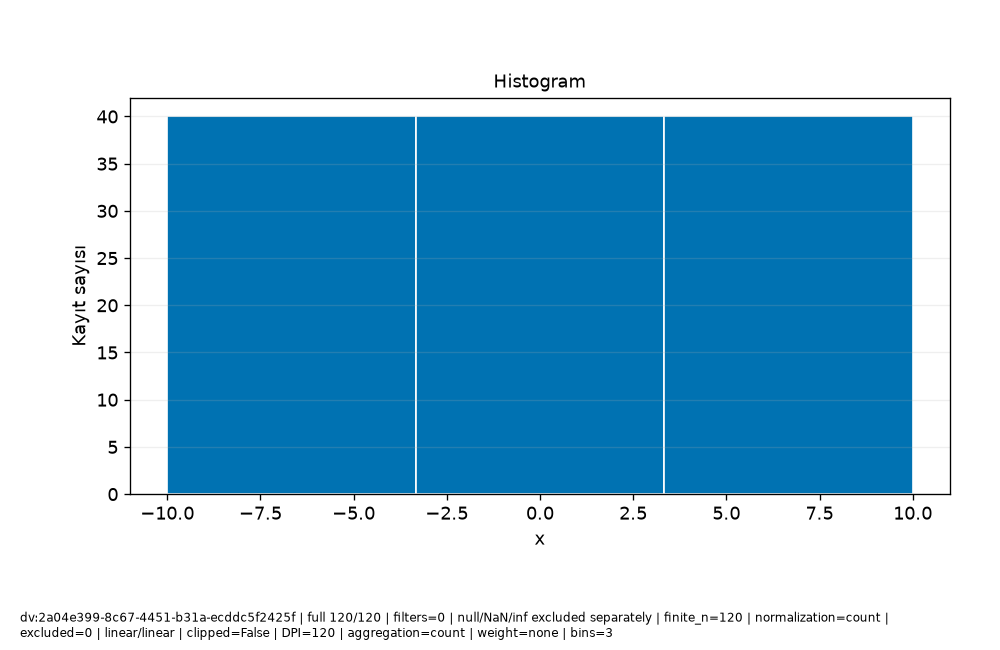

# Veri\_Ufku · Bilimsel rapor

Protokol: exploratory
Keşifsel inceleme; analiz birimi, seçim ve test kullanımını kayıtlı sonuçlarla değerlendirin.

Güncellik: Seçilen dataset/run için daha yeni kayıt bulunmadı; dış kaynağın canlı tazeliği doğrulanmadı.

Test kullanım defteri: []
Model seçim protokolü: kayıtlı method/model-card alanlarına bakın; alan yoksa not_recorded.

## Araştırma sorusu

**text**

```text
Soruyu ve analiz birimini kullanıcı olarak açıklayın.
```
**evidence**

```text
Kullanıcı metni; doğrulanmış hesap değildir.
```

## Yorum ve sınırlamalar

**text**

```text
Bulguyu yorumdan ayırın; nedensel çıkarım varsayımlarını açıkça yazın.
```
**evidence**

```text
Kullanıcı metni; doğrulanmış hesap değildir.
```

## Kaynakça


## method

**record_id**

```text
result:1301e816-185d-4cf3-9600-604968b30acc
```
**capability_id**

```text
model.regression
```
**dataset_versions**

```text
[
  "dv:2a04e399-8c67-4451-b31a-ecddc5f2425f"
]
```
**run_id**

```text
run:d6500de7-1964-4c82-b3c7-0ec2ad6596b2
```
**evidence**

```text
Kayıtlı alan projeksiyonu; yeni hesap veya otomatik yorum değildir.
```
**data**

```text
{
  "spec": {
    "availability": {
      "col:ffecedff-36be-4f49-90d2-d74d33e3d77e": {
        "note": "Önceden bilinir",
        "offset_seconds": 0
      }
    },
    "baseline": "auto",
    "entity_use": "new",
    "folds": 3,
    "horizon_seconds": 0,
    "method": "auto",
    "prediction_moment": "Ölçüm öncesi",
    "seed": 42,
    "structure": "independent",
    "test_fraction": 0.2,
    "validation_fraction": 0.2
  },
  "model_card": {
    "baseline": {
      "comparison": [
        {
          "metrics": [
            {
              "averaging": "per_record",
              "coverage": "all eligible records in this evaluation partition",
              "direction": "minimize",
              "metric": "mae",
              "n": 24,
              "scope": "validation",
              "status": "valid",
              "value": 15.105042016806722
            },
            {
              "averaging": "per_record",
              "coverage": "all eligible records in this evaluation partition",
              "direction": "minimize",
              "metric": "rmse",
              "n": 24,
              "scope": "validation",
              "status": "valid",
              "value": 17.131074485116738
            },
            {
              "averaging": "per_record",
              "coverage": "all eligible records in this evaluation partition",
              "direction": "maximize",
              "metric": "r2",
              "n": 24,
              "scope": "validation",
              "status": "valid",
              "value": -0.07031033705694889
            }
          ],
          "scope": "validation"
        },
        {
          "metrics": [
            {
              "averaging": "per_record",
              "coverage": "all eligible records in this evaluation partition",
              "direction": "minimize",
              "metric": "mae",
              "n": 32,
              "scope": "cv:1",
              "status": "valid",
              "value": 16.085215336134453
            },
            {
              "averaging": "per_record",
              "coverage": "all eligible records in this evaluation partition",
              "direction": "minimize",
              "metric": "rmse",
              "n": 32,
              "scope": "cv:1",
              "status": "valid",
              "value": 17.78349866194151
            },
            {
              "averaging": "per_record",
              "coverage": "all eligible records in this evaluation partition",
              "direction": "maximize",
              "metric": "r2",
              "n": 32,
              "scope": "cv:1",
              "status": "valid",
              "value": -0.08216532968157875
            }
          ],
          "scope": "cv:1"
        },
        {
          "metrics": [
            {
              "averaging": "per_record",
              "coverage": "all eligible records in this evaluation partition",
              "direction": "minimize",
              "metric": "mae",
              "n": 32,
              "scope": "cv:2",
              "status": "valid",
              "value": 14.063484768907566
            },
            {
              "averaging": "per_record",
              "coverage": "all eligible records in this evaluation partition",
              "direction": "minimize",
              "metric": "rmse",
              "n": 32,
              "scope": "cv:2",
              "status": "valid",
              "value": 16.834420290258713
            },
            {
              "averaging": "per_record",
              "coverage": "all eligible records in this evaluation partition",
              "direction": "maximize",
              "metric": "r2",
              "n": 32,
              "scope": "cv:2",
              "status": "valid",
              "value": -0.000592538052601066
            }
          ],
          "scope": "cv:2"
        },
        {
          "metrics": [
            {
              "averaging": "per_record",
              "coverage": "all eligible records in this evaluation partition",
              "direction": "minimize",
              "metric": "mae",
              "n": 32,
              "scope": "cv:3",
              "status": "valid",
              "value": 16.882878151260506
            },
            {
              "averaging": "per_record",
              "coverage": "all eligible records in this evaluation partition",
              "direction": "minimize",
              "metric": "rmse",
              "n": 32,
              "scope": "cv:3",
              "status": "valid",
              "value": 19.037369544238533
            },
            {
              "averaging": "per_record",
              "coverage": "all eligible records in this evaluation partition",
              "direction": "maximize",
              "metric": "r2",
              "n": 32,
              "scope": "cv:3",
              "status": "valid",
              "value": -0.084358201283397
            }
          ],
          "scope": "cv:3"
        }
      ],
      "limitation": "Final koşuda yeniden baseline seçimi yapılmaz; geliştirme koşusu kartına bakın.",
      "strategy": "mean"
    },
    "candidate_selection": {
      "parameters": {
        "alpha": 1.0,
        "candidates": [
          "baseline",
          "linear",
          "ridge",
          "forest"
        ],
        "depth": 8,
        "trees": 50,
        "unit": "TL"
      },
      "rule": "minimum development CV mean MAE; ties follow candidate order",
      "selected": "linear"
    },
    "columns": [
      {
        "id": "col:ffecedff-36be-4f49-90d2-d74d33e3d77e",
        "name": "x",
        "original_name": "x",
        "type": "Float64"
      },
      {
        "id": "col:da9d4f2c-76e5-4998-b275-454e54704eec",
        "name": "y",
        "original_name": "y",
        "type": "Float64"
      }
    ],
    "dataset_version": "dv:2a04e399-8c67-4451-b31a-ecddc5f2425f",
    "decision": null,
    "estimator": "LinearRegression",
    "features": [
      {
        "id": "col:ffecedff-36be-4f49-90d2-d74d33e3d77e",
        "name": "x",
        "type": "Float64",
        "unit": ""
      }
    ],
    "fit_row_ids": [
      "row:b0625650-71c5-47f1-a29f-4c0219beaa46",
      "row:1aabe1f4-ef44-45c6-bbea-a24518d54a44",
      "row:58e6986e-34fd-420d-91e6-9a280872a549",
      "row:35c6c64c-d832-471f-9e51-854a9a253d73",
      "row:25871d9a-1990-4b34-850b-2897e26365d9",
      "row:cd6cbcb8-9d2e-4e0f-a623-c1f03311aa18",
      "row:17cbb44b-a966-4186-8983-146bda683f6d",
      "row:b4566e27-3454-4de3-bc34-ae38c1b67667",
      "row:7c6c6efd-9ebe-4793-b474-2d32a3d45442",
      "row:65f6d989-10ea-44c2-957d-14a709e54101",
      "row:d6706908-adaf-495f-957d-76ebb273628a",
      "row:10f2f95e-f030-4379-a28c-93c9e88c9a96",
      "row:20c13942-01b8-43d8-981a-83d3fa94eb72",
      "row:3742ad85-6e60-419b-ba93-64ce5272b347",
      "row:8bc9aeb1-e387-45e6-8b1e-a19a1ad35d1d",
      "row:efe24746-11d6-4dbe-8604-8012cff3e576",
      "row:7fa021c3-4578-43a0-a193-d31693da650f",
      "row:18156e06-1c24-42d4-9f18-c89cb4a6cfb8",
      "row:1ac4a7e5-821e-4a80-afed-92637e240675",
      "row:05c6ce30-cbe9-431e-bad8-aaea2b73b626",
      "row:8237fe85-fd5a-4faf-ba9d-74fbbe377ac6",
      "row:cff4182d-f36f-4345-85ee-a5518b9e3bb2",
      "row:1f0554f4-f61b-4ec8-9afa-ad720f5331e0",
      "row:96c678d5-8f76-4822-96fc-a032de806412",
      "row:1dcdf3af-c872-49db-8f60-09ff78f74474",
      "row:3073c5cd-e5d4-4f4b-a268-ed45dcedd2dc",
      "row:4f89be19-18fc-4d3f-8c39-76ba5154dc2e",
      "row:50b3e466-985f-4e47-87b1-d81a45fbdce7",
      "row:b0fc367d-2ff2-45d3-841e-c9a3e6c5b849",
      "row:3c5c872e-097f-45c3-8fdb-108f93d97f5d",
      "row:d52556ad-ccde-4569-8f99-5871096a5a89",
      "row:82171aa9-e1c7-4650-8019-6ed4155f7ba3",
      "row:4138fe8f-c06f-48af-88dc-84df8199d729",
      "row:a94da2cb-ccb8-4314-a1a8-29593828aa81",
      "row:abcc3033-383d-416c-88c6-017726b8940c",
      "row:6a58e46a-2266-42cc-9cee-47773f54db80",
      "row:ba6a5856-c924-44f2-8187-72fafaabc986",
      "row:1d49d33e-64c6-49e2-aa1d-c70509276793",
      "row:9037fb16-83b2-49e8-b9f3-f86887e00f38",
      "row:659741c1-b6f2-46f3-b52e-bc9b9f1e16ed",
      "row:6b80bf6a-efde-4fea-9511-c264d9c89e1f",
      "row:079dfa9e-c605-4ad2-b7b0-f60843f9837c",
      "row:d0d875d7-9ab6-44e2-851e-c15e9d9cc11e",
      "row:9d0ab75a-ab73-46a6-bf03-d6aa2215e9cc",
      "row:0b0bdc5d-ecc4-4345-9aac-a42d3114098a",
      "row:73968e14-ad23-4e68-9816-cf9e6851c269",
      "row:6e55dbd3-6981-498c-96ef-5646269508cf",
      "row:95f8922e-99d2-495c-9622-102d26c26280",
      "row:aa334802-39e4-47bd-9d5a-c91855543d99",
      "row:db888b88-8c15-4cc6-b420-4a36723d3736",
      "row:a90bf227-0368-4db5-bb7b-fe47de6dd753",
      "row:7c085372-9bfa-468c-b870-8bbe2814d5d8",
      "row:2ca255f9-c122-4932-a725-63065932e8d2",
      "row:9e0fb0e7-7c0a-4d27-8cb0-8e41ae554a97",
      "row:c5703160-3902-4d60-b7aa-77c4df943a77",
      "row:e5852e18-960c-4a13-9247-9e0164df1d87",
      "row:6c35d5a3-6859-42c0-9f4f-a5572ea9211d",
      "row:0bedfebc-7d88-41df-b082-d1c390d98615",
      "row:ee7dd895-01ea-45c3-a9f1-f3560a583d50",
      "row:13f08ce5-5e26-4473-be0e-a3b3569e330d",
      "row:bc1a4b87-06e3-4b85-b888-0472bac2e82b",
      "row:2ad598f6-eef5-4fe2-a500-3ce1e90abed1",
      "row:b67432db-07ae-4aaa-b774-322b18624ff6",
      "row:8a84cc42-80d6-4370-aa79-8505529353c8",
      "row:1d251f90-5f4a-43df-b175-2bc7b62daff2",
      "row:549f6c44-3af6-4673-abe5-5c6b3fc9af5a",
      "row:8843f7d8-3bf5-4781-b853-96110c5488d9",
      "row:2f364881-12cd-429f-b77f-78ee1d09f9df",
      "row:fb7e2a75-e047-4b5c-8eab-b65e03baf77c",
      "row:607f39ed-f061-43de-8703-4489d961abe5",
      "row:dc0715fd-5e35-4418-a90c-d53592fe8ff2",
      "row:538898f5-989a-4297-8959-14e73434fd12"
    ],
    "fit_scope": "development_train; validation previously used for selection",
    "fitted_preprocessing": {
      "1": {
        "kind": "impute_numeric",
        "statistics": [
          1.344537815126051
        ]
      },
      "2": {
        "kind": "standard_scale",
        "mean": [
          0.6092436974789925
        ],
        "scale": [
          5.948272597687973
        ]
      }
    },
    "importance": {
      "limitation": "İlişkili değişkenler önemi paylaşır/gizler; negatif önem mümkün. Nedensellik değildir; final test kullanılmadı.",
      "metric": "negative_MAE",
      "repeats": 3,
      "row_ids": [
        "row:dc7e11a1-94b9-462b-a154-86e18cc2dc83",
        "row:322cad8e-a5b5-4a77-b524-22caa0b38b0e",
        "row:3a101767-d044-47d8-8e09-0a473e3f198e",
        "row:24f5d1bf-6a58-4ff7-8a52-8707171dc4af",
        "row:e6b8393d-9651-4967-a2a4-48b8e3feaa8b",
        "row:ed65fae4-d504-4590-a187-1f06d64e8bfa",
        "row:bca1e5f9-c756-4c79-9d33-6aa436f83921",
        "row:f2c9e782-b2e0-43bd-96a3-d9601490f827",
        "row:5d0bfced-07dd-4d89-8c42-dff65e41e82b",
        "row:ab16f3ca-7ba0-4aa1-afd2-63861718c083",
        "row:96606342-cfbf-44ca-b5ae-d721f0677ea5",
        "row:845ed7c5-8e77-44e3-8490-2d01a97c5071",
        "row:89b0eb58-00fe-44da-a5a5-e3a179c53134",
        "row:07ad24c0-6b6f-4b2a-a273-737d2e27cacd",
        "row:4c9d1dc6-56a1-4db4-afec-7ff131aa1578",
        "row:6d33046d-8f96-4967-8dda-2a2ca5126ce9",
        "row:77bcee5a-6712-4cdb-b60a-cf990ad37f08",
        "row:38dc4a0c-9a71-4e35-92ab-caa335f832df",
        "row:3ed1c29e-7cb0-4153-a46e-c62b79a70ed5",
        "row:cd2434d4-d24c-47dc-a115-fb69c2ed083a",
        "row:2ce1623c-88fd-49cc-9e3f-f9fc9a8329a0",
        "row:f392572f-ca2d-4020-870c-2cf2b272acff",
        "row:9b8c4c67-810b-4e85-b83a-bfe7f5892283",
        "row:3d0e3c58-a8f2-4a7b-88d6-34f8cc821a04"
      ],
      "scope": "validation; exploratory; already used for model/threshold selection",
      "seed": 42,
      "status": "available",
      "values": [
        {
          "column_id": "col:ffecedff-36be-4f49-90d2-d74d33e3d77e",
          "mean": 19.523809523809522,
          "name": "x",
          "std": 2.038091850261204
        }
      ]
    },
    "label_order": [],
    "limitations": "Katsayı ve önemler nedensel etki değildir. İlişkili özellikler önemi paylaşabilir veya gizleyebilir. Yeni veri dağılımı değişebilir; olasılık kesinlik veya kalibrasyon garantisi değildir. Küme ve anomali adayları gerçek sınıf/veri hatası değildir; otomatik silme yok.",
    "method": null,
    "metrics": [
      {
        "evaluation_n": 24,
        "metrics": [
          {
            "averaging": "per_record",
            "coverage": "all eligible records in this evaluation partition",
            "direction": "minimize",
            "metric": "mae",
            "n": 24,
            "scope": "validation",
            "status": "valid",
            "value": 4.810966440042345e-15
          },
          {
            "averaging": "per_record",
            "coverage": "all eligible records in this evaluation partition",
            "direction": "minimize",
            "metric": "rmse",
            "n": 24,
            "scope": "validation",
            "status": "valid",
            "value": 5.582114810376975e-15
          },
          {
            "averaging": "per_record",
            "coverage": "all eligible records in this evaluation partition",
            "direction": "maximize",
            "metric": "r2",
            "n": 24,
            "scope": "validation",
            "status": "valid",
            "value": 1.0
          }
        ],
        "scope": "validation",
        "status": "valid",
        "train_n": 72
      },
      {
        "evaluation_n": 32,
        "metrics": [
          {
            "averaging": "per_record",
            "coverage": "all eligible records in this evaluation partition",
            "direction": "minimize",
            "metric": "mae",
            "n": 32,
            "scope": "cv:1",
            "status": "valid",
            "value": 1.3877787807814457e-15
          },
          {
            "averaging": "per_record",
            "coverage": "all eligible records in this evaluation partition",
            "direction": "minimize",
            "metric": "rmse",
            "n": 32,
            "scope": "cv:1",
            "status": "valid",
            "value": 2.1413206232596582e-15
          },
          {
            "averaging": "per_record",
            "coverage": "all eligible records in this evaluation partition",
            "direction": "maximize",
            "metric": "r2",
            "n": 32,
            "scope": "cv:1",
            "status": "valid",
            "value": 1.0
          }
        ],
        "scope": "cv:1",
        "status": "valid",
        "train_n": 64
      },
      {
        "evaluation_n": 32,
        "metrics": [
          {
            "averaging": "per_record",
            "coverage": "all eligible records in this evaluation partition",
            "direction": "minimize",
            "metric": "mae",
            "n": 32,
            "scope": "cv:2",
            "status": "valid",
            "value": 5.828670879282072e-15
          },
          {
            "averaging": "per_record",
            "coverage": "all eligible records in this evaluation partition",
            "direction": "minimize",
            "metric": "rmse",
            "n": 32,
            "scope": "cv:2",
            "status": "valid",
            "value": 7.320740245935003e-15
          },
          {
            "averaging": "per_record",
            "coverage": "all eligible records in this evaluation partition",
            "direction": "maximize",
            "metric": "r2",
            "n": 32,
            "scope": "cv:2",
            "status": "valid",
            "value": 1.0
          }
        ],
        "scope": "cv:2",
        "status": "valid",
        "train_n": 64
      },
      {
        "evaluation_n": 32,
        "metrics": [
          {
            "averaging": "per_record",
            "coverage": "all eligible records in this evaluation partition",
            "direction": "minimize",
            "metric": "mae",
            "n": 32,
            "scope": "cv:3",
            "status": "valid",
            "value": 1.915134717478395e-15
          },
          {
            "averaging": "per_record",
            "coverage": "all eligible records in this evaluation partition",
            "direction": "minimize",
            "metric": "rmse",
            "n": 32,
            "scope": "cv:3",
            "status": "valid",
            "value": 2.687565378447544e-15
          },
          {
            "averaging": "per_record",
            "coverage": "all eligible records in this evaluation partition",
            "direction": "maximize",
            "metric": "r2",
            "n": 32,
            "scope": "cv:3",
            "status": "valid",
            "value": 1.0
          }
        ],
        "scope": "cv:3",
        "status": "valid",
        "train_n": 64
      }
    ],
    "preparation_spec": {
      "allow_identifiers": false,
      "categorical_imputation": "most_frequent",
      "date_features": true,
      "encoding": "onehot",
      "family": "linear",
      "features": [
        "col:ffecedff-36be-4f49-90d2-d74d33e3d77e"
      ],
      "group": "",
      "history_action": "review",
      "history_note": "",
      "invalid_numeric": "reject",
      "numeric_imputation": "median",
      "precision": "reject",
      "prediction_context": "",
      "purpose": "regression",
      "scaling": "standard",
      "selection": "none",
      "source_version": "dv:2a04e399-8c67-4451-b31a-ecddc5f2425f",
      "target": "col:da9d4f2c-76e5-4998-b275-454e54704eec",
      "time": ""
    },
    "preprocessing": {
      "category_vocabulary": null,
      "column_lineage": [
        {
          "category_map": [],
          "input_column_id": "col:ffecedff-36be-4f49-90d2-d74d33e3d77e",
          "names_status": "structurally_known",
          "output_names": [
            "f_ffecedff36be4f4990d2d74d33e3d77e__numeric"
          ],
          "selected_after_fit": "all_planned",
          "source_dtype": "Float64",
          "source_name": "x"
        }
      ],
      "estimator_family": "linear",
      "feature_selection_mask": null,
      "fit_state": "not_fitted",
      "fitted_parameters": {},
      "schema": "PreparationPlan/v1",
      "steps": [
        {
          "input_column_ids": [
            "col:ffecedff-36be-4f49-90d2-d74d33e3d77e"
          ],
          "kind": "numeric",
          "learned_scope": "row_local",
          "output_names": [
            "f_ffecedff36be4f4990d2d74d33e3d77e__numeric"
          ],
          "parameters": {
            "nonfinite": "reject",
            "precision": "reject"
          },
          "reason": "Kimlik ölçüm değildir; Float64 kaybı gelecekte açık politika ile denetlenir.",
          "state": "planned"
        },
        {
          "input_column_ids": [
            "col:ffecedff-36be-4f49-90d2-d74d33e3d77e"
          ],
          "kind": "impute_numeric",
          "learned_scope": "training_fold",
          "output_names": [
            "f_ffecedff36be4f4990d2d74d33e3d77e__numeric"
          ],
          "parameters": {
            "all_missing": "error",
            "strategy": "median"
          },
          "reason": "Seçilen doldurma değeri yalnız eğitim katında öğrenilir; test/validation ortalaması kullanılmaz.",
          "state": "planned"
        },
        {
          "input_column_ids": [
            "col:ffecedff-36be-4f49-90d2-d74d33e3d77e"
          ],
          "kind": "standard_scale",
          "learned_scope": "training_fold",
          "output_names": [
            "f_ffecedff36be4f4990d2d74d33e3d77e__numeric"
          ],
          "parameters": {
            "explicit_override": false
          },
          "reason": "Uzaklıklar ve düzenlileştirilmiş doğrusal modeller ölçüm ölçeğine duyarlıdır; eğitim katında standardizasyon planlandı.",
          "state": "planned"
        }
      ],
      "training_dependency": "Requires a validated split/fold protocol in Phase16; no training performed",
      "version_id": "ml-pipeline:28ac1f01-ff11-4026-a20b-3f2eac9d96bd"
    },
    "probability_supported": false,
    "purpose": "regression",
    "run_id": "run:d6500de7-1964-4c82-b3c7-0ec2ad6596b2",
    "schema": "ModelCard/v1",
    "seed": 42,
    "snapshot_fingerprint": {
      "sha256": "bf985e27b61088c1b9286f3824b6c8ad30d54451407218b21e3eb64fb292d72c",
      "size": 11606
    },
    "split": {
      "invalid_folds": [],
      "membership": {
        "development": [
          "row:05c6ce30-cbe9-431e-bad8-aaea2b73b626",
          "row:079dfa9e-c605-4ad2-b7b0-f60843f9837c",
          "row:07ad24c0-6b6f-4b2a-a273-737d2e27cacd",
          "row:0b0bdc5d-ecc4-4345-9aac-a42d3114098a",
          "row:0bedfebc-7d88-41df-b082-d1c390d98615",
          "row:10f2f95e-f030-4379-a28c-93c9e88c9a96",
          "row:13f08ce5-5e26-4473-be0e-a3b3569e330d",
          "row:17cbb44b-a966-4186-8983-146bda683f6d",
          "row:18156e06-1c24-42d4-9f18-c89cb4a6cfb8",
          "row:1aabe1f4-ef44-45c6-bbea-a24518d54a44",
          "row:1ac4a7e5-821e-4a80-afed-92637e240675",
          "row:1d251f90-5f4a-43df-b175-2bc7b62daff2",
          "row:1d49d33e-64c6-49e2-aa1d-c70509276793",
          "row:1dcdf3af-c872-49db-8f60-09ff78f74474",
          "row:1f0554f4-f61b-4ec8-9afa-ad720f5331e0",
          "row:20c13942-01b8-43d8-981a-83d3fa94eb72",
          "row:24f5d1bf-6a58-4ff7-8a52-8707171dc4af",
          "row:25871d9a-1990-4b34-850b-2897e26365d9",
          "row:2ad598f6-eef5-4fe2-a500-3ce1e90abed1",
          "row:2ca255f9-c122-4932-a725-63065932e8d2",
          "row:2ce1623c-88fd-49cc-9e3f-f9fc9a8329a0",
          "row:2f364881-12cd-429f-b77f-78ee1d09f9df",
          "row:3073c5cd-e5d4-4f4b-a268-ed45dcedd2dc",
          "row:322cad8e-a5b5-4a77-b524-22caa0b38b0e",
          "row:35c6c64c-d832-471f-9e51-854a9a253d73",
          "row:3742ad85-6e60-419b-ba93-64ce5272b347",
          "row:38dc4a0c-9a71-4e35-92ab-caa335f832df",
          "row:3a101767-d044-47d8-8e09-0a473e3f198e",
          "row:3c5c872e-097f-45c3-8fdb-108f93d97f5d",
          "row:3d0e3c58-a8f2-4a7b-88d6-34f8cc821a04",
          "row:3ed1c29e-7cb0-4153-a46e-c62b79a70ed5",
          "row:4138fe8f-c06f-48af-88dc-84df8199d729",
          "row:4c9d1dc6-56a1-4db4-afec-7ff131aa1578",
          "row:4f89be19-18fc-4d3f-8c39-76ba5154dc2e",
          "row:50b3e466-985f-4e47-87b1-d81a45fbdce7",
          "row:538898f5-989a-4297-8959-14e73434fd12",
          "row:549f6c44-3af6-4673-abe5-5c6b3fc9af5a",
          "row:58e6986e-34fd-420d-91e6-9a280872a549",
          "row:5d0bfced-07dd-4d89-8c42-dff65e41e82b",
          "row:607f39ed-f061-43de-8703-4489d961abe5",
          "row:659741c1-b6f2-46f3-b52e-bc9b9f1e16ed",
          "row:65f6d989-10ea-44c2-957d-14a709e54101",
          "row:6a58e46a-2266-42cc-9cee-47773f54db80",
          "row:6b80bf6a-efde-4fea-9511-c264d9c89e1f",
          "row:6c35d5a3-6859-42c0-9f4f-a5572ea9211d",
          "row:6d33046d-8f96-4967-8dda-2a2ca5126ce9",
          "row:6e55dbd3-6981-498c-96ef-5646269508cf",
          "row:73968e14-ad23-4e68-9816-cf9e6851c269",
          "row:77bcee5a-6712-4cdb-b60a-cf990ad37f08",
          "row:7c085372-9bfa-468c-b870-8bbe2814d5d8",
          "row:7c6c6efd-9ebe-4793-b474-2d32a3d45442",
          "row:7fa021c3-4578-43a0-a193-d31693da650f",
          "row:82171aa9-e1c7-4650-8019-6ed4155f7ba3",
          "row:8237fe85-fd5a-4faf-ba9d-74fbbe377ac6",
          "row:845ed7c5-8e77-44e3-8490-2d01a97c5071",
          "row:8843f7d8-3bf5-4781-b853-96110c5488d9",
          "row:89b0eb58-00fe-44da-a5a5-e3a179c53134",
          "row:8a84cc42-80d6-4370-aa79-8505529353c8",
          "row:8bc9aeb1-e387-45e6-8b1e-a19a1ad35d1d",
          "row:9037fb16-83b2-49e8-b9f3-f86887e00f38",
          "row:95f8922e-99d2-495c-9622-102d26c26280",
          "row:96606342-cfbf-44ca-b5ae-d721f0677ea5",
          "row:96c678d5-8f76-4822-96fc-a032de806412",
          "row:9b8c4c67-810b-4e85-b83a-bfe7f5892283",
          "row:9d0ab75a-ab73-46a6-bf03-d6aa2215e9cc",
          "row:9e0fb0e7-7c0a-4d27-8cb0-8e41ae554a97",
          "row:a90bf227-0368-4db5-bb7b-fe47de6dd753",
          "row:a94da2cb-ccb8-4314-a1a8-29593828aa81",
          "row:aa334802-39e4-47bd-9d5a-c91855543d99",
          "row:ab16f3ca-7ba0-4aa1-afd2-63861718c083",
          "row:abcc3033-383d-416c-88c6-017726b8940c",
          "row:b0625650-71c5-47f1-a29f-4c0219beaa46",
          "row:b0fc367d-2ff2-45d3-841e-c9a3e6c5b849",
          "row:b4566e27-3454-4de3-bc34-ae38c1b67667",
          "row:b67432db-07ae-4aaa-b774-322b18624ff6",
          "row:ba6a5856-c924-44f2-8187-72fafaabc986",
          "row:bc1a4b87-06e3-4b85-b888-0472bac2e82b",
          "row:bca1e5f9-c756-4c79-9d33-6aa436f83921",
          "row:c5703160-3902-4d60-b7aa-77c4df943a77",
          "row:cd2434d4-d24c-47dc-a115-fb69c2ed083a",
          "row:cd6cbcb8-9d2e-4e0f-a623-c1f03311aa18",
          "row:cff4182d-f36f-4345-85ee-a5518b9e3bb2",
          "row:d0d875d7-9ab6-44e2-851e-c15e9d9cc11e",
          "row:d52556ad-ccde-4569-8f99-5871096a5a89",
          "row:d6706908-adaf-495f-957d-76ebb273628a",
          "row:db888b88-8c15-4cc6-b420-4a36723d3736",
          "row:dc0715fd-5e35-4418-a90c-d53592fe8ff2",
          "row:dc7e11a1-94b9-462b-a154-86e18cc2dc83",
          "row:e5852e18-960c-4a13-9247-9e0164df1d87",
          "row:e6b8393d-9651-4967-a2a4-48b8e3feaa8b",
          "row:ed65fae4-d504-4590-a187-1f06d64e8bfa",
          "row:ee7dd895-01ea-45c3-a9f1-f3560a583d50",
          "row:efe24746-11d6-4dbe-8604-8012cff3e576",
          "row:f2c9e782-b2e0-43bd-96a3-d9601490f827",
          "row:f392572f-ca2d-4020-870c-2cf2b272acff",
          "row:fb7e2a75-e047-4b5c-8eab-b65e03baf77c"
        ],
        "folds": [
          {
            "status": "valid",
            "train": [
              "row:05c6ce30-cbe9-431e-bad8-aaea2b73b626",
              "row:079dfa9e-c605-4ad2-b7b0-f60843f9837c",
              "row:0b0bdc5d-ecc4-4345-9aac-a42d3114098a",
              "row:0bedfebc-7d88-41df-b082-d1c390d98615",
              "row:10f2f95e-f030-4379-a28c-93c9e88c9a96",
              "row:13f08ce5-5e26-4473-be0e-a3b3569e330d",
              "row:18156e06-1c24-42d4-9f18-c89cb4a6cfb8",
              "row:1ac4a7e5-821e-4a80-afed-92637e240675",
              "row:1d251f90-5f4a-43df-b175-2bc7b62daff2",
              "row:1d49d33e-64c6-49e2-aa1d-c70509276793",
              "row:1dcdf3af-c872-49db-8f60-09ff78f74474",
              "row:1f0554f4-f61b-4ec8-9afa-ad720f5331e0",
              "row:20c13942-01b8-43d8-981a-83d3fa94eb72",
              "row:2ad598f6-eef5-4fe2-a500-3ce1e90abed1",
              "row:2ca255f9-c122-4932-a725-63065932e8d2",
              "row:2f364881-12cd-429f-b77f-78ee1d09f9df",
              "row:3073c5cd-e5d4-4f4b-a268-ed45dcedd2dc",
              "row:3742ad85-6e60-419b-ba93-64ce5272b347",
              "row:3c5c872e-097f-45c3-8fdb-108f93d97f5d",
              "row:4138fe8f-c06f-48af-88dc-84df8199d729",
              "row:4f89be19-18fc-4d3f-8c39-76ba5154dc2e",
              "row:50b3e466-985f-4e47-87b1-d81a45fbdce7",
              "row:538898f5-989a-4297-8959-14e73434fd12",
              "row:549f6c44-3af6-4673-abe5-5c6b3fc9af5a",
              "row:607f39ed-f061-43de-8703-4489d961abe5",
              "row:659741c1-b6f2-46f3-b52e-bc9b9f1e16ed",
              "row:65f6d989-10ea-44c2-957d-14a709e54101",
              "row:6a58e46a-2266-42cc-9cee-47773f54db80",
              "row:6b80bf6a-efde-4fea-9511-c264d9c89e1f",
              "row:6c35d5a3-6859-42c0-9f4f-a5572ea9211d",
              "row:6e55dbd3-6981-498c-96ef-5646269508cf",
              "row:73968e14-ad23-4e68-9816-cf9e6851c269",
              "row:7c085372-9bfa-468c-b870-8bbe2814d5d8",
              "row:7c6c6efd-9ebe-4793-b474-2d32a3d45442",
              "row:7fa021c3-4578-43a0-a193-d31693da650f",
              "row:82171aa9-e1c7-4650-8019-6ed4155f7ba3",
              "row:8237fe85-fd5a-4faf-ba9d-74fbbe377ac6",
              "row:8843f7d8-3bf5-4781-b853-96110c5488d9",
              "row:8a84cc42-80d6-4370-aa79-8505529353c8",
              "row:8bc9aeb1-e387-45e6-8b1e-a19a1ad35d1d",
              "row:9037fb16-83b2-49e8-b9f3-f86887e00f38",
              "row:95f8922e-99d2-495c-9622-102d26c26280",
              "row:96c678d5-8f76-4822-96fc-a032de806412",
              "row:9d0ab75a-ab73-46a6-bf03-d6aa2215e9cc",
              "row:9e0fb0e7-7c0a-4d27-8cb0-8e41ae554a97",
              "row:a90bf227-0368-4db5-bb7b-fe47de6dd753",
              "row:a94da2cb-ccb8-4314-a1a8-29593828aa81",
              "row:aa334802-39e4-47bd-9d5a-c91855543d99",
              "row:abcc3033-383d-416c-88c6-017726b8940c",
              "row:b0fc367d-2ff2-45d3-841e-c9a3e6c5b849",
              "row:b67432db-07ae-4aaa-b774-322b18624ff6",
              "row:ba6a5856-c924-44f2-8187-72fafaabc986",
              "row:bc1a4b87-06e3-4b85-b888-0472bac2e82b",
              "row:c5703160-3902-4d60-b7aa-77c4df943a77",
              "row:cff4182d-f36f-4345-85ee-a5518b9e3bb2",
              "row:d0d875d7-9ab6-44e2-851e-c15e9d9cc11e",
              "row:d52556ad-ccde-4569-8f99-5871096a5a89",
              "row:d6706908-adaf-495f-957d-76ebb273628a",
              "row:db888b88-8c15-4cc6-b420-4a36723d3736",
              "row:dc0715fd-5e35-4418-a90c-d53592fe8ff2",
              "row:e5852e18-960c-4a13-9247-9e0164df1d87",
              "row:ee7dd895-01ea-45c3-a9f1-f3560a583d50",
              "row:efe24746-11d6-4dbe-8604-8012cff3e576",
              "row:fb7e2a75-e047-4b5c-8eab-b65e03baf77c"
            ],
            "validation": [
              "row:07ad24c0-6b6f-4b2a-a273-737d2e27cacd",
              "row:17cbb44b-a966-4186-8983-146bda683f6d",
              "row:1aabe1f4-ef44-45c6-bbea-a24518d54a44",
              "row:24f5d1bf-6a58-4ff7-8a52-8707171dc4af",
              "row:25871d9a-1990-4b34-850b-2897e26365d9",
              "row:2ce1623c-88fd-49cc-9e3f-f9fc9a8329a0",
              "row:322cad8e-a5b5-4a77-b524-22caa0b38b0e",
              "row:35c6c64c-d832-471f-9e51-854a9a253d73",
              "row:38dc4a0c-9a71-4e35-92ab-caa335f832df",
              "row:3a101767-d044-47d8-8e09-0a473e3f198e",
              "row:3d0e3c58-a8f2-4a7b-88d6-34f8cc821a04",
              "row:3ed1c29e-7cb0-4153-a46e-c62b79a70ed5",
              "row:4c9d1dc6-56a1-4db4-afec-7ff131aa1578",
              "row:58e6986e-34fd-420d-91e6-9a280872a549",
              "row:5d0bfced-07dd-4d89-8c42-dff65e41e82b",
              "row:6d33046d-8f96-4967-8dda-2a2ca5126ce9",
              "row:77bcee5a-6712-4cdb-b60a-cf990ad37f08",
              "row:845ed7c5-8e77-44e3-8490-2d01a97c5071",
              "row:89b0eb58-00fe-44da-a5a5-e3a179c53134",
              "row:96606342-cfbf-44ca-b5ae-d721f0677ea5",
              "row:9b8c4c67-810b-4e85-b83a-bfe7f5892283",
              "row:ab16f3ca-7ba0-4aa1-afd2-63861718c083",
              "row:b0625650-71c5-47f1-a29f-4c0219beaa46",
              "row:b4566e27-3454-4de3-bc34-ae38c1b67667",
              "row:bca1e5f9-c756-4c79-9d33-6aa436f83921",
              "row:cd2434d4-d24c-47dc-a115-fb69c2ed083a",
              "row:cd6cbcb8-9d2e-4e0f-a623-c1f03311aa18",
              "row:dc7e11a1-94b9-462b-a154-86e18cc2dc83",
              "row:e6b8393d-9651-4967-a2a4-48b8e3feaa8b",
              "row:ed65fae4-d504-4590-a187-1f06d64e8bfa",
              "row:f2c9e782-b2e0-43bd-96a3-d9601490f827",
              "row:f392572f-ca2d-4020-870c-2cf2b272acff"
            ]
          },
          {
            "status": "valid",
            "train": [
              "row:079dfa9e-c605-4ad2-b7b0-f60843f9837c",
              "row:07ad24c0-6b6f-4b2a-a273-737d2e27cacd",
              "row:0b0bdc5d-ecc4-4345-9aac-a42d3114098a",
              "row:0bedfebc-7d88-41df-b082-d1c390d98615",
              "row:13f08ce5-5e26-4473-be0e-a3b3569e330d",
              "row:17cbb44b-a966-4186-8983-146bda683f6d",
              "row:1aabe1f4-ef44-45c6-bbea-a24518d54a44",
              "row:1d251f90-5f4a-43df-b175-2bc7b62daff2",
              "row:24f5d1bf-6a58-4ff7-8a52-8707171dc4af",
              "row:25871d9a-1990-4b34-850b-2897e26365d9",
              "row:2ad598f6-eef5-4fe2-a500-3ce1e90abed1",
              "row:2ca255f9-c122-4932-a725-63065932e8d2",
              "row:2ce1623c-88fd-49cc-9e3f-f9fc9a8329a0",
              "row:2f364881-12cd-429f-b77f-78ee1d09f9df",
              "row:322cad8e-a5b5-4a77-b524-22caa0b38b0e",
              "row:35c6c64c-d832-471f-9e51-854a9a253d73",
              "row:38dc4a0c-9a71-4e35-92ab-caa335f832df",
              "row:3a101767-d044-47d8-8e09-0a473e3f198e",
              "row:3d0e3c58-a8f2-4a7b-88d6-34f8cc821a04",
              "row:3ed1c29e-7cb0-4153-a46e-c62b79a70ed5",
              "row:4c9d1dc6-56a1-4db4-afec-7ff131aa1578",
              "row:538898f5-989a-4297-8959-14e73434fd12",
              "row:549f6c44-3af6-4673-abe5-5c6b3fc9af5a",
              "row:58e6986e-34fd-420d-91e6-9a280872a549",
              "row:5d0bfced-07dd-4d89-8c42-dff65e41e82b",
              "row:607f39ed-f061-43de-8703-4489d961abe5",
              "row:6b80bf6a-efde-4fea-9511-c264d9c89e1f",
              "row:6c35d5a3-6859-42c0-9f4f-a5572ea9211d",
              "row:6d33046d-8f96-4967-8dda-2a2ca5126ce9",
              "row:6e55dbd3-6981-498c-96ef-5646269508cf",
              "row:73968e14-ad23-4e68-9816-cf9e6851c269",
              "row:77bcee5a-6712-4cdb-b60a-cf990ad37f08",
              "row:7c085372-9bfa-468c-b870-8bbe2814d5d8",
              "row:845ed7c5-8e77-44e3-8490-2d01a97c5071",
              "row:8843f7d8-3bf5-4781-b853-96110c5488d9",
              "row:89b0eb58-00fe-44da-a5a5-e3a179c53134",
              "row:8a84cc42-80d6-4370-aa79-8505529353c8",
              "row:95f8922e-99d2-495c-9622-102d26c26280",
              "row:96606342-cfbf-44ca-b5ae-d721f0677ea5",
              "row:9b8c4c67-810b-4e85-b83a-bfe7f5892283",
              "row:9d0ab75a-ab73-46a6-bf03-d6aa2215e9cc",
              "row:9e0fb0e7-7c0a-4d27-8cb0-8e41ae554a97",
              "row:a90bf227-0368-4db5-bb7b-fe47de6dd753",
              "row:aa334802-39e4-47bd-9d5a-c91855543d99",
              "row:ab16f3ca-7ba0-4aa1-afd2-63861718c083",
              "row:b0625650-71c5-47f1-a29f-4c0219beaa46",
              "row:b4566e27-3454-4de3-bc34-ae38c1b67667",
              "row:b67432db-07ae-4aaa-b774-322b18624ff6",
              "row:bc1a4b87-06e3-4b85-b888-0472bac2e82b",
              "row:bca1e5f9-c756-4c79-9d33-6aa436f83921",
              "row:c5703160-3902-4d60-b7aa-77c4df943a77",
              "row:cd2434d4-d24c-47dc-a115-fb69c2ed083a",
              "row:cd6cbcb8-9d2e-4e0f-a623-c1f03311aa18",
              "row:d0d875d7-9ab6-44e2-851e-c15e9d9cc11e",
              "row:db888b88-8c15-4cc6-b420-4a36723d3736",
              "row:dc0715fd-5e35-4418-a90c-d53592fe8ff2",
              "row:dc7e11a1-94b9-462b-a154-86e18cc2dc83",
              "row:e5852e18-960c-4a13-9247-9e0164df1d87",
              "row:e6b8393d-9651-4967-a2a4-48b8e3feaa8b",
              "row:ed65fae4-d504-4590-a187-1f06d64e8bfa",
              "row:ee7dd895-01ea-45c3-a9f1-f3560a583d50",
              "row:f2c9e782-b2e0-43bd-96a3-d9601490f827",
              "row:f392572f-ca2d-4020-870c-2cf2b272acff",
              "row:fb7e2a75-e047-4b5c-8eab-b65e03baf77c"
            ],
            "validation": [
              "row:05c6ce30-cbe9-431e-bad8-aaea2b73b626",
              "row:10f2f95e-f030-4379-a28c-93c9e88c9a96",
              "row:18156e06-1c24-42d4-9f18-c89cb4a6cfb8",
              "row:1ac4a7e5-821e-4a80-afed-92637e240675",
              "row:1d49d33e-64c6-49e2-aa1d-c70509276793",
              "row:1dcdf3af-c872-49db-8f60-09ff78f74474",
              "row:1f0554f4-f61b-4ec8-9afa-ad720f5331e0",
              "row:20c13942-01b8-43d8-981a-83d3fa94eb72",
              "row:3073c5cd-e5d4-4f4b-a268-ed45dcedd2dc",
              "row:3742ad85-6e60-419b-ba93-64ce5272b347",
              "row:3c5c872e-097f-45c3-8fdb-108f93d97f5d",
              "row:4138fe8f-c06f-48af-88dc-84df8199d729",
              "row:4f89be19-18fc-4d3f-8c39-76ba5154dc2e",
              "row:50b3e466-985f-4e47-87b1-d81a45fbdce7",
              "row:659741c1-b6f2-46f3-b52e-bc9b9f1e16ed",
              "row:65f6d989-10ea-44c2-957d-14a709e54101",
              "row:6a58e46a-2266-42cc-9cee-47773f54db80",
              "row:7c6c6efd-9ebe-4793-b474-2d32a3d45442",
              "row:7fa021c3-4578-43a0-a193-d31693da650f",
              "row:82171aa9-e1c7-4650-8019-6ed4155f7ba3",
              "row:8237fe85-fd5a-4faf-ba9d-74fbbe377ac6",
              "row:8bc9aeb1-e387-45e6-8b1e-a19a1ad35d1d",
              "row:9037fb16-83b2-49e8-b9f3-f86887e00f38",
              "row:96c678d5-8f76-4822-96fc-a032de806412",
              "row:a94da2cb-ccb8-4314-a1a8-29593828aa81",
              "row:abcc3033-383d-416c-88c6-017726b8940c",
              "row:b0fc367d-2ff2-45d3-841e-c9a3e6c5b849",
              "row:ba6a5856-c924-44f2-8187-72fafaabc986",
              "row:cff4182d-f36f-4345-85ee-a5518b9e3bb2",
              "row:d52556ad-ccde-4569-8f99-5871096a5a89",
              "row:d6706908-adaf-495f-957d-76ebb273628a",
              "row:efe24746-11d6-4dbe-8604-8012cff3e576"
            ]
          },
          {
            "status": "valid",
            "train": [
              "row:05c6ce30-cbe9-431e-bad8-aaea2b73b626",
              "row:07ad24c0-6b6f-4b2a-a273-737d2e27cacd",
              "row:10f2f95e-f030-4379-a28c-93c9e88c9a96",
              "row:17cbb44b-a966-4186-8983-146bda683f6d",
              "row:18156e06-1c24-42d4-9f18-c89cb4a6cfb8",
              "row:1aabe1f4-ef44-45c6-bbea-a24518d54a44",
              "row:1ac4a7e5-821e-4a80-afed-92637e240675",
              "row:1d49d33e-64c6-49e2-aa1d-c70509276793",
              "row:1dcdf3af-c872-49db-8f60-09ff78f74474",
              "row:1f0554f4-f61b-4ec8-9afa-ad720f5331e0",
              "row:20c13942-01b8-43d8-981a-83d3fa94eb72",
              "row:24f5d1bf-6a58-4ff7-8a52-8707171dc4af",
              "row:25871d9a-1990-4b34-850b-2897e26365d9",
              "row:2ce1623c-88fd-49cc-9e3f-f9fc9a8329a0",
              "row:3073c5cd-e5d4-4f4b-a268-ed45dcedd2dc",
              "row:322cad8e-a5b5-4a77-b524-22caa0b38b0e",
              "row:35c6c64c-d832-471f-9e51-854a9a253d73",
              "row:3742ad85-6e60-419b-ba93-64ce5272b347",
              "row:38dc4a0c-9a71-4e35-92ab-caa335f832df",
              "row:3a101767-d044-47d8-8e09-0a473e3f198e",
              "row:3c5c872e-097f-45c3-8fdb-108f93d97f5d",
              "row:3d0e3c58-a8f2-4a7b-88d6-34f8cc821a04",
              "row:3ed1c29e-7cb0-4153-a46e-c62b79a70ed5",
              "row:4138fe8f-c06f-48af-88dc-84df8199d729",
              "row:4c9d1dc6-56a1-4db4-afec-7ff131aa1578",
              "row:4f89be19-18fc-4d3f-8c39-76ba5154dc2e",
              "row:50b3e466-985f-4e47-87b1-d81a45fbdce7",
              "row:58e6986e-34fd-420d-91e6-9a280872a549",
              "row:5d0bfced-07dd-4d89-8c42-dff65e41e82b",
              "row:659741c1-b6f2-46f3-b52e-bc9b9f1e16ed",
              "row:65f6d989-10ea-44c2-957d-14a709e54101",
              "row:6a58e46a-2266-42cc-9cee-47773f54db80",
              "row:6d33046d-8f96-4967-8dda-2a2ca5126ce9",
              "row:77bcee5a-6712-4cdb-b60a-cf990ad37f08",
              "row:7c6c6efd-9ebe-4793-b474-2d32a3d45442",
              "row:7fa021c3-4578-43a0-a193-d31693da650f",
              "row:82171aa9-e1c7-4650-8019-6ed4155f7ba3",
              "row:8237fe85-fd5a-4faf-ba9d-74fbbe377ac6",
              "row:845ed7c5-8e77-44e3-8490-2d01a97c5071",
              "row:89b0eb58-00fe-44da-a5a5-e3a179c53134",
              "row:8bc9aeb1-e387-45e6-8b1e-a19a1ad35d1d",
              "row:9037fb16-83b2-49e8-b9f3-f86887e00f38",
              "row:96606342-cfbf-44ca-b5ae-d721f0677ea5",
              "row:96c678d5-8f76-4822-96fc-a032de806412",
              "row:9b8c4c67-810b-4e85-b83a-bfe7f5892283",
              "row:a94da2cb-ccb8-4314-a1a8-29593828aa81",
              "row:ab16f3ca-7ba0-4aa1-afd2-63861718c083",
              "row:abcc3033-383d-416c-88c6-017726b8940c",
              "row:b0625650-71c5-47f1-a29f-4c0219beaa46",
              "row:b0fc367d-2ff2-45d3-841e-c9a3e6c5b849",
              "row:b4566e27-3454-4de3-bc34-ae38c1b67667",
              "row:ba6a5856-c924-44f2-8187-72fafaabc986",
              "row:bca1e5f9-c756-4c79-9d33-6aa436f83921",
              "row:cd2434d4-d24c-47dc-a115-fb69c2ed083a",
              "row:cd6cbcb8-9d2e-4e0f-a623-c1f03311aa18",
              "row:cff4182d-f36f-4345-85ee-a5518b9e3bb2",
              "row:d52556ad-ccde-4569-8f99-5871096a5a89",
              "row:d6706908-adaf-495f-957d-76ebb273628a",
              "row:dc7e11a1-94b9-462b-a154-86e18cc2dc83",
              "row:e6b8393d-9651-4967-a2a4-48b8e3feaa8b",
              "row:ed65fae4-d504-4590-a187-1f06d64e8bfa",
              "row:efe24746-11d6-4dbe-8604-8012cff3e576",
              "row:f2c9e782-b2e0-43bd-96a3-d9601490f827",
              "row:f392572f-ca2d-4020-870c-2cf2b272acff"
            ],
            "validation": [
              "row:079dfa9e-c605-4ad2-b7b0-f60843f9837c",
              "row:0b0bdc5d-ecc4-4345-9aac-a42d3114098a",
              "row:0bedfebc-7d88-41df-b082-d1c390d98615",
              "row:13f08ce5-5e26-4473-be0e-a3b3569e330d",
              "row:1d251f90-5f4a-43df-b175-2bc7b62daff2",
              "row:2ad598f6-eef5-4fe2-a500-3ce1e90abed1",
              "row:2ca255f9-c122-4932-a725-63065932e8d2",
              "row:2f364881-12cd-429f-b77f-78ee1d09f9df",
              "row:538898f5-989a-4297-8959-14e73434fd12",
              "row:549f6c44-3af6-4673-abe5-5c6b3fc9af5a",
              "row:607f39ed-f061-43de-8703-4489d961abe5",
              "row:6b80bf6a-efde-4fea-9511-c264d9c89e1f",
              "row:6c35d5a3-6859-42c0-9f4f-a5572ea9211d",
              "row:6e55dbd3-6981-498c-96ef-5646269508cf",
              "row:73968e14-ad23-4e68-9816-cf9e6851c269",
              "row:7c085372-9bfa-468c-b870-8bbe2814d5d8",
              "row:8843f7d8-3bf5-4781-b853-96110c5488d9",
              "row:8a84cc42-80d6-4370-aa79-8505529353c8",
              "row:95f8922e-99d2-495c-9622-102d26c26280",
              "row:9d0ab75a-ab73-46a6-bf03-d6aa2215e9cc",
              "row:9e0fb0e7-7c0a-4d27-8cb0-8e41ae554a97",
              "row:a90bf227-0368-4db5-bb7b-fe47de6dd753",
              "row:aa334802-39e4-47bd-9d5a-c91855543d99",
              "row:b67432db-07ae-4aaa-b774-322b18624ff6",
              "row:bc1a4b87-06e3-4b85-b888-0472bac2e82b",
              "row:c5703160-3902-4d60-b7aa-77c4df943a77",
              "row:d0d875d7-9ab6-44e2-851e-c15e9d9cc11e",
              "row:db888b88-8c15-4cc6-b420-4a36723d3736",
              "row:dc0715fd-5e35-4418-a90c-d53592fe8ff2",
              "row:e5852e18-960c-4a13-9247-9e0164df1d87",
              "row:ee7dd895-01ea-45c3-a9f1-f3560a583d50",
              "row:fb7e2a75-e047-4b5c-8eab-b65e03baf77c"
            ]
          }
        ],
        "purged": [],
        "test": [
          "row:207a4cbe-f05c-4561-bbae-d534e555676d",
          "row:299bf2b7-509f-45e3-b615-4dc8395111f0",
          "row:39d08459-beb8-4f2a-a021-a6811239c153",
          "row:3a523332-a353-459c-b4a7-68f68b196787",
          "row:4d6f2048-f2dc-45b9-a374-0fdd0c3d185d",
          "row:5b5b9167-812e-438a-9b68-a9b01e1bf766",
          "row:5ead9cc4-4a2e-4a9e-b86a-bd3b63b00f9b",
          "row:688c6936-8d65-4120-9a98-48f736135de7",
          "row:72f577e7-1b10-4268-9d91-57506d6adcda",
          "row:77304fa2-fa71-47c0-a00a-6d856881a4a8",
          "row:81fed1cf-9669-438b-a21f-97efb6bacb83",
          "row:87eec7b2-fd8d-4f10-ac66-b3ad4ef0e337",
          "row:94d9a2e7-0d95-4266-b054-b5eb4866abc1",
          "row:9611ca37-c445-4c33-b4a7-8900eebd9f86",
          "row:ae4f661d-7107-4ff9-a6d2-0884d4c2150b",
          "row:b81ae4db-1d1f-4719-997e-707cf03e177c",
          "row:c12e69bf-68d0-4870-a512-8f1c6fb5ddb1",
          "row:ceb06f96-d44c-403e-adde-128fcae8debd",
          "row:d60a08eb-006a-498b-9ced-c9ad67ad520b",
          "row:ea0a6661-bcf1-4f61-84e0-56a3e38eab86",
          "row:f1f15237-62a3-4353-a01b-383fbaff644e",
          "row:f24e29bb-f4f5-4d40-ad62-c9eb4cbbfd1f",
          "row:f63fb1f4-116e-4634-8774-e72168e79b71",
          "row:f88bf080-5c23-4cb1-ba06-d0efa85afdfc"
        ],
        "train": [
          "row:05c6ce30-cbe9-431e-bad8-aaea2b73b626",
          "row:079dfa9e-c605-4ad2-b7b0-f60843f9837c",
          "row:0b0bdc5d-ecc4-4345-9aac-a42d3114098a",
          "row:0bedfebc-7d88-41df-b082-d1c390d98615",
          "row:10f2f95e-f030-4379-a28c-93c9e88c9a96",
          "row:13f08ce5-5e26-4473-be0e-a3b3569e330d",
          "row:17cbb44b-a966-4186-8983-146bda683f6d",
          "row:18156e06-1c24-42d4-9f18-c89cb4a6cfb8",
          "row:1aabe1f4-ef44-45c6-bbea-a24518d54a44",
          "row:1ac4a7e5-821e-4a80-afed-92637e240675",
          "row:1d251f90-5f4a-43df-b175-2bc7b62daff2",
          "row:1d49d33e-64c6-49e2-aa1d-c70509276793",
          "row:1dcdf3af-c872-49db-8f60-09ff78f74474",
          "row:1f0554f4-f61b-4ec8-9afa-ad720f5331e0",
          "row:20c13942-01b8-43d8-981a-83d3fa94eb72",
          "row:25871d9a-1990-4b34-850b-2897e26365d9",
          "row:2ad598f6-eef5-4fe2-a500-3ce1e90abed1",
          "row:2ca255f9-c122-4932-a725-63065932e8d2",
          "row:2f364881-12cd-429f-b77f-78ee1d09f9df",
          "row:3073c5cd-e5d4-4f4b-a268-ed45dcedd2dc",
          "row:35c6c64c-d832-471f-9e51-854a9a253d73",
          "row:3742ad85-6e60-419b-ba93-64ce5272b347",
          "row:3c5c872e-097f-45c3-8fdb-108f93d97f5d",
          "row:4138fe8f-c06f-48af-88dc-84df8199d729",
          "row:4f89be19-18fc-4d3f-8c39-76ba5154dc2e",
          "row:50b3e466-985f-4e47-87b1-d81a45fbdce7",
          "row:538898f5-989a-4297-8959-14e73434fd12",
          "row:549f6c44-3af6-4673-abe5-5c6b3fc9af5a",
          "row:58e6986e-34fd-420d-91e6-9a280872a549",
          "row:607f39ed-f061-43de-8703-4489d961abe5",
          "row:659741c1-b6f2-46f3-b52e-bc9b9f1e16ed",
          "row:65f6d989-10ea-44c2-957d-14a709e54101",
          "row:6a58e46a-2266-42cc-9cee-47773f54db80",
          "row:6b80bf6a-efde-4fea-9511-c264d9c89e1f",
          "row:6c35d5a3-6859-42c0-9f4f-a5572ea9211d",
          "row:6e55dbd3-6981-498c-96ef-5646269508cf",
          "row:73968e14-ad23-4e68-9816-cf9e6851c269",
          "row:7c085372-9bfa-468c-b870-8bbe2814d5d8",
          "row:7c6c6efd-9ebe-4793-b474-2d32a3d45442",
          "row:7fa021c3-4578-43a0-a193-d31693da650f",
          "row:82171aa9-e1c7-4650-8019-6ed4155f7ba3",
          "row:8237fe85-fd5a-4faf-ba9d-74fbbe377ac6",
          "row:8843f7d8-3bf5-4781-b853-96110c5488d9",
          "row:8a84cc42-80d6-4370-aa79-8505529353c8",
          "row:8bc9aeb1-e387-45e6-8b1e-a19a1ad35d1d",
          "row:9037fb16-83b2-49e8-b9f3-f86887e00f38",
          "row:95f8922e-99d2-495c-9622-102d26c26280",
          "row:96c678d5-8f76-4822-96fc-a032de806412",
          "row:9d0ab75a-ab73-46a6-bf03-d6aa2215e9cc",
          "row:9e0fb0e7-7c0a-4d27-8cb0-8e41ae554a97",
          "row:a90bf227-0368-4db5-bb7b-fe47de6dd753",
          "row:a94da2cb-ccb8-4314-a1a8-29593828aa81",
          "row:aa334802-39e4-47bd-9d5a-c91855543d99",
          "row:abcc3033-383d-416c-88c6-017726b8940c",
          "row:b0625650-71c5-47f1-a29f-4c0219beaa46",
          "row:b0fc367d-2ff2-45d3-841e-c9a3e6c5b849",
          "row:b4566e27-3454-4de3-bc34-ae38c1b67667",
          "row:b67432db-07ae-4aaa-b774-322b18624ff6",
          "row:ba6a5856-c924-44f2-8187-72fafaabc986",
          "row:bc1a4b87-06e3-4b85-b888-0472bac2e82b",
          "row:c5703160-3902-4d60-b7aa-77c4df943a77",
          "row:cd6cbcb8-9d2e-4e0f-a623-c1f03311aa18",
          "row:cff4182d-f36f-4345-85ee-a5518b9e3bb2",
          "row:d0d875d7-9ab6-44e2-851e-c15e9d9cc11e",
          "row:d52556ad-ccde-4569-8f99-5871096a5a89",
          "row:d6706908-adaf-495f-957d-76ebb273628a",
          "row:db888b88-8c15-4cc6-b420-4a36723d3736",
          "row:dc0715fd-5e35-4418-a90c-d53592fe8ff2",
          "row:e5852e18-960c-4a13-9247-9e0164df1d87",
          "row:ee7dd895-01ea-45c3-a9f1-f3560a583d50",
          "row:efe24746-11d6-4dbe-8604-8012cff3e576",
          "row:fb7e2a75-e047-4b5c-8eab-b65e03baf77c"
        ],
        "validation": [
          "row:07ad24c0-6b6f-4b2a-a273-737d2e27cacd",
          "row:24f5d1bf-6a58-4ff7-8a52-8707171dc4af",
          "row:2ce1623c-88fd-49cc-9e3f-f9fc9a8329a0",
          "row:322cad8e-a5b5-4a77-b524-22caa0b38b0e",
          "row:38dc4a0c-9a71-4e35-92ab-caa335f832df",
          "row:3a101767-d044-47d8-8e09-0a473e3f198e",
          "row:3d0e3c58-a8f2-4a7b-88d6-34f8cc821a04",
          "row:3ed1c29e-7cb0-4153-a46e-c62b79a70ed5",
          "row:4c9d1dc6-56a1-4db4-afec-7ff131aa1578",
          "row:5d0bfced-07dd-4d89-8c42-dff65e41e82b",
          "row:6d33046d-8f96-4967-8dda-2a2ca5126ce9",
          "row:77bcee5a-6712-4cdb-b60a-cf990ad37f08",
          "row:845ed7c5-8e77-44e3-8490-2d01a97c5071",
          "row:89b0eb58-00fe-44da-a5a5-e3a179c53134",
          "row:96606342-cfbf-44ca-b5ae-d721f0677ea5",
          "row:9b8c4c67-810b-4e85-b83a-bfe7f5892283",
          "row:ab16f3ca-7ba0-4aa1-afd2-63861718c083",
          "row:bca1e5f9-c756-4c79-9d33-6aa436f83921",
          "row:cd2434d4-d24c-47dc-a115-fb69c2ed083a",
          "row:dc7e11a1-94b9-462b-a154-86e18cc2dc83",
          "row:e6b8393d-9651-4967-a2a4-48b8e3feaa8b",
          "row:ed65fae4-d504-4590-a187-1f06d64e8bfa",
          "row:f2c9e782-b2e0-43bd-96a3-d9601490f827",
          "row:f392572f-ca2d-4020-870c-2cf2b272acff"
        ]
      },
      "method": "random",
      "protocol_id": "protocol:73f75bc84be05645f18df47b92678fe864ec0585985d2decb85e01ccac7c72d7",
      "schema": "ValidationPlan/v1",
      "split_id": "split:9f2a1516c426d2c8538da67e12f1b5ca4cf72de43b047ba4eaeae01e797122ca"
    },
    "target": {
      "id": "col:da9d4f2c-76e5-4998-b275-454e54704eec",
      "name": "y",
      "original_name": "y",
      "type": "Float64",
      "unit": "TL"
    },
    "threshold": null,
    "versions": {
      "numpy": "2.5.3",
      "polars": "2.0.0",
      "python": "3.13.15",
      "scikit-learn": "1.9.1",
      "scipy": "1.18.0",
      "skops": "0.16.0",
      "veri-ufku": "0.1.0"
    }
  },
  "status": "completed",
  "cv_summary": [
    {
      "aggregation": "unweighted fold mean; not pooled record error",
      "ddof": 1,
      "direction": "minimize",
      "invalid_folds": 0,
      "mean": 3.0438614591806376e-15,
      "metric": "mae",
      "scope": "development_cv",
      "standard_deviation": 2.4260871172953877e-15,
      "valid_folds": 3
    },
    {
      "aggregation": "unweighted fold mean; not pooled record error",
      "ddof": 1,
      "direction": "minimize",
      "invalid_folds": 0,
      "mean": 4.049875415880735e-15,
      "metric": "rmse",
      "scope": "development_cv",
      "standard_deviation": 2.845788710622596e-15,
      "valid_folds": 3
    },
    {
      "aggregation": "unweighted fold mean; not pooled record error",
      "ddof": 1,
      "direction": "maximize",
      "invalid_folds": 0,
      "mean": 1.0,
      "metric": "r2",
      "scope": "development_cv",
      "standard_deviation": 0.0,
      "valid_folds": 3
    }
  ],
  "plan": {
    "invalid_folds": [],
    "membership": {
      "development": [
        "row:05c6ce30-cbe9-431e-bad8-aaea2b73b626",
        "row:079dfa9e-c605-4ad2-b7b0-f60843f9837c",
        "row:07ad24c0-6b6f-4b2a-a273-737d2e27cacd",
        "row:0b0bdc5d-ecc4-4345-9aac-a42d3114098a",
        "row:0bedfebc-7d88-41df-b082-d1c390d98615",
        "row:10f2f95e-f030-4379-a28c-93c9e88c9a96",
        "row:13f08ce5-5e26-4473-be0e-a3b3569e330d",
        "row:17cbb44b-a966-4186-8983-146bda683f6d",
        "row:18156e06-1c24-42d4-9f18-c89cb4a6cfb8",
        "row:1aabe1f4-ef44-45c6-bbea-a24518d54a44",
        "row:1ac4a7e5-821e-4a80-afed-92637e240675",
        "row:1d251f90-5f4a-43df-b175-2bc7b62daff2",
        "row:1d49d33e-64c6-49e2-aa1d-c70509276793",
        "row:1dcdf3af-c872-49db-8f60-09ff78f74474",
        "row:1f0554f4-f61b-4ec8-9afa-ad720f5331e0",
        "row:20c13942-01b8-43d8-981a-83d3fa94eb72",
        "row:24f5d1bf-6a58-4ff7-8a52-8707171dc4af",
        "row:25871d9a-1990-4b34-850b-2897e26365d9",
        "row:2ad598f6-eef5-4fe2-a500-3ce1e90abed1",
        "row:2ca255f9-c122-4932-a725-63065932e8d2",
        "row:2ce1623c-88fd-49cc-9e3f-f9fc9a8329a0",
        "row:2f364881-12cd-429f-b77f-78ee1d09f9df",
        "row:3073c5cd-e5d4-4f4b-a268-ed45dcedd2dc",
        "row:322cad8e-a5b5-4a77-b524-22caa0b38b0e",
        "row:35c6c64c-d832-471f-9e51-854a9a253d73",
        "row:3742ad85-6e60-419b-ba93-64ce5272b347",
        "row:38dc4a0c-9a71-4e35-92ab-caa335f832df",
        "row:3a101767-d044-47d8-8e09-0a473e3f198e",
        "row:3c5c872e-097f-45c3-8fdb-108f93d97f5d",
        "row:3d0e3c58-a8f2-4a7b-88d6-34f8cc821a04",
        "row:3ed1c29e-7cb0-4153-a46e-c62b79a70ed5",
        "row:4138fe8f-c06f-48af-88dc-84df8199d729",
        "row:4c9d1dc6-56a1-4db4-afec-7ff131aa1578",
        "row:4f89be19-18fc-4d3f-8c39-76ba5154dc2e",
        "row:50b3e466-985f-4e47-87b1-d81a45fbdce7",
        "row:538898f5-989a-4297-8959-14e73434fd12",
        "row:549f6c44-3af6-4673-abe5-5c6b3fc9af5a",
        "row:58e6986e-34fd-420d-91e6-9a280872a549",
        "row:5d0bfced-07dd-4d89-8c42-dff65e41e82b",
        "row:607f39ed-f061-43de-8703-4489d961abe5",
        "row:659741c1-b6f2-46f3-b52e-bc9b9f1e16ed",
        "row:65f6d989-10ea-44c2-957d-14a709e54101",
        "row:6a58e46a-2266-42cc-9cee-47773f54db80",
        "row:6b80bf6a-efde-4fea-9511-c264d9c89e1f",
        "row:6c35d5a3-6859-42c0-9f4f-a5572ea9211d",
        "row:6d33046d-8f96-4967-8dda-2a2ca5126ce9",
        "row:6e55dbd3-6981-498c-96ef-5646269508cf",
        "row:73968e14-ad23-4e68-9816-cf9e6851c269",
        "row:77bcee5a-6712-4cdb-b60a-cf990ad37f08",
        "row:7c085372-9bfa-468c-b870-8bbe2814d5d8",
        "row:7c6c6efd-9ebe-4793-b474-2d32a3d45442",
        "row:7fa021c3-4578-43a0-a193-d31693da650f",
        "row:82171aa9-e1c7-4650-8019-6ed4155f7ba3",
        "row:8237fe85-fd5a-4faf-ba9d-74fbbe377ac6",
        "row:845ed7c5-8e77-44e3-8490-2d01a97c5071",
        "row:8843f7d8-3bf5-4781-b853-96110c5488d9",
        "row:89b0eb58-00fe-44da-a5a5-e3a179c53134",
        "row:8a84cc42-80d6-4370-aa79-8505529353c8",
        "row:8bc9aeb1-e387-45e6-8b1e-a19a1ad35d1d",
        "row:9037fb16-83b2-49e8-b9f3-f86887e00f38",
        "row:95f8922e-99d2-495c-9622-102d26c26280",
        "row:96606342-cfbf-44ca-b5ae-d721f0677ea5",
        "row:96c678d5-8f76-4822-96fc-a032de806412",
        "row:9b8c4c67-810b-4e85-b83a-bfe7f5892283",
        "row:9d0ab75a-ab73-46a6-bf03-d6aa2215e9cc",
        "row:9e0fb0e7-7c0a-4d27-8cb0-8e41ae554a97",
        "row:a90bf227-0368-4db5-bb7b-fe47de6dd753",
        "row:a94da2cb-ccb8-4314-a1a8-29593828aa81",
        "row:aa334802-39e4-47bd-9d5a-c91855543d99",
        "row:ab16f3ca-7ba0-4aa1-afd2-63861718c083",
        "row:abcc3033-383d-416c-88c6-017726b8940c",
        "row:b0625650-71c5-47f1-a29f-4c0219beaa46",
        "row:b0fc367d-2ff2-45d3-841e-c9a3e6c5b849",
        "row:b4566e27-3454-4de3-bc34-ae38c1b67667",
        "row:b67432db-07ae-4aaa-b774-322b18624ff6",
        "row:ba6a5856-c924-44f2-8187-72fafaabc986",
        "row:bc1a4b87-06e3-4b85-b888-0472bac2e82b",
        "row:bca1e5f9-c756-4c79-9d33-6aa436f83921",
        "row:c5703160-3902-4d60-b7aa-77c4df943a77",
        "row:cd2434d4-d24c-47dc-a115-fb69c2ed083a",
        "row:cd6cbcb8-9d2e-4e0f-a623-c1f03311aa18",
        "row:cff4182d-f36f-4345-85ee-a5518b9e3bb2",
        "row:d0d875d7-9ab6-44e2-851e-c15e9d9cc11e",
        "row:d52556ad-ccde-4569-8f99-5871096a5a89",
        "row:d6706908-adaf-495f-957d-76ebb273628a",
        "row:db888b88-8c15-4cc6-b420-4a36723d3736",
        "row:dc0715fd-5e35-4418-a90c-d53592fe8ff2",
        "row:dc7e11a1-94b9-462b-a154-86e18cc2dc83",
        "row:e5852e18-960c-4a13-9247-9e0164df1d87",
        "row:e6b8393d-9651-4967-a2a4-48b8e3feaa8b",
        "row:ed65fae4-d504-4590-a187-1f06d64e8bfa",
        "row:ee7dd895-01ea-45c3-a9f1-f3560a583d50",
        "row:efe24746-11d6-4dbe-8604-8012cff3e576",
        "row:f2c9e782-b2e0-43bd-96a3-d9601490f827",
        "row:f392572f-ca2d-4020-870c-2cf2b272acff",
        "row:fb7e2a75-e047-4b5c-8eab-b65e03baf77c"
      ],
      "folds": [
        {
          "status": "valid",
          "train": [
            "row:05c6ce30-cbe9-431e-bad8-aaea2b73b626",
            "row:079dfa9e-c605-4ad2-b7b0-f60843f9837c",
            "row:0b0bdc5d-ecc4-4345-9aac-a42d3114098a",
            "row:0bedfebc-7d88-41df-b082-d1c390d98615",
            "row:10f2f95e-f030-4379-a28c-93c9e88c9a96",
            "row:13f08ce5-5e26-4473-be0e-a3b3569e330d",
            "row:18156e06-1c24-42d4-9f18-c89cb4a6cfb8",
            "row:1ac4a7e5-821e-4a80-afed-92637e240675",
            "row:1d251f90-5f4a-43df-b175-2bc7b62daff2",
            "row:1d49d33e-64c6-49e2-aa1d-c70509276793",
            "row:1dcdf3af-c872-49db-8f60-09ff78f74474",
            "row:1f0554f4-f61b-4ec8-9afa-ad720f5331e0",
            "row:20c13942-01b8-43d8-981a-83d3fa94eb72",
            "row:2ad598f6-eef5-4fe2-a500-3ce1e90abed1",
            "row:2ca255f9-c122-4932-a725-63065932e8d2",
            "row:2f364881-12cd-429f-b77f-78ee1d09f9df",
            "row:3073c5cd-e5d4-4f4b-a268-ed45dcedd2dc",
            "row:3742ad85-6e60-419b-ba93-64ce5272b347",
            "row:3c5c872e-097f-45c3-8fdb-108f93d97f5d",
            "row:4138fe8f-c06f-48af-88dc-84df8199d729",
            "row:4f89be19-18fc-4d3f-8c39-76ba5154dc2e",
            "row:50b3e466-985f-4e47-87b1-d81a45fbdce7",
            "row:538898f5-989a-4297-8959-14e73434fd12",
            "row:549f6c44-3af6-4673-abe5-5c6b3fc9af5a",
            "row:607f39ed-f061-43de-8703-4489d961abe5",
            "row:659741c1-b6f2-46f3-b52e-bc9b9f1e16ed",
            "row:65f6d989-10ea-44c2-957d-14a709e54101",
            "row:6a58e46a-2266-42cc-9cee-47773f54db80",
            "row:6b80bf6a-efde-4fea-9511-c264d9c89e1f",
            "row:6c35d5a3-6859-42c0-9f4f-a5572ea9211d",
            "row:6e55dbd3-6981-498c-96ef-5646269508cf",
            "row:73968e14-ad23-4e68-9816-cf9e6851c269",
            "row:7c085372-9bfa-468c-b870-8bbe2814d5d8",
            "row:7c6c6efd-9ebe-4793-b474-2d32a3d45442",
            "row:7fa021c3-4578-43a0-a193-d31693da650f",
            "row:82171aa9-e1c7-4650-8019-6ed4155f7ba3",
            "row:8237fe85-fd5a-4faf-ba9d-74fbbe377ac6",
            "row:8843f7d8-3bf5-4781-b853-96110c5488d9",
            "row:8a84cc42-80d6-4370-aa79-8505529353c8",
            "row:8bc9aeb1-e387-45e6-8b1e-a19a1ad35d1d",
            "row:9037fb16-83b2-49e8-b9f3-f86887e00f38",
            "row:95f8922e-99d2-495c-9622-102d26c26280",
            "row:96c678d5-8f76-4822-96fc-a032de806412",
            "row:9d0ab75a-ab73-46a6-bf03-d6aa2215e9cc",
            "row:9e0fb0e7-7c0a-4d27-8cb0-8e41ae554a97",
            "row:a90bf227-0368-4db5-bb7b-fe47de6dd753",
            "row:a94da2cb-ccb8-4314-a1a8-29593828aa81",
            "row:aa334802-39e4-47bd-9d5a-c91855543d99",
            "row:abcc3033-383d-416c-88c6-017726b8940c",
            "row:b0fc367d-2ff2-45d3-841e-c9a3e6c5b849",
            "row:b67432db-07ae-4aaa-b774-322b18624ff6",
            "row:ba6a5856-c924-44f2-8187-72fafaabc986",
            "row:bc1a4b87-06e3-4b85-b888-0472bac2e82b",
            "row:c5703160-3902-4d60-b7aa-77c4df943a77",
            "row:cff4182d-f36f-4345-85ee-a5518b9e3bb2",
            "row:d0d875d7-9ab6-44e2-851e-c15e9d9cc11e",
            "row:d52556ad-ccde-4569-8f99-5871096a5a89",
            "row:d6706908-adaf-495f-957d-76ebb273628a",
            "row:db888b88-8c15-4cc6-b420-4a36723d3736",
            "row:dc0715fd-5e35-4418-a90c-d53592fe8ff2",
            "row:e5852e18-960c-4a13-9247-9e0164df1d87",
            "row:ee7dd895-01ea-45c3-a9f1-f3560a583d50",
            "row:efe24746-11d6-4dbe-8604-8012cff3e576",
            "row:fb7e2a75-e047-4b5c-8eab-b65e03baf77c"
          ],
          "validation": [
            "row:07ad24c0-6b6f-4b2a-a273-737d2e27cacd",
            "row:17cbb44b-a966-4186-8983-146bda683f6d",
            "row:1aabe1f4-ef44-45c6-bbea-a24518d54a44",
            "row:24f5d1bf-6a58-4ff7-8a52-8707171dc4af",
            "row:25871d9a-1990-4b34-850b-2897e26365d9",
            "row:2ce1623c-88fd-49cc-9e3f-f9fc9a8329a0",
            "row:322cad8e-a5b5-4a77-b524-22caa0b38b0e",
            "row:35c6c64c-d832-471f-9e51-854a9a253d73",
            "row:38dc4a0c-9a71-4e35-92ab-caa335f832df",
            "row:3a101767-d044-47d8-8e09-0a473e3f198e",
            "row:3d0e3c58-a8f2-4a7b-88d6-34f8cc821a04",
            "row:3ed1c29e-7cb0-4153-a46e-c62b79a70ed5",
            "row:4c9d1dc6-56a1-4db4-afec-7ff131aa1578",
            "row:58e6986e-34fd-420d-91e6-9a280872a549",
            "row:5d0bfced-07dd-4d89-8c42-dff65e41e82b",
            "row:6d33046d-8f96-4967-8dda-2a2ca5126ce9",
            "row:77bcee5a-6712-4cdb-b60a-cf990ad37f08",
            "row:845ed7c5-8e77-44e3-8490-2d01a97c5071",
            "row:89b0eb58-00fe-44da-a5a5-e3a179c53134",
            "row:96606342-cfbf-44ca-b5ae-d721f0677ea5",
            "row:9b8c4c67-810b-4e85-b83a-bfe7f5892283",
            "row:ab16f3ca-7ba0-4aa1-afd2-63861718c083",
            "row:b0625650-71c5-47f1-a29f-4c0219beaa46",
            "row:b4566e27-3454-4de3-bc34-ae38c1b67667",
            "row:bca1e5f9-c756-4c79-9d33-6aa436f83921",
            "row:cd2434d4-d24c-47dc-a115-fb69c2ed083a",
            "row:cd6cbcb8-9d2e-4e0f-a623-c1f03311aa18",
            "row:dc7e11a1-94b9-462b-a154-86e18cc2dc83",
            "row:e6b8393d-9651-4967-a2a4-48b8e3feaa8b",
            "row:ed65fae4-d504-4590-a187-1f06d64e8bfa",
            "row:f2c9e782-b2e0-43bd-96a3-d9601490f827",
            "row:f392572f-ca2d-4020-870c-2cf2b272acff"
          ]
        },
        {
          "status": "valid",
          "train": [
            "row:079dfa9e-c605-4ad2-b7b0-f60843f9837c",
            "row:07ad24c0-6b6f-4b2a-a273-737d2e27cacd",
            "row:0b0bdc5d-ecc4-4345-9aac-a42d3114098a",
            "row:0bedfebc-7d88-41df-b082-d1c390d98615",
            "row:13f08ce5-5e26-4473-be0e-a3b3569e330d",
            "row:17cbb44b-a966-4186-8983-146bda683f6d",
            "row:1aabe1f4-ef44-45c6-bbea-a24518d54a44",
            "row:1d251f90-5f4a-43df-b175-2bc7b62daff2",
            "row:24f5d1bf-6a58-4ff7-8a52-8707171dc4af",
            "row:25871d9a-1990-4b34-850b-2897e26365d9",
            "row:2ad598f6-eef5-4fe2-a500-3ce1e90abed1",
            "row:2ca255f9-c122-4932-a725-63065932e8d2",
            "row:2ce1623c-88fd-49cc-9e3f-f9fc9a8329a0",
            "row:2f364881-12cd-429f-b77f-78ee1d09f9df",
            "row:322cad8e-a5b5-4a77-b524-22caa0b38b0e",
            "row:35c6c64c-d832-471f-9e51-854a9a253d73",
            "row:38dc4a0c-9a71-4e35-92ab-caa335f832df",
            "row:3a101767-d044-47d8-8e09-0a473e3f198e",
            "row:3d0e3c58-a8f2-4a7b-88d6-34f8cc821a04",
            "row:3ed1c29e-7cb0-4153-a46e-c62b79a70ed5",
            "row:4c9d1dc6-56a1-4db4-afec-7ff131aa1578",
            "row:538898f5-989a-4297-8959-14e73434fd12",
            "row:549f6c44-3af6-4673-abe5-5c6b3fc9af5a",
            "row:58e6986e-34fd-420d-91e6-9a280872a549",
            "row:5d0bfced-07dd-4d89-8c42-dff65e41e82b",
            "row:607f39ed-f061-43de-8703-4489d961abe5",
            "row:6b80bf6a-efde-4fea-9511-c264d9c89e1f",
            "row:6c35d5a3-6859-42c0-9f4f-a5572ea9211d",
            "row:6d33046d-8f96-4967-8dda-2a2ca5126ce9",
            "row:6e55dbd3-6981-498c-96ef-5646269508cf",
            "row:73968e14-ad23-4e68-9816-cf9e6851c269",
            "row:77bcee5a-6712-4cdb-b60a-cf990ad37f08",
            "row:7c085372-9bfa-468c-b870-8bbe2814d5d8",
            "row:845ed7c5-8e77-44e3-8490-2d01a97c5071",
            "row:8843f7d8-3bf5-4781-b853-96110c5488d9",
            "row:89b0eb58-00fe-44da-a5a5-e3a179c53134",
            "row:8a84cc42-80d6-4370-aa79-8505529353c8",
            "row:95f8922e-99d2-495c-9622-102d26c26280",
            "row:96606342-cfbf-44ca-b5ae-d721f0677ea5",
            "row:9b8c4c67-810b-4e85-b83a-bfe7f5892283",
            "row:9d0ab75a-ab73-46a6-bf03-d6aa2215e9cc",
            "row:9e0fb0e7-7c0a-4d27-8cb0-8e41ae554a97",
            "row:a90bf227-0368-4db5-bb7b-fe47de6dd753",
            "row:aa334802-39e4-47bd-9d5a-c91855543d99",
            "row:ab16f3ca-7ba0-4aa1-afd2-63861718c083",
            "row:b0625650-71c5-47f1-a29f-4c0219beaa46",
            "row:b4566e27-3454-4de3-bc34-ae38c1b67667",
            "row:b67432db-07ae-4aaa-b774-322b18624ff6",
            "row:bc1a4b87-06e3-4b85-b888-0472bac2e82b",
            "row:bca1e5f9-c756-4c79-9d33-6aa436f83921",
            "row:c5703160-3902-4d60-b7aa-77c4df943a77",
            "row:cd2434d4-d24c-47dc-a115-fb69c2ed083a",
            "row:cd6cbcb8-9d2e-4e0f-a623-c1f03311aa18",
            "row:d0d875d7-9ab6-44e2-851e-c15e9d9cc11e",
            "row:db888b88-8c15-4cc6-b420-4a36723d3736",
            "row:dc0715fd-5e35-4418-a90c-d53592fe8ff2",
            "row:dc7e11a1-94b9-462b-a154-86e18cc2dc83",
            "row:e5852e18-960c-4a13-9247-9e0164df1d87",
            "row:e6b8393d-9651-4967-a2a4-48b8e3feaa8b",
            "row:ed65fae4-d504-4590-a187-1f06d64e8bfa",
            "row:ee7dd895-01ea-45c3-a9f1-f3560a583d50",
            "row:f2c9e782-b2e0-43bd-96a3-d9601490f827",
            "row:f392572f-ca2d-4020-870c-2cf2b272acff",
            "row:fb7e2a75-e047-4b5c-8eab-b65e03baf77c"
          ],
          "validation": [
            "row:05c6ce30-cbe9-431e-bad8-aaea2b73b626",
            "row:10f2f95e-f030-4379-a28c-93c9e88c9a96",
            "row:18156e06-1c24-42d4-9f18-c89cb4a6cfb8",
            "row:1ac4a7e5-821e-4a80-afed-92637e240675",
            "row:1d49d33e-64c6-49e2-aa1d-c70509276793",
            "row:1dcdf3af-c872-49db-8f60-09ff78f74474",
            "row:1f0554f4-f61b-4ec8-9afa-ad720f5331e0",
            "row:20c13942-01b8-43d8-981a-83d3fa94eb72",
            "row:3073c5cd-e5d4-4f4b-a268-ed45dcedd2dc",
            "row:3742ad85-6e60-419b-ba93-64ce5272b347",
            "row:3c5c872e-097f-45c3-8fdb-108f93d97f5d",
            "row:4138fe8f-c06f-48af-88dc-84df8199d729",
            "row:4f89be19-18fc-4d3f-8c39-76ba5154dc2e",
            "row:50b3e466-985f-4e47-87b1-d81a45fbdce7",
            "row:659741c1-b6f2-46f3-b52e-bc9b9f1e16ed",
            "row:65f6d989-10ea-44c2-957d-14a709e54101",
            "row:6a58e46a-2266-42cc-9cee-47773f54db80",
            "row:7c6c6efd-9ebe-4793-b474-2d32a3d45442",
            "row:7fa021c3-4578-43a0-a193-d31693da650f",
            "row:82171aa9-e1c7-4650-8019-6ed4155f7ba3",
            "row:8237fe85-fd5a-4faf-ba9d-74fbbe377ac6",
            "row:8bc9aeb1-e387-45e6-8b1e-a19a1ad35d1d",
            "row:9037fb16-83b2-49e8-b9f3-f86887e00f38",
            "row:96c678d5-8f76-4822-96fc-a032de806412",
            "row:a94da2cb-ccb8-4314-a1a8-29593828aa81",
            "row:abcc3033-383d-416c-88c6-017726b8940c",
            "row:b0fc367d-2ff2-45d3-841e-c9a3e6c5b849",
            "row:ba6a5856-c924-44f2-8187-72fafaabc986",
            "row:cff4182d-f36f-4345-85ee-a5518b9e3bb2",
            "row:d52556ad-ccde-4569-8f99-5871096a5a89",
            "row:d6706908-adaf-495f-957d-76ebb273628a",
            "row:efe24746-11d6-4dbe-8604-8012cff3e576"
          ]
        },
        {
          "status": "valid",
          "train": [
            "row:05c6ce30-cbe9-431e-bad8-aaea2b73b626",
            "row:07ad24c0-6b6f-4b2a-a273-737d2e27cacd",
            "row:10f2f95e-f030-4379-a28c-93c9e88c9a96",
            "row:17cbb44b-a966-4186-8983-146bda683f6d",
            "row:18156e06-1c24-42d4-9f18-c89cb4a6cfb8",
            "row:1aabe1f4-ef44-45c6-bbea-a24518d54a44",
            "row:1ac4a7e5-821e-4a80-afed-92637e240675",
            "row:1d49d33e-64c6-49e2-aa1d-c70509276793",
            "row:1dcdf3af-c872-49db-8f60-09ff78f74474",
            "row:1f0554f4-f61b-4ec8-9afa-ad720f5331e0",
            "row:20c13942-01b8-43d8-981a-83d3fa94eb72",
            "row:24f5d1bf-6a58-4ff7-8a52-8707171dc4af",
            "row:25871d9a-1990-4b34-850b-2897e26365d9",
            "row:2ce1623c-88fd-49cc-9e3f-f9fc9a8329a0",
            "row:3073c5cd-e5d4-4f4b-a268-ed45dcedd2dc",
            "row:322cad8e-a5b5-4a77-b524-22caa0b38b0e",
            "row:35c6c64c-d832-471f-9e51-854a9a253d73",
            "row:3742ad85-6e60-419b-ba93-64ce5272b347",
            "row:38dc4a0c-9a71-4e35-92ab-caa335f832df",
            "row:3a101767-d044-47d8-8e09-0a473e3f198e",
            "row:3c5c872e-097f-45c3-8fdb-108f93d97f5d",
            "row:3d0e3c58-a8f2-4a7b-88d6-34f8cc821a04",
            "row:3ed1c29e-7cb0-4153-a46e-c62b79a70ed5",
            "row:4138fe8f-c06f-48af-88dc-84df8199d729",
            "row:4c9d1dc6-56a1-4db4-afec-7ff131aa1578",
            "row:4f89be19-18fc-4d3f-8c39-76ba5154dc2e",
            "row:50b3e466-985f-4e47-87b1-d81a45fbdce7",
            "row:58e6986e-34fd-420d-91e6-9a280872a549",
            "row:5d0bfced-07dd-4d89-8c42-dff65e41e82b",
            "row:659741c1-b6f2-46f3-b52e-bc9b9f1e16ed",
            "row:65f6d989-10ea-44c2-957d-14a709e54101",
            "row:6a58e46a-2266-42cc-9cee-47773f54db80",
            "row:6d33046d-8f96-4967-8dda-2a2ca5126ce9",
            "row:77bcee5a-6712-4cdb-b60a-cf990ad37f08",
            "row:7c6c6efd-9ebe-4793-b474-2d32a3d45442",
            "row:7fa021c3-4578-43a0-a193-d31693da650f",
            "row:82171aa9-e1c7-4650-8019-6ed4155f7ba3",
            "row:8237fe85-fd5a-4faf-ba9d-74fbbe377ac6",
            "row:845ed7c5-8e77-44e3-8490-2d01a97c5071",
            "row:89b0eb58-00fe-44da-a5a5-e3a179c53134",
            "row:8bc9aeb1-e387-45e6-8b1e-a19a1ad35d1d",
            "row:9037fb16-83b2-49e8-b9f3-f86887e00f38",
            "row:96606342-cfbf-44ca-b5ae-d721f0677ea5",
            "row:96c678d5-8f76-4822-96fc-a032de806412",
            "row:9b8c4c67-810b-4e85-b83a-bfe7f5892283",
            "row:a94da2cb-ccb8-4314-a1a8-29593828aa81",
            "row:ab16f3ca-7ba0-4aa1-afd2-63861718c083",
            "row:abcc3033-383d-416c-88c6-017726b8940c",
            "row:b0625650-71c5-47f1-a29f-4c0219beaa46",
            "row:b0fc367d-2ff2-45d3-841e-c9a3e6c5b849",
            "row:b4566e27-3454-4de3-bc34-ae38c1b67667",
            "row:ba6a5856-c924-44f2-8187-72fafaabc986",
            "row:bca1e5f9-c756-4c79-9d33-6aa436f83921",
            "row:cd2434d4-d24c-47dc-a115-fb69c2ed083a",
            "row:cd6cbcb8-9d2e-4e0f-a623-c1f03311aa18",
            "row:cff4182d-f36f-4345-85ee-a5518b9e3bb2",
            "row:d52556ad-ccde-4569-8f99-5871096a5a89",
            "row:d6706908-adaf-495f-957d-76ebb273628a",
            "row:dc7e11a1-94b9-462b-a154-86e18cc2dc83",
            "row:e6b8393d-9651-4967-a2a4-48b8e3feaa8b",
            "row:ed65fae4-d504-4590-a187-1f06d64e8bfa",
            "row:efe24746-11d6-4dbe-8604-8012cff3e576",
            "row:f2c9e782-b2e0-43bd-96a3-d9601490f827",
            "row:f392572f-ca2d-4020-870c-2cf2b272acff"
          ],
          "validation": [
            "row:079dfa9e-c605-4ad2-b7b0-f60843f9837c",
            "row:0b0bdc5d-ecc4-4345-9aac-a42d3114098a",
            "row:0bedfebc-7d88-41df-b082-d1c390d98615",
            "row:13f08ce5-5e26-4473-be0e-a3b3569e330d",
            "row:1d251f90-5f4a-43df-b175-2bc7b62daff2",
            "row:2ad598f6-eef5-4fe2-a500-3ce1e90abed1",
            "row:2ca255f9-c122-4932-a725-63065932e8d2",
            "row:2f364881-12cd-429f-b77f-78ee1d09f9df",
            "row:538898f5-989a-4297-8959-14e73434fd12",
            "row:549f6c44-3af6-4673-abe5-5c6b3fc9af5a",
            "row:607f39ed-f061-43de-8703-4489d961abe5",
            "row:6b80bf6a-efde-4fea-9511-c264d9c89e1f",
            "row:6c35d5a3-6859-42c0-9f4f-a5572ea9211d",
            "row:6e55dbd3-6981-498c-96ef-5646269508cf",
            "row:73968e14-ad23-4e68-9816-cf9e6851c269",
            "row:7c085372-9bfa-468c-b870-8bbe2814d5d8",
            "row:8843f7d8-3bf5-4781-b853-96110c5488d9",
            "row:8a84cc42-80d6-4370-aa79-8505529353c8",
            "row:95f8922e-99d2-495c-9622-102d26c26280",
            "row:9d0ab75a-ab73-46a6-bf03-d6aa2215e9cc",
            "row:9e0fb0e7-7c0a-4d27-8cb0-8e41ae554a97",
            "row:a90bf227-0368-4db5-bb7b-fe47de6dd753",
            "row:aa334802-39e4-47bd-9d5a-c91855543d99",
            "row:b67432db-07ae-4aaa-b774-322b18624ff6",
            "row:bc1a4b87-06e3-4b85-b888-0472bac2e82b",
            "row:c5703160-3902-4d60-b7aa-77c4df943a77",
            "row:d0d875d7-9ab6-44e2-851e-c15e9d9cc11e",
            "row:db888b88-8c15-4cc6-b420-4a36723d3736",
            "row:dc0715fd-5e35-4418-a90c-d53592fe8ff2",
            "row:e5852e18-960c-4a13-9247-9e0164df1d87",
            "row:ee7dd895-01ea-45c3-a9f1-f3560a583d50",
            "row:fb7e2a75-e047-4b5c-8eab-b65e03baf77c"
          ]
        }
      ],
      "purged": [],
      "test": [
        "row:207a4cbe-f05c-4561-bbae-d534e555676d",
        "row:299bf2b7-509f-45e3-b615-4dc8395111f0",
        "row:39d08459-beb8-4f2a-a021-a6811239c153",
        "row:3a523332-a353-459c-b4a7-68f68b196787",
        "row:4d6f2048-f2dc-45b9-a374-0fdd0c3d185d",
        "row:5b5b9167-812e-438a-9b68-a9b01e1bf766",
        "row:5ead9cc4-4a2e-4a9e-b86a-bd3b63b00f9b",
        "row:688c6936-8d65-4120-9a98-48f736135de7",
        "row:72f577e7-1b10-4268-9d91-57506d6adcda",
        "row:77304fa2-fa71-47c0-a00a-6d856881a4a8",
        "row:81fed1cf-9669-438b-a21f-97efb6bacb83",
        "row:87eec7b2-fd8d-4f10-ac66-b3ad4ef0e337",
        "row:94d9a2e7-0d95-4266-b054-b5eb4866abc1",
        "row:9611ca37-c445-4c33-b4a7-8900eebd9f86",
        "row:ae4f661d-7107-4ff9-a6d2-0884d4c2150b",
        "row:b81ae4db-1d1f-4719-997e-707cf03e177c",
        "row:c12e69bf-68d0-4870-a512-8f1c6fb5ddb1",
        "row:ceb06f96-d44c-403e-adde-128fcae8debd",
        "row:d60a08eb-006a-498b-9ced-c9ad67ad520b",
        "row:ea0a6661-bcf1-4f61-84e0-56a3e38eab86",
        "row:f1f15237-62a3-4353-a01b-383fbaff644e",
        "row:f24e29bb-f4f5-4d40-ad62-c9eb4cbbfd1f",
        "row:f63fb1f4-116e-4634-8774-e72168e79b71",
        "row:f88bf080-5c23-4cb1-ba06-d0efa85afdfc"
      ],
      "train": [
        "row:05c6ce30-cbe9-431e-bad8-aaea2b73b626",
        "row:079dfa9e-c605-4ad2-b7b0-f60843f9837c",
        "row:0b0bdc5d-ecc4-4345-9aac-a42d3114098a",
        "row:0bedfebc-7d88-41df-b082-d1c390d98615",
        "row:10f2f95e-f030-4379-a28c-93c9e88c9a96",
        "row:13f08ce5-5e26-4473-be0e-a3b3569e330d",
        "row:17cbb44b-a966-4186-8983-146bda683f6d",
        "row:18156e06-1c24-42d4-9f18-c89cb4a6cfb8",
        "row:1aabe1f4-ef44-45c6-bbea-a24518d54a44",
        "row:1ac4a7e5-821e-4a80-afed-92637e240675",
        "row:1d251f90-5f4a-43df-b175-2bc7b62daff2",
        "row:1d49d33e-64c6-49e2-aa1d-c70509276793",
        "row:1dcdf3af-c872-49db-8f60-09ff78f74474",
        "row:1f0554f4-f61b-4ec8-9afa-ad720f5331e0",
        "row:20c13942-01b8-43d8-981a-83d3fa94eb72",
        "row:25871d9a-1990-4b34-850b-2897e26365d9",
        "row:2ad598f6-eef5-4fe2-a500-3ce1e90abed1",
        "row:2ca255f9-c122-4932-a725-63065932e8d2",
        "row:2f364881-12cd-429f-b77f-78ee1d09f9df",
        "row:3073c5cd-e5d4-4f4b-a268-ed45dcedd2dc",
        "row:35c6c64c-d832-471f-9e51-854a9a253d73",
        "row:3742ad85-6e60-419b-ba93-64ce5272b347",
        "row:3c5c872e-097f-45c3-8fdb-108f93d97f5d",
        "row:4138fe8f-c06f-48af-88dc-84df8199d729",
        "row:4f89be19-18fc-4d3f-8c39-76ba5154dc2e",
        "row:50b3e466-985f-4e47-87b1-d81a45fbdce7",
        "row:538898f5-989a-4297-8959-14e73434fd12",
        "row:549f6c44-3af6-4673-abe5-5c6b3fc9af5a",
        "row:58e6986e-34fd-420d-91e6-9a280872a549",
        "row:607f39ed-f061-43de-8703-4489d961abe5",
        "row:659741c1-b6f2-46f3-b52e-bc9b9f1e16ed",
        "row:65f6d989-10ea-44c2-957d-14a709e54101",
        "row:6a58e46a-2266-42cc-9cee-47773f54db80",
        "row:6b80bf6a-efde-4fea-9511-c264d9c89e1f",
        "row:6c35d5a3-6859-42c0-9f4f-a5572ea9211d",
        "row:6e55dbd3-6981-498c-96ef-5646269508cf",
        "row:73968e14-ad23-4e68-9816-cf9e6851c269",
        "row:7c085372-9bfa-468c-b870-8bbe2814d5d8",
        "row:7c6c6efd-9ebe-4793-b474-2d32a3d45442",
        "row:7fa021c3-4578-43a0-a193-d31693da650f",
        "row:82171aa9-e1c7-4650-8019-6ed4155f7ba3",
        "row:8237fe85-fd5a-4faf-ba9d-74fbbe377ac6",
        "row:8843f7d8-3bf5-4781-b853-96110c5488d9",
        "row:8a84cc42-80d6-4370-aa79-8505529353c8",
        "row:8bc9aeb1-e387-45e6-8b1e-a19a1ad35d1d",
        "row:9037fb16-83b2-49e8-b9f3-f86887e00f38",
        "row:95f8922e-99d2-495c-9622-102d26c26280",
        "row:96c678d5-8f76-4822-96fc-a032de806412",
        "row:9d0ab75a-ab73-46a6-bf03-d6aa2215e9cc",
        "row:9e0fb0e7-7c0a-4d27-8cb0-8e41ae554a97",
        "row:a90bf227-0368-4db5-bb7b-fe47de6dd753",
        "row:a94da2cb-ccb8-4314-a1a8-29593828aa81",
        "row:aa334802-39e4-47bd-9d5a-c91855543d99",
        "row:abcc3033-383d-416c-88c6-017726b8940c",
        "row:b0625650-71c5-47f1-a29f-4c0219beaa46",
        "row:b0fc367d-2ff2-45d3-841e-c9a3e6c5b849",
        "row:b4566e27-3454-4de3-bc34-ae38c1b67667",
        "row:b67432db-07ae-4aaa-b774-322b18624ff6",
        "row:ba6a5856-c924-44f2-8187-72fafaabc986",
        "row:bc1a4b87-06e3-4b85-b888-0472bac2e82b",
        "row:c5703160-3902-4d60-b7aa-77c4df943a77",
        "row:cd6cbcb8-9d2e-4e0f-a623-c1f03311aa18",
        "row:cff4182d-f36f-4345-85ee-a5518b9e3bb2",
        "row:d0d875d7-9ab6-44e2-851e-c15e9d9cc11e",
        "row:d52556ad-ccde-4569-8f99-5871096a5a89",
        "row:d6706908-adaf-495f-957d-76ebb273628a",
        "row:db888b88-8c15-4cc6-b420-4a36723d3736",
        "row:dc0715fd-5e35-4418-a90c-d53592fe8ff2",
        "row:e5852e18-960c-4a13-9247-9e0164df1d87",
        "row:ee7dd895-01ea-45c3-a9f1-f3560a583d50",
        "row:efe24746-11d6-4dbe-8604-8012cff3e576",
        "row:fb7e2a75-e047-4b5c-8eab-b65e03baf77c"
      ],
      "validation": [
        "row:07ad24c0-6b6f-4b2a-a273-737d2e27cacd",
        "row:24f5d1bf-6a58-4ff7-8a52-8707171dc4af",
        "row:2ce1623c-88fd-49cc-9e3f-f9fc9a8329a0",
        "row:322cad8e-a5b5-4a77-b524-22caa0b38b0e",
        "row:38dc4a0c-9a71-4e35-92ab-caa335f832df",
        "row:3a101767-d044-47d8-8e09-0a473e3f198e",
        "row:3d0e3c58-a8f2-4a7b-88d6-34f8cc821a04",
        "row:3ed1c29e-7cb0-4153-a46e-c62b79a70ed5",
        "row:4c9d1dc6-56a1-4db4-afec-7ff131aa1578",
        "row:5d0bfced-07dd-4d89-8c42-dff65e41e82b",
        "row:6d33046d-8f96-4967-8dda-2a2ca5126ce9",
        "row:77bcee5a-6712-4cdb-b60a-cf990ad37f08",
        "row:845ed7c5-8e77-44e3-8490-2d01a97c5071",
        "row:89b0eb58-00fe-44da-a5a5-e3a179c53134",
        "row:96606342-cfbf-44ca-b5ae-d721f0677ea5",
        "row:9b8c4c67-810b-4e85-b83a-bfe7f5892283",
        "row:ab16f3ca-7ba0-4aa1-afd2-63861718c083",
        "row:bca1e5f9-c756-4c79-9d33-6aa436f83921",
        "row:cd2434d4-d24c-47dc-a115-fb69c2ed083a",
        "row:dc7e11a1-94b9-462b-a154-86e18cc2dc83",
        "row:e6b8393d-9651-4967-a2a4-48b8e3feaa8b",
        "row:ed65fae4-d504-4590-a187-1f06d64e8bfa",
        "row:f2c9e782-b2e0-43bd-96a3-d9601490f827",
        "row:f392572f-ca2d-4020-870c-2cf2b272acff"
      ]
    },
    "method": "random",
    "protocol_id": "protocol:73f75bc84be05645f18df47b92678fe864ec0585985d2decb85e01ccac7c72d7",
    "schema": "ValidationPlan/v1",
    "split_id": "split:9f2a1516c426d2c8538da67e12f1b5ca4cf72de43b047ba4eaeae01e797122ca"
  },
  "evaluations": [
    {
      "baseline_center": null,
      "elapsed_seconds": 0.0032586779998382553,
      "evaluation_n": 24,
      "fit_row_ids": [
        "row:b0625650-71c5-47f1-a29f-4c0219beaa46",
        "row:1aabe1f4-ef44-45c6-bbea-a24518d54a44",
        "row:58e6986e-34fd-420d-91e6-9a280872a549",
        "row:35c6c64c-d832-471f-9e51-854a9a253d73",
        "row:25871d9a-1990-4b34-850b-2897e26365d9",
        "row:cd6cbcb8-9d2e-4e0f-a623-c1f03311aa18",
        "row:17cbb44b-a966-4186-8983-146bda683f6d",
        "row:b4566e27-3454-4de3-bc34-ae38c1b67667",
        "row:7c6c6efd-9ebe-4793-b474-2d32a3d45442",
        "row:65f6d989-10ea-44c2-957d-14a709e54101",
        "row:d6706908-adaf-495f-957d-76ebb273628a",
        "row:10f2f95e-f030-4379-a28c-93c9e88c9a96",
        "row:20c13942-01b8-43d8-981a-83d3fa94eb72",
        "row:3742ad85-6e60-419b-ba93-64ce5272b347",
        "row:8bc9aeb1-e387-45e6-8b1e-a19a1ad35d1d",
        "row:efe24746-11d6-4dbe-8604-8012cff3e576",
        "row:7fa021c3-4578-43a0-a193-d31693da650f",
        "row:18156e06-1c24-42d4-9f18-c89cb4a6cfb8",
        "row:1ac4a7e5-821e-4a80-afed-92637e240675",
        "row:05c6ce30-cbe9-431e-bad8-aaea2b73b626",
        "row:8237fe85-fd5a-4faf-ba9d-74fbbe377ac6",
        "row:cff4182d-f36f-4345-85ee-a5518b9e3bb2",
        "row:1f0554f4-f61b-4ec8-9afa-ad720f5331e0",
        "row:96c678d5-8f76-4822-96fc-a032de806412",
        "row:1dcdf3af-c872-49db-8f60-09ff78f74474",
        "row:3073c5cd-e5d4-4f4b-a268-ed45dcedd2dc",
        "row:4f89be19-18fc-4d3f-8c39-76ba5154dc2e",
        "row:50b3e466-985f-4e47-87b1-d81a45fbdce7",
        "row:b0fc367d-2ff2-45d3-841e-c9a3e6c5b849",
        "row:3c5c872e-097f-45c3-8fdb-108f93d97f5d",
        "row:d52556ad-ccde-4569-8f99-5871096a5a89",
        "row:82171aa9-e1c7-4650-8019-6ed4155f7ba3",
        "row:4138fe8f-c06f-48af-88dc-84df8199d729",
        "row:a94da2cb-ccb8-4314-a1a8-29593828aa81",
        "row:abcc3033-383d-416c-88c6-017726b8940c",
        "row:6a58e46a-2266-42cc-9cee-47773f54db80",
        "row:ba6a5856-c924-44f2-8187-72fafaabc986",
        "row:1d49d33e-64c6-49e2-aa1d-c70509276793",
        "row:9037fb16-83b2-49e8-b9f3-f86887e00f38",
        "row:659741c1-b6f2-46f3-b52e-bc9b9f1e16ed",
        "row:6b80bf6a-efde-4fea-9511-c264d9c89e1f",
        "row:079dfa9e-c605-4ad2-b7b0-f60843f9837c",
        "row:d0d875d7-9ab6-44e2-851e-c15e9d9cc11e",
        "row:9d0ab75a-ab73-46a6-bf03-d6aa2215e9cc",
        "row:0b0bdc5d-ecc4-4345-9aac-a42d3114098a",
        "row:73968e14-ad23-4e68-9816-cf9e6851c269",
        "row:6e55dbd3-6981-498c-96ef-5646269508cf",
        "row:95f8922e-99d2-495c-9622-102d26c26280",
        "row:aa334802-39e4-47bd-9d5a-c91855543d99",
        "row:db888b88-8c15-4cc6-b420-4a36723d3736",
        "row:a90bf227-0368-4db5-bb7b-fe47de6dd753",
        "row:7c085372-9bfa-468c-b870-8bbe2814d5d8",
        "row:2ca255f9-c122-4932-a725-63065932e8d2",
        "row:9e0fb0e7-7c0a-4d27-8cb0-8e41ae554a97",
        "row:c5703160-3902-4d60-b7aa-77c4df943a77",
        "row:e5852e18-960c-4a13-9247-9e0164df1d87",
        "row:6c35d5a3-6859-42c0-9f4f-a5572ea9211d",
        "row:0bedfebc-7d88-41df-b082-d1c390d98615",
        "row:ee7dd895-01ea-45c3-a9f1-f3560a583d50",
        "row:13f08ce5-5e26-4473-be0e-a3b3569e330d",
        "row:bc1a4b87-06e3-4b85-b888-0472bac2e82b",
        "row:2ad598f6-eef5-4fe2-a500-3ce1e90abed1",
        "row:b67432db-07ae-4aaa-b774-322b18624ff6",
        "row:8a84cc42-80d6-4370-aa79-8505529353c8",
        "row:1d251f90-5f4a-43df-b175-2bc7b62daff2",
        "row:549f6c44-3af6-4673-abe5-5c6b3fc9af5a",
        "row:8843f7d8-3bf5-4781-b853-96110c5488d9",
        "row:2f364881-12cd-429f-b77f-78ee1d09f9df",
        "row:fb7e2a75-e047-4b5c-8eab-b65e03baf77c",
        "row:607f39ed-f061-43de-8703-4489d961abe5",
        "row:dc0715fd-5e35-4418-a90c-d53592fe8ff2",
        "row:538898f5-989a-4297-8959-14e73434fd12"
      ],
      "fitted_parameters": {
        "1": {
          "kind": "impute_numeric",
          "statistics": [
            1.344537815126051
          ]
        },
        "2": {
          "kind": "standard_scale",
          "mean": [
            0.6092436974789925
          ],
          "scale": [
            5.948272597687973
          ]
        }
      },
      "metrics": [
        {
          "averaging": "per_record",
          "coverage": "all eligible records in this evaluation partition",
          "direction": "minimize",
          "metric": "mae",
          "n": 24,
          "scope": "validation",
          "status": "valid",
          "value": 4.810966440042345e-15
        },
        {
          "averaging": "per_record",
          "coverage": "all eligible records in this evaluation partition",
          "direction": "minimize",
          "metric": "rmse",
          "n": 24,
          "scope": "validation",
          "status": "valid",
          "value": 5.582114810376975e-15
        },
        {
          "averaging": "per_record",
          "coverage": "all eligible records in this evaluation partition",
          "direction": "maximize",
          "metric": "r2",
          "n": 24,
          "scope": "validation",
          "status": "valid",
          "value": 1.0
        }
      ],
      "prediction_coverage": {
        "displayed": 24,
        "sampling": "evenly spaced partition positions; not a random fit sample",
        "total": 24
      },
      "predictions": [
        {
          "actual": 28.932773109243705,
          "predicted": 28.93277310924371,
          "residual": -3.552713678800501e-15,
          "row_id": "row:dc7e11a1-94b9-462b-a154-86e18cc2dc83"
        },
        {
          "actual": -12.411764705882355,
          "predicted": -12.411764705882362,
          "residual": 7.105427357601002e-15,
          "row_id": "row:322cad8e-a5b5-4a77-b524-22caa0b38b0e"
        },
        {
          "actual": -8.3781512605042,
          "predicted": -8.378151260504207,
          "residual": 7.105427357601002e-15,
          "row_id": "row:3a101767-d044-47d8-8e09-0a473e3f198e"
        },
        {
          "actual": 2.714285714285719,
          "predicted": 2.714285714285716,
          "residual": 2.6645352591003757e-15,
          "row_id": "row:24f5d1bf-6a58-4ff7-8a52-8707171dc4af"
        },
        {
          "actual": -1.319327731092434,
          "predicted": -1.3193277310924376,
          "residual": 3.552713678800501e-15,
          "row_id": "row:e6b8393d-9651-4967-a2a4-48b8e3feaa8b"
        },
        {
          "actual": -11.403361344537814,
          "predicted": -11.403361344537824,
          "residual": 1.0658141036401503e-14,
          "row_id": "row:ed65fae4-d504-4590-a187-1f06d64e8bfa"
        },
        {
          "actual": 6.747899159663866,
          "predicted": 6.7478991596638656,
          "residual": 8.881784197001252e-16,
          "row_id": "row:bca1e5f9-c756-4c79-9d33-6aa436f83921"
        },
        {
          "actual": -16.445378151260503,
          "predicted": -16.44537815126051,
          "residual": 7.105427357601002e-15,
          "row_id": "row:f2c9e782-b2e0-43bd-96a3-d9601490f827"
        },
        {
          "actual": -1.823529411764703,
          "predicted": -1.8235294117647065,
          "residual": 3.552713678800501e-15,
          "row_id": "row:5d0bfced-07dd-4d89-8c42-dff65e41e82b"
        },
        {
          "actual": 5.23529411764706,
          "predicted": 5.235294117647058,
          "residual": 1.7763568394002505e-15,
          "row_id": "row:ab16f3ca-7ba0-4aa1-afd2-63861718c083"
        },
        {
          "actual": 27.92436974789916,
          "predicted": 27.924369747899167,
          "residual": -7.105427357601002e-15,
          "row_id": "row:96606342-cfbf-44ca-b5ae-d721f0677ea5"
        },
        {
          "actual": -5.857142857142858,
          "predicted": -5.857142857142861,
          "residual": 3.552713678800501e-15,
          "row_id": "row:845ed7c5-8e77-44e3-8490-2d01a97c5071"
        },
        {
          "actual": 11.789915966386559,
          "predicted": 11.789915966386559,
          "residual": 0.0,
          "row_id": "row:89b0eb58-00fe-44da-a5a5-e3a179c53134"
        },
        {
          "actual": 15.31932773109244,
          "predicted": 15.319327731092441,
          "residual": -1.7763568394002505e-15,
          "row_id": "row:07ad24c0-6b6f-4b2a-a273-737d2e27cacd"
        },
        {
          "actual": 33.97478991596638,
          "predicted": 33.97478991596639,
          "residual": -7.105427357601002e-15,
          "row_id": "row:4c9d1dc6-56a1-4db4-afec-7ff131aa1578"
        },
        {
          "actual": 1.7058823529411793,
          "predicted": 1.7058823529411766,
          "residual": 2.6645352591003757e-15,
          "row_id": "row:6d33046d-8f96-4967-8dda-2a2ca5126ce9"
        },
        {
          "actual": -7.87394957983193,
          "predicted": -7.873949579831933,
          "residual": 3.552713678800501e-15,
          "row_id": "row:77bcee5a-6712-4cdb-b60a-cf990ad37f08"
        },
        {
          "actual": -20.478991596638654,
          "predicted": -20.478991596638664,
          "residual": 1.0658141036401503e-14,
          "row_id": "row:38dc4a0c-9a71-4e35-92ab-caa335f832df"
        },
        {
          "actual": 2.2100840336134464,
          "predicted": 2.2100840336134437,
          "residual": 2.6645352591003757e-15,
          "row_id": "row:3ed1c29e-7cb0-4153-a46e-c62b79a70ed5"
        },
        {
          "actual": 20.361344537815132,
          "predicted": 20.361344537815135,
          "residual": -3.552713678800501e-15,
          "row_id": "row:cd2434d4-d24c-47dc-a115-fb69c2ed083a"
        },
        {
          "actual": 27.420168067226893,
          "predicted": 27.420168067226896,
          "residual": -3.552713678800501e-15,
          "row_id": "row:2ce1623c-88fd-49cc-9e3f-f9fc9a8329a0"
        },
        {
          "actual": -6.865546218487394,
          "predicted": -6.865546218487401,
          "residual": 7.105427357601002e-15,
          "row_id": "row:f392572f-ca2d-4020-870c-2cf2b272acff"
        },
        {
          "actual": -18.46218487394958,
          "predicted": -18.46218487394959,
          "residual": 7.105427357601002e-15,
          "row_id": "row:9b8c4c67-810b-4e85-b83a-bfe7f5892283"
        },
        {
          "actual": 33.470588235294116,
          "predicted": 33.47058823529412,
          "residual": -7.105427357601002e-15,
          "row_id": "row:3d0e3c58-a8f2-4a7b-88d6-34f8cc821a04"
        }
      ],
      "scope": "validation",
      "status": "valid",
      "train_n": 72
    },
    {
      "baseline_center": null,
      "elapsed_seconds": 0.0032143150019692257,
      "evaluation_n": 32,
      "fit_row_ids": [
        "row:0bedfebc-7d88-41df-b082-d1c390d98615",
        "row:bc1a4b87-06e3-4b85-b888-0472bac2e82b",
        "row:3073c5cd-e5d4-4f4b-a268-ed45dcedd2dc",
        "row:65f6d989-10ea-44c2-957d-14a709e54101",
        "row:d52556ad-ccde-4569-8f99-5871096a5a89",
        "row:7fa021c3-4578-43a0-a193-d31693da650f",
        "row:b0fc367d-2ff2-45d3-841e-c9a3e6c5b849",
        "row:96c678d5-8f76-4822-96fc-a032de806412",
        "row:607f39ed-f061-43de-8703-4489d961abe5",
        "row:3742ad85-6e60-419b-ba93-64ce5272b347",
        "row:4f89be19-18fc-4d3f-8c39-76ba5154dc2e",
        "row:05c6ce30-cbe9-431e-bad8-aaea2b73b626",
        "row:8843f7d8-3bf5-4781-b853-96110c5488d9",
        "row:13f08ce5-5e26-4473-be0e-a3b3569e330d",
        "row:2ad598f6-eef5-4fe2-a500-3ce1e90abed1",
        "row:1dcdf3af-c872-49db-8f60-09ff78f74474",
        "row:cff4182d-f36f-4345-85ee-a5518b9e3bb2",
        "row:1ac4a7e5-821e-4a80-afed-92637e240675",
        "row:6c35d5a3-6859-42c0-9f4f-a5572ea9211d",
        "row:a90bf227-0368-4db5-bb7b-fe47de6dd753",
        "row:efe24746-11d6-4dbe-8604-8012cff3e576",
        "row:20c13942-01b8-43d8-981a-83d3fa94eb72",
        "row:4138fe8f-c06f-48af-88dc-84df8199d729",
        "row:e5852e18-960c-4a13-9247-9e0164df1d87",
        "row:50b3e466-985f-4e47-87b1-d81a45fbdce7",
        "row:73968e14-ad23-4e68-9816-cf9e6851c269",
        "row:1d49d33e-64c6-49e2-aa1d-c70509276793",
        "row:d6706908-adaf-495f-957d-76ebb273628a",
        "row:6b80bf6a-efde-4fea-9511-c264d9c89e1f",
        "row:8bc9aeb1-e387-45e6-8b1e-a19a1ad35d1d",
        "row:95f8922e-99d2-495c-9622-102d26c26280",
        "row:10f2f95e-f030-4379-a28c-93c9e88c9a96",
        "row:9037fb16-83b2-49e8-b9f3-f86887e00f38",
        "row:538898f5-989a-4297-8959-14e73434fd12",
        "row:ee7dd895-01ea-45c3-a9f1-f3560a583d50",
        "row:ba6a5856-c924-44f2-8187-72fafaabc986",
        "row:abcc3033-383d-416c-88c6-017726b8940c",
        "row:db888b88-8c15-4cc6-b420-4a36723d3736",
        "row:6e55dbd3-6981-498c-96ef-5646269508cf",
        "row:2ca255f9-c122-4932-a725-63065932e8d2",
        "row:2f364881-12cd-429f-b77f-78ee1d09f9df",
        "row:d0d875d7-9ab6-44e2-851e-c15e9d9cc11e",
        "row:82171aa9-e1c7-4650-8019-6ed4155f7ba3",
        "row:9e0fb0e7-7c0a-4d27-8cb0-8e41ae554a97",
        "row:659741c1-b6f2-46f3-b52e-bc9b9f1e16ed",
        "row:079dfa9e-c605-4ad2-b7b0-f60843f9837c",
        "row:7c6c6efd-9ebe-4793-b474-2d32a3d45442",
        "row:fb7e2a75-e047-4b5c-8eab-b65e03baf77c",
        "row:8a84cc42-80d6-4370-aa79-8505529353c8",
        "row:3c5c872e-097f-45c3-8fdb-108f93d97f5d",
        "row:0b0bdc5d-ecc4-4345-9aac-a42d3114098a",
        "row:8237fe85-fd5a-4faf-ba9d-74fbbe377ac6",
        "row:c5703160-3902-4d60-b7aa-77c4df943a77",
        "row:549f6c44-3af6-4673-abe5-5c6b3fc9af5a",
        "row:aa334802-39e4-47bd-9d5a-c91855543d99",
        "row:a94da2cb-ccb8-4314-a1a8-29593828aa81",
        "row:1d251f90-5f4a-43df-b175-2bc7b62daff2",
        "row:b67432db-07ae-4aaa-b774-322b18624ff6",
        "row:1f0554f4-f61b-4ec8-9afa-ad720f5331e0",
        "row:7c085372-9bfa-468c-b870-8bbe2814d5d8",
        "row:18156e06-1c24-42d4-9f18-c89cb4a6cfb8",
        "row:dc0715fd-5e35-4418-a90c-d53592fe8ff2",
        "row:9d0ab75a-ab73-46a6-bf03-d6aa2215e9cc",
        "row:6a58e46a-2266-42cc-9cee-47773f54db80"
      ],
      "fitted_parameters": {
        "1": {
          "kind": "impute_numeric",
          "statistics": [
            1.6806722689075633
          ]
        },
        "2": {
          "kind": "standard_scale",
          "mean": [
            0.7878151260504211
          ],
          "scale": [
            5.891265382167167
          ]
        }
      },
      "metrics": [
        {
          "averaging": "per_record",
          "coverage": "all eligible records in this evaluation partition",
          "direction": "minimize",
          "metric": "mae",
          "n": 32,
          "scope": "cv:1",
          "status": "valid",
          "value": 1.3877787807814457e-15
        },
        {
          "averaging": "per_record",
          "coverage": "all eligible records in this evaluation partition",
          "direction": "minimize",
          "metric": "rmse",
          "n": 32,
          "scope": "cv:1",
          "status": "valid",
          "value": 2.1413206232596582e-15
        },
        {
          "averaging": "per_record",
          "coverage": "all eligible records in this evaluation partition",
          "direction": "maximize",
          "metric": "r2",
          "n": 32,
          "scope": "cv:1",
          "status": "valid",
          "value": 1.0
        }
      ],
      "prediction_coverage": {
        "displayed": 32,
        "sampling": "evenly spaced partition positions; not a random fit sample",
        "total": 32
      },
      "predictions": [
        {
          "actual": -1.823529411764703,
          "predicted": -1.823529411764703,
          "residual": 0.0,
          "row_id": "row:5d0bfced-07dd-4d89-8c42-dff65e41e82b"
        },
        {
          "actual": 15.31932773109244,
          "predicted": 15.31932773109244,
          "residual": 0.0,
          "row_id": "row:07ad24c0-6b6f-4b2a-a273-737d2e27cacd"
        },
        {
          "actual": 25.403361344537814,
          "predicted": 25.403361344537814,
          "residual": 0.0,
          "row_id": "row:1aabe1f4-ef44-45c6-bbea-a24518d54a44"
        },
        {
          "actual": 5.23529411764706,
          "predicted": 5.23529411764706,
          "residual": 0.0,
          "row_id": "row:ab16f3ca-7ba0-4aa1-afd2-63861718c083"
        },
        {
          "actual": 32.46218487394958,
          "predicted": 32.46218487394959,
          "residual": -7.105427357601002e-15,
          "row_id": "row:35c6c64c-d832-471f-9e51-854a9a253d73"
        },
        {
          "actual": -7.87394957983193,
          "predicted": -7.8739495798319314,
          "residual": 1.7763568394002505e-15,
          "row_id": "row:77bcee5a-6712-4cdb-b60a-cf990ad37f08"
        },
        {
          "actual": -18.46218487394958,
          "predicted": -18.46218487394958,
          "residual": 0.0,
          "row_id": "row:9b8c4c67-810b-4e85-b83a-bfe7f5892283"
        },
        {
          "actual": 11.789915966386559,
          "predicted": 11.789915966386559,
          "residual": 0.0,
          "row_id": "row:89b0eb58-00fe-44da-a5a5-e3a179c53134"
        },
        {
          "actual": -20.478991596638654,
          "predicted": -20.478991596638657,
          "residual": 3.552713678800501e-15,
          "row_id": "row:38dc4a0c-9a71-4e35-92ab-caa335f832df"
        },
        {
          "actual": 1.7058823529411793,
          "predicted": 1.7058823529411793,
          "residual": 0.0,
          "row_id": "row:6d33046d-8f96-4967-8dda-2a2ca5126ce9"
        },
        {
          "actual": -14.932773109243698,
          "predicted": -14.932773109243696,
          "residual": -1.7763568394002505e-15,
          "row_id": "row:17cbb44b-a966-4186-8983-146bda683f6d"
        },
        {
          "actual": -5.857142857142858,
          "predicted": -5.857142857142856,
          "residual": -1.7763568394002505e-15,
          "row_id": "row:845ed7c5-8e77-44e3-8490-2d01a97c5071"
        },
        {
          "actual": 33.97478991596638,
          "predicted": 33.97478991596638,
          "residual": 0.0,
          "row_id": "row:4c9d1dc6-56a1-4db4-afec-7ff131aa1578"
        },
        {
          "actual": -1.319327731092434,
          "predicted": -1.319327731092434,
          "residual": 0.0,
          "row_id": "row:e6b8393d-9651-4967-a2a4-48b8e3feaa8b"
        },
        {
          "actual": 24.899159663865554,
          "predicted": 24.899159663865554,
          "residual": 0.0,
          "row_id": "row:58e6986e-34fd-420d-91e6-9a280872a549"
        },
        {
          "actual": 27.420168067226893,
          "predicted": 27.42016806722689,
          "residual": 3.552713678800501e-15,
          "row_id": "row:2ce1623c-88fd-49cc-9e3f-f9fc9a8329a0"
        },
        {
          "actual": -16.445378151260503,
          "predicted": -16.445378151260506,
          "residual": 3.552713678800501e-15,
          "row_id": "row:f2c9e782-b2e0-43bd-96a3-d9601490f827"
        },
        {
          "actual": -14.428571428571427,
          "predicted": -14.428571428571425,
          "residual": -1.7763568394002505e-15,
          "row_id": "row:25871d9a-1990-4b34-850b-2897e26365d9"
        },
        {
          "actual": 2.2100840336134464,
          "predicted": 2.2100840336134473,
          "residual": -8.881784197001252e-16,
          "row_id": "row:3ed1c29e-7cb0-4153-a46e-c62b79a70ed5"
        },
        {
          "actual": 0.19327731092437261,
          "predicted": 0.1932773109243744,
          "residual": -1.7763568394002505e-15,
          "row_id": "row:cd6cbcb8-9d2e-4e0f-a623-c1f03311aa18"
        },
        {
          "actual": 27.92436974789916,
          "predicted": 27.924369747899163,
          "residual": -3.552713678800501e-15,
          "row_id": "row:96606342-cfbf-44ca-b5ae-d721f0677ea5"
        },
        {
          "actual": -6.865546218487394,
          "predicted": -6.865546218487394,
          "residual": 0.0,
          "row_id": "row:f392572f-ca2d-4020-870c-2cf2b272acff"
        },
        {
          "actual": 33.470588235294116,
          "predicted": 33.470588235294116,
          "residual": 0.0,
          "row_id": "row:3d0e3c58-a8f2-4a7b-88d6-34f8cc821a04"
        },
        {
          "actual": 6.747899159663866,
          "predicted": 6.747899159663866,
          "residual": 0.0,
          "row_id": "row:bca1e5f9-c756-4c79-9d33-6aa436f83921"
        },
        {
          "actual": -4.344537815126049,
          "predicted": -4.344537815126051,
          "residual": 1.7763568394002505e-15,
          "row_id": "row:b4566e27-3454-4de3-bc34-ae38c1b67667"
        },
        {
          "actual": -8.3781512605042,
          "predicted": -8.378151260504202,
          "residual": 1.7763568394002505e-15,
          "row_id": "row:3a101767-d044-47d8-8e09-0a473e3f198e"
        },
        {
          "actual": -12.411764705882355,
          "predicted": -12.411764705882353,
          "residual": -1.7763568394002505e-15,
          "row_id": "row:322cad8e-a5b5-4a77-b524-22caa0b38b0e"
        },
        {
          "actual": -11.403361344537814,
          "predicted": -11.403361344537812,
          "residual": -1.7763568394002505e-15,
          "row_id": "row:ed65fae4-d504-4590-a187-1f06d64e8bfa"
        },
        {
          "actual": 28.932773109243705,
          "predicted": 28.932773109243705,
          "residual": 0.0,
          "row_id": "row:dc7e11a1-94b9-462b-a154-86e18cc2dc83"
        },
        {
          "actual": 20.361344537815132,
          "predicted": 20.361344537815135,
          "residual": -3.552713678800501e-15,
          "row_id": "row:cd2434d4-d24c-47dc-a115-fb69c2ed083a"
        },
        {
          "actual": -12.915966386554622,
          "predicted": -12.91596638655462,
          "residual": -1.7763568394002505e-15,
          "row_id": "row:b0625650-71c5-47f1-a29f-4c0219beaa46"
        },
        {
          "actual": 2.714285714285719,
          "predicted": 2.7142857142857197,
          "residual": -8.881784197001252e-16,
          "row_id": "row:24f5d1bf-6a58-4ff7-8a52-8707171dc4af"
        }
      ],
      "scope": "cv:1",
      "status": "valid",
      "train_n": 64
    },
    {
      "baseline_center": null,
      "elapsed_seconds": 0.004169691001152387,
      "evaluation_n": 32,
      "fit_row_ids": [
        "row:5d0bfced-07dd-4d89-8c42-dff65e41e82b",
        "row:0bedfebc-7d88-41df-b082-d1c390d98615",
        "row:bc1a4b87-06e3-4b85-b888-0472bac2e82b",
        "row:07ad24c0-6b6f-4b2a-a273-737d2e27cacd",
        "row:1aabe1f4-ef44-45c6-bbea-a24518d54a44",
        "row:ab16f3ca-7ba0-4aa1-afd2-63861718c083",
        "row:35c6c64c-d832-471f-9e51-854a9a253d73",
        "row:77bcee5a-6712-4cdb-b60a-cf990ad37f08",
        "row:607f39ed-f061-43de-8703-4489d961abe5",
        "row:9b8c4c67-810b-4e85-b83a-bfe7f5892283",
        "row:89b0eb58-00fe-44da-a5a5-e3a179c53134",
        "row:8843f7d8-3bf5-4781-b853-96110c5488d9",
        "row:13f08ce5-5e26-4473-be0e-a3b3569e330d",
        "row:38dc4a0c-9a71-4e35-92ab-caa335f832df",
        "row:2ad598f6-eef5-4fe2-a500-3ce1e90abed1",
        "row:6d33046d-8f96-4967-8dda-2a2ca5126ce9",
        "row:17cbb44b-a966-4186-8983-146bda683f6d",
        "row:6c35d5a3-6859-42c0-9f4f-a5572ea9211d",
        "row:845ed7c5-8e77-44e3-8490-2d01a97c5071",
        "row:4c9d1dc6-56a1-4db4-afec-7ff131aa1578",
        "row:a90bf227-0368-4db5-bb7b-fe47de6dd753",
        "row:e6b8393d-9651-4967-a2a4-48b8e3feaa8b",
        "row:e5852e18-960c-4a13-9247-9e0164df1d87",
        "row:58e6986e-34fd-420d-91e6-9a280872a549",
        "row:2ce1623c-88fd-49cc-9e3f-f9fc9a8329a0",
        "row:73968e14-ad23-4e68-9816-cf9e6851c269",
        "row:f2c9e782-b2e0-43bd-96a3-d9601490f827",
        "row:25871d9a-1990-4b34-850b-2897e26365d9",
        "row:6b80bf6a-efde-4fea-9511-c264d9c89e1f",
        "row:95f8922e-99d2-495c-9622-102d26c26280",
        "row:538898f5-989a-4297-8959-14e73434fd12",
        "row:ee7dd895-01ea-45c3-a9f1-f3560a583d50",
        "row:3ed1c29e-7cb0-4153-a46e-c62b79a70ed5",
        "row:cd6cbcb8-9d2e-4e0f-a623-c1f03311aa18",
        "row:db888b88-8c15-4cc6-b420-4a36723d3736",
        "row:6e55dbd3-6981-498c-96ef-5646269508cf",
        "row:2ca255f9-c122-4932-a725-63065932e8d2",
        "row:2f364881-12cd-429f-b77f-78ee1d09f9df",
        "row:d0d875d7-9ab6-44e2-851e-c15e9d9cc11e",
        "row:9e0fb0e7-7c0a-4d27-8cb0-8e41ae554a97",
        "row:96606342-cfbf-44ca-b5ae-d721f0677ea5",
        "row:079dfa9e-c605-4ad2-b7b0-f60843f9837c",
        "row:f392572f-ca2d-4020-870c-2cf2b272acff",
        "row:3d0e3c58-a8f2-4a7b-88d6-34f8cc821a04",
        "row:bca1e5f9-c756-4c79-9d33-6aa436f83921",
        "row:fb7e2a75-e047-4b5c-8eab-b65e03baf77c",
        "row:b4566e27-3454-4de3-bc34-ae38c1b67667",
        "row:3a101767-d044-47d8-8e09-0a473e3f198e",
        "row:8a84cc42-80d6-4370-aa79-8505529353c8",
        "row:0b0bdc5d-ecc4-4345-9aac-a42d3114098a",
        "row:322cad8e-a5b5-4a77-b524-22caa0b38b0e",
        "row:ed65fae4-d504-4590-a187-1f06d64e8bfa",
        "row:dc7e11a1-94b9-462b-a154-86e18cc2dc83",
        "row:c5703160-3902-4d60-b7aa-77c4df943a77",
        "row:549f6c44-3af6-4673-abe5-5c6b3fc9af5a",
        "row:aa334802-39e4-47bd-9d5a-c91855543d99",
        "row:cd2434d4-d24c-47dc-a115-fb69c2ed083a",
        "row:1d251f90-5f4a-43df-b175-2bc7b62daff2",
        "row:b67432db-07ae-4aaa-b774-322b18624ff6",
        "row:b0625650-71c5-47f1-a29f-4c0219beaa46",
        "row:7c085372-9bfa-468c-b870-8bbe2814d5d8",
        "row:dc0715fd-5e35-4418-a90c-d53592fe8ff2",
        "row:9d0ab75a-ab73-46a6-bf03-d6aa2215e9cc",
        "row:24f5d1bf-6a58-4ff7-8a52-8707171dc4af"
      ],
      "fitted_parameters": {
        "1": {
          "kind": "impute_numeric",
          "statistics": [
            -0.3361344537815123
          ]
        },
        "2": {
          "kind": "standard_scale",
          "mean": [
            0.28886554621848815
          ],
          "scale": [
            6.007556262639732
          ]
        }
      },
      "metrics": [
        {
          "averaging": "per_record",
          "coverage": "all eligible records in this evaluation partition",
          "direction": "minimize",
          "metric": "mae",
          "n": 32,
          "scope": "cv:2",
          "status": "valid",
          "value": 5.828670879282072e-15
        },
        {
          "averaging": "per_record",
          "coverage": "all eligible records in this evaluation partition",
          "direction": "minimize",
          "metric": "rmse",
          "n": 32,
          "scope": "cv:2",
          "status": "valid",
          "value": 7.320740245935003e-15
        },
        {
          "averaging": "per_record",
          "coverage": "all eligible records in this evaluation partition",
          "direction": "maximize",
          "metric": "r2",
          "n": 32,
          "scope": "cv:2",
          "status": "valid",
          "value": 1.0
        }
      ],
      "prediction_coverage": {
        "displayed": 32,
        "sampling": "evenly spaced partition positions; not a random fit sample",
        "total": 32
      },
      "predictions": [
        {
          "actual": 34.478991596638664,
          "predicted": 34.47899159663867,
          "residual": -7.105427357601002e-15,
          "row_id": "row:3073c5cd-e5d4-4f4b-a268-ed45dcedd2dc"
        },
        {
          "actual": 25.90756302521009,
          "predicted": 25.907563025210095,
          "residual": -3.552713678800501e-15,
          "row_id": "row:65f6d989-10ea-44c2-957d-14a709e54101"
        },
        {
          "actual": -10.899159663865547,
          "predicted": -10.899159663865559,
          "residual": 1.2434497875801753e-14,
          "row_id": "row:d52556ad-ccde-4569-8f99-5871096a5a89"
        },
        {
          "actual": 16.327731092436977,
          "predicted": 16.327731092436984,
          "residual": -7.105427357601002e-15,
          "row_id": "row:7fa021c3-4578-43a0-a193-d31693da650f"
        },
        {
          "actual": -11.907563025210084,
          "predicted": -11.90756302521009,
          "residual": 5.329070518200751e-15,
          "row_id": "row:b0fc367d-2ff2-45d3-841e-c9a3e6c5b849"
        },
        {
          "actual": 3.722689075630253,
          "predicted": 3.7226890756302504,
          "residual": 2.6645352591003757e-15,
          "row_id": "row:96c678d5-8f76-4822-96fc-a032de806412"
        },
        {
          "actual": -6.361344537815125,
          "predicted": -6.36134453781513,
          "residual": 5.329070518200751e-15,
          "row_id": "row:3742ad85-6e60-419b-ba93-64ce5272b347"
        },
        {
          "actual": -10.394957983193276,
          "predicted": -10.394957983193285,
          "residual": 8.881784197001252e-15,
          "row_id": "row:4f89be19-18fc-4d3f-8c39-76ba5154dc2e"
        },
        {
          "actual": -8.882352941176471,
          "predicted": -8.882352941176476,
          "residual": 5.329070518200751e-15,
          "row_id": "row:05c6ce30-cbe9-431e-bad8-aaea2b73b626"
        },
        {
          "actual": 11.285714285714286,
          "predicted": 11.285714285714288,
          "residual": -1.7763568394002505e-15,
          "row_id": "row:1dcdf3af-c872-49db-8f60-09ff78f74474"
        },
        {
          "actual": -3.3361344537815114,
          "predicted": -3.336134453781515,
          "residual": 3.552713678800501e-15,
          "row_id": "row:cff4182d-f36f-4345-85ee-a5518b9e3bb2"
        },
        {
          "actual": -5.352941176470587,
          "predicted": -5.352941176470596,
          "residual": 8.881784197001252e-15,
          "row_id": "row:1ac4a7e5-821e-4a80-afed-92637e240675"
        },
        {
          "actual": 13.302521008403366,
          "predicted": 13.302521008403367,
          "residual": -1.7763568394002505e-15,
          "row_id": "row:efe24746-11d6-4dbe-8604-8012cff3e576"
        },
        {
          "actual": 10.78151260504202,
          "predicted": 10.781512605042021,
          "residual": -1.7763568394002505e-15,
          "row_id": "row:20c13942-01b8-43d8-981a-83d3fa94eb72"
        },
        {
          "actual": 18.848739495798327,
          "predicted": 18.84873949579833,
          "residual": -3.552713678800501e-15,
          "row_id": "row:4138fe8f-c06f-48af-88dc-84df8199d729"
        },
        {
          "actual": -13.42016806722689,
          "predicted": -13.420168067226902,
          "residual": 1.2434497875801753e-14,
          "row_id": "row:50b3e466-985f-4e47-87b1-d81a45fbdce7"
        },
        {
          "actual": 19.352941176470594,
          "predicted": 19.352941176470594,
          "residual": 0.0,
          "row_id": "row:1d49d33e-64c6-49e2-aa1d-c70509276793"
        },
        {
          "actual": -21.48739495798319,
          "predicted": -21.487394957983206,
          "residual": 1.4210854715202004e-14,
          "row_id": "row:d6706908-adaf-495f-957d-76ebb273628a"
        },
        {
          "actual": 35.991596638655466,
          "predicted": 35.99159663865547,
          "residual": -7.105427357601002e-15,
          "row_id": "row:8bc9aeb1-e387-45e6-8b1e-a19a1ad35d1d"
        },
        {
          "actual": 15.823529411764707,
          "predicted": 15.82352941176471,
          "residual": -3.552713678800501e-15,
          "row_id": "row:10f2f95e-f030-4379-a28c-93c9e88c9a96"
        },
        {
          "actual": 32.96638655462185,
          "predicted": 32.96638655462186,
          "residual": -1.4210854715202004e-14,
          "row_id": "row:9037fb16-83b2-49e8-b9f3-f86887e00f38"
        },
        {
          "actual": 17.33613445378152,
          "predicted": 17.336134453781522,
          "residual": -3.552713678800501e-15,
          "row_id": "row:ba6a5856-c924-44f2-8187-72fafaabc986"
        },
        {
          "actual": 17.840336134453786,
          "predicted": 17.84033613445379,
          "residual": -3.552713678800501e-15,
          "row_id": "row:abcc3033-383d-416c-88c6-017726b8940c"
        },
        {
          "actual": 6.243697478991599,
          "predicted": 6.2436974789915975,
          "residual": 1.7763568394002505e-15,
          "row_id": "row:82171aa9-e1c7-4650-8019-6ed4155f7ba3"
        },
        {
          "actual": 5.739495798319332,
          "predicted": 5.73949579831933,
          "residual": 1.7763568394002505e-15,
          "row_id": "row:659741c1-b6f2-46f3-b52e-bc9b9f1e16ed"
        },
        {
          "actual": 8.764705882352946,
          "predicted": 8.764705882352946,
          "residual": 0.0,
          "row_id": "row:7c6c6efd-9ebe-4793-b474-2d32a3d45442"
        },
        {
          "actual": -22.495798319327733,
          "predicted": -22.495798319327747,
          "residual": 1.4210854715202004e-14,
          "row_id": "row:3c5c872e-097f-45c3-8fdb-108f93d97f5d"
        },
        {
          "actual": -21.99159663865546,
          "predicted": -21.991596638655473,
          "residual": 1.4210854715202004e-14,
          "row_id": "row:8237fe85-fd5a-4faf-ba9d-74fbbe377ac6"
        },
        {
          "actual": 14.3109243697479,
          "predicted": 14.310924369747902,
          "residual": -1.7763568394002505e-15,
          "row_id": "row:a94da2cb-ccb8-4314-a1a8-29593828aa81"
        },
        {
          "actual": 7.252100840336139,
          "predicted": 7.252100840336138,
          "residual": 8.881784197001252e-16,
          "row_id": "row:1f0554f4-f61b-4ec8-9afa-ad720f5331e0"
        },
        {
          "actual": 30.445378151260506,
          "predicted": 30.445378151260513,
          "residual": -7.105427357601002e-15,
          "row_id": "row:18156e06-1c24-42d4-9f18-c89cb4a6cfb8"
        },
        {
          "actual": 28.428571428571438,
          "predicted": 28.428571428571445,
          "residual": -7.105427357601002e-15,
          "row_id": "row:6a58e46a-2266-42cc-9cee-47773f54db80"
        }
      ],
      "scope": "cv:2",
      "status": "valid",
      "train_n": 64
    },
    {
      "baseline_center": null,
      "elapsed_seconds": 0.0037814600000274368,
      "evaluation_n": 32,
      "fit_row_ids": [
        "row:5d0bfced-07dd-4d89-8c42-dff65e41e82b",
        "row:3073c5cd-e5d4-4f4b-a268-ed45dcedd2dc",
        "row:07ad24c0-6b6f-4b2a-a273-737d2e27cacd",
        "row:65f6d989-10ea-44c2-957d-14a709e54101",
        "row:d52556ad-ccde-4569-8f99-5871096a5a89",
        "row:7fa021c3-4578-43a0-a193-d31693da650f",
        "row:b0fc367d-2ff2-45d3-841e-c9a3e6c5b849",
        "row:1aabe1f4-ef44-45c6-bbea-a24518d54a44",
        "row:ab16f3ca-7ba0-4aa1-afd2-63861718c083",
        "row:35c6c64c-d832-471f-9e51-854a9a253d73",
        "row:77bcee5a-6712-4cdb-b60a-cf990ad37f08",
        "row:96c678d5-8f76-4822-96fc-a032de806412",
        "row:9b8c4c67-810b-4e85-b83a-bfe7f5892283",
        "row:3742ad85-6e60-419b-ba93-64ce5272b347",
        "row:4f89be19-18fc-4d3f-8c39-76ba5154dc2e",
        "row:89b0eb58-00fe-44da-a5a5-e3a179c53134",
        "row:05c6ce30-cbe9-431e-bad8-aaea2b73b626",
        "row:38dc4a0c-9a71-4e35-92ab-caa335f832df",
        "row:1dcdf3af-c872-49db-8f60-09ff78f74474",
        "row:cff4182d-f36f-4345-85ee-a5518b9e3bb2",
        "row:6d33046d-8f96-4967-8dda-2a2ca5126ce9",
        "row:1ac4a7e5-821e-4a80-afed-92637e240675",
        "row:17cbb44b-a966-4186-8983-146bda683f6d",
        "row:845ed7c5-8e77-44e3-8490-2d01a97c5071",
        "row:4c9d1dc6-56a1-4db4-afec-7ff131aa1578",
        "row:e6b8393d-9651-4967-a2a4-48b8e3feaa8b",
        "row:efe24746-11d6-4dbe-8604-8012cff3e576",
        "row:20c13942-01b8-43d8-981a-83d3fa94eb72",
        "row:4138fe8f-c06f-48af-88dc-84df8199d729",
        "row:50b3e466-985f-4e47-87b1-d81a45fbdce7",
        "row:58e6986e-34fd-420d-91e6-9a280872a549",
        "row:2ce1623c-88fd-49cc-9e3f-f9fc9a8329a0",
        "row:f2c9e782-b2e0-43bd-96a3-d9601490f827",
        "row:1d49d33e-64c6-49e2-aa1d-c70509276793",
        "row:d6706908-adaf-495f-957d-76ebb273628a",
        "row:25871d9a-1990-4b34-850b-2897e26365d9",
        "row:8bc9aeb1-e387-45e6-8b1e-a19a1ad35d1d",
        "row:10f2f95e-f030-4379-a28c-93c9e88c9a96",
        "row:9037fb16-83b2-49e8-b9f3-f86887e00f38",
        "row:3ed1c29e-7cb0-4153-a46e-c62b79a70ed5",
        "row:ba6a5856-c924-44f2-8187-72fafaabc986",
        "row:cd6cbcb8-9d2e-4e0f-a623-c1f03311aa18",
        "row:abcc3033-383d-416c-88c6-017726b8940c",
        "row:82171aa9-e1c7-4650-8019-6ed4155f7ba3",
        "row:96606342-cfbf-44ca-b5ae-d721f0677ea5",
        "row:659741c1-b6f2-46f3-b52e-bc9b9f1e16ed",
        "row:f392572f-ca2d-4020-870c-2cf2b272acff",
        "row:3d0e3c58-a8f2-4a7b-88d6-34f8cc821a04",
        "row:bca1e5f9-c756-4c79-9d33-6aa436f83921",
        "row:7c6c6efd-9ebe-4793-b474-2d32a3d45442",
        "row:b4566e27-3454-4de3-bc34-ae38c1b67667",
        "row:3a101767-d044-47d8-8e09-0a473e3f198e",
        "row:3c5c872e-097f-45c3-8fdb-108f93d97f5d",
        "row:322cad8e-a5b5-4a77-b524-22caa0b38b0e",
        "row:8237fe85-fd5a-4faf-ba9d-74fbbe377ac6",
        "row:ed65fae4-d504-4590-a187-1f06d64e8bfa",
        "row:dc7e11a1-94b9-462b-a154-86e18cc2dc83",
        "row:a94da2cb-ccb8-4314-a1a8-29593828aa81",
        "row:cd2434d4-d24c-47dc-a115-fb69c2ed083a",
        "row:b0625650-71c5-47f1-a29f-4c0219beaa46",
        "row:1f0554f4-f61b-4ec8-9afa-ad720f5331e0",
        "row:18156e06-1c24-42d4-9f18-c89cb4a6cfb8",
        "row:24f5d1bf-6a58-4ff7-8a52-8707171dc4af",
        "row:6a58e46a-2266-42cc-9cee-47773f54db80"
      ],
      "fitted_parameters": {
        "1": {
          "kind": "impute_numeric",
          "statistics": [
            -0.504201680672268
          ]
        },
        "2": {
          "kind": "standard_scale",
          "mean": [
            -0.3466386554621841
          ],
          "scale": [
            5.676226055105291
          ]
        }
      },
      "metrics": [
        {
          "averaging": "per_record",
          "coverage": "all eligible records in this evaluation partition",
          "direction": "minimize",
          "metric": "mae",
          "n": 32,
          "scope": "cv:3",
          "status": "valid",
          "value": 1.915134717478395e-15
        },
        {
          "averaging": "per_record",
          "coverage": "all eligible records in this evaluation partition",
          "direction": "minimize",
          "metric": "rmse",
          "n": 32,
          "scope": "cv:3",
          "status": "valid",
          "value": 2.687565378447544e-15
        },
        {
          "averaging": "per_record",
          "coverage": "all eligible records in this evaluation partition",
          "direction": "maximize",
          "metric": "r2",
          "n": 32,
          "scope": "cv:3",
          "status": "valid",
          "value": 1.0
        }
      ],
      "prediction_coverage": {
        "displayed": 32,
        "sampling": "evenly spaced partition positions; not a random fit sample",
        "total": 32
      },
      "predictions": [
        {
          "actual": -16.949579831932773,
          "predicted": -16.949579831932773,
          "residual": 0.0,
          "row_id": "row:0bedfebc-7d88-41df-b082-d1c390d98615"
        },
        {
          "actual": -15.436974789915965,
          "predicted": -15.436974789915968,
          "residual": 3.552713678800501e-15,
          "row_id": "row:bc1a4b87-06e3-4b85-b888-0472bac2e82b"
        },
        {
          "actual": 36.49579831932773,
          "predicted": 36.49579831932773,
          "residual": 0.0,
          "row_id": "row:607f39ed-f061-43de-8703-4489d961abe5"
        },
        {
          "actual": 26.41176470588236,
          "predicted": 26.411764705882362,
          "residual": -3.552713678800501e-15,
          "row_id": "row:8843f7d8-3bf5-4781-b853-96110c5488d9"
        },
        {
          "actual": 19.85714285714286,
          "predicted": 19.85714285714286,
          "residual": 0.0,
          "row_id": "row:13f08ce5-5e26-4473-be0e-a3b3569e330d"
        },
        {
          "actual": 22.378151260504204,
          "predicted": 22.378151260504207,
          "residual": -3.552713678800501e-15,
          "row_id": "row:2ad598f6-eef5-4fe2-a500-3ce1e90abed1"
        },
        {
          "actual": 10.277310924369752,
          "predicted": 10.277310924369752,
          "residual": 0.0,
          "row_id": "row:6c35d5a3-6859-42c0-9f4f-a5572ea9211d"
        },
        {
          "actual": -19.47058823529412,
          "predicted": -19.47058823529412,
          "residual": 0.0,
          "row_id": "row:a90bf227-0368-4db5-bb7b-fe47de6dd753"
        },
        {
          "actual": -9.386554621848738,
          "predicted": -9.386554621848742,
          "residual": 3.552713678800501e-15,
          "row_id": "row:e5852e18-960c-4a13-9247-9e0164df1d87"
        },
        {
          "actual": -18.96638655462185,
          "predicted": -18.966386554621845,
          "residual": -3.552713678800501e-15,
          "row_id": "row:73968e14-ad23-4e68-9816-cf9e6851c269"
        },
        {
          "actual": -3.8403361344537803,
          "predicted": -3.840336134453781,
          "residual": 8.881784197001252e-16,
          "row_id": "row:6b80bf6a-efde-4fea-9511-c264d9c89e1f"
        },
        {
          "actual": -19.974789915966387,
          "predicted": -19.974789915966387,
          "residual": 0.0,
          "row_id": "row:95f8922e-99d2-495c-9622-102d26c26280"
        },
        {
          "actual": 24.39495798319328,
          "predicted": 24.394957983193283,
          "residual": -3.552713678800501e-15,
          "row_id": "row:538898f5-989a-4297-8959-14e73434fd12"
        },
        {
          "actual": 4.2268907563025255,
          "predicted": 4.226890756302525,
          "residual": 8.881784197001252e-16,
          "row_id": "row:ee7dd895-01ea-45c3-a9f1-f3560a583d50"
        },
        {
          "actual": 7.756302521008406,
          "predicted": 7.756302521008406,
          "residual": 0.0,
          "row_id": "row:db888b88-8c15-4cc6-b420-4a36723d3736"
        },
        {
          "actual": 35.4873949579832,
          "predicted": 35.4873949579832,
          "residual": 0.0,
          "row_id": "row:6e55dbd3-6981-498c-96ef-5646269508cf"
        },
        {
          "actual": 16.831932773109244,
          "predicted": 16.831932773109248,
          "residual": -3.552713678800501e-15,
          "row_id": "row:2ca255f9-c122-4932-a725-63065932e8d2"
        },
        {
          "actual": 23.890756302521012,
          "predicted": 23.890756302521016,
          "residual": -3.552713678800501e-15,
          "row_id": "row:2f364881-12cd-429f-b77f-78ee1d09f9df"
        },
        {
          "actual": -2.3277310924369736,
          "predicted": -2.3277310924369745,
          "residual": 8.881784197001252e-16,
          "row_id": "row:d0d875d7-9ab6-44e2-851e-c15e9d9cc11e"
        },
        {
          "actual": 1.2016806722689068,
          "predicted": 1.201680672268906,
          "residual": 8.881784197001252e-16,
          "row_id": "row:9e0fb0e7-7c0a-4d27-8cb0-8e41ae554a97"
        },
        {
          "actual": 14.815126050420172,
          "predicted": 14.815126050420172,
          "residual": 0.0,
          "row_id": "row:079dfa9e-c605-4ad2-b7b0-f60843f9837c"
        },
        {
          "actual": 29.94117647058824,
          "predicted": 29.941176470588243,
          "residual": -3.552713678800501e-15,
          "row_id": "row:fb7e2a75-e047-4b5c-8eab-b65e03baf77c"
        },
        {
          "actual": 34.98319327731093,
          "predicted": 34.98319327731093,
          "residual": 0.0,
          "row_id": "row:8a84cc42-80d6-4370-aa79-8505529353c8"
        },
        {
          "actual": 3.218487394957986,
          "predicted": 3.218487394957985,
          "residual": 8.881784197001252e-16,
          "row_id": "row:0b0bdc5d-ecc4-4345-9aac-a42d3114098a"
        },
        {
          "actual": 26.915966386554626,
          "predicted": 26.91596638655463,
          "residual": -3.552713678800501e-15,
          "row_id": "row:c5703160-3902-4d60-b7aa-77c4df943a77"
        },
        {
          "actual": 20.8655462184874,
          "predicted": 20.865546218487403,
          "residual": -3.552713678800501e-15,
          "row_id": "row:549f6c44-3af6-4673-abe5-5c6b3fc9af5a"
        },
        {
          "actual": 31.45378151260505,
          "predicted": 31.453781512605055,
          "residual": -3.552713678800501e-15,
          "row_id": "row:aa334802-39e4-47bd-9d5a-c91855543d99"
        },
        {
          "actual": 18.344537815126053,
          "predicted": 18.344537815126056,
          "residual": -3.552713678800501e-15,
          "row_id": "row:1d251f90-5f4a-43df-b175-2bc7b62daff2"
        },
        {
          "actual": 37.0,
          "predicted": 37.00000000000001,
          "residual": -7.105427357601002e-15,
          "row_id": "row:b67432db-07ae-4aaa-b774-322b18624ff6"
        },
        {
          "actual": 12.798319327731093,
          "predicted": 12.798319327731093,
          "residual": 0.0,
          "row_id": "row:7c085372-9bfa-468c-b870-8bbe2814d5d8"
        },
        {
          "actual": -15.941176470588232,
          "predicted": -15.941176470588232,
          "residual": 0.0,
          "row_id": "row:dc0715fd-5e35-4418-a90c-d53592fe8ff2"
        },
        {
          "actual": 23.386554621848745,
          "predicted": 23.38655462184875,
          "residual": -3.552713678800501e-15,
          "row_id": "row:9d0ab75a-ab73-46a6-bf03-d6aa2215e9cc"
        }
      ],
      "scope": "cv:3",
      "status": "valid",
      "train_n": 64
    }
  ],
  "data_access_at": "2026-10-16T11:07:41.608086+00:00",
  "evaluated_at": "2026-10-16T11:07:41.783205+00:00"
}
```
**narrative**

```text
[
  "Kayıtlı bulgu: cv_summary/0/ddof = 1 · kaynak result:1301e816-185d-4cf3-9600-604968b30acc/cv_summary/0/ddof",
  "Kayıtlı bulgu: cv_summary/0/invalid_folds = 0 · kaynak result:1301e816-185d-4cf3-9600-604968b30acc/cv_summary/0/invalid_folds",
  "Kayıtlı bulgu: cv_summary/0/mean = 3.0438614591806376e-15 · kaynak result:1301e816-185d-4cf3-9600-604968b30acc/cv_summary/0/mean",
  "Kayıtlı bulgu: cv_summary/0/standard_deviation = 2.4260871172953877e-15 · kaynak result:1301e816-185d-4cf3-9600-604968b30acc/cv_summary/0/standard_deviation",
  "Kayıtlı bulgu: cv_summary/0/valid_folds = 3 · kaynak result:1301e816-185d-4cf3-9600-604968b30acc/cv_summary/0/valid_folds",
  "Kayıtlı bulgu: cv_summary/1/ddof = 1 · kaynak result:1301e816-185d-4cf3-9600-604968b30acc/cv_summary/1/ddof",
  "Kayıtlı bulgu: cv_summary/1/invalid_folds = 0 · kaynak result:1301e816-185d-4cf3-9600-604968b30acc/cv_summary/1/invalid_folds",
  "Kayıtlı bulgu: cv_summary/1/mean = 4.049875415880735e-15 · kaynak result:1301e816-185d-4cf3-9600-604968b30acc/cv_summary/1/mean",
  "Kayıtlı bulgu: cv_summary/1/standard_deviation = 2.845788710622596e-15 · kaynak result:1301e816-185d-4cf3-9600-604968b30acc/cv_summary/1/standard_deviation",
  "Kayıtlı bulgu: cv_summary/1/valid_folds = 3 · kaynak result:1301e816-185d-4cf3-9600-604968b30acc/cv_summary/1/valid_folds",
  "Kayıtlı bulgu: cv_summary/2/ddof = 1 · kaynak result:1301e816-185d-4cf3-9600-604968b30acc/cv_summary/2/ddof",
  "Kayıtlı bulgu: cv_summary/2/invalid_folds = 0 · kaynak result:1301e816-185d-4cf3-9600-604968b30acc/cv_summary/2/invalid_folds",
  "Kayıtlı bulgu: cv_summary/2/mean = 1.0 · kaynak result:1301e816-185d-4cf3-9600-604968b30acc/cv_summary/2/mean",
  "Kayıtlı bulgu: cv_summary/2/standard_deviation = 0.0 · kaynak result:1301e816-185d-4cf3-9600-604968b30acc/cv_summary/2/standard_deviation",
  "Kayıtlı bulgu: cv_summary/2/valid_folds = 3 · kaynak result:1301e816-185d-4cf3-9600-604968b30acc/cv_summary/2/valid_folds"
]
```
**narrative_scope**

```text
İlk40 numeric alanın birebir değeri; bütün kayıtlı ayrıntılar data alanında. İstatistiksel yorum/hesap yapılmaz.
```
**field_references**

```text
{
  "spec": "result:1301e816-185d-4cf3-9600-604968b30acc/spec",
  "model_card": "result:1301e816-185d-4cf3-9600-604968b30acc/model_card",
  "status": "result:1301e816-185d-4cf3-9600-604968b30acc/status",
  "cv_summary": "result:1301e816-185d-4cf3-9600-604968b30acc/cv_summary",
  "plan": "result:1301e816-185d-4cf3-9600-604968b30acc/plan",
  "evaluations": "result:1301e816-185d-4cf3-9600-604968b30acc/evaluations",
  "data_access_at": "result:1301e816-185d-4cf3-9600-604968b30acc/data_access_at",
  "evaluated_at": "result:1301e816-185d-4cf3-9600-604968b30acc/evaluated_at"
}
```

## model-card

**record_id**

```text
result:1301e816-185d-4cf3-9600-604968b30acc
```
**capability_id**

```text
model.regression
```
**dataset_versions**

```text
[
  "dv:2a04e399-8c67-4451-b31a-ecddc5f2425f"
]
```
**run_id**

```text
run:d6500de7-1964-4c82-b3c7-0ec2ad6596b2
```
**evidence**

```text
Kayıtlı alan projeksiyonu; yeni hesap veya otomatik yorum değildir.
```
**data**

```text
{
  "model_card": {
    "baseline": {
      "comparison": [
        {
          "metrics": [
            {
              "averaging": "per_record",
              "coverage": "all eligible records in this evaluation partition",
              "direction": "minimize",
              "metric": "mae",
              "n": 24,
              "scope": "validation",
              "status": "valid",
              "value": 15.105042016806722
            },
            {
              "averaging": "per_record",
              "coverage": "all eligible records in this evaluation partition",
              "direction": "minimize",
              "metric": "rmse",
              "n": 24,
              "scope": "validation",
              "status": "valid",
              "value": 17.131074485116738
            },
            {
              "averaging": "per_record",
              "coverage": "all eligible records in this evaluation partition",
              "direction": "maximize",
              "metric": "r2",
              "n": 24,
              "scope": "validation",
              "status": "valid",
              "value": -0.07031033705694889
            }
          ],
          "scope": "validation"
        },
        {
          "metrics": [
            {
              "averaging": "per_record",
              "coverage": "all eligible records in this evaluation partition",
              "direction": "minimize",
              "metric": "mae",
              "n": 32,
              "scope": "cv:1",
              "status": "valid",
              "value": 16.085215336134453
            },
            {
              "averaging": "per_record",
              "coverage": "all eligible records in this evaluation partition",
              "direction": "minimize",
              "metric": "rmse",
              "n": 32,
              "scope": "cv:1",
              "status": "valid",
              "value": 17.78349866194151
            },
            {
              "averaging": "per_record",
              "coverage": "all eligible records in this evaluation partition",
              "direction": "maximize",
              "metric": "r2",
              "n": 32,
              "scope": "cv:1",
              "status": "valid",
              "value": -0.08216532968157875
            }
          ],
          "scope": "cv:1"
        },
        {
          "metrics": [
            {
              "averaging": "per_record",
              "coverage": "all eligible records in this evaluation partition",
              "direction": "minimize",
              "metric": "mae",
              "n": 32,
              "scope": "cv:2",
              "status": "valid",
              "value": 14.063484768907566
            },
            {
              "averaging": "per_record",
              "coverage": "all eligible records in this evaluation partition",
              "direction": "minimize",
              "metric": "rmse",
              "n": 32,
              "scope": "cv:2",
              "status": "valid",
              "value": 16.834420290258713
            },
            {
              "averaging": "per_record",
              "coverage": "all eligible records in this evaluation partition",
              "direction": "maximize",
              "metric": "r2",
              "n": 32,
              "scope": "cv:2",
              "status": "valid",
              "value": -0.000592538052601066
            }
          ],
          "scope": "cv:2"
        },
        {
          "metrics": [
            {
              "averaging": "per_record",
              "coverage": "all eligible records in this evaluation partition",
              "direction": "minimize",
              "metric": "mae",
              "n": 32,
              "scope": "cv:3",
              "status": "valid",
              "value": 16.882878151260506
            },
            {
              "averaging": "per_record",
              "coverage": "all eligible records in this evaluation partition",
              "direction": "minimize",
              "metric": "rmse",
              "n": 32,
              "scope": "cv:3",
              "status": "valid",
              "value": 19.037369544238533
            },
            {
              "averaging": "per_record",
              "coverage": "all eligible records in this evaluation partition",
              "direction": "maximize",
              "metric": "r2",
              "n": 32,
              "scope": "cv:3",
              "status": "valid",
              "value": -0.084358201283397
            }
          ],
          "scope": "cv:3"
        }
      ],
      "limitation": "Final koşuda yeniden baseline seçimi yapılmaz; geliştirme koşusu kartına bakın.",
      "strategy": "mean"
    },
    "candidate_selection": {
      "parameters": {
        "alpha": 1.0,
        "candidates": [
          "baseline",
          "linear",
          "ridge",
          "forest"
        ],
        "depth": 8,
        "trees": 50,
        "unit": "TL"
      },
      "rule": "minimum development CV mean MAE; ties follow candidate order",
      "selected": "linear"
    },
    "columns": [
      {
        "id": "col:ffecedff-36be-4f49-90d2-d74d33e3d77e",
        "name": "x",
        "original_name": "x",
        "type": "Float64"
      },
      {
        "id": "col:da9d4f2c-76e5-4998-b275-454e54704eec",
        "name": "y",
        "original_name": "y",
        "type": "Float64"
      }
    ],
    "dataset_version": "dv:2a04e399-8c67-4451-b31a-ecddc5f2425f",
    "decision": null,
    "estimator": "LinearRegression",
    "features": [
      {
        "id": "col:ffecedff-36be-4f49-90d2-d74d33e3d77e",
        "name": "x",
        "type": "Float64",
        "unit": ""
      }
    ],
    "fit_row_ids": [
      "row:b0625650-71c5-47f1-a29f-4c0219beaa46",
      "row:1aabe1f4-ef44-45c6-bbea-a24518d54a44",
      "row:58e6986e-34fd-420d-91e6-9a280872a549",
      "row:35c6c64c-d832-471f-9e51-854a9a253d73",
      "row:25871d9a-1990-4b34-850b-2897e26365d9",
      "row:cd6cbcb8-9d2e-4e0f-a623-c1f03311aa18",
      "row:17cbb44b-a966-4186-8983-146bda683f6d",
      "row:b4566e27-3454-4de3-bc34-ae38c1b67667",
      "row:7c6c6efd-9ebe-4793-b474-2d32a3d45442",
      "row:65f6d989-10ea-44c2-957d-14a709e54101",
      "row:d6706908-adaf-495f-957d-76ebb273628a",
      "row:10f2f95e-f030-4379-a28c-93c9e88c9a96",
      "row:20c13942-01b8-43d8-981a-83d3fa94eb72",
      "row:3742ad85-6e60-419b-ba93-64ce5272b347",
      "row:8bc9aeb1-e387-45e6-8b1e-a19a1ad35d1d",
      "row:efe24746-11d6-4dbe-8604-8012cff3e576",
      "row:7fa021c3-4578-43a0-a193-d31693da650f",
      "row:18156e06-1c24-42d4-9f18-c89cb4a6cfb8",
      "row:1ac4a7e5-821e-4a80-afed-92637e240675",
      "row:05c6ce30-cbe9-431e-bad8-aaea2b73b626",
      "row:8237fe85-fd5a-4faf-ba9d-74fbbe377ac6",
      "row:cff4182d-f36f-4345-85ee-a5518b9e3bb2",
      "row:1f0554f4-f61b-4ec8-9afa-ad720f5331e0",
      "row:96c678d5-8f76-4822-96fc-a032de806412",
      "row:1dcdf3af-c872-49db-8f60-09ff78f74474",
      "row:3073c5cd-e5d4-4f4b-a268-ed45dcedd2dc",
      "row:4f89be19-18fc-4d3f-8c39-76ba5154dc2e",
      "row:50b3e466-985f-4e47-87b1-d81a45fbdce7",
      "row:b0fc367d-2ff2-45d3-841e-c9a3e6c5b849",
      "row:3c5c872e-097f-45c3-8fdb-108f93d97f5d",
      "row:d52556ad-ccde-4569-8f99-5871096a5a89",
      "row:82171aa9-e1c7-4650-8019-6ed4155f7ba3",
      "row:4138fe8f-c06f-48af-88dc-84df8199d729",
      "row:a94da2cb-ccb8-4314-a1a8-29593828aa81",
      "row:abcc3033-383d-416c-88c6-017726b8940c",
      "row:6a58e46a-2266-42cc-9cee-47773f54db80",
      "row:ba6a5856-c924-44f2-8187-72fafaabc986",
      "row:1d49d33e-64c6-49e2-aa1d-c70509276793",
      "row:9037fb16-83b2-49e8-b9f3-f86887e00f38",
      "row:659741c1-b6f2-46f3-b52e-bc9b9f1e16ed",
      "row:6b80bf6a-efde-4fea-9511-c264d9c89e1f",
      "row:079dfa9e-c605-4ad2-b7b0-f60843f9837c",
      "row:d0d875d7-9ab6-44e2-851e-c15e9d9cc11e",
      "row:9d0ab75a-ab73-46a6-bf03-d6aa2215e9cc",
      "row:0b0bdc5d-ecc4-4345-9aac-a42d3114098a",
      "row:73968e14-ad23-4e68-9816-cf9e6851c269",
      "row:6e55dbd3-6981-498c-96ef-5646269508cf",
      "row:95f8922e-99d2-495c-9622-102d26c26280",
      "row:aa334802-39e4-47bd-9d5a-c91855543d99",
      "row:db888b88-8c15-4cc6-b420-4a36723d3736",
      "row:a90bf227-0368-4db5-bb7b-fe47de6dd753",
      "row:7c085372-9bfa-468c-b870-8bbe2814d5d8",
      "row:2ca255f9-c122-4932-a725-63065932e8d2",
      "row:9e0fb0e7-7c0a-4d27-8cb0-8e41ae554a97",
      "row:c5703160-3902-4d60-b7aa-77c4df943a77",
      "row:e5852e18-960c-4a13-9247-9e0164df1d87",
      "row:6c35d5a3-6859-42c0-9f4f-a5572ea9211d",
      "row:0bedfebc-7d88-41df-b082-d1c390d98615",
      "row:ee7dd895-01ea-45c3-a9f1-f3560a583d50",
      "row:13f08ce5-5e26-4473-be0e-a3b3569e330d",
      "row:bc1a4b87-06e3-4b85-b888-0472bac2e82b",
      "row:2ad598f6-eef5-4fe2-a500-3ce1e90abed1",
      "row:b67432db-07ae-4aaa-b774-322b18624ff6",
      "row:8a84cc42-80d6-4370-aa79-8505529353c8",
      "row:1d251f90-5f4a-43df-b175-2bc7b62daff2",
      "row:549f6c44-3af6-4673-abe5-5c6b3fc9af5a",
      "row:8843f7d8-3bf5-4781-b853-96110c5488d9",
      "row:2f364881-12cd-429f-b77f-78ee1d09f9df",
      "row:fb7e2a75-e047-4b5c-8eab-b65e03baf77c",
      "row:607f39ed-f061-43de-8703-4489d961abe5",
      "row:dc0715fd-5e35-4418-a90c-d53592fe8ff2",
      "row:538898f5-989a-4297-8959-14e73434fd12"
    ],
    "fit_scope": "development_train; validation previously used for selection",
    "fitted_preprocessing": {
      "1": {
        "kind": "impute_numeric",
        "statistics": [
          1.344537815126051
        ]
      },
      "2": {
        "kind": "standard_scale",
        "mean": [
          0.6092436974789925
        ],
        "scale": [
          5.948272597687973
        ]
      }
    },
    "importance": {
      "limitation": "İlişkili değişkenler önemi paylaşır/gizler; negatif önem mümkün. Nedensellik değildir; final test kullanılmadı.",
      "metric": "negative_MAE",
      "repeats": 3,
      "row_ids": [
        "row:dc7e11a1-94b9-462b-a154-86e18cc2dc83",
        "row:322cad8e-a5b5-4a77-b524-22caa0b38b0e",
        "row:3a101767-d044-47d8-8e09-0a473e3f198e",
        "row:24f5d1bf-6a58-4ff7-8a52-8707171dc4af",
        "row:e6b8393d-9651-4967-a2a4-48b8e3feaa8b",
        "row:ed65fae4-d504-4590-a187-1f06d64e8bfa",
        "row:bca1e5f9-c756-4c79-9d33-6aa436f83921",
        "row:f2c9e782-b2e0-43bd-96a3-d9601490f827",
        "row:5d0bfced-07dd-4d89-8c42-dff65e41e82b",
        "row:ab16f3ca-7ba0-4aa1-afd2-63861718c083",
        "row:96606342-cfbf-44ca-b5ae-d721f0677ea5",
        "row:845ed7c5-8e77-44e3-8490-2d01a97c5071",
        "row:89b0eb58-00fe-44da-a5a5-e3a179c53134",
        "row:07ad24c0-6b6f-4b2a-a273-737d2e27cacd",
        "row:4c9d1dc6-56a1-4db4-afec-7ff131aa1578",
        "row:6d33046d-8f96-4967-8dda-2a2ca5126ce9",
        "row:77bcee5a-6712-4cdb-b60a-cf990ad37f08",
        "row:38dc4a0c-9a71-4e35-92ab-caa335f832df",
        "row:3ed1c29e-7cb0-4153-a46e-c62b79a70ed5",
        "row:cd2434d4-d24c-47dc-a115-fb69c2ed083a",
        "row:2ce1623c-88fd-49cc-9e3f-f9fc9a8329a0",
        "row:f392572f-ca2d-4020-870c-2cf2b272acff",
        "row:9b8c4c67-810b-4e85-b83a-bfe7f5892283",
        "row:3d0e3c58-a8f2-4a7b-88d6-34f8cc821a04"
      ],
      "scope": "validation; exploratory; already used for model/threshold selection",
      "seed": 42,
      "status": "available",
      "values": [
        {
          "column_id": "col:ffecedff-36be-4f49-90d2-d74d33e3d77e",
          "mean": 19.523809523809522,
          "name": "x",
          "std": 2.038091850261204
        }
      ]
    },
    "label_order": [],
    "limitations": "Katsayı ve önemler nedensel etki değildir. İlişkili özellikler önemi paylaşabilir veya gizleyebilir. Yeni veri dağılımı değişebilir; olasılık kesinlik veya kalibrasyon garantisi değildir. Küme ve anomali adayları gerçek sınıf/veri hatası değildir; otomatik silme yok.",
    "method": null,
    "metrics": [
      {
        "evaluation_n": 24,
        "metrics": [
          {
            "averaging": "per_record",
            "coverage": "all eligible records in this evaluation partition",
            "direction": "minimize",
            "metric": "mae",
            "n": 24,
            "scope": "validation",
            "status": "valid",
            "value": 4.810966440042345e-15
          },
          {
            "averaging": "per_record",
            "coverage": "all eligible records in this evaluation partition",
            "direction": "minimize",
            "metric": "rmse",
            "n": 24,
            "scope": "validation",
            "status": "valid",
            "value": 5.582114810376975e-15
          },
          {
            "averaging": "per_record",
            "coverage": "all eligible records in this evaluation partition",
            "direction": "maximize",
            "metric": "r2",
            "n": 24,
            "scope": "validation",
            "status": "valid",
            "value": 1.0
          }
        ],
        "scope": "validation",
        "status": "valid",
        "train_n": 72
      },
      {
        "evaluation_n": 32,
        "metrics": [
          {
            "averaging": "per_record",
            "coverage": "all eligible records in this evaluation partition",
            "direction": "minimize",
            "metric": "mae",
            "n": 32,
            "scope": "cv:1",
            "status": "valid",
            "value": 1.3877787807814457e-15
          },
          {
            "averaging": "per_record",
            "coverage": "all eligible records in this evaluation partition",
            "direction": "minimize",
            "metric": "rmse",
            "n": 32,
            "scope": "cv:1",
            "status": "valid",
            "value": 2.1413206232596582e-15
          },
          {
            "averaging": "per_record",
            "coverage": "all eligible records in this evaluation partition",
            "direction": "maximize",
            "metric": "r2",
            "n": 32,
            "scope": "cv:1",
            "status": "valid",
            "value": 1.0
          }
        ],
        "scope": "cv:1",
        "status": "valid",
        "train_n": 64
      },
      {
        "evaluation_n": 32,
        "metrics": [
          {
            "averaging": "per_record",
            "coverage": "all eligible records in this evaluation partition",
            "direction": "minimize",
            "metric": "mae",
            "n": 32,
            "scope": "cv:2",
            "status": "valid",
            "value": 5.828670879282072e-15
          },
          {
            "averaging": "per_record",
            "coverage": "all eligible records in this evaluation partition",
            "direction": "minimize",
            "metric": "rmse",
            "n": 32,
            "scope": "cv:2",
            "status": "valid",
            "value": 7.320740245935003e-15
          },
          {
            "averaging": "per_record",
            "coverage": "all eligible records in this evaluation partition",
            "direction": "maximize",
            "metric": "r2",
            "n": 32,
            "scope": "cv:2",
            "status": "valid",
            "value": 1.0
          }
        ],
        "scope": "cv:2",
        "status": "valid",
        "train_n": 64
      },
      {
        "evaluation_n": 32,
        "metrics": [
          {
            "averaging": "per_record",
            "coverage": "all eligible records in this evaluation partition",
            "direction": "minimize",
            "metric": "mae",
            "n": 32,
            "scope": "cv:3",
            "status": "valid",
            "value": 1.915134717478395e-15
          },
          {
            "averaging": "per_record",
            "coverage": "all eligible records in this evaluation partition",
            "direction": "minimize",
            "metric": "rmse",
            "n": 32,
            "scope": "cv:3",
            "status": "valid",
            "value": 2.687565378447544e-15
          },
          {
            "averaging": "per_record",
            "coverage": "all eligible records in this evaluation partition",
            "direction": "maximize",
            "metric": "r2",
            "n": 32,
            "scope": "cv:3",
            "status": "valid",
            "value": 1.0
          }
        ],
        "scope": "cv:3",
        "status": "valid",
        "train_n": 64
      }
    ],
    "preparation_spec": {
      "allow_identifiers": false,
      "categorical_imputation": "most_frequent",
      "date_features": true,
      "encoding": "onehot",
      "family": "linear",
      "features": [
        "col:ffecedff-36be-4f49-90d2-d74d33e3d77e"
      ],
      "group": "",
      "history_action": "review",
      "history_note": "",
      "invalid_numeric": "reject",
      "numeric_imputation": "median",
      "precision": "reject",
      "prediction_context": "",
      "purpose": "regression",
      "scaling": "standard",
      "selection": "none",
      "source_version": "dv:2a04e399-8c67-4451-b31a-ecddc5f2425f",
      "target": "col:da9d4f2c-76e5-4998-b275-454e54704eec",
      "time": ""
    },
    "preprocessing": {
      "category_vocabulary": null,
      "column_lineage": [
        {
          "category_map": [],
          "input_column_id": "col:ffecedff-36be-4f49-90d2-d74d33e3d77e",
          "names_status": "structurally_known",
          "output_names": [
            "f_ffecedff36be4f4990d2d74d33e3d77e__numeric"
          ],
          "selected_after_fit": "all_planned",
          "source_dtype": "Float64",
          "source_name": "x"
        }
      ],
      "estimator_family": "linear",
      "feature_selection_mask": null,
      "fit_state": "not_fitted",
      "fitted_parameters": {},
      "schema": "PreparationPlan/v1",
      "steps": [
        {
          "input_column_ids": [
            "col:ffecedff-36be-4f49-90d2-d74d33e3d77e"
          ],
          "kind": "numeric",
          "learned_scope": "row_local",
          "output_names": [
            "f_ffecedff36be4f4990d2d74d33e3d77e__numeric"
          ],
          "parameters": {
            "nonfinite": "reject",
            "precision": "reject"
          },
          "reason": "Kimlik ölçüm değildir; Float64 kaybı gelecekte açık politika ile denetlenir.",
          "state": "planned"
        },
        {
          "input_column_ids": [
            "col:ffecedff-36be-4f49-90d2-d74d33e3d77e"
          ],
          "kind": "impute_numeric",
          "learned_scope": "training_fold",
          "output_names": [
            "f_ffecedff36be4f4990d2d74d33e3d77e__numeric"
          ],
          "parameters": {
            "all_missing": "error",
            "strategy": "median"
          },
          "reason": "Seçilen doldurma değeri yalnız eğitim katında öğrenilir; test/validation ortalaması kullanılmaz.",
          "state": "planned"
        },
        {
          "input_column_ids": [
            "col:ffecedff-36be-4f49-90d2-d74d33e3d77e"
          ],
          "kind": "standard_scale",
          "learned_scope": "training_fold",
          "output_names": [
            "f_ffecedff36be4f4990d2d74d33e3d77e__numeric"
          ],
          "parameters": {
            "explicit_override": false
          },
          "reason": "Uzaklıklar ve düzenlileştirilmiş doğrusal modeller ölçüm ölçeğine duyarlıdır; eğitim katında standardizasyon planlandı.",
          "state": "planned"
        }
      ],
      "training_dependency": "Requires a validated split/fold protocol in Phase16; no training performed",
      "version_id": "ml-pipeline:28ac1f01-ff11-4026-a20b-3f2eac9d96bd"
    },
    "probability_supported": false,
    "purpose": "regression",
    "run_id": "run:d6500de7-1964-4c82-b3c7-0ec2ad6596b2",
    "schema": "ModelCard/v1",
    "seed": 42,
    "snapshot_fingerprint": {
      "sha256": "bf985e27b61088c1b9286f3824b6c8ad30d54451407218b21e3eb64fb292d72c",
      "size": 11606
    },
    "split": {
      "invalid_folds": [],
      "membership": {
        "development": [
          "row:05c6ce30-cbe9-431e-bad8-aaea2b73b626",
          "row:079dfa9e-c605-4ad2-b7b0-f60843f9837c",
          "row:07ad24c0-6b6f-4b2a-a273-737d2e27cacd",
          "row:0b0bdc5d-ecc4-4345-9aac-a42d3114098a",
          "row:0bedfebc-7d88-41df-b082-d1c390d98615",
          "row:10f2f95e-f030-4379-a28c-93c9e88c9a96",
          "row:13f08ce5-5e26-4473-be0e-a3b3569e330d",
          "row:17cbb44b-a966-4186-8983-146bda683f6d",
          "row:18156e06-1c24-42d4-9f18-c89cb4a6cfb8",
          "row:1aabe1f4-ef44-45c6-bbea-a24518d54a44",
          "row:1ac4a7e5-821e-4a80-afed-92637e240675",
          "row:1d251f90-5f4a-43df-b175-2bc7b62daff2",
          "row:1d49d33e-64c6-49e2-aa1d-c70509276793",
          "row:1dcdf3af-c872-49db-8f60-09ff78f74474",
          "row:1f0554f4-f61b-4ec8-9afa-ad720f5331e0",
          "row:20c13942-01b8-43d8-981a-83d3fa94eb72",
          "row:24f5d1bf-6a58-4ff7-8a52-8707171dc4af",
          "row:25871d9a-1990-4b34-850b-2897e26365d9",
          "row:2ad598f6-eef5-4fe2-a500-3ce1e90abed1",
          "row:2ca255f9-c122-4932-a725-63065932e8d2",
          "row:2ce1623c-88fd-49cc-9e3f-f9fc9a8329a0",
          "row:2f364881-12cd-429f-b77f-78ee1d09f9df",
          "row:3073c5cd-e5d4-4f4b-a268-ed45dcedd2dc",
          "row:322cad8e-a5b5-4a77-b524-22caa0b38b0e",
          "row:35c6c64c-d832-471f-9e51-854a9a253d73",
          "row:3742ad85-6e60-419b-ba93-64ce5272b347",
          "row:38dc4a0c-9a71-4e35-92ab-caa335f832df",
          "row:3a101767-d044-47d8-8e09-0a473e3f198e",
          "row:3c5c872e-097f-45c3-8fdb-108f93d97f5d",
          "row:3d0e3c58-a8f2-4a7b-88d6-34f8cc821a04",
          "row:3ed1c29e-7cb0-4153-a46e-c62b79a70ed5",
          "row:4138fe8f-c06f-48af-88dc-84df8199d729",
          "row:4c9d1dc6-56a1-4db4-afec-7ff131aa1578",
          "row:4f89be19-18fc-4d3f-8c39-76ba5154dc2e",
          "row:50b3e466-985f-4e47-87b1-d81a45fbdce7",
          "row:538898f5-989a-4297-8959-14e73434fd12",
          "row:549f6c44-3af6-4673-abe5-5c6b3fc9af5a",
          "row:58e6986e-34fd-420d-91e6-9a280872a549",
          "row:5d0bfced-07dd-4d89-8c42-dff65e41e82b",
          "row:607f39ed-f061-43de-8703-4489d961abe5",
          "row:659741c1-b6f2-46f3-b52e-bc9b9f1e16ed",
          "row:65f6d989-10ea-44c2-957d-14a709e54101",
          "row:6a58e46a-2266-42cc-9cee-47773f54db80",
          "row:6b80bf6a-efde-4fea-9511-c264d9c89e1f",
          "row:6c35d5a3-6859-42c0-9f4f-a5572ea9211d",
          "row:6d33046d-8f96-4967-8dda-2a2ca5126ce9",
          "row:6e55dbd3-6981-498c-96ef-5646269508cf",
          "row:73968e14-ad23-4e68-9816-cf9e6851c269",
          "row:77bcee5a-6712-4cdb-b60a-cf990ad37f08",
          "row:7c085372-9bfa-468c-b870-8bbe2814d5d8",
          "row:7c6c6efd-9ebe-4793-b474-2d32a3d45442",
          "row:7fa021c3-4578-43a0-a193-d31693da650f",
          "row:82171aa9-e1c7-4650-8019-6ed4155f7ba3",
          "row:8237fe85-fd5a-4faf-ba9d-74fbbe377ac6",
          "row:845ed7c5-8e77-44e3-8490-2d01a97c5071",
          "row:8843f7d8-3bf5-4781-b853-96110c5488d9",
          "row:89b0eb58-00fe-44da-a5a5-e3a179c53134",
          "row:8a84cc42-80d6-4370-aa79-8505529353c8",
          "row:8bc9aeb1-e387-45e6-8b1e-a19a1ad35d1d",
          "row:9037fb16-83b2-49e8-b9f3-f86887e00f38",
          "row:95f8922e-99d2-495c-9622-102d26c26280",
          "row:96606342-cfbf-44ca-b5ae-d721f0677ea5",
          "row:96c678d5-8f76-4822-96fc-a032de806412",
          "row:9b8c4c67-810b-4e85-b83a-bfe7f5892283",
          "row:9d0ab75a-ab73-46a6-bf03-d6aa2215e9cc",
          "row:9e0fb0e7-7c0a-4d27-8cb0-8e41ae554a97",
          "row:a90bf227-0368-4db5-bb7b-fe47de6dd753",
          "row:a94da2cb-ccb8-4314-a1a8-29593828aa81",
          "row:aa334802-39e4-47bd-9d5a-c91855543d99",
          "row:ab16f3ca-7ba0-4aa1-afd2-63861718c083",
          "row:abcc3033-383d-416c-88c6-017726b8940c",
          "row:b0625650-71c5-47f1-a29f-4c0219beaa46",
          "row:b0fc367d-2ff2-45d3-841e-c9a3e6c5b849",
          "row:b4566e27-3454-4de3-bc34-ae38c1b67667",
          "row:b67432db-07ae-4aaa-b774-322b18624ff6",
          "row:ba6a5856-c924-44f2-8187-72fafaabc986",
          "row:bc1a4b87-06e3-4b85-b888-0472bac2e82b",
          "row:bca1e5f9-c756-4c79-9d33-6aa436f83921",
          "row:c5703160-3902-4d60-b7aa-77c4df943a77",
          "row:cd2434d4-d24c-47dc-a115-fb69c2ed083a",
          "row:cd6cbcb8-9d2e-4e0f-a623-c1f03311aa18",
          "row:cff4182d-f36f-4345-85ee-a5518b9e3bb2",
          "row:d0d875d7-9ab6-44e2-851e-c15e9d9cc11e",
          "row:d52556ad-ccde-4569-8f99-5871096a5a89",
          "row:d6706908-adaf-495f-957d-76ebb273628a",
          "row:db888b88-8c15-4cc6-b420-4a36723d3736",
          "row:dc0715fd-5e35-4418-a90c-d53592fe8ff2",
          "row:dc7e11a1-94b9-462b-a154-86e18cc2dc83",
          "row:e5852e18-960c-4a13-9247-9e0164df1d87",
          "row:e6b8393d-9651-4967-a2a4-48b8e3feaa8b",
          "row:ed65fae4-d504-4590-a187-1f06d64e8bfa",
          "row:ee7dd895-01ea-45c3-a9f1-f3560a583d50",
          "row:efe24746-11d6-4dbe-8604-8012cff3e576",
          "row:f2c9e782-b2e0-43bd-96a3-d9601490f827",
          "row:f392572f-ca2d-4020-870c-2cf2b272acff",
          "row:fb7e2a75-e047-4b5c-8eab-b65e03baf77c"
        ],
        "folds": [
          {
            "status": "valid",
            "train": [
              "row:05c6ce30-cbe9-431e-bad8-aaea2b73b626",
              "row:079dfa9e-c605-4ad2-b7b0-f60843f9837c",
              "row:0b0bdc5d-ecc4-4345-9aac-a42d3114098a",
              "row:0bedfebc-7d88-41df-b082-d1c390d98615",
              "row:10f2f95e-f030-4379-a28c-93c9e88c9a96",
              "row:13f08ce5-5e26-4473-be0e-a3b3569e330d",
              "row:18156e06-1c24-42d4-9f18-c89cb4a6cfb8",
              "row:1ac4a7e5-821e-4a80-afed-92637e240675",
              "row:1d251f90-5f4a-43df-b175-2bc7b62daff2",
              "row:1d49d33e-64c6-49e2-aa1d-c70509276793",
              "row:1dcdf3af-c872-49db-8f60-09ff78f74474",
              "row:1f0554f4-f61b-4ec8-9afa-ad720f5331e0",
              "row:20c13942-01b8-43d8-981a-83d3fa94eb72",
              "row:2ad598f6-eef5-4fe2-a500-3ce1e90abed1",
              "row:2ca255f9-c122-4932-a725-63065932e8d2",
              "row:2f364881-12cd-429f-b77f-78ee1d09f9df",
              "row:3073c5cd-e5d4-4f4b-a268-ed45dcedd2dc",
              "row:3742ad85-6e60-419b-ba93-64ce5272b347",
              "row:3c5c872e-097f-45c3-8fdb-108f93d97f5d",
              "row:4138fe8f-c06f-48af-88dc-84df8199d729",
              "row:4f89be19-18fc-4d3f-8c39-76ba5154dc2e",
              "row:50b3e466-985f-4e47-87b1-d81a45fbdce7",
              "row:538898f5-989a-4297-8959-14e73434fd12",
              "row:549f6c44-3af6-4673-abe5-5c6b3fc9af5a",
              "row:607f39ed-f061-43de-8703-4489d961abe5",
              "row:659741c1-b6f2-46f3-b52e-bc9b9f1e16ed",
              "row:65f6d989-10ea-44c2-957d-14a709e54101",
              "row:6a58e46a-2266-42cc-9cee-47773f54db80",
              "row:6b80bf6a-efde-4fea-9511-c264d9c89e1f",
              "row:6c35d5a3-6859-42c0-9f4f-a5572ea9211d",
              "row:6e55dbd3-6981-498c-96ef-5646269508cf",
              "row:73968e14-ad23-4e68-9816-cf9e6851c269",
              "row:7c085372-9bfa-468c-b870-8bbe2814d5d8",
              "row:7c6c6efd-9ebe-4793-b474-2d32a3d45442",
              "row:7fa021c3-4578-43a0-a193-d31693da650f",
              "row:82171aa9-e1c7-4650-8019-6ed4155f7ba3",
              "row:8237fe85-fd5a-4faf-ba9d-74fbbe377ac6",
              "row:8843f7d8-3bf5-4781-b853-96110c5488d9",
              "row:8a84cc42-80d6-4370-aa79-8505529353c8",
              "row:8bc9aeb1-e387-45e6-8b1e-a19a1ad35d1d",
              "row:9037fb16-83b2-49e8-b9f3-f86887e00f38",
              "row:95f8922e-99d2-495c-9622-102d26c26280",
              "row:96c678d5-8f76-4822-96fc-a032de806412",
              "row:9d0ab75a-ab73-46a6-bf03-d6aa2215e9cc",
              "row:9e0fb0e7-7c0a-4d27-8cb0-8e41ae554a97",
              "row:a90bf227-0368-4db5-bb7b-fe47de6dd753",
              "row:a94da2cb-ccb8-4314-a1a8-29593828aa81",
              "row:aa334802-39e4-47bd-9d5a-c91855543d99",
              "row:abcc3033-383d-416c-88c6-017726b8940c",
              "row:b0fc367d-2ff2-45d3-841e-c9a3e6c5b849",
              "row:b67432db-07ae-4aaa-b774-322b18624ff6",
              "row:ba6a5856-c924-44f2-8187-72fafaabc986",
              "row:bc1a4b87-06e3-4b85-b888-0472bac2e82b",
              "row:c5703160-3902-4d60-b7aa-77c4df943a77",
              "row:cff4182d-f36f-4345-85ee-a5518b9e3bb2",
              "row:d0d875d7-9ab6-44e2-851e-c15e9d9cc11e",
              "row:d52556ad-ccde-4569-8f99-5871096a5a89",
              "row:d6706908-adaf-495f-957d-76ebb273628a",
              "row:db888b88-8c15-4cc6-b420-4a36723d3736",
              "row:dc0715fd-5e35-4418-a90c-d53592fe8ff2",
              "row:e5852e18-960c-4a13-9247-9e0164df1d87",
              "row:ee7dd895-01ea-45c3-a9f1-f3560a583d50",
              "row:efe24746-11d6-4dbe-8604-8012cff3e576",
              "row:fb7e2a75-e047-4b5c-8eab-b65e03baf77c"
            ],
            "validation": [
              "row:07ad24c0-6b6f-4b2a-a273-737d2e27cacd",
              "row:17cbb44b-a966-4186-8983-146bda683f6d",
              "row:1aabe1f4-ef44-45c6-bbea-a24518d54a44",
              "row:24f5d1bf-6a58-4ff7-8a52-8707171dc4af",
              "row:25871d9a-1990-4b34-850b-2897e26365d9",
              "row:2ce1623c-88fd-49cc-9e3f-f9fc9a8329a0",
              "row:322cad8e-a5b5-4a77-b524-22caa0b38b0e",
              "row:35c6c64c-d832-471f-9e51-854a9a253d73",
              "row:38dc4a0c-9a71-4e35-92ab-caa335f832df",
              "row:3a101767-d044-47d8-8e09-0a473e3f198e",
              "row:3d0e3c58-a8f2-4a7b-88d6-34f8cc821a04",
              "row:3ed1c29e-7cb0-4153-a46e-c62b79a70ed5",
              "row:4c9d1dc6-56a1-4db4-afec-7ff131aa1578",
              "row:58e6986e-34fd-420d-91e6-9a280872a549",
              "row:5d0bfced-07dd-4d89-8c42-dff65e41e82b",
              "row:6d33046d-8f96-4967-8dda-2a2ca5126ce9",
              "row:77bcee5a-6712-4cdb-b60a-cf990ad37f08",
              "row:845ed7c5-8e77-44e3-8490-2d01a97c5071",
              "row:89b0eb58-00fe-44da-a5a5-e3a179c53134",
              "row:96606342-cfbf-44ca-b5ae-d721f0677ea5",
              "row:9b8c4c67-810b-4e85-b83a-bfe7f5892283",
              "row:ab16f3ca-7ba0-4aa1-afd2-63861718c083",
              "row:b0625650-71c5-47f1-a29f-4c0219beaa46",
              "row:b4566e27-3454-4de3-bc34-ae38c1b67667",
              "row:bca1e5f9-c756-4c79-9d33-6aa436f83921",
              "row:cd2434d4-d24c-47dc-a115-fb69c2ed083a",
              "row:cd6cbcb8-9d2e-4e0f-a623-c1f03311aa18",
              "row:dc7e11a1-94b9-462b-a154-86e18cc2dc83",
              "row:e6b8393d-9651-4967-a2a4-48b8e3feaa8b",
              "row:ed65fae4-d504-4590-a187-1f06d64e8bfa",
              "row:f2c9e782-b2e0-43bd-96a3-d9601490f827",
              "row:f392572f-ca2d-4020-870c-2cf2b272acff"
            ]
          },
          {
            "status": "valid",
            "train": [
              "row:079dfa9e-c605-4ad2-b7b0-f60843f9837c",
              "row:07ad24c0-6b6f-4b2a-a273-737d2e27cacd",
              "row:0b0bdc5d-ecc4-4345-9aac-a42d3114098a",
              "row:0bedfebc-7d88-41df-b082-d1c390d98615",
              "row:13f08ce5-5e26-4473-be0e-a3b3569e330d",
              "row:17cbb44b-a966-4186-8983-146bda683f6d",
              "row:1aabe1f4-ef44-45c6-bbea-a24518d54a44",
              "row:1d251f90-5f4a-43df-b175-2bc7b62daff2",
              "row:24f5d1bf-6a58-4ff7-8a52-8707171dc4af",
              "row:25871d9a-1990-4b34-850b-2897e26365d9",
              "row:2ad598f6-eef5-4fe2-a500-3ce1e90abed1",
              "row:2ca255f9-c122-4932-a725-63065932e8d2",
              "row:2ce1623c-88fd-49cc-9e3f-f9fc9a8329a0",
              "row:2f364881-12cd-429f-b77f-78ee1d09f9df",
              "row:322cad8e-a5b5-4a77-b524-22caa0b38b0e",
              "row:35c6c64c-d832-471f-9e51-854a9a253d73",
              "row:38dc4a0c-9a71-4e35-92ab-caa335f832df",
              "row:3a101767-d044-47d8-8e09-0a473e3f198e",
              "row:3d0e3c58-a8f2-4a7b-88d6-34f8cc821a04",
              "row:3ed1c29e-7cb0-4153-a46e-c62b79a70ed5",
              "row:4c9d1dc6-56a1-4db4-afec-7ff131aa1578",
              "row:538898f5-989a-4297-8959-14e73434fd12",
              "row:549f6c44-3af6-4673-abe5-5c6b3fc9af5a",
              "row:58e6986e-34fd-420d-91e6-9a280872a549",
              "row:5d0bfced-07dd-4d89-8c42-dff65e41e82b",
              "row:607f39ed-f061-43de-8703-4489d961abe5",
              "row:6b80bf6a-efde-4fea-9511-c264d9c89e1f",
              "row:6c35d5a3-6859-42c0-9f4f-a5572ea9211d",
              "row:6d33046d-8f96-4967-8dda-2a2ca5126ce9",
              "row:6e55dbd3-6981-498c-96ef-5646269508cf",
              "row:73968e14-ad23-4e68-9816-cf9e6851c269",
              "row:77bcee5a-6712-4cdb-b60a-cf990ad37f08",
              "row:7c085372-9bfa-468c-b870-8bbe2814d5d8",
              "row:845ed7c5-8e77-44e3-8490-2d01a97c5071",
              "row:8843f7d8-3bf5-4781-b853-96110c5488d9",
              "row:89b0eb58-00fe-44da-a5a5-e3a179c53134",
              "row:8a84cc42-80d6-4370-aa79-8505529353c8",
              "row:95f8922e-99d2-495c-9622-102d26c26280",
              "row:96606342-cfbf-44ca-b5ae-d721f0677ea5",
              "row:9b8c4c67-810b-4e85-b83a-bfe7f5892283",
              "row:9d0ab75a-ab73-46a6-bf03-d6aa2215e9cc",
              "row:9e0fb0e7-7c0a-4d27-8cb0-8e41ae554a97",
              "row:a90bf227-0368-4db5-bb7b-fe47de6dd753",
              "row:aa334802-39e4-47bd-9d5a-c91855543d99",
              "row:ab16f3ca-7ba0-4aa1-afd2-63861718c083",
              "row:b0625650-71c5-47f1-a29f-4c0219beaa46",
              "row:b4566e27-3454-4de3-bc34-ae38c1b67667",
              "row:b67432db-07ae-4aaa-b774-322b18624ff6",
              "row:bc1a4b87-06e3-4b85-b888-0472bac2e82b",
              "row:bca1e5f9-c756-4c79-9d33-6aa436f83921",
              "row:c5703160-3902-4d60-b7aa-77c4df943a77",
              "row:cd2434d4-d24c-47dc-a115-fb69c2ed083a",
              "row:cd6cbcb8-9d2e-4e0f-a623-c1f03311aa18",
              "row:d0d875d7-9ab6-44e2-851e-c15e9d9cc11e",
              "row:db888b88-8c15-4cc6-b420-4a36723d3736",
              "row:dc0715fd-5e35-4418-a90c-d53592fe8ff2",
              "row:dc7e11a1-94b9-462b-a154-86e18cc2dc83",
              "row:e5852e18-960c-4a13-9247-9e0164df1d87",
              "row:e6b8393d-9651-4967-a2a4-48b8e3feaa8b",
              "row:ed65fae4-d504-4590-a187-1f06d64e8bfa",
              "row:ee7dd895-01ea-45c3-a9f1-f3560a583d50",
              "row:f2c9e782-b2e0-43bd-96a3-d9601490f827",
              "row:f392572f-ca2d-4020-870c-2cf2b272acff",
              "row:fb7e2a75-e047-4b5c-8eab-b65e03baf77c"
            ],
            "validation": [
              "row:05c6ce30-cbe9-431e-bad8-aaea2b73b626",
              "row:10f2f95e-f030-4379-a28c-93c9e88c9a96",
              "row:18156e06-1c24-42d4-9f18-c89cb4a6cfb8",
              "row:1ac4a7e5-821e-4a80-afed-92637e240675",
              "row:1d49d33e-64c6-49e2-aa1d-c70509276793",
              "row:1dcdf3af-c872-49db-8f60-09ff78f74474",
              "row:1f0554f4-f61b-4ec8-9afa-ad720f5331e0",
              "row:20c13942-01b8-43d8-981a-83d3fa94eb72",
              "row:3073c5cd-e5d4-4f4b-a268-ed45dcedd2dc",
              "row:3742ad85-6e60-419b-ba93-64ce5272b347",
              "row:3c5c872e-097f-45c3-8fdb-108f93d97f5d",
              "row:4138fe8f-c06f-48af-88dc-84df8199d729",
              "row:4f89be19-18fc-4d3f-8c39-76ba5154dc2e",
              "row:50b3e466-985f-4e47-87b1-d81a45fbdce7",
              "row:659741c1-b6f2-46f3-b52e-bc9b9f1e16ed",
              "row:65f6d989-10ea-44c2-957d-14a709e54101",
              "row:6a58e46a-2266-42cc-9cee-47773f54db80",
              "row:7c6c6efd-9ebe-4793-b474-2d32a3d45442",
              "row:7fa021c3-4578-43a0-a193-d31693da650f",
              "row:82171aa9-e1c7-4650-8019-6ed4155f7ba3",
              "row:8237fe85-fd5a-4faf-ba9d-74fbbe377ac6",
              "row:8bc9aeb1-e387-45e6-8b1e-a19a1ad35d1d",
              "row:9037fb16-83b2-49e8-b9f3-f86887e00f38",
              "row:96c678d5-8f76-4822-96fc-a032de806412",
              "row:a94da2cb-ccb8-4314-a1a8-29593828aa81",
              "row:abcc3033-383d-416c-88c6-017726b8940c",
              "row:b0fc367d-2ff2-45d3-841e-c9a3e6c5b849",
              "row:ba6a5856-c924-44f2-8187-72fafaabc986",
              "row:cff4182d-f36f-4345-85ee-a5518b9e3bb2",
              "row:d52556ad-ccde-4569-8f99-5871096a5a89",
              "row:d6706908-adaf-495f-957d-76ebb273628a",
              "row:efe24746-11d6-4dbe-8604-8012cff3e576"
            ]
          },
          {
            "status": "valid",
            "train": [
              "row:05c6ce30-cbe9-431e-bad8-aaea2b73b626",
              "row:07ad24c0-6b6f-4b2a-a273-737d2e27cacd",
              "row:10f2f95e-f030-4379-a28c-93c9e88c9a96",
              "row:17cbb44b-a966-4186-8983-146bda683f6d",
              "row:18156e06-1c24-42d4-9f18-c89cb4a6cfb8",
              "row:1aabe1f4-ef44-45c6-bbea-a24518d54a44",
              "row:1ac4a7e5-821e-4a80-afed-92637e240675",
              "row:1d49d33e-64c6-49e2-aa1d-c70509276793",
              "row:1dcdf3af-c872-49db-8f60-09ff78f74474",
              "row:1f0554f4-f61b-4ec8-9afa-ad720f5331e0",
              "row:20c13942-01b8-43d8-981a-83d3fa94eb72",
              "row:24f5d1bf-6a58-4ff7-8a52-8707171dc4af",
              "row:25871d9a-1990-4b34-850b-2897e26365d9",
              "row:2ce1623c-88fd-49cc-9e3f-f9fc9a8329a0",
              "row:3073c5cd-e5d4-4f4b-a268-ed45dcedd2dc",
              "row:322cad8e-a5b5-4a77-b524-22caa0b38b0e",
              "row:35c6c64c-d832-471f-9e51-854a9a253d73",
              "row:3742ad85-6e60-419b-ba93-64ce5272b347",
              "row:38dc4a0c-9a71-4e35-92ab-caa335f832df",
              "row:3a101767-d044-47d8-8e09-0a473e3f198e",
              "row:3c5c872e-097f-45c3-8fdb-108f93d97f5d",
              "row:3d0e3c58-a8f2-4a7b-88d6-34f8cc821a04",
              "row:3ed1c29e-7cb0-4153-a46e-c62b79a70ed5",
              "row:4138fe8f-c06f-48af-88dc-84df8199d729",
              "row:4c9d1dc6-56a1-4db4-afec-7ff131aa1578",
              "row:4f89be19-18fc-4d3f-8c39-76ba5154dc2e",
              "row:50b3e466-985f-4e47-87b1-d81a45fbdce7",
              "row:58e6986e-34fd-420d-91e6-9a280872a549",
              "row:5d0bfced-07dd-4d89-8c42-dff65e41e82b",
              "row:659741c1-b6f2-46f3-b52e-bc9b9f1e16ed",
              "row:65f6d989-10ea-44c2-957d-14a709e54101",
              "row:6a58e46a-2266-42cc-9cee-47773f54db80",
              "row:6d33046d-8f96-4967-8dda-2a2ca5126ce9",
              "row:77bcee5a-6712-4cdb-b60a-cf990ad37f08",
              "row:7c6c6efd-9ebe-4793-b474-2d32a3d45442",
              "row:7fa021c3-4578-43a0-a193-d31693da650f",
              "row:82171aa9-e1c7-4650-8019-6ed4155f7ba3",
              "row:8237fe85-fd5a-4faf-ba9d-74fbbe377ac6",
              "row:845ed7c5-8e77-44e3-8490-2d01a97c5071",
              "row:89b0eb58-00fe-44da-a5a5-e3a179c53134",
              "row:8bc9aeb1-e387-45e6-8b1e-a19a1ad35d1d",
              "row:9037fb16-83b2-49e8-b9f3-f86887e00f38",
              "row:96606342-cfbf-44ca-b5ae-d721f0677ea5",
              "row:96c678d5-8f76-4822-96fc-a032de806412",
              "row:9b8c4c67-810b-4e85-b83a-bfe7f5892283",
              "row:a94da2cb-ccb8-4314-a1a8-29593828aa81",
              "row:ab16f3ca-7ba0-4aa1-afd2-63861718c083",
              "row:abcc3033-383d-416c-88c6-017726b8940c",
              "row:b0625650-71c5-47f1-a29f-4c0219beaa46",
              "row:b0fc367d-2ff2-45d3-841e-c9a3e6c5b849",
              "row:b4566e27-3454-4de3-bc34-ae38c1b67667",
              "row:ba6a5856-c924-44f2-8187-72fafaabc986",
              "row:bca1e5f9-c756-4c79-9d33-6aa436f83921",
              "row:cd2434d4-d24c-47dc-a115-fb69c2ed083a",
              "row:cd6cbcb8-9d2e-4e0f-a623-c1f03311aa18",
              "row:cff4182d-f36f-4345-85ee-a5518b9e3bb2",
              "row:d52556ad-ccde-4569-8f99-5871096a5a89",
              "row:d6706908-adaf-495f-957d-76ebb273628a",
              "row:dc7e11a1-94b9-462b-a154-86e18cc2dc83",
              "row:e6b8393d-9651-4967-a2a4-48b8e3feaa8b",
              "row:ed65fae4-d504-4590-a187-1f06d64e8bfa",
              "row:efe24746-11d6-4dbe-8604-8012cff3e576",
              "row:f2c9e782-b2e0-43bd-96a3-d9601490f827",
              "row:f392572f-ca2d-4020-870c-2cf2b272acff"
            ],
            "validation": [
              "row:079dfa9e-c605-4ad2-b7b0-f60843f9837c",
              "row:0b0bdc5d-ecc4-4345-9aac-a42d3114098a",
              "row:0bedfebc-7d88-41df-b082-d1c390d98615",
              "row:13f08ce5-5e26-4473-be0e-a3b3569e330d",
              "row:1d251f90-5f4a-43df-b175-2bc7b62daff2",
              "row:2ad598f6-eef5-4fe2-a500-3ce1e90abed1",
              "row:2ca255f9-c122-4932-a725-63065932e8d2",
              "row:2f364881-12cd-429f-b77f-78ee1d09f9df",
              "row:538898f5-989a-4297-8959-14e73434fd12",
              "row:549f6c44-3af6-4673-abe5-5c6b3fc9af5a",
              "row:607f39ed-f061-43de-8703-4489d961abe5",
              "row:6b80bf6a-efde-4fea-9511-c264d9c89e1f",
              "row:6c35d5a3-6859-42c0-9f4f-a5572ea9211d",
              "row:6e55dbd3-6981-498c-96ef-5646269508cf",
              "row:73968e14-ad23-4e68-9816-cf9e6851c269",
              "row:7c085372-9bfa-468c-b870-8bbe2814d5d8",
              "row:8843f7d8-3bf5-4781-b853-96110c5488d9",
              "row:8a84cc42-80d6-4370-aa79-8505529353c8",
              "row:95f8922e-99d2-495c-9622-102d26c26280",
              "row:9d0ab75a-ab73-46a6-bf03-d6aa2215e9cc",
              "row:9e0fb0e7-7c0a-4d27-8cb0-8e41ae554a97",
              "row:a90bf227-0368-4db5-bb7b-fe47de6dd753",
              "row:aa334802-39e4-47bd-9d5a-c91855543d99",
              "row:b67432db-07ae-4aaa-b774-322b18624ff6",
              "row:bc1a4b87-06e3-4b85-b888-0472bac2e82b",
              "row:c5703160-3902-4d60-b7aa-77c4df943a77",
              "row:d0d875d7-9ab6-44e2-851e-c15e9d9cc11e",
              "row:db888b88-8c15-4cc6-b420-4a36723d3736",
              "row:dc0715fd-5e35-4418-a90c-d53592fe8ff2",
              "row:e5852e18-960c-4a13-9247-9e0164df1d87",
              "row:ee7dd895-01ea-45c3-a9f1-f3560a583d50",
              "row:fb7e2a75-e047-4b5c-8eab-b65e03baf77c"
            ]
          }
        ],
        "purged": [],
        "test": [
          "row:207a4cbe-f05c-4561-bbae-d534e555676d",
          "row:299bf2b7-509f-45e3-b615-4dc8395111f0",
          "row:39d08459-beb8-4f2a-a021-a6811239c153",
          "row:3a523332-a353-459c-b4a7-68f68b196787",
          "row:4d6f2048-f2dc-45b9-a374-0fdd0c3d185d",
          "row:5b5b9167-812e-438a-9b68-a9b01e1bf766",
          "row:5ead9cc4-4a2e-4a9e-b86a-bd3b63b00f9b",
          "row:688c6936-8d65-4120-9a98-48f736135de7",
          "row:72f577e7-1b10-4268-9d91-57506d6adcda",
          "row:77304fa2-fa71-47c0-a00a-6d856881a4a8",
          "row:81fed1cf-9669-438b-a21f-97efb6bacb83",
          "row:87eec7b2-fd8d-4f10-ac66-b3ad4ef0e337",
          "row:94d9a2e7-0d95-4266-b054-b5eb4866abc1",
          "row:9611ca37-c445-4c33-b4a7-8900eebd9f86",
          "row:ae4f661d-7107-4ff9-a6d2-0884d4c2150b",
          "row:b81ae4db-1d1f-4719-997e-707cf03e177c",
          "row:c12e69bf-68d0-4870-a512-8f1c6fb5ddb1",
          "row:ceb06f96-d44c-403e-adde-128fcae8debd",
          "row:d60a08eb-006a-498b-9ced-c9ad67ad520b",
          "row:ea0a6661-bcf1-4f61-84e0-56a3e38eab86",
          "row:f1f15237-62a3-4353-a01b-383fbaff644e",
          "row:f24e29bb-f4f5-4d40-ad62-c9eb4cbbfd1f",
          "row:f63fb1f4-116e-4634-8774-e72168e79b71",
          "row:f88bf080-5c23-4cb1-ba06-d0efa85afdfc"
        ],
        "train": [
          "row:05c6ce30-cbe9-431e-bad8-aaea2b73b626",
          "row:079dfa9e-c605-4ad2-b7b0-f60843f9837c",
          "row:0b0bdc5d-ecc4-4345-9aac-a42d3114098a",
          "row:0bedfebc-7d88-41df-b082-d1c390d98615",
          "row:10f2f95e-f030-4379-a28c-93c9e88c9a96",
          "row:13f08ce5-5e26-4473-be0e-a3b3569e330d",
          "row:17cbb44b-a966-4186-8983-146bda683f6d",
          "row:18156e06-1c24-42d4-9f18-c89cb4a6cfb8",
          "row:1aabe1f4-ef44-45c6-bbea-a24518d54a44",
          "row:1ac4a7e5-821e-4a80-afed-92637e240675",
          "row:1d251f90-5f4a-43df-b175-2bc7b62daff2",
          "row:1d49d33e-64c6-49e2-aa1d-c70509276793",
          "row:1dcdf3af-c872-49db-8f60-09ff78f74474",
          "row:1f0554f4-f61b-4ec8-9afa-ad720f5331e0",
          "row:20c13942-01b8-43d8-981a-83d3fa94eb72",
          "row:25871d9a-1990-4b34-850b-2897e26365d9",
          "row:2ad598f6-eef5-4fe2-a500-3ce1e90abed1",
          "row:2ca255f9-c122-4932-a725-63065932e8d2",
          "row:2f364881-12cd-429f-b77f-78ee1d09f9df",
          "row:3073c5cd-e5d4-4f4b-a268-ed45dcedd2dc",
          "row:35c6c64c-d832-471f-9e51-854a9a253d73",
          "row:3742ad85-6e60-419b-ba93-64ce5272b347",
          "row:3c5c872e-097f-45c3-8fdb-108f93d97f5d",
          "row:4138fe8f-c06f-48af-88dc-84df8199d729",
          "row:4f89be19-18fc-4d3f-8c39-76ba5154dc2e",
          "row:50b3e466-985f-4e47-87b1-d81a45fbdce7",
          "row:538898f5-989a-4297-8959-14e73434fd12",
          "row:549f6c44-3af6-4673-abe5-5c6b3fc9af5a",
          "row:58e6986e-34fd-420d-91e6-9a280872a549",
          "row:607f39ed-f061-43de-8703-4489d961abe5",
          "row:659741c1-b6f2-46f3-b52e-bc9b9f1e16ed",
          "row:65f6d989-10ea-44c2-957d-14a709e54101",
          "row:6a58e46a-2266-42cc-9cee-47773f54db80",
          "row:6b80bf6a-efde-4fea-9511-c264d9c89e1f",
          "row:6c35d5a3-6859-42c0-9f4f-a5572ea9211d",
          "row:6e55dbd3-6981-498c-96ef-5646269508cf",
          "row:73968e14-ad23-4e68-9816-cf9e6851c269",
          "row:7c085372-9bfa-468c-b870-8bbe2814d5d8",
          "row:7c6c6efd-9ebe-4793-b474-2d32a3d45442",
          "row:7fa021c3-4578-43a0-a193-d31693da650f",
          "row:82171aa9-e1c7-4650-8019-6ed4155f7ba3",
          "row:8237fe85-fd5a-4faf-ba9d-74fbbe377ac6",
          "row:8843f7d8-3bf5-4781-b853-96110c5488d9",
          "row:8a84cc42-80d6-4370-aa79-8505529353c8",
          "row:8bc9aeb1-e387-45e6-8b1e-a19a1ad35d1d",
          "row:9037fb16-83b2-49e8-b9f3-f86887e00f38",
          "row:95f8922e-99d2-495c-9622-102d26c26280",
          "row:96c678d5-8f76-4822-96fc-a032de806412",
          "row:9d0ab75a-ab73-46a6-bf03-d6aa2215e9cc",
          "row:9e0fb0e7-7c0a-4d27-8cb0-8e41ae554a97",
          "row:a90bf227-0368-4db5-bb7b-fe47de6dd753",
          "row:a94da2cb-ccb8-4314-a1a8-29593828aa81",
          "row:aa334802-39e4-47bd-9d5a-c91855543d99",
          "row:abcc3033-383d-416c-88c6-017726b8940c",
          "row:b0625650-71c5-47f1-a29f-4c0219beaa46",
          "row:b0fc367d-2ff2-45d3-841e-c9a3e6c5b849",
          "row:b4566e27-3454-4de3-bc34-ae38c1b67667",
          "row:b67432db-07ae-4aaa-b774-322b18624ff6",
          "row:ba6a5856-c924-44f2-8187-72fafaabc986",
          "row:bc1a4b87-06e3-4b85-b888-0472bac2e82b",
          "row:c5703160-3902-4d60-b7aa-77c4df943a77",
          "row:cd6cbcb8-9d2e-4e0f-a623-c1f03311aa18",
          "row:cff4182d-f36f-4345-85ee-a5518b9e3bb2",
          "row:d0d875d7-9ab6-44e2-851e-c15e9d9cc11e",
          "row:d52556ad-ccde-4569-8f99-5871096a5a89",
          "row:d6706908-adaf-495f-957d-76ebb273628a",
          "row:db888b88-8c15-4cc6-b420-4a36723d3736",
          "row:dc0715fd-5e35-4418-a90c-d53592fe8ff2",
          "row:e5852e18-960c-4a13-9247-9e0164df1d87",
          "row:ee7dd895-01ea-45c3-a9f1-f3560a583d50",
          "row:efe24746-11d6-4dbe-8604-8012cff3e576",
          "row:fb7e2a75-e047-4b5c-8eab-b65e03baf77c"
        ],
        "validation": [
          "row:07ad24c0-6b6f-4b2a-a273-737d2e27cacd",
          "row:24f5d1bf-6a58-4ff7-8a52-8707171dc4af",
          "row:2ce1623c-88fd-49cc-9e3f-f9fc9a8329a0",
          "row:322cad8e-a5b5-4a77-b524-22caa0b38b0e",
          "row:38dc4a0c-9a71-4e35-92ab-caa335f832df",
          "row:3a101767-d044-47d8-8e09-0a473e3f198e",
          "row:3d0e3c58-a8f2-4a7b-88d6-34f8cc821a04",
          "row:3ed1c29e-7cb0-4153-a46e-c62b79a70ed5",
          "row:4c9d1dc6-56a1-4db4-afec-7ff131aa1578",
          "row:5d0bfced-07dd-4d89-8c42-dff65e41e82b",
          "row:6d33046d-8f96-4967-8dda-2a2ca5126ce9",
          "row:77bcee5a-6712-4cdb-b60a-cf990ad37f08",
          "row:845ed7c5-8e77-44e3-8490-2d01a97c5071",
          "row:89b0eb58-00fe-44da-a5a5-e3a179c53134",
          "row:96606342-cfbf-44ca-b5ae-d721f0677ea5",
          "row:9b8c4c67-810b-4e85-b83a-bfe7f5892283",
          "row:ab16f3ca-7ba0-4aa1-afd2-63861718c083",
          "row:bca1e5f9-c756-4c79-9d33-6aa436f83921",
          "row:cd2434d4-d24c-47dc-a115-fb69c2ed083a",
          "row:dc7e11a1-94b9-462b-a154-86e18cc2dc83",
          "row:e6b8393d-9651-4967-a2a4-48b8e3feaa8b",
          "row:ed65fae4-d504-4590-a187-1f06d64e8bfa",
          "row:f2c9e782-b2e0-43bd-96a3-d9601490f827",
          "row:f392572f-ca2d-4020-870c-2cf2b272acff"
        ]
      },
      "method": "random",
      "protocol_id": "protocol:73f75bc84be05645f18df47b92678fe864ec0585985d2decb85e01ccac7c72d7",
      "schema": "ValidationPlan/v1",
      "split_id": "split:9f2a1516c426d2c8538da67e12f1b5ca4cf72de43b047ba4eaeae01e797122ca"
    },
    "target": {
      "id": "col:da9d4f2c-76e5-4998-b275-454e54704eec",
      "name": "y",
      "original_name": "y",
      "type": "Float64",
      "unit": "TL"
    },
    "threshold": null,
    "versions": {
      "numpy": "2.5.3",
      "polars": "2.0.0",
      "python": "3.13.15",
      "scikit-learn": "1.9.1",
      "scipy": "1.18.0",
      "skops": "0.16.0",
      "veri-ufku": "0.1.0"
    }
  }
}
```
**narrative**

```text
[
  "Bu blokta şablonun desteklediği sayısal alan yok; kayıtlı ayrıntılara bakın. Yeni metrik hesaplanmadı."
]
```
**narrative_scope**

```text
İlk40 numeric alanın birebir değeri; bütün kayıtlı ayrıntılar data alanında. İstatistiksel yorum/hesap yapılmaz.
```
**field_references**

```text
{
  "model_card": "result:1301e816-185d-4cf3-9600-604968b30acc/model_card"
}
```

## result

**record_id**

```text
result:1301e816-185d-4cf3-9600-604968b30acc
```
**capability_id**

```text
model.regression
```
**dataset_versions**

```text
[
  "dv:2a04e399-8c67-4451-b31a-ecddc5f2425f"
]
```
**run_id**

```text
run:d6500de7-1964-4c82-b3c7-0ec2ad6596b2
```
**evidence**

```text
Kayıtlı alan projeksiyonu; yeni hesap veya otomatik yorum değildir.
```
**data**

```text
{
  "spec": {
    "availability": {
      "col:ffecedff-36be-4f49-90d2-d74d33e3d77e": {
        "note": "Önceden bilinir",
        "offset_seconds": 0
      }
    },
    "baseline": "auto",
    "entity_use": "new",
    "folds": 3,
    "horizon_seconds": 0,
    "method": "auto",
    "prediction_moment": "Ölçüm öncesi",
    "seed": 42,
    "structure": "independent",
    "test_fraction": 0.2,
    "validation_fraction": 0.2
  },
  "model_card": {
    "baseline": {
      "comparison": [
        {
          "metrics": [
            {
              "averaging": "per_record",
              "coverage": "all eligible records in this evaluation partition",
              "direction": "minimize",
              "metric": "mae",
              "n": 24,
              "scope": "validation",
              "status": "valid",
              "value": 15.105042016806722
            },
            {
              "averaging": "per_record",
              "coverage": "all eligible records in this evaluation partition",
              "direction": "minimize",
              "metric": "rmse",
              "n": 24,
              "scope": "validation",
              "status": "valid",
              "value": 17.131074485116738
            },
            {
              "averaging": "per_record",
              "coverage": "all eligible records in this evaluation partition",
              "direction": "maximize",
              "metric": "r2",
              "n": 24,
              "scope": "validation",
              "status": "valid",
              "value": -0.07031033705694889
            }
          ],
          "scope": "validation"
        },
        {
          "metrics": [
            {
              "averaging": "per_record",
              "coverage": "all eligible records in this evaluation partition",
              "direction": "minimize",
              "metric": "mae",
              "n": 32,
              "scope": "cv:1",
              "status": "valid",
              "value": 16.085215336134453
            },
            {
              "averaging": "per_record",
              "coverage": "all eligible records in this evaluation partition",
              "direction": "minimize",
              "metric": "rmse",
              "n": 32,
              "scope": "cv:1",
              "status": "valid",
              "value": 17.78349866194151
            },
            {
              "averaging": "per_record",
              "coverage": "all eligible records in this evaluation partition",
              "direction": "maximize",
              "metric": "r2",
              "n": 32,
              "scope": "cv:1",
              "status": "valid",
              "value": -0.08216532968157875
            }
          ],
          "scope": "cv:1"
        },
        {
          "metrics": [
            {
              "averaging": "per_record",
              "coverage": "all eligible records in this evaluation partition",
              "direction": "minimize",
              "metric": "mae",
              "n": 32,
              "scope": "cv:2",
              "status": "valid",
              "value": 14.063484768907566
            },
            {
              "averaging": "per_record",
              "coverage": "all eligible records in this evaluation partition",
              "direction": "minimize",
              "metric": "rmse",
              "n": 32,
              "scope": "cv:2",
              "status": "valid",
              "value": 16.834420290258713
            },
            {
              "averaging": "per_record",
              "coverage": "all eligible records in this evaluation partition",
              "direction": "maximize",
              "metric": "r2",
              "n": 32,
              "scope": "cv:2",
              "status": "valid",
              "value": -0.000592538052601066
            }
          ],
          "scope": "cv:2"
        },
        {
          "metrics": [
            {
              "averaging": "per_record",
              "coverage": "all eligible records in this evaluation partition",
              "direction": "minimize",
              "metric": "mae",
              "n": 32,
              "scope": "cv:3",
              "status": "valid",
              "value": 16.882878151260506
            },
            {
              "averaging": "per_record",
              "coverage": "all eligible records in this evaluation partition",
              "direction": "minimize",
              "metric": "rmse",
              "n": 32,
              "scope": "cv:3",
              "status": "valid",
              "value": 19.037369544238533
            },
            {
              "averaging": "per_record",
              "coverage": "all eligible records in this evaluation partition",
              "direction": "maximize",
              "metric": "r2",
              "n": 32,
              "scope": "cv:3",
              "status": "valid",
              "value": -0.084358201283397
            }
          ],
          "scope": "cv:3"
        }
      ],
      "limitation": "Final koşuda yeniden baseline seçimi yapılmaz; geliştirme koşusu kartına bakın.",
      "strategy": "mean"
    },
    "candidate_selection": {
      "parameters": {
        "alpha": 1.0,
        "candidates": [
          "baseline",
          "linear",
          "ridge",
          "forest"
        ],
        "depth": 8,
        "trees": 50,
        "unit": "TL"
      },
      "rule": "minimum development CV mean MAE; ties follow candidate order",
      "selected": "linear"
    },
    "columns": [
      {
        "id": "col:ffecedff-36be-4f49-90d2-d74d33e3d77e",
        "name": "x",
        "original_name": "x",
        "type": "Float64"
      },
      {
        "id": "col:da9d4f2c-76e5-4998-b275-454e54704eec",
        "name": "y",
        "original_name": "y",
        "type": "Float64"
      }
    ],
    "dataset_version": "dv:2a04e399-8c67-4451-b31a-ecddc5f2425f",
    "decision": null,
    "estimator": "LinearRegression",
    "features": [
      {
        "id": "col:ffecedff-36be-4f49-90d2-d74d33e3d77e",
        "name": "x",
        "type": "Float64",
        "unit": ""
      }
    ],
    "fit_row_ids": [
      "row:b0625650-71c5-47f1-a29f-4c0219beaa46",
      "row:1aabe1f4-ef44-45c6-bbea-a24518d54a44",
      "row:58e6986e-34fd-420d-91e6-9a280872a549",
      "row:35c6c64c-d832-471f-9e51-854a9a253d73",
      "row:25871d9a-1990-4b34-850b-2897e26365d9",
      "row:cd6cbcb8-9d2e-4e0f-a623-c1f03311aa18",
      "row:17cbb44b-a966-4186-8983-146bda683f6d",
      "row:b4566e27-3454-4de3-bc34-ae38c1b67667",
      "row:7c6c6efd-9ebe-4793-b474-2d32a3d45442",
      "row:65f6d989-10ea-44c2-957d-14a709e54101",
      "row:d6706908-adaf-495f-957d-76ebb273628a",
      "row:10f2f95e-f030-4379-a28c-93c9e88c9a96",
      "row:20c13942-01b8-43d8-981a-83d3fa94eb72",
      "row:3742ad85-6e60-419b-ba93-64ce5272b347",
      "row:8bc9aeb1-e387-45e6-8b1e-a19a1ad35d1d",
      "row:efe24746-11d6-4dbe-8604-8012cff3e576",
      "row:7fa021c3-4578-43a0-a193-d31693da650f",
      "row:18156e06-1c24-42d4-9f18-c89cb4a6cfb8",
      "row:1ac4a7e5-821e-4a80-afed-92637e240675",
      "row:05c6ce30-cbe9-431e-bad8-aaea2b73b626",
      "row:8237fe85-fd5a-4faf-ba9d-74fbbe377ac6",
      "row:cff4182d-f36f-4345-85ee-a5518b9e3bb2",
      "row:1f0554f4-f61b-4ec8-9afa-ad720f5331e0",
      "row:96c678d5-8f76-4822-96fc-a032de806412",
      "row:1dcdf3af-c872-49db-8f60-09ff78f74474",
      "row:3073c5cd-e5d4-4f4b-a268-ed45dcedd2dc",
      "row:4f89be19-18fc-4d3f-8c39-76ba5154dc2e",
      "row:50b3e466-985f-4e47-87b1-d81a45fbdce7",
      "row:b0fc367d-2ff2-45d3-841e-c9a3e6c5b849",
      "row:3c5c872e-097f-45c3-8fdb-108f93d97f5d",
      "row:d52556ad-ccde-4569-8f99-5871096a5a89",
      "row:82171aa9-e1c7-4650-8019-6ed4155f7ba3",
      "row:4138fe8f-c06f-48af-88dc-84df8199d729",
      "row:a94da2cb-ccb8-4314-a1a8-29593828aa81",
      "row:abcc3033-383d-416c-88c6-017726b8940c",
      "row:6a58e46a-2266-42cc-9cee-47773f54db80",
      "row:ba6a5856-c924-44f2-8187-72fafaabc986",
      "row:1d49d33e-64c6-49e2-aa1d-c70509276793",
      "row:9037fb16-83b2-49e8-b9f3-f86887e00f38",
      "row:659741c1-b6f2-46f3-b52e-bc9b9f1e16ed",
      "row:6b80bf6a-efde-4fea-9511-c264d9c89e1f",
      "row:079dfa9e-c605-4ad2-b7b0-f60843f9837c",
      "row:d0d875d7-9ab6-44e2-851e-c15e9d9cc11e",
      "row:9d0ab75a-ab73-46a6-bf03-d6aa2215e9cc",
      "row:0b0bdc5d-ecc4-4345-9aac-a42d3114098a",
      "row:73968e14-ad23-4e68-9816-cf9e6851c269",
      "row:6e55dbd3-6981-498c-96ef-5646269508cf",
      "row:95f8922e-99d2-495c-9622-102d26c26280",
      "row:aa334802-39e4-47bd-9d5a-c91855543d99",
      "row:db888b88-8c15-4cc6-b420-4a36723d3736",
      "row:a90bf227-0368-4db5-bb7b-fe47de6dd753",
      "row:7c085372-9bfa-468c-b870-8bbe2814d5d8",
      "row:2ca255f9-c122-4932-a725-63065932e8d2",
      "row:9e0fb0e7-7c0a-4d27-8cb0-8e41ae554a97",
      "row:c5703160-3902-4d60-b7aa-77c4df943a77",
      "row:e5852e18-960c-4a13-9247-9e0164df1d87",
      "row:6c35d5a3-6859-42c0-9f4f-a5572ea9211d",
      "row:0bedfebc-7d88-41df-b082-d1c390d98615",
      "row:ee7dd895-01ea-45c3-a9f1-f3560a583d50",
      "row:13f08ce5-5e26-4473-be0e-a3b3569e330d",
      "row:bc1a4b87-06e3-4b85-b888-0472bac2e82b",
      "row:2ad598f6-eef5-4fe2-a500-3ce1e90abed1",
      "row:b67432db-07ae-4aaa-b774-322b18624ff6",
      "row:8a84cc42-80d6-4370-aa79-8505529353c8",
      "row:1d251f90-5f4a-43df-b175-2bc7b62daff2",
      "row:549f6c44-3af6-4673-abe5-5c6b3fc9af5a",
      "row:8843f7d8-3bf5-4781-b853-96110c5488d9",
      "row:2f364881-12cd-429f-b77f-78ee1d09f9df",
      "row:fb7e2a75-e047-4b5c-8eab-b65e03baf77c",
      "row:607f39ed-f061-43de-8703-4489d961abe5",
      "row:dc0715fd-5e35-4418-a90c-d53592fe8ff2",
      "row:538898f5-989a-4297-8959-14e73434fd12"
    ],
    "fit_scope": "development_train; validation previously used for selection",
    "fitted_preprocessing": {
      "1": {
        "kind": "impute_numeric",
        "statistics": [
          1.344537815126051
        ]
      },
      "2": {
        "kind": "standard_scale",
        "mean": [
          0.6092436974789925
        ],
        "scale": [
          5.948272597687973
        ]
      }
    },
    "importance": {
      "limitation": "İlişkili değişkenler önemi paylaşır/gizler; negatif önem mümkün. Nedensellik değildir; final test kullanılmadı.",
      "metric": "negative_MAE",
      "repeats": 3,
      "row_ids": [
        "row:dc7e11a1-94b9-462b-a154-86e18cc2dc83",
        "row:322cad8e-a5b5-4a77-b524-22caa0b38b0e",
        "row:3a101767-d044-47d8-8e09-0a473e3f198e",
        "row:24f5d1bf-6a58-4ff7-8a52-8707171dc4af",
        "row:e6b8393d-9651-4967-a2a4-48b8e3feaa8b",
        "row:ed65fae4-d504-4590-a187-1f06d64e8bfa",
        "row:bca1e5f9-c756-4c79-9d33-6aa436f83921",
        "row:f2c9e782-b2e0-43bd-96a3-d9601490f827",
        "row:5d0bfced-07dd-4d89-8c42-dff65e41e82b",
        "row:ab16f3ca-7ba0-4aa1-afd2-63861718c083",
        "row:96606342-cfbf-44ca-b5ae-d721f0677ea5",
        "row:845ed7c5-8e77-44e3-8490-2d01a97c5071",
        "row:89b0eb58-00fe-44da-a5a5-e3a179c53134",
        "row:07ad24c0-6b6f-4b2a-a273-737d2e27cacd",
        "row:4c9d1dc6-56a1-4db4-afec-7ff131aa1578",
        "row:6d33046d-8f96-4967-8dda-2a2ca5126ce9",
        "row:77bcee5a-6712-4cdb-b60a-cf990ad37f08",
        "row:38dc4a0c-9a71-4e35-92ab-caa335f832df",
        "row:3ed1c29e-7cb0-4153-a46e-c62b79a70ed5",
        "row:cd2434d4-d24c-47dc-a115-fb69c2ed083a",
        "row:2ce1623c-88fd-49cc-9e3f-f9fc9a8329a0",
        "row:f392572f-ca2d-4020-870c-2cf2b272acff",
        "row:9b8c4c67-810b-4e85-b83a-bfe7f5892283",
        "row:3d0e3c58-a8f2-4a7b-88d6-34f8cc821a04"
      ],
      "scope": "validation; exploratory; already used for model/threshold selection",
      "seed": 42,
      "status": "available",
      "values": [
        {
          "column_id": "col:ffecedff-36be-4f49-90d2-d74d33e3d77e",
          "mean": 19.523809523809522,
          "name": "x",
          "std": 2.038091850261204
        }
      ]
    },
    "label_order": [],
    "limitations": "Katsayı ve önemler nedensel etki değildir. İlişkili özellikler önemi paylaşabilir veya gizleyebilir. Yeni veri dağılımı değişebilir; olasılık kesinlik veya kalibrasyon garantisi değildir. Küme ve anomali adayları gerçek sınıf/veri hatası değildir; otomatik silme yok.",
    "method": null,
    "metrics": [
      {
        "evaluation_n": 24,
        "metrics": [
          {
            "averaging": "per_record",
            "coverage": "all eligible records in this evaluation partition",
            "direction": "minimize",
            "metric": "mae",
            "n": 24,
            "scope": "validation",
            "status": "valid",
            "value": 4.810966440042345e-15
          },
          {
            "averaging": "per_record",
            "coverage": "all eligible records in this evaluation partition",
            "direction": "minimize",
            "metric": "rmse",
            "n": 24,
            "scope": "validation",
            "status": "valid",
            "value": 5.582114810376975e-15
          },
          {
            "averaging": "per_record",
            "coverage": "all eligible records in this evaluation partition",
            "direction": "maximize",
            "metric": "r2",
            "n": 24,
            "scope": "validation",
            "status": "valid",
            "value": 1.0
          }
        ],
        "scope": "validation",
        "status": "valid",
        "train_n": 72
      },
      {
        "evaluation_n": 32,
        "metrics": [
          {
            "averaging": "per_record",
            "coverage": "all eligible records in this evaluation partition",
            "direction": "minimize",
            "metric": "mae",
            "n": 32,
            "scope": "cv:1",
            "status": "valid",
            "value": 1.3877787807814457e-15
          },
          {
            "averaging": "per_record",
            "coverage": "all eligible records in this evaluation partition",
            "direction": "minimize",
            "metric": "rmse",
            "n": 32,
            "scope": "cv:1",
            "status": "valid",
            "value": 2.1413206232596582e-15
          },
          {
            "averaging": "per_record",
            "coverage": "all eligible records in this evaluation partition",
            "direction": "maximize",
            "metric": "r2",
            "n": 32,
            "scope": "cv:1",
            "status": "valid",
            "value": 1.0
          }
        ],
        "scope": "cv:1",
        "status": "valid",
        "train_n": 64
      },
      {
        "evaluation_n": 32,
        "metrics": [
          {
            "averaging": "per_record",
            "coverage": "all eligible records in this evaluation partition",
            "direction": "minimize",
            "metric": "mae",
            "n": 32,
            "scope": "cv:2",
            "status": "valid",
            "value": 5.828670879282072e-15
          },
          {
            "averaging": "per_record",
            "coverage": "all eligible records in this evaluation partition",
            "direction": "minimize",
            "metric": "rmse",
            "n": 32,
            "scope": "cv:2",
            "status": "valid",
            "value": 7.320740245935003e-15
          },
          {
            "averaging": "per_record",
            "coverage": "all eligible records in this evaluation partition",
            "direction": "maximize",
            "metric": "r2",
            "n": 32,
            "scope": "cv:2",
            "status": "valid",
            "value": 1.0
          }
        ],
        "scope": "cv:2",
        "status": "valid",
        "train_n": 64
      },
      {
        "evaluation_n": 32,
        "metrics": [
          {
            "averaging": "per_record",
            "coverage": "all eligible records in this evaluation partition",
            "direction": "minimize",
            "metric": "mae",
            "n": 32,
            "scope": "cv:3",
            "status": "valid",
            "value": 1.915134717478395e-15
          },
          {
            "averaging": "per_record",
            "coverage": "all eligible records in this evaluation partition",
            "direction": "minimize",
            "metric": "rmse",
            "n": 32,
            "scope": "cv:3",
            "status": "valid",
            "value": 2.687565378447544e-15
          },
          {
            "averaging": "per_record",
            "coverage": "all eligible records in this evaluation partition",
            "direction": "maximize",
            "metric": "r2",
            "n": 32,
            "scope": "cv:3",
            "status": "valid",
            "value": 1.0
          }
        ],
        "scope": "cv:3",
        "status": "valid",
        "train_n": 64
      }
    ],
    "preparation_spec": {
      "allow_identifiers": false,
      "categorical_imputation": "most_frequent",
      "date_features": true,
      "encoding": "onehot",
      "family": "linear",
      "features": [
        "col:ffecedff-36be-4f49-90d2-d74d33e3d77e"
      ],
      "group": "",
      "history_action": "review",
      "history_note": "",
      "invalid_numeric": "reject",
      "numeric_imputation": "median",
      "precision": "reject",
      "prediction_context": "",
      "purpose": "regression",
      "scaling": "standard",
      "selection": "none",
      "source_version": "dv:2a04e399-8c67-4451-b31a-ecddc5f2425f",
      "target": "col:da9d4f2c-76e5-4998-b275-454e54704eec",
      "time": ""
    },
    "preprocessing": {
      "category_vocabulary": null,
      "column_lineage": [
        {
          "category_map": [],
          "input_column_id": "col:ffecedff-36be-4f49-90d2-d74d33e3d77e",
          "names_status": "structurally_known",
          "output_names": [
            "f_ffecedff36be4f4990d2d74d33e3d77e__numeric"
          ],
          "selected_after_fit": "all_planned",
          "source_dtype": "Float64",
          "source_name": "x"
        }
      ],
      "estimator_family": "linear",
      "feature_selection_mask": null,
      "fit_state": "not_fitted",
      "fitted_parameters": {},
      "schema": "PreparationPlan/v1",
      "steps": [
        {
          "input_column_ids": [
            "col:ffecedff-36be-4f49-90d2-d74d33e3d77e"
          ],
          "kind": "numeric",
          "learned_scope": "row_local",
          "output_names": [
            "f_ffecedff36be4f4990d2d74d33e3d77e__numeric"
          ],
          "parameters": {
            "nonfinite": "reject",
            "precision": "reject"
          },
          "reason": "Kimlik ölçüm değildir; Float64 kaybı gelecekte açık politika ile denetlenir.",
          "state": "planned"
        },
        {
          "input_column_ids": [
            "col:ffecedff-36be-4f49-90d2-d74d33e3d77e"
          ],
          "kind": "impute_numeric",
          "learned_scope": "training_fold",
          "output_names": [
            "f_ffecedff36be4f4990d2d74d33e3d77e__numeric"
          ],
          "parameters": {
            "all_missing": "error",
            "strategy": "median"
          },
          "reason": "Seçilen doldurma değeri yalnız eğitim katında öğrenilir; test/validation ortalaması kullanılmaz.",
          "state": "planned"
        },
        {
          "input_column_ids": [
            "col:ffecedff-36be-4f49-90d2-d74d33e3d77e"
          ],
          "kind": "standard_scale",
          "learned_scope": "training_fold",
          "output_names": [
            "f_ffecedff36be4f4990d2d74d33e3d77e__numeric"
          ],
          "parameters": {
            "explicit_override": false
          },
          "reason": "Uzaklıklar ve düzenlileştirilmiş doğrusal modeller ölçüm ölçeğine duyarlıdır; eğitim katında standardizasyon planlandı.",
          "state": "planned"
        }
      ],
      "training_dependency": "Requires a validated split/fold protocol in Phase16; no training performed",
      "version_id": "ml-pipeline:28ac1f01-ff11-4026-a20b-3f2eac9d96bd"
    },
    "probability_supported": false,
    "purpose": "regression",
    "run_id": "run:d6500de7-1964-4c82-b3c7-0ec2ad6596b2",
    "schema": "ModelCard/v1",
    "seed": 42,
    "snapshot_fingerprint": {
      "sha256": "bf985e27b61088c1b9286f3824b6c8ad30d54451407218b21e3eb64fb292d72c",
      "size": 11606
    },
    "split": {
      "invalid_folds": [],
      "membership": {
        "development": [
          "row:05c6ce30-cbe9-431e-bad8-aaea2b73b626",
          "row:079dfa9e-c605-4ad2-b7b0-f60843f9837c",
          "row:07ad24c0-6b6f-4b2a-a273-737d2e27cacd",
          "row:0b0bdc5d-ecc4-4345-9aac-a42d3114098a",
          "row:0bedfebc-7d88-41df-b082-d1c390d98615",
          "row:10f2f95e-f030-4379-a28c-93c9e88c9a96",
          "row:13f08ce5-5e26-4473-be0e-a3b3569e330d",
          "row:17cbb44b-a966-4186-8983-146bda683f6d",
          "row:18156e06-1c24-42d4-9f18-c89cb4a6cfb8",
          "row:1aabe1f4-ef44-45c6-bbea-a24518d54a44",
          "row:1ac4a7e5-821e-4a80-afed-92637e240675",
          "row:1d251f90-5f4a-43df-b175-2bc7b62daff2",
          "row:1d49d33e-64c6-49e2-aa1d-c70509276793",
          "row:1dcdf3af-c872-49db-8f60-09ff78f74474",
          "row:1f0554f4-f61b-4ec8-9afa-ad720f5331e0",
          "row:20c13942-01b8-43d8-981a-83d3fa94eb72",
          "row:24f5d1bf-6a58-4ff7-8a52-8707171dc4af",
          "row:25871d9a-1990-4b34-850b-2897e26365d9",
          "row:2ad598f6-eef5-4fe2-a500-3ce1e90abed1",
          "row:2ca255f9-c122-4932-a725-63065932e8d2",
          "row:2ce1623c-88fd-49cc-9e3f-f9fc9a8329a0",
          "row:2f364881-12cd-429f-b77f-78ee1d09f9df",
          "row:3073c5cd-e5d4-4f4b-a268-ed45dcedd2dc",
          "row:322cad8e-a5b5-4a77-b524-22caa0b38b0e",
          "row:35c6c64c-d832-471f-9e51-854a9a253d73",
          "row:3742ad85-6e60-419b-ba93-64ce5272b347",
          "row:38dc4a0c-9a71-4e35-92ab-caa335f832df",
          "row:3a101767-d044-47d8-8e09-0a473e3f198e",
          "row:3c5c872e-097f-45c3-8fdb-108f93d97f5d",
          "row:3d0e3c58-a8f2-4a7b-88d6-34f8cc821a04",
          "row:3ed1c29e-7cb0-4153-a46e-c62b79a70ed5",
          "row:4138fe8f-c06f-48af-88dc-84df8199d729",
          "row:4c9d1dc6-56a1-4db4-afec-7ff131aa1578",
          "row:4f89be19-18fc-4d3f-8c39-76ba5154dc2e",
          "row:50b3e466-985f-4e47-87b1-d81a45fbdce7",
          "row:538898f5-989a-4297-8959-14e73434fd12",
          "row:549f6c44-3af6-4673-abe5-5c6b3fc9af5a",
          "row:58e6986e-34fd-420d-91e6-9a280872a549",
          "row:5d0bfced-07dd-4d89-8c42-dff65e41e82b",
          "row:607f39ed-f061-43de-8703-4489d961abe5",
          "row:659741c1-b6f2-46f3-b52e-bc9b9f1e16ed",
          "row:65f6d989-10ea-44c2-957d-14a709e54101",
          "row:6a58e46a-2266-42cc-9cee-47773f54db80",
          "row:6b80bf6a-efde-4fea-9511-c264d9c89e1f",
          "row:6c35d5a3-6859-42c0-9f4f-a5572ea9211d",
          "row:6d33046d-8f96-4967-8dda-2a2ca5126ce9",
          "row:6e55dbd3-6981-498c-96ef-5646269508cf",
          "row:73968e14-ad23-4e68-9816-cf9e6851c269",
          "row:77bcee5a-6712-4cdb-b60a-cf990ad37f08",
          "row:7c085372-9bfa-468c-b870-8bbe2814d5d8",
          "row:7c6c6efd-9ebe-4793-b474-2d32a3d45442",
          "row:7fa021c3-4578-43a0-a193-d31693da650f",
          "row:82171aa9-e1c7-4650-8019-6ed4155f7ba3",
          "row:8237fe85-fd5a-4faf-ba9d-74fbbe377ac6",
          "row:845ed7c5-8e77-44e3-8490-2d01a97c5071",
          "row:8843f7d8-3bf5-4781-b853-96110c5488d9",
          "row:89b0eb58-00fe-44da-a5a5-e3a179c53134",
          "row:8a84cc42-80d6-4370-aa79-8505529353c8",
          "row:8bc9aeb1-e387-45e6-8b1e-a19a1ad35d1d",
          "row:9037fb16-83b2-49e8-b9f3-f86887e00f38",
          "row:95f8922e-99d2-495c-9622-102d26c26280",
          "row:96606342-cfbf-44ca-b5ae-d721f0677ea5",
          "row:96c678d5-8f76-4822-96fc-a032de806412",
          "row:9b8c4c67-810b-4e85-b83a-bfe7f5892283",
          "row:9d0ab75a-ab73-46a6-bf03-d6aa2215e9cc",
          "row:9e0fb0e7-7c0a-4d27-8cb0-8e41ae554a97",
          "row:a90bf227-0368-4db5-bb7b-fe47de6dd753",
          "row:a94da2cb-ccb8-4314-a1a8-29593828aa81",
          "row:aa334802-39e4-47bd-9d5a-c91855543d99",
          "row:ab16f3ca-7ba0-4aa1-afd2-63861718c083",
          "row:abcc3033-383d-416c-88c6-017726b8940c",
          "row:b0625650-71c5-47f1-a29f-4c0219beaa46",
          "row:b0fc367d-2ff2-45d3-841e-c9a3e6c5b849",
          "row:b4566e27-3454-4de3-bc34-ae38c1b67667",
          "row:b67432db-07ae-4aaa-b774-322b18624ff6",
          "row:ba6a5856-c924-44f2-8187-72fafaabc986",
          "row:bc1a4b87-06e3-4b85-b888-0472bac2e82b",
          "row:bca1e5f9-c756-4c79-9d33-6aa436f83921",
          "row:c5703160-3902-4d60-b7aa-77c4df943a77",
          "row:cd2434d4-d24c-47dc-a115-fb69c2ed083a",
          "row:cd6cbcb8-9d2e-4e0f-a623-c1f03311aa18",
          "row:cff4182d-f36f-4345-85ee-a5518b9e3bb2",
          "row:d0d875d7-9ab6-44e2-851e-c15e9d9cc11e",
          "row:d52556ad-ccde-4569-8f99-5871096a5a89",
          "row:d6706908-adaf-495f-957d-76ebb273628a",
          "row:db888b88-8c15-4cc6-b420-4a36723d3736",
          "row:dc0715fd-5e35-4418-a90c-d53592fe8ff2",
          "row:dc7e11a1-94b9-462b-a154-86e18cc2dc83",
          "row:e5852e18-960c-4a13-9247-9e0164df1d87",
          "row:e6b8393d-9651-4967-a2a4-48b8e3feaa8b",
          "row:ed65fae4-d504-4590-a187-1f06d64e8bfa",
          "row:ee7dd895-01ea-45c3-a9f1-f3560a583d50",
          "row:efe24746-11d6-4dbe-8604-8012cff3e576",
          "row:f2c9e782-b2e0-43bd-96a3-d9601490f827",
          "row:f392572f-ca2d-4020-870c-2cf2b272acff",
          "row:fb7e2a75-e047-4b5c-8eab-b65e03baf77c"
        ],
        "folds": [
          {
            "status": "valid",
            "train": [
              "row:05c6ce30-cbe9-431e-bad8-aaea2b73b626",
              "row:079dfa9e-c605-4ad2-b7b0-f60843f9837c",
              "row:0b0bdc5d-ecc4-4345-9aac-a42d3114098a",
              "row:0bedfebc-7d88-41df-b082-d1c390d98615",
              "row:10f2f95e-f030-4379-a28c-93c9e88c9a96",
              "row:13f08ce5-5e26-4473-be0e-a3b3569e330d",
              "row:18156e06-1c24-42d4-9f18-c89cb4a6cfb8",
              "row:1ac4a7e5-821e-4a80-afed-92637e240675",
              "row:1d251f90-5f4a-43df-b175-2bc7b62daff2",
              "row:1d49d33e-64c6-49e2-aa1d-c70509276793",
              "row:1dcdf3af-c872-49db-8f60-09ff78f74474",
              "row:1f0554f4-f61b-4ec8-9afa-ad720f5331e0",
              "row:20c13942-01b8-43d8-981a-83d3fa94eb72",
              "row:2ad598f6-eef5-4fe2-a500-3ce1e90abed1",
              "row:2ca255f9-c122-4932-a725-63065932e8d2",
              "row:2f364881-12cd-429f-b77f-78ee1d09f9df",
              "row:3073c5cd-e5d4-4f4b-a268-ed45dcedd2dc",
              "row:3742ad85-6e60-419b-ba93-64ce5272b347",
              "row:3c5c872e-097f-45c3-8fdb-108f93d97f5d",
              "row:4138fe8f-c06f-48af-88dc-84df8199d729",
              "row:4f89be19-18fc-4d3f-8c39-76ba5154dc2e",
              "row:50b3e466-985f-4e47-87b1-d81a45fbdce7",
              "row:538898f5-989a-4297-8959-14e73434fd12",
              "row:549f6c44-3af6-4673-abe5-5c6b3fc9af5a",
              "row:607f39ed-f061-43de-8703-4489d961abe5",
              "row:659741c1-b6f2-46f3-b52e-bc9b9f1e16ed",
              "row:65f6d989-10ea-44c2-957d-14a709e54101",
              "row:6a58e46a-2266-42cc-9cee-47773f54db80",
              "row:6b80bf6a-efde-4fea-9511-c264d9c89e1f",
              "row:6c35d5a3-6859-42c0-9f4f-a5572ea9211d",
              "row:6e55dbd3-6981-498c-96ef-5646269508cf",
              "row:73968e14-ad23-4e68-9816-cf9e6851c269",
              "row:7c085372-9bfa-468c-b870-8bbe2814d5d8",
              "row:7c6c6efd-9ebe-4793-b474-2d32a3d45442",
              "row:7fa021c3-4578-43a0-a193-d31693da650f",
              "row:82171aa9-e1c7-4650-8019-6ed4155f7ba3",
              "row:8237fe85-fd5a-4faf-ba9d-74fbbe377ac6",
              "row:8843f7d8-3bf5-4781-b853-96110c5488d9",
              "row:8a84cc42-80d6-4370-aa79-8505529353c8",
              "row:8bc9aeb1-e387-45e6-8b1e-a19a1ad35d1d",
              "row:9037fb16-83b2-49e8-b9f3-f86887e00f38",
              "row:95f8922e-99d2-495c-9622-102d26c26280",
              "row:96c678d5-8f76-4822-96fc-a032de806412",
              "row:9d0ab75a-ab73-46a6-bf03-d6aa2215e9cc",
              "row:9e0fb0e7-7c0a-4d27-8cb0-8e41ae554a97",
              "row:a90bf227-0368-4db5-bb7b-fe47de6dd753",
              "row:a94da2cb-ccb8-4314-a1a8-29593828aa81",
              "row:aa334802-39e4-47bd-9d5a-c91855543d99",
              "row:abcc3033-383d-416c-88c6-017726b8940c",
              "row:b0fc367d-2ff2-45d3-841e-c9a3e6c5b849",
              "row:b67432db-07ae-4aaa-b774-322b18624ff6",
              "row:ba6a5856-c924-44f2-8187-72fafaabc986",
              "row:bc1a4b87-06e3-4b85-b888-0472bac2e82b",
              "row:c5703160-3902-4d60-b7aa-77c4df943a77",
              "row:cff4182d-f36f-4345-85ee-a5518b9e3bb2",
              "row:d0d875d7-9ab6-44e2-851e-c15e9d9cc11e",
              "row:d52556ad-ccde-4569-8f99-5871096a5a89",
              "row:d6706908-adaf-495f-957d-76ebb273628a",
              "row:db888b88-8c15-4cc6-b420-4a36723d3736",
              "row:dc0715fd-5e35-4418-a90c-d53592fe8ff2",
              "row:e5852e18-960c-4a13-9247-9e0164df1d87",
              "row:ee7dd895-01ea-45c3-a9f1-f3560a583d50",
              "row:efe24746-11d6-4dbe-8604-8012cff3e576",
              "row:fb7e2a75-e047-4b5c-8eab-b65e03baf77c"
            ],
            "validation": [
              "row:07ad24c0-6b6f-4b2a-a273-737d2e27cacd",
              "row:17cbb44b-a966-4186-8983-146bda683f6d",
              "row:1aabe1f4-ef44-45c6-bbea-a24518d54a44",
              "row:24f5d1bf-6a58-4ff7-8a52-8707171dc4af",
              "row:25871d9a-1990-4b34-850b-2897e26365d9",
              "row:2ce1623c-88fd-49cc-9e3f-f9fc9a8329a0",
              "row:322cad8e-a5b5-4a77-b524-22caa0b38b0e",
              "row:35c6c64c-d832-471f-9e51-854a9a253d73",
              "row:38dc4a0c-9a71-4e35-92ab-caa335f832df",
              "row:3a101767-d044-47d8-8e09-0a473e3f198e",
              "row:3d0e3c58-a8f2-4a7b-88d6-34f8cc821a04",
              "row:3ed1c29e-7cb0-4153-a46e-c62b79a70ed5",
              "row:4c9d1dc6-56a1-4db4-afec-7ff131aa1578",
              "row:58e6986e-34fd-420d-91e6-9a280872a549",
              "row:5d0bfced-07dd-4d89-8c42-dff65e41e82b",
              "row:6d33046d-8f96-4967-8dda-2a2ca5126ce9",
              "row:77bcee5a-6712-4cdb-b60a-cf990ad37f08",
              "row:845ed7c5-8e77-44e3-8490-2d01a97c5071",
              "row:89b0eb58-00fe-44da-a5a5-e3a179c53134",
              "row:96606342-cfbf-44ca-b5ae-d721f0677ea5",
              "row:9b8c4c67-810b-4e85-b83a-bfe7f5892283",
              "row:ab16f3ca-7ba0-4aa1-afd2-63861718c083",
              "row:b0625650-71c5-47f1-a29f-4c0219beaa46",
              "row:b4566e27-3454-4de3-bc34-ae38c1b67667",
              "row:bca1e5f9-c756-4c79-9d33-6aa436f83921",
              "row:cd2434d4-d24c-47dc-a115-fb69c2ed083a",
              "row:cd6cbcb8-9d2e-4e0f-a623-c1f03311aa18",
              "row:dc7e11a1-94b9-462b-a154-86e18cc2dc83",
              "row:e6b8393d-9651-4967-a2a4-48b8e3feaa8b",
              "row:ed65fae4-d504-4590-a187-1f06d64e8bfa",
              "row:f2c9e782-b2e0-43bd-96a3-d9601490f827",
              "row:f392572f-ca2d-4020-870c-2cf2b272acff"
            ]
          },
          {
            "status": "valid",
            "train": [
              "row:079dfa9e-c605-4ad2-b7b0-f60843f9837c",
              "row:07ad24c0-6b6f-4b2a-a273-737d2e27cacd",
              "row:0b0bdc5d-ecc4-4345-9aac-a42d3114098a",
              "row:0bedfebc-7d88-41df-b082-d1c390d98615",
              "row:13f08ce5-5e26-4473-be0e-a3b3569e330d",
              "row:17cbb44b-a966-4186-8983-146bda683f6d",
              "row:1aabe1f4-ef44-45c6-bbea-a24518d54a44",
              "row:1d251f90-5f4a-43df-b175-2bc7b62daff2",
              "row:24f5d1bf-6a58-4ff7-8a52-8707171dc4af",
              "row:25871d9a-1990-4b34-850b-2897e26365d9",
              "row:2ad598f6-eef5-4fe2-a500-3ce1e90abed1",
              "row:2ca255f9-c122-4932-a725-63065932e8d2",
              "row:2ce1623c-88fd-49cc-9e3f-f9fc9a8329a0",
              "row:2f364881-12cd-429f-b77f-78ee1d09f9df",
              "row:322cad8e-a5b5-4a77-b524-22caa0b38b0e",
              "row:35c6c64c-d832-471f-9e51-854a9a253d73",
              "row:38dc4a0c-9a71-4e35-92ab-caa335f832df",
              "row:3a101767-d044-47d8-8e09-0a473e3f198e",
              "row:3d0e3c58-a8f2-4a7b-88d6-34f8cc821a04",
              "row:3ed1c29e-7cb0-4153-a46e-c62b79a70ed5",
              "row:4c9d1dc6-56a1-4db4-afec-7ff131aa1578",
              "row:538898f5-989a-4297-8959-14e73434fd12",
              "row:549f6c44-3af6-4673-abe5-5c6b3fc9af5a",
              "row:58e6986e-34fd-420d-91e6-9a280872a549",
              "row:5d0bfced-07dd-4d89-8c42-dff65e41e82b",
              "row:607f39ed-f061-43de-8703-4489d961abe5",
              "row:6b80bf6a-efde-4fea-9511-c264d9c89e1f",
              "row:6c35d5a3-6859-42c0-9f4f-a5572ea9211d",
              "row:6d33046d-8f96-4967-8dda-2a2ca5126ce9",
              "row:6e55dbd3-6981-498c-96ef-5646269508cf",
              "row:73968e14-ad23-4e68-9816-cf9e6851c269",
              "row:77bcee5a-6712-4cdb-b60a-cf990ad37f08",
              "row:7c085372-9bfa-468c-b870-8bbe2814d5d8",
              "row:845ed7c5-8e77-44e3-8490-2d01a97c5071",
              "row:8843f7d8-3bf5-4781-b853-96110c5488d9",
              "row:89b0eb58-00fe-44da-a5a5-e3a179c53134",
              "row:8a84cc42-80d6-4370-aa79-8505529353c8",
              "row:95f8922e-99d2-495c-9622-102d26c26280",
              "row:96606342-cfbf-44ca-b5ae-d721f0677ea5",
              "row:9b8c4c67-810b-4e85-b83a-bfe7f5892283",
              "row:9d0ab75a-ab73-46a6-bf03-d6aa2215e9cc",
              "row:9e0fb0e7-7c0a-4d27-8cb0-8e41ae554a97",
              "row:a90bf227-0368-4db5-bb7b-fe47de6dd753",
              "row:aa334802-39e4-47bd-9d5a-c91855543d99",
              "row:ab16f3ca-7ba0-4aa1-afd2-63861718c083",
              "row:b0625650-71c5-47f1-a29f-4c0219beaa46",
              "row:b4566e27-3454-4de3-bc34-ae38c1b67667",
              "row:b67432db-07ae-4aaa-b774-322b18624ff6",
              "row:bc1a4b87-06e3-4b85-b888-0472bac2e82b",
              "row:bca1e5f9-c756-4c79-9d33-6aa436f83921",
              "row:c5703160-3902-4d60-b7aa-77c4df943a77",
              "row:cd2434d4-d24c-47dc-a115-fb69c2ed083a",
              "row:cd6cbcb8-9d2e-4e0f-a623-c1f03311aa18",
              "row:d0d875d7-9ab6-44e2-851e-c15e9d9cc11e",
              "row:db888b88-8c15-4cc6-b420-4a36723d3736",
              "row:dc0715fd-5e35-4418-a90c-d53592fe8ff2",
              "row:dc7e11a1-94b9-462b-a154-86e18cc2dc83",
              "row:e5852e18-960c-4a13-9247-9e0164df1d87",
              "row:e6b8393d-9651-4967-a2a4-48b8e3feaa8b",
              "row:ed65fae4-d504-4590-a187-1f06d64e8bfa",
              "row:ee7dd895-01ea-45c3-a9f1-f3560a583d50",
              "row:f2c9e782-b2e0-43bd-96a3-d9601490f827",
              "row:f392572f-ca2d-4020-870c-2cf2b272acff",
              "row:fb7e2a75-e047-4b5c-8eab-b65e03baf77c"
            ],
            "validation": [
              "row:05c6ce30-cbe9-431e-bad8-aaea2b73b626",
              "row:10f2f95e-f030-4379-a28c-93c9e88c9a96",
              "row:18156e06-1c24-42d4-9f18-c89cb4a6cfb8",
              "row:1ac4a7e5-821e-4a80-afed-92637e240675",
              "row:1d49d33e-64c6-49e2-aa1d-c70509276793",
              "row:1dcdf3af-c872-49db-8f60-09ff78f74474",
              "row:1f0554f4-f61b-4ec8-9afa-ad720f5331e0",
              "row:20c13942-01b8-43d8-981a-83d3fa94eb72",
              "row:3073c5cd-e5d4-4f4b-a268-ed45dcedd2dc",
              "row:3742ad85-6e60-419b-ba93-64ce5272b347",
              "row:3c5c872e-097f-45c3-8fdb-108f93d97f5d",
              "row:4138fe8f-c06f-48af-88dc-84df8199d729",
              "row:4f89be19-18fc-4d3f-8c39-76ba5154dc2e",
              "row:50b3e466-985f-4e47-87b1-d81a45fbdce7",
              "row:659741c1-b6f2-46f3-b52e-bc9b9f1e16ed",
              "row:65f6d989-10ea-44c2-957d-14a709e54101",
              "row:6a58e46a-2266-42cc-9cee-47773f54db80",
              "row:7c6c6efd-9ebe-4793-b474-2d32a3d45442",
              "row:7fa021c3-4578-43a0-a193-d31693da650f",
              "row:82171aa9-e1c7-4650-8019-6ed4155f7ba3",
              "row:8237fe85-fd5a-4faf-ba9d-74fbbe377ac6",
              "row:8bc9aeb1-e387-45e6-8b1e-a19a1ad35d1d",
              "row:9037fb16-83b2-49e8-b9f3-f86887e00f38",
              "row:96c678d5-8f76-4822-96fc-a032de806412",
              "row:a94da2cb-ccb8-4314-a1a8-29593828aa81",
              "row:abcc3033-383d-416c-88c6-017726b8940c",
              "row:b0fc367d-2ff2-45d3-841e-c9a3e6c5b849",
              "row:ba6a5856-c924-44f2-8187-72fafaabc986",
              "row:cff4182d-f36f-4345-85ee-a5518b9e3bb2",
              "row:d52556ad-ccde-4569-8f99-5871096a5a89",
              "row:d6706908-adaf-495f-957d-76ebb273628a",
              "row:efe24746-11d6-4dbe-8604-8012cff3e576"
            ]
          },
          {
            "status": "valid",
            "train": [
              "row:05c6ce30-cbe9-431e-bad8-aaea2b73b626",
              "row:07ad24c0-6b6f-4b2a-a273-737d2e27cacd",
              "row:10f2f95e-f030-4379-a28c-93c9e88c9a96",
              "row:17cbb44b-a966-4186-8983-146bda683f6d",
              "row:18156e06-1c24-42d4-9f18-c89cb4a6cfb8",
              "row:1aabe1f4-ef44-45c6-bbea-a24518d54a44",
              "row:1ac4a7e5-821e-4a80-afed-92637e240675",
              "row:1d49d33e-64c6-49e2-aa1d-c70509276793",
              "row:1dcdf3af-c872-49db-8f60-09ff78f74474",
              "row:1f0554f4-f61b-4ec8-9afa-ad720f5331e0",
              "row:20c13942-01b8-43d8-981a-83d3fa94eb72",
              "row:24f5d1bf-6a58-4ff7-8a52-8707171dc4af",
              "row:25871d9a-1990-4b34-850b-2897e26365d9",
              "row:2ce1623c-88fd-49cc-9e3f-f9fc9a8329a0",
              "row:3073c5cd-e5d4-4f4b-a268-ed45dcedd2dc",
              "row:322cad8e-a5b5-4a77-b524-22caa0b38b0e",
              "row:35c6c64c-d832-471f-9e51-854a9a253d73",
              "row:3742ad85-6e60-419b-ba93-64ce5272b347",
              "row:38dc4a0c-9a71-4e35-92ab-caa335f832df",
              "row:3a101767-d044-47d8-8e09-0a473e3f198e",
              "row:3c5c872e-097f-45c3-8fdb-108f93d97f5d",
              "row:3d0e3c58-a8f2-4a7b-88d6-34f8cc821a04",
              "row:3ed1c29e-7cb0-4153-a46e-c62b79a70ed5",
              "row:4138fe8f-c06f-48af-88dc-84df8199d729",
              "row:4c9d1dc6-56a1-4db4-afec-7ff131aa1578",
              "row:4f89be19-18fc-4d3f-8c39-76ba5154dc2e",
              "row:50b3e466-985f-4e47-87b1-d81a45fbdce7",
              "row:58e6986e-34fd-420d-91e6-9a280872a549",
              "row:5d0bfced-07dd-4d89-8c42-dff65e41e82b",
              "row:659741c1-b6f2-46f3-b52e-bc9b9f1e16ed",
              "row:65f6d989-10ea-44c2-957d-14a709e54101",
              "row:6a58e46a-2266-42cc-9cee-47773f54db80",
              "row:6d33046d-8f96-4967-8dda-2a2ca5126ce9",
              "row:77bcee5a-6712-4cdb-b60a-cf990ad37f08",
              "row:7c6c6efd-9ebe-4793-b474-2d32a3d45442",
              "row:7fa021c3-4578-43a0-a193-d31693da650f",
              "row:82171aa9-e1c7-4650-8019-6ed4155f7ba3",
              "row:8237fe85-fd5a-4faf-ba9d-74fbbe377ac6",
              "row:845ed7c5-8e77-44e3-8490-2d01a97c5071",
              "row:89b0eb58-00fe-44da-a5a5-e3a179c53134",
              "row:8bc9aeb1-e387-45e6-8b1e-a19a1ad35d1d",
              "row:9037fb16-83b2-49e8-b9f3-f86887e00f38",
              "row:96606342-cfbf-44ca-b5ae-d721f0677ea5",
              "row:96c678d5-8f76-4822-96fc-a032de806412",
              "row:9b8c4c67-810b-4e85-b83a-bfe7f5892283",
              "row:a94da2cb-ccb8-4314-a1a8-29593828aa81",
              "row:ab16f3ca-7ba0-4aa1-afd2-63861718c083",
              "row:abcc3033-383d-416c-88c6-017726b8940c",
              "row:b0625650-71c5-47f1-a29f-4c0219beaa46",
              "row:b0fc367d-2ff2-45d3-841e-c9a3e6c5b849",
              "row:b4566e27-3454-4de3-bc34-ae38c1b67667",
              "row:ba6a5856-c924-44f2-8187-72fafaabc986",
              "row:bca1e5f9-c756-4c79-9d33-6aa436f83921",
              "row:cd2434d4-d24c-47dc-a115-fb69c2ed083a",
              "row:cd6cbcb8-9d2e-4e0f-a623-c1f03311aa18",
              "row:cff4182d-f36f-4345-85ee-a5518b9e3bb2",
              "row:d52556ad-ccde-4569-8f99-5871096a5a89",
              "row:d6706908-adaf-495f-957d-76ebb273628a",
              "row:dc7e11a1-94b9-462b-a154-86e18cc2dc83",
              "row:e6b8393d-9651-4967-a2a4-48b8e3feaa8b",
              "row:ed65fae4-d504-4590-a187-1f06d64e8bfa",
              "row:efe24746-11d6-4dbe-8604-8012cff3e576",
              "row:f2c9e782-b2e0-43bd-96a3-d9601490f827",
              "row:f392572f-ca2d-4020-870c-2cf2b272acff"
            ],
            "validation": [
              "row:079dfa9e-c605-4ad2-b7b0-f60843f9837c",
              "row:0b0bdc5d-ecc4-4345-9aac-a42d3114098a",
              "row:0bedfebc-7d88-41df-b082-d1c390d98615",
              "row:13f08ce5-5e26-4473-be0e-a3b3569e330d",
              "row:1d251f90-5f4a-43df-b175-2bc7b62daff2",
              "row:2ad598f6-eef5-4fe2-a500-3ce1e90abed1",
              "row:2ca255f9-c122-4932-a725-63065932e8d2",
              "row:2f364881-12cd-429f-b77f-78ee1d09f9df",
              "row:538898f5-989a-4297-8959-14e73434fd12",
              "row:549f6c44-3af6-4673-abe5-5c6b3fc9af5a",
              "row:607f39ed-f061-43de-8703-4489d961abe5",
              "row:6b80bf6a-efde-4fea-9511-c264d9c89e1f",
              "row:6c35d5a3-6859-42c0-9f4f-a5572ea9211d",
              "row:6e55dbd3-6981-498c-96ef-5646269508cf",
              "row:73968e14-ad23-4e68-9816-cf9e6851c269",
              "row:7c085372-9bfa-468c-b870-8bbe2814d5d8",
              "row:8843f7d8-3bf5-4781-b853-96110c5488d9",
              "row:8a84cc42-80d6-4370-aa79-8505529353c8",
              "row:95f8922e-99d2-495c-9622-102d26c26280",
              "row:9d0ab75a-ab73-46a6-bf03-d6aa2215e9cc",
              "row:9e0fb0e7-7c0a-4d27-8cb0-8e41ae554a97",
              "row:a90bf227-0368-4db5-bb7b-fe47de6dd753",
              "row:aa334802-39e4-47bd-9d5a-c91855543d99",
              "row:b67432db-07ae-4aaa-b774-322b18624ff6",
              "row:bc1a4b87-06e3-4b85-b888-0472bac2e82b",
              "row:c5703160-3902-4d60-b7aa-77c4df943a77",
              "row:d0d875d7-9ab6-44e2-851e-c15e9d9cc11e",
              "row:db888b88-8c15-4cc6-b420-4a36723d3736",
              "row:dc0715fd-5e35-4418-a90c-d53592fe8ff2",
              "row:e5852e18-960c-4a13-9247-9e0164df1d87",
              "row:ee7dd895-01ea-45c3-a9f1-f3560a583d50",
              "row:fb7e2a75-e047-4b5c-8eab-b65e03baf77c"
            ]
          }
        ],
        "purged": [],
        "test": [
          "row:207a4cbe-f05c-4561-bbae-d534e555676d",
          "row:299bf2b7-509f-45e3-b615-4dc8395111f0",
          "row:39d08459-beb8-4f2a-a021-a6811239c153",
          "row:3a523332-a353-459c-b4a7-68f68b196787",
          "row:4d6f2048-f2dc-45b9-a374-0fdd0c3d185d",
          "row:5b5b9167-812e-438a-9b68-a9b01e1bf766",
          "row:5ead9cc4-4a2e-4a9e-b86a-bd3b63b00f9b",
          "row:688c6936-8d65-4120-9a98-48f736135de7",
          "row:72f577e7-1b10-4268-9d91-57506d6adcda",
          "row:77304fa2-fa71-47c0-a00a-6d856881a4a8",
          "row:81fed1cf-9669-438b-a21f-97efb6bacb83",
          "row:87eec7b2-fd8d-4f10-ac66-b3ad4ef0e337",
          "row:94d9a2e7-0d95-4266-b054-b5eb4866abc1",
          "row:9611ca37-c445-4c33-b4a7-8900eebd9f86",
          "row:ae4f661d-7107-4ff9-a6d2-0884d4c2150b",
          "row:b81ae4db-1d1f-4719-997e-707cf03e177c",
          "row:c12e69bf-68d0-4870-a512-8f1c6fb5ddb1",
          "row:ceb06f96-d44c-403e-adde-128fcae8debd",
          "row:d60a08eb-006a-498b-9ced-c9ad67ad520b",
          "row:ea0a6661-bcf1-4f61-84e0-56a3e38eab86",
          "row:f1f15237-62a3-4353-a01b-383fbaff644e",
          "row:f24e29bb-f4f5-4d40-ad62-c9eb4cbbfd1f",
          "row:f63fb1f4-116e-4634-8774-e72168e79b71",
          "row:f88bf080-5c23-4cb1-ba06-d0efa85afdfc"
        ],
        "train": [
          "row:05c6ce30-cbe9-431e-bad8-aaea2b73b626",
          "row:079dfa9e-c605-4ad2-b7b0-f60843f9837c",
          "row:0b0bdc5d-ecc4-4345-9aac-a42d3114098a",
          "row:0bedfebc-7d88-41df-b082-d1c390d98615",
          "row:10f2f95e-f030-4379-a28c-93c9e88c9a96",
          "row:13f08ce5-5e26-4473-be0e-a3b3569e330d",
          "row:17cbb44b-a966-4186-8983-146bda683f6d",
          "row:18156e06-1c24-42d4-9f18-c89cb4a6cfb8",
          "row:1aabe1f4-ef44-45c6-bbea-a24518d54a44",
          "row:1ac4a7e5-821e-4a80-afed-92637e240675",
          "row:1d251f90-5f4a-43df-b175-2bc7b62daff2",
          "row:1d49d33e-64c6-49e2-aa1d-c70509276793",
          "row:1dcdf3af-c872-49db-8f60-09ff78f74474",
          "row:1f0554f4-f61b-4ec8-9afa-ad720f5331e0",
          "row:20c13942-01b8-43d8-981a-83d3fa94eb72",
          "row:25871d9a-1990-4b34-850b-2897e26365d9",
          "row:2ad598f6-eef5-4fe2-a500-3ce1e90abed1",
          "row:2ca255f9-c122-4932-a725-63065932e8d2",
          "row:2f364881-12cd-429f-b77f-78ee1d09f9df",
          "row:3073c5cd-e5d4-4f4b-a268-ed45dcedd2dc",
          "row:35c6c64c-d832-471f-9e51-854a9a253d73",
          "row:3742ad85-6e60-419b-ba93-64ce5272b347",
          "row:3c5c872e-097f-45c3-8fdb-108f93d97f5d",
          "row:4138fe8f-c06f-48af-88dc-84df8199d729",
          "row:4f89be19-18fc-4d3f-8c39-76ba5154dc2e",
          "row:50b3e466-985f-4e47-87b1-d81a45fbdce7",
          "row:538898f5-989a-4297-8959-14e73434fd12",
          "row:549f6c44-3af6-4673-abe5-5c6b3fc9af5a",
          "row:58e6986e-34fd-420d-91e6-9a280872a549",
          "row:607f39ed-f061-43de-8703-4489d961abe5",
          "row:659741c1-b6f2-46f3-b52e-bc9b9f1e16ed",
          "row:65f6d989-10ea-44c2-957d-14a709e54101",
          "row:6a58e46a-2266-42cc-9cee-47773f54db80",
          "row:6b80bf6a-efde-4fea-9511-c264d9c89e1f",
          "row:6c35d5a3-6859-42c0-9f4f-a5572ea9211d",
          "row:6e55dbd3-6981-498c-96ef-5646269508cf",
          "row:73968e14-ad23-4e68-9816-cf9e6851c269",
          "row:7c085372-9bfa-468c-b870-8bbe2814d5d8",
          "row:7c6c6efd-9ebe-4793-b474-2d32a3d45442",
          "row:7fa021c3-4578-43a0-a193-d31693da650f",
          "row:82171aa9-e1c7-4650-8019-6ed4155f7ba3",
          "row:8237fe85-fd5a-4faf-ba9d-74fbbe377ac6",
          "row:8843f7d8-3bf5-4781-b853-96110c5488d9",
          "row:8a84cc42-80d6-4370-aa79-8505529353c8",
          "row:8bc9aeb1-e387-45e6-8b1e-a19a1ad35d1d",
          "row:9037fb16-83b2-49e8-b9f3-f86887e00f38",
          "row:95f8922e-99d2-495c-9622-102d26c26280",
          "row:96c678d5-8f76-4822-96fc-a032de806412",
          "row:9d0ab75a-ab73-46a6-bf03-d6aa2215e9cc",
          "row:9e0fb0e7-7c0a-4d27-8cb0-8e41ae554a97",
          "row:a90bf227-0368-4db5-bb7b-fe47de6dd753",
          "row:a94da2cb-ccb8-4314-a1a8-29593828aa81",
          "row:aa334802-39e4-47bd-9d5a-c91855543d99",
          "row:abcc3033-383d-416c-88c6-017726b8940c",
          "row:b0625650-71c5-47f1-a29f-4c0219beaa46",
          "row:b0fc367d-2ff2-45d3-841e-c9a3e6c5b849",
          "row:b4566e27-3454-4de3-bc34-ae38c1b67667",
          "row:b67432db-07ae-4aaa-b774-322b18624ff6",
          "row:ba6a5856-c924-44f2-8187-72fafaabc986",
          "row:bc1a4b87-06e3-4b85-b888-0472bac2e82b",
          "row:c5703160-3902-4d60-b7aa-77c4df943a77",
          "row:cd6cbcb8-9d2e-4e0f-a623-c1f03311aa18",
          "row:cff4182d-f36f-4345-85ee-a5518b9e3bb2",
          "row:d0d875d7-9ab6-44e2-851e-c15e9d9cc11e",
          "row:d52556ad-ccde-4569-8f99-5871096a5a89",
          "row:d6706908-adaf-495f-957d-76ebb273628a",
          "row:db888b88-8c15-4cc6-b420-4a36723d3736",
          "row:dc0715fd-5e35-4418-a90c-d53592fe8ff2",
          "row:e5852e18-960c-4a13-9247-9e0164df1d87",
          "row:ee7dd895-01ea-45c3-a9f1-f3560a583d50",
          "row:efe24746-11d6-4dbe-8604-8012cff3e576",
          "row:fb7e2a75-e047-4b5c-8eab-b65e03baf77c"
        ],
        "validation": [
          "row:07ad24c0-6b6f-4b2a-a273-737d2e27cacd",
          "row:24f5d1bf-6a58-4ff7-8a52-8707171dc4af",
          "row:2ce1623c-88fd-49cc-9e3f-f9fc9a8329a0",
          "row:322cad8e-a5b5-4a77-b524-22caa0b38b0e",
          "row:38dc4a0c-9a71-4e35-92ab-caa335f832df",
          "row:3a101767-d044-47d8-8e09-0a473e3f198e",
          "row:3d0e3c58-a8f2-4a7b-88d6-34f8cc821a04",
          "row:3ed1c29e-7cb0-4153-a46e-c62b79a70ed5",
          "row:4c9d1dc6-56a1-4db4-afec-7ff131aa1578",
          "row:5d0bfced-07dd-4d89-8c42-dff65e41e82b",
          "row:6d33046d-8f96-4967-8dda-2a2ca5126ce9",
          "row:77bcee5a-6712-4cdb-b60a-cf990ad37f08",
          "row:845ed7c5-8e77-44e3-8490-2d01a97c5071",
          "row:89b0eb58-00fe-44da-a5a5-e3a179c53134",
          "row:96606342-cfbf-44ca-b5ae-d721f0677ea5",
          "row:9b8c4c67-810b-4e85-b83a-bfe7f5892283",
          "row:ab16f3ca-7ba0-4aa1-afd2-63861718c083",
          "row:bca1e5f9-c756-4c79-9d33-6aa436f83921",
          "row:cd2434d4-d24c-47dc-a115-fb69c2ed083a",
          "row:dc7e11a1-94b9-462b-a154-86e18cc2dc83",
          "row:e6b8393d-9651-4967-a2a4-48b8e3feaa8b",
          "row:ed65fae4-d504-4590-a187-1f06d64e8bfa",
          "row:f2c9e782-b2e0-43bd-96a3-d9601490f827",
          "row:f392572f-ca2d-4020-870c-2cf2b272acff"
        ]
      },
      "method": "random",
      "protocol_id": "protocol:73f75bc84be05645f18df47b92678fe864ec0585985d2decb85e01ccac7c72d7",
      "schema": "ValidationPlan/v1",
      "split_id": "split:9f2a1516c426d2c8538da67e12f1b5ca4cf72de43b047ba4eaeae01e797122ca"
    },
    "target": {
      "id": "col:da9d4f2c-76e5-4998-b275-454e54704eec",
      "name": "y",
      "original_name": "y",
      "type": "Float64",
      "unit": "TL"
    },
    "threshold": null,
    "versions": {
      "numpy": "2.5.3",
      "polars": "2.0.0",
      "python": "3.13.15",
      "scikit-learn": "1.9.1",
      "scipy": "1.18.0",
      "skops": "0.16.0",
      "veri-ufku": "0.1.0"
    }
  },
  "status": "completed",
  "cv_summary": [
    {
      "aggregation": "unweighted fold mean; not pooled record error",
      "ddof": 1,
      "direction": "minimize",
      "invalid_folds": 0,
      "mean": 3.0438614591806376e-15,
      "metric": "mae",
      "scope": "development_cv",
      "standard_deviation": 2.4260871172953877e-15,
      "valid_folds": 3
    },
    {
      "aggregation": "unweighted fold mean; not pooled record error",
      "ddof": 1,
      "direction": "minimize",
      "invalid_folds": 0,
      "mean": 4.049875415880735e-15,
      "metric": "rmse",
      "scope": "development_cv",
      "standard_deviation": 2.845788710622596e-15,
      "valid_folds": 3
    },
    {
      "aggregation": "unweighted fold mean; not pooled record error",
      "ddof": 1,
      "direction": "maximize",
      "invalid_folds": 0,
      "mean": 1.0,
      "metric": "r2",
      "scope": "development_cv",
      "standard_deviation": 0.0,
      "valid_folds": 3
    }
  ],
  "plan": {
    "invalid_folds": [],
    "membership": {
      "development": [
        "row:05c6ce30-cbe9-431e-bad8-aaea2b73b626",
        "row:079dfa9e-c605-4ad2-b7b0-f60843f9837c",
        "row:07ad24c0-6b6f-4b2a-a273-737d2e27cacd",
        "row:0b0bdc5d-ecc4-4345-9aac-a42d3114098a",
        "row:0bedfebc-7d88-41df-b082-d1c390d98615",
        "row:10f2f95e-f030-4379-a28c-93c9e88c9a96",
        "row:13f08ce5-5e26-4473-be0e-a3b3569e330d",
        "row:17cbb44b-a966-4186-8983-146bda683f6d",
        "row:18156e06-1c24-42d4-9f18-c89cb4a6cfb8",
        "row:1aabe1f4-ef44-45c6-bbea-a24518d54a44",
        "row:1ac4a7e5-821e-4a80-afed-92637e240675",
        "row:1d251f90-5f4a-43df-b175-2bc7b62daff2",
        "row:1d49d33e-64c6-49e2-aa1d-c70509276793",
        "row:1dcdf3af-c872-49db-8f60-09ff78f74474",
        "row:1f0554f4-f61b-4ec8-9afa-ad720f5331e0",
        "row:20c13942-01b8-43d8-981a-83d3fa94eb72",
        "row:24f5d1bf-6a58-4ff7-8a52-8707171dc4af",
        "row:25871d9a-1990-4b34-850b-2897e26365d9",
        "row:2ad598f6-eef5-4fe2-a500-3ce1e90abed1",
        "row:2ca255f9-c122-4932-a725-63065932e8d2",
        "row:2ce1623c-88fd-49cc-9e3f-f9fc9a8329a0",
        "row:2f364881-12cd-429f-b77f-78ee1d09f9df",
        "row:3073c5cd-e5d4-4f4b-a268-ed45dcedd2dc",
        "row:322cad8e-a5b5-4a77-b524-22caa0b38b0e",
        "row:35c6c64c-d832-471f-9e51-854a9a253d73",
        "row:3742ad85-6e60-419b-ba93-64ce5272b347",
        "row:38dc4a0c-9a71-4e35-92ab-caa335f832df",
        "row:3a101767-d044-47d8-8e09-0a473e3f198e",
        "row:3c5c872e-097f-45c3-8fdb-108f93d97f5d",
        "row:3d0e3c58-a8f2-4a7b-88d6-34f8cc821a04",
        "row:3ed1c29e-7cb0-4153-a46e-c62b79a70ed5",
        "row:4138fe8f-c06f-48af-88dc-84df8199d729",
        "row:4c9d1dc6-56a1-4db4-afec-7ff131aa1578",
        "row:4f89be19-18fc-4d3f-8c39-76ba5154dc2e",
        "row:50b3e466-985f-4e47-87b1-d81a45fbdce7",
        "row:538898f5-989a-4297-8959-14e73434fd12",
        "row:549f6c44-3af6-4673-abe5-5c6b3fc9af5a",
        "row:58e6986e-34fd-420d-91e6-9a280872a549",
        "row:5d0bfced-07dd-4d89-8c42-dff65e41e82b",
        "row:607f39ed-f061-43de-8703-4489d961abe5",
        "row:659741c1-b6f2-46f3-b52e-bc9b9f1e16ed",
        "row:65f6d989-10ea-44c2-957d-14a709e54101",
        "row:6a58e46a-2266-42cc-9cee-47773f54db80",
        "row:6b80bf6a-efde-4fea-9511-c264d9c89e1f",
        "row:6c35d5a3-6859-42c0-9f4f-a5572ea9211d",
        "row:6d33046d-8f96-4967-8dda-2a2ca5126ce9",
        "row:6e55dbd3-6981-498c-96ef-5646269508cf",
        "row:73968e14-ad23-4e68-9816-cf9e6851c269",
        "row:77bcee5a-6712-4cdb-b60a-cf990ad37f08",
        "row:7c085372-9bfa-468c-b870-8bbe2814d5d8",
        "row:7c6c6efd-9ebe-4793-b474-2d32a3d45442",
        "row:7fa021c3-4578-43a0-a193-d31693da650f",
        "row:82171aa9-e1c7-4650-8019-6ed4155f7ba3",
        "row:8237fe85-fd5a-4faf-ba9d-74fbbe377ac6",
        "row:845ed7c5-8e77-44e3-8490-2d01a97c5071",
        "row:8843f7d8-3bf5-4781-b853-96110c5488d9",
        "row:89b0eb58-00fe-44da-a5a5-e3a179c53134",
        "row:8a84cc42-80d6-4370-aa79-8505529353c8",
        "row:8bc9aeb1-e387-45e6-8b1e-a19a1ad35d1d",
        "row:9037fb16-83b2-49e8-b9f3-f86887e00f38",
        "row:95f8922e-99d2-495c-9622-102d26c26280",
        "row:96606342-cfbf-44ca-b5ae-d721f0677ea5",
        "row:96c678d5-8f76-4822-96fc-a032de806412",
        "row:9b8c4c67-810b-4e85-b83a-bfe7f5892283",
        "row:9d0ab75a-ab73-46a6-bf03-d6aa2215e9cc",
        "row:9e0fb0e7-7c0a-4d27-8cb0-8e41ae554a97",
        "row:a90bf227-0368-4db5-bb7b-fe47de6dd753",
        "row:a94da2cb-ccb8-4314-a1a8-29593828aa81",
        "row:aa334802-39e4-47bd-9d5a-c91855543d99",
        "row:ab16f3ca-7ba0-4aa1-afd2-63861718c083",
        "row:abcc3033-383d-416c-88c6-017726b8940c",
        "row:b0625650-71c5-47f1-a29f-4c0219beaa46",
        "row:b0fc367d-2ff2-45d3-841e-c9a3e6c5b849",
        "row:b4566e27-3454-4de3-bc34-ae38c1b67667",
        "row:b67432db-07ae-4aaa-b774-322b18624ff6",
        "row:ba6a5856-c924-44f2-8187-72fafaabc986",
        "row:bc1a4b87-06e3-4b85-b888-0472bac2e82b",
        "row:bca1e5f9-c756-4c79-9d33-6aa436f83921",
        "row:c5703160-3902-4d60-b7aa-77c4df943a77",
        "row:cd2434d4-d24c-47dc-a115-fb69c2ed083a",
        "row:cd6cbcb8-9d2e-4e0f-a623-c1f03311aa18",
        "row:cff4182d-f36f-4345-85ee-a5518b9e3bb2",
        "row:d0d875d7-9ab6-44e2-851e-c15e9d9cc11e",
        "row:d52556ad-ccde-4569-8f99-5871096a5a89",
        "row:d6706908-adaf-495f-957d-76ebb273628a",
        "row:db888b88-8c15-4cc6-b420-4a36723d3736",
        "row:dc0715fd-5e35-4418-a90c-d53592fe8ff2",
        "row:dc7e11a1-94b9-462b-a154-86e18cc2dc83",
        "row:e5852e18-960c-4a13-9247-9e0164df1d87",
        "row:e6b8393d-9651-4967-a2a4-48b8e3feaa8b",
        "row:ed65fae4-d504-4590-a187-1f06d64e8bfa",
        "row:ee7dd895-01ea-45c3-a9f1-f3560a583d50",
        "row:efe24746-11d6-4dbe-8604-8012cff3e576",
        "row:f2c9e782-b2e0-43bd-96a3-d9601490f827",
        "row:f392572f-ca2d-4020-870c-2cf2b272acff",
        "row:fb7e2a75-e047-4b5c-8eab-b65e03baf77c"
      ],
      "folds": [
        {
          "status": "valid",
          "train": [
            "row:05c6ce30-cbe9-431e-bad8-aaea2b73b626",
            "row:079dfa9e-c605-4ad2-b7b0-f60843f9837c",
            "row:0b0bdc5d-ecc4-4345-9aac-a42d3114098a",
            "row:0bedfebc-7d88-41df-b082-d1c390d98615",
            "row:10f2f95e-f030-4379-a28c-93c9e88c9a96",
            "row:13f08ce5-5e26-4473-be0e-a3b3569e330d",
            "row:18156e06-1c24-42d4-9f18-c89cb4a6cfb8",
            "row:1ac4a7e5-821e-4a80-afed-92637e240675",
            "row:1d251f90-5f4a-43df-b175-2bc7b62daff2",
            "row:1d49d33e-64c6-49e2-aa1d-c70509276793",
            "row:1dcdf3af-c872-49db-8f60-09ff78f74474",
            "row:1f0554f4-f61b-4ec8-9afa-ad720f5331e0",
            "row:20c13942-01b8-43d8-981a-83d3fa94eb72",
            "row:2ad598f6-eef5-4fe2-a500-3ce1e90abed1",
            "row:2ca255f9-c122-4932-a725-63065932e8d2",
            "row:2f364881-12cd-429f-b77f-78ee1d09f9df",
            "row:3073c5cd-e5d4-4f4b-a268-ed45dcedd2dc",
            "row:3742ad85-6e60-419b-ba93-64ce5272b347",
            "row:3c5c872e-097f-45c3-8fdb-108f93d97f5d",
            "row:4138fe8f-c06f-48af-88dc-84df8199d729",
            "row:4f89be19-18fc-4d3f-8c39-76ba5154dc2e",
            "row:50b3e466-985f-4e47-87b1-d81a45fbdce7",
            "row:538898f5-989a-4297-8959-14e73434fd12",
            "row:549f6c44-3af6-4673-abe5-5c6b3fc9af5a",
            "row:607f39ed-f061-43de-8703-4489d961abe5",
            "row:659741c1-b6f2-46f3-b52e-bc9b9f1e16ed",
            "row:65f6d989-10ea-44c2-957d-14a709e54101",
            "row:6a58e46a-2266-42cc-9cee-47773f54db80",
            "row:6b80bf6a-efde-4fea-9511-c264d9c89e1f",
            "row:6c35d5a3-6859-42c0-9f4f-a5572ea9211d",
            "row:6e55dbd3-6981-498c-96ef-5646269508cf",
            "row:73968e14-ad23-4e68-9816-cf9e6851c269",
            "row:7c085372-9bfa-468c-b870-8bbe2814d5d8",
            "row:7c6c6efd-9ebe-4793-b474-2d32a3d45442",
            "row:7fa021c3-4578-43a0-a193-d31693da650f",
            "row:82171aa9-e1c7-4650-8019-6ed4155f7ba3",
            "row:8237fe85-fd5a-4faf-ba9d-74fbbe377ac6",
            "row:8843f7d8-3bf5-4781-b853-96110c5488d9",
            "row:8a84cc42-80d6-4370-aa79-8505529353c8",
            "row:8bc9aeb1-e387-45e6-8b1e-a19a1ad35d1d",
            "row:9037fb16-83b2-49e8-b9f3-f86887e00f38",
            "row:95f8922e-99d2-495c-9622-102d26c26280",
            "row:96c678d5-8f76-4822-96fc-a032de806412",
            "row:9d0ab75a-ab73-46a6-bf03-d6aa2215e9cc",
            "row:9e0fb0e7-7c0a-4d27-8cb0-8e41ae554a97",
            "row:a90bf227-0368-4db5-bb7b-fe47de6dd753",
            "row:a94da2cb-ccb8-4314-a1a8-29593828aa81",
            "row:aa334802-39e4-47bd-9d5a-c91855543d99",
            "row:abcc3033-383d-416c-88c6-017726b8940c",
            "row:b0fc367d-2ff2-45d3-841e-c9a3e6c5b849",
            "row:b67432db-07ae-4aaa-b774-322b18624ff6",
            "row:ba6a5856-c924-44f2-8187-72fafaabc986",
            "row:bc1a4b87-06e3-4b85-b888-0472bac2e82b",
            "row:c5703160-3902-4d60-b7aa-77c4df943a77",
            "row:cff4182d-f36f-4345-85ee-a5518b9e3bb2",
            "row:d0d875d7-9ab6-44e2-851e-c15e9d9cc11e",
            "row:d52556ad-ccde-4569-8f99-5871096a5a89",
            "row:d6706908-adaf-495f-957d-76ebb273628a",
            "row:db888b88-8c15-4cc6-b420-4a36723d3736",
            "row:dc0715fd-5e35-4418-a90c-d53592fe8ff2",
            "row:e5852e18-960c-4a13-9247-9e0164df1d87",
            "row:ee7dd895-01ea-45c3-a9f1-f3560a583d50",
            "row:efe24746-11d6-4dbe-8604-8012cff3e576",
            "row:fb7e2a75-e047-4b5c-8eab-b65e03baf77c"
          ],
          "validation": [
            "row:07ad24c0-6b6f-4b2a-a273-737d2e27cacd",
            "row:17cbb44b-a966-4186-8983-146bda683f6d",
            "row:1aabe1f4-ef44-45c6-bbea-a24518d54a44",
            "row:24f5d1bf-6a58-4ff7-8a52-8707171dc4af",
            "row:25871d9a-1990-4b34-850b-2897e26365d9",
            "row:2ce1623c-88fd-49cc-9e3f-f9fc9a8329a0",
            "row:322cad8e-a5b5-4a77-b524-22caa0b38b0e",
            "row:35c6c64c-d832-471f-9e51-854a9a253d73",
            "row:38dc4a0c-9a71-4e35-92ab-caa335f832df",
            "row:3a101767-d044-47d8-8e09-0a473e3f198e",
            "row:3d0e3c58-a8f2-4a7b-88d6-34f8cc821a04",
            "row:3ed1c29e-7cb0-4153-a46e-c62b79a70ed5",
            "row:4c9d1dc6-56a1-4db4-afec-7ff131aa1578",
            "row:58e6986e-34fd-420d-91e6-9a280872a549",
            "row:5d0bfced-07dd-4d89-8c42-dff65e41e82b",
            "row:6d33046d-8f96-4967-8dda-2a2ca5126ce9",
            "row:77bcee5a-6712-4cdb-b60a-cf990ad37f08",
            "row:845ed7c5-8e77-44e3-8490-2d01a97c5071",
            "row:89b0eb58-00fe-44da-a5a5-e3a179c53134",
            "row:96606342-cfbf-44ca-b5ae-d721f0677ea5",
            "row:9b8c4c67-810b-4e85-b83a-bfe7f5892283",
            "row:ab16f3ca-7ba0-4aa1-afd2-63861718c083",
            "row:b0625650-71c5-47f1-a29f-4c0219beaa46",
            "row:b4566e27-3454-4de3-bc34-ae38c1b67667",
            "row:bca1e5f9-c756-4c79-9d33-6aa436f83921",
            "row:cd2434d4-d24c-47dc-a115-fb69c2ed083a",
            "row:cd6cbcb8-9d2e-4e0f-a623-c1f03311aa18",
            "row:dc7e11a1-94b9-462b-a154-86e18cc2dc83",
            "row:e6b8393d-9651-4967-a2a4-48b8e3feaa8b",
            "row:ed65fae4-d504-4590-a187-1f06d64e8bfa",
            "row:f2c9e782-b2e0-43bd-96a3-d9601490f827",
            "row:f392572f-ca2d-4020-870c-2cf2b272acff"
          ]
        },
        {
          "status": "valid",
          "train": [
            "row:079dfa9e-c605-4ad2-b7b0-f60843f9837c",
            "row:07ad24c0-6b6f-4b2a-a273-737d2e27cacd",
            "row:0b0bdc5d-ecc4-4345-9aac-a42d3114098a",
            "row:0bedfebc-7d88-41df-b082-d1c390d98615",
            "row:13f08ce5-5e26-4473-be0e-a3b3569e330d",
            "row:17cbb44b-a966-4186-8983-146bda683f6d",
            "row:1aabe1f4-ef44-45c6-bbea-a24518d54a44",
            "row:1d251f90-5f4a-43df-b175-2bc7b62daff2",
            "row:24f5d1bf-6a58-4ff7-8a52-8707171dc4af",
            "row:25871d9a-1990-4b34-850b-2897e26365d9",
            "row:2ad598f6-eef5-4fe2-a500-3ce1e90abed1",
            "row:2ca255f9-c122-4932-a725-63065932e8d2",
            "row:2ce1623c-88fd-49cc-9e3f-f9fc9a8329a0",
            "row:2f364881-12cd-429f-b77f-78ee1d09f9df",
            "row:322cad8e-a5b5-4a77-b524-22caa0b38b0e",
            "row:35c6c64c-d832-471f-9e51-854a9a253d73",
            "row:38dc4a0c-9a71-4e35-92ab-caa335f832df",
            "row:3a101767-d044-47d8-8e09-0a473e3f198e",
            "row:3d0e3c58-a8f2-4a7b-88d6-34f8cc821a04",
            "row:3ed1c29e-7cb0-4153-a46e-c62b79a70ed5",
            "row:4c9d1dc6-56a1-4db4-afec-7ff131aa1578",
            "row:538898f5-989a-4297-8959-14e73434fd12",
            "row:549f6c44-3af6-4673-abe5-5c6b3fc9af5a",
            "row:58e6986e-34fd-420d-91e6-9a280872a549",
            "row:5d0bfced-07dd-4d89-8c42-dff65e41e82b",
            "row:607f39ed-f061-43de-8703-4489d961abe5",
            "row:6b80bf6a-efde-4fea-9511-c264d9c89e1f",
            "row:6c35d5a3-6859-42c0-9f4f-a5572ea9211d",
            "row:6d33046d-8f96-4967-8dda-2a2ca5126ce9",
            "row:6e55dbd3-6981-498c-96ef-5646269508cf",
            "row:73968e14-ad23-4e68-9816-cf9e6851c269",
            "row:77bcee5a-6712-4cdb-b60a-cf990ad37f08",
            "row:7c085372-9bfa-468c-b870-8bbe2814d5d8",
            "row:845ed7c5-8e77-44e3-8490-2d01a97c5071",
            "row:8843f7d8-3bf5-4781-b853-96110c5488d9",
            "row:89b0eb58-00fe-44da-a5a5-e3a179c53134",
            "row:8a84cc42-80d6-4370-aa79-8505529353c8",
            "row:95f8922e-99d2-495c-9622-102d26c26280",
            "row:96606342-cfbf-44ca-b5ae-d721f0677ea5",
            "row:9b8c4c67-810b-4e85-b83a-bfe7f5892283",
            "row:9d0ab75a-ab73-46a6-bf03-d6aa2215e9cc",
            "row:9e0fb0e7-7c0a-4d27-8cb0-8e41ae554a97",
            "row:a90bf227-0368-4db5-bb7b-fe47de6dd753",
            "row:aa334802-39e4-47bd-9d5a-c91855543d99",
            "row:ab16f3ca-7ba0-4aa1-afd2-63861718c083",
            "row:b0625650-71c5-47f1-a29f-4c0219beaa46",
            "row:b4566e27-3454-4de3-bc34-ae38c1b67667",
            "row:b67432db-07ae-4aaa-b774-322b18624ff6",
            "row:bc1a4b87-06e3-4b85-b888-0472bac2e82b",
            "row:bca1e5f9-c756-4c79-9d33-6aa436f83921",
            "row:c5703160-3902-4d60-b7aa-77c4df943a77",
            "row:cd2434d4-d24c-47dc-a115-fb69c2ed083a",
            "row:cd6cbcb8-9d2e-4e0f-a623-c1f03311aa18",
            "row:d0d875d7-9ab6-44e2-851e-c15e9d9cc11e",
            "row:db888b88-8c15-4cc6-b420-4a36723d3736",
            "row:dc0715fd-5e35-4418-a90c-d53592fe8ff2",
            "row:dc7e11a1-94b9-462b-a154-86e18cc2dc83",
            "row:e5852e18-960c-4a13-9247-9e0164df1d87",
            "row:e6b8393d-9651-4967-a2a4-48b8e3feaa8b",
            "row:ed65fae4-d504-4590-a187-1f06d64e8bfa",
            "row:ee7dd895-01ea-45c3-a9f1-f3560a583d50",
            "row:f2c9e782-b2e0-43bd-96a3-d9601490f827",
            "row:f392572f-ca2d-4020-870c-2cf2b272acff",
            "row:fb7e2a75-e047-4b5c-8eab-b65e03baf77c"
          ],
          "validation": [
            "row:05c6ce30-cbe9-431e-bad8-aaea2b73b626",
            "row:10f2f95e-f030-4379-a28c-93c9e88c9a96",
            "row:18156e06-1c24-42d4-9f18-c89cb4a6cfb8",
            "row:1ac4a7e5-821e-4a80-afed-92637e240675",
            "row:1d49d33e-64c6-49e2-aa1d-c70509276793",
            "row:1dcdf3af-c872-49db-8f60-09ff78f74474",
            "row:1f0554f4-f61b-4ec8-9afa-ad720f5331e0",
            "row:20c13942-01b8-43d8-981a-83d3fa94eb72",
            "row:3073c5cd-e5d4-4f4b-a268-ed45dcedd2dc",
            "row:3742ad85-6e60-419b-ba93-64ce5272b347",
            "row:3c5c872e-097f-45c3-8fdb-108f93d97f5d",
            "row:4138fe8f-c06f-48af-88dc-84df8199d729",
            "row:4f89be19-18fc-4d3f-8c39-76ba5154dc2e",
            "row:50b3e466-985f-4e47-87b1-d81a45fbdce7",
            "row:659741c1-b6f2-46f3-b52e-bc9b9f1e16ed",
            "row:65f6d989-10ea-44c2-957d-14a709e54101",
            "row:6a58e46a-2266-42cc-9cee-47773f54db80",
            "row:7c6c6efd-9ebe-4793-b474-2d32a3d45442",
            "row:7fa021c3-4578-43a0-a193-d31693da650f",
            "row:82171aa9-e1c7-4650-8019-6ed4155f7ba3",
            "row:8237fe85-fd5a-4faf-ba9d-74fbbe377ac6",
            "row:8bc9aeb1-e387-45e6-8b1e-a19a1ad35d1d",
            "row:9037fb16-83b2-49e8-b9f3-f86887e00f38",
            "row:96c678d5-8f76-4822-96fc-a032de806412",
            "row:a94da2cb-ccb8-4314-a1a8-29593828aa81",
            "row:abcc3033-383d-416c-88c6-017726b8940c",
            "row:b0fc367d-2ff2-45d3-841e-c9a3e6c5b849",
            "row:ba6a5856-c924-44f2-8187-72fafaabc986",
            "row:cff4182d-f36f-4345-85ee-a5518b9e3bb2",
            "row:d52556ad-ccde-4569-8f99-5871096a5a89",
            "row:d6706908-adaf-495f-957d-76ebb273628a",
            "row:efe24746-11d6-4dbe-8604-8012cff3e576"
          ]
        },
        {
          "status": "valid",
          "train": [
            "row:05c6ce30-cbe9-431e-bad8-aaea2b73b626",
            "row:07ad24c0-6b6f-4b2a-a273-737d2e27cacd",
            "row:10f2f95e-f030-4379-a28c-93c9e88c9a96",
            "row:17cbb44b-a966-4186-8983-146bda683f6d",
            "row:18156e06-1c24-42d4-9f18-c89cb4a6cfb8",
            "row:1aabe1f4-ef44-45c6-bbea-a24518d54a44",
            "row:1ac4a7e5-821e-4a80-afed-92637e240675",
            "row:1d49d33e-64c6-49e2-aa1d-c70509276793",
            "row:1dcdf3af-c872-49db-8f60-09ff78f74474",
            "row:1f0554f4-f61b-4ec8-9afa-ad720f5331e0",
            "row:20c13942-01b8-43d8-981a-83d3fa94eb72",
            "row:24f5d1bf-6a58-4ff7-8a52-8707171dc4af",
            "row:25871d9a-1990-4b34-850b-2897e26365d9",
            "row:2ce1623c-88fd-49cc-9e3f-f9fc9a8329a0",
            "row:3073c5cd-e5d4-4f4b-a268-ed45dcedd2dc",
            "row:322cad8e-a5b5-4a77-b524-22caa0b38b0e",
            "row:35c6c64c-d832-471f-9e51-854a9a253d73",
            "row:3742ad85-6e60-419b-ba93-64ce5272b347",
            "row:38dc4a0c-9a71-4e35-92ab-caa335f832df",
            "row:3a101767-d044-47d8-8e09-0a473e3f198e",
            "row:3c5c872e-097f-45c3-8fdb-108f93d97f5d",
            "row:3d0e3c58-a8f2-4a7b-88d6-34f8cc821a04",
            "row:3ed1c29e-7cb0-4153-a46e-c62b79a70ed5",
            "row:4138fe8f-c06f-48af-88dc-84df8199d729",
            "row:4c9d1dc6-56a1-4db4-afec-7ff131aa1578",
            "row:4f89be19-18fc-4d3f-8c39-76ba5154dc2e",
            "row:50b3e466-985f-4e47-87b1-d81a45fbdce7",
            "row:58e6986e-34fd-420d-91e6-9a280872a549",
            "row:5d0bfced-07dd-4d89-8c42-dff65e41e82b",
            "row:659741c1-b6f2-46f3-b52e-bc9b9f1e16ed",
            "row:65f6d989-10ea-44c2-957d-14a709e54101",
            "row:6a58e46a-2266-42cc-9cee-47773f54db80",
            "row:6d33046d-8f96-4967-8dda-2a2ca5126ce9",
            "row:77bcee5a-6712-4cdb-b60a-cf990ad37f08",
            "row:7c6c6efd-9ebe-4793-b474-2d32a3d45442",
            "row:7fa021c3-4578-43a0-a193-d31693da650f",
            "row:82171aa9-e1c7-4650-8019-6ed4155f7ba3",
            "row:8237fe85-fd5a-4faf-ba9d-74fbbe377ac6",
            "row:845ed7c5-8e77-44e3-8490-2d01a97c5071",
            "row:89b0eb58-00fe-44da-a5a5-e3a179c53134",
            "row:8bc9aeb1-e387-45e6-8b1e-a19a1ad35d1d",
            "row:9037fb16-83b2-49e8-b9f3-f86887e00f38",
            "row:96606342-cfbf-44ca-b5ae-d721f0677ea5",
            "row:96c678d5-8f76-4822-96fc-a032de806412",
            "row:9b8c4c67-810b-4e85-b83a-bfe7f5892283",
            "row:a94da2cb-ccb8-4314-a1a8-29593828aa81",
            "row:ab16f3ca-7ba0-4aa1-afd2-63861718c083",
            "row:abcc3033-383d-416c-88c6-017726b8940c",
            "row:b0625650-71c5-47f1-a29f-4c0219beaa46",
            "row:b0fc367d-2ff2-45d3-841e-c9a3e6c5b849",
            "row:b4566e27-3454-4de3-bc34-ae38c1b67667",
            "row:ba6a5856-c924-44f2-8187-72fafaabc986",
            "row:bca1e5f9-c756-4c79-9d33-6aa436f83921",
            "row:cd2434d4-d24c-47dc-a115-fb69c2ed083a",
            "row:cd6cbcb8-9d2e-4e0f-a623-c1f03311aa18",
            "row:cff4182d-f36f-4345-85ee-a5518b9e3bb2",
            "row:d52556ad-ccde-4569-8f99-5871096a5a89",
            "row:d6706908-adaf-495f-957d-76ebb273628a",
            "row:dc7e11a1-94b9-462b-a154-86e18cc2dc83",
            "row:e6b8393d-9651-4967-a2a4-48b8e3feaa8b",
            "row:ed65fae4-d504-4590-a187-1f06d64e8bfa",
            "row:efe24746-11d6-4dbe-8604-8012cff3e576",
            "row:f2c9e782-b2e0-43bd-96a3-d9601490f827",
            "row:f392572f-ca2d-4020-870c-2cf2b272acff"
          ],
          "validation": [
            "row:079dfa9e-c605-4ad2-b7b0-f60843f9837c",
            "row:0b0bdc5d-ecc4-4345-9aac-a42d3114098a",
            "row:0bedfebc-7d88-41df-b082-d1c390d98615",
            "row:13f08ce5-5e26-4473-be0e-a3b3569e330d",
            "row:1d251f90-5f4a-43df-b175-2bc7b62daff2",
            "row:2ad598f6-eef5-4fe2-a500-3ce1e90abed1",
            "row:2ca255f9-c122-4932-a725-63065932e8d2",
            "row:2f364881-12cd-429f-b77f-78ee1d09f9df",
            "row:538898f5-989a-4297-8959-14e73434fd12",
            "row:549f6c44-3af6-4673-abe5-5c6b3fc9af5a",
            "row:607f39ed-f061-43de-8703-4489d961abe5",
            "row:6b80bf6a-efde-4fea-9511-c264d9c89e1f",
            "row:6c35d5a3-6859-42c0-9f4f-a5572ea9211d",
            "row:6e55dbd3-6981-498c-96ef-5646269508cf",
            "row:73968e14-ad23-4e68-9816-cf9e6851c269",
            "row:7c085372-9bfa-468c-b870-8bbe2814d5d8",
            "row:8843f7d8-3bf5-4781-b853-96110c5488d9",
            "row:8a84cc42-80d6-4370-aa79-8505529353c8",
            "row:95f8922e-99d2-495c-9622-102d26c26280",
            "row:9d0ab75a-ab73-46a6-bf03-d6aa2215e9cc",
            "row:9e0fb0e7-7c0a-4d27-8cb0-8e41ae554a97",
            "row:a90bf227-0368-4db5-bb7b-fe47de6dd753",
            "row:aa334802-39e4-47bd-9d5a-c91855543d99",
            "row:b67432db-07ae-4aaa-b774-322b18624ff6",
            "row:bc1a4b87-06e3-4b85-b888-0472bac2e82b",
            "row:c5703160-3902-4d60-b7aa-77c4df943a77",
            "row:d0d875d7-9ab6-44e2-851e-c15e9d9cc11e",
            "row:db888b88-8c15-4cc6-b420-4a36723d3736",
            "row:dc0715fd-5e35-4418-a90c-d53592fe8ff2",
            "row:e5852e18-960c-4a13-9247-9e0164df1d87",
            "row:ee7dd895-01ea-45c3-a9f1-f3560a583d50",
            "row:fb7e2a75-e047-4b5c-8eab-b65e03baf77c"
          ]
        }
      ],
      "purged": [],
      "test": [
        "row:207a4cbe-f05c-4561-bbae-d534e555676d",
        "row:299bf2b7-509f-45e3-b615-4dc8395111f0",
        "row:39d08459-beb8-4f2a-a021-a6811239c153",
        "row:3a523332-a353-459c-b4a7-68f68b196787",
        "row:4d6f2048-f2dc-45b9-a374-0fdd0c3d185d",
        "row:5b5b9167-812e-438a-9b68-a9b01e1bf766",
        "row:5ead9cc4-4a2e-4a9e-b86a-bd3b63b00f9b",
        "row:688c6936-8d65-4120-9a98-48f736135de7",
        "row:72f577e7-1b10-4268-9d91-57506d6adcda",
        "row:77304fa2-fa71-47c0-a00a-6d856881a4a8",
        "row:81fed1cf-9669-438b-a21f-97efb6bacb83",
        "row:87eec7b2-fd8d-4f10-ac66-b3ad4ef0e337",
        "row:94d9a2e7-0d95-4266-b054-b5eb4866abc1",
        "row:9611ca37-c445-4c33-b4a7-8900eebd9f86",
        "row:ae4f661d-7107-4ff9-a6d2-0884d4c2150b",
        "row:b81ae4db-1d1f-4719-997e-707cf03e177c",
        "row:c12e69bf-68d0-4870-a512-8f1c6fb5ddb1",
        "row:ceb06f96-d44c-403e-adde-128fcae8debd",
        "row:d60a08eb-006a-498b-9ced-c9ad67ad520b",
        "row:ea0a6661-bcf1-4f61-84e0-56a3e38eab86",
        "row:f1f15237-62a3-4353-a01b-383fbaff644e",
        "row:f24e29bb-f4f5-4d40-ad62-c9eb4cbbfd1f",
        "row:f63fb1f4-116e-4634-8774-e72168e79b71",
        "row:f88bf080-5c23-4cb1-ba06-d0efa85afdfc"
      ],
      "train": [
        "row:05c6ce30-cbe9-431e-bad8-aaea2b73b626",
        "row:079dfa9e-c605-4ad2-b7b0-f60843f9837c",
        "row:0b0bdc5d-ecc4-4345-9aac-a42d3114098a",
        "row:0bedfebc-7d88-41df-b082-d1c390d98615",
        "row:10f2f95e-f030-4379-a28c-93c9e88c9a96",
        "row:13f08ce5-5e26-4473-be0e-a3b3569e330d",
        "row:17cbb44b-a966-4186-8983-146bda683f6d",
        "row:18156e06-1c24-42d4-9f18-c89cb4a6cfb8",
        "row:1aabe1f4-ef44-45c6-bbea-a24518d54a44",
        "row:1ac4a7e5-821e-4a80-afed-92637e240675",
        "row:1d251f90-5f4a-43df-b175-2bc7b62daff2",
        "row:1d49d33e-64c6-49e2-aa1d-c70509276793",
        "row:1dcdf3af-c872-49db-8f60-09ff78f74474",
        "row:1f0554f4-f61b-4ec8-9afa-ad720f5331e0",
        "row:20c13942-01b8-43d8-981a-83d3fa94eb72",
        "row:25871d9a-1990-4b34-850b-2897e26365d9",
        "row:2ad598f6-eef5-4fe2-a500-3ce1e90abed1",
        "row:2ca255f9-c122-4932-a725-63065932e8d2",
        "row:2f364881-12cd-429f-b77f-78ee1d09f9df",
        "row:3073c5cd-e5d4-4f4b-a268-ed45dcedd2dc",
        "row:35c6c64c-d832-471f-9e51-854a9a253d73",
        "row:3742ad85-6e60-419b-ba93-64ce5272b347",
        "row:3c5c872e-097f-45c3-8fdb-108f93d97f5d",
        "row:4138fe8f-c06f-48af-88dc-84df8199d729",
        "row:4f89be19-18fc-4d3f-8c39-76ba5154dc2e",
        "row:50b3e466-985f-4e47-87b1-d81a45fbdce7",
        "row:538898f5-989a-4297-8959-14e73434fd12",
        "row:549f6c44-3af6-4673-abe5-5c6b3fc9af5a",
        "row:58e6986e-34fd-420d-91e6-9a280872a549",
        "row:607f39ed-f061-43de-8703-4489d961abe5",
        "row:659741c1-b6f2-46f3-b52e-bc9b9f1e16ed",
        "row:65f6d989-10ea-44c2-957d-14a709e54101",
        "row:6a58e46a-2266-42cc-9cee-47773f54db80",
        "row:6b80bf6a-efde-4fea-9511-c264d9c89e1f",
        "row:6c35d5a3-6859-42c0-9f4f-a5572ea9211d",
        "row:6e55dbd3-6981-498c-96ef-5646269508cf",
        "row:73968e14-ad23-4e68-9816-cf9e6851c269",
        "row:7c085372-9bfa-468c-b870-8bbe2814d5d8",
        "row:7c6c6efd-9ebe-4793-b474-2d32a3d45442",
        "row:7fa021c3-4578-43a0-a193-d31693da650f",
        "row:82171aa9-e1c7-4650-8019-6ed4155f7ba3",
        "row:8237fe85-fd5a-4faf-ba9d-74fbbe377ac6",
        "row:8843f7d8-3bf5-4781-b853-96110c5488d9",
        "row:8a84cc42-80d6-4370-aa79-8505529353c8",
        "row:8bc9aeb1-e387-45e6-8b1e-a19a1ad35d1d",
        "row:9037fb16-83b2-49e8-b9f3-f86887e00f38",
        "row:95f8922e-99d2-495c-9622-102d26c26280",
        "row:96c678d5-8f76-4822-96fc-a032de806412",
        "row:9d0ab75a-ab73-46a6-bf03-d6aa2215e9cc",
        "row:9e0fb0e7-7c0a-4d27-8cb0-8e41ae554a97",
        "row:a90bf227-0368-4db5-bb7b-fe47de6dd753",
        "row:a94da2cb-ccb8-4314-a1a8-29593828aa81",
        "row:aa334802-39e4-47bd-9d5a-c91855543d99",
        "row:abcc3033-383d-416c-88c6-017726b8940c",
        "row:b0625650-71c5-47f1-a29f-4c0219beaa46",
        "row:b0fc367d-2ff2-45d3-841e-c9a3e6c5b849",
        "row:b4566e27-3454-4de3-bc34-ae38c1b67667",
        "row:b67432db-07ae-4aaa-b774-322b18624ff6",
        "row:ba6a5856-c924-44f2-8187-72fafaabc986",
        "row:bc1a4b87-06e3-4b85-b888-0472bac2e82b",
        "row:c5703160-3902-4d60-b7aa-77c4df943a77",
        "row:cd6cbcb8-9d2e-4e0f-a623-c1f03311aa18",
        "row:cff4182d-f36f-4345-85ee-a5518b9e3bb2",
        "row:d0d875d7-9ab6-44e2-851e-c15e9d9cc11e",
        "row:d52556ad-ccde-4569-8f99-5871096a5a89",
        "row:d6706908-adaf-495f-957d-76ebb273628a",
        "row:db888b88-8c15-4cc6-b420-4a36723d3736",
        "row:dc0715fd-5e35-4418-a90c-d53592fe8ff2",
        "row:e5852e18-960c-4a13-9247-9e0164df1d87",
        "row:ee7dd895-01ea-45c3-a9f1-f3560a583d50",
        "row:efe24746-11d6-4dbe-8604-8012cff3e576",
        "row:fb7e2a75-e047-4b5c-8eab-b65e03baf77c"
      ],
      "validation": [
        "row:07ad24c0-6b6f-4b2a-a273-737d2e27cacd",
        "row:24f5d1bf-6a58-4ff7-8a52-8707171dc4af",
        "row:2ce1623c-88fd-49cc-9e3f-f9fc9a8329a0",
        "row:322cad8e-a5b5-4a77-b524-22caa0b38b0e",
        "row:38dc4a0c-9a71-4e35-92ab-caa335f832df",
        "row:3a101767-d044-47d8-8e09-0a473e3f198e",
        "row:3d0e3c58-a8f2-4a7b-88d6-34f8cc821a04",
        "row:3ed1c29e-7cb0-4153-a46e-c62b79a70ed5",
        "row:4c9d1dc6-56a1-4db4-afec-7ff131aa1578",
        "row:5d0bfced-07dd-4d89-8c42-dff65e41e82b",
        "row:6d33046d-8f96-4967-8dda-2a2ca5126ce9",
        "row:77bcee5a-6712-4cdb-b60a-cf990ad37f08",
        "row:845ed7c5-8e77-44e3-8490-2d01a97c5071",
        "row:89b0eb58-00fe-44da-a5a5-e3a179c53134",
        "row:96606342-cfbf-44ca-b5ae-d721f0677ea5",
        "row:9b8c4c67-810b-4e85-b83a-bfe7f5892283",
        "row:ab16f3ca-7ba0-4aa1-afd2-63861718c083",
        "row:bca1e5f9-c756-4c79-9d33-6aa436f83921",
        "row:cd2434d4-d24c-47dc-a115-fb69c2ed083a",
        "row:dc7e11a1-94b9-462b-a154-86e18cc2dc83",
        "row:e6b8393d-9651-4967-a2a4-48b8e3feaa8b",
        "row:ed65fae4-d504-4590-a187-1f06d64e8bfa",
        "row:f2c9e782-b2e0-43bd-96a3-d9601490f827",
        "row:f392572f-ca2d-4020-870c-2cf2b272acff"
      ]
    },
    "method": "random",
    "protocol_id": "protocol:73f75bc84be05645f18df47b92678fe864ec0585985d2decb85e01ccac7c72d7",
    "schema": "ValidationPlan/v1",
    "split_id": "split:9f2a1516c426d2c8538da67e12f1b5ca4cf72de43b047ba4eaeae01e797122ca"
  },
  "evaluations": [
    {
      "baseline_center": null,
      "elapsed_seconds": 0.0032586779998382553,
      "evaluation_n": 24,
      "fit_row_ids": [
        "row:b0625650-71c5-47f1-a29f-4c0219beaa46",
        "row:1aabe1f4-ef44-45c6-bbea-a24518d54a44",
        "row:58e6986e-34fd-420d-91e6-9a280872a549",
        "row:35c6c64c-d832-471f-9e51-854a9a253d73",
        "row:25871d9a-1990-4b34-850b-2897e26365d9",
        "row:cd6cbcb8-9d2e-4e0f-a623-c1f03311aa18",
        "row:17cbb44b-a966-4186-8983-146bda683f6d",
        "row:b4566e27-3454-4de3-bc34-ae38c1b67667",
        "row:7c6c6efd-9ebe-4793-b474-2d32a3d45442",
        "row:65f6d989-10ea-44c2-957d-14a709e54101",
        "row:d6706908-adaf-495f-957d-76ebb273628a",
        "row:10f2f95e-f030-4379-a28c-93c9e88c9a96",
        "row:20c13942-01b8-43d8-981a-83d3fa94eb72",
        "row:3742ad85-6e60-419b-ba93-64ce5272b347",
        "row:8bc9aeb1-e387-45e6-8b1e-a19a1ad35d1d",
        "row:efe24746-11d6-4dbe-8604-8012cff3e576",
        "row:7fa021c3-4578-43a0-a193-d31693da650f",
        "row:18156e06-1c24-42d4-9f18-c89cb4a6cfb8",
        "row:1ac4a7e5-821e-4a80-afed-92637e240675",
        "row:05c6ce30-cbe9-431e-bad8-aaea2b73b626",
        "row:8237fe85-fd5a-4faf-ba9d-74fbbe377ac6",
        "row:cff4182d-f36f-4345-85ee-a5518b9e3bb2",
        "row:1f0554f4-f61b-4ec8-9afa-ad720f5331e0",
        "row:96c678d5-8f76-4822-96fc-a032de806412",
        "row:1dcdf3af-c872-49db-8f60-09ff78f74474",
        "row:3073c5cd-e5d4-4f4b-a268-ed45dcedd2dc",
        "row:4f89be19-18fc-4d3f-8c39-76ba5154dc2e",
        "row:50b3e466-985f-4e47-87b1-d81a45fbdce7",
        "row:b0fc367d-2ff2-45d3-841e-c9a3e6c5b849",
        "row:3c5c872e-097f-45c3-8fdb-108f93d97f5d",
        "row:d52556ad-ccde-4569-8f99-5871096a5a89",
        "row:82171aa9-e1c7-4650-8019-6ed4155f7ba3",
        "row:4138fe8f-c06f-48af-88dc-84df8199d729",
        "row:a94da2cb-ccb8-4314-a1a8-29593828aa81",
        "row:abcc3033-383d-416c-88c6-017726b8940c",
        "row:6a58e46a-2266-42cc-9cee-47773f54db80",
        "row:ba6a5856-c924-44f2-8187-72fafaabc986",
        "row:1d49d33e-64c6-49e2-aa1d-c70509276793",
        "row:9037fb16-83b2-49e8-b9f3-f86887e00f38",
        "row:659741c1-b6f2-46f3-b52e-bc9b9f1e16ed",
        "row:6b80bf6a-efde-4fea-9511-c264d9c89e1f",
        "row:079dfa9e-c605-4ad2-b7b0-f60843f9837c",
        "row:d0d875d7-9ab6-44e2-851e-c15e9d9cc11e",
        "row:9d0ab75a-ab73-46a6-bf03-d6aa2215e9cc",
        "row:0b0bdc5d-ecc4-4345-9aac-a42d3114098a",
        "row:73968e14-ad23-4e68-9816-cf9e6851c269",
        "row:6e55dbd3-6981-498c-96ef-5646269508cf",
        "row:95f8922e-99d2-495c-9622-102d26c26280",
        "row:aa334802-39e4-47bd-9d5a-c91855543d99",
        "row:db888b88-8c15-4cc6-b420-4a36723d3736",
        "row:a90bf227-0368-4db5-bb7b-fe47de6dd753",
        "row:7c085372-9bfa-468c-b870-8bbe2814d5d8",
        "row:2ca255f9-c122-4932-a725-63065932e8d2",
        "row:9e0fb0e7-7c0a-4d27-8cb0-8e41ae554a97",
        "row:c5703160-3902-4d60-b7aa-77c4df943a77",
        "row:e5852e18-960c-4a13-9247-9e0164df1d87",
        "row:6c35d5a3-6859-42c0-9f4f-a5572ea9211d",
        "row:0bedfebc-7d88-41df-b082-d1c390d98615",
        "row:ee7dd895-01ea-45c3-a9f1-f3560a583d50",
        "row:13f08ce5-5e26-4473-be0e-a3b3569e330d",
        "row:bc1a4b87-06e3-4b85-b888-0472bac2e82b",
        "row:2ad598f6-eef5-4fe2-a500-3ce1e90abed1",
        "row:b67432db-07ae-4aaa-b774-322b18624ff6",
        "row:8a84cc42-80d6-4370-aa79-8505529353c8",
        "row:1d251f90-5f4a-43df-b175-2bc7b62daff2",
        "row:549f6c44-3af6-4673-abe5-5c6b3fc9af5a",
        "row:8843f7d8-3bf5-4781-b853-96110c5488d9",
        "row:2f364881-12cd-429f-b77f-78ee1d09f9df",
        "row:fb7e2a75-e047-4b5c-8eab-b65e03baf77c",
        "row:607f39ed-f061-43de-8703-4489d961abe5",
        "row:dc0715fd-5e35-4418-a90c-d53592fe8ff2",
        "row:538898f5-989a-4297-8959-14e73434fd12"
      ],
      "fitted_parameters": {
        "1": {
          "kind": "impute_numeric",
          "statistics": [
            1.344537815126051
          ]
        },
        "2": {
          "kind": "standard_scale",
          "mean": [
            0.6092436974789925
          ],
          "scale": [
            5.948272597687973
          ]
        }
      },
      "metrics": [
        {
          "averaging": "per_record",
          "coverage": "all eligible records in this evaluation partition",
          "direction": "minimize",
          "metric": "mae",
          "n": 24,
          "scope": "validation",
          "status": "valid",
          "value": 4.810966440042345e-15
        },
        {
          "averaging": "per_record",
          "coverage": "all eligible records in this evaluation partition",
          "direction": "minimize",
          "metric": "rmse",
          "n": 24,
          "scope": "validation",
          "status": "valid",
          "value": 5.582114810376975e-15
        },
        {
          "averaging": "per_record",
          "coverage": "all eligible records in this evaluation partition",
          "direction": "maximize",
          "metric": "r2",
          "n": 24,
          "scope": "validation",
          "status": "valid",
          "value": 1.0
        }
      ],
      "prediction_coverage": {
        "displayed": 24,
        "sampling": "evenly spaced partition positions; not a random fit sample",
        "total": 24
      },
      "predictions": [
        {
          "actual": 28.932773109243705,
          "predicted": 28.93277310924371,
          "residual": -3.552713678800501e-15,
          "row_id": "row:dc7e11a1-94b9-462b-a154-86e18cc2dc83"
        },
        {
          "actual": -12.411764705882355,
          "predicted": -12.411764705882362,
          "residual": 7.105427357601002e-15,
          "row_id": "row:322cad8e-a5b5-4a77-b524-22caa0b38b0e"
        },
        {
          "actual": -8.3781512605042,
          "predicted": -8.378151260504207,
          "residual": 7.105427357601002e-15,
          "row_id": "row:3a101767-d044-47d8-8e09-0a473e3f198e"
        },
        {
          "actual": 2.714285714285719,
          "predicted": 2.714285714285716,
          "residual": 2.6645352591003757e-15,
          "row_id": "row:24f5d1bf-6a58-4ff7-8a52-8707171dc4af"
        },
        {
          "actual": -1.319327731092434,
          "predicted": -1.3193277310924376,
          "residual": 3.552713678800501e-15,
          "row_id": "row:e6b8393d-9651-4967-a2a4-48b8e3feaa8b"
        },
        {
          "actual": -11.403361344537814,
          "predicted": -11.403361344537824,
          "residual": 1.0658141036401503e-14,
          "row_id": "row:ed65fae4-d504-4590-a187-1f06d64e8bfa"
        },
        {
          "actual": 6.747899159663866,
          "predicted": 6.7478991596638656,
          "residual": 8.881784197001252e-16,
          "row_id": "row:bca1e5f9-c756-4c79-9d33-6aa436f83921"
        },
        {
          "actual": -16.445378151260503,
          "predicted": -16.44537815126051,
          "residual": 7.105427357601002e-15,
          "row_id": "row:f2c9e782-b2e0-43bd-96a3-d9601490f827"
        },
        {
          "actual": -1.823529411764703,
          "predicted": -1.8235294117647065,
          "residual": 3.552713678800501e-15,
          "row_id": "row:5d0bfced-07dd-4d89-8c42-dff65e41e82b"
        },
        {
          "actual": 5.23529411764706,
          "predicted": 5.235294117647058,
          "residual": 1.7763568394002505e-15,
          "row_id": "row:ab16f3ca-7ba0-4aa1-afd2-63861718c083"
        },
        {
          "actual": 27.92436974789916,
          "predicted": 27.924369747899167,
          "residual": -7.105427357601002e-15,
          "row_id": "row:96606342-cfbf-44ca-b5ae-d721f0677ea5"
        },
        {
          "actual": -5.857142857142858,
          "predicted": -5.857142857142861,
          "residual": 3.552713678800501e-15,
          "row_id": "row:845ed7c5-8e77-44e3-8490-2d01a97c5071"
        },
        {
          "actual": 11.789915966386559,
          "predicted": 11.789915966386559,
          "residual": 0.0,
          "row_id": "row:89b0eb58-00fe-44da-a5a5-e3a179c53134"
        },
        {
          "actual": 15.31932773109244,
          "predicted": 15.319327731092441,
          "residual": -1.7763568394002505e-15,
          "row_id": "row:07ad24c0-6b6f-4b2a-a273-737d2e27cacd"
        },
        {
          "actual": 33.97478991596638,
          "predicted": 33.97478991596639,
          "residual": -7.105427357601002e-15,
          "row_id": "row:4c9d1dc6-56a1-4db4-afec-7ff131aa1578"
        },
        {
          "actual": 1.7058823529411793,
          "predicted": 1.7058823529411766,
          "residual": 2.6645352591003757e-15,
          "row_id": "row:6d33046d-8f96-4967-8dda-2a2ca5126ce9"
        },
        {
          "actual": -7.87394957983193,
          "predicted": -7.873949579831933,
          "residual": 3.552713678800501e-15,
          "row_id": "row:77bcee5a-6712-4cdb-b60a-cf990ad37f08"
        },
        {
          "actual": -20.478991596638654,
          "predicted": -20.478991596638664,
          "residual": 1.0658141036401503e-14,
          "row_id": "row:38dc4a0c-9a71-4e35-92ab-caa335f832df"
        },
        {
          "actual": 2.2100840336134464,
          "predicted": 2.2100840336134437,
          "residual": 2.6645352591003757e-15,
          "row_id": "row:3ed1c29e-7cb0-4153-a46e-c62b79a70ed5"
        },
        {
          "actual": 20.361344537815132,
          "predicted": 20.361344537815135,
          "residual": -3.552713678800501e-15,
          "row_id": "row:cd2434d4-d24c-47dc-a115-fb69c2ed083a"
        },
        {
          "actual": 27.420168067226893,
          "predicted": 27.420168067226896,
          "residual": -3.552713678800501e-15,
          "row_id": "row:2ce1623c-88fd-49cc-9e3f-f9fc9a8329a0"
        },
        {
          "actual": -6.865546218487394,
          "predicted": -6.865546218487401,
          "residual": 7.105427357601002e-15,
          "row_id": "row:f392572f-ca2d-4020-870c-2cf2b272acff"
        },
        {
          "actual": -18.46218487394958,
          "predicted": -18.46218487394959,
          "residual": 7.105427357601002e-15,
          "row_id": "row:9b8c4c67-810b-4e85-b83a-bfe7f5892283"
        },
        {
          "actual": 33.470588235294116,
          "predicted": 33.47058823529412,
          "residual": -7.105427357601002e-15,
          "row_id": "row:3d0e3c58-a8f2-4a7b-88d6-34f8cc821a04"
        }
      ],
      "scope": "validation",
      "status": "valid",
      "train_n": 72
    },
    {
      "baseline_center": null,
      "elapsed_seconds": 0.0032143150019692257,
      "evaluation_n": 32,
      "fit_row_ids": [
        "row:0bedfebc-7d88-41df-b082-d1c390d98615",
        "row:bc1a4b87-06e3-4b85-b888-0472bac2e82b",
        "row:3073c5cd-e5d4-4f4b-a268-ed45dcedd2dc",
        "row:65f6d989-10ea-44c2-957d-14a709e54101",
        "row:d52556ad-ccde-4569-8f99-5871096a5a89",
        "row:7fa021c3-4578-43a0-a193-d31693da650f",
        "row:b0fc367d-2ff2-45d3-841e-c9a3e6c5b849",
        "row:96c678d5-8f76-4822-96fc-a032de806412",
        "row:607f39ed-f061-43de-8703-4489d961abe5",
        "row:3742ad85-6e60-419b-ba93-64ce5272b347",
        "row:4f89be19-18fc-4d3f-8c39-76ba5154dc2e",
        "row:05c6ce30-cbe9-431e-bad8-aaea2b73b626",
        "row:8843f7d8-3bf5-4781-b853-96110c5488d9",
        "row:13f08ce5-5e26-4473-be0e-a3b3569e330d",
        "row:2ad598f6-eef5-4fe2-a500-3ce1e90abed1",
        "row:1dcdf3af-c872-49db-8f60-09ff78f74474",
        "row:cff4182d-f36f-4345-85ee-a5518b9e3bb2",
        "row:1ac4a7e5-821e-4a80-afed-92637e240675",
        "row:6c35d5a3-6859-42c0-9f4f-a5572ea9211d",
        "row:a90bf227-0368-4db5-bb7b-fe47de6dd753",
        "row:efe24746-11d6-4dbe-8604-8012cff3e576",
        "row:20c13942-01b8-43d8-981a-83d3fa94eb72",
        "row:4138fe8f-c06f-48af-88dc-84df8199d729",
        "row:e5852e18-960c-4a13-9247-9e0164df1d87",
        "row:50b3e466-985f-4e47-87b1-d81a45fbdce7",
        "row:73968e14-ad23-4e68-9816-cf9e6851c269",
        "row:1d49d33e-64c6-49e2-aa1d-c70509276793",
        "row:d6706908-adaf-495f-957d-76ebb273628a",
        "row:6b80bf6a-efde-4fea-9511-c264d9c89e1f",
        "row:8bc9aeb1-e387-45e6-8b1e-a19a1ad35d1d",
        "row:95f8922e-99d2-495c-9622-102d26c26280",
        "row:10f2f95e-f030-4379-a28c-93c9e88c9a96",
        "row:9037fb16-83b2-49e8-b9f3-f86887e00f38",
        "row:538898f5-989a-4297-8959-14e73434fd12",
        "row:ee7dd895-01ea-45c3-a9f1-f3560a583d50",
        "row:ba6a5856-c924-44f2-8187-72fafaabc986",
        "row:abcc3033-383d-416c-88c6-017726b8940c",
        "row:db888b88-8c15-4cc6-b420-4a36723d3736",
        "row:6e55dbd3-6981-498c-96ef-5646269508cf",
        "row:2ca255f9-c122-4932-a725-63065932e8d2",
        "row:2f364881-12cd-429f-b77f-78ee1d09f9df",
        "row:d0d875d7-9ab6-44e2-851e-c15e9d9cc11e",
        "row:82171aa9-e1c7-4650-8019-6ed4155f7ba3",
        "row:9e0fb0e7-7c0a-4d27-8cb0-8e41ae554a97",
        "row:659741c1-b6f2-46f3-b52e-bc9b9f1e16ed",
        "row:079dfa9e-c605-4ad2-b7b0-f60843f9837c",
        "row:7c6c6efd-9ebe-4793-b474-2d32a3d45442",
        "row:fb7e2a75-e047-4b5c-8eab-b65e03baf77c",
        "row:8a84cc42-80d6-4370-aa79-8505529353c8",
        "row:3c5c872e-097f-45c3-8fdb-108f93d97f5d",
        "row:0b0bdc5d-ecc4-4345-9aac-a42d3114098a",
        "row:8237fe85-fd5a-4faf-ba9d-74fbbe377ac6",
        "row:c5703160-3902-4d60-b7aa-77c4df943a77",
        "row:549f6c44-3af6-4673-abe5-5c6b3fc9af5a",
        "row:aa334802-39e4-47bd-9d5a-c91855543d99",
        "row:a94da2cb-ccb8-4314-a1a8-29593828aa81",
        "row:1d251f90-5f4a-43df-b175-2bc7b62daff2",
        "row:b67432db-07ae-4aaa-b774-322b18624ff6",
        "row:1f0554f4-f61b-4ec8-9afa-ad720f5331e0",
        "row:7c085372-9bfa-468c-b870-8bbe2814d5d8",
        "row:18156e06-1c24-42d4-9f18-c89cb4a6cfb8",
        "row:dc0715fd-5e35-4418-a90c-d53592fe8ff2",
        "row:9d0ab75a-ab73-46a6-bf03-d6aa2215e9cc",
        "row:6a58e46a-2266-42cc-9cee-47773f54db80"
      ],
      "fitted_parameters": {
        "1": {
          "kind": "impute_numeric",
          "statistics": [
            1.6806722689075633
          ]
        },
        "2": {
          "kind": "standard_scale",
          "mean": [
            0.7878151260504211
          ],
          "scale": [
            5.891265382167167
          ]
        }
      },
      "metrics": [
        {
          "averaging": "per_record",
          "coverage": "all eligible records in this evaluation partition",
          "direction": "minimize",
          "metric": "mae",
          "n": 32,
          "scope": "cv:1",
          "status": "valid",
          "value": 1.3877787807814457e-15
        },
        {
          "averaging": "per_record",
          "coverage": "all eligible records in this evaluation partition",
          "direction": "minimize",
          "metric": "rmse",
          "n": 32,
          "scope": "cv:1",
          "status": "valid",
          "value": 2.1413206232596582e-15
        },
        {
          "averaging": "per_record",
          "coverage": "all eligible records in this evaluation partition",
          "direction": "maximize",
          "metric": "r2",
          "n": 32,
          "scope": "cv:1",
          "status": "valid",
          "value": 1.0
        }
      ],
      "prediction_coverage": {
        "displayed": 32,
        "sampling": "evenly spaced partition positions; not a random fit sample",
        "total": 32
      },
      "predictions": [
        {
          "actual": -1.823529411764703,
          "predicted": -1.823529411764703,
          "residual": 0.0,
          "row_id": "row:5d0bfced-07dd-4d89-8c42-dff65e41e82b"
        },
        {
          "actual": 15.31932773109244,
          "predicted": 15.31932773109244,
          "residual": 0.0,
          "row_id": "row:07ad24c0-6b6f-4b2a-a273-737d2e27cacd"
        },
        {
          "actual": 25.403361344537814,
          "predicted": 25.403361344537814,
          "residual": 0.0,
          "row_id": "row:1aabe1f4-ef44-45c6-bbea-a24518d54a44"
        },
        {
          "actual": 5.23529411764706,
          "predicted": 5.23529411764706,
          "residual": 0.0,
          "row_id": "row:ab16f3ca-7ba0-4aa1-afd2-63861718c083"
        },
        {
          "actual": 32.46218487394958,
          "predicted": 32.46218487394959,
          "residual": -7.105427357601002e-15,
          "row_id": "row:35c6c64c-d832-471f-9e51-854a9a253d73"
        },
        {
          "actual": -7.87394957983193,
          "predicted": -7.8739495798319314,
          "residual": 1.7763568394002505e-15,
          "row_id": "row:77bcee5a-6712-4cdb-b60a-cf990ad37f08"
        },
        {
          "actual": -18.46218487394958,
          "predicted": -18.46218487394958,
          "residual": 0.0,
          "row_id": "row:9b8c4c67-810b-4e85-b83a-bfe7f5892283"
        },
        {
          "actual": 11.789915966386559,
          "predicted": 11.789915966386559,
          "residual": 0.0,
          "row_id": "row:89b0eb58-00fe-44da-a5a5-e3a179c53134"
        },
        {
          "actual": -20.478991596638654,
          "predicted": -20.478991596638657,
          "residual": 3.552713678800501e-15,
          "row_id": "row:38dc4a0c-9a71-4e35-92ab-caa335f832df"
        },
        {
          "actual": 1.7058823529411793,
          "predicted": 1.7058823529411793,
          "residual": 0.0,
          "row_id": "row:6d33046d-8f96-4967-8dda-2a2ca5126ce9"
        },
        {
          "actual": -14.932773109243698,
          "predicted": -14.932773109243696,
          "residual": -1.7763568394002505e-15,
          "row_id": "row:17cbb44b-a966-4186-8983-146bda683f6d"
        },
        {
          "actual": -5.857142857142858,
          "predicted": -5.857142857142856,
          "residual": -1.7763568394002505e-15,
          "row_id": "row:845ed7c5-8e77-44e3-8490-2d01a97c5071"
        },
        {
          "actual": 33.97478991596638,
          "predicted": 33.97478991596638,
          "residual": 0.0,
          "row_id": "row:4c9d1dc6-56a1-4db4-afec-7ff131aa1578"
        },
        {
          "actual": -1.319327731092434,
          "predicted": -1.319327731092434,
          "residual": 0.0,
          "row_id": "row:e6b8393d-9651-4967-a2a4-48b8e3feaa8b"
        },
        {
          "actual": 24.899159663865554,
          "predicted": 24.899159663865554,
          "residual": 0.0,
          "row_id": "row:58e6986e-34fd-420d-91e6-9a280872a549"
        },
        {
          "actual": 27.420168067226893,
          "predicted": 27.42016806722689,
          "residual": 3.552713678800501e-15,
          "row_id": "row:2ce1623c-88fd-49cc-9e3f-f9fc9a8329a0"
        },
        {
          "actual": -16.445378151260503,
          "predicted": -16.445378151260506,
          "residual": 3.552713678800501e-15,
          "row_id": "row:f2c9e782-b2e0-43bd-96a3-d9601490f827"
        },
        {
          "actual": -14.428571428571427,
          "predicted": -14.428571428571425,
          "residual": -1.7763568394002505e-15,
          "row_id": "row:25871d9a-1990-4b34-850b-2897e26365d9"
        },
        {
          "actual": 2.2100840336134464,
          "predicted": 2.2100840336134473,
          "residual": -8.881784197001252e-16,
          "row_id": "row:3ed1c29e-7cb0-4153-a46e-c62b79a70ed5"
        },
        {
          "actual": 0.19327731092437261,
          "predicted": 0.1932773109243744,
          "residual": -1.7763568394002505e-15,
          "row_id": "row:cd6cbcb8-9d2e-4e0f-a623-c1f03311aa18"
        },
        {
          "actual": 27.92436974789916,
          "predicted": 27.924369747899163,
          "residual": -3.552713678800501e-15,
          "row_id": "row:96606342-cfbf-44ca-b5ae-d721f0677ea5"
        },
        {
          "actual": -6.865546218487394,
          "predicted": -6.865546218487394,
          "residual": 0.0,
          "row_id": "row:f392572f-ca2d-4020-870c-2cf2b272acff"
        },
        {
          "actual": 33.470588235294116,
          "predicted": 33.470588235294116,
          "residual": 0.0,
          "row_id": "row:3d0e3c58-a8f2-4a7b-88d6-34f8cc821a04"
        },
        {
          "actual": 6.747899159663866,
          "predicted": 6.747899159663866,
          "residual": 0.0,
          "row_id": "row:bca1e5f9-c756-4c79-9d33-6aa436f83921"
        },
        {
          "actual": -4.344537815126049,
          "predicted": -4.344537815126051,
          "residual": 1.7763568394002505e-15,
          "row_id": "row:b4566e27-3454-4de3-bc34-ae38c1b67667"
        },
        {
          "actual": -8.3781512605042,
          "predicted": -8.378151260504202,
          "residual": 1.7763568394002505e-15,
          "row_id": "row:3a101767-d044-47d8-8e09-0a473e3f198e"
        },
        {
          "actual": -12.411764705882355,
          "predicted": -12.411764705882353,
          "residual": -1.7763568394002505e-15,
          "row_id": "row:322cad8e-a5b5-4a77-b524-22caa0b38b0e"
        },
        {
          "actual": -11.403361344537814,
          "predicted": -11.403361344537812,
          "residual": -1.7763568394002505e-15,
          "row_id": "row:ed65fae4-d504-4590-a187-1f06d64e8bfa"
        },
        {
          "actual": 28.932773109243705,
          "predicted": 28.932773109243705,
          "residual": 0.0,
          "row_id": "row:dc7e11a1-94b9-462b-a154-86e18cc2dc83"
        },
        {
          "actual": 20.361344537815132,
          "predicted": 20.361344537815135,
          "residual": -3.552713678800501e-15,
          "row_id": "row:cd2434d4-d24c-47dc-a115-fb69c2ed083a"
        },
        {
          "actual": -12.915966386554622,
          "predicted": -12.91596638655462,
          "residual": -1.7763568394002505e-15,
          "row_id": "row:b0625650-71c5-47f1-a29f-4c0219beaa46"
        },
        {
          "actual": 2.714285714285719,
          "predicted": 2.7142857142857197,
          "residual": -8.881784197001252e-16,
          "row_id": "row:24f5d1bf-6a58-4ff7-8a52-8707171dc4af"
        }
      ],
      "scope": "cv:1",
      "status": "valid",
      "train_n": 64
    },
    {
      "baseline_center": null,
      "elapsed_seconds": 0.004169691001152387,
      "evaluation_n": 32,
      "fit_row_ids": [
        "row:5d0bfced-07dd-4d89-8c42-dff65e41e82b",
        "row:0bedfebc-7d88-41df-b082-d1c390d98615",
        "row:bc1a4b87-06e3-4b85-b888-0472bac2e82b",
        "row:07ad24c0-6b6f-4b2a-a273-737d2e27cacd",
        "row:1aabe1f4-ef44-45c6-bbea-a24518d54a44",
        "row:ab16f3ca-7ba0-4aa1-afd2-63861718c083",
        "row:35c6c64c-d832-471f-9e51-854a9a253d73",
        "row:77bcee5a-6712-4cdb-b60a-cf990ad37f08",
        "row:607f39ed-f061-43de-8703-4489d961abe5",
        "row:9b8c4c67-810b-4e85-b83a-bfe7f5892283",
        "row:89b0eb58-00fe-44da-a5a5-e3a179c53134",
        "row:8843f7d8-3bf5-4781-b853-96110c5488d9",
        "row:13f08ce5-5e26-4473-be0e-a3b3569e330d",
        "row:38dc4a0c-9a71-4e35-92ab-caa335f832df",
        "row:2ad598f6-eef5-4fe2-a500-3ce1e90abed1",
        "row:6d33046d-8f96-4967-8dda-2a2ca5126ce9",
        "row:17cbb44b-a966-4186-8983-146bda683f6d",
        "row:6c35d5a3-6859-42c0-9f4f-a5572ea9211d",
        "row:845ed7c5-8e77-44e3-8490-2d01a97c5071",
        "row:4c9d1dc6-56a1-4db4-afec-7ff131aa1578",
        "row:a90bf227-0368-4db5-bb7b-fe47de6dd753",
        "row:e6b8393d-9651-4967-a2a4-48b8e3feaa8b",
        "row:e5852e18-960c-4a13-9247-9e0164df1d87",
        "row:58e6986e-34fd-420d-91e6-9a280872a549",
        "row:2ce1623c-88fd-49cc-9e3f-f9fc9a8329a0",
        "row:73968e14-ad23-4e68-9816-cf9e6851c269",
        "row:f2c9e782-b2e0-43bd-96a3-d9601490f827",
        "row:25871d9a-1990-4b34-850b-2897e26365d9",
        "row:6b80bf6a-efde-4fea-9511-c264d9c89e1f",
        "row:95f8922e-99d2-495c-9622-102d26c26280",
        "row:538898f5-989a-4297-8959-14e73434fd12",
        "row:ee7dd895-01ea-45c3-a9f1-f3560a583d50",
        "row:3ed1c29e-7cb0-4153-a46e-c62b79a70ed5",
        "row:cd6cbcb8-9d2e-4e0f-a623-c1f03311aa18",
        "row:db888b88-8c15-4cc6-b420-4a36723d3736",
        "row:6e55dbd3-6981-498c-96ef-5646269508cf",
        "row:2ca255f9-c122-4932-a725-63065932e8d2",
        "row:2f364881-12cd-429f-b77f-78ee1d09f9df",
        "row:d0d875d7-9ab6-44e2-851e-c15e9d9cc11e",
        "row:9e0fb0e7-7c0a-4d27-8cb0-8e41ae554a97",
        "row:96606342-cfbf-44ca-b5ae-d721f0677ea5",
        "row:079dfa9e-c605-4ad2-b7b0-f60843f9837c",
        "row:f392572f-ca2d-4020-870c-2cf2b272acff",
        "row:3d0e3c58-a8f2-4a7b-88d6-34f8cc821a04",
        "row:bca1e5f9-c756-4c79-9d33-6aa436f83921",
        "row:fb7e2a75-e047-4b5c-8eab-b65e03baf77c",
        "row:b4566e27-3454-4de3-bc34-ae38c1b67667",
        "row:3a101767-d044-47d8-8e09-0a473e3f198e",
        "row:8a84cc42-80d6-4370-aa79-8505529353c8",
        "row:0b0bdc5d-ecc4-4345-9aac-a42d3114098a",
        "row:322cad8e-a5b5-4a77-b524-22caa0b38b0e",
        "row:ed65fae4-d504-4590-a187-1f06d64e8bfa",
        "row:dc7e11a1-94b9-462b-a154-86e18cc2dc83",
        "row:c5703160-3902-4d60-b7aa-77c4df943a77",
        "row:549f6c44-3af6-4673-abe5-5c6b3fc9af5a",
        "row:aa334802-39e4-47bd-9d5a-c91855543d99",
        "row:cd2434d4-d24c-47dc-a115-fb69c2ed083a",
        "row:1d251f90-5f4a-43df-b175-2bc7b62daff2",
        "row:b67432db-07ae-4aaa-b774-322b18624ff6",
        "row:b0625650-71c5-47f1-a29f-4c0219beaa46",
        "row:7c085372-9bfa-468c-b870-8bbe2814d5d8",
        "row:dc0715fd-5e35-4418-a90c-d53592fe8ff2",
        "row:9d0ab75a-ab73-46a6-bf03-d6aa2215e9cc",
        "row:24f5d1bf-6a58-4ff7-8a52-8707171dc4af"
      ],
      "fitted_parameters": {
        "1": {
          "kind": "impute_numeric",
          "statistics": [
            -0.3361344537815123
          ]
        },
        "2": {
          "kind": "standard_scale",
          "mean": [
            0.28886554621848815
          ],
          "scale": [
            6.007556262639732
          ]
        }
      },
      "metrics": [
        {
          "averaging": "per_record",
          "coverage": "all eligible records in this evaluation partition",
          "direction": "minimize",
          "metric": "mae",
          "n": 32,
          "scope": "cv:2",
          "status": "valid",
          "value": 5.828670879282072e-15
        },
        {
          "averaging": "per_record",
          "coverage": "all eligible records in this evaluation partition",
          "direction": "minimize",
          "metric": "rmse",
          "n": 32,
          "scope": "cv:2",
          "status": "valid",
          "value": 7.320740245935003e-15
        },
        {
          "averaging": "per_record",
          "coverage": "all eligible records in this evaluation partition",
          "direction": "maximize",
          "metric": "r2",
          "n": 32,
          "scope": "cv:2",
          "status": "valid",
          "value": 1.0
        }
      ],
      "prediction_coverage": {
        "displayed": 32,
        "sampling": "evenly spaced partition positions; not a random fit sample",
        "total": 32
      },
      "predictions": [
        {
          "actual": 34.478991596638664,
          "predicted": 34.47899159663867,
          "residual": -7.105427357601002e-15,
          "row_id": "row:3073c5cd-e5d4-4f4b-a268-ed45dcedd2dc"
        },
        {
          "actual": 25.90756302521009,
          "predicted": 25.907563025210095,
          "residual": -3.552713678800501e-15,
          "row_id": "row:65f6d989-10ea-44c2-957d-14a709e54101"
        },
        {
          "actual": -10.899159663865547,
          "predicted": -10.899159663865559,
          "residual": 1.2434497875801753e-14,
          "row_id": "row:d52556ad-ccde-4569-8f99-5871096a5a89"
        },
        {
          "actual": 16.327731092436977,
          "predicted": 16.327731092436984,
          "residual": -7.105427357601002e-15,
          "row_id": "row:7fa021c3-4578-43a0-a193-d31693da650f"
        },
        {
          "actual": -11.907563025210084,
          "predicted": -11.90756302521009,
          "residual": 5.329070518200751e-15,
          "row_id": "row:b0fc367d-2ff2-45d3-841e-c9a3e6c5b849"
        },
        {
          "actual": 3.722689075630253,
          "predicted": 3.7226890756302504,
          "residual": 2.6645352591003757e-15,
          "row_id": "row:96c678d5-8f76-4822-96fc-a032de806412"
        },
        {
          "actual": -6.361344537815125,
          "predicted": -6.36134453781513,
          "residual": 5.329070518200751e-15,
          "row_id": "row:3742ad85-6e60-419b-ba93-64ce5272b347"
        },
        {
          "actual": -10.394957983193276,
          "predicted": -10.394957983193285,
          "residual": 8.881784197001252e-15,
          "row_id": "row:4f89be19-18fc-4d3f-8c39-76ba5154dc2e"
        },
        {
          "actual": -8.882352941176471,
          "predicted": -8.882352941176476,
          "residual": 5.329070518200751e-15,
          "row_id": "row:05c6ce30-cbe9-431e-bad8-aaea2b73b626"
        },
        {
          "actual": 11.285714285714286,
          "predicted": 11.285714285714288,
          "residual": -1.7763568394002505e-15,
          "row_id": "row:1dcdf3af-c872-49db-8f60-09ff78f74474"
        },
        {
          "actual": -3.3361344537815114,
          "predicted": -3.336134453781515,
          "residual": 3.552713678800501e-15,
          "row_id": "row:cff4182d-f36f-4345-85ee-a5518b9e3bb2"
        },
        {
          "actual": -5.352941176470587,
          "predicted": -5.352941176470596,
          "residual": 8.881784197001252e-15,
          "row_id": "row:1ac4a7e5-821e-4a80-afed-92637e240675"
        },
        {
          "actual": 13.302521008403366,
          "predicted": 13.302521008403367,
          "residual": -1.7763568394002505e-15,
          "row_id": "row:efe24746-11d6-4dbe-8604-8012cff3e576"
        },
        {
          "actual": 10.78151260504202,
          "predicted": 10.781512605042021,
          "residual": -1.7763568394002505e-15,
          "row_id": "row:20c13942-01b8-43d8-981a-83d3fa94eb72"
        },
        {
          "actual": 18.848739495798327,
          "predicted": 18.84873949579833,
          "residual": -3.552713678800501e-15,
          "row_id": "row:4138fe8f-c06f-48af-88dc-84df8199d729"
        },
        {
          "actual": -13.42016806722689,
          "predicted": -13.420168067226902,
          "residual": 1.2434497875801753e-14,
          "row_id": "row:50b3e466-985f-4e47-87b1-d81a45fbdce7"
        },
        {
          "actual": 19.352941176470594,
          "predicted": 19.352941176470594,
          "residual": 0.0,
          "row_id": "row:1d49d33e-64c6-49e2-aa1d-c70509276793"
        },
        {
          "actual": -21.48739495798319,
          "predicted": -21.487394957983206,
          "residual": 1.4210854715202004e-14,
          "row_id": "row:d6706908-adaf-495f-957d-76ebb273628a"
        },
        {
          "actual": 35.991596638655466,
          "predicted": 35.99159663865547,
          "residual": -7.105427357601002e-15,
          "row_id": "row:8bc9aeb1-e387-45e6-8b1e-a19a1ad35d1d"
        },
        {
          "actual": 15.823529411764707,
          "predicted": 15.82352941176471,
          "residual": -3.552713678800501e-15,
          "row_id": "row:10f2f95e-f030-4379-a28c-93c9e88c9a96"
        },
        {
          "actual": 32.96638655462185,
          "predicted": 32.96638655462186,
          "residual": -1.4210854715202004e-14,
          "row_id": "row:9037fb16-83b2-49e8-b9f3-f86887e00f38"
        },
        {
          "actual": 17.33613445378152,
          "predicted": 17.336134453781522,
          "residual": -3.552713678800501e-15,
          "row_id": "row:ba6a5856-c924-44f2-8187-72fafaabc986"
        },
        {
          "actual": 17.840336134453786,
          "predicted": 17.84033613445379,
          "residual": -3.552713678800501e-15,
          "row_id": "row:abcc3033-383d-416c-88c6-017726b8940c"
        },
        {
          "actual": 6.243697478991599,
          "predicted": 6.2436974789915975,
          "residual": 1.7763568394002505e-15,
          "row_id": "row:82171aa9-e1c7-4650-8019-6ed4155f7ba3"
        },
        {
          "actual": 5.739495798319332,
          "predicted": 5.73949579831933,
          "residual": 1.7763568394002505e-15,
          "row_id": "row:659741c1-b6f2-46f3-b52e-bc9b9f1e16ed"
        },
        {
          "actual": 8.764705882352946,
          "predicted": 8.764705882352946,
          "residual": 0.0,
          "row_id": "row:7c6c6efd-9ebe-4793-b474-2d32a3d45442"
        },
        {
          "actual": -22.495798319327733,
          "predicted": -22.495798319327747,
          "residual": 1.4210854715202004e-14,
          "row_id": "row:3c5c872e-097f-45c3-8fdb-108f93d97f5d"
        },
        {
          "actual": -21.99159663865546,
          "predicted": -21.991596638655473,
          "residual": 1.4210854715202004e-14,
          "row_id": "row:8237fe85-fd5a-4faf-ba9d-74fbbe377ac6"
        },
        {
          "actual": 14.3109243697479,
          "predicted": 14.310924369747902,
          "residual": -1.7763568394002505e-15,
          "row_id": "row:a94da2cb-ccb8-4314-a1a8-29593828aa81"
        },
        {
          "actual": 7.252100840336139,
          "predicted": 7.252100840336138,
          "residual": 8.881784197001252e-16,
          "row_id": "row:1f0554f4-f61b-4ec8-9afa-ad720f5331e0"
        },
        {
          "actual": 30.445378151260506,
          "predicted": 30.445378151260513,
          "residual": -7.105427357601002e-15,
          "row_id": "row:18156e06-1c24-42d4-9f18-c89cb4a6cfb8"
        },
        {
          "actual": 28.428571428571438,
          "predicted": 28.428571428571445,
          "residual": -7.105427357601002e-15,
          "row_id": "row:6a58e46a-2266-42cc-9cee-47773f54db80"
        }
      ],
      "scope": "cv:2",
      "status": "valid",
      "train_n": 64
    },
    {
      "baseline_center": null,
      "elapsed_seconds": 0.0037814600000274368,
      "evaluation_n": 32,
      "fit_row_ids": [
        "row:5d0bfced-07dd-4d89-8c42-dff65e41e82b",
        "row:3073c5cd-e5d4-4f4b-a268-ed45dcedd2dc",
        "row:07ad24c0-6b6f-4b2a-a273-737d2e27cacd",
        "row:65f6d989-10ea-44c2-957d-14a709e54101",
        "row:d52556ad-ccde-4569-8f99-5871096a5a89",
        "row:7fa021c3-4578-43a0-a193-d31693da650f",
        "row:b0fc367d-2ff2-45d3-841e-c9a3e6c5b849",
        "row:1aabe1f4-ef44-45c6-bbea-a24518d54a44",
        "row:ab16f3ca-7ba0-4aa1-afd2-63861718c083",
        "row:35c6c64c-d832-471f-9e51-854a9a253d73",
        "row:77bcee5a-6712-4cdb-b60a-cf990ad37f08",
        "row:96c678d5-8f76-4822-96fc-a032de806412",
        "row:9b8c4c67-810b-4e85-b83a-bfe7f5892283",
        "row:3742ad85-6e60-419b-ba93-64ce5272b347",
        "row:4f89be19-18fc-4d3f-8c39-76ba5154dc2e",
        "row:89b0eb58-00fe-44da-a5a5-e3a179c53134",
        "row:05c6ce30-cbe9-431e-bad8-aaea2b73b626",
        "row:38dc4a0c-9a71-4e35-92ab-caa335f832df",
        "row:1dcdf3af-c872-49db-8f60-09ff78f74474",
        "row:cff4182d-f36f-4345-85ee-a5518b9e3bb2",
        "row:6d33046d-8f96-4967-8dda-2a2ca5126ce9",
        "row:1ac4a7e5-821e-4a80-afed-92637e240675",
        "row:17cbb44b-a966-4186-8983-146bda683f6d",
        "row:845ed7c5-8e77-44e3-8490-2d01a97c5071",
        "row:4c9d1dc6-56a1-4db4-afec-7ff131aa1578",
        "row:e6b8393d-9651-4967-a2a4-48b8e3feaa8b",
        "row:efe24746-11d6-4dbe-8604-8012cff3e576",
        "row:20c13942-01b8-43d8-981a-83d3fa94eb72",
        "row:4138fe8f-c06f-48af-88dc-84df8199d729",
        "row:50b3e466-985f-4e47-87b1-d81a45fbdce7",
        "row:58e6986e-34fd-420d-91e6-9a280872a549",
        "row:2ce1623c-88fd-49cc-9e3f-f9fc9a8329a0",
        "row:f2c9e782-b2e0-43bd-96a3-d9601490f827",
        "row:1d49d33e-64c6-49e2-aa1d-c70509276793",
        "row:d6706908-adaf-495f-957d-76ebb273628a",
        "row:25871d9a-1990-4b34-850b-2897e26365d9",
        "row:8bc9aeb1-e387-45e6-8b1e-a19a1ad35d1d",
        "row:10f2f95e-f030-4379-a28c-93c9e88c9a96",
        "row:9037fb16-83b2-49e8-b9f3-f86887e00f38",
        "row:3ed1c29e-7cb0-4153-a46e-c62b79a70ed5",
        "row:ba6a5856-c924-44f2-8187-72fafaabc986",
        "row:cd6cbcb8-9d2e-4e0f-a623-c1f03311aa18",
        "row:abcc3033-383d-416c-88c6-017726b8940c",
        "row:82171aa9-e1c7-4650-8019-6ed4155f7ba3",
        "row:96606342-cfbf-44ca-b5ae-d721f0677ea5",
        "row:659741c1-b6f2-46f3-b52e-bc9b9f1e16ed",
        "row:f392572f-ca2d-4020-870c-2cf2b272acff",
        "row:3d0e3c58-a8f2-4a7b-88d6-34f8cc821a04",
        "row:bca1e5f9-c756-4c79-9d33-6aa436f83921",
        "row:7c6c6efd-9ebe-4793-b474-2d32a3d45442",
        "row:b4566e27-3454-4de3-bc34-ae38c1b67667",
        "row:3a101767-d044-47d8-8e09-0a473e3f198e",
        "row:3c5c872e-097f-45c3-8fdb-108f93d97f5d",
        "row:322cad8e-a5b5-4a77-b524-22caa0b38b0e",
        "row:8237fe85-fd5a-4faf-ba9d-74fbbe377ac6",
        "row:ed65fae4-d504-4590-a187-1f06d64e8bfa",
        "row:dc7e11a1-94b9-462b-a154-86e18cc2dc83",
        "row:a94da2cb-ccb8-4314-a1a8-29593828aa81",
        "row:cd2434d4-d24c-47dc-a115-fb69c2ed083a",
        "row:b0625650-71c5-47f1-a29f-4c0219beaa46",
        "row:1f0554f4-f61b-4ec8-9afa-ad720f5331e0",
        "row:18156e06-1c24-42d4-9f18-c89cb4a6cfb8",
        "row:24f5d1bf-6a58-4ff7-8a52-8707171dc4af",
        "row:6a58e46a-2266-42cc-9cee-47773f54db80"
      ],
      "fitted_parameters": {
        "1": {
          "kind": "impute_numeric",
          "statistics": [
            -0.504201680672268
          ]
        },
        "2": {
          "kind": "standard_scale",
          "mean": [
            -0.3466386554621841
          ],
          "scale": [
            5.676226055105291
          ]
        }
      },
      "metrics": [
        {
          "averaging": "per_record",
          "coverage": "all eligible records in this evaluation partition",
          "direction": "minimize",
          "metric": "mae",
          "n": 32,
          "scope": "cv:3",
          "status": "valid",
          "value": 1.915134717478395e-15
        },
        {
          "averaging": "per_record",
          "coverage": "all eligible records in this evaluation partition",
          "direction": "minimize",
          "metric": "rmse",
          "n": 32,
          "scope": "cv:3",
          "status": "valid",
          "value": 2.687565378447544e-15
        },
        {
          "averaging": "per_record",
          "coverage": "all eligible records in this evaluation partition",
          "direction": "maximize",
          "metric": "r2",
          "n": 32,
          "scope": "cv:3",
          "status": "valid",
          "value": 1.0
        }
      ],
      "prediction_coverage": {
        "displayed": 32,
        "sampling": "evenly spaced partition positions; not a random fit sample",
        "total": 32
      },
      "predictions": [
        {
          "actual": -16.949579831932773,
          "predicted": -16.949579831932773,
          "residual": 0.0,
          "row_id": "row:0bedfebc-7d88-41df-b082-d1c390d98615"
        },
        {
          "actual": -15.436974789915965,
          "predicted": -15.436974789915968,
          "residual": 3.552713678800501e-15,
          "row_id": "row:bc1a4b87-06e3-4b85-b888-0472bac2e82b"
        },
        {
          "actual": 36.49579831932773,
          "predicted": 36.49579831932773,
          "residual": 0.0,
          "row_id": "row:607f39ed-f061-43de-8703-4489d961abe5"
        },
        {
          "actual": 26.41176470588236,
          "predicted": 26.411764705882362,
          "residual": -3.552713678800501e-15,
          "row_id": "row:8843f7d8-3bf5-4781-b853-96110c5488d9"
        },
        {
          "actual": 19.85714285714286,
          "predicted": 19.85714285714286,
          "residual": 0.0,
          "row_id": "row:13f08ce5-5e26-4473-be0e-a3b3569e330d"
        },
        {
          "actual": 22.378151260504204,
          "predicted": 22.378151260504207,
          "residual": -3.552713678800501e-15,
          "row_id": "row:2ad598f6-eef5-4fe2-a500-3ce1e90abed1"
        },
        {
          "actual": 10.277310924369752,
          "predicted": 10.277310924369752,
          "residual": 0.0,
          "row_id": "row:6c35d5a3-6859-42c0-9f4f-a5572ea9211d"
        },
        {
          "actual": -19.47058823529412,
          "predicted": -19.47058823529412,
          "residual": 0.0,
          "row_id": "row:a90bf227-0368-4db5-bb7b-fe47de6dd753"
        },
        {
          "actual": -9.386554621848738,
          "predicted": -9.386554621848742,
          "residual": 3.552713678800501e-15,
          "row_id": "row:e5852e18-960c-4a13-9247-9e0164df1d87"
        },
        {
          "actual": -18.96638655462185,
          "predicted": -18.966386554621845,
          "residual": -3.552713678800501e-15,
          "row_id": "row:73968e14-ad23-4e68-9816-cf9e6851c269"
        },
        {
          "actual": -3.8403361344537803,
          "predicted": -3.840336134453781,
          "residual": 8.881784197001252e-16,
          "row_id": "row:6b80bf6a-efde-4fea-9511-c264d9c89e1f"
        },
        {
          "actual": -19.974789915966387,
          "predicted": -19.974789915966387,
          "residual": 0.0,
          "row_id": "row:95f8922e-99d2-495c-9622-102d26c26280"
        },
        {
          "actual": 24.39495798319328,
          "predicted": 24.394957983193283,
          "residual": -3.552713678800501e-15,
          "row_id": "row:538898f5-989a-4297-8959-14e73434fd12"
        },
        {
          "actual": 4.2268907563025255,
          "predicted": 4.226890756302525,
          "residual": 8.881784197001252e-16,
          "row_id": "row:ee7dd895-01ea-45c3-a9f1-f3560a583d50"
        },
        {
          "actual": 7.756302521008406,
          "predicted": 7.756302521008406,
          "residual": 0.0,
          "row_id": "row:db888b88-8c15-4cc6-b420-4a36723d3736"
        },
        {
          "actual": 35.4873949579832,
          "predicted": 35.4873949579832,
          "residual": 0.0,
          "row_id": "row:6e55dbd3-6981-498c-96ef-5646269508cf"
        },
        {
          "actual": 16.831932773109244,
          "predicted": 16.831932773109248,
          "residual": -3.552713678800501e-15,
          "row_id": "row:2ca255f9-c122-4932-a725-63065932e8d2"
        },
        {
          "actual": 23.890756302521012,
          "predicted": 23.890756302521016,
          "residual": -3.552713678800501e-15,
          "row_id": "row:2f364881-12cd-429f-b77f-78ee1d09f9df"
        },
        {
          "actual": -2.3277310924369736,
          "predicted": -2.3277310924369745,
          "residual": 8.881784197001252e-16,
          "row_id": "row:d0d875d7-9ab6-44e2-851e-c15e9d9cc11e"
        },
        {
          "actual": 1.2016806722689068,
          "predicted": 1.201680672268906,
          "residual": 8.881784197001252e-16,
          "row_id": "row:9e0fb0e7-7c0a-4d27-8cb0-8e41ae554a97"
        },
        {
          "actual": 14.815126050420172,
          "predicted": 14.815126050420172,
          "residual": 0.0,
          "row_id": "row:079dfa9e-c605-4ad2-b7b0-f60843f9837c"
        },
        {
          "actual": 29.94117647058824,
          "predicted": 29.941176470588243,
          "residual": -3.552713678800501e-15,
          "row_id": "row:fb7e2a75-e047-4b5c-8eab-b65e03baf77c"
        },
        {
          "actual": 34.98319327731093,
          "predicted": 34.98319327731093,
          "residual": 0.0,
          "row_id": "row:8a84cc42-80d6-4370-aa79-8505529353c8"
        },
        {
          "actual": 3.218487394957986,
          "predicted": 3.218487394957985,
          "residual": 8.881784197001252e-16,
          "row_id": "row:0b0bdc5d-ecc4-4345-9aac-a42d3114098a"
        },
        {
          "actual": 26.915966386554626,
          "predicted": 26.91596638655463,
          "residual": -3.552713678800501e-15,
          "row_id": "row:c5703160-3902-4d60-b7aa-77c4df943a77"
        },
        {
          "actual": 20.8655462184874,
          "predicted": 20.865546218487403,
          "residual": -3.552713678800501e-15,
          "row_id": "row:549f6c44-3af6-4673-abe5-5c6b3fc9af5a"
        },
        {
          "actual": 31.45378151260505,
          "predicted": 31.453781512605055,
          "residual": -3.552713678800501e-15,
          "row_id": "row:aa334802-39e4-47bd-9d5a-c91855543d99"
        },
        {
          "actual": 18.344537815126053,
          "predicted": 18.344537815126056,
          "residual": -3.552713678800501e-15,
          "row_id": "row:1d251f90-5f4a-43df-b175-2bc7b62daff2"
        },
        {
          "actual": 37.0,
          "predicted": 37.00000000000001,
          "residual": -7.105427357601002e-15,
          "row_id": "row:b67432db-07ae-4aaa-b774-322b18624ff6"
        },
        {
          "actual": 12.798319327731093,
          "predicted": 12.798319327731093,
          "residual": 0.0,
          "row_id": "row:7c085372-9bfa-468c-b870-8bbe2814d5d8"
        },
        {
          "actual": -15.941176470588232,
          "predicted": -15.941176470588232,
          "residual": 0.0,
          "row_id": "row:dc0715fd-5e35-4418-a90c-d53592fe8ff2"
        },
        {
          "actual": 23.386554621848745,
          "predicted": 23.38655462184875,
          "residual": -3.552713678800501e-15,
          "row_id": "row:9d0ab75a-ab73-46a6-bf03-d6aa2215e9cc"
        }
      ],
      "scope": "cv:3",
      "status": "valid",
      "train_n": 64
    }
  ],
  "data_access_at": "2026-10-16T11:07:41.608086+00:00",
  "evaluated_at": "2026-10-16T11:07:41.783205+00:00"
}
```
**narrative**

```text
[
  "Kayıtlı bulgu: cv_summary/0/ddof = 1 · kaynak result:1301e816-185d-4cf3-9600-604968b30acc/cv_summary/0/ddof",
  "Kayıtlı bulgu: cv_summary/0/invalid_folds = 0 · kaynak result:1301e816-185d-4cf3-9600-604968b30acc/cv_summary/0/invalid_folds",
  "Kayıtlı bulgu: cv_summary/0/mean = 3.0438614591806376e-15 · kaynak result:1301e816-185d-4cf3-9600-604968b30acc/cv_summary/0/mean",
  "Kayıtlı bulgu: cv_summary/0/standard_deviation = 2.4260871172953877e-15 · kaynak result:1301e816-185d-4cf3-9600-604968b30acc/cv_summary/0/standard_deviation",
  "Kayıtlı bulgu: cv_summary/0/valid_folds = 3 · kaynak result:1301e816-185d-4cf3-9600-604968b30acc/cv_summary/0/valid_folds",
  "Kayıtlı bulgu: cv_summary/1/ddof = 1 · kaynak result:1301e816-185d-4cf3-9600-604968b30acc/cv_summary/1/ddof",
  "Kayıtlı bulgu: cv_summary/1/invalid_folds = 0 · kaynak result:1301e816-185d-4cf3-9600-604968b30acc/cv_summary/1/invalid_folds",
  "Kayıtlı bulgu: cv_summary/1/mean = 4.049875415880735e-15 · kaynak result:1301e816-185d-4cf3-9600-604968b30acc/cv_summary/1/mean",
  "Kayıtlı bulgu: cv_summary/1/standard_deviation = 2.845788710622596e-15 · kaynak result:1301e816-185d-4cf3-9600-604968b30acc/cv_summary/1/standard_deviation",
  "Kayıtlı bulgu: cv_summary/1/valid_folds = 3 · kaynak result:1301e816-185d-4cf3-9600-604968b30acc/cv_summary/1/valid_folds",
  "Kayıtlı bulgu: cv_summary/2/ddof = 1 · kaynak result:1301e816-185d-4cf3-9600-604968b30acc/cv_summary/2/ddof",
  "Kayıtlı bulgu: cv_summary/2/invalid_folds = 0 · kaynak result:1301e816-185d-4cf3-9600-604968b30acc/cv_summary/2/invalid_folds",
  "Kayıtlı bulgu: cv_summary/2/mean = 1.0 · kaynak result:1301e816-185d-4cf3-9600-604968b30acc/cv_summary/2/mean",
  "Kayıtlı bulgu: cv_summary/2/standard_deviation = 0.0 · kaynak result:1301e816-185d-4cf3-9600-604968b30acc/cv_summary/2/standard_deviation",
  "Kayıtlı bulgu: cv_summary/2/valid_folds = 3 · kaynak result:1301e816-185d-4cf3-9600-604968b30acc/cv_summary/2/valid_folds"
]
```
**narrative_scope**

```text
İlk40 numeric alanın birebir değeri; bütün kayıtlı ayrıntılar data alanında. İstatistiksel yorum/hesap yapılmaz.
```
**field_references**

```text
{
  "spec": "result:1301e816-185d-4cf3-9600-604968b30acc/spec",
  "model_card": "result:1301e816-185d-4cf3-9600-604968b30acc/model_card",
  "status": "result:1301e816-185d-4cf3-9600-604968b30acc/status",
  "cv_summary": "result:1301e816-185d-4cf3-9600-604968b30acc/cv_summary",
  "plan": "result:1301e816-185d-4cf3-9600-604968b30acc/plan",
  "evaluations": "result:1301e816-185d-4cf3-9600-604968b30acc/evaluations",
  "data_access_at": "result:1301e816-185d-4cf3-9600-604968b30acc/data_access_at",
  "evaluated_at": "result:1301e816-185d-4cf3-9600-604968b30acc/evaluated_at"
}
```

## uncertainty

**record_id**

```text
result:1301e816-185d-4cf3-9600-604968b30acc
```
**capability_id**

```text
model.regression
```
**dataset_versions**

```text
[
  "dv:2a04e399-8c67-4451-b31a-ecddc5f2425f"
]
```
**run_id**

```text
run:d6500de7-1964-4c82-b3c7-0ec2ad6596b2
```
**evidence**

```text
Kayıtlı alan projeksiyonu; yeni hesap veya otomatik yorum değildir.
```
**data**

```text
{
  "status": "not_recorded"
}
```
**narrative**

```text
[
  "Bu blokta şablonun desteklediği sayısal alan yok; kayıtlı ayrıntılara bakın. Yeni metrik hesaplanmadı."
]
```
**narrative_scope**

```text
İlk40 numeric alanın birebir değeri; bütün kayıtlı ayrıntılar data alanında. İstatistiksel yorum/hesap yapılmaz.
```
**field_references**

```text
{
  "status": "result:1301e816-185d-4cf3-9600-604968b30acc/status"
}
```

## diagnostic

**record_id**

```text
result:1301e816-185d-4cf3-9600-604968b30acc
```
**capability_id**

```text
model.regression
```
**dataset_versions**

```text
[
  "dv:2a04e399-8c67-4451-b31a-ecddc5f2425f"
]
```
**run_id**

```text
run:d6500de7-1964-4c82-b3c7-0ec2ad6596b2
```
**evidence**

```text
Kayıtlı alan projeksiyonu; yeni hesap veya otomatik yorum değildir.
```
**data**

```text
{
  "status": "not_recorded"
}
```
**narrative**

```text
[
  "Bu blokta şablonun desteklediği sayısal alan yok; kayıtlı ayrıntılara bakın. Yeni metrik hesaplanmadı."
]
```
**narrative_scope**

```text
İlk40 numeric alanın birebir değeri; bütün kayıtlı ayrıntılar data alanında. İstatistiksel yorum/hesap yapılmaz.
```
**field_references**

```text
{
  "status": "result:1301e816-185d-4cf3-9600-604968b30acc/status"
}
```

## Varsayım

**text**

```text
Model fit ve seçim kapsamı ile sınırlı değerlendirme.
```
**evidence**

```text
Kullanıcı metni; doğrulanmış hesap değildir.
```

## Eğitim kaynağı dağılımı

**record_id**

```text
result:2cf55f40-0bf3-4672-9dae-a798463b5450
```
**capability_id**

```text
chart.histogram
```
**dataset_versions**

```text
[
  "dv:2a04e399-8c67-4451-b31a-ecddc5f2425f"
]
```
**run_id**

```text
not_recorded
```
**evidence**

```text
Kayıtlı alan projeksiyonu; yeni hesap veya otomatik yorum değildir.
```
**data**

```text
{
  "spec": {
    "advanced": false,
    "aggregation": "count",
    "annotation": "",
    "bandwidth": "scott",
    "bandwidth_factor": 1.0,
    "bins": 3,
    "bounds": [],
    "bubble_encoding": "area",
    "category_order": [],
    "cluster_method": "average",
    "columns": [],
    "confidence": 0.95,
    "correlation": "pearson",
    "dpi": 120,
    "entity": "",
    "facet": "",
    "facet_scale": "shared",
    "font": "DejaVu Sans",
    "font_size": 11,
    "funnel_unit": "people",
    "geo_classification": "equal",
    "geo_crs": "",
    "geo_denominator": "",
    "geo_measure": "",
    "geo_measure_mode": "count",
    "geo_thresholds": [],
    "geometry": "",
    "grid_bins": 40,
    "group": "",
    "heatmap_order": "input",
    "heatmap_scale": "raw",
    "height": 650,
    "kind": "histogram",
    "legend": true,
    "linthresh": 1.0,
    "missing_category": "include",
    "normalization": "count",
    "null_policy": "exclude_nonfinite; category_null_separate; missing_null_only",
    "palette": "accessible",
    "parent": "",
    "point_limit": 10000,
    "precision": "reject",
    "purpose": "distribution",
    "radar_scale": "minmax",
    "sample_rows": 10000,
    "scatter_mode": "systematic",
    "schema_version": 1,
    "scope": "view",
    "size": "",
    "target": "",
    "title": "",
    "top_n": 20,
    "uncertainty": "ci",
    "view": {},
    "waterfall_role": "",
    "weight": "",
    "weight_type": "none",
    "width": 1000,
    "x": "col:ffecedff-36be-4f49-90d2-d74d33e3d77e",
    "xlabel": "",
    "xscale": "linear",
    "xunit": "",
    "y": "",
    "ylabel": "",
    "yscale": "linear",
    "yunit": ""
  },
  "warnings": [],
  "details": {
    "aggregation": "count",
    "bin_edges": [
      -10.0,
      -3.333333333333333,
      3.333333333333334,
      10.0
    ],
    "bin_rule": "left closed/right open; final right closed",
    "display": {
      "annotation": "",
      "bounds": [],
      "clipped": false,
      "export_dpi": 120,
      "font": "DejaVu Sans",
      "font_size": 11,
      "linthresh": 1.0,
      "palette": "accessible",
      "xscale": "linear",
      "yscale": "linear"
    },
    "excluded_rows": 0,
    "exclusions": {
      "col:ffecedff-36be-4f49-90d2-d74d33e3d77e": {
        "nan": 0,
        "negative_infinity": 0,
        "null": 0,
        "positive_infinity": 0
      }
    },
    "included_n": 120,
    "normalization": "count",
    "other_categories": 0,
    "other_rows": 0,
    "precision_loss_values": 0
  },
  "dataset_n": 120,
  "population_n": 120,
  "used_n": 120,
  "scope": "full",
  "filters": [],
  "summary": [
    {
      "column_count": 2,
      "column_id": "col:ffecedff-36be-4f49-90d2-d74d33e3d77e",
      "column_name": "x",
      "counts": {
        "empty_string": 0,
        "nan": 0,
        "negative_infinity": 0,
        "null": 0,
        "positive_infinity": 0,
        "valid": 120
      },
      "dataset_rows": 120,
      "dataset_version": "dv:2a04e399-8c67-4451-b31a-ecddc5f2425f",
      "date_range": null,
      "examples": [
        "-10.0",
        "-9.831932773109244",
        "-9.663865546218487",
        "-9.495798319327731",
        "-9.327731092436975"
      ],
      "filters": [],
      "frequencies": [
        {
          "count": 1,
          "value": "-10.0"
        },
        {
          "count": 1,
          "value": "-9.831932773109244"
        },
        {
          "count": 1,
          "value": "-9.663865546218487"
        },
        {
          "count": 1,
          "value": "-9.495798319327731"
        },
        {
          "count": 1,
          "value": "-9.327731092436975"
        },
        {
          "count": 1,
          "value": "-9.159663865546218"
        },
        {
          "count": 1,
          "value": "-8.991596638655462"
        },
        {
          "count": 1,
          "value": "-8.823529411764707"
        },
        {
          "count": 1,
          "value": "-8.655462184873949"
        },
        {
          "count": 1,
          "value": "-8.487394957983193"
        },
        {
          "count": 1,
          "value": "-8.319327731092436"
        },
        {
          "count": 1,
          "value": "-8.15126050420168"
        },
        {
          "count": 1,
          "value": "-7.983193277310924"
        },
        {
          "count": 1,
          "value": "-7.815126050420168"
        },
        {
          "count": 1,
          "value": "-7.647058823529411"
        },
        {
          "count": 1,
          "value": "-7.4789915966386555"
        },
        {
          "count": 1,
          "value": "-7.310924369747899"
        },
        {
          "count": 1,
          "value": "-7.142857142857142"
        },
        {
          "count": 1,
          "value": "-6.974789915966387"
        },
        {
          "count": 1,
          "value": "-6.80672268907563"
        }
      ],
      "frequency_other_count": 100,
      "null_rate": 0.0,
      "numeric": {
        "arithmetic": "Decimal precision80; sqrt rounded half-even",
        "ddof": 1,
        "exclusions": "null, NaN, +infinity, -infinity",
        "finite_n": 120,
        "maximum": "10",
        "mean": "8.14163551391781462977329889933268229166666666666666666666666666534E-16",
        "median": "8.8817841970012523233890533447265625E-16",
        "minimum": "-10",
        "quantile_method": "linear h=(n-1)*q",
        "quantiles": {
          "0.05": "-9.00000000000000000000000000000000000000000000000000",
          "0.25": "-4.9999999999999993338661852249060757458209991455078125",
          "0.5": "8.8817841970012523233890533447265625E-16",
          "0.75": "5.000000000000001776356839400250464677810668945312500",
          "0.95": "9.00000000000000017763568394002504646778106689453125"
        },
        "std": "5.8462276070339790544271037264853676434839086437545619525880970189476647725779493",
        "suppressed": false
      },
      "parent_scope": "full",
      "physical_type": "Float64",
      "population_n": 120,
      "provenance": {
        "capability_id": "dataset.profile",
        "column_lineage_ref": "col:ffecedff-36be-4f49-90d2-d74d33e3d77e",
        "config_revision": 0,
        "created_at": "2026-10-16T11:07:41.913840+00:00",
        "dataset_versions": [
          "dv:2a04e399-8c67-4451-b31a-ecddc5f2425f"
        ],
        "environment": [
          [
            "polars",
            "2.0.0"
          ],
          [
            "arithmetic",
            "Decimal precision80"
          ]
        ],
        "exclusions": [
          "null",
          "NaN",
          "+infinity",
          "-infinity"
        ],
        "filters": [],
        "learning_content_version": "6",
        "method_version": 1,
        "parameters_hash": "cc80b37915e3d76222fc4b5fa07e48341ef35db821c0f2e36886aa0aea08b90a",
        "provenance_id": "prov:6da851e8-392a-4b44-9d2d-fdabc90cfae9",
        "row_lineage_ref": "snapshots/84f568a4-ad1b-4d25-9c34-6bf46b5b176c.parquet",
        "scope": "full",
        "seed": null,
        "seed_reason": "Tam tarama; örnekleme yok",
        "source_snapshot_ids": [
          "snapshot:314cbbed-a648-40b1-9574-85898723d7e6"
        ]
      },
      "representative_sample": null,
      "role": "measurement",
      "role_proposal": "measurement",
      "role_reason": "Sayısal fiziksel tür; kimlik veya kategori ise rolü düzeltin.",
      "sampling_method": "none",
      "scope": "full",
      "snapshot_fingerprint": {
        "sha256": "bf985e27b61088c1b9286f3824b6c8ad30d54451407218b21e3eb64fb292d72c",
        "size": 11606
      },
      "target": "view",
      "unique": 120,
      "unique_matching": 120,
      "unique_method": "exact non-null; NaN collapsed; +/-inf separate; -0=+0",
      "unique_offset": 0,
      "unique_query": "",
      "unique_values": [
        {
          "count": 1,
          "value": "-10.0"
        },
        {
          "count": 1,
          "value": "-9.831932773109244"
        },
        {
          "count": 1,
          "value": "-9.663865546218487"
        },
        {
          "count": 1,
          "value": "-9.495798319327731"
        },
        {
          "count": 1,
          "value": "-9.327731092436975"
        },
        {
          "count": 1,
          "value": "-9.159663865546218"
        },
        {
          "count": 1,
          "value": "-8.991596638655462"
        },
        {
          "count": 1,
          "value": "-8.823529411764707"
        },
        {
          "count": 1,
          "value": "-8.655462184873949"
        },
        {
          "count": 1,
          "value": "-8.487394957983193"
        },
        {
          "count": 1,
          "value": "-8.319327731092436"
        },
        {
          "count": 1,
          "value": "-8.15126050420168"
        },
        {
          "count": 1,
          "value": "-7.983193277310924"
        },
        {
          "count": 1,
          "value": "-7.815126050420168"
        },
        {
          "count": 1,
          "value": "-7.647058823529411"
        },
        {
          "count": 1,
          "value": "-7.4789915966386555"
        },
        {
          "count": 1,
          "value": "-7.310924369747899"
        },
        {
          "count": 1,
          "value": "-7.142857142857142"
        },
        {
          "count": 1,
          "value": "-6.974789915966387"
        },
        {
          "count": 1,
          "value": "-6.80672268907563"
        },
        {
          "count": 1,
          "value": "-6.6386554621848735"
        },
        {
          "count": 1,
          "value": "-6.470588235294118"
        },
        {
          "count": 1,
          "value": "-6.302521008403361"
        },
        {
          "count": 1,
          "value": "-6.134453781512605"
        },
        {
          "count": 1,
          "value": "-5.966386554621849"
        },
        {
          "count": 1,
          "value": "-5.798319327731092"
        },
        {
          "count": 1,
          "value": "-5.630252100840336"
        },
        {
          "count": 1,
          "value": "-5.462184873949579"
        },
        {
          "count": 1,
          "value": "-5.294117647058823"
        },
        {
          "count": 1,
          "value": "-5.126050420168067"
        },
        {
          "count": 1,
          "value": "-4.95798319327731"
        },
        {
          "count": 1,
          "value": "-4.7899159663865545"
        },
        {
          "count": 1,
          "value": "-4.621848739495798"
        },
        {
          "count": 1,
          "value": "-4.453781512605041"
        },
        {
          "count": 1,
          "value": "-4.285714285714286"
        },
        {
          "count": 1,
          "value": "-4.117647058823529"
        },
        {
          "count": 1,
          "value": "-3.9495798319327724"
        },
        {
          "count": 1,
          "value": "-3.7815126050420167"
        },
        {
          "count": 1,
          "value": "-3.61344537815126"
        },
        {
          "count": 1,
          "value": "-3.4453781512605035"
        },
        {
          "count": 1,
          "value": "-3.277310924369747"
        },
        {
          "count": 1,
          "value": "-3.109243697478991"
        },
        {
          "count": 1,
          "value": "-2.9411764705882346"
        },
        {
          "count": 1,
          "value": "-2.773109243697478"
        },
        {
          "count": 1,
          "value": "-2.6050420168067223"
        },
        {
          "count": 1,
          "value": "-2.4369747899159657"
        },
        {
          "count": 1,
          "value": "-2.268907563025209"
        },
        {
          "count": 1,
          "value": "-2.1008403361344534"
        },
        {
          "count": 1,
          "value": "-1.9327731092436977"
        },
        {
          "count": 1,
          "value": "-1.7647058823529402"
        },
        {
          "count": 1,
          "value": "-1.5966386554621845"
        },
        {
          "count": 1,
          "value": "-1.428571428571427"
        },
        {
          "count": 1,
          "value": "-1.2605042016806713"
        },
        {
          "count": 1,
          "value": "-1.0924369747899156"
        },
        {
          "count": 1,
          "value": "-0.9243697478991582"
        },
        {
          "count": 1,
          "value": "-0.7563025210084025"
        },
        {
          "count": 1,
          "value": "-0.5882352941176467"
        },
        {
          "count": 1,
          "value": "-0.42016806722688926"
        },
        {
          "count": 1,
          "value": "-0.25210084033613356"
        },
        {
          "count": 1,
          "value": "-0.08403361344537785"
        },
        {
          "count": 1,
          "value": "0.08403361344537963"
        },
        {
          "count": 1,
          "value": "0.25210084033613533"
        },
        {
          "count": 1,
          "value": "0.42016806722689104"
        },
        {
          "count": 1,
          "value": "0.5882352941176485"
        },
        {
          "count": 1,
          "value": "0.7563025210084042"
        },
        {
          "count": 1,
          "value": "0.9243697478991599"
        },
        {
          "count": 1,
          "value": "1.0924369747899174"
        },
        {
          "count": 1,
          "value": "1.2605042016806731"
        },
        {
          "count": 1,
          "value": "1.4285714285714288"
        },
        {
          "count": 1,
          "value": "1.5966386554621863"
        },
        {
          "count": 1,
          "value": "1.764705882352942"
        },
        {
          "count": 1,
          "value": "1.9327731092436977"
        },
        {
          "count": 1,
          "value": "2.100840336134455"
        },
        {
          "count": 1,
          "value": "2.268907563025211"
        },
        {
          "count": 1,
          "value": "2.4369747899159666"
        },
        {
          "count": 1,
          "value": "2.605042016806724"
        },
        {
          "count": 1,
          "value": "2.77310924369748"
        },
        {
          "count": 1,
          "value": "2.9411764705882355"
        },
        {
          "count": 1,
          "value": "3.109243697478993"
        },
        {
          "count": 1,
          "value": "3.2773109243697487"
        },
        {
          "count": 1,
          "value": "3.445378151260506"
        },
        {
          "count": 1,
          "value": "3.613445378151262"
        },
        {
          "count": 1,
          "value": "3.7815126050420176"
        },
        {
          "count": 1,
          "value": "3.949579831932775"
        },
        {
          "count": 1,
          "value": "4.117647058823531"
        },
        {
          "count": 1,
          "value": "4.2857142857142865"
        },
        {
          "count": 1,
          "value": "4.453781512605044"
        },
        {
          "count": 1,
          "value": "4.6218487394958"
        },
        {
          "count": 1,
          "value": "4.789915966386555"
        },
        {
          "count": 1,
          "value": "4.957983193277313"
        },
        {
          "count": 1,
          "value": "5.1260504201680686"
        },
        {
          "count": 1,
          "value": "5.294117647058824"
        },
        {
          "count": 1,
          "value": "5.462184873949582"
        },
        {
          "count": 1,
          "value": "5.6302521008403374"
        },
        {
          "count": 1,
          "value": "5.798319327731093"
        },
        {
          "count": 1,
          "value": "5.966386554621851"
        },
        {
          "count": 1,
          "value": "6.134453781512605"
        },
        {
          "count": 1,
          "value": "6.302521008403364"
        },
        {
          "count": 1,
          "value": "6.4705882352941195"
        },
        {
          "count": 1,
          "value": "6.638655462184875"
        },
        {
          "count": 1,
          "value": "6.806722689075631"
        },
        {
          "count": 1,
          "value": "6.974789915966387"
        },
        {
          "count": 1,
          "value": "7.142857142857146"
        },
        {
          "count": 1,
          "value": "7.310924369747902"
        },
        {
          "count": 1,
          "value": "7.478991596638657"
        },
        {
          "count": 1,
          "value": "7.647058823529413"
        },
        {
          "count": 1,
          "value": "7.815126050420169"
        },
        {
          "count": 1,
          "value": "7.983193277310924"
        },
        {
          "count": 1,
          "value": "8.151260504201684"
        },
        {
          "count": 1,
          "value": "8.31932773109244"
        },
        {
          "count": 1,
          "value": "8.487394957983195"
        },
        {
          "count": 1,
          "value": "8.65546218487395"
        },
        {
          "count": 1,
          "value": "8.823529411764707"
        },
        {
          "count": 1,
          "value": "8.991596638655462"
        },
        {
          "count": 1,
          "value": "9.159663865546221"
        },
        {
          "count": 1,
          "value": "9.327731092436977"
        },
        {
          "count": 1,
          "value": "9.495798319327733"
        },
        {
          "count": 1,
          "value": "9.663865546218489"
        },
        {
          "count": 1,
          "value": "9.831932773109244"
        },
        {
          "count": 1,
          "value": "10.0"
        }
      ],
      "used_n": 120,
      "warnings": []
    }
  ],
  "render": {
    "accessibility": {
      "correlation_encoding": "BrBG diverging + numeric values when <=10 columns",
      "group_encoding": "bar hatch / line dash+marker / scatter marker",
      "numeric_alternative": "points and membership table",
      "palette": "Okabe-Ito subset"
    },
    "axes_rect": [
      130.00000000000003,
      97.5,
      950.0000000000001,
      494.0
    ],
    "bounds": [
      -11.0,
      11.0,
      0.0,
      42.0
    ],
    "display": {
      "annotation": "",
      "bounds": [],
      "clipped": false,
      "export_dpi": 120,
      "font": "DejaVu Sans",
      "font_size": 11,
      "linthresh": 1.0,
      "palette": "accessible",
      "xscale": "linear",
      "yscale": "linear"
    },
    "facets": 1,
    "height": 650,
    "highlight": [],
    "hit_regions": [
      {
        "bottom": 494.0,
        "left": 167.2727272727273,
        "point_id": 0,
        "right": 415.75757575757586,
        "top": 116.38095238095241
      },
      {
        "bottom": 494.0,
        "left": 415.75757575757586,
        "point_id": 1,
        "right": 664.2424242424244,
        "top": 116.38095238095241
      },
      {
        "bottom": 494.0,
        "left": 664.2424242424244,
        "point_id": 2,
        "right": 912.727272727273,
        "top": 116.38095238095241
      }
    ],
    "panel_axes": [
      {
        "bounds": [
          -11.0,
          11.0,
          0.0,
          42.0
        ],
        "index": 0
      }
    ],
    "pixels": [
      {
        "point_id": 0,
        "x": 291.5151515151516,
        "y": 116.38095238095241
      },
      {
        "point_id": 1,
        "x": 540.0000000000001,
        "y": 116.38095238095241
      },
      {
        "point_id": 2,
        "x": 788.4848484848487,
        "y": 116.38095238095241
      }
    ],
    "selection_context": {},
    "view_bounds": [],
    "width": 1000
  }
}
```
**narrative**

```text
[
  "Bu blokta şablonun desteklediği sayısal alan yok; kayıtlı ayrıntılara bakın. Yeni metrik hesaplanmadı."
]
```
**narrative_scope**

```text
İlk40 numeric alanın birebir değeri; bütün kayıtlı ayrıntılar data alanında. İstatistiksel yorum/hesap yapılmaz.
```
**field_references**

```text
{
  "spec": "result:2cf55f40-0bf3-4672-9dae-a798463b5450/spec",
  "warnings": "result:2cf55f40-0bf3-4672-9dae-a798463b5450/warnings",
  "details": "result:2cf55f40-0bf3-4672-9dae-a798463b5450/details",
  "dataset_n": "result:2cf55f40-0bf3-4672-9dae-a798463b5450/dataset_n",
  "population_n": "result:2cf55f40-0bf3-4672-9dae-a798463b5450/population_n",
  "used_n": "result:2cf55f40-0bf3-4672-9dae-a798463b5450/used_n",
  "scope": "result:2cf55f40-0bf3-4672-9dae-a798463b5450/scope",
  "filters": "result:2cf55f40-0bf3-4672-9dae-a798463b5450/filters",
  "summary": "result:2cf55f40-0bf3-4672-9dae-a798463b5450/summary",
  "render": "result:2cf55f40-0bf3-4672-9dae-a798463b5450/render"
}
```
**caption**

```text
Üç bin; n/filtre bilgisi native kayıtla bağlı.
```

[figure-9.svg](figure-9.svg)
[figure-9.pdf](figure-9.pdf)

## Sınırlamalar
Bulgular seçilen immutable kayıtların değerleridir; bu rapor analiz/modeli yeniden hesaplamaz.
Keşifsel/doğrulayıcı sınıfı kullanıcı beyanıdır; confirmatory seçmek tasarımın geçerliliğini kanıtlamaz.
Kullanıcı notu/yorum/varsayım manuel metindir; doğrulanmış sayısal bulgu veya nedensel etki diye etiketlenmez.
Eksik metrik, belirsizlik veya tanılama üretilmez; not_recorded olarak görünür.
Redaction desen ve açık ColumnId seçimine dayanır; anonimlik veya bütün serbest metindeki sırları bulma garantisi değildir.
Statik grafikte örnekleme/filtre/caption bağlamı korunur; kaynak değişimi eski raporu güncel kanıt yapmaz.
Markdown/HTML/PDF bağımsız dosyada attachment bağlantıları yalnız paketle aynı dizine açıldığında çalışır; ZIP taşınabilir tam teslimdir.
PDF yerel A4 Türkçe font kullanır; HTML/Markdown/PDF düzenleri birebir aynı değildir. DOCX/local LLM/remote service desteklenmiyor.
