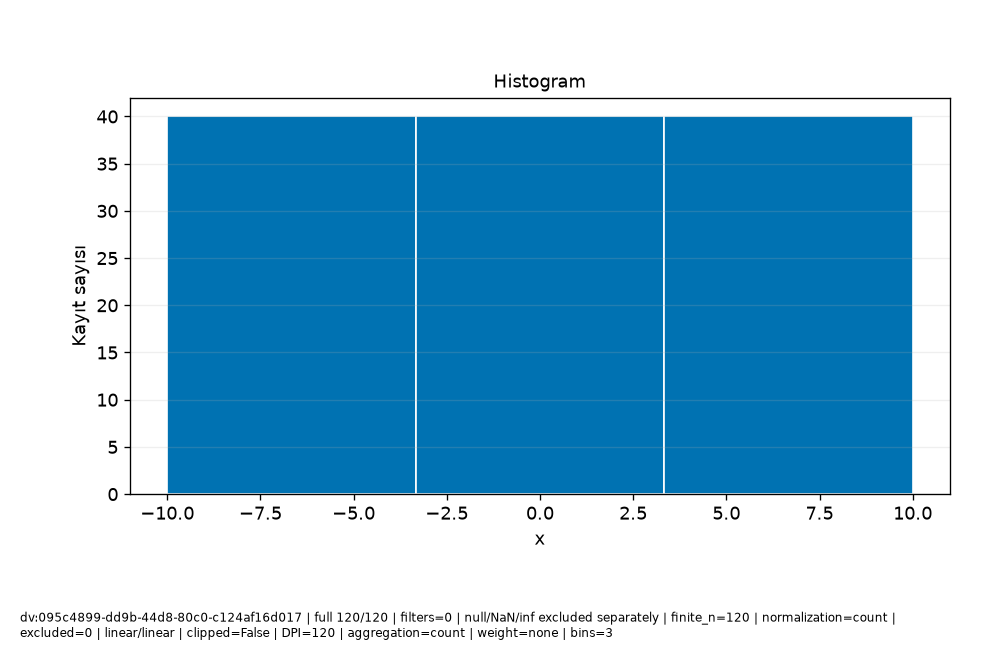

# Veri\_Ufku · Bilimsel rapor

Protokol: exploratory
Keşifsel inceleme; analiz birimi, seçim ve test kullanımını kayıtlı sonuçlarla değerlendirin.

Güncellik: Seçilen dataset/run için daha yeni kayıt bulunmadı; dış kaynağın canlı tazeliği doğrulanmadı.

Test kullanım defteri: []
Model seçim protokolü: kayıtlı method/model-card alanlarına bakın; alan yoksa not_recorded.

## Araştırma sorusu

**text**

```text
Soruyu ve analiz birimini kullanıcı olarak açıklayın.
```
**evidence**

```text
Kullanıcı metni; doğrulanmış hesap değildir.
```

## Yorum ve sınırlamalar

**text**

```text
Bulguyu yorumdan ayırın; nedensel çıkarım varsayımlarını açıkça yazın.
```
**evidence**

```text
Kullanıcı metni; doğrulanmış hesap değildir.
```

## Kaynakça


## method

**record_id**

```text
result:76c66f99-58f3-40c9-833e-3b157f09065e
```
**capability_id**

```text
model.regression
```
**dataset_versions**

```text
[
  "dv:095c4899-dd9b-44d8-80c0-c124af16d017"
]
```
**run_id**

```text
run:c85547b3-c473-4837-9279-ae9fe706e597
```
**evidence**

```text
Kayıtlı alan projeksiyonu; yeni hesap veya otomatik yorum değildir.
```
**data**

```text
{
  "spec": {
    "availability": {
      "col:14a0d04b-7435-4385-bf3e-41e964fe39b6": {
        "note": "Önceden bilinir",
        "offset_seconds": 0
      }
    },
    "baseline": "auto",
    "entity_use": "new",
    "folds": 3,
    "horizon_seconds": 0,
    "method": "auto",
    "prediction_moment": "Ölçüm öncesi",
    "seed": 42,
    "structure": "independent",
    "test_fraction": 0.2,
    "validation_fraction": 0.2
  },
  "model_card": {
    "baseline": {
      "comparison": [
        {
          "metrics": [
            {
              "averaging": "per_record",
              "coverage": "all eligible records in this evaluation partition",
              "direction": "minimize",
              "metric": "mae",
              "n": 24,
              "scope": "validation",
              "status": "valid",
              "value": 15.105042016806722
            },
            {
              "averaging": "per_record",
              "coverage": "all eligible records in this evaluation partition",
              "direction": "minimize",
              "metric": "rmse",
              "n": 24,
              "scope": "validation",
              "status": "valid",
              "value": 17.131074485116738
            },
            {
              "averaging": "per_record",
              "coverage": "all eligible records in this evaluation partition",
              "direction": "maximize",
              "metric": "r2",
              "n": 24,
              "scope": "validation",
              "status": "valid",
              "value": -0.07031033705694889
            }
          ],
          "scope": "validation"
        },
        {
          "metrics": [
            {
              "averaging": "per_record",
              "coverage": "all eligible records in this evaluation partition",
              "direction": "minimize",
              "metric": "mae",
              "n": 32,
              "scope": "cv:1",
              "status": "valid",
              "value": 16.085215336134453
            },
            {
              "averaging": "per_record",
              "coverage": "all eligible records in this evaluation partition",
              "direction": "minimize",
              "metric": "rmse",
              "n": 32,
              "scope": "cv:1",
              "status": "valid",
              "value": 17.78349866194151
            },
            {
              "averaging": "per_record",
              "coverage": "all eligible records in this evaluation partition",
              "direction": "maximize",
              "metric": "r2",
              "n": 32,
              "scope": "cv:1",
              "status": "valid",
              "value": -0.08216532968157875
            }
          ],
          "scope": "cv:1"
        },
        {
          "metrics": [
            {
              "averaging": "per_record",
              "coverage": "all eligible records in this evaluation partition",
              "direction": "minimize",
              "metric": "mae",
              "n": 32,
              "scope": "cv:2",
              "status": "valid",
              "value": 14.063484768907566
            },
            {
              "averaging": "per_record",
              "coverage": "all eligible records in this evaluation partition",
              "direction": "minimize",
              "metric": "rmse",
              "n": 32,
              "scope": "cv:2",
              "status": "valid",
              "value": 16.834420290258713
            },
            {
              "averaging": "per_record",
              "coverage": "all eligible records in this evaluation partition",
              "direction": "maximize",
              "metric": "r2",
              "n": 32,
              "scope": "cv:2",
              "status": "valid",
              "value": -0.000592538052601066
            }
          ],
          "scope": "cv:2"
        },
        {
          "metrics": [
            {
              "averaging": "per_record",
              "coverage": "all eligible records in this evaluation partition",
              "direction": "minimize",
              "metric": "mae",
              "n": 32,
              "scope": "cv:3",
              "status": "valid",
              "value": 16.882878151260506
            },
            {
              "averaging": "per_record",
              "coverage": "all eligible records in this evaluation partition",
              "direction": "minimize",
              "metric": "rmse",
              "n": 32,
              "scope": "cv:3",
              "status": "valid",
              "value": 19.037369544238533
            },
            {
              "averaging": "per_record",
              "coverage": "all eligible records in this evaluation partition",
              "direction": "maximize",
              "metric": "r2",
              "n": 32,
              "scope": "cv:3",
              "status": "valid",
              "value": -0.084358201283397
            }
          ],
          "scope": "cv:3"
        }
      ],
      "limitation": "Final koşuda yeniden baseline seçimi yapılmaz; geliştirme koşusu kartına bakın.",
      "strategy": "mean"
    },
    "candidate_selection": {
      "parameters": {
        "alpha": 1.0,
        "candidates": [
          "baseline",
          "linear",
          "ridge",
          "forest"
        ],
        "depth": 8,
        "trees": 50,
        "unit": "TL"
      },
      "rule": "minimum development CV mean MAE; ties follow candidate order",
      "selected": "linear"
    },
    "columns": [
      {
        "id": "col:14a0d04b-7435-4385-bf3e-41e964fe39b6",
        "name": "x",
        "original_name": "x",
        "type": "Float64"
      },
      {
        "id": "col:6be88793-335a-4227-9f6d-b433dc5f7225",
        "name": "y",
        "original_name": "y",
        "type": "Float64"
      }
    ],
    "dataset_version": "dv:095c4899-dd9b-44d8-80c0-c124af16d017",
    "decision": null,
    "estimator": "LinearRegression",
    "features": [
      {
        "id": "col:14a0d04b-7435-4385-bf3e-41e964fe39b6",
        "name": "x",
        "type": "Float64",
        "unit": ""
      }
    ],
    "fit_row_ids": [
      "row:518c3914-47e5-475b-8ea8-5411b22cc2bb",
      "row:f89cccc1-3a61-4cb9-b9be-cd068c198e65",
      "row:cc3688cd-774d-4c36-8fb4-20ce8f0f0fb6",
      "row:ca432d2c-f2ed-47e9-b510-3cb727e33c62",
      "row:5dd519a3-e236-4cb1-abef-655f828a1902",
      "row:182f34d4-00bf-4c3a-8ba2-1442f3e28d45",
      "row:4402afaf-ebc8-40f8-aa71-ee57f5e5c74f",
      "row:f2291a3f-aa7d-4b75-9064-3c6ef612f544",
      "row:128cb27a-0c5f-436e-88f1-b2d2305cf50a",
      "row:67c4a42f-3f89-4d24-85da-a47b5aea2623",
      "row:125fe14b-d520-4d04-8949-d8e440f04652",
      "row:af218d60-0d62-4f2b-9ba4-051d5d428d38",
      "row:c19ca534-df85-480f-998f-6e082d558326",
      "row:dd5f5084-c8f7-49bf-8391-aa1e9f4a932d",
      "row:0431d93d-dd0a-4a42-ae3e-0dc997d23715",
      "row:78a7f293-613a-472e-9487-9ec69794b19c",
      "row:4bf4b0d6-bc1a-4948-949c-1674d910f801",
      "row:e2533073-18cd-4434-83dd-42e7505e4964",
      "row:ed3f916e-da04-489e-8bea-bd9ef2e8228c",
      "row:c4724d05-032a-42fd-9c05-97b5d5fbe4ec",
      "row:25a77181-1f2b-4865-bfdb-821a66d6faf4",
      "row:32f26181-46e0-4a3b-899b-85d9566cc75e",
      "row:5744cf76-7173-4b67-b609-6d5f6f74ac1d",
      "row:c8422329-7d12-4e8c-b754-1cf783311243",
      "row:61c59761-20a0-4323-80f8-3b2f39e9aa8b",
      "row:a1f2edde-deeb-4804-b1d1-1cc297c01b63",
      "row:2a69c18b-470d-43f1-92cd-0efe6a5dc677",
      "row:998128f2-07eb-436e-bc24-767f11864677",
      "row:dedd530f-9d9d-4d3e-b5bc-632584760ef0",
      "row:2e3066a4-be35-498a-b3ea-ef08babf3620",
      "row:0b11c4c6-bd86-4294-8542-b9e9ac082e2e",
      "row:6b4f2dda-0152-44cd-8bb7-fa4cadde2a92",
      "row:95f588da-a4cb-455f-9301-2b4c2921c6af",
      "row:60901238-bf80-4556-8eea-f5e47f479eeb",
      "row:cd85e0ea-72dd-43f3-8916-420265fbef99",
      "row:a8d6b1b3-398b-445b-ba69-98c9ad555fc3",
      "row:3b4c7434-a536-4536-8269-3c50237bf23b",
      "row:d18ef122-da68-4bd6-ba7f-ed3f58792f10",
      "row:b8f92e58-caff-47bf-a9a7-942451fab666",
      "row:378b103d-929c-4d4c-9e42-6990297a18d2",
      "row:295314aa-82cd-4563-93d1-b020ec38fdd0",
      "row:b4eb6dba-a2f7-47a8-a3dc-2350fcd8f4d3",
      "row:e5b42492-7469-4267-adfb-8b2977b05913",
      "row:3913978c-1293-4d16-9e98-d191634cf7cf",
      "row:e21627b4-0f8a-4e36-83d7-fa5a161f9527",
      "row:510facd4-c9d2-4756-ba0c-8f420286a931",
      "row:fda7625e-cefe-4b77-a6c4-32a03ca7a5fc",
      "row:f7594a54-f0ed-439a-8693-fdd805cb94a2",
      "row:e1ae3a64-7716-42e9-8a0b-5bc1ef35c18f",
      "row:11125099-cf5e-43dd-b344-b43b9d9ea657",
      "row:c0c96637-c3d2-4cc5-94af-2cafc141d29e",
      "row:90ba0635-9909-4604-a750-31470b39c5ea",
      "row:7d7bceb7-4f69-431c-a0bc-1aed37281268",
      "row:30369997-4551-4eaa-bacf-cdbeee0fdd38",
      "row:57078334-86db-4cd5-8ee4-bae107f1b1d1",
      "row:99d48475-15c2-4e26-81cc-6003e546c311",
      "row:8694295e-2641-4248-9ef0-9a85972ebffe",
      "row:739fd7f3-df22-4ae8-b44a-dcec4c9fe17e",
      "row:7a30b16f-88d9-4eb7-9c75-1fc8decc8dfa",
      "row:45e2f74e-87f1-40a6-9165-a7e276d60711",
      "row:335141c3-8230-406a-9eee-89ce8a1f91ec",
      "row:1f8b0bf2-c327-4ad2-b9f3-278ac8705102",
      "row:a46f6c9f-3a31-46a1-9ee1-a185348077e8",
      "row:2b07740d-4d4e-4a6d-a743-18dd84007a42",
      "row:e756ec52-85ba-4dac-9973-9d97dfe87ac2",
      "row:82f418f6-c8fc-4f8d-8965-36b274f9d486",
      "row:235f7a3e-a40b-4e18-81a6-0dff0ab3c69b",
      "row:a129aa5b-3443-48d2-a1c7-bebb658d4ab3",
      "row:7831cbf1-fd1f-4b9c-8aaa-ca401289660d",
      "row:db244597-424f-49c6-b863-0ce621ed49e5",
      "row:7786729b-7279-4b07-ae76-c008ec5ba7d8",
      "row:318c4fc3-7f84-49ae-85c4-70b252352a67"
    ],
    "fit_scope": "development_train; validation previously used for selection",
    "fitted_preprocessing": {
      "1": {
        "kind": "impute_numeric",
        "statistics": [
          1.344537815126051
        ]
      },
      "2": {
        "kind": "standard_scale",
        "mean": [
          0.6092436974789925
        ],
        "scale": [
          5.948272597687973
        ]
      }
    },
    "importance": {
      "limitation": "İlişkili değişkenler önemi paylaşır/gizler; negatif önem mümkün. Nedensellik değildir; final test kullanılmadı.",
      "metric": "negative_MAE",
      "repeats": 3,
      "row_ids": [
        "row:49164049-77b1-4ab2-97bb-4a3465813df9",
        "row:db6a223e-b25b-4516-85df-ae880831a229",
        "row:6964a36a-2f29-45ad-b626-c72ef6536d7e",
        "row:1730857f-d21c-4fa7-b6a6-8208f1905722",
        "row:73e4ff31-0d79-4658-90da-273b345dc058",
        "row:bbe9e7f0-1508-4417-b3a1-e50bd2834c82",
        "row:295970eb-69b3-47ca-a880-3edc2d231eb8",
        "row:cc968abd-e43d-45de-b961-d9f592ec3a71",
        "row:73bd91fd-a756-47d1-af61-6d52ac3fe2fe",
        "row:53ce7776-5dac-4adc-a1c5-8f954196de20",
        "row:0c7fc97a-7684-423a-acce-4f28a4e40832",
        "row:dc71b089-4c75-40aa-a46f-1ddd37f44594",
        "row:36229b67-e3ef-44eb-9b17-2c506f4f8315",
        "row:d7626e8a-640f-49c7-8875-a0d6b15a39df",
        "row:7400dd06-4a94-42a4-8bb7-e8038faa2b0e",
        "row:2cc4d56b-0078-49ef-a08d-e45a33e97378",
        "row:5c1b3ee8-0b17-4957-b50d-daffa3ba0d1c",
        "row:c6918dd9-8a88-454f-940c-6fc01d6d39d1",
        "row:cad063b6-c17d-4238-a56b-36590f51ee54",
        "row:623b1385-529b-4664-be6a-cb25249dc57a",
        "row:79dfaf27-4161-4bb6-9d01-300ffdc51fa5",
        "row:b9e620a5-c7c1-4d02-9dc7-7af8da882f4c",
        "row:272d2b8f-2490-4c08-9394-ed0d6a31b662",
        "row:23a1be40-945a-47bb-a2be-b89b3a6bef57"
      ],
      "scope": "validation; exploratory; already used for model/threshold selection",
      "seed": 42,
      "status": "available",
      "values": [
        {
          "column_id": "col:14a0d04b-7435-4385-bf3e-41e964fe39b6",
          "mean": 19.523809523809522,
          "name": "x",
          "std": 2.038091850261204
        }
      ]
    },
    "label_order": [],
    "limitations": "Katsayı ve önemler nedensel etki değildir. İlişkili özellikler önemi paylaşabilir veya gizleyebilir. Yeni veri dağılımı değişebilir; olasılık kesinlik veya kalibrasyon garantisi değildir. Küme ve anomali adayları gerçek sınıf/veri hatası değildir; otomatik silme yok.",
    "method": null,
    "metrics": [
      {
        "evaluation_n": 24,
        "metrics": [
          {
            "averaging": "per_record",
            "coverage": "all eligible records in this evaluation partition",
            "direction": "minimize",
            "metric": "mae",
            "n": 24,
            "scope": "validation",
            "status": "valid",
            "value": 4.810966440042345e-15
          },
          {
            "averaging": "per_record",
            "coverage": "all eligible records in this evaluation partition",
            "direction": "minimize",
            "metric": "rmse",
            "n": 24,
            "scope": "validation",
            "status": "valid",
            "value": 5.582114810376975e-15
          },
          {
            "averaging": "per_record",
            "coverage": "all eligible records in this evaluation partition",
            "direction": "maximize",
            "metric": "r2",
            "n": 24,
            "scope": "validation",
            "status": "valid",
            "value": 1.0
          }
        ],
        "scope": "validation",
        "status": "valid",
        "train_n": 72
      },
      {
        "evaluation_n": 32,
        "metrics": [
          {
            "averaging": "per_record",
            "coverage": "all eligible records in this evaluation partition",
            "direction": "minimize",
            "metric": "mae",
            "n": 32,
            "scope": "cv:1",
            "status": "valid",
            "value": 1.3877787807814457e-15
          },
          {
            "averaging": "per_record",
            "coverage": "all eligible records in this evaluation partition",
            "direction": "minimize",
            "metric": "rmse",
            "n": 32,
            "scope": "cv:1",
            "status": "valid",
            "value": 2.1413206232596582e-15
          },
          {
            "averaging": "per_record",
            "coverage": "all eligible records in this evaluation partition",
            "direction": "maximize",
            "metric": "r2",
            "n": 32,
            "scope": "cv:1",
            "status": "valid",
            "value": 1.0
          }
        ],
        "scope": "cv:1",
        "status": "valid",
        "train_n": 64
      },
      {
        "evaluation_n": 32,
        "metrics": [
          {
            "averaging": "per_record",
            "coverage": "all eligible records in this evaluation partition",
            "direction": "minimize",
            "metric": "mae",
            "n": 32,
            "scope": "cv:2",
            "status": "valid",
            "value": 5.828670879282072e-15
          },
          {
            "averaging": "per_record",
            "coverage": "all eligible records in this evaluation partition",
            "direction": "minimize",
            "metric": "rmse",
            "n": 32,
            "scope": "cv:2",
            "status": "valid",
            "value": 7.320740245935003e-15
          },
          {
            "averaging": "per_record",
            "coverage": "all eligible records in this evaluation partition",
            "direction": "maximize",
            "metric": "r2",
            "n": 32,
            "scope": "cv:2",
            "status": "valid",
            "value": 1.0
          }
        ],
        "scope": "cv:2",
        "status": "valid",
        "train_n": 64
      },
      {
        "evaluation_n": 32,
        "metrics": [
          {
            "averaging": "per_record",
            "coverage": "all eligible records in this evaluation partition",
            "direction": "minimize",
            "metric": "mae",
            "n": 32,
            "scope": "cv:3",
            "status": "valid",
            "value": 1.915134717478395e-15
          },
          {
            "averaging": "per_record",
            "coverage": "all eligible records in this evaluation partition",
            "direction": "minimize",
            "metric": "rmse",
            "n": 32,
            "scope": "cv:3",
            "status": "valid",
            "value": 2.687565378447544e-15
          },
          {
            "averaging": "per_record",
            "coverage": "all eligible records in this evaluation partition",
            "direction": "maximize",
            "metric": "r2",
            "n": 32,
            "scope": "cv:3",
            "status": "valid",
            "value": 1.0
          }
        ],
        "scope": "cv:3",
        "status": "valid",
        "train_n": 64
      }
    ],
    "preparation_spec": {
      "allow_identifiers": false,
      "categorical_imputation": "most_frequent",
      "date_features": true,
      "encoding": "onehot",
      "family": "linear",
      "features": [
        "col:14a0d04b-7435-4385-bf3e-41e964fe39b6"
      ],
      "group": "",
      "history_action": "review",
      "history_note": "",
      "invalid_numeric": "reject",
      "numeric_imputation": "median",
      "precision": "reject",
      "prediction_context": "",
      "purpose": "regression",
      "scaling": "standard",
      "selection": "none",
      "source_version": "dv:095c4899-dd9b-44d8-80c0-c124af16d017",
      "target": "col:6be88793-335a-4227-9f6d-b433dc5f7225",
      "time": ""
    },
    "preprocessing": {
      "category_vocabulary": null,
      "column_lineage": [
        {
          "category_map": [],
          "input_column_id": "col:14a0d04b-7435-4385-bf3e-41e964fe39b6",
          "names_status": "structurally_known",
          "output_names": [
            "f_14a0d04b74354385bf3e41e964fe39b6__numeric"
          ],
          "selected_after_fit": "all_planned",
          "source_dtype": "Float64",
          "source_name": "x"
        }
      ],
      "estimator_family": "linear",
      "feature_selection_mask": null,
      "fit_state": "not_fitted",
      "fitted_parameters": {},
      "schema": "PreparationPlan/v1",
      "steps": [
        {
          "input_column_ids": [
            "col:14a0d04b-7435-4385-bf3e-41e964fe39b6"
          ],
          "kind": "numeric",
          "learned_scope": "row_local",
          "output_names": [
            "f_14a0d04b74354385bf3e41e964fe39b6__numeric"
          ],
          "parameters": {
            "nonfinite": "reject",
            "precision": "reject"
          },
          "reason": "Kimlik ölçüm değildir; Float64 kaybı gelecekte açık politika ile denetlenir.",
          "state": "planned"
        },
        {
          "input_column_ids": [
            "col:14a0d04b-7435-4385-bf3e-41e964fe39b6"
          ],
          "kind": "impute_numeric",
          "learned_scope": "training_fold",
          "output_names": [
            "f_14a0d04b74354385bf3e41e964fe39b6__numeric"
          ],
          "parameters": {
            "all_missing": "error",
            "strategy": "median"
          },
          "reason": "Seçilen doldurma değeri yalnız eğitim katında öğrenilir; test/validation ortalaması kullanılmaz.",
          "state": "planned"
        },
        {
          "input_column_ids": [
            "col:14a0d04b-7435-4385-bf3e-41e964fe39b6"
          ],
          "kind": "standard_scale",
          "learned_scope": "training_fold",
          "output_names": [
            "f_14a0d04b74354385bf3e41e964fe39b6__numeric"
          ],
          "parameters": {
            "explicit_override": false
          },
          "reason": "Uzaklıklar ve düzenlileştirilmiş doğrusal modeller ölçüm ölçeğine duyarlıdır; eğitim katında standardizasyon planlandı.",
          "state": "planned"
        }
      ],
      "training_dependency": "Requires a validated split/fold protocol in Phase16; no training performed",
      "version_id": "ml-pipeline:69646829-5f33-465f-8279-ff808e3b172e"
    },
    "probability_supported": false,
    "purpose": "regression",
    "run_id": "run:c85547b3-c473-4837-9279-ae9fe706e597",
    "schema": "ModelCard/v1",
    "seed": 42,
    "snapshot_fingerprint": {
      "sha256": "95e87b9c6b9ddfe2d463e46c1600e7be6e0cfffb72c3c485c2333d15ac090b52",
      "size": 11597
    },
    "split": {
      "invalid_folds": [],
      "membership": {
        "development": [
          "row:0431d93d-dd0a-4a42-ae3e-0dc997d23715",
          "row:0b11c4c6-bd86-4294-8542-b9e9ac082e2e",
          "row:0c7fc97a-7684-423a-acce-4f28a4e40832",
          "row:11125099-cf5e-43dd-b344-b43b9d9ea657",
          "row:125fe14b-d520-4d04-8949-d8e440f04652",
          "row:128cb27a-0c5f-436e-88f1-b2d2305cf50a",
          "row:1730857f-d21c-4fa7-b6a6-8208f1905722",
          "row:182f34d4-00bf-4c3a-8ba2-1442f3e28d45",
          "row:1f8b0bf2-c327-4ad2-b9f3-278ac8705102",
          "row:235f7a3e-a40b-4e18-81a6-0dff0ab3c69b",
          "row:23a1be40-945a-47bb-a2be-b89b3a6bef57",
          "row:25a77181-1f2b-4865-bfdb-821a66d6faf4",
          "row:272d2b8f-2490-4c08-9394-ed0d6a31b662",
          "row:295314aa-82cd-4563-93d1-b020ec38fdd0",
          "row:295970eb-69b3-47ca-a880-3edc2d231eb8",
          "row:2a69c18b-470d-43f1-92cd-0efe6a5dc677",
          "row:2b07740d-4d4e-4a6d-a743-18dd84007a42",
          "row:2cc4d56b-0078-49ef-a08d-e45a33e97378",
          "row:2e3066a4-be35-498a-b3ea-ef08babf3620",
          "row:30369997-4551-4eaa-bacf-cdbeee0fdd38",
          "row:318c4fc3-7f84-49ae-85c4-70b252352a67",
          "row:32f26181-46e0-4a3b-899b-85d9566cc75e",
          "row:335141c3-8230-406a-9eee-89ce8a1f91ec",
          "row:36229b67-e3ef-44eb-9b17-2c506f4f8315",
          "row:378b103d-929c-4d4c-9e42-6990297a18d2",
          "row:3913978c-1293-4d16-9e98-d191634cf7cf",
          "row:3b4c7434-a536-4536-8269-3c50237bf23b",
          "row:4402afaf-ebc8-40f8-aa71-ee57f5e5c74f",
          "row:45e2f74e-87f1-40a6-9165-a7e276d60711",
          "row:49164049-77b1-4ab2-97bb-4a3465813df9",
          "row:4bf4b0d6-bc1a-4948-949c-1674d910f801",
          "row:510facd4-c9d2-4756-ba0c-8f420286a931",
          "row:518c3914-47e5-475b-8ea8-5411b22cc2bb",
          "row:53ce7776-5dac-4adc-a1c5-8f954196de20",
          "row:57078334-86db-4cd5-8ee4-bae107f1b1d1",
          "row:5744cf76-7173-4b67-b609-6d5f6f74ac1d",
          "row:5c1b3ee8-0b17-4957-b50d-daffa3ba0d1c",
          "row:5dd519a3-e236-4cb1-abef-655f828a1902",
          "row:60901238-bf80-4556-8eea-f5e47f479eeb",
          "row:61c59761-20a0-4323-80f8-3b2f39e9aa8b",
          "row:623b1385-529b-4664-be6a-cb25249dc57a",
          "row:67c4a42f-3f89-4d24-85da-a47b5aea2623",
          "row:6964a36a-2f29-45ad-b626-c72ef6536d7e",
          "row:6b4f2dda-0152-44cd-8bb7-fa4cadde2a92",
          "row:739fd7f3-df22-4ae8-b44a-dcec4c9fe17e",
          "row:73bd91fd-a756-47d1-af61-6d52ac3fe2fe",
          "row:73e4ff31-0d79-4658-90da-273b345dc058",
          "row:7400dd06-4a94-42a4-8bb7-e8038faa2b0e",
          "row:7786729b-7279-4b07-ae76-c008ec5ba7d8",
          "row:7831cbf1-fd1f-4b9c-8aaa-ca401289660d",
          "row:78a7f293-613a-472e-9487-9ec69794b19c",
          "row:79dfaf27-4161-4bb6-9d01-300ffdc51fa5",
          "row:7a30b16f-88d9-4eb7-9c75-1fc8decc8dfa",
          "row:7d7bceb7-4f69-431c-a0bc-1aed37281268",
          "row:82f418f6-c8fc-4f8d-8965-36b274f9d486",
          "row:8694295e-2641-4248-9ef0-9a85972ebffe",
          "row:90ba0635-9909-4604-a750-31470b39c5ea",
          "row:95f588da-a4cb-455f-9301-2b4c2921c6af",
          "row:998128f2-07eb-436e-bc24-767f11864677",
          "row:99d48475-15c2-4e26-81cc-6003e546c311",
          "row:a129aa5b-3443-48d2-a1c7-bebb658d4ab3",
          "row:a1f2edde-deeb-4804-b1d1-1cc297c01b63",
          "row:a46f6c9f-3a31-46a1-9ee1-a185348077e8",
          "row:a8d6b1b3-398b-445b-ba69-98c9ad555fc3",
          "row:af218d60-0d62-4f2b-9ba4-051d5d428d38",
          "row:b4eb6dba-a2f7-47a8-a3dc-2350fcd8f4d3",
          "row:b8f92e58-caff-47bf-a9a7-942451fab666",
          "row:b9e620a5-c7c1-4d02-9dc7-7af8da882f4c",
          "row:bbe9e7f0-1508-4417-b3a1-e50bd2834c82",
          "row:c0c96637-c3d2-4cc5-94af-2cafc141d29e",
          "row:c19ca534-df85-480f-998f-6e082d558326",
          "row:c4724d05-032a-42fd-9c05-97b5d5fbe4ec",
          "row:c6918dd9-8a88-454f-940c-6fc01d6d39d1",
          "row:c8422329-7d12-4e8c-b754-1cf783311243",
          "row:ca432d2c-f2ed-47e9-b510-3cb727e33c62",
          "row:cad063b6-c17d-4238-a56b-36590f51ee54",
          "row:cc3688cd-774d-4c36-8fb4-20ce8f0f0fb6",
          "row:cc968abd-e43d-45de-b961-d9f592ec3a71",
          "row:cd85e0ea-72dd-43f3-8916-420265fbef99",
          "row:d18ef122-da68-4bd6-ba7f-ed3f58792f10",
          "row:d7626e8a-640f-49c7-8875-a0d6b15a39df",
          "row:db244597-424f-49c6-b863-0ce621ed49e5",
          "row:db6a223e-b25b-4516-85df-ae880831a229",
          "row:dc71b089-4c75-40aa-a46f-1ddd37f44594",
          "row:dd5f5084-c8f7-49bf-8391-aa1e9f4a932d",
          "row:dedd530f-9d9d-4d3e-b5bc-632584760ef0",
          "row:e1ae3a64-7716-42e9-8a0b-5bc1ef35c18f",
          "row:e21627b4-0f8a-4e36-83d7-fa5a161f9527",
          "row:e2533073-18cd-4434-83dd-42e7505e4964",
          "row:e5b42492-7469-4267-adfb-8b2977b05913",
          "row:e756ec52-85ba-4dac-9973-9d97dfe87ac2",
          "row:ed3f916e-da04-489e-8bea-bd9ef2e8228c",
          "row:f2291a3f-aa7d-4b75-9064-3c6ef612f544",
          "row:f7594a54-f0ed-439a-8693-fdd805cb94a2",
          "row:f89cccc1-3a61-4cb9-b9be-cd068c198e65",
          "row:fda7625e-cefe-4b77-a6c4-32a03ca7a5fc"
        ],
        "folds": [
          {
            "status": "valid",
            "train": [
              "row:0431d93d-dd0a-4a42-ae3e-0dc997d23715",
              "row:0b11c4c6-bd86-4294-8542-b9e9ac082e2e",
              "row:11125099-cf5e-43dd-b344-b43b9d9ea657",
              "row:125fe14b-d520-4d04-8949-d8e440f04652",
              "row:128cb27a-0c5f-436e-88f1-b2d2305cf50a",
              "row:1f8b0bf2-c327-4ad2-b9f3-278ac8705102",
              "row:235f7a3e-a40b-4e18-81a6-0dff0ab3c69b",
              "row:25a77181-1f2b-4865-bfdb-821a66d6faf4",
              "row:295314aa-82cd-4563-93d1-b020ec38fdd0",
              "row:2a69c18b-470d-43f1-92cd-0efe6a5dc677",
              "row:2b07740d-4d4e-4a6d-a743-18dd84007a42",
              "row:2e3066a4-be35-498a-b3ea-ef08babf3620",
              "row:30369997-4551-4eaa-bacf-cdbeee0fdd38",
              "row:318c4fc3-7f84-49ae-85c4-70b252352a67",
              "row:32f26181-46e0-4a3b-899b-85d9566cc75e",
              "row:335141c3-8230-406a-9eee-89ce8a1f91ec",
              "row:378b103d-929c-4d4c-9e42-6990297a18d2",
              "row:3913978c-1293-4d16-9e98-d191634cf7cf",
              "row:3b4c7434-a536-4536-8269-3c50237bf23b",
              "row:45e2f74e-87f1-40a6-9165-a7e276d60711",
              "row:4bf4b0d6-bc1a-4948-949c-1674d910f801",
              "row:510facd4-c9d2-4756-ba0c-8f420286a931",
              "row:57078334-86db-4cd5-8ee4-bae107f1b1d1",
              "row:5744cf76-7173-4b67-b609-6d5f6f74ac1d",
              "row:60901238-bf80-4556-8eea-f5e47f479eeb",
              "row:61c59761-20a0-4323-80f8-3b2f39e9aa8b",
              "row:67c4a42f-3f89-4d24-85da-a47b5aea2623",
              "row:6b4f2dda-0152-44cd-8bb7-fa4cadde2a92",
              "row:739fd7f3-df22-4ae8-b44a-dcec4c9fe17e",
              "row:7786729b-7279-4b07-ae76-c008ec5ba7d8",
              "row:7831cbf1-fd1f-4b9c-8aaa-ca401289660d",
              "row:78a7f293-613a-472e-9487-9ec69794b19c",
              "row:7a30b16f-88d9-4eb7-9c75-1fc8decc8dfa",
              "row:7d7bceb7-4f69-431c-a0bc-1aed37281268",
              "row:82f418f6-c8fc-4f8d-8965-36b274f9d486",
              "row:8694295e-2641-4248-9ef0-9a85972ebffe",
              "row:90ba0635-9909-4604-a750-31470b39c5ea",
              "row:95f588da-a4cb-455f-9301-2b4c2921c6af",
              "row:998128f2-07eb-436e-bc24-767f11864677",
              "row:99d48475-15c2-4e26-81cc-6003e546c311",
              "row:a129aa5b-3443-48d2-a1c7-bebb658d4ab3",
              "row:a1f2edde-deeb-4804-b1d1-1cc297c01b63",
              "row:a46f6c9f-3a31-46a1-9ee1-a185348077e8",
              "row:a8d6b1b3-398b-445b-ba69-98c9ad555fc3",
              "row:af218d60-0d62-4f2b-9ba4-051d5d428d38",
              "row:b4eb6dba-a2f7-47a8-a3dc-2350fcd8f4d3",
              "row:b8f92e58-caff-47bf-a9a7-942451fab666",
              "row:c0c96637-c3d2-4cc5-94af-2cafc141d29e",
              "row:c19ca534-df85-480f-998f-6e082d558326",
              "row:c4724d05-032a-42fd-9c05-97b5d5fbe4ec",
              "row:c8422329-7d12-4e8c-b754-1cf783311243",
              "row:cd85e0ea-72dd-43f3-8916-420265fbef99",
              "row:d18ef122-da68-4bd6-ba7f-ed3f58792f10",
              "row:db244597-424f-49c6-b863-0ce621ed49e5",
              "row:dd5f5084-c8f7-49bf-8391-aa1e9f4a932d",
              "row:dedd530f-9d9d-4d3e-b5bc-632584760ef0",
              "row:e1ae3a64-7716-42e9-8a0b-5bc1ef35c18f",
              "row:e21627b4-0f8a-4e36-83d7-fa5a161f9527",
              "row:e2533073-18cd-4434-83dd-42e7505e4964",
              "row:e5b42492-7469-4267-adfb-8b2977b05913",
              "row:e756ec52-85ba-4dac-9973-9d97dfe87ac2",
              "row:ed3f916e-da04-489e-8bea-bd9ef2e8228c",
              "row:f7594a54-f0ed-439a-8693-fdd805cb94a2",
              "row:fda7625e-cefe-4b77-a6c4-32a03ca7a5fc"
            ],
            "validation": [
              "row:0c7fc97a-7684-423a-acce-4f28a4e40832",
              "row:1730857f-d21c-4fa7-b6a6-8208f1905722",
              "row:182f34d4-00bf-4c3a-8ba2-1442f3e28d45",
              "row:23a1be40-945a-47bb-a2be-b89b3a6bef57",
              "row:272d2b8f-2490-4c08-9394-ed0d6a31b662",
              "row:295970eb-69b3-47ca-a880-3edc2d231eb8",
              "row:2cc4d56b-0078-49ef-a08d-e45a33e97378",
              "row:36229b67-e3ef-44eb-9b17-2c506f4f8315",
              "row:4402afaf-ebc8-40f8-aa71-ee57f5e5c74f",
              "row:49164049-77b1-4ab2-97bb-4a3465813df9",
              "row:518c3914-47e5-475b-8ea8-5411b22cc2bb",
              "row:53ce7776-5dac-4adc-a1c5-8f954196de20",
              "row:5c1b3ee8-0b17-4957-b50d-daffa3ba0d1c",
              "row:5dd519a3-e236-4cb1-abef-655f828a1902",
              "row:623b1385-529b-4664-be6a-cb25249dc57a",
              "row:6964a36a-2f29-45ad-b626-c72ef6536d7e",
              "row:73bd91fd-a756-47d1-af61-6d52ac3fe2fe",
              "row:73e4ff31-0d79-4658-90da-273b345dc058",
              "row:7400dd06-4a94-42a4-8bb7-e8038faa2b0e",
              "row:79dfaf27-4161-4bb6-9d01-300ffdc51fa5",
              "row:b9e620a5-c7c1-4d02-9dc7-7af8da882f4c",
              "row:bbe9e7f0-1508-4417-b3a1-e50bd2834c82",
              "row:c6918dd9-8a88-454f-940c-6fc01d6d39d1",
              "row:ca432d2c-f2ed-47e9-b510-3cb727e33c62",
              "row:cad063b6-c17d-4238-a56b-36590f51ee54",
              "row:cc3688cd-774d-4c36-8fb4-20ce8f0f0fb6",
              "row:cc968abd-e43d-45de-b961-d9f592ec3a71",
              "row:d7626e8a-640f-49c7-8875-a0d6b15a39df",
              "row:db6a223e-b25b-4516-85df-ae880831a229",
              "row:dc71b089-4c75-40aa-a46f-1ddd37f44594",
              "row:f2291a3f-aa7d-4b75-9064-3c6ef612f544",
              "row:f89cccc1-3a61-4cb9-b9be-cd068c198e65"
            ]
          },
          {
            "status": "valid",
            "train": [
              "row:0c7fc97a-7684-423a-acce-4f28a4e40832",
              "row:11125099-cf5e-43dd-b344-b43b9d9ea657",
              "row:1730857f-d21c-4fa7-b6a6-8208f1905722",
              "row:182f34d4-00bf-4c3a-8ba2-1442f3e28d45",
              "row:1f8b0bf2-c327-4ad2-b9f3-278ac8705102",
              "row:235f7a3e-a40b-4e18-81a6-0dff0ab3c69b",
              "row:23a1be40-945a-47bb-a2be-b89b3a6bef57",
              "row:272d2b8f-2490-4c08-9394-ed0d6a31b662",
              "row:295314aa-82cd-4563-93d1-b020ec38fdd0",
              "row:295970eb-69b3-47ca-a880-3edc2d231eb8",
              "row:2b07740d-4d4e-4a6d-a743-18dd84007a42",
              "row:2cc4d56b-0078-49ef-a08d-e45a33e97378",
              "row:30369997-4551-4eaa-bacf-cdbeee0fdd38",
              "row:318c4fc3-7f84-49ae-85c4-70b252352a67",
              "row:335141c3-8230-406a-9eee-89ce8a1f91ec",
              "row:36229b67-e3ef-44eb-9b17-2c506f4f8315",
              "row:3913978c-1293-4d16-9e98-d191634cf7cf",
              "row:4402afaf-ebc8-40f8-aa71-ee57f5e5c74f",
              "row:45e2f74e-87f1-40a6-9165-a7e276d60711",
              "row:49164049-77b1-4ab2-97bb-4a3465813df9",
              "row:510facd4-c9d2-4756-ba0c-8f420286a931",
              "row:518c3914-47e5-475b-8ea8-5411b22cc2bb",
              "row:53ce7776-5dac-4adc-a1c5-8f954196de20",
              "row:57078334-86db-4cd5-8ee4-bae107f1b1d1",
              "row:5c1b3ee8-0b17-4957-b50d-daffa3ba0d1c",
              "row:5dd519a3-e236-4cb1-abef-655f828a1902",
              "row:623b1385-529b-4664-be6a-cb25249dc57a",
              "row:6964a36a-2f29-45ad-b626-c72ef6536d7e",
              "row:739fd7f3-df22-4ae8-b44a-dcec4c9fe17e",
              "row:73bd91fd-a756-47d1-af61-6d52ac3fe2fe",
              "row:73e4ff31-0d79-4658-90da-273b345dc058",
              "row:7400dd06-4a94-42a4-8bb7-e8038faa2b0e",
              "row:7786729b-7279-4b07-ae76-c008ec5ba7d8",
              "row:7831cbf1-fd1f-4b9c-8aaa-ca401289660d",
              "row:79dfaf27-4161-4bb6-9d01-300ffdc51fa5",
              "row:7a30b16f-88d9-4eb7-9c75-1fc8decc8dfa",
              "row:7d7bceb7-4f69-431c-a0bc-1aed37281268",
              "row:82f418f6-c8fc-4f8d-8965-36b274f9d486",
              "row:8694295e-2641-4248-9ef0-9a85972ebffe",
              "row:90ba0635-9909-4604-a750-31470b39c5ea",
              "row:99d48475-15c2-4e26-81cc-6003e546c311",
              "row:a129aa5b-3443-48d2-a1c7-bebb658d4ab3",
              "row:a46f6c9f-3a31-46a1-9ee1-a185348077e8",
              "row:b4eb6dba-a2f7-47a8-a3dc-2350fcd8f4d3",
              "row:b9e620a5-c7c1-4d02-9dc7-7af8da882f4c",
              "row:bbe9e7f0-1508-4417-b3a1-e50bd2834c82",
              "row:c0c96637-c3d2-4cc5-94af-2cafc141d29e",
              "row:c6918dd9-8a88-454f-940c-6fc01d6d39d1",
              "row:ca432d2c-f2ed-47e9-b510-3cb727e33c62",
              "row:cad063b6-c17d-4238-a56b-36590f51ee54",
              "row:cc3688cd-774d-4c36-8fb4-20ce8f0f0fb6",
              "row:cc968abd-e43d-45de-b961-d9f592ec3a71",
              "row:d7626e8a-640f-49c7-8875-a0d6b15a39df",
              "row:db244597-424f-49c6-b863-0ce621ed49e5",
              "row:db6a223e-b25b-4516-85df-ae880831a229",
              "row:dc71b089-4c75-40aa-a46f-1ddd37f44594",
              "row:e1ae3a64-7716-42e9-8a0b-5bc1ef35c18f",
              "row:e21627b4-0f8a-4e36-83d7-fa5a161f9527",
              "row:e5b42492-7469-4267-adfb-8b2977b05913",
              "row:e756ec52-85ba-4dac-9973-9d97dfe87ac2",
              "row:f2291a3f-aa7d-4b75-9064-3c6ef612f544",
              "row:f7594a54-f0ed-439a-8693-fdd805cb94a2",
              "row:f89cccc1-3a61-4cb9-b9be-cd068c198e65",
              "row:fda7625e-cefe-4b77-a6c4-32a03ca7a5fc"
            ],
            "validation": [
              "row:0431d93d-dd0a-4a42-ae3e-0dc997d23715",
              "row:0b11c4c6-bd86-4294-8542-b9e9ac082e2e",
              "row:125fe14b-d520-4d04-8949-d8e440f04652",
              "row:128cb27a-0c5f-436e-88f1-b2d2305cf50a",
              "row:25a77181-1f2b-4865-bfdb-821a66d6faf4",
              "row:2a69c18b-470d-43f1-92cd-0efe6a5dc677",
              "row:2e3066a4-be35-498a-b3ea-ef08babf3620",
              "row:32f26181-46e0-4a3b-899b-85d9566cc75e",
              "row:378b103d-929c-4d4c-9e42-6990297a18d2",
              "row:3b4c7434-a536-4536-8269-3c50237bf23b",
              "row:4bf4b0d6-bc1a-4948-949c-1674d910f801",
              "row:5744cf76-7173-4b67-b609-6d5f6f74ac1d",
              "row:60901238-bf80-4556-8eea-f5e47f479eeb",
              "row:61c59761-20a0-4323-80f8-3b2f39e9aa8b",
              "row:67c4a42f-3f89-4d24-85da-a47b5aea2623",
              "row:6b4f2dda-0152-44cd-8bb7-fa4cadde2a92",
              "row:78a7f293-613a-472e-9487-9ec69794b19c",
              "row:95f588da-a4cb-455f-9301-2b4c2921c6af",
              "row:998128f2-07eb-436e-bc24-767f11864677",
              "row:a1f2edde-deeb-4804-b1d1-1cc297c01b63",
              "row:a8d6b1b3-398b-445b-ba69-98c9ad555fc3",
              "row:af218d60-0d62-4f2b-9ba4-051d5d428d38",
              "row:b8f92e58-caff-47bf-a9a7-942451fab666",
              "row:c19ca534-df85-480f-998f-6e082d558326",
              "row:c4724d05-032a-42fd-9c05-97b5d5fbe4ec",
              "row:c8422329-7d12-4e8c-b754-1cf783311243",
              "row:cd85e0ea-72dd-43f3-8916-420265fbef99",
              "row:d18ef122-da68-4bd6-ba7f-ed3f58792f10",
              "row:dd5f5084-c8f7-49bf-8391-aa1e9f4a932d",
              "row:dedd530f-9d9d-4d3e-b5bc-632584760ef0",
              "row:e2533073-18cd-4434-83dd-42e7505e4964",
              "row:ed3f916e-da04-489e-8bea-bd9ef2e8228c"
            ]
          },
          {
            "status": "valid",
            "train": [
              "row:0431d93d-dd0a-4a42-ae3e-0dc997d23715",
              "row:0b11c4c6-bd86-4294-8542-b9e9ac082e2e",
              "row:0c7fc97a-7684-423a-acce-4f28a4e40832",
              "row:125fe14b-d520-4d04-8949-d8e440f04652",
              "row:128cb27a-0c5f-436e-88f1-b2d2305cf50a",
              "row:1730857f-d21c-4fa7-b6a6-8208f1905722",
              "row:182f34d4-00bf-4c3a-8ba2-1442f3e28d45",
              "row:23a1be40-945a-47bb-a2be-b89b3a6bef57",
              "row:25a77181-1f2b-4865-bfdb-821a66d6faf4",
              "row:272d2b8f-2490-4c08-9394-ed0d6a31b662",
              "row:295970eb-69b3-47ca-a880-3edc2d231eb8",
              "row:2a69c18b-470d-43f1-92cd-0efe6a5dc677",
              "row:2cc4d56b-0078-49ef-a08d-e45a33e97378",
              "row:2e3066a4-be35-498a-b3ea-ef08babf3620",
              "row:32f26181-46e0-4a3b-899b-85d9566cc75e",
              "row:36229b67-e3ef-44eb-9b17-2c506f4f8315",
              "row:378b103d-929c-4d4c-9e42-6990297a18d2",
              "row:3b4c7434-a536-4536-8269-3c50237bf23b",
              "row:4402afaf-ebc8-40f8-aa71-ee57f5e5c74f",
              "row:49164049-77b1-4ab2-97bb-4a3465813df9",
              "row:4bf4b0d6-bc1a-4948-949c-1674d910f801",
              "row:518c3914-47e5-475b-8ea8-5411b22cc2bb",
              "row:53ce7776-5dac-4adc-a1c5-8f954196de20",
              "row:5744cf76-7173-4b67-b609-6d5f6f74ac1d",
              "row:5c1b3ee8-0b17-4957-b50d-daffa3ba0d1c",
              "row:5dd519a3-e236-4cb1-abef-655f828a1902",
              "row:60901238-bf80-4556-8eea-f5e47f479eeb",
              "row:61c59761-20a0-4323-80f8-3b2f39e9aa8b",
              "row:623b1385-529b-4664-be6a-cb25249dc57a",
              "row:67c4a42f-3f89-4d24-85da-a47b5aea2623",
              "row:6964a36a-2f29-45ad-b626-c72ef6536d7e",
              "row:6b4f2dda-0152-44cd-8bb7-fa4cadde2a92",
              "row:73bd91fd-a756-47d1-af61-6d52ac3fe2fe",
              "row:73e4ff31-0d79-4658-90da-273b345dc058",
              "row:7400dd06-4a94-42a4-8bb7-e8038faa2b0e",
              "row:78a7f293-613a-472e-9487-9ec69794b19c",
              "row:79dfaf27-4161-4bb6-9d01-300ffdc51fa5",
              "row:95f588da-a4cb-455f-9301-2b4c2921c6af",
              "row:998128f2-07eb-436e-bc24-767f11864677",
              "row:a1f2edde-deeb-4804-b1d1-1cc297c01b63",
              "row:a8d6b1b3-398b-445b-ba69-98c9ad555fc3",
              "row:af218d60-0d62-4f2b-9ba4-051d5d428d38",
              "row:b8f92e58-caff-47bf-a9a7-942451fab666",
              "row:b9e620a5-c7c1-4d02-9dc7-7af8da882f4c",
              "row:bbe9e7f0-1508-4417-b3a1-e50bd2834c82",
              "row:c19ca534-df85-480f-998f-6e082d558326",
              "row:c4724d05-032a-42fd-9c05-97b5d5fbe4ec",
              "row:c6918dd9-8a88-454f-940c-6fc01d6d39d1",
              "row:c8422329-7d12-4e8c-b754-1cf783311243",
              "row:ca432d2c-f2ed-47e9-b510-3cb727e33c62",
              "row:cad063b6-c17d-4238-a56b-36590f51ee54",
              "row:cc3688cd-774d-4c36-8fb4-20ce8f0f0fb6",
              "row:cc968abd-e43d-45de-b961-d9f592ec3a71",
              "row:cd85e0ea-72dd-43f3-8916-420265fbef99",
              "row:d18ef122-da68-4bd6-ba7f-ed3f58792f10",
              "row:d7626e8a-640f-49c7-8875-a0d6b15a39df",
              "row:db6a223e-b25b-4516-85df-ae880831a229",
              "row:dc71b089-4c75-40aa-a46f-1ddd37f44594",
              "row:dd5f5084-c8f7-49bf-8391-aa1e9f4a932d",
              "row:dedd530f-9d9d-4d3e-b5bc-632584760ef0",
              "row:e2533073-18cd-4434-83dd-42e7505e4964",
              "row:ed3f916e-da04-489e-8bea-bd9ef2e8228c",
              "row:f2291a3f-aa7d-4b75-9064-3c6ef612f544",
              "row:f89cccc1-3a61-4cb9-b9be-cd068c198e65"
            ],
            "validation": [
              "row:11125099-cf5e-43dd-b344-b43b9d9ea657",
              "row:1f8b0bf2-c327-4ad2-b9f3-278ac8705102",
              "row:235f7a3e-a40b-4e18-81a6-0dff0ab3c69b",
              "row:295314aa-82cd-4563-93d1-b020ec38fdd0",
              "row:2b07740d-4d4e-4a6d-a743-18dd84007a42",
              "row:30369997-4551-4eaa-bacf-cdbeee0fdd38",
              "row:318c4fc3-7f84-49ae-85c4-70b252352a67",
              "row:335141c3-8230-406a-9eee-89ce8a1f91ec",
              "row:3913978c-1293-4d16-9e98-d191634cf7cf",
              "row:45e2f74e-87f1-40a6-9165-a7e276d60711",
              "row:510facd4-c9d2-4756-ba0c-8f420286a931",
              "row:57078334-86db-4cd5-8ee4-bae107f1b1d1",
              "row:739fd7f3-df22-4ae8-b44a-dcec4c9fe17e",
              "row:7786729b-7279-4b07-ae76-c008ec5ba7d8",
              "row:7831cbf1-fd1f-4b9c-8aaa-ca401289660d",
              "row:7a30b16f-88d9-4eb7-9c75-1fc8decc8dfa",
              "row:7d7bceb7-4f69-431c-a0bc-1aed37281268",
              "row:82f418f6-c8fc-4f8d-8965-36b274f9d486",
              "row:8694295e-2641-4248-9ef0-9a85972ebffe",
              "row:90ba0635-9909-4604-a750-31470b39c5ea",
              "row:99d48475-15c2-4e26-81cc-6003e546c311",
              "row:a129aa5b-3443-48d2-a1c7-bebb658d4ab3",
              "row:a46f6c9f-3a31-46a1-9ee1-a185348077e8",
              "row:b4eb6dba-a2f7-47a8-a3dc-2350fcd8f4d3",
              "row:c0c96637-c3d2-4cc5-94af-2cafc141d29e",
              "row:db244597-424f-49c6-b863-0ce621ed49e5",
              "row:e1ae3a64-7716-42e9-8a0b-5bc1ef35c18f",
              "row:e21627b4-0f8a-4e36-83d7-fa5a161f9527",
              "row:e5b42492-7469-4267-adfb-8b2977b05913",
              "row:e756ec52-85ba-4dac-9973-9d97dfe87ac2",
              "row:f7594a54-f0ed-439a-8693-fdd805cb94a2",
              "row:fda7625e-cefe-4b77-a6c4-32a03ca7a5fc"
            ]
          }
        ],
        "purged": [],
        "test": [
          "row:0e7b2f15-7e8d-441a-953a-c35c3cda1bc9",
          "row:1c59ad5e-cec6-4171-9268-f204cd42376b",
          "row:213d4ba5-e91e-4e91-aceb-082320b7ba74",
          "row:26ce661b-db8a-409a-b3c2-d8e4f036f997",
          "row:2a3e6e40-5ff9-4ddb-a266-163732840f32",
          "row:2c6f0a67-6968-4bf0-b42d-dec5d539f2e6",
          "row:3121fa6a-daac-4ef7-b8a3-d705b43dccca",
          "row:3fa3ca6e-34c2-43e4-b723-e21411eb52e3",
          "row:53f0f486-44db-4e14-bc64-35cc4a4c7543",
          "row:5c534966-0d0b-4140-a097-64231d741b80",
          "row:7cc8dda0-4a2f-4f75-b577-352c424b49f1",
          "row:7dbe3950-4509-46b0-8d57-848c3a94cae2",
          "row:835603ca-86ee-48dd-bbdf-d153925c0947",
          "row:8a649294-4ced-419b-bdcf-cc961edea05a",
          "row:978d12da-4d40-404d-8f65-ab482125c631",
          "row:9ae76e80-4cdd-4f7a-90cf-c4669db631d7",
          "row:9d8e73ae-0002-471e-b46e-8fe67140a125",
          "row:b5ae9952-439f-4787-aa03-5634039c6441",
          "row:d05bc951-b23a-4926-b1ed-c5a24ea067bc",
          "row:e910ed07-6ed5-4d04-80dc-4f9f8602e99e",
          "row:f358535a-c708-407c-97a5-c356ec9607d7",
          "row:f4c80238-3666-401e-ba03-1f339e68f779",
          "row:fe84cbdc-112b-426a-947e-f3308318779a",
          "row:fff5f56b-a2fb-4e03-ae2c-820dd437aa0c"
        ],
        "train": [
          "row:0431d93d-dd0a-4a42-ae3e-0dc997d23715",
          "row:0b11c4c6-bd86-4294-8542-b9e9ac082e2e",
          "row:11125099-cf5e-43dd-b344-b43b9d9ea657",
          "row:125fe14b-d520-4d04-8949-d8e440f04652",
          "row:128cb27a-0c5f-436e-88f1-b2d2305cf50a",
          "row:182f34d4-00bf-4c3a-8ba2-1442f3e28d45",
          "row:1f8b0bf2-c327-4ad2-b9f3-278ac8705102",
          "row:235f7a3e-a40b-4e18-81a6-0dff0ab3c69b",
          "row:25a77181-1f2b-4865-bfdb-821a66d6faf4",
          "row:295314aa-82cd-4563-93d1-b020ec38fdd0",
          "row:2a69c18b-470d-43f1-92cd-0efe6a5dc677",
          "row:2b07740d-4d4e-4a6d-a743-18dd84007a42",
          "row:2e3066a4-be35-498a-b3ea-ef08babf3620",
          "row:30369997-4551-4eaa-bacf-cdbeee0fdd38",
          "row:318c4fc3-7f84-49ae-85c4-70b252352a67",
          "row:32f26181-46e0-4a3b-899b-85d9566cc75e",
          "row:335141c3-8230-406a-9eee-89ce8a1f91ec",
          "row:378b103d-929c-4d4c-9e42-6990297a18d2",
          "row:3913978c-1293-4d16-9e98-d191634cf7cf",
          "row:3b4c7434-a536-4536-8269-3c50237bf23b",
          "row:4402afaf-ebc8-40f8-aa71-ee57f5e5c74f",
          "row:45e2f74e-87f1-40a6-9165-a7e276d60711",
          "row:4bf4b0d6-bc1a-4948-949c-1674d910f801",
          "row:510facd4-c9d2-4756-ba0c-8f420286a931",
          "row:518c3914-47e5-475b-8ea8-5411b22cc2bb",
          "row:57078334-86db-4cd5-8ee4-bae107f1b1d1",
          "row:5744cf76-7173-4b67-b609-6d5f6f74ac1d",
          "row:5dd519a3-e236-4cb1-abef-655f828a1902",
          "row:60901238-bf80-4556-8eea-f5e47f479eeb",
          "row:61c59761-20a0-4323-80f8-3b2f39e9aa8b",
          "row:67c4a42f-3f89-4d24-85da-a47b5aea2623",
          "row:6b4f2dda-0152-44cd-8bb7-fa4cadde2a92",
          "row:739fd7f3-df22-4ae8-b44a-dcec4c9fe17e",
          "row:7786729b-7279-4b07-ae76-c008ec5ba7d8",
          "row:7831cbf1-fd1f-4b9c-8aaa-ca401289660d",
          "row:78a7f293-613a-472e-9487-9ec69794b19c",
          "row:7a30b16f-88d9-4eb7-9c75-1fc8decc8dfa",
          "row:7d7bceb7-4f69-431c-a0bc-1aed37281268",
          "row:82f418f6-c8fc-4f8d-8965-36b274f9d486",
          "row:8694295e-2641-4248-9ef0-9a85972ebffe",
          "row:90ba0635-9909-4604-a750-31470b39c5ea",
          "row:95f588da-a4cb-455f-9301-2b4c2921c6af",
          "row:998128f2-07eb-436e-bc24-767f11864677",
          "row:99d48475-15c2-4e26-81cc-6003e546c311",
          "row:a129aa5b-3443-48d2-a1c7-bebb658d4ab3",
          "row:a1f2edde-deeb-4804-b1d1-1cc297c01b63",
          "row:a46f6c9f-3a31-46a1-9ee1-a185348077e8",
          "row:a8d6b1b3-398b-445b-ba69-98c9ad555fc3",
          "row:af218d60-0d62-4f2b-9ba4-051d5d428d38",
          "row:b4eb6dba-a2f7-47a8-a3dc-2350fcd8f4d3",
          "row:b8f92e58-caff-47bf-a9a7-942451fab666",
          "row:c0c96637-c3d2-4cc5-94af-2cafc141d29e",
          "row:c19ca534-df85-480f-998f-6e082d558326",
          "row:c4724d05-032a-42fd-9c05-97b5d5fbe4ec",
          "row:c8422329-7d12-4e8c-b754-1cf783311243",
          "row:ca432d2c-f2ed-47e9-b510-3cb727e33c62",
          "row:cc3688cd-774d-4c36-8fb4-20ce8f0f0fb6",
          "row:cd85e0ea-72dd-43f3-8916-420265fbef99",
          "row:d18ef122-da68-4bd6-ba7f-ed3f58792f10",
          "row:db244597-424f-49c6-b863-0ce621ed49e5",
          "row:dd5f5084-c8f7-49bf-8391-aa1e9f4a932d",
          "row:dedd530f-9d9d-4d3e-b5bc-632584760ef0",
          "row:e1ae3a64-7716-42e9-8a0b-5bc1ef35c18f",
          "row:e21627b4-0f8a-4e36-83d7-fa5a161f9527",
          "row:e2533073-18cd-4434-83dd-42e7505e4964",
          "row:e5b42492-7469-4267-adfb-8b2977b05913",
          "row:e756ec52-85ba-4dac-9973-9d97dfe87ac2",
          "row:ed3f916e-da04-489e-8bea-bd9ef2e8228c",
          "row:f2291a3f-aa7d-4b75-9064-3c6ef612f544",
          "row:f7594a54-f0ed-439a-8693-fdd805cb94a2",
          "row:f89cccc1-3a61-4cb9-b9be-cd068c198e65",
          "row:fda7625e-cefe-4b77-a6c4-32a03ca7a5fc"
        ],
        "validation": [
          "row:0c7fc97a-7684-423a-acce-4f28a4e40832",
          "row:1730857f-d21c-4fa7-b6a6-8208f1905722",
          "row:23a1be40-945a-47bb-a2be-b89b3a6bef57",
          "row:272d2b8f-2490-4c08-9394-ed0d6a31b662",
          "row:295970eb-69b3-47ca-a880-3edc2d231eb8",
          "row:2cc4d56b-0078-49ef-a08d-e45a33e97378",
          "row:36229b67-e3ef-44eb-9b17-2c506f4f8315",
          "row:49164049-77b1-4ab2-97bb-4a3465813df9",
          "row:53ce7776-5dac-4adc-a1c5-8f954196de20",
          "row:5c1b3ee8-0b17-4957-b50d-daffa3ba0d1c",
          "row:623b1385-529b-4664-be6a-cb25249dc57a",
          "row:6964a36a-2f29-45ad-b626-c72ef6536d7e",
          "row:73bd91fd-a756-47d1-af61-6d52ac3fe2fe",
          "row:73e4ff31-0d79-4658-90da-273b345dc058",
          "row:7400dd06-4a94-42a4-8bb7-e8038faa2b0e",
          "row:79dfaf27-4161-4bb6-9d01-300ffdc51fa5",
          "row:b9e620a5-c7c1-4d02-9dc7-7af8da882f4c",
          "row:bbe9e7f0-1508-4417-b3a1-e50bd2834c82",
          "row:c6918dd9-8a88-454f-940c-6fc01d6d39d1",
          "row:cad063b6-c17d-4238-a56b-36590f51ee54",
          "row:cc968abd-e43d-45de-b961-d9f592ec3a71",
          "row:d7626e8a-640f-49c7-8875-a0d6b15a39df",
          "row:db6a223e-b25b-4516-85df-ae880831a229",
          "row:dc71b089-4c75-40aa-a46f-1ddd37f44594"
        ]
      },
      "method": "random",
      "protocol_id": "protocol:bf6e5be602aa3e022d1f296ca1902e63d2e46c6c805ed6609925006c2d72b969",
      "schema": "ValidationPlan/v1",
      "split_id": "split:70a1a08180e49556d0b29e1b4c2a0595331ecc3afd19565ff85d63889d698a13"
    },
    "target": {
      "id": "col:6be88793-335a-4227-9f6d-b433dc5f7225",
      "name": "y",
      "original_name": "y",
      "type": "Float64",
      "unit": "TL"
    },
    "threshold": null,
    "versions": {
      "numpy": "2.5.3",
      "polars": "2.0.0",
      "python": "3.13.15",
      "scikit-learn": "1.9.1",
      "scipy": "1.18.0",
      "skops": "0.16.0",
      "veri-ufku": "0.1.0"
    }
  },
  "status": "completed",
  "cv_summary": [
    {
      "aggregation": "unweighted fold mean; not pooled record error",
      "ddof": 1,
      "direction": "minimize",
      "invalid_folds": 0,
      "mean": 3.0438614591806376e-15,
      "metric": "mae",
      "scope": "development_cv",
      "standard_deviation": 2.4260871172953877e-15,
      "valid_folds": 3
    },
    {
      "aggregation": "unweighted fold mean; not pooled record error",
      "ddof": 1,
      "direction": "minimize",
      "invalid_folds": 0,
      "mean": 4.049875415880735e-15,
      "metric": "rmse",
      "scope": "development_cv",
      "standard_deviation": 2.845788710622596e-15,
      "valid_folds": 3
    },
    {
      "aggregation": "unweighted fold mean; not pooled record error",
      "ddof": 1,
      "direction": "maximize",
      "invalid_folds": 0,
      "mean": 1.0,
      "metric": "r2",
      "scope": "development_cv",
      "standard_deviation": 0.0,
      "valid_folds": 3
    }
  ],
  "plan": {
    "invalid_folds": [],
    "membership": {
      "development": [
        "row:0431d93d-dd0a-4a42-ae3e-0dc997d23715",
        "row:0b11c4c6-bd86-4294-8542-b9e9ac082e2e",
        "row:0c7fc97a-7684-423a-acce-4f28a4e40832",
        "row:11125099-cf5e-43dd-b344-b43b9d9ea657",
        "row:125fe14b-d520-4d04-8949-d8e440f04652",
        "row:128cb27a-0c5f-436e-88f1-b2d2305cf50a",
        "row:1730857f-d21c-4fa7-b6a6-8208f1905722",
        "row:182f34d4-00bf-4c3a-8ba2-1442f3e28d45",
        "row:1f8b0bf2-c327-4ad2-b9f3-278ac8705102",
        "row:235f7a3e-a40b-4e18-81a6-0dff0ab3c69b",
        "row:23a1be40-945a-47bb-a2be-b89b3a6bef57",
        "row:25a77181-1f2b-4865-bfdb-821a66d6faf4",
        "row:272d2b8f-2490-4c08-9394-ed0d6a31b662",
        "row:295314aa-82cd-4563-93d1-b020ec38fdd0",
        "row:295970eb-69b3-47ca-a880-3edc2d231eb8",
        "row:2a69c18b-470d-43f1-92cd-0efe6a5dc677",
        "row:2b07740d-4d4e-4a6d-a743-18dd84007a42",
        "row:2cc4d56b-0078-49ef-a08d-e45a33e97378",
        "row:2e3066a4-be35-498a-b3ea-ef08babf3620",
        "row:30369997-4551-4eaa-bacf-cdbeee0fdd38",
        "row:318c4fc3-7f84-49ae-85c4-70b252352a67",
        "row:32f26181-46e0-4a3b-899b-85d9566cc75e",
        "row:335141c3-8230-406a-9eee-89ce8a1f91ec",
        "row:36229b67-e3ef-44eb-9b17-2c506f4f8315",
        "row:378b103d-929c-4d4c-9e42-6990297a18d2",
        "row:3913978c-1293-4d16-9e98-d191634cf7cf",
        "row:3b4c7434-a536-4536-8269-3c50237bf23b",
        "row:4402afaf-ebc8-40f8-aa71-ee57f5e5c74f",
        "row:45e2f74e-87f1-40a6-9165-a7e276d60711",
        "row:49164049-77b1-4ab2-97bb-4a3465813df9",
        "row:4bf4b0d6-bc1a-4948-949c-1674d910f801",
        "row:510facd4-c9d2-4756-ba0c-8f420286a931",
        "row:518c3914-47e5-475b-8ea8-5411b22cc2bb",
        "row:53ce7776-5dac-4adc-a1c5-8f954196de20",
        "row:57078334-86db-4cd5-8ee4-bae107f1b1d1",
        "row:5744cf76-7173-4b67-b609-6d5f6f74ac1d",
        "row:5c1b3ee8-0b17-4957-b50d-daffa3ba0d1c",
        "row:5dd519a3-e236-4cb1-abef-655f828a1902",
        "row:60901238-bf80-4556-8eea-f5e47f479eeb",
        "row:61c59761-20a0-4323-80f8-3b2f39e9aa8b",
        "row:623b1385-529b-4664-be6a-cb25249dc57a",
        "row:67c4a42f-3f89-4d24-85da-a47b5aea2623",
        "row:6964a36a-2f29-45ad-b626-c72ef6536d7e",
        "row:6b4f2dda-0152-44cd-8bb7-fa4cadde2a92",
        "row:739fd7f3-df22-4ae8-b44a-dcec4c9fe17e",
        "row:73bd91fd-a756-47d1-af61-6d52ac3fe2fe",
        "row:73e4ff31-0d79-4658-90da-273b345dc058",
        "row:7400dd06-4a94-42a4-8bb7-e8038faa2b0e",
        "row:7786729b-7279-4b07-ae76-c008ec5ba7d8",
        "row:7831cbf1-fd1f-4b9c-8aaa-ca401289660d",
        "row:78a7f293-613a-472e-9487-9ec69794b19c",
        "row:79dfaf27-4161-4bb6-9d01-300ffdc51fa5",
        "row:7a30b16f-88d9-4eb7-9c75-1fc8decc8dfa",
        "row:7d7bceb7-4f69-431c-a0bc-1aed37281268",
        "row:82f418f6-c8fc-4f8d-8965-36b274f9d486",
        "row:8694295e-2641-4248-9ef0-9a85972ebffe",
        "row:90ba0635-9909-4604-a750-31470b39c5ea",
        "row:95f588da-a4cb-455f-9301-2b4c2921c6af",
        "row:998128f2-07eb-436e-bc24-767f11864677",
        "row:99d48475-15c2-4e26-81cc-6003e546c311",
        "row:a129aa5b-3443-48d2-a1c7-bebb658d4ab3",
        "row:a1f2edde-deeb-4804-b1d1-1cc297c01b63",
        "row:a46f6c9f-3a31-46a1-9ee1-a185348077e8",
        "row:a8d6b1b3-398b-445b-ba69-98c9ad555fc3",
        "row:af218d60-0d62-4f2b-9ba4-051d5d428d38",
        "row:b4eb6dba-a2f7-47a8-a3dc-2350fcd8f4d3",
        "row:b8f92e58-caff-47bf-a9a7-942451fab666",
        "row:b9e620a5-c7c1-4d02-9dc7-7af8da882f4c",
        "row:bbe9e7f0-1508-4417-b3a1-e50bd2834c82",
        "row:c0c96637-c3d2-4cc5-94af-2cafc141d29e",
        "row:c19ca534-df85-480f-998f-6e082d558326",
        "row:c4724d05-032a-42fd-9c05-97b5d5fbe4ec",
        "row:c6918dd9-8a88-454f-940c-6fc01d6d39d1",
        "row:c8422329-7d12-4e8c-b754-1cf783311243",
        "row:ca432d2c-f2ed-47e9-b510-3cb727e33c62",
        "row:cad063b6-c17d-4238-a56b-36590f51ee54",
        "row:cc3688cd-774d-4c36-8fb4-20ce8f0f0fb6",
        "row:cc968abd-e43d-45de-b961-d9f592ec3a71",
        "row:cd85e0ea-72dd-43f3-8916-420265fbef99",
        "row:d18ef122-da68-4bd6-ba7f-ed3f58792f10",
        "row:d7626e8a-640f-49c7-8875-a0d6b15a39df",
        "row:db244597-424f-49c6-b863-0ce621ed49e5",
        "row:db6a223e-b25b-4516-85df-ae880831a229",
        "row:dc71b089-4c75-40aa-a46f-1ddd37f44594",
        "row:dd5f5084-c8f7-49bf-8391-aa1e9f4a932d",
        "row:dedd530f-9d9d-4d3e-b5bc-632584760ef0",
        "row:e1ae3a64-7716-42e9-8a0b-5bc1ef35c18f",
        "row:e21627b4-0f8a-4e36-83d7-fa5a161f9527",
        "row:e2533073-18cd-4434-83dd-42e7505e4964",
        "row:e5b42492-7469-4267-adfb-8b2977b05913",
        "row:e756ec52-85ba-4dac-9973-9d97dfe87ac2",
        "row:ed3f916e-da04-489e-8bea-bd9ef2e8228c",
        "row:f2291a3f-aa7d-4b75-9064-3c6ef612f544",
        "row:f7594a54-f0ed-439a-8693-fdd805cb94a2",
        "row:f89cccc1-3a61-4cb9-b9be-cd068c198e65",
        "row:fda7625e-cefe-4b77-a6c4-32a03ca7a5fc"
      ],
      "folds": [
        {
          "status": "valid",
          "train": [
            "row:0431d93d-dd0a-4a42-ae3e-0dc997d23715",
            "row:0b11c4c6-bd86-4294-8542-b9e9ac082e2e",
            "row:11125099-cf5e-43dd-b344-b43b9d9ea657",
            "row:125fe14b-d520-4d04-8949-d8e440f04652",
            "row:128cb27a-0c5f-436e-88f1-b2d2305cf50a",
            "row:1f8b0bf2-c327-4ad2-b9f3-278ac8705102",
            "row:235f7a3e-a40b-4e18-81a6-0dff0ab3c69b",
            "row:25a77181-1f2b-4865-bfdb-821a66d6faf4",
            "row:295314aa-82cd-4563-93d1-b020ec38fdd0",
            "row:2a69c18b-470d-43f1-92cd-0efe6a5dc677",
            "row:2b07740d-4d4e-4a6d-a743-18dd84007a42",
            "row:2e3066a4-be35-498a-b3ea-ef08babf3620",
            "row:30369997-4551-4eaa-bacf-cdbeee0fdd38",
            "row:318c4fc3-7f84-49ae-85c4-70b252352a67",
            "row:32f26181-46e0-4a3b-899b-85d9566cc75e",
            "row:335141c3-8230-406a-9eee-89ce8a1f91ec",
            "row:378b103d-929c-4d4c-9e42-6990297a18d2",
            "row:3913978c-1293-4d16-9e98-d191634cf7cf",
            "row:3b4c7434-a536-4536-8269-3c50237bf23b",
            "row:45e2f74e-87f1-40a6-9165-a7e276d60711",
            "row:4bf4b0d6-bc1a-4948-949c-1674d910f801",
            "row:510facd4-c9d2-4756-ba0c-8f420286a931",
            "row:57078334-86db-4cd5-8ee4-bae107f1b1d1",
            "row:5744cf76-7173-4b67-b609-6d5f6f74ac1d",
            "row:60901238-bf80-4556-8eea-f5e47f479eeb",
            "row:61c59761-20a0-4323-80f8-3b2f39e9aa8b",
            "row:67c4a42f-3f89-4d24-85da-a47b5aea2623",
            "row:6b4f2dda-0152-44cd-8bb7-fa4cadde2a92",
            "row:739fd7f3-df22-4ae8-b44a-dcec4c9fe17e",
            "row:7786729b-7279-4b07-ae76-c008ec5ba7d8",
            "row:7831cbf1-fd1f-4b9c-8aaa-ca401289660d",
            "row:78a7f293-613a-472e-9487-9ec69794b19c",
            "row:7a30b16f-88d9-4eb7-9c75-1fc8decc8dfa",
            "row:7d7bceb7-4f69-431c-a0bc-1aed37281268",
            "row:82f418f6-c8fc-4f8d-8965-36b274f9d486",
            "row:8694295e-2641-4248-9ef0-9a85972ebffe",
            "row:90ba0635-9909-4604-a750-31470b39c5ea",
            "row:95f588da-a4cb-455f-9301-2b4c2921c6af",
            "row:998128f2-07eb-436e-bc24-767f11864677",
            "row:99d48475-15c2-4e26-81cc-6003e546c311",
            "row:a129aa5b-3443-48d2-a1c7-bebb658d4ab3",
            "row:a1f2edde-deeb-4804-b1d1-1cc297c01b63",
            "row:a46f6c9f-3a31-46a1-9ee1-a185348077e8",
            "row:a8d6b1b3-398b-445b-ba69-98c9ad555fc3",
            "row:af218d60-0d62-4f2b-9ba4-051d5d428d38",
            "row:b4eb6dba-a2f7-47a8-a3dc-2350fcd8f4d3",
            "row:b8f92e58-caff-47bf-a9a7-942451fab666",
            "row:c0c96637-c3d2-4cc5-94af-2cafc141d29e",
            "row:c19ca534-df85-480f-998f-6e082d558326",
            "row:c4724d05-032a-42fd-9c05-97b5d5fbe4ec",
            "row:c8422329-7d12-4e8c-b754-1cf783311243",
            "row:cd85e0ea-72dd-43f3-8916-420265fbef99",
            "row:d18ef122-da68-4bd6-ba7f-ed3f58792f10",
            "row:db244597-424f-49c6-b863-0ce621ed49e5",
            "row:dd5f5084-c8f7-49bf-8391-aa1e9f4a932d",
            "row:dedd530f-9d9d-4d3e-b5bc-632584760ef0",
            "row:e1ae3a64-7716-42e9-8a0b-5bc1ef35c18f",
            "row:e21627b4-0f8a-4e36-83d7-fa5a161f9527",
            "row:e2533073-18cd-4434-83dd-42e7505e4964",
            "row:e5b42492-7469-4267-adfb-8b2977b05913",
            "row:e756ec52-85ba-4dac-9973-9d97dfe87ac2",
            "row:ed3f916e-da04-489e-8bea-bd9ef2e8228c",
            "row:f7594a54-f0ed-439a-8693-fdd805cb94a2",
            "row:fda7625e-cefe-4b77-a6c4-32a03ca7a5fc"
          ],
          "validation": [
            "row:0c7fc97a-7684-423a-acce-4f28a4e40832",
            "row:1730857f-d21c-4fa7-b6a6-8208f1905722",
            "row:182f34d4-00bf-4c3a-8ba2-1442f3e28d45",
            "row:23a1be40-945a-47bb-a2be-b89b3a6bef57",
            "row:272d2b8f-2490-4c08-9394-ed0d6a31b662",
            "row:295970eb-69b3-47ca-a880-3edc2d231eb8",
            "row:2cc4d56b-0078-49ef-a08d-e45a33e97378",
            "row:36229b67-e3ef-44eb-9b17-2c506f4f8315",
            "row:4402afaf-ebc8-40f8-aa71-ee57f5e5c74f",
            "row:49164049-77b1-4ab2-97bb-4a3465813df9",
            "row:518c3914-47e5-475b-8ea8-5411b22cc2bb",
            "row:53ce7776-5dac-4adc-a1c5-8f954196de20",
            "row:5c1b3ee8-0b17-4957-b50d-daffa3ba0d1c",
            "row:5dd519a3-e236-4cb1-abef-655f828a1902",
            "row:623b1385-529b-4664-be6a-cb25249dc57a",
            "row:6964a36a-2f29-45ad-b626-c72ef6536d7e",
            "row:73bd91fd-a756-47d1-af61-6d52ac3fe2fe",
            "row:73e4ff31-0d79-4658-90da-273b345dc058",
            "row:7400dd06-4a94-42a4-8bb7-e8038faa2b0e",
            "row:79dfaf27-4161-4bb6-9d01-300ffdc51fa5",
            "row:b9e620a5-c7c1-4d02-9dc7-7af8da882f4c",
            "row:bbe9e7f0-1508-4417-b3a1-e50bd2834c82",
            "row:c6918dd9-8a88-454f-940c-6fc01d6d39d1",
            "row:ca432d2c-f2ed-47e9-b510-3cb727e33c62",
            "row:cad063b6-c17d-4238-a56b-36590f51ee54",
            "row:cc3688cd-774d-4c36-8fb4-20ce8f0f0fb6",
            "row:cc968abd-e43d-45de-b961-d9f592ec3a71",
            "row:d7626e8a-640f-49c7-8875-a0d6b15a39df",
            "row:db6a223e-b25b-4516-85df-ae880831a229",
            "row:dc71b089-4c75-40aa-a46f-1ddd37f44594",
            "row:f2291a3f-aa7d-4b75-9064-3c6ef612f544",
            "row:f89cccc1-3a61-4cb9-b9be-cd068c198e65"
          ]
        },
        {
          "status": "valid",
          "train": [
            "row:0c7fc97a-7684-423a-acce-4f28a4e40832",
            "row:11125099-cf5e-43dd-b344-b43b9d9ea657",
            "row:1730857f-d21c-4fa7-b6a6-8208f1905722",
            "row:182f34d4-00bf-4c3a-8ba2-1442f3e28d45",
            "row:1f8b0bf2-c327-4ad2-b9f3-278ac8705102",
            "row:235f7a3e-a40b-4e18-81a6-0dff0ab3c69b",
            "row:23a1be40-945a-47bb-a2be-b89b3a6bef57",
            "row:272d2b8f-2490-4c08-9394-ed0d6a31b662",
            "row:295314aa-82cd-4563-93d1-b020ec38fdd0",
            "row:295970eb-69b3-47ca-a880-3edc2d231eb8",
            "row:2b07740d-4d4e-4a6d-a743-18dd84007a42",
            "row:2cc4d56b-0078-49ef-a08d-e45a33e97378",
            "row:30369997-4551-4eaa-bacf-cdbeee0fdd38",
            "row:318c4fc3-7f84-49ae-85c4-70b252352a67",
            "row:335141c3-8230-406a-9eee-89ce8a1f91ec",
            "row:36229b67-e3ef-44eb-9b17-2c506f4f8315",
            "row:3913978c-1293-4d16-9e98-d191634cf7cf",
            "row:4402afaf-ebc8-40f8-aa71-ee57f5e5c74f",
            "row:45e2f74e-87f1-40a6-9165-a7e276d60711",
            "row:49164049-77b1-4ab2-97bb-4a3465813df9",
            "row:510facd4-c9d2-4756-ba0c-8f420286a931",
            "row:518c3914-47e5-475b-8ea8-5411b22cc2bb",
            "row:53ce7776-5dac-4adc-a1c5-8f954196de20",
            "row:57078334-86db-4cd5-8ee4-bae107f1b1d1",
            "row:5c1b3ee8-0b17-4957-b50d-daffa3ba0d1c",
            "row:5dd519a3-e236-4cb1-abef-655f828a1902",
            "row:623b1385-529b-4664-be6a-cb25249dc57a",
            "row:6964a36a-2f29-45ad-b626-c72ef6536d7e",
            "row:739fd7f3-df22-4ae8-b44a-dcec4c9fe17e",
            "row:73bd91fd-a756-47d1-af61-6d52ac3fe2fe",
            "row:73e4ff31-0d79-4658-90da-273b345dc058",
            "row:7400dd06-4a94-42a4-8bb7-e8038faa2b0e",
            "row:7786729b-7279-4b07-ae76-c008ec5ba7d8",
            "row:7831cbf1-fd1f-4b9c-8aaa-ca401289660d",
            "row:79dfaf27-4161-4bb6-9d01-300ffdc51fa5",
            "row:7a30b16f-88d9-4eb7-9c75-1fc8decc8dfa",
            "row:7d7bceb7-4f69-431c-a0bc-1aed37281268",
            "row:82f418f6-c8fc-4f8d-8965-36b274f9d486",
            "row:8694295e-2641-4248-9ef0-9a85972ebffe",
            "row:90ba0635-9909-4604-a750-31470b39c5ea",
            "row:99d48475-15c2-4e26-81cc-6003e546c311",
            "row:a129aa5b-3443-48d2-a1c7-bebb658d4ab3",
            "row:a46f6c9f-3a31-46a1-9ee1-a185348077e8",
            "row:b4eb6dba-a2f7-47a8-a3dc-2350fcd8f4d3",
            "row:b9e620a5-c7c1-4d02-9dc7-7af8da882f4c",
            "row:bbe9e7f0-1508-4417-b3a1-e50bd2834c82",
            "row:c0c96637-c3d2-4cc5-94af-2cafc141d29e",
            "row:c6918dd9-8a88-454f-940c-6fc01d6d39d1",
            "row:ca432d2c-f2ed-47e9-b510-3cb727e33c62",
            "row:cad063b6-c17d-4238-a56b-36590f51ee54",
            "row:cc3688cd-774d-4c36-8fb4-20ce8f0f0fb6",
            "row:cc968abd-e43d-45de-b961-d9f592ec3a71",
            "row:d7626e8a-640f-49c7-8875-a0d6b15a39df",
            "row:db244597-424f-49c6-b863-0ce621ed49e5",
            "row:db6a223e-b25b-4516-85df-ae880831a229",
            "row:dc71b089-4c75-40aa-a46f-1ddd37f44594",
            "row:e1ae3a64-7716-42e9-8a0b-5bc1ef35c18f",
            "row:e21627b4-0f8a-4e36-83d7-fa5a161f9527",
            "row:e5b42492-7469-4267-adfb-8b2977b05913",
            "row:e756ec52-85ba-4dac-9973-9d97dfe87ac2",
            "row:f2291a3f-aa7d-4b75-9064-3c6ef612f544",
            "row:f7594a54-f0ed-439a-8693-fdd805cb94a2",
            "row:f89cccc1-3a61-4cb9-b9be-cd068c198e65",
            "row:fda7625e-cefe-4b77-a6c4-32a03ca7a5fc"
          ],
          "validation": [
            "row:0431d93d-dd0a-4a42-ae3e-0dc997d23715",
            "row:0b11c4c6-bd86-4294-8542-b9e9ac082e2e",
            "row:125fe14b-d520-4d04-8949-d8e440f04652",
            "row:128cb27a-0c5f-436e-88f1-b2d2305cf50a",
            "row:25a77181-1f2b-4865-bfdb-821a66d6faf4",
            "row:2a69c18b-470d-43f1-92cd-0efe6a5dc677",
            "row:2e3066a4-be35-498a-b3ea-ef08babf3620",
            "row:32f26181-46e0-4a3b-899b-85d9566cc75e",
            "row:378b103d-929c-4d4c-9e42-6990297a18d2",
            "row:3b4c7434-a536-4536-8269-3c50237bf23b",
            "row:4bf4b0d6-bc1a-4948-949c-1674d910f801",
            "row:5744cf76-7173-4b67-b609-6d5f6f74ac1d",
            "row:60901238-bf80-4556-8eea-f5e47f479eeb",
            "row:61c59761-20a0-4323-80f8-3b2f39e9aa8b",
            "row:67c4a42f-3f89-4d24-85da-a47b5aea2623",
            "row:6b4f2dda-0152-44cd-8bb7-fa4cadde2a92",
            "row:78a7f293-613a-472e-9487-9ec69794b19c",
            "row:95f588da-a4cb-455f-9301-2b4c2921c6af",
            "row:998128f2-07eb-436e-bc24-767f11864677",
            "row:a1f2edde-deeb-4804-b1d1-1cc297c01b63",
            "row:a8d6b1b3-398b-445b-ba69-98c9ad555fc3",
            "row:af218d60-0d62-4f2b-9ba4-051d5d428d38",
            "row:b8f92e58-caff-47bf-a9a7-942451fab666",
            "row:c19ca534-df85-480f-998f-6e082d558326",
            "row:c4724d05-032a-42fd-9c05-97b5d5fbe4ec",
            "row:c8422329-7d12-4e8c-b754-1cf783311243",
            "row:cd85e0ea-72dd-43f3-8916-420265fbef99",
            "row:d18ef122-da68-4bd6-ba7f-ed3f58792f10",
            "row:dd5f5084-c8f7-49bf-8391-aa1e9f4a932d",
            "row:dedd530f-9d9d-4d3e-b5bc-632584760ef0",
            "row:e2533073-18cd-4434-83dd-42e7505e4964",
            "row:ed3f916e-da04-489e-8bea-bd9ef2e8228c"
          ]
        },
        {
          "status": "valid",
          "train": [
            "row:0431d93d-dd0a-4a42-ae3e-0dc997d23715",
            "row:0b11c4c6-bd86-4294-8542-b9e9ac082e2e",
            "row:0c7fc97a-7684-423a-acce-4f28a4e40832",
            "row:125fe14b-d520-4d04-8949-d8e440f04652",
            "row:128cb27a-0c5f-436e-88f1-b2d2305cf50a",
            "row:1730857f-d21c-4fa7-b6a6-8208f1905722",
            "row:182f34d4-00bf-4c3a-8ba2-1442f3e28d45",
            "row:23a1be40-945a-47bb-a2be-b89b3a6bef57",
            "row:25a77181-1f2b-4865-bfdb-821a66d6faf4",
            "row:272d2b8f-2490-4c08-9394-ed0d6a31b662",
            "row:295970eb-69b3-47ca-a880-3edc2d231eb8",
            "row:2a69c18b-470d-43f1-92cd-0efe6a5dc677",
            "row:2cc4d56b-0078-49ef-a08d-e45a33e97378",
            "row:2e3066a4-be35-498a-b3ea-ef08babf3620",
            "row:32f26181-46e0-4a3b-899b-85d9566cc75e",
            "row:36229b67-e3ef-44eb-9b17-2c506f4f8315",
            "row:378b103d-929c-4d4c-9e42-6990297a18d2",
            "row:3b4c7434-a536-4536-8269-3c50237bf23b",
            "row:4402afaf-ebc8-40f8-aa71-ee57f5e5c74f",
            "row:49164049-77b1-4ab2-97bb-4a3465813df9",
            "row:4bf4b0d6-bc1a-4948-949c-1674d910f801",
            "row:518c3914-47e5-475b-8ea8-5411b22cc2bb",
            "row:53ce7776-5dac-4adc-a1c5-8f954196de20",
            "row:5744cf76-7173-4b67-b609-6d5f6f74ac1d",
            "row:5c1b3ee8-0b17-4957-b50d-daffa3ba0d1c",
            "row:5dd519a3-e236-4cb1-abef-655f828a1902",
            "row:60901238-bf80-4556-8eea-f5e47f479eeb",
            "row:61c59761-20a0-4323-80f8-3b2f39e9aa8b",
            "row:623b1385-529b-4664-be6a-cb25249dc57a",
            "row:67c4a42f-3f89-4d24-85da-a47b5aea2623",
            "row:6964a36a-2f29-45ad-b626-c72ef6536d7e",
            "row:6b4f2dda-0152-44cd-8bb7-fa4cadde2a92",
            "row:73bd91fd-a756-47d1-af61-6d52ac3fe2fe",
            "row:73e4ff31-0d79-4658-90da-273b345dc058",
            "row:7400dd06-4a94-42a4-8bb7-e8038faa2b0e",
            "row:78a7f293-613a-472e-9487-9ec69794b19c",
            "row:79dfaf27-4161-4bb6-9d01-300ffdc51fa5",
            "row:95f588da-a4cb-455f-9301-2b4c2921c6af",
            "row:998128f2-07eb-436e-bc24-767f11864677",
            "row:a1f2edde-deeb-4804-b1d1-1cc297c01b63",
            "row:a8d6b1b3-398b-445b-ba69-98c9ad555fc3",
            "row:af218d60-0d62-4f2b-9ba4-051d5d428d38",
            "row:b8f92e58-caff-47bf-a9a7-942451fab666",
            "row:b9e620a5-c7c1-4d02-9dc7-7af8da882f4c",
            "row:bbe9e7f0-1508-4417-b3a1-e50bd2834c82",
            "row:c19ca534-df85-480f-998f-6e082d558326",
            "row:c4724d05-032a-42fd-9c05-97b5d5fbe4ec",
            "row:c6918dd9-8a88-454f-940c-6fc01d6d39d1",
            "row:c8422329-7d12-4e8c-b754-1cf783311243",
            "row:ca432d2c-f2ed-47e9-b510-3cb727e33c62",
            "row:cad063b6-c17d-4238-a56b-36590f51ee54",
            "row:cc3688cd-774d-4c36-8fb4-20ce8f0f0fb6",
            "row:cc968abd-e43d-45de-b961-d9f592ec3a71",
            "row:cd85e0ea-72dd-43f3-8916-420265fbef99",
            "row:d18ef122-da68-4bd6-ba7f-ed3f58792f10",
            "row:d7626e8a-640f-49c7-8875-a0d6b15a39df",
            "row:db6a223e-b25b-4516-85df-ae880831a229",
            "row:dc71b089-4c75-40aa-a46f-1ddd37f44594",
            "row:dd5f5084-c8f7-49bf-8391-aa1e9f4a932d",
            "row:dedd530f-9d9d-4d3e-b5bc-632584760ef0",
            "row:e2533073-18cd-4434-83dd-42e7505e4964",
            "row:ed3f916e-da04-489e-8bea-bd9ef2e8228c",
            "row:f2291a3f-aa7d-4b75-9064-3c6ef612f544",
            "row:f89cccc1-3a61-4cb9-b9be-cd068c198e65"
          ],
          "validation": [
            "row:11125099-cf5e-43dd-b344-b43b9d9ea657",
            "row:1f8b0bf2-c327-4ad2-b9f3-278ac8705102",
            "row:235f7a3e-a40b-4e18-81a6-0dff0ab3c69b",
            "row:295314aa-82cd-4563-93d1-b020ec38fdd0",
            "row:2b07740d-4d4e-4a6d-a743-18dd84007a42",
            "row:30369997-4551-4eaa-bacf-cdbeee0fdd38",
            "row:318c4fc3-7f84-49ae-85c4-70b252352a67",
            "row:335141c3-8230-406a-9eee-89ce8a1f91ec",
            "row:3913978c-1293-4d16-9e98-d191634cf7cf",
            "row:45e2f74e-87f1-40a6-9165-a7e276d60711",
            "row:510facd4-c9d2-4756-ba0c-8f420286a931",
            "row:57078334-86db-4cd5-8ee4-bae107f1b1d1",
            "row:739fd7f3-df22-4ae8-b44a-dcec4c9fe17e",
            "row:7786729b-7279-4b07-ae76-c008ec5ba7d8",
            "row:7831cbf1-fd1f-4b9c-8aaa-ca401289660d",
            "row:7a30b16f-88d9-4eb7-9c75-1fc8decc8dfa",
            "row:7d7bceb7-4f69-431c-a0bc-1aed37281268",
            "row:82f418f6-c8fc-4f8d-8965-36b274f9d486",
            "row:8694295e-2641-4248-9ef0-9a85972ebffe",
            "row:90ba0635-9909-4604-a750-31470b39c5ea",
            "row:99d48475-15c2-4e26-81cc-6003e546c311",
            "row:a129aa5b-3443-48d2-a1c7-bebb658d4ab3",
            "row:a46f6c9f-3a31-46a1-9ee1-a185348077e8",
            "row:b4eb6dba-a2f7-47a8-a3dc-2350fcd8f4d3",
            "row:c0c96637-c3d2-4cc5-94af-2cafc141d29e",
            "row:db244597-424f-49c6-b863-0ce621ed49e5",
            "row:e1ae3a64-7716-42e9-8a0b-5bc1ef35c18f",
            "row:e21627b4-0f8a-4e36-83d7-fa5a161f9527",
            "row:e5b42492-7469-4267-adfb-8b2977b05913",
            "row:e756ec52-85ba-4dac-9973-9d97dfe87ac2",
            "row:f7594a54-f0ed-439a-8693-fdd805cb94a2",
            "row:fda7625e-cefe-4b77-a6c4-32a03ca7a5fc"
          ]
        }
      ],
      "purged": [],
      "test": [
        "row:0e7b2f15-7e8d-441a-953a-c35c3cda1bc9",
        "row:1c59ad5e-cec6-4171-9268-f204cd42376b",
        "row:213d4ba5-e91e-4e91-aceb-082320b7ba74",
        "row:26ce661b-db8a-409a-b3c2-d8e4f036f997",
        "row:2a3e6e40-5ff9-4ddb-a266-163732840f32",
        "row:2c6f0a67-6968-4bf0-b42d-dec5d539f2e6",
        "row:3121fa6a-daac-4ef7-b8a3-d705b43dccca",
        "row:3fa3ca6e-34c2-43e4-b723-e21411eb52e3",
        "row:53f0f486-44db-4e14-bc64-35cc4a4c7543",
        "row:5c534966-0d0b-4140-a097-64231d741b80",
        "row:7cc8dda0-4a2f-4f75-b577-352c424b49f1",
        "row:7dbe3950-4509-46b0-8d57-848c3a94cae2",
        "row:835603ca-86ee-48dd-bbdf-d153925c0947",
        "row:8a649294-4ced-419b-bdcf-cc961edea05a",
        "row:978d12da-4d40-404d-8f65-ab482125c631",
        "row:9ae76e80-4cdd-4f7a-90cf-c4669db631d7",
        "row:9d8e73ae-0002-471e-b46e-8fe67140a125",
        "row:b5ae9952-439f-4787-aa03-5634039c6441",
        "row:d05bc951-b23a-4926-b1ed-c5a24ea067bc",
        "row:e910ed07-6ed5-4d04-80dc-4f9f8602e99e",
        "row:f358535a-c708-407c-97a5-c356ec9607d7",
        "row:f4c80238-3666-401e-ba03-1f339e68f779",
        "row:fe84cbdc-112b-426a-947e-f3308318779a",
        "row:fff5f56b-a2fb-4e03-ae2c-820dd437aa0c"
      ],
      "train": [
        "row:0431d93d-dd0a-4a42-ae3e-0dc997d23715",
        "row:0b11c4c6-bd86-4294-8542-b9e9ac082e2e",
        "row:11125099-cf5e-43dd-b344-b43b9d9ea657",
        "row:125fe14b-d520-4d04-8949-d8e440f04652",
        "row:128cb27a-0c5f-436e-88f1-b2d2305cf50a",
        "row:182f34d4-00bf-4c3a-8ba2-1442f3e28d45",
        "row:1f8b0bf2-c327-4ad2-b9f3-278ac8705102",
        "row:235f7a3e-a40b-4e18-81a6-0dff0ab3c69b",
        "row:25a77181-1f2b-4865-bfdb-821a66d6faf4",
        "row:295314aa-82cd-4563-93d1-b020ec38fdd0",
        "row:2a69c18b-470d-43f1-92cd-0efe6a5dc677",
        "row:2b07740d-4d4e-4a6d-a743-18dd84007a42",
        "row:2e3066a4-be35-498a-b3ea-ef08babf3620",
        "row:30369997-4551-4eaa-bacf-cdbeee0fdd38",
        "row:318c4fc3-7f84-49ae-85c4-70b252352a67",
        "row:32f26181-46e0-4a3b-899b-85d9566cc75e",
        "row:335141c3-8230-406a-9eee-89ce8a1f91ec",
        "row:378b103d-929c-4d4c-9e42-6990297a18d2",
        "row:3913978c-1293-4d16-9e98-d191634cf7cf",
        "row:3b4c7434-a536-4536-8269-3c50237bf23b",
        "row:4402afaf-ebc8-40f8-aa71-ee57f5e5c74f",
        "row:45e2f74e-87f1-40a6-9165-a7e276d60711",
        "row:4bf4b0d6-bc1a-4948-949c-1674d910f801",
        "row:510facd4-c9d2-4756-ba0c-8f420286a931",
        "row:518c3914-47e5-475b-8ea8-5411b22cc2bb",
        "row:57078334-86db-4cd5-8ee4-bae107f1b1d1",
        "row:5744cf76-7173-4b67-b609-6d5f6f74ac1d",
        "row:5dd519a3-e236-4cb1-abef-655f828a1902",
        "row:60901238-bf80-4556-8eea-f5e47f479eeb",
        "row:61c59761-20a0-4323-80f8-3b2f39e9aa8b",
        "row:67c4a42f-3f89-4d24-85da-a47b5aea2623",
        "row:6b4f2dda-0152-44cd-8bb7-fa4cadde2a92",
        "row:739fd7f3-df22-4ae8-b44a-dcec4c9fe17e",
        "row:7786729b-7279-4b07-ae76-c008ec5ba7d8",
        "row:7831cbf1-fd1f-4b9c-8aaa-ca401289660d",
        "row:78a7f293-613a-472e-9487-9ec69794b19c",
        "row:7a30b16f-88d9-4eb7-9c75-1fc8decc8dfa",
        "row:7d7bceb7-4f69-431c-a0bc-1aed37281268",
        "row:82f418f6-c8fc-4f8d-8965-36b274f9d486",
        "row:8694295e-2641-4248-9ef0-9a85972ebffe",
        "row:90ba0635-9909-4604-a750-31470b39c5ea",
        "row:95f588da-a4cb-455f-9301-2b4c2921c6af",
        "row:998128f2-07eb-436e-bc24-767f11864677",
        "row:99d48475-15c2-4e26-81cc-6003e546c311",
        "row:a129aa5b-3443-48d2-a1c7-bebb658d4ab3",
        "row:a1f2edde-deeb-4804-b1d1-1cc297c01b63",
        "row:a46f6c9f-3a31-46a1-9ee1-a185348077e8",
        "row:a8d6b1b3-398b-445b-ba69-98c9ad555fc3",
        "row:af218d60-0d62-4f2b-9ba4-051d5d428d38",
        "row:b4eb6dba-a2f7-47a8-a3dc-2350fcd8f4d3",
        "row:b8f92e58-caff-47bf-a9a7-942451fab666",
        "row:c0c96637-c3d2-4cc5-94af-2cafc141d29e",
        "row:c19ca534-df85-480f-998f-6e082d558326",
        "row:c4724d05-032a-42fd-9c05-97b5d5fbe4ec",
        "row:c8422329-7d12-4e8c-b754-1cf783311243",
        "row:ca432d2c-f2ed-47e9-b510-3cb727e33c62",
        "row:cc3688cd-774d-4c36-8fb4-20ce8f0f0fb6",
        "row:cd85e0ea-72dd-43f3-8916-420265fbef99",
        "row:d18ef122-da68-4bd6-ba7f-ed3f58792f10",
        "row:db244597-424f-49c6-b863-0ce621ed49e5",
        "row:dd5f5084-c8f7-49bf-8391-aa1e9f4a932d",
        "row:dedd530f-9d9d-4d3e-b5bc-632584760ef0",
        "row:e1ae3a64-7716-42e9-8a0b-5bc1ef35c18f",
        "row:e21627b4-0f8a-4e36-83d7-fa5a161f9527",
        "row:e2533073-18cd-4434-83dd-42e7505e4964",
        "row:e5b42492-7469-4267-adfb-8b2977b05913",
        "row:e756ec52-85ba-4dac-9973-9d97dfe87ac2",
        "row:ed3f916e-da04-489e-8bea-bd9ef2e8228c",
        "row:f2291a3f-aa7d-4b75-9064-3c6ef612f544",
        "row:f7594a54-f0ed-439a-8693-fdd805cb94a2",
        "row:f89cccc1-3a61-4cb9-b9be-cd068c198e65",
        "row:fda7625e-cefe-4b77-a6c4-32a03ca7a5fc"
      ],
      "validation": [
        "row:0c7fc97a-7684-423a-acce-4f28a4e40832",
        "row:1730857f-d21c-4fa7-b6a6-8208f1905722",
        "row:23a1be40-945a-47bb-a2be-b89b3a6bef57",
        "row:272d2b8f-2490-4c08-9394-ed0d6a31b662",
        "row:295970eb-69b3-47ca-a880-3edc2d231eb8",
        "row:2cc4d56b-0078-49ef-a08d-e45a33e97378",
        "row:36229b67-e3ef-44eb-9b17-2c506f4f8315",
        "row:49164049-77b1-4ab2-97bb-4a3465813df9",
        "row:53ce7776-5dac-4adc-a1c5-8f954196de20",
        "row:5c1b3ee8-0b17-4957-b50d-daffa3ba0d1c",
        "row:623b1385-529b-4664-be6a-cb25249dc57a",
        "row:6964a36a-2f29-45ad-b626-c72ef6536d7e",
        "row:73bd91fd-a756-47d1-af61-6d52ac3fe2fe",
        "row:73e4ff31-0d79-4658-90da-273b345dc058",
        "row:7400dd06-4a94-42a4-8bb7-e8038faa2b0e",
        "row:79dfaf27-4161-4bb6-9d01-300ffdc51fa5",
        "row:b9e620a5-c7c1-4d02-9dc7-7af8da882f4c",
        "row:bbe9e7f0-1508-4417-b3a1-e50bd2834c82",
        "row:c6918dd9-8a88-454f-940c-6fc01d6d39d1",
        "row:cad063b6-c17d-4238-a56b-36590f51ee54",
        "row:cc968abd-e43d-45de-b961-d9f592ec3a71",
        "row:d7626e8a-640f-49c7-8875-a0d6b15a39df",
        "row:db6a223e-b25b-4516-85df-ae880831a229",
        "row:dc71b089-4c75-40aa-a46f-1ddd37f44594"
      ]
    },
    "method": "random",
    "protocol_id": "protocol:bf6e5be602aa3e022d1f296ca1902e63d2e46c6c805ed6609925006c2d72b969",
    "schema": "ValidationPlan/v1",
    "split_id": "split:70a1a08180e49556d0b29e1b4c2a0595331ecc3afd19565ff85d63889d698a13"
  },
  "evaluations": [
    {
      "baseline_center": null,
      "elapsed_seconds": 0.0025552930019330233,
      "evaluation_n": 24,
      "fit_row_ids": [
        "row:518c3914-47e5-475b-8ea8-5411b22cc2bb",
        "row:f89cccc1-3a61-4cb9-b9be-cd068c198e65",
        "row:cc3688cd-774d-4c36-8fb4-20ce8f0f0fb6",
        "row:ca432d2c-f2ed-47e9-b510-3cb727e33c62",
        "row:5dd519a3-e236-4cb1-abef-655f828a1902",
        "row:182f34d4-00bf-4c3a-8ba2-1442f3e28d45",
        "row:4402afaf-ebc8-40f8-aa71-ee57f5e5c74f",
        "row:f2291a3f-aa7d-4b75-9064-3c6ef612f544",
        "row:128cb27a-0c5f-436e-88f1-b2d2305cf50a",
        "row:67c4a42f-3f89-4d24-85da-a47b5aea2623",
        "row:125fe14b-d520-4d04-8949-d8e440f04652",
        "row:af218d60-0d62-4f2b-9ba4-051d5d428d38",
        "row:c19ca534-df85-480f-998f-6e082d558326",
        "row:dd5f5084-c8f7-49bf-8391-aa1e9f4a932d",
        "row:0431d93d-dd0a-4a42-ae3e-0dc997d23715",
        "row:78a7f293-613a-472e-9487-9ec69794b19c",
        "row:4bf4b0d6-bc1a-4948-949c-1674d910f801",
        "row:e2533073-18cd-4434-83dd-42e7505e4964",
        "row:ed3f916e-da04-489e-8bea-bd9ef2e8228c",
        "row:c4724d05-032a-42fd-9c05-97b5d5fbe4ec",
        "row:25a77181-1f2b-4865-bfdb-821a66d6faf4",
        "row:32f26181-46e0-4a3b-899b-85d9566cc75e",
        "row:5744cf76-7173-4b67-b609-6d5f6f74ac1d",
        "row:c8422329-7d12-4e8c-b754-1cf783311243",
        "row:61c59761-20a0-4323-80f8-3b2f39e9aa8b",
        "row:a1f2edde-deeb-4804-b1d1-1cc297c01b63",
        "row:2a69c18b-470d-43f1-92cd-0efe6a5dc677",
        "row:998128f2-07eb-436e-bc24-767f11864677",
        "row:dedd530f-9d9d-4d3e-b5bc-632584760ef0",
        "row:2e3066a4-be35-498a-b3ea-ef08babf3620",
        "row:0b11c4c6-bd86-4294-8542-b9e9ac082e2e",
        "row:6b4f2dda-0152-44cd-8bb7-fa4cadde2a92",
        "row:95f588da-a4cb-455f-9301-2b4c2921c6af",
        "row:60901238-bf80-4556-8eea-f5e47f479eeb",
        "row:cd85e0ea-72dd-43f3-8916-420265fbef99",
        "row:a8d6b1b3-398b-445b-ba69-98c9ad555fc3",
        "row:3b4c7434-a536-4536-8269-3c50237bf23b",
        "row:d18ef122-da68-4bd6-ba7f-ed3f58792f10",
        "row:b8f92e58-caff-47bf-a9a7-942451fab666",
        "row:378b103d-929c-4d4c-9e42-6990297a18d2",
        "row:295314aa-82cd-4563-93d1-b020ec38fdd0",
        "row:b4eb6dba-a2f7-47a8-a3dc-2350fcd8f4d3",
        "row:e5b42492-7469-4267-adfb-8b2977b05913",
        "row:3913978c-1293-4d16-9e98-d191634cf7cf",
        "row:e21627b4-0f8a-4e36-83d7-fa5a161f9527",
        "row:510facd4-c9d2-4756-ba0c-8f420286a931",
        "row:fda7625e-cefe-4b77-a6c4-32a03ca7a5fc",
        "row:f7594a54-f0ed-439a-8693-fdd805cb94a2",
        "row:e1ae3a64-7716-42e9-8a0b-5bc1ef35c18f",
        "row:11125099-cf5e-43dd-b344-b43b9d9ea657",
        "row:c0c96637-c3d2-4cc5-94af-2cafc141d29e",
        "row:90ba0635-9909-4604-a750-31470b39c5ea",
        "row:7d7bceb7-4f69-431c-a0bc-1aed37281268",
        "row:30369997-4551-4eaa-bacf-cdbeee0fdd38",
        "row:57078334-86db-4cd5-8ee4-bae107f1b1d1",
        "row:99d48475-15c2-4e26-81cc-6003e546c311",
        "row:8694295e-2641-4248-9ef0-9a85972ebffe",
        "row:739fd7f3-df22-4ae8-b44a-dcec4c9fe17e",
        "row:7a30b16f-88d9-4eb7-9c75-1fc8decc8dfa",
        "row:45e2f74e-87f1-40a6-9165-a7e276d60711",
        "row:335141c3-8230-406a-9eee-89ce8a1f91ec",
        "row:1f8b0bf2-c327-4ad2-b9f3-278ac8705102",
        "row:a46f6c9f-3a31-46a1-9ee1-a185348077e8",
        "row:2b07740d-4d4e-4a6d-a743-18dd84007a42",
        "row:e756ec52-85ba-4dac-9973-9d97dfe87ac2",
        "row:82f418f6-c8fc-4f8d-8965-36b274f9d486",
        "row:235f7a3e-a40b-4e18-81a6-0dff0ab3c69b",
        "row:a129aa5b-3443-48d2-a1c7-bebb658d4ab3",
        "row:7831cbf1-fd1f-4b9c-8aaa-ca401289660d",
        "row:db244597-424f-49c6-b863-0ce621ed49e5",
        "row:7786729b-7279-4b07-ae76-c008ec5ba7d8",
        "row:318c4fc3-7f84-49ae-85c4-70b252352a67"
      ],
      "fitted_parameters": {
        "1": {
          "kind": "impute_numeric",
          "statistics": [
            1.344537815126051
          ]
        },
        "2": {
          "kind": "standard_scale",
          "mean": [
            0.6092436974789925
          ],
          "scale": [
            5.948272597687973
          ]
        }
      },
      "metrics": [
        {
          "averaging": "per_record",
          "coverage": "all eligible records in this evaluation partition",
          "direction": "minimize",
          "metric": "mae",
          "n": 24,
          "scope": "validation",
          "status": "valid",
          "value": 4.810966440042345e-15
        },
        {
          "averaging": "per_record",
          "coverage": "all eligible records in this evaluation partition",
          "direction": "minimize",
          "metric": "rmse",
          "n": 24,
          "scope": "validation",
          "status": "valid",
          "value": 5.582114810376975e-15
        },
        {
          "averaging": "per_record",
          "coverage": "all eligible records in this evaluation partition",
          "direction": "maximize",
          "metric": "r2",
          "n": 24,
          "scope": "validation",
          "status": "valid",
          "value": 1.0
        }
      ],
      "prediction_coverage": {
        "displayed": 24,
        "sampling": "evenly spaced partition positions; not a random fit sample",
        "total": 24
      },
      "predictions": [
        {
          "actual": 28.932773109243705,
          "predicted": 28.93277310924371,
          "residual": -3.552713678800501e-15,
          "row_id": "row:49164049-77b1-4ab2-97bb-4a3465813df9"
        },
        {
          "actual": -12.411764705882355,
          "predicted": -12.411764705882362,
          "residual": 7.105427357601002e-15,
          "row_id": "row:db6a223e-b25b-4516-85df-ae880831a229"
        },
        {
          "actual": -8.3781512605042,
          "predicted": -8.378151260504207,
          "residual": 7.105427357601002e-15,
          "row_id": "row:6964a36a-2f29-45ad-b626-c72ef6536d7e"
        },
        {
          "actual": 2.714285714285719,
          "predicted": 2.714285714285716,
          "residual": 2.6645352591003757e-15,
          "row_id": "row:1730857f-d21c-4fa7-b6a6-8208f1905722"
        },
        {
          "actual": -1.319327731092434,
          "predicted": -1.3193277310924376,
          "residual": 3.552713678800501e-15,
          "row_id": "row:73e4ff31-0d79-4658-90da-273b345dc058"
        },
        {
          "actual": -11.403361344537814,
          "predicted": -11.403361344537824,
          "residual": 1.0658141036401503e-14,
          "row_id": "row:bbe9e7f0-1508-4417-b3a1-e50bd2834c82"
        },
        {
          "actual": 6.747899159663866,
          "predicted": 6.7478991596638656,
          "residual": 8.881784197001252e-16,
          "row_id": "row:295970eb-69b3-47ca-a880-3edc2d231eb8"
        },
        {
          "actual": -16.445378151260503,
          "predicted": -16.44537815126051,
          "residual": 7.105427357601002e-15,
          "row_id": "row:cc968abd-e43d-45de-b961-d9f592ec3a71"
        },
        {
          "actual": -1.823529411764703,
          "predicted": -1.8235294117647065,
          "residual": 3.552713678800501e-15,
          "row_id": "row:73bd91fd-a756-47d1-af61-6d52ac3fe2fe"
        },
        {
          "actual": 5.23529411764706,
          "predicted": 5.235294117647058,
          "residual": 1.7763568394002505e-15,
          "row_id": "row:53ce7776-5dac-4adc-a1c5-8f954196de20"
        },
        {
          "actual": 27.92436974789916,
          "predicted": 27.924369747899167,
          "residual": -7.105427357601002e-15,
          "row_id": "row:0c7fc97a-7684-423a-acce-4f28a4e40832"
        },
        {
          "actual": -5.857142857142858,
          "predicted": -5.857142857142861,
          "residual": 3.552713678800501e-15,
          "row_id": "row:dc71b089-4c75-40aa-a46f-1ddd37f44594"
        },
        {
          "actual": 11.789915966386559,
          "predicted": 11.789915966386559,
          "residual": 0.0,
          "row_id": "row:36229b67-e3ef-44eb-9b17-2c506f4f8315"
        },
        {
          "actual": 15.31932773109244,
          "predicted": 15.319327731092441,
          "residual": -1.7763568394002505e-15,
          "row_id": "row:d7626e8a-640f-49c7-8875-a0d6b15a39df"
        },
        {
          "actual": 33.97478991596638,
          "predicted": 33.97478991596639,
          "residual": -7.105427357601002e-15,
          "row_id": "row:7400dd06-4a94-42a4-8bb7-e8038faa2b0e"
        },
        {
          "actual": 1.7058823529411793,
          "predicted": 1.7058823529411766,
          "residual": 2.6645352591003757e-15,
          "row_id": "row:2cc4d56b-0078-49ef-a08d-e45a33e97378"
        },
        {
          "actual": -7.87394957983193,
          "predicted": -7.873949579831933,
          "residual": 3.552713678800501e-15,
          "row_id": "row:5c1b3ee8-0b17-4957-b50d-daffa3ba0d1c"
        },
        {
          "actual": -20.478991596638654,
          "predicted": -20.478991596638664,
          "residual": 1.0658141036401503e-14,
          "row_id": "row:c6918dd9-8a88-454f-940c-6fc01d6d39d1"
        },
        {
          "actual": 2.2100840336134464,
          "predicted": 2.2100840336134437,
          "residual": 2.6645352591003757e-15,
          "row_id": "row:cad063b6-c17d-4238-a56b-36590f51ee54"
        },
        {
          "actual": 20.361344537815132,
          "predicted": 20.361344537815135,
          "residual": -3.552713678800501e-15,
          "row_id": "row:623b1385-529b-4664-be6a-cb25249dc57a"
        },
        {
          "actual": 27.420168067226893,
          "predicted": 27.420168067226896,
          "residual": -3.552713678800501e-15,
          "row_id": "row:79dfaf27-4161-4bb6-9d01-300ffdc51fa5"
        },
        {
          "actual": -6.865546218487394,
          "predicted": -6.865546218487401,
          "residual": 7.105427357601002e-15,
          "row_id": "row:b9e620a5-c7c1-4d02-9dc7-7af8da882f4c"
        },
        {
          "actual": -18.46218487394958,
          "predicted": -18.46218487394959,
          "residual": 7.105427357601002e-15,
          "row_id": "row:272d2b8f-2490-4c08-9394-ed0d6a31b662"
        },
        {
          "actual": 33.470588235294116,
          "predicted": 33.47058823529412,
          "residual": -7.105427357601002e-15,
          "row_id": "row:23a1be40-945a-47bb-a2be-b89b3a6bef57"
        }
      ],
      "scope": "validation",
      "status": "valid",
      "train_n": 72
    },
    {
      "baseline_center": null,
      "elapsed_seconds": 0.0026024699982372113,
      "evaluation_n": 32,
      "fit_row_ids": [
        "row:739fd7f3-df22-4ae8-b44a-dcec4c9fe17e",
        "row:335141c3-8230-406a-9eee-89ce8a1f91ec",
        "row:a1f2edde-deeb-4804-b1d1-1cc297c01b63",
        "row:67c4a42f-3f89-4d24-85da-a47b5aea2623",
        "row:0b11c4c6-bd86-4294-8542-b9e9ac082e2e",
        "row:4bf4b0d6-bc1a-4948-949c-1674d910f801",
        "row:dedd530f-9d9d-4d3e-b5bc-632584760ef0",
        "row:c8422329-7d12-4e8c-b754-1cf783311243",
        "row:db244597-424f-49c6-b863-0ce621ed49e5",
        "row:dd5f5084-c8f7-49bf-8391-aa1e9f4a932d",
        "row:2a69c18b-470d-43f1-92cd-0efe6a5dc677",
        "row:c4724d05-032a-42fd-9c05-97b5d5fbe4ec",
        "row:235f7a3e-a40b-4e18-81a6-0dff0ab3c69b",
        "row:45e2f74e-87f1-40a6-9165-a7e276d60711",
        "row:1f8b0bf2-c327-4ad2-b9f3-278ac8705102",
        "row:61c59761-20a0-4323-80f8-3b2f39e9aa8b",
        "row:32f26181-46e0-4a3b-899b-85d9566cc75e",
        "row:ed3f916e-da04-489e-8bea-bd9ef2e8228c",
        "row:8694295e-2641-4248-9ef0-9a85972ebffe",
        "row:c0c96637-c3d2-4cc5-94af-2cafc141d29e",
        "row:78a7f293-613a-472e-9487-9ec69794b19c",
        "row:c19ca534-df85-480f-998f-6e082d558326",
        "row:95f588da-a4cb-455f-9301-2b4c2921c6af",
        "row:99d48475-15c2-4e26-81cc-6003e546c311",
        "row:998128f2-07eb-436e-bc24-767f11864677",
        "row:510facd4-c9d2-4756-ba0c-8f420286a931",
        "row:d18ef122-da68-4bd6-ba7f-ed3f58792f10",
        "row:125fe14b-d520-4d04-8949-d8e440f04652",
        "row:295314aa-82cd-4563-93d1-b020ec38fdd0",
        "row:0431d93d-dd0a-4a42-ae3e-0dc997d23715",
        "row:f7594a54-f0ed-439a-8693-fdd805cb94a2",
        "row:af218d60-0d62-4f2b-9ba4-051d5d428d38",
        "row:b8f92e58-caff-47bf-a9a7-942451fab666",
        "row:318c4fc3-7f84-49ae-85c4-70b252352a67",
        "row:7a30b16f-88d9-4eb7-9c75-1fc8decc8dfa",
        "row:3b4c7434-a536-4536-8269-3c50237bf23b",
        "row:cd85e0ea-72dd-43f3-8916-420265fbef99",
        "row:11125099-cf5e-43dd-b344-b43b9d9ea657",
        "row:fda7625e-cefe-4b77-a6c4-32a03ca7a5fc",
        "row:7d7bceb7-4f69-431c-a0bc-1aed37281268",
        "row:a129aa5b-3443-48d2-a1c7-bebb658d4ab3",
        "row:e5b42492-7469-4267-adfb-8b2977b05913",
        "row:6b4f2dda-0152-44cd-8bb7-fa4cadde2a92",
        "row:30369997-4551-4eaa-bacf-cdbeee0fdd38",
        "row:378b103d-929c-4d4c-9e42-6990297a18d2",
        "row:b4eb6dba-a2f7-47a8-a3dc-2350fcd8f4d3",
        "row:128cb27a-0c5f-436e-88f1-b2d2305cf50a",
        "row:7831cbf1-fd1f-4b9c-8aaa-ca401289660d",
        "row:2b07740d-4d4e-4a6d-a743-18dd84007a42",
        "row:2e3066a4-be35-498a-b3ea-ef08babf3620",
        "row:e21627b4-0f8a-4e36-83d7-fa5a161f9527",
        "row:25a77181-1f2b-4865-bfdb-821a66d6faf4",
        "row:57078334-86db-4cd5-8ee4-bae107f1b1d1",
        "row:82f418f6-c8fc-4f8d-8965-36b274f9d486",
        "row:e1ae3a64-7716-42e9-8a0b-5bc1ef35c18f",
        "row:60901238-bf80-4556-8eea-f5e47f479eeb",
        "row:e756ec52-85ba-4dac-9973-9d97dfe87ac2",
        "row:a46f6c9f-3a31-46a1-9ee1-a185348077e8",
        "row:5744cf76-7173-4b67-b609-6d5f6f74ac1d",
        "row:90ba0635-9909-4604-a750-31470b39c5ea",
        "row:e2533073-18cd-4434-83dd-42e7505e4964",
        "row:7786729b-7279-4b07-ae76-c008ec5ba7d8",
        "row:3913978c-1293-4d16-9e98-d191634cf7cf",
        "row:a8d6b1b3-398b-445b-ba69-98c9ad555fc3"
      ],
      "fitted_parameters": {
        "1": {
          "kind": "impute_numeric",
          "statistics": [
            1.6806722689075633
          ]
        },
        "2": {
          "kind": "standard_scale",
          "mean": [
            0.7878151260504211
          ],
          "scale": [
            5.891265382167167
          ]
        }
      },
      "metrics": [
        {
          "averaging": "per_record",
          "coverage": "all eligible records in this evaluation partition",
          "direction": "minimize",
          "metric": "mae",
          "n": 32,
          "scope": "cv:1",
          "status": "valid",
          "value": 1.3877787807814457e-15
        },
        {
          "averaging": "per_record",
          "coverage": "all eligible records in this evaluation partition",
          "direction": "minimize",
          "metric": "rmse",
          "n": 32,
          "scope": "cv:1",
          "status": "valid",
          "value": 2.1413206232596582e-15
        },
        {
          "averaging": "per_record",
          "coverage": "all eligible records in this evaluation partition",
          "direction": "maximize",
          "metric": "r2",
          "n": 32,
          "scope": "cv:1",
          "status": "valid",
          "value": 1.0
        }
      ],
      "prediction_coverage": {
        "displayed": 32,
        "sampling": "evenly spaced partition positions; not a random fit sample",
        "total": 32
      },
      "predictions": [
        {
          "actual": -1.823529411764703,
          "predicted": -1.823529411764703,
          "residual": 0.0,
          "row_id": "row:73bd91fd-a756-47d1-af61-6d52ac3fe2fe"
        },
        {
          "actual": 15.31932773109244,
          "predicted": 15.31932773109244,
          "residual": 0.0,
          "row_id": "row:d7626e8a-640f-49c7-8875-a0d6b15a39df"
        },
        {
          "actual": 25.403361344537814,
          "predicted": 25.403361344537814,
          "residual": 0.0,
          "row_id": "row:f89cccc1-3a61-4cb9-b9be-cd068c198e65"
        },
        {
          "actual": 5.23529411764706,
          "predicted": 5.23529411764706,
          "residual": 0.0,
          "row_id": "row:53ce7776-5dac-4adc-a1c5-8f954196de20"
        },
        {
          "actual": 32.46218487394958,
          "predicted": 32.46218487394959,
          "residual": -7.105427357601002e-15,
          "row_id": "row:ca432d2c-f2ed-47e9-b510-3cb727e33c62"
        },
        {
          "actual": -7.87394957983193,
          "predicted": -7.8739495798319314,
          "residual": 1.7763568394002505e-15,
          "row_id": "row:5c1b3ee8-0b17-4957-b50d-daffa3ba0d1c"
        },
        {
          "actual": -18.46218487394958,
          "predicted": -18.46218487394958,
          "residual": 0.0,
          "row_id": "row:272d2b8f-2490-4c08-9394-ed0d6a31b662"
        },
        {
          "actual": 11.789915966386559,
          "predicted": 11.789915966386559,
          "residual": 0.0,
          "row_id": "row:36229b67-e3ef-44eb-9b17-2c506f4f8315"
        },
        {
          "actual": -20.478991596638654,
          "predicted": -20.478991596638657,
          "residual": 3.552713678800501e-15,
          "row_id": "row:c6918dd9-8a88-454f-940c-6fc01d6d39d1"
        },
        {
          "actual": 1.7058823529411793,
          "predicted": 1.7058823529411793,
          "residual": 0.0,
          "row_id": "row:2cc4d56b-0078-49ef-a08d-e45a33e97378"
        },
        {
          "actual": -14.932773109243698,
          "predicted": -14.932773109243696,
          "residual": -1.7763568394002505e-15,
          "row_id": "row:4402afaf-ebc8-40f8-aa71-ee57f5e5c74f"
        },
        {
          "actual": -5.857142857142858,
          "predicted": -5.857142857142856,
          "residual": -1.7763568394002505e-15,
          "row_id": "row:dc71b089-4c75-40aa-a46f-1ddd37f44594"
        },
        {
          "actual": 33.97478991596638,
          "predicted": 33.97478991596638,
          "residual": 0.0,
          "row_id": "row:7400dd06-4a94-42a4-8bb7-e8038faa2b0e"
        },
        {
          "actual": -1.319327731092434,
          "predicted": -1.319327731092434,
          "residual": 0.0,
          "row_id": "row:73e4ff31-0d79-4658-90da-273b345dc058"
        },
        {
          "actual": 24.899159663865554,
          "predicted": 24.899159663865554,
          "residual": 0.0,
          "row_id": "row:cc3688cd-774d-4c36-8fb4-20ce8f0f0fb6"
        },
        {
          "actual": 27.420168067226893,
          "predicted": 27.42016806722689,
          "residual": 3.552713678800501e-15,
          "row_id": "row:79dfaf27-4161-4bb6-9d01-300ffdc51fa5"
        },
        {
          "actual": -16.445378151260503,
          "predicted": -16.445378151260506,
          "residual": 3.552713678800501e-15,
          "row_id": "row:cc968abd-e43d-45de-b961-d9f592ec3a71"
        },
        {
          "actual": -14.428571428571427,
          "predicted": -14.428571428571425,
          "residual": -1.7763568394002505e-15,
          "row_id": "row:5dd519a3-e236-4cb1-abef-655f828a1902"
        },
        {
          "actual": 2.2100840336134464,
          "predicted": 2.2100840336134473,
          "residual": -8.881784197001252e-16,
          "row_id": "row:cad063b6-c17d-4238-a56b-36590f51ee54"
        },
        {
          "actual": 0.19327731092437261,
          "predicted": 0.1932773109243744,
          "residual": -1.7763568394002505e-15,
          "row_id": "row:182f34d4-00bf-4c3a-8ba2-1442f3e28d45"
        },
        {
          "actual": 27.92436974789916,
          "predicted": 27.924369747899163,
          "residual": -3.552713678800501e-15,
          "row_id": "row:0c7fc97a-7684-423a-acce-4f28a4e40832"
        },
        {
          "actual": -6.865546218487394,
          "predicted": -6.865546218487394,
          "residual": 0.0,
          "row_id": "row:b9e620a5-c7c1-4d02-9dc7-7af8da882f4c"
        },
        {
          "actual": 33.470588235294116,
          "predicted": 33.470588235294116,
          "residual": 0.0,
          "row_id": "row:23a1be40-945a-47bb-a2be-b89b3a6bef57"
        },
        {
          "actual": 6.747899159663866,
          "predicted": 6.747899159663866,
          "residual": 0.0,
          "row_id": "row:295970eb-69b3-47ca-a880-3edc2d231eb8"
        },
        {
          "actual": -4.344537815126049,
          "predicted": -4.344537815126051,
          "residual": 1.7763568394002505e-15,
          "row_id": "row:f2291a3f-aa7d-4b75-9064-3c6ef612f544"
        },
        {
          "actual": -8.3781512605042,
          "predicted": -8.378151260504202,
          "residual": 1.7763568394002505e-15,
          "row_id": "row:6964a36a-2f29-45ad-b626-c72ef6536d7e"
        },
        {
          "actual": -12.411764705882355,
          "predicted": -12.411764705882353,
          "residual": -1.7763568394002505e-15,
          "row_id": "row:db6a223e-b25b-4516-85df-ae880831a229"
        },
        {
          "actual": -11.403361344537814,
          "predicted": -11.403361344537812,
          "residual": -1.7763568394002505e-15,
          "row_id": "row:bbe9e7f0-1508-4417-b3a1-e50bd2834c82"
        },
        {
          "actual": 28.932773109243705,
          "predicted": 28.932773109243705,
          "residual": 0.0,
          "row_id": "row:49164049-77b1-4ab2-97bb-4a3465813df9"
        },
        {
          "actual": 20.361344537815132,
          "predicted": 20.361344537815135,
          "residual": -3.552713678800501e-15,
          "row_id": "row:623b1385-529b-4664-be6a-cb25249dc57a"
        },
        {
          "actual": -12.915966386554622,
          "predicted": -12.91596638655462,
          "residual": -1.7763568394002505e-15,
          "row_id": "row:518c3914-47e5-475b-8ea8-5411b22cc2bb"
        },
        {
          "actual": 2.714285714285719,
          "predicted": 2.7142857142857197,
          "residual": -8.881784197001252e-16,
          "row_id": "row:1730857f-d21c-4fa7-b6a6-8208f1905722"
        }
      ],
      "scope": "cv:1",
      "status": "valid",
      "train_n": 64
    },
    {
      "baseline_center": null,
      "elapsed_seconds": 0.0025099179983953945,
      "evaluation_n": 32,
      "fit_row_ids": [
        "row:73bd91fd-a756-47d1-af61-6d52ac3fe2fe",
        "row:739fd7f3-df22-4ae8-b44a-dcec4c9fe17e",
        "row:335141c3-8230-406a-9eee-89ce8a1f91ec",
        "row:d7626e8a-640f-49c7-8875-a0d6b15a39df",
        "row:f89cccc1-3a61-4cb9-b9be-cd068c198e65",
        "row:53ce7776-5dac-4adc-a1c5-8f954196de20",
        "row:ca432d2c-f2ed-47e9-b510-3cb727e33c62",
        "row:5c1b3ee8-0b17-4957-b50d-daffa3ba0d1c",
        "row:db244597-424f-49c6-b863-0ce621ed49e5",
        "row:272d2b8f-2490-4c08-9394-ed0d6a31b662",
        "row:36229b67-e3ef-44eb-9b17-2c506f4f8315",
        "row:235f7a3e-a40b-4e18-81a6-0dff0ab3c69b",
        "row:45e2f74e-87f1-40a6-9165-a7e276d60711",
        "row:c6918dd9-8a88-454f-940c-6fc01d6d39d1",
        "row:1f8b0bf2-c327-4ad2-b9f3-278ac8705102",
        "row:2cc4d56b-0078-49ef-a08d-e45a33e97378",
        "row:4402afaf-ebc8-40f8-aa71-ee57f5e5c74f",
        "row:8694295e-2641-4248-9ef0-9a85972ebffe",
        "row:dc71b089-4c75-40aa-a46f-1ddd37f44594",
        "row:7400dd06-4a94-42a4-8bb7-e8038faa2b0e",
        "row:c0c96637-c3d2-4cc5-94af-2cafc141d29e",
        "row:73e4ff31-0d79-4658-90da-273b345dc058",
        "row:99d48475-15c2-4e26-81cc-6003e546c311",
        "row:cc3688cd-774d-4c36-8fb4-20ce8f0f0fb6",
        "row:79dfaf27-4161-4bb6-9d01-300ffdc51fa5",
        "row:510facd4-c9d2-4756-ba0c-8f420286a931",
        "row:cc968abd-e43d-45de-b961-d9f592ec3a71",
        "row:5dd519a3-e236-4cb1-abef-655f828a1902",
        "row:295314aa-82cd-4563-93d1-b020ec38fdd0",
        "row:f7594a54-f0ed-439a-8693-fdd805cb94a2",
        "row:318c4fc3-7f84-49ae-85c4-70b252352a67",
        "row:7a30b16f-88d9-4eb7-9c75-1fc8decc8dfa",
        "row:cad063b6-c17d-4238-a56b-36590f51ee54",
        "row:182f34d4-00bf-4c3a-8ba2-1442f3e28d45",
        "row:11125099-cf5e-43dd-b344-b43b9d9ea657",
        "row:fda7625e-cefe-4b77-a6c4-32a03ca7a5fc",
        "row:7d7bceb7-4f69-431c-a0bc-1aed37281268",
        "row:a129aa5b-3443-48d2-a1c7-bebb658d4ab3",
        "row:e5b42492-7469-4267-adfb-8b2977b05913",
        "row:30369997-4551-4eaa-bacf-cdbeee0fdd38",
        "row:0c7fc97a-7684-423a-acce-4f28a4e40832",
        "row:b4eb6dba-a2f7-47a8-a3dc-2350fcd8f4d3",
        "row:b9e620a5-c7c1-4d02-9dc7-7af8da882f4c",
        "row:23a1be40-945a-47bb-a2be-b89b3a6bef57",
        "row:295970eb-69b3-47ca-a880-3edc2d231eb8",
        "row:7831cbf1-fd1f-4b9c-8aaa-ca401289660d",
        "row:f2291a3f-aa7d-4b75-9064-3c6ef612f544",
        "row:6964a36a-2f29-45ad-b626-c72ef6536d7e",
        "row:2b07740d-4d4e-4a6d-a743-18dd84007a42",
        "row:e21627b4-0f8a-4e36-83d7-fa5a161f9527",
        "row:db6a223e-b25b-4516-85df-ae880831a229",
        "row:bbe9e7f0-1508-4417-b3a1-e50bd2834c82",
        "row:49164049-77b1-4ab2-97bb-4a3465813df9",
        "row:57078334-86db-4cd5-8ee4-bae107f1b1d1",
        "row:82f418f6-c8fc-4f8d-8965-36b274f9d486",
        "row:e1ae3a64-7716-42e9-8a0b-5bc1ef35c18f",
        "row:623b1385-529b-4664-be6a-cb25249dc57a",
        "row:e756ec52-85ba-4dac-9973-9d97dfe87ac2",
        "row:a46f6c9f-3a31-46a1-9ee1-a185348077e8",
        "row:518c3914-47e5-475b-8ea8-5411b22cc2bb",
        "row:90ba0635-9909-4604-a750-31470b39c5ea",
        "row:7786729b-7279-4b07-ae76-c008ec5ba7d8",
        "row:3913978c-1293-4d16-9e98-d191634cf7cf",
        "row:1730857f-d21c-4fa7-b6a6-8208f1905722"
      ],
      "fitted_parameters": {
        "1": {
          "kind": "impute_numeric",
          "statistics": [
            -0.3361344537815123
          ]
        },
        "2": {
          "kind": "standard_scale",
          "mean": [
            0.28886554621848815
          ],
          "scale": [
            6.007556262639732
          ]
        }
      },
      "metrics": [
        {
          "averaging": "per_record",
          "coverage": "all eligible records in this evaluation partition",
          "direction": "minimize",
          "metric": "mae",
          "n": 32,
          "scope": "cv:2",
          "status": "valid",
          "value": 5.828670879282072e-15
        },
        {
          "averaging": "per_record",
          "coverage": "all eligible records in this evaluation partition",
          "direction": "minimize",
          "metric": "rmse",
          "n": 32,
          "scope": "cv:2",
          "status": "valid",
          "value": 7.320740245935003e-15
        },
        {
          "averaging": "per_record",
          "coverage": "all eligible records in this evaluation partition",
          "direction": "maximize",
          "metric": "r2",
          "n": 32,
          "scope": "cv:2",
          "status": "valid",
          "value": 1.0
        }
      ],
      "prediction_coverage": {
        "displayed": 32,
        "sampling": "evenly spaced partition positions; not a random fit sample",
        "total": 32
      },
      "predictions": [
        {
          "actual": 34.478991596638664,
          "predicted": 34.47899159663867,
          "residual": -7.105427357601002e-15,
          "row_id": "row:a1f2edde-deeb-4804-b1d1-1cc297c01b63"
        },
        {
          "actual": 25.90756302521009,
          "predicted": 25.907563025210095,
          "residual": -3.552713678800501e-15,
          "row_id": "row:67c4a42f-3f89-4d24-85da-a47b5aea2623"
        },
        {
          "actual": -10.899159663865547,
          "predicted": -10.899159663865559,
          "residual": 1.2434497875801753e-14,
          "row_id": "row:0b11c4c6-bd86-4294-8542-b9e9ac082e2e"
        },
        {
          "actual": 16.327731092436977,
          "predicted": 16.327731092436984,
          "residual": -7.105427357601002e-15,
          "row_id": "row:4bf4b0d6-bc1a-4948-949c-1674d910f801"
        },
        {
          "actual": -11.907563025210084,
          "predicted": -11.90756302521009,
          "residual": 5.329070518200751e-15,
          "row_id": "row:dedd530f-9d9d-4d3e-b5bc-632584760ef0"
        },
        {
          "actual": 3.722689075630253,
          "predicted": 3.7226890756302504,
          "residual": 2.6645352591003757e-15,
          "row_id": "row:c8422329-7d12-4e8c-b754-1cf783311243"
        },
        {
          "actual": -6.361344537815125,
          "predicted": -6.36134453781513,
          "residual": 5.329070518200751e-15,
          "row_id": "row:dd5f5084-c8f7-49bf-8391-aa1e9f4a932d"
        },
        {
          "actual": -10.394957983193276,
          "predicted": -10.394957983193285,
          "residual": 8.881784197001252e-15,
          "row_id": "row:2a69c18b-470d-43f1-92cd-0efe6a5dc677"
        },
        {
          "actual": -8.882352941176471,
          "predicted": -8.882352941176476,
          "residual": 5.329070518200751e-15,
          "row_id": "row:c4724d05-032a-42fd-9c05-97b5d5fbe4ec"
        },
        {
          "actual": 11.285714285714286,
          "predicted": 11.285714285714288,
          "residual": -1.7763568394002505e-15,
          "row_id": "row:61c59761-20a0-4323-80f8-3b2f39e9aa8b"
        },
        {
          "actual": -3.3361344537815114,
          "predicted": -3.336134453781515,
          "residual": 3.552713678800501e-15,
          "row_id": "row:32f26181-46e0-4a3b-899b-85d9566cc75e"
        },
        {
          "actual": -5.352941176470587,
          "predicted": -5.352941176470596,
          "residual": 8.881784197001252e-15,
          "row_id": "row:ed3f916e-da04-489e-8bea-bd9ef2e8228c"
        },
        {
          "actual": 13.302521008403366,
          "predicted": 13.302521008403367,
          "residual": -1.7763568394002505e-15,
          "row_id": "row:78a7f293-613a-472e-9487-9ec69794b19c"
        },
        {
          "actual": 10.78151260504202,
          "predicted": 10.781512605042021,
          "residual": -1.7763568394002505e-15,
          "row_id": "row:c19ca534-df85-480f-998f-6e082d558326"
        },
        {
          "actual": 18.848739495798327,
          "predicted": 18.84873949579833,
          "residual": -3.552713678800501e-15,
          "row_id": "row:95f588da-a4cb-455f-9301-2b4c2921c6af"
        },
        {
          "actual": -13.42016806722689,
          "predicted": -13.420168067226902,
          "residual": 1.2434497875801753e-14,
          "row_id": "row:998128f2-07eb-436e-bc24-767f11864677"
        },
        {
          "actual": 19.352941176470594,
          "predicted": 19.352941176470594,
          "residual": 0.0,
          "row_id": "row:d18ef122-da68-4bd6-ba7f-ed3f58792f10"
        },
        {
          "actual": -21.48739495798319,
          "predicted": -21.487394957983206,
          "residual": 1.4210854715202004e-14,
          "row_id": "row:125fe14b-d520-4d04-8949-d8e440f04652"
        },
        {
          "actual": 35.991596638655466,
          "predicted": 35.99159663865547,
          "residual": -7.105427357601002e-15,
          "row_id": "row:0431d93d-dd0a-4a42-ae3e-0dc997d23715"
        },
        {
          "actual": 15.823529411764707,
          "predicted": 15.82352941176471,
          "residual": -3.552713678800501e-15,
          "row_id": "row:af218d60-0d62-4f2b-9ba4-051d5d428d38"
        },
        {
          "actual": 32.96638655462185,
          "predicted": 32.96638655462186,
          "residual": -1.4210854715202004e-14,
          "row_id": "row:b8f92e58-caff-47bf-a9a7-942451fab666"
        },
        {
          "actual": 17.33613445378152,
          "predicted": 17.336134453781522,
          "residual": -3.552713678800501e-15,
          "row_id": "row:3b4c7434-a536-4536-8269-3c50237bf23b"
        },
        {
          "actual": 17.840336134453786,
          "predicted": 17.84033613445379,
          "residual": -3.552713678800501e-15,
          "row_id": "row:cd85e0ea-72dd-43f3-8916-420265fbef99"
        },
        {
          "actual": 6.243697478991599,
          "predicted": 6.2436974789915975,
          "residual": 1.7763568394002505e-15,
          "row_id": "row:6b4f2dda-0152-44cd-8bb7-fa4cadde2a92"
        },
        {
          "actual": 5.739495798319332,
          "predicted": 5.73949579831933,
          "residual": 1.7763568394002505e-15,
          "row_id": "row:378b103d-929c-4d4c-9e42-6990297a18d2"
        },
        {
          "actual": 8.764705882352946,
          "predicted": 8.764705882352946,
          "residual": 0.0,
          "row_id": "row:128cb27a-0c5f-436e-88f1-b2d2305cf50a"
        },
        {
          "actual": -22.495798319327733,
          "predicted": -22.495798319327747,
          "residual": 1.4210854715202004e-14,
          "row_id": "row:2e3066a4-be35-498a-b3ea-ef08babf3620"
        },
        {
          "actual": -21.99159663865546,
          "predicted": -21.991596638655473,
          "residual": 1.4210854715202004e-14,
          "row_id": "row:25a77181-1f2b-4865-bfdb-821a66d6faf4"
        },
        {
          "actual": 14.3109243697479,
          "predicted": 14.310924369747902,
          "residual": -1.7763568394002505e-15,
          "row_id": "row:60901238-bf80-4556-8eea-f5e47f479eeb"
        },
        {
          "actual": 7.252100840336139,
          "predicted": 7.252100840336138,
          "residual": 8.881784197001252e-16,
          "row_id": "row:5744cf76-7173-4b67-b609-6d5f6f74ac1d"
        },
        {
          "actual": 30.445378151260506,
          "predicted": 30.445378151260513,
          "residual": -7.105427357601002e-15,
          "row_id": "row:e2533073-18cd-4434-83dd-42e7505e4964"
        },
        {
          "actual": 28.428571428571438,
          "predicted": 28.428571428571445,
          "residual": -7.105427357601002e-15,
          "row_id": "row:a8d6b1b3-398b-445b-ba69-98c9ad555fc3"
        }
      ],
      "scope": "cv:2",
      "status": "valid",
      "train_n": 64
    },
    {
      "baseline_center": null,
      "elapsed_seconds": 0.002428226998745231,
      "evaluation_n": 32,
      "fit_row_ids": [
        "row:73bd91fd-a756-47d1-af61-6d52ac3fe2fe",
        "row:a1f2edde-deeb-4804-b1d1-1cc297c01b63",
        "row:d7626e8a-640f-49c7-8875-a0d6b15a39df",
        "row:67c4a42f-3f89-4d24-85da-a47b5aea2623",
        "row:0b11c4c6-bd86-4294-8542-b9e9ac082e2e",
        "row:4bf4b0d6-bc1a-4948-949c-1674d910f801",
        "row:dedd530f-9d9d-4d3e-b5bc-632584760ef0",
        "row:f89cccc1-3a61-4cb9-b9be-cd068c198e65",
        "row:53ce7776-5dac-4adc-a1c5-8f954196de20",
        "row:ca432d2c-f2ed-47e9-b510-3cb727e33c62",
        "row:5c1b3ee8-0b17-4957-b50d-daffa3ba0d1c",
        "row:c8422329-7d12-4e8c-b754-1cf783311243",
        "row:272d2b8f-2490-4c08-9394-ed0d6a31b662",
        "row:dd5f5084-c8f7-49bf-8391-aa1e9f4a932d",
        "row:2a69c18b-470d-43f1-92cd-0efe6a5dc677",
        "row:36229b67-e3ef-44eb-9b17-2c506f4f8315",
        "row:c4724d05-032a-42fd-9c05-97b5d5fbe4ec",
        "row:c6918dd9-8a88-454f-940c-6fc01d6d39d1",
        "row:61c59761-20a0-4323-80f8-3b2f39e9aa8b",
        "row:32f26181-46e0-4a3b-899b-85d9566cc75e",
        "row:2cc4d56b-0078-49ef-a08d-e45a33e97378",
        "row:ed3f916e-da04-489e-8bea-bd9ef2e8228c",
        "row:4402afaf-ebc8-40f8-aa71-ee57f5e5c74f",
        "row:dc71b089-4c75-40aa-a46f-1ddd37f44594",
        "row:7400dd06-4a94-42a4-8bb7-e8038faa2b0e",
        "row:73e4ff31-0d79-4658-90da-273b345dc058",
        "row:78a7f293-613a-472e-9487-9ec69794b19c",
        "row:c19ca534-df85-480f-998f-6e082d558326",
        "row:95f588da-a4cb-455f-9301-2b4c2921c6af",
        "row:998128f2-07eb-436e-bc24-767f11864677",
        "row:cc3688cd-774d-4c36-8fb4-20ce8f0f0fb6",
        "row:79dfaf27-4161-4bb6-9d01-300ffdc51fa5",
        "row:cc968abd-e43d-45de-b961-d9f592ec3a71",
        "row:d18ef122-da68-4bd6-ba7f-ed3f58792f10",
        "row:125fe14b-d520-4d04-8949-d8e440f04652",
        "row:5dd519a3-e236-4cb1-abef-655f828a1902",
        "row:0431d93d-dd0a-4a42-ae3e-0dc997d23715",
        "row:af218d60-0d62-4f2b-9ba4-051d5d428d38",
        "row:b8f92e58-caff-47bf-a9a7-942451fab666",
        "row:cad063b6-c17d-4238-a56b-36590f51ee54",
        "row:3b4c7434-a536-4536-8269-3c50237bf23b",
        "row:182f34d4-00bf-4c3a-8ba2-1442f3e28d45",
        "row:cd85e0ea-72dd-43f3-8916-420265fbef99",
        "row:6b4f2dda-0152-44cd-8bb7-fa4cadde2a92",
        "row:0c7fc97a-7684-423a-acce-4f28a4e40832",
        "row:378b103d-929c-4d4c-9e42-6990297a18d2",
        "row:b9e620a5-c7c1-4d02-9dc7-7af8da882f4c",
        "row:23a1be40-945a-47bb-a2be-b89b3a6bef57",
        "row:295970eb-69b3-47ca-a880-3edc2d231eb8",
        "row:128cb27a-0c5f-436e-88f1-b2d2305cf50a",
        "row:f2291a3f-aa7d-4b75-9064-3c6ef612f544",
        "row:6964a36a-2f29-45ad-b626-c72ef6536d7e",
        "row:2e3066a4-be35-498a-b3ea-ef08babf3620",
        "row:db6a223e-b25b-4516-85df-ae880831a229",
        "row:25a77181-1f2b-4865-bfdb-821a66d6faf4",
        "row:bbe9e7f0-1508-4417-b3a1-e50bd2834c82",
        "row:49164049-77b1-4ab2-97bb-4a3465813df9",
        "row:60901238-bf80-4556-8eea-f5e47f479eeb",
        "row:623b1385-529b-4664-be6a-cb25249dc57a",
        "row:518c3914-47e5-475b-8ea8-5411b22cc2bb",
        "row:5744cf76-7173-4b67-b609-6d5f6f74ac1d",
        "row:e2533073-18cd-4434-83dd-42e7505e4964",
        "row:1730857f-d21c-4fa7-b6a6-8208f1905722",
        "row:a8d6b1b3-398b-445b-ba69-98c9ad555fc3"
      ],
      "fitted_parameters": {
        "1": {
          "kind": "impute_numeric",
          "statistics": [
            -0.504201680672268
          ]
        },
        "2": {
          "kind": "standard_scale",
          "mean": [
            -0.3466386554621841
          ],
          "scale": [
            5.676226055105291
          ]
        }
      },
      "metrics": [
        {
          "averaging": "per_record",
          "coverage": "all eligible records in this evaluation partition",
          "direction": "minimize",
          "metric": "mae",
          "n": 32,
          "scope": "cv:3",
          "status": "valid",
          "value": 1.915134717478395e-15
        },
        {
          "averaging": "per_record",
          "coverage": "all eligible records in this evaluation partition",
          "direction": "minimize",
          "metric": "rmse",
          "n": 32,
          "scope": "cv:3",
          "status": "valid",
          "value": 2.687565378447544e-15
        },
        {
          "averaging": "per_record",
          "coverage": "all eligible records in this evaluation partition",
          "direction": "maximize",
          "metric": "r2",
          "n": 32,
          "scope": "cv:3",
          "status": "valid",
          "value": 1.0
        }
      ],
      "prediction_coverage": {
        "displayed": 32,
        "sampling": "evenly spaced partition positions; not a random fit sample",
        "total": 32
      },
      "predictions": [
        {
          "actual": -16.949579831932773,
          "predicted": -16.949579831932773,
          "residual": 0.0,
          "row_id": "row:739fd7f3-df22-4ae8-b44a-dcec4c9fe17e"
        },
        {
          "actual": -15.436974789915965,
          "predicted": -15.436974789915968,
          "residual": 3.552713678800501e-15,
          "row_id": "row:335141c3-8230-406a-9eee-89ce8a1f91ec"
        },
        {
          "actual": 36.49579831932773,
          "predicted": 36.49579831932773,
          "residual": 0.0,
          "row_id": "row:db244597-424f-49c6-b863-0ce621ed49e5"
        },
        {
          "actual": 26.41176470588236,
          "predicted": 26.411764705882362,
          "residual": -3.552713678800501e-15,
          "row_id": "row:235f7a3e-a40b-4e18-81a6-0dff0ab3c69b"
        },
        {
          "actual": 19.85714285714286,
          "predicted": 19.85714285714286,
          "residual": 0.0,
          "row_id": "row:45e2f74e-87f1-40a6-9165-a7e276d60711"
        },
        {
          "actual": 22.378151260504204,
          "predicted": 22.378151260504207,
          "residual": -3.552713678800501e-15,
          "row_id": "row:1f8b0bf2-c327-4ad2-b9f3-278ac8705102"
        },
        {
          "actual": 10.277310924369752,
          "predicted": 10.277310924369752,
          "residual": 0.0,
          "row_id": "row:8694295e-2641-4248-9ef0-9a85972ebffe"
        },
        {
          "actual": -19.47058823529412,
          "predicted": -19.47058823529412,
          "residual": 0.0,
          "row_id": "row:c0c96637-c3d2-4cc5-94af-2cafc141d29e"
        },
        {
          "actual": -9.386554621848738,
          "predicted": -9.386554621848742,
          "residual": 3.552713678800501e-15,
          "row_id": "row:99d48475-15c2-4e26-81cc-6003e546c311"
        },
        {
          "actual": -18.96638655462185,
          "predicted": -18.966386554621845,
          "residual": -3.552713678800501e-15,
          "row_id": "row:510facd4-c9d2-4756-ba0c-8f420286a931"
        },
        {
          "actual": -3.8403361344537803,
          "predicted": -3.840336134453781,
          "residual": 8.881784197001252e-16,
          "row_id": "row:295314aa-82cd-4563-93d1-b020ec38fdd0"
        },
        {
          "actual": -19.974789915966387,
          "predicted": -19.974789915966387,
          "residual": 0.0,
          "row_id": "row:f7594a54-f0ed-439a-8693-fdd805cb94a2"
        },
        {
          "actual": 24.39495798319328,
          "predicted": 24.394957983193283,
          "residual": -3.552713678800501e-15,
          "row_id": "row:318c4fc3-7f84-49ae-85c4-70b252352a67"
        },
        {
          "actual": 4.2268907563025255,
          "predicted": 4.226890756302525,
          "residual": 8.881784197001252e-16,
          "row_id": "row:7a30b16f-88d9-4eb7-9c75-1fc8decc8dfa"
        },
        {
          "actual": 7.756302521008406,
          "predicted": 7.756302521008406,
          "residual": 0.0,
          "row_id": "row:11125099-cf5e-43dd-b344-b43b9d9ea657"
        },
        {
          "actual": 35.4873949579832,
          "predicted": 35.4873949579832,
          "residual": 0.0,
          "row_id": "row:fda7625e-cefe-4b77-a6c4-32a03ca7a5fc"
        },
        {
          "actual": 16.831932773109244,
          "predicted": 16.831932773109248,
          "residual": -3.552713678800501e-15,
          "row_id": "row:7d7bceb7-4f69-431c-a0bc-1aed37281268"
        },
        {
          "actual": 23.890756302521012,
          "predicted": 23.890756302521016,
          "residual": -3.552713678800501e-15,
          "row_id": "row:a129aa5b-3443-48d2-a1c7-bebb658d4ab3"
        },
        {
          "actual": -2.3277310924369736,
          "predicted": -2.3277310924369745,
          "residual": 8.881784197001252e-16,
          "row_id": "row:e5b42492-7469-4267-adfb-8b2977b05913"
        },
        {
          "actual": 1.2016806722689068,
          "predicted": 1.201680672268906,
          "residual": 8.881784197001252e-16,
          "row_id": "row:30369997-4551-4eaa-bacf-cdbeee0fdd38"
        },
        {
          "actual": 14.815126050420172,
          "predicted": 14.815126050420172,
          "residual": 0.0,
          "row_id": "row:b4eb6dba-a2f7-47a8-a3dc-2350fcd8f4d3"
        },
        {
          "actual": 29.94117647058824,
          "predicted": 29.941176470588243,
          "residual": -3.552713678800501e-15,
          "row_id": "row:7831cbf1-fd1f-4b9c-8aaa-ca401289660d"
        },
        {
          "actual": 34.98319327731093,
          "predicted": 34.98319327731093,
          "residual": 0.0,
          "row_id": "row:2b07740d-4d4e-4a6d-a743-18dd84007a42"
        },
        {
          "actual": 3.218487394957986,
          "predicted": 3.218487394957985,
          "residual": 8.881784197001252e-16,
          "row_id": "row:e21627b4-0f8a-4e36-83d7-fa5a161f9527"
        },
        {
          "actual": 26.915966386554626,
          "predicted": 26.91596638655463,
          "residual": -3.552713678800501e-15,
          "row_id": "row:57078334-86db-4cd5-8ee4-bae107f1b1d1"
        },
        {
          "actual": 20.8655462184874,
          "predicted": 20.865546218487403,
          "residual": -3.552713678800501e-15,
          "row_id": "row:82f418f6-c8fc-4f8d-8965-36b274f9d486"
        },
        {
          "actual": 31.45378151260505,
          "predicted": 31.453781512605055,
          "residual": -3.552713678800501e-15,
          "row_id": "row:e1ae3a64-7716-42e9-8a0b-5bc1ef35c18f"
        },
        {
          "actual": 18.344537815126053,
          "predicted": 18.344537815126056,
          "residual": -3.552713678800501e-15,
          "row_id": "row:e756ec52-85ba-4dac-9973-9d97dfe87ac2"
        },
        {
          "actual": 37.0,
          "predicted": 37.00000000000001,
          "residual": -7.105427357601002e-15,
          "row_id": "row:a46f6c9f-3a31-46a1-9ee1-a185348077e8"
        },
        {
          "actual": 12.798319327731093,
          "predicted": 12.798319327731093,
          "residual": 0.0,
          "row_id": "row:90ba0635-9909-4604-a750-31470b39c5ea"
        },
        {
          "actual": -15.941176470588232,
          "predicted": -15.941176470588232,
          "residual": 0.0,
          "row_id": "row:7786729b-7279-4b07-ae76-c008ec5ba7d8"
        },
        {
          "actual": 23.386554621848745,
          "predicted": 23.38655462184875,
          "residual": -3.552713678800501e-15,
          "row_id": "row:3913978c-1293-4d16-9e98-d191634cf7cf"
        }
      ],
      "scope": "cv:3",
      "status": "valid",
      "train_n": 64
    }
  ],
  "data_access_at": "2026-10-16T11:14:30.960206+00:00",
  "evaluated_at": "2026-10-16T11:14:31.103846+00:00"
}
```
**narrative**

```text
[
  "Kayıtlı bulgu: cv_summary/0/ddof = 1 · kaynak result:76c66f99-58f3-40c9-833e-3b157f09065e/cv_summary/0/ddof",
  "Kayıtlı bulgu: cv_summary/0/invalid_folds = 0 · kaynak result:76c66f99-58f3-40c9-833e-3b157f09065e/cv_summary/0/invalid_folds",
  "Kayıtlı bulgu: cv_summary/0/mean = 3.0438614591806376e-15 · kaynak result:76c66f99-58f3-40c9-833e-3b157f09065e/cv_summary/0/mean",
  "Kayıtlı bulgu: cv_summary/0/standard_deviation = 2.4260871172953877e-15 · kaynak result:76c66f99-58f3-40c9-833e-3b157f09065e/cv_summary/0/standard_deviation",
  "Kayıtlı bulgu: cv_summary/0/valid_folds = 3 · kaynak result:76c66f99-58f3-40c9-833e-3b157f09065e/cv_summary/0/valid_folds",
  "Kayıtlı bulgu: cv_summary/1/ddof = 1 · kaynak result:76c66f99-58f3-40c9-833e-3b157f09065e/cv_summary/1/ddof",
  "Kayıtlı bulgu: cv_summary/1/invalid_folds = 0 · kaynak result:76c66f99-58f3-40c9-833e-3b157f09065e/cv_summary/1/invalid_folds",
  "Kayıtlı bulgu: cv_summary/1/mean = 4.049875415880735e-15 · kaynak result:76c66f99-58f3-40c9-833e-3b157f09065e/cv_summary/1/mean",
  "Kayıtlı bulgu: cv_summary/1/standard_deviation = 2.845788710622596e-15 · kaynak result:76c66f99-58f3-40c9-833e-3b157f09065e/cv_summary/1/standard_deviation",
  "Kayıtlı bulgu: cv_summary/1/valid_folds = 3 · kaynak result:76c66f99-58f3-40c9-833e-3b157f09065e/cv_summary/1/valid_folds",
  "Kayıtlı bulgu: cv_summary/2/ddof = 1 · kaynak result:76c66f99-58f3-40c9-833e-3b157f09065e/cv_summary/2/ddof",
  "Kayıtlı bulgu: cv_summary/2/invalid_folds = 0 · kaynak result:76c66f99-58f3-40c9-833e-3b157f09065e/cv_summary/2/invalid_folds",
  "Kayıtlı bulgu: cv_summary/2/mean = 1.0 · kaynak result:76c66f99-58f3-40c9-833e-3b157f09065e/cv_summary/2/mean",
  "Kayıtlı bulgu: cv_summary/2/standard_deviation = 0.0 · kaynak result:76c66f99-58f3-40c9-833e-3b157f09065e/cv_summary/2/standard_deviation",
  "Kayıtlı bulgu: cv_summary/2/valid_folds = 3 · kaynak result:76c66f99-58f3-40c9-833e-3b157f09065e/cv_summary/2/valid_folds"
]
```
**narrative_scope**

```text
İlk40 numeric alanın birebir değeri; bütün kayıtlı ayrıntılar data alanında. İstatistiksel yorum/hesap yapılmaz.
```
**field_references**

```text
{
  "spec": "result:76c66f99-58f3-40c9-833e-3b157f09065e/spec",
  "model_card": "result:76c66f99-58f3-40c9-833e-3b157f09065e/model_card",
  "status": "result:76c66f99-58f3-40c9-833e-3b157f09065e/status",
  "cv_summary": "result:76c66f99-58f3-40c9-833e-3b157f09065e/cv_summary",
  "plan": "result:76c66f99-58f3-40c9-833e-3b157f09065e/plan",
  "evaluations": "result:76c66f99-58f3-40c9-833e-3b157f09065e/evaluations",
  "data_access_at": "result:76c66f99-58f3-40c9-833e-3b157f09065e/data_access_at",
  "evaluated_at": "result:76c66f99-58f3-40c9-833e-3b157f09065e/evaluated_at"
}
```

## model-card

**record_id**

```text
result:76c66f99-58f3-40c9-833e-3b157f09065e
```
**capability_id**

```text
model.regression
```
**dataset_versions**

```text
[
  "dv:095c4899-dd9b-44d8-80c0-c124af16d017"
]
```
**run_id**

```text
run:c85547b3-c473-4837-9279-ae9fe706e597
```
**evidence**

```text
Kayıtlı alan projeksiyonu; yeni hesap veya otomatik yorum değildir.
```
**data**

```text
{
  "model_card": {
    "baseline": {
      "comparison": [
        {
          "metrics": [
            {
              "averaging": "per_record",
              "coverage": "all eligible records in this evaluation partition",
              "direction": "minimize",
              "metric": "mae",
              "n": 24,
              "scope": "validation",
              "status": "valid",
              "value": 15.105042016806722
            },
            {
              "averaging": "per_record",
              "coverage": "all eligible records in this evaluation partition",
              "direction": "minimize",
              "metric": "rmse",
              "n": 24,
              "scope": "validation",
              "status": "valid",
              "value": 17.131074485116738
            },
            {
              "averaging": "per_record",
              "coverage": "all eligible records in this evaluation partition",
              "direction": "maximize",
              "metric": "r2",
              "n": 24,
              "scope": "validation",
              "status": "valid",
              "value": -0.07031033705694889
            }
          ],
          "scope": "validation"
        },
        {
          "metrics": [
            {
              "averaging": "per_record",
              "coverage": "all eligible records in this evaluation partition",
              "direction": "minimize",
              "metric": "mae",
              "n": 32,
              "scope": "cv:1",
              "status": "valid",
              "value": 16.085215336134453
            },
            {
              "averaging": "per_record",
              "coverage": "all eligible records in this evaluation partition",
              "direction": "minimize",
              "metric": "rmse",
              "n": 32,
              "scope": "cv:1",
              "status": "valid",
              "value": 17.78349866194151
            },
            {
              "averaging": "per_record",
              "coverage": "all eligible records in this evaluation partition",
              "direction": "maximize",
              "metric": "r2",
              "n": 32,
              "scope": "cv:1",
              "status": "valid",
              "value": -0.08216532968157875
            }
          ],
          "scope": "cv:1"
        },
        {
          "metrics": [
            {
              "averaging": "per_record",
              "coverage": "all eligible records in this evaluation partition",
              "direction": "minimize",
              "metric": "mae",
              "n": 32,
              "scope": "cv:2",
              "status": "valid",
              "value": 14.063484768907566
            },
            {
              "averaging": "per_record",
              "coverage": "all eligible records in this evaluation partition",
              "direction": "minimize",
              "metric": "rmse",
              "n": 32,
              "scope": "cv:2",
              "status": "valid",
              "value": 16.834420290258713
            },
            {
              "averaging": "per_record",
              "coverage": "all eligible records in this evaluation partition",
              "direction": "maximize",
              "metric": "r2",
              "n": 32,
              "scope": "cv:2",
              "status": "valid",
              "value": -0.000592538052601066
            }
          ],
          "scope": "cv:2"
        },
        {
          "metrics": [
            {
              "averaging": "per_record",
              "coverage": "all eligible records in this evaluation partition",
              "direction": "minimize",
              "metric": "mae",
              "n": 32,
              "scope": "cv:3",
              "status": "valid",
              "value": 16.882878151260506
            },
            {
              "averaging": "per_record",
              "coverage": "all eligible records in this evaluation partition",
              "direction": "minimize",
              "metric": "rmse",
              "n": 32,
              "scope": "cv:3",
              "status": "valid",
              "value": 19.037369544238533
            },
            {
              "averaging": "per_record",
              "coverage": "all eligible records in this evaluation partition",
              "direction": "maximize",
              "metric": "r2",
              "n": 32,
              "scope": "cv:3",
              "status": "valid",
              "value": -0.084358201283397
            }
          ],
          "scope": "cv:3"
        }
      ],
      "limitation": "Final koşuda yeniden baseline seçimi yapılmaz; geliştirme koşusu kartına bakın.",
      "strategy": "mean"
    },
    "candidate_selection": {
      "parameters": {
        "alpha": 1.0,
        "candidates": [
          "baseline",
          "linear",
          "ridge",
          "forest"
        ],
        "depth": 8,
        "trees": 50,
        "unit": "TL"
      },
      "rule": "minimum development CV mean MAE; ties follow candidate order",
      "selected": "linear"
    },
    "columns": [
      {
        "id": "col:14a0d04b-7435-4385-bf3e-41e964fe39b6",
        "name": "x",
        "original_name": "x",
        "type": "Float64"
      },
      {
        "id": "col:6be88793-335a-4227-9f6d-b433dc5f7225",
        "name": "y",
        "original_name": "y",
        "type": "Float64"
      }
    ],
    "dataset_version": "dv:095c4899-dd9b-44d8-80c0-c124af16d017",
    "decision": null,
    "estimator": "LinearRegression",
    "features": [
      {
        "id": "col:14a0d04b-7435-4385-bf3e-41e964fe39b6",
        "name": "x",
        "type": "Float64",
        "unit": ""
      }
    ],
    "fit_row_ids": [
      "row:518c3914-47e5-475b-8ea8-5411b22cc2bb",
      "row:f89cccc1-3a61-4cb9-b9be-cd068c198e65",
      "row:cc3688cd-774d-4c36-8fb4-20ce8f0f0fb6",
      "row:ca432d2c-f2ed-47e9-b510-3cb727e33c62",
      "row:5dd519a3-e236-4cb1-abef-655f828a1902",
      "row:182f34d4-00bf-4c3a-8ba2-1442f3e28d45",
      "row:4402afaf-ebc8-40f8-aa71-ee57f5e5c74f",
      "row:f2291a3f-aa7d-4b75-9064-3c6ef612f544",
      "row:128cb27a-0c5f-436e-88f1-b2d2305cf50a",
      "row:67c4a42f-3f89-4d24-85da-a47b5aea2623",
      "row:125fe14b-d520-4d04-8949-d8e440f04652",
      "row:af218d60-0d62-4f2b-9ba4-051d5d428d38",
      "row:c19ca534-df85-480f-998f-6e082d558326",
      "row:dd5f5084-c8f7-49bf-8391-aa1e9f4a932d",
      "row:0431d93d-dd0a-4a42-ae3e-0dc997d23715",
      "row:78a7f293-613a-472e-9487-9ec69794b19c",
      "row:4bf4b0d6-bc1a-4948-949c-1674d910f801",
      "row:e2533073-18cd-4434-83dd-42e7505e4964",
      "row:ed3f916e-da04-489e-8bea-bd9ef2e8228c",
      "row:c4724d05-032a-42fd-9c05-97b5d5fbe4ec",
      "row:25a77181-1f2b-4865-bfdb-821a66d6faf4",
      "row:32f26181-46e0-4a3b-899b-85d9566cc75e",
      "row:5744cf76-7173-4b67-b609-6d5f6f74ac1d",
      "row:c8422329-7d12-4e8c-b754-1cf783311243",
      "row:61c59761-20a0-4323-80f8-3b2f39e9aa8b",
      "row:a1f2edde-deeb-4804-b1d1-1cc297c01b63",
      "row:2a69c18b-470d-43f1-92cd-0efe6a5dc677",
      "row:998128f2-07eb-436e-bc24-767f11864677",
      "row:dedd530f-9d9d-4d3e-b5bc-632584760ef0",
      "row:2e3066a4-be35-498a-b3ea-ef08babf3620",
      "row:0b11c4c6-bd86-4294-8542-b9e9ac082e2e",
      "row:6b4f2dda-0152-44cd-8bb7-fa4cadde2a92",
      "row:95f588da-a4cb-455f-9301-2b4c2921c6af",
      "row:60901238-bf80-4556-8eea-f5e47f479eeb",
      "row:cd85e0ea-72dd-43f3-8916-420265fbef99",
      "row:a8d6b1b3-398b-445b-ba69-98c9ad555fc3",
      "row:3b4c7434-a536-4536-8269-3c50237bf23b",
      "row:d18ef122-da68-4bd6-ba7f-ed3f58792f10",
      "row:b8f92e58-caff-47bf-a9a7-942451fab666",
      "row:378b103d-929c-4d4c-9e42-6990297a18d2",
      "row:295314aa-82cd-4563-93d1-b020ec38fdd0",
      "row:b4eb6dba-a2f7-47a8-a3dc-2350fcd8f4d3",
      "row:e5b42492-7469-4267-adfb-8b2977b05913",
      "row:3913978c-1293-4d16-9e98-d191634cf7cf",
      "row:e21627b4-0f8a-4e36-83d7-fa5a161f9527",
      "row:510facd4-c9d2-4756-ba0c-8f420286a931",
      "row:fda7625e-cefe-4b77-a6c4-32a03ca7a5fc",
      "row:f7594a54-f0ed-439a-8693-fdd805cb94a2",
      "row:e1ae3a64-7716-42e9-8a0b-5bc1ef35c18f",
      "row:11125099-cf5e-43dd-b344-b43b9d9ea657",
      "row:c0c96637-c3d2-4cc5-94af-2cafc141d29e",
      "row:90ba0635-9909-4604-a750-31470b39c5ea",
      "row:7d7bceb7-4f69-431c-a0bc-1aed37281268",
      "row:30369997-4551-4eaa-bacf-cdbeee0fdd38",
      "row:57078334-86db-4cd5-8ee4-bae107f1b1d1",
      "row:99d48475-15c2-4e26-81cc-6003e546c311",
      "row:8694295e-2641-4248-9ef0-9a85972ebffe",
      "row:739fd7f3-df22-4ae8-b44a-dcec4c9fe17e",
      "row:7a30b16f-88d9-4eb7-9c75-1fc8decc8dfa",
      "row:45e2f74e-87f1-40a6-9165-a7e276d60711",
      "row:335141c3-8230-406a-9eee-89ce8a1f91ec",
      "row:1f8b0bf2-c327-4ad2-b9f3-278ac8705102",
      "row:a46f6c9f-3a31-46a1-9ee1-a185348077e8",
      "row:2b07740d-4d4e-4a6d-a743-18dd84007a42",
      "row:e756ec52-85ba-4dac-9973-9d97dfe87ac2",
      "row:82f418f6-c8fc-4f8d-8965-36b274f9d486",
      "row:235f7a3e-a40b-4e18-81a6-0dff0ab3c69b",
      "row:a129aa5b-3443-48d2-a1c7-bebb658d4ab3",
      "row:7831cbf1-fd1f-4b9c-8aaa-ca401289660d",
      "row:db244597-424f-49c6-b863-0ce621ed49e5",
      "row:7786729b-7279-4b07-ae76-c008ec5ba7d8",
      "row:318c4fc3-7f84-49ae-85c4-70b252352a67"
    ],
    "fit_scope": "development_train; validation previously used for selection",
    "fitted_preprocessing": {
      "1": {
        "kind": "impute_numeric",
        "statistics": [
          1.344537815126051
        ]
      },
      "2": {
        "kind": "standard_scale",
        "mean": [
          0.6092436974789925
        ],
        "scale": [
          5.948272597687973
        ]
      }
    },
    "importance": {
      "limitation": "İlişkili değişkenler önemi paylaşır/gizler; negatif önem mümkün. Nedensellik değildir; final test kullanılmadı.",
      "metric": "negative_MAE",
      "repeats": 3,
      "row_ids": [
        "row:49164049-77b1-4ab2-97bb-4a3465813df9",
        "row:db6a223e-b25b-4516-85df-ae880831a229",
        "row:6964a36a-2f29-45ad-b626-c72ef6536d7e",
        "row:1730857f-d21c-4fa7-b6a6-8208f1905722",
        "row:73e4ff31-0d79-4658-90da-273b345dc058",
        "row:bbe9e7f0-1508-4417-b3a1-e50bd2834c82",
        "row:295970eb-69b3-47ca-a880-3edc2d231eb8",
        "row:cc968abd-e43d-45de-b961-d9f592ec3a71",
        "row:73bd91fd-a756-47d1-af61-6d52ac3fe2fe",
        "row:53ce7776-5dac-4adc-a1c5-8f954196de20",
        "row:0c7fc97a-7684-423a-acce-4f28a4e40832",
        "row:dc71b089-4c75-40aa-a46f-1ddd37f44594",
        "row:36229b67-e3ef-44eb-9b17-2c506f4f8315",
        "row:d7626e8a-640f-49c7-8875-a0d6b15a39df",
        "row:7400dd06-4a94-42a4-8bb7-e8038faa2b0e",
        "row:2cc4d56b-0078-49ef-a08d-e45a33e97378",
        "row:5c1b3ee8-0b17-4957-b50d-daffa3ba0d1c",
        "row:c6918dd9-8a88-454f-940c-6fc01d6d39d1",
        "row:cad063b6-c17d-4238-a56b-36590f51ee54",
        "row:623b1385-529b-4664-be6a-cb25249dc57a",
        "row:79dfaf27-4161-4bb6-9d01-300ffdc51fa5",
        "row:b9e620a5-c7c1-4d02-9dc7-7af8da882f4c",
        "row:272d2b8f-2490-4c08-9394-ed0d6a31b662",
        "row:23a1be40-945a-47bb-a2be-b89b3a6bef57"
      ],
      "scope": "validation; exploratory; already used for model/threshold selection",
      "seed": 42,
      "status": "available",
      "values": [
        {
          "column_id": "col:14a0d04b-7435-4385-bf3e-41e964fe39b6",
          "mean": 19.523809523809522,
          "name": "x",
          "std": 2.038091850261204
        }
      ]
    },
    "label_order": [],
    "limitations": "Katsayı ve önemler nedensel etki değildir. İlişkili özellikler önemi paylaşabilir veya gizleyebilir. Yeni veri dağılımı değişebilir; olasılık kesinlik veya kalibrasyon garantisi değildir. Küme ve anomali adayları gerçek sınıf/veri hatası değildir; otomatik silme yok.",
    "method": null,
    "metrics": [
      {
        "evaluation_n": 24,
        "metrics": [
          {
            "averaging": "per_record",
            "coverage": "all eligible records in this evaluation partition",
            "direction": "minimize",
            "metric": "mae",
            "n": 24,
            "scope": "validation",
            "status": "valid",
            "value": 4.810966440042345e-15
          },
          {
            "averaging": "per_record",
            "coverage": "all eligible records in this evaluation partition",
            "direction": "minimize",
            "metric": "rmse",
            "n": 24,
            "scope": "validation",
            "status": "valid",
            "value": 5.582114810376975e-15
          },
          {
            "averaging": "per_record",
            "coverage": "all eligible records in this evaluation partition",
            "direction": "maximize",
            "metric": "r2",
            "n": 24,
            "scope": "validation",
            "status": "valid",
            "value": 1.0
          }
        ],
        "scope": "validation",
        "status": "valid",
        "train_n": 72
      },
      {
        "evaluation_n": 32,
        "metrics": [
          {
            "averaging": "per_record",
            "coverage": "all eligible records in this evaluation partition",
            "direction": "minimize",
            "metric": "mae",
            "n": 32,
            "scope": "cv:1",
            "status": "valid",
            "value": 1.3877787807814457e-15
          },
          {
            "averaging": "per_record",
            "coverage": "all eligible records in this evaluation partition",
            "direction": "minimize",
            "metric": "rmse",
            "n": 32,
            "scope": "cv:1",
            "status": "valid",
            "value": 2.1413206232596582e-15
          },
          {
            "averaging": "per_record",
            "coverage": "all eligible records in this evaluation partition",
            "direction": "maximize",
            "metric": "r2",
            "n": 32,
            "scope": "cv:1",
            "status": "valid",
            "value": 1.0
          }
        ],
        "scope": "cv:1",
        "status": "valid",
        "train_n": 64
      },
      {
        "evaluation_n": 32,
        "metrics": [
          {
            "averaging": "per_record",
            "coverage": "all eligible records in this evaluation partition",
            "direction": "minimize",
            "metric": "mae",
            "n": 32,
            "scope": "cv:2",
            "status": "valid",
            "value": 5.828670879282072e-15
          },
          {
            "averaging": "per_record",
            "coverage": "all eligible records in this evaluation partition",
            "direction": "minimize",
            "metric": "rmse",
            "n": 32,
            "scope": "cv:2",
            "status": "valid",
            "value": 7.320740245935003e-15
          },
          {
            "averaging": "per_record",
            "coverage": "all eligible records in this evaluation partition",
            "direction": "maximize",
            "metric": "r2",
            "n": 32,
            "scope": "cv:2",
            "status": "valid",
            "value": 1.0
          }
        ],
        "scope": "cv:2",
        "status": "valid",
        "train_n": 64
      },
      {
        "evaluation_n": 32,
        "metrics": [
          {
            "averaging": "per_record",
            "coverage": "all eligible records in this evaluation partition",
            "direction": "minimize",
            "metric": "mae",
            "n": 32,
            "scope": "cv:3",
            "status": "valid",
            "value": 1.915134717478395e-15
          },
          {
            "averaging": "per_record",
            "coverage": "all eligible records in this evaluation partition",
            "direction": "minimize",
            "metric": "rmse",
            "n": 32,
            "scope": "cv:3",
            "status": "valid",
            "value": 2.687565378447544e-15
          },
          {
            "averaging": "per_record",
            "coverage": "all eligible records in this evaluation partition",
            "direction": "maximize",
            "metric": "r2",
            "n": 32,
            "scope": "cv:3",
            "status": "valid",
            "value": 1.0
          }
        ],
        "scope": "cv:3",
        "status": "valid",
        "train_n": 64
      }
    ],
    "preparation_spec": {
      "allow_identifiers": false,
      "categorical_imputation": "most_frequent",
      "date_features": true,
      "encoding": "onehot",
      "family": "linear",
      "features": [
        "col:14a0d04b-7435-4385-bf3e-41e964fe39b6"
      ],
      "group": "",
      "history_action": "review",
      "history_note": "",
      "invalid_numeric": "reject",
      "numeric_imputation": "median",
      "precision": "reject",
      "prediction_context": "",
      "purpose": "regression",
      "scaling": "standard",
      "selection": "none",
      "source_version": "dv:095c4899-dd9b-44d8-80c0-c124af16d017",
      "target": "col:6be88793-335a-4227-9f6d-b433dc5f7225",
      "time": ""
    },
    "preprocessing": {
      "category_vocabulary": null,
      "column_lineage": [
        {
          "category_map": [],
          "input_column_id": "col:14a0d04b-7435-4385-bf3e-41e964fe39b6",
          "names_status": "structurally_known",
          "output_names": [
            "f_14a0d04b74354385bf3e41e964fe39b6__numeric"
          ],
          "selected_after_fit": "all_planned",
          "source_dtype": "Float64",
          "source_name": "x"
        }
      ],
      "estimator_family": "linear",
      "feature_selection_mask": null,
      "fit_state": "not_fitted",
      "fitted_parameters": {},
      "schema": "PreparationPlan/v1",
      "steps": [
        {
          "input_column_ids": [
            "col:14a0d04b-7435-4385-bf3e-41e964fe39b6"
          ],
          "kind": "numeric",
          "learned_scope": "row_local",
          "output_names": [
            "f_14a0d04b74354385bf3e41e964fe39b6__numeric"
          ],
          "parameters": {
            "nonfinite": "reject",
            "precision": "reject"
          },
          "reason": "Kimlik ölçüm değildir; Float64 kaybı gelecekte açık politika ile denetlenir.",
          "state": "planned"
        },
        {
          "input_column_ids": [
            "col:14a0d04b-7435-4385-bf3e-41e964fe39b6"
          ],
          "kind": "impute_numeric",
          "learned_scope": "training_fold",
          "output_names": [
            "f_14a0d04b74354385bf3e41e964fe39b6__numeric"
          ],
          "parameters": {
            "all_missing": "error",
            "strategy": "median"
          },
          "reason": "Seçilen doldurma değeri yalnız eğitim katında öğrenilir; test/validation ortalaması kullanılmaz.",
          "state": "planned"
        },
        {
          "input_column_ids": [
            "col:14a0d04b-7435-4385-bf3e-41e964fe39b6"
          ],
          "kind": "standard_scale",
          "learned_scope": "training_fold",
          "output_names": [
            "f_14a0d04b74354385bf3e41e964fe39b6__numeric"
          ],
          "parameters": {
            "explicit_override": false
          },
          "reason": "Uzaklıklar ve düzenlileştirilmiş doğrusal modeller ölçüm ölçeğine duyarlıdır; eğitim katında standardizasyon planlandı.",
          "state": "planned"
        }
      ],
      "training_dependency": "Requires a validated split/fold protocol in Phase16; no training performed",
      "version_id": "ml-pipeline:69646829-5f33-465f-8279-ff808e3b172e"
    },
    "probability_supported": false,
    "purpose": "regression",
    "run_id": "run:c85547b3-c473-4837-9279-ae9fe706e597",
    "schema": "ModelCard/v1",
    "seed": 42,
    "snapshot_fingerprint": {
      "sha256": "95e87b9c6b9ddfe2d463e46c1600e7be6e0cfffb72c3c485c2333d15ac090b52",
      "size": 11597
    },
    "split": {
      "invalid_folds": [],
      "membership": {
        "development": [
          "row:0431d93d-dd0a-4a42-ae3e-0dc997d23715",
          "row:0b11c4c6-bd86-4294-8542-b9e9ac082e2e",
          "row:0c7fc97a-7684-423a-acce-4f28a4e40832",
          "row:11125099-cf5e-43dd-b344-b43b9d9ea657",
          "row:125fe14b-d520-4d04-8949-d8e440f04652",
          "row:128cb27a-0c5f-436e-88f1-b2d2305cf50a",
          "row:1730857f-d21c-4fa7-b6a6-8208f1905722",
          "row:182f34d4-00bf-4c3a-8ba2-1442f3e28d45",
          "row:1f8b0bf2-c327-4ad2-b9f3-278ac8705102",
          "row:235f7a3e-a40b-4e18-81a6-0dff0ab3c69b",
          "row:23a1be40-945a-47bb-a2be-b89b3a6bef57",
          "row:25a77181-1f2b-4865-bfdb-821a66d6faf4",
          "row:272d2b8f-2490-4c08-9394-ed0d6a31b662",
          "row:295314aa-82cd-4563-93d1-b020ec38fdd0",
          "row:295970eb-69b3-47ca-a880-3edc2d231eb8",
          "row:2a69c18b-470d-43f1-92cd-0efe6a5dc677",
          "row:2b07740d-4d4e-4a6d-a743-18dd84007a42",
          "row:2cc4d56b-0078-49ef-a08d-e45a33e97378",
          "row:2e3066a4-be35-498a-b3ea-ef08babf3620",
          "row:30369997-4551-4eaa-bacf-cdbeee0fdd38",
          "row:318c4fc3-7f84-49ae-85c4-70b252352a67",
          "row:32f26181-46e0-4a3b-899b-85d9566cc75e",
          "row:335141c3-8230-406a-9eee-89ce8a1f91ec",
          "row:36229b67-e3ef-44eb-9b17-2c506f4f8315",
          "row:378b103d-929c-4d4c-9e42-6990297a18d2",
          "row:3913978c-1293-4d16-9e98-d191634cf7cf",
          "row:3b4c7434-a536-4536-8269-3c50237bf23b",
          "row:4402afaf-ebc8-40f8-aa71-ee57f5e5c74f",
          "row:45e2f74e-87f1-40a6-9165-a7e276d60711",
          "row:49164049-77b1-4ab2-97bb-4a3465813df9",
          "row:4bf4b0d6-bc1a-4948-949c-1674d910f801",
          "row:510facd4-c9d2-4756-ba0c-8f420286a931",
          "row:518c3914-47e5-475b-8ea8-5411b22cc2bb",
          "row:53ce7776-5dac-4adc-a1c5-8f954196de20",
          "row:57078334-86db-4cd5-8ee4-bae107f1b1d1",
          "row:5744cf76-7173-4b67-b609-6d5f6f74ac1d",
          "row:5c1b3ee8-0b17-4957-b50d-daffa3ba0d1c",
          "row:5dd519a3-e236-4cb1-abef-655f828a1902",
          "row:60901238-bf80-4556-8eea-f5e47f479eeb",
          "row:61c59761-20a0-4323-80f8-3b2f39e9aa8b",
          "row:623b1385-529b-4664-be6a-cb25249dc57a",
          "row:67c4a42f-3f89-4d24-85da-a47b5aea2623",
          "row:6964a36a-2f29-45ad-b626-c72ef6536d7e",
          "row:6b4f2dda-0152-44cd-8bb7-fa4cadde2a92",
          "row:739fd7f3-df22-4ae8-b44a-dcec4c9fe17e",
          "row:73bd91fd-a756-47d1-af61-6d52ac3fe2fe",
          "row:73e4ff31-0d79-4658-90da-273b345dc058",
          "row:7400dd06-4a94-42a4-8bb7-e8038faa2b0e",
          "row:7786729b-7279-4b07-ae76-c008ec5ba7d8",
          "row:7831cbf1-fd1f-4b9c-8aaa-ca401289660d",
          "row:78a7f293-613a-472e-9487-9ec69794b19c",
          "row:79dfaf27-4161-4bb6-9d01-300ffdc51fa5",
          "row:7a30b16f-88d9-4eb7-9c75-1fc8decc8dfa",
          "row:7d7bceb7-4f69-431c-a0bc-1aed37281268",
          "row:82f418f6-c8fc-4f8d-8965-36b274f9d486",
          "row:8694295e-2641-4248-9ef0-9a85972ebffe",
          "row:90ba0635-9909-4604-a750-31470b39c5ea",
          "row:95f588da-a4cb-455f-9301-2b4c2921c6af",
          "row:998128f2-07eb-436e-bc24-767f11864677",
          "row:99d48475-15c2-4e26-81cc-6003e546c311",
          "row:a129aa5b-3443-48d2-a1c7-bebb658d4ab3",
          "row:a1f2edde-deeb-4804-b1d1-1cc297c01b63",
          "row:a46f6c9f-3a31-46a1-9ee1-a185348077e8",
          "row:a8d6b1b3-398b-445b-ba69-98c9ad555fc3",
          "row:af218d60-0d62-4f2b-9ba4-051d5d428d38",
          "row:b4eb6dba-a2f7-47a8-a3dc-2350fcd8f4d3",
          "row:b8f92e58-caff-47bf-a9a7-942451fab666",
          "row:b9e620a5-c7c1-4d02-9dc7-7af8da882f4c",
          "row:bbe9e7f0-1508-4417-b3a1-e50bd2834c82",
          "row:c0c96637-c3d2-4cc5-94af-2cafc141d29e",
          "row:c19ca534-df85-480f-998f-6e082d558326",
          "row:c4724d05-032a-42fd-9c05-97b5d5fbe4ec",
          "row:c6918dd9-8a88-454f-940c-6fc01d6d39d1",
          "row:c8422329-7d12-4e8c-b754-1cf783311243",
          "row:ca432d2c-f2ed-47e9-b510-3cb727e33c62",
          "row:cad063b6-c17d-4238-a56b-36590f51ee54",
          "row:cc3688cd-774d-4c36-8fb4-20ce8f0f0fb6",
          "row:cc968abd-e43d-45de-b961-d9f592ec3a71",
          "row:cd85e0ea-72dd-43f3-8916-420265fbef99",
          "row:d18ef122-da68-4bd6-ba7f-ed3f58792f10",
          "row:d7626e8a-640f-49c7-8875-a0d6b15a39df",
          "row:db244597-424f-49c6-b863-0ce621ed49e5",
          "row:db6a223e-b25b-4516-85df-ae880831a229",
          "row:dc71b089-4c75-40aa-a46f-1ddd37f44594",
          "row:dd5f5084-c8f7-49bf-8391-aa1e9f4a932d",
          "row:dedd530f-9d9d-4d3e-b5bc-632584760ef0",
          "row:e1ae3a64-7716-42e9-8a0b-5bc1ef35c18f",
          "row:e21627b4-0f8a-4e36-83d7-fa5a161f9527",
          "row:e2533073-18cd-4434-83dd-42e7505e4964",
          "row:e5b42492-7469-4267-adfb-8b2977b05913",
          "row:e756ec52-85ba-4dac-9973-9d97dfe87ac2",
          "row:ed3f916e-da04-489e-8bea-bd9ef2e8228c",
          "row:f2291a3f-aa7d-4b75-9064-3c6ef612f544",
          "row:f7594a54-f0ed-439a-8693-fdd805cb94a2",
          "row:f89cccc1-3a61-4cb9-b9be-cd068c198e65",
          "row:fda7625e-cefe-4b77-a6c4-32a03ca7a5fc"
        ],
        "folds": [
          {
            "status": "valid",
            "train": [
              "row:0431d93d-dd0a-4a42-ae3e-0dc997d23715",
              "row:0b11c4c6-bd86-4294-8542-b9e9ac082e2e",
              "row:11125099-cf5e-43dd-b344-b43b9d9ea657",
              "row:125fe14b-d520-4d04-8949-d8e440f04652",
              "row:128cb27a-0c5f-436e-88f1-b2d2305cf50a",
              "row:1f8b0bf2-c327-4ad2-b9f3-278ac8705102",
              "row:235f7a3e-a40b-4e18-81a6-0dff0ab3c69b",
              "row:25a77181-1f2b-4865-bfdb-821a66d6faf4",
              "row:295314aa-82cd-4563-93d1-b020ec38fdd0",
              "row:2a69c18b-470d-43f1-92cd-0efe6a5dc677",
              "row:2b07740d-4d4e-4a6d-a743-18dd84007a42",
              "row:2e3066a4-be35-498a-b3ea-ef08babf3620",
              "row:30369997-4551-4eaa-bacf-cdbeee0fdd38",
              "row:318c4fc3-7f84-49ae-85c4-70b252352a67",
              "row:32f26181-46e0-4a3b-899b-85d9566cc75e",
              "row:335141c3-8230-406a-9eee-89ce8a1f91ec",
              "row:378b103d-929c-4d4c-9e42-6990297a18d2",
              "row:3913978c-1293-4d16-9e98-d191634cf7cf",
              "row:3b4c7434-a536-4536-8269-3c50237bf23b",
              "row:45e2f74e-87f1-40a6-9165-a7e276d60711",
              "row:4bf4b0d6-bc1a-4948-949c-1674d910f801",
              "row:510facd4-c9d2-4756-ba0c-8f420286a931",
              "row:57078334-86db-4cd5-8ee4-bae107f1b1d1",
              "row:5744cf76-7173-4b67-b609-6d5f6f74ac1d",
              "row:60901238-bf80-4556-8eea-f5e47f479eeb",
              "row:61c59761-20a0-4323-80f8-3b2f39e9aa8b",
              "row:67c4a42f-3f89-4d24-85da-a47b5aea2623",
              "row:6b4f2dda-0152-44cd-8bb7-fa4cadde2a92",
              "row:739fd7f3-df22-4ae8-b44a-dcec4c9fe17e",
              "row:7786729b-7279-4b07-ae76-c008ec5ba7d8",
              "row:7831cbf1-fd1f-4b9c-8aaa-ca401289660d",
              "row:78a7f293-613a-472e-9487-9ec69794b19c",
              "row:7a30b16f-88d9-4eb7-9c75-1fc8decc8dfa",
              "row:7d7bceb7-4f69-431c-a0bc-1aed37281268",
              "row:82f418f6-c8fc-4f8d-8965-36b274f9d486",
              "row:8694295e-2641-4248-9ef0-9a85972ebffe",
              "row:90ba0635-9909-4604-a750-31470b39c5ea",
              "row:95f588da-a4cb-455f-9301-2b4c2921c6af",
              "row:998128f2-07eb-436e-bc24-767f11864677",
              "row:99d48475-15c2-4e26-81cc-6003e546c311",
              "row:a129aa5b-3443-48d2-a1c7-bebb658d4ab3",
              "row:a1f2edde-deeb-4804-b1d1-1cc297c01b63",
              "row:a46f6c9f-3a31-46a1-9ee1-a185348077e8",
              "row:a8d6b1b3-398b-445b-ba69-98c9ad555fc3",
              "row:af218d60-0d62-4f2b-9ba4-051d5d428d38",
              "row:b4eb6dba-a2f7-47a8-a3dc-2350fcd8f4d3",
              "row:b8f92e58-caff-47bf-a9a7-942451fab666",
              "row:c0c96637-c3d2-4cc5-94af-2cafc141d29e",
              "row:c19ca534-df85-480f-998f-6e082d558326",
              "row:c4724d05-032a-42fd-9c05-97b5d5fbe4ec",
              "row:c8422329-7d12-4e8c-b754-1cf783311243",
              "row:cd85e0ea-72dd-43f3-8916-420265fbef99",
              "row:d18ef122-da68-4bd6-ba7f-ed3f58792f10",
              "row:db244597-424f-49c6-b863-0ce621ed49e5",
              "row:dd5f5084-c8f7-49bf-8391-aa1e9f4a932d",
              "row:dedd530f-9d9d-4d3e-b5bc-632584760ef0",
              "row:e1ae3a64-7716-42e9-8a0b-5bc1ef35c18f",
              "row:e21627b4-0f8a-4e36-83d7-fa5a161f9527",
              "row:e2533073-18cd-4434-83dd-42e7505e4964",
              "row:e5b42492-7469-4267-adfb-8b2977b05913",
              "row:e756ec52-85ba-4dac-9973-9d97dfe87ac2",
              "row:ed3f916e-da04-489e-8bea-bd9ef2e8228c",
              "row:f7594a54-f0ed-439a-8693-fdd805cb94a2",
              "row:fda7625e-cefe-4b77-a6c4-32a03ca7a5fc"
            ],
            "validation": [
              "row:0c7fc97a-7684-423a-acce-4f28a4e40832",
              "row:1730857f-d21c-4fa7-b6a6-8208f1905722",
              "row:182f34d4-00bf-4c3a-8ba2-1442f3e28d45",
              "row:23a1be40-945a-47bb-a2be-b89b3a6bef57",
              "row:272d2b8f-2490-4c08-9394-ed0d6a31b662",
              "row:295970eb-69b3-47ca-a880-3edc2d231eb8",
              "row:2cc4d56b-0078-49ef-a08d-e45a33e97378",
              "row:36229b67-e3ef-44eb-9b17-2c506f4f8315",
              "row:4402afaf-ebc8-40f8-aa71-ee57f5e5c74f",
              "row:49164049-77b1-4ab2-97bb-4a3465813df9",
              "row:518c3914-47e5-475b-8ea8-5411b22cc2bb",
              "row:53ce7776-5dac-4adc-a1c5-8f954196de20",
              "row:5c1b3ee8-0b17-4957-b50d-daffa3ba0d1c",
              "row:5dd519a3-e236-4cb1-abef-655f828a1902",
              "row:623b1385-529b-4664-be6a-cb25249dc57a",
              "row:6964a36a-2f29-45ad-b626-c72ef6536d7e",
              "row:73bd91fd-a756-47d1-af61-6d52ac3fe2fe",
              "row:73e4ff31-0d79-4658-90da-273b345dc058",
              "row:7400dd06-4a94-42a4-8bb7-e8038faa2b0e",
              "row:79dfaf27-4161-4bb6-9d01-300ffdc51fa5",
              "row:b9e620a5-c7c1-4d02-9dc7-7af8da882f4c",
              "row:bbe9e7f0-1508-4417-b3a1-e50bd2834c82",
              "row:c6918dd9-8a88-454f-940c-6fc01d6d39d1",
              "row:ca432d2c-f2ed-47e9-b510-3cb727e33c62",
              "row:cad063b6-c17d-4238-a56b-36590f51ee54",
              "row:cc3688cd-774d-4c36-8fb4-20ce8f0f0fb6",
              "row:cc968abd-e43d-45de-b961-d9f592ec3a71",
              "row:d7626e8a-640f-49c7-8875-a0d6b15a39df",
              "row:db6a223e-b25b-4516-85df-ae880831a229",
              "row:dc71b089-4c75-40aa-a46f-1ddd37f44594",
              "row:f2291a3f-aa7d-4b75-9064-3c6ef612f544",
              "row:f89cccc1-3a61-4cb9-b9be-cd068c198e65"
            ]
          },
          {
            "status": "valid",
            "train": [
              "row:0c7fc97a-7684-423a-acce-4f28a4e40832",
              "row:11125099-cf5e-43dd-b344-b43b9d9ea657",
              "row:1730857f-d21c-4fa7-b6a6-8208f1905722",
              "row:182f34d4-00bf-4c3a-8ba2-1442f3e28d45",
              "row:1f8b0bf2-c327-4ad2-b9f3-278ac8705102",
              "row:235f7a3e-a40b-4e18-81a6-0dff0ab3c69b",
              "row:23a1be40-945a-47bb-a2be-b89b3a6bef57",
              "row:272d2b8f-2490-4c08-9394-ed0d6a31b662",
              "row:295314aa-82cd-4563-93d1-b020ec38fdd0",
              "row:295970eb-69b3-47ca-a880-3edc2d231eb8",
              "row:2b07740d-4d4e-4a6d-a743-18dd84007a42",
              "row:2cc4d56b-0078-49ef-a08d-e45a33e97378",
              "row:30369997-4551-4eaa-bacf-cdbeee0fdd38",
              "row:318c4fc3-7f84-49ae-85c4-70b252352a67",
              "row:335141c3-8230-406a-9eee-89ce8a1f91ec",
              "row:36229b67-e3ef-44eb-9b17-2c506f4f8315",
              "row:3913978c-1293-4d16-9e98-d191634cf7cf",
              "row:4402afaf-ebc8-40f8-aa71-ee57f5e5c74f",
              "row:45e2f74e-87f1-40a6-9165-a7e276d60711",
              "row:49164049-77b1-4ab2-97bb-4a3465813df9",
              "row:510facd4-c9d2-4756-ba0c-8f420286a931",
              "row:518c3914-47e5-475b-8ea8-5411b22cc2bb",
              "row:53ce7776-5dac-4adc-a1c5-8f954196de20",
              "row:57078334-86db-4cd5-8ee4-bae107f1b1d1",
              "row:5c1b3ee8-0b17-4957-b50d-daffa3ba0d1c",
              "row:5dd519a3-e236-4cb1-abef-655f828a1902",
              "row:623b1385-529b-4664-be6a-cb25249dc57a",
              "row:6964a36a-2f29-45ad-b626-c72ef6536d7e",
              "row:739fd7f3-df22-4ae8-b44a-dcec4c9fe17e",
              "row:73bd91fd-a756-47d1-af61-6d52ac3fe2fe",
              "row:73e4ff31-0d79-4658-90da-273b345dc058",
              "row:7400dd06-4a94-42a4-8bb7-e8038faa2b0e",
              "row:7786729b-7279-4b07-ae76-c008ec5ba7d8",
              "row:7831cbf1-fd1f-4b9c-8aaa-ca401289660d",
              "row:79dfaf27-4161-4bb6-9d01-300ffdc51fa5",
              "row:7a30b16f-88d9-4eb7-9c75-1fc8decc8dfa",
              "row:7d7bceb7-4f69-431c-a0bc-1aed37281268",
              "row:82f418f6-c8fc-4f8d-8965-36b274f9d486",
              "row:8694295e-2641-4248-9ef0-9a85972ebffe",
              "row:90ba0635-9909-4604-a750-31470b39c5ea",
              "row:99d48475-15c2-4e26-81cc-6003e546c311",
              "row:a129aa5b-3443-48d2-a1c7-bebb658d4ab3",
              "row:a46f6c9f-3a31-46a1-9ee1-a185348077e8",
              "row:b4eb6dba-a2f7-47a8-a3dc-2350fcd8f4d3",
              "row:b9e620a5-c7c1-4d02-9dc7-7af8da882f4c",
              "row:bbe9e7f0-1508-4417-b3a1-e50bd2834c82",
              "row:c0c96637-c3d2-4cc5-94af-2cafc141d29e",
              "row:c6918dd9-8a88-454f-940c-6fc01d6d39d1",
              "row:ca432d2c-f2ed-47e9-b510-3cb727e33c62",
              "row:cad063b6-c17d-4238-a56b-36590f51ee54",
              "row:cc3688cd-774d-4c36-8fb4-20ce8f0f0fb6",
              "row:cc968abd-e43d-45de-b961-d9f592ec3a71",
              "row:d7626e8a-640f-49c7-8875-a0d6b15a39df",
              "row:db244597-424f-49c6-b863-0ce621ed49e5",
              "row:db6a223e-b25b-4516-85df-ae880831a229",
              "row:dc71b089-4c75-40aa-a46f-1ddd37f44594",
              "row:e1ae3a64-7716-42e9-8a0b-5bc1ef35c18f",
              "row:e21627b4-0f8a-4e36-83d7-fa5a161f9527",
              "row:e5b42492-7469-4267-adfb-8b2977b05913",
              "row:e756ec52-85ba-4dac-9973-9d97dfe87ac2",
              "row:f2291a3f-aa7d-4b75-9064-3c6ef612f544",
              "row:f7594a54-f0ed-439a-8693-fdd805cb94a2",
              "row:f89cccc1-3a61-4cb9-b9be-cd068c198e65",
              "row:fda7625e-cefe-4b77-a6c4-32a03ca7a5fc"
            ],
            "validation": [
              "row:0431d93d-dd0a-4a42-ae3e-0dc997d23715",
              "row:0b11c4c6-bd86-4294-8542-b9e9ac082e2e",
              "row:125fe14b-d520-4d04-8949-d8e440f04652",
              "row:128cb27a-0c5f-436e-88f1-b2d2305cf50a",
              "row:25a77181-1f2b-4865-bfdb-821a66d6faf4",
              "row:2a69c18b-470d-43f1-92cd-0efe6a5dc677",
              "row:2e3066a4-be35-498a-b3ea-ef08babf3620",
              "row:32f26181-46e0-4a3b-899b-85d9566cc75e",
              "row:378b103d-929c-4d4c-9e42-6990297a18d2",
              "row:3b4c7434-a536-4536-8269-3c50237bf23b",
              "row:4bf4b0d6-bc1a-4948-949c-1674d910f801",
              "row:5744cf76-7173-4b67-b609-6d5f6f74ac1d",
              "row:60901238-bf80-4556-8eea-f5e47f479eeb",
              "row:61c59761-20a0-4323-80f8-3b2f39e9aa8b",
              "row:67c4a42f-3f89-4d24-85da-a47b5aea2623",
              "row:6b4f2dda-0152-44cd-8bb7-fa4cadde2a92",
              "row:78a7f293-613a-472e-9487-9ec69794b19c",
              "row:95f588da-a4cb-455f-9301-2b4c2921c6af",
              "row:998128f2-07eb-436e-bc24-767f11864677",
              "row:a1f2edde-deeb-4804-b1d1-1cc297c01b63",
              "row:a8d6b1b3-398b-445b-ba69-98c9ad555fc3",
              "row:af218d60-0d62-4f2b-9ba4-051d5d428d38",
              "row:b8f92e58-caff-47bf-a9a7-942451fab666",
              "row:c19ca534-df85-480f-998f-6e082d558326",
              "row:c4724d05-032a-42fd-9c05-97b5d5fbe4ec",
              "row:c8422329-7d12-4e8c-b754-1cf783311243",
              "row:cd85e0ea-72dd-43f3-8916-420265fbef99",
              "row:d18ef122-da68-4bd6-ba7f-ed3f58792f10",
              "row:dd5f5084-c8f7-49bf-8391-aa1e9f4a932d",
              "row:dedd530f-9d9d-4d3e-b5bc-632584760ef0",
              "row:e2533073-18cd-4434-83dd-42e7505e4964",
              "row:ed3f916e-da04-489e-8bea-bd9ef2e8228c"
            ]
          },
          {
            "status": "valid",
            "train": [
              "row:0431d93d-dd0a-4a42-ae3e-0dc997d23715",
              "row:0b11c4c6-bd86-4294-8542-b9e9ac082e2e",
              "row:0c7fc97a-7684-423a-acce-4f28a4e40832",
              "row:125fe14b-d520-4d04-8949-d8e440f04652",
              "row:128cb27a-0c5f-436e-88f1-b2d2305cf50a",
              "row:1730857f-d21c-4fa7-b6a6-8208f1905722",
              "row:182f34d4-00bf-4c3a-8ba2-1442f3e28d45",
              "row:23a1be40-945a-47bb-a2be-b89b3a6bef57",
              "row:25a77181-1f2b-4865-bfdb-821a66d6faf4",
              "row:272d2b8f-2490-4c08-9394-ed0d6a31b662",
              "row:295970eb-69b3-47ca-a880-3edc2d231eb8",
              "row:2a69c18b-470d-43f1-92cd-0efe6a5dc677",
              "row:2cc4d56b-0078-49ef-a08d-e45a33e97378",
              "row:2e3066a4-be35-498a-b3ea-ef08babf3620",
              "row:32f26181-46e0-4a3b-899b-85d9566cc75e",
              "row:36229b67-e3ef-44eb-9b17-2c506f4f8315",
              "row:378b103d-929c-4d4c-9e42-6990297a18d2",
              "row:3b4c7434-a536-4536-8269-3c50237bf23b",
              "row:4402afaf-ebc8-40f8-aa71-ee57f5e5c74f",
              "row:49164049-77b1-4ab2-97bb-4a3465813df9",
              "row:4bf4b0d6-bc1a-4948-949c-1674d910f801",
              "row:518c3914-47e5-475b-8ea8-5411b22cc2bb",
              "row:53ce7776-5dac-4adc-a1c5-8f954196de20",
              "row:5744cf76-7173-4b67-b609-6d5f6f74ac1d",
              "row:5c1b3ee8-0b17-4957-b50d-daffa3ba0d1c",
              "row:5dd519a3-e236-4cb1-abef-655f828a1902",
              "row:60901238-bf80-4556-8eea-f5e47f479eeb",
              "row:61c59761-20a0-4323-80f8-3b2f39e9aa8b",
              "row:623b1385-529b-4664-be6a-cb25249dc57a",
              "row:67c4a42f-3f89-4d24-85da-a47b5aea2623",
              "row:6964a36a-2f29-45ad-b626-c72ef6536d7e",
              "row:6b4f2dda-0152-44cd-8bb7-fa4cadde2a92",
              "row:73bd91fd-a756-47d1-af61-6d52ac3fe2fe",
              "row:73e4ff31-0d79-4658-90da-273b345dc058",
              "row:7400dd06-4a94-42a4-8bb7-e8038faa2b0e",
              "row:78a7f293-613a-472e-9487-9ec69794b19c",
              "row:79dfaf27-4161-4bb6-9d01-300ffdc51fa5",
              "row:95f588da-a4cb-455f-9301-2b4c2921c6af",
              "row:998128f2-07eb-436e-bc24-767f11864677",
              "row:a1f2edde-deeb-4804-b1d1-1cc297c01b63",
              "row:a8d6b1b3-398b-445b-ba69-98c9ad555fc3",
              "row:af218d60-0d62-4f2b-9ba4-051d5d428d38",
              "row:b8f92e58-caff-47bf-a9a7-942451fab666",
              "row:b9e620a5-c7c1-4d02-9dc7-7af8da882f4c",
              "row:bbe9e7f0-1508-4417-b3a1-e50bd2834c82",
              "row:c19ca534-df85-480f-998f-6e082d558326",
              "row:c4724d05-032a-42fd-9c05-97b5d5fbe4ec",
              "row:c6918dd9-8a88-454f-940c-6fc01d6d39d1",
              "row:c8422329-7d12-4e8c-b754-1cf783311243",
              "row:ca432d2c-f2ed-47e9-b510-3cb727e33c62",
              "row:cad063b6-c17d-4238-a56b-36590f51ee54",
              "row:cc3688cd-774d-4c36-8fb4-20ce8f0f0fb6",
              "row:cc968abd-e43d-45de-b961-d9f592ec3a71",
              "row:cd85e0ea-72dd-43f3-8916-420265fbef99",
              "row:d18ef122-da68-4bd6-ba7f-ed3f58792f10",
              "row:d7626e8a-640f-49c7-8875-a0d6b15a39df",
              "row:db6a223e-b25b-4516-85df-ae880831a229",
              "row:dc71b089-4c75-40aa-a46f-1ddd37f44594",
              "row:dd5f5084-c8f7-49bf-8391-aa1e9f4a932d",
              "row:dedd530f-9d9d-4d3e-b5bc-632584760ef0",
              "row:e2533073-18cd-4434-83dd-42e7505e4964",
              "row:ed3f916e-da04-489e-8bea-bd9ef2e8228c",
              "row:f2291a3f-aa7d-4b75-9064-3c6ef612f544",
              "row:f89cccc1-3a61-4cb9-b9be-cd068c198e65"
            ],
            "validation": [
              "row:11125099-cf5e-43dd-b344-b43b9d9ea657",
              "row:1f8b0bf2-c327-4ad2-b9f3-278ac8705102",
              "row:235f7a3e-a40b-4e18-81a6-0dff0ab3c69b",
              "row:295314aa-82cd-4563-93d1-b020ec38fdd0",
              "row:2b07740d-4d4e-4a6d-a743-18dd84007a42",
              "row:30369997-4551-4eaa-bacf-cdbeee0fdd38",
              "row:318c4fc3-7f84-49ae-85c4-70b252352a67",
              "row:335141c3-8230-406a-9eee-89ce8a1f91ec",
              "row:3913978c-1293-4d16-9e98-d191634cf7cf",
              "row:45e2f74e-87f1-40a6-9165-a7e276d60711",
              "row:510facd4-c9d2-4756-ba0c-8f420286a931",
              "row:57078334-86db-4cd5-8ee4-bae107f1b1d1",
              "row:739fd7f3-df22-4ae8-b44a-dcec4c9fe17e",
              "row:7786729b-7279-4b07-ae76-c008ec5ba7d8",
              "row:7831cbf1-fd1f-4b9c-8aaa-ca401289660d",
              "row:7a30b16f-88d9-4eb7-9c75-1fc8decc8dfa",
              "row:7d7bceb7-4f69-431c-a0bc-1aed37281268",
              "row:82f418f6-c8fc-4f8d-8965-36b274f9d486",
              "row:8694295e-2641-4248-9ef0-9a85972ebffe",
              "row:90ba0635-9909-4604-a750-31470b39c5ea",
              "row:99d48475-15c2-4e26-81cc-6003e546c311",
              "row:a129aa5b-3443-48d2-a1c7-bebb658d4ab3",
              "row:a46f6c9f-3a31-46a1-9ee1-a185348077e8",
              "row:b4eb6dba-a2f7-47a8-a3dc-2350fcd8f4d3",
              "row:c0c96637-c3d2-4cc5-94af-2cafc141d29e",
              "row:db244597-424f-49c6-b863-0ce621ed49e5",
              "row:e1ae3a64-7716-42e9-8a0b-5bc1ef35c18f",
              "row:e21627b4-0f8a-4e36-83d7-fa5a161f9527",
              "row:e5b42492-7469-4267-adfb-8b2977b05913",
              "row:e756ec52-85ba-4dac-9973-9d97dfe87ac2",
              "row:f7594a54-f0ed-439a-8693-fdd805cb94a2",
              "row:fda7625e-cefe-4b77-a6c4-32a03ca7a5fc"
            ]
          }
        ],
        "purged": [],
        "test": [
          "row:0e7b2f15-7e8d-441a-953a-c35c3cda1bc9",
          "row:1c59ad5e-cec6-4171-9268-f204cd42376b",
          "row:213d4ba5-e91e-4e91-aceb-082320b7ba74",
          "row:26ce661b-db8a-409a-b3c2-d8e4f036f997",
          "row:2a3e6e40-5ff9-4ddb-a266-163732840f32",
          "row:2c6f0a67-6968-4bf0-b42d-dec5d539f2e6",
          "row:3121fa6a-daac-4ef7-b8a3-d705b43dccca",
          "row:3fa3ca6e-34c2-43e4-b723-e21411eb52e3",
          "row:53f0f486-44db-4e14-bc64-35cc4a4c7543",
          "row:5c534966-0d0b-4140-a097-64231d741b80",
          "row:7cc8dda0-4a2f-4f75-b577-352c424b49f1",
          "row:7dbe3950-4509-46b0-8d57-848c3a94cae2",
          "row:835603ca-86ee-48dd-bbdf-d153925c0947",
          "row:8a649294-4ced-419b-bdcf-cc961edea05a",
          "row:978d12da-4d40-404d-8f65-ab482125c631",
          "row:9ae76e80-4cdd-4f7a-90cf-c4669db631d7",
          "row:9d8e73ae-0002-471e-b46e-8fe67140a125",
          "row:b5ae9952-439f-4787-aa03-5634039c6441",
          "row:d05bc951-b23a-4926-b1ed-c5a24ea067bc",
          "row:e910ed07-6ed5-4d04-80dc-4f9f8602e99e",
          "row:f358535a-c708-407c-97a5-c356ec9607d7",
          "row:f4c80238-3666-401e-ba03-1f339e68f779",
          "row:fe84cbdc-112b-426a-947e-f3308318779a",
          "row:fff5f56b-a2fb-4e03-ae2c-820dd437aa0c"
        ],
        "train": [
          "row:0431d93d-dd0a-4a42-ae3e-0dc997d23715",
          "row:0b11c4c6-bd86-4294-8542-b9e9ac082e2e",
          "row:11125099-cf5e-43dd-b344-b43b9d9ea657",
          "row:125fe14b-d520-4d04-8949-d8e440f04652",
          "row:128cb27a-0c5f-436e-88f1-b2d2305cf50a",
          "row:182f34d4-00bf-4c3a-8ba2-1442f3e28d45",
          "row:1f8b0bf2-c327-4ad2-b9f3-278ac8705102",
          "row:235f7a3e-a40b-4e18-81a6-0dff0ab3c69b",
          "row:25a77181-1f2b-4865-bfdb-821a66d6faf4",
          "row:295314aa-82cd-4563-93d1-b020ec38fdd0",
          "row:2a69c18b-470d-43f1-92cd-0efe6a5dc677",
          "row:2b07740d-4d4e-4a6d-a743-18dd84007a42",
          "row:2e3066a4-be35-498a-b3ea-ef08babf3620",
          "row:30369997-4551-4eaa-bacf-cdbeee0fdd38",
          "row:318c4fc3-7f84-49ae-85c4-70b252352a67",
          "row:32f26181-46e0-4a3b-899b-85d9566cc75e",
          "row:335141c3-8230-406a-9eee-89ce8a1f91ec",
          "row:378b103d-929c-4d4c-9e42-6990297a18d2",
          "row:3913978c-1293-4d16-9e98-d191634cf7cf",
          "row:3b4c7434-a536-4536-8269-3c50237bf23b",
          "row:4402afaf-ebc8-40f8-aa71-ee57f5e5c74f",
          "row:45e2f74e-87f1-40a6-9165-a7e276d60711",
          "row:4bf4b0d6-bc1a-4948-949c-1674d910f801",
          "row:510facd4-c9d2-4756-ba0c-8f420286a931",
          "row:518c3914-47e5-475b-8ea8-5411b22cc2bb",
          "row:57078334-86db-4cd5-8ee4-bae107f1b1d1",
          "row:5744cf76-7173-4b67-b609-6d5f6f74ac1d",
          "row:5dd519a3-e236-4cb1-abef-655f828a1902",
          "row:60901238-bf80-4556-8eea-f5e47f479eeb",
          "row:61c59761-20a0-4323-80f8-3b2f39e9aa8b",
          "row:67c4a42f-3f89-4d24-85da-a47b5aea2623",
          "row:6b4f2dda-0152-44cd-8bb7-fa4cadde2a92",
          "row:739fd7f3-df22-4ae8-b44a-dcec4c9fe17e",
          "row:7786729b-7279-4b07-ae76-c008ec5ba7d8",
          "row:7831cbf1-fd1f-4b9c-8aaa-ca401289660d",
          "row:78a7f293-613a-472e-9487-9ec69794b19c",
          "row:7a30b16f-88d9-4eb7-9c75-1fc8decc8dfa",
          "row:7d7bceb7-4f69-431c-a0bc-1aed37281268",
          "row:82f418f6-c8fc-4f8d-8965-36b274f9d486",
          "row:8694295e-2641-4248-9ef0-9a85972ebffe",
          "row:90ba0635-9909-4604-a750-31470b39c5ea",
          "row:95f588da-a4cb-455f-9301-2b4c2921c6af",
          "row:998128f2-07eb-436e-bc24-767f11864677",
          "row:99d48475-15c2-4e26-81cc-6003e546c311",
          "row:a129aa5b-3443-48d2-a1c7-bebb658d4ab3",
          "row:a1f2edde-deeb-4804-b1d1-1cc297c01b63",
          "row:a46f6c9f-3a31-46a1-9ee1-a185348077e8",
          "row:a8d6b1b3-398b-445b-ba69-98c9ad555fc3",
          "row:af218d60-0d62-4f2b-9ba4-051d5d428d38",
          "row:b4eb6dba-a2f7-47a8-a3dc-2350fcd8f4d3",
          "row:b8f92e58-caff-47bf-a9a7-942451fab666",
          "row:c0c96637-c3d2-4cc5-94af-2cafc141d29e",
          "row:c19ca534-df85-480f-998f-6e082d558326",
          "row:c4724d05-032a-42fd-9c05-97b5d5fbe4ec",
          "row:c8422329-7d12-4e8c-b754-1cf783311243",
          "row:ca432d2c-f2ed-47e9-b510-3cb727e33c62",
          "row:cc3688cd-774d-4c36-8fb4-20ce8f0f0fb6",
          "row:cd85e0ea-72dd-43f3-8916-420265fbef99",
          "row:d18ef122-da68-4bd6-ba7f-ed3f58792f10",
          "row:db244597-424f-49c6-b863-0ce621ed49e5",
          "row:dd5f5084-c8f7-49bf-8391-aa1e9f4a932d",
          "row:dedd530f-9d9d-4d3e-b5bc-632584760ef0",
          "row:e1ae3a64-7716-42e9-8a0b-5bc1ef35c18f",
          "row:e21627b4-0f8a-4e36-83d7-fa5a161f9527",
          "row:e2533073-18cd-4434-83dd-42e7505e4964",
          "row:e5b42492-7469-4267-adfb-8b2977b05913",
          "row:e756ec52-85ba-4dac-9973-9d97dfe87ac2",
          "row:ed3f916e-da04-489e-8bea-bd9ef2e8228c",
          "row:f2291a3f-aa7d-4b75-9064-3c6ef612f544",
          "row:f7594a54-f0ed-439a-8693-fdd805cb94a2",
          "row:f89cccc1-3a61-4cb9-b9be-cd068c198e65",
          "row:fda7625e-cefe-4b77-a6c4-32a03ca7a5fc"
        ],
        "validation": [
          "row:0c7fc97a-7684-423a-acce-4f28a4e40832",
          "row:1730857f-d21c-4fa7-b6a6-8208f1905722",
          "row:23a1be40-945a-47bb-a2be-b89b3a6bef57",
          "row:272d2b8f-2490-4c08-9394-ed0d6a31b662",
          "row:295970eb-69b3-47ca-a880-3edc2d231eb8",
          "row:2cc4d56b-0078-49ef-a08d-e45a33e97378",
          "row:36229b67-e3ef-44eb-9b17-2c506f4f8315",
          "row:49164049-77b1-4ab2-97bb-4a3465813df9",
          "row:53ce7776-5dac-4adc-a1c5-8f954196de20",
          "row:5c1b3ee8-0b17-4957-b50d-daffa3ba0d1c",
          "row:623b1385-529b-4664-be6a-cb25249dc57a",
          "row:6964a36a-2f29-45ad-b626-c72ef6536d7e",
          "row:73bd91fd-a756-47d1-af61-6d52ac3fe2fe",
          "row:73e4ff31-0d79-4658-90da-273b345dc058",
          "row:7400dd06-4a94-42a4-8bb7-e8038faa2b0e",
          "row:79dfaf27-4161-4bb6-9d01-300ffdc51fa5",
          "row:b9e620a5-c7c1-4d02-9dc7-7af8da882f4c",
          "row:bbe9e7f0-1508-4417-b3a1-e50bd2834c82",
          "row:c6918dd9-8a88-454f-940c-6fc01d6d39d1",
          "row:cad063b6-c17d-4238-a56b-36590f51ee54",
          "row:cc968abd-e43d-45de-b961-d9f592ec3a71",
          "row:d7626e8a-640f-49c7-8875-a0d6b15a39df",
          "row:db6a223e-b25b-4516-85df-ae880831a229",
          "row:dc71b089-4c75-40aa-a46f-1ddd37f44594"
        ]
      },
      "method": "random",
      "protocol_id": "protocol:bf6e5be602aa3e022d1f296ca1902e63d2e46c6c805ed6609925006c2d72b969",
      "schema": "ValidationPlan/v1",
      "split_id": "split:70a1a08180e49556d0b29e1b4c2a0595331ecc3afd19565ff85d63889d698a13"
    },
    "target": {
      "id": "col:6be88793-335a-4227-9f6d-b433dc5f7225",
      "name": "y",
      "original_name": "y",
      "type": "Float64",
      "unit": "TL"
    },
    "threshold": null,
    "versions": {
      "numpy": "2.5.3",
      "polars": "2.0.0",
      "python": "3.13.15",
      "scikit-learn": "1.9.1",
      "scipy": "1.18.0",
      "skops": "0.16.0",
      "veri-ufku": "0.1.0"
    }
  }
}
```
**narrative**

```text
[
  "Bu blokta şablonun desteklediği sayısal alan yok; kayıtlı ayrıntılara bakın. Yeni metrik hesaplanmadı."
]
```
**narrative_scope**

```text
İlk40 numeric alanın birebir değeri; bütün kayıtlı ayrıntılar data alanında. İstatistiksel yorum/hesap yapılmaz.
```
**field_references**

```text
{
  "model_card": "result:76c66f99-58f3-40c9-833e-3b157f09065e/model_card"
}
```

## result

**record_id**

```text
result:76c66f99-58f3-40c9-833e-3b157f09065e
```
**capability_id**

```text
model.regression
```
**dataset_versions**

```text
[
  "dv:095c4899-dd9b-44d8-80c0-c124af16d017"
]
```
**run_id**

```text
run:c85547b3-c473-4837-9279-ae9fe706e597
```
**evidence**

```text
Kayıtlı alan projeksiyonu; yeni hesap veya otomatik yorum değildir.
```
**data**

```text
{
  "spec": {
    "availability": {
      "col:14a0d04b-7435-4385-bf3e-41e964fe39b6": {
        "note": "Önceden bilinir",
        "offset_seconds": 0
      }
    },
    "baseline": "auto",
    "entity_use": "new",
    "folds": 3,
    "horizon_seconds": 0,
    "method": "auto",
    "prediction_moment": "Ölçüm öncesi",
    "seed": 42,
    "structure": "independent",
    "test_fraction": 0.2,
    "validation_fraction": 0.2
  },
  "model_card": {
    "baseline": {
      "comparison": [
        {
          "metrics": [
            {
              "averaging": "per_record",
              "coverage": "all eligible records in this evaluation partition",
              "direction": "minimize",
              "metric": "mae",
              "n": 24,
              "scope": "validation",
              "status": "valid",
              "value": 15.105042016806722
            },
            {
              "averaging": "per_record",
              "coverage": "all eligible records in this evaluation partition",
              "direction": "minimize",
              "metric": "rmse",
              "n": 24,
              "scope": "validation",
              "status": "valid",
              "value": 17.131074485116738
            },
            {
              "averaging": "per_record",
              "coverage": "all eligible records in this evaluation partition",
              "direction": "maximize",
              "metric": "r2",
              "n": 24,
              "scope": "validation",
              "status": "valid",
              "value": -0.07031033705694889
            }
          ],
          "scope": "validation"
        },
        {
          "metrics": [
            {
              "averaging": "per_record",
              "coverage": "all eligible records in this evaluation partition",
              "direction": "minimize",
              "metric": "mae",
              "n": 32,
              "scope": "cv:1",
              "status": "valid",
              "value": 16.085215336134453
            },
            {
              "averaging": "per_record",
              "coverage": "all eligible records in this evaluation partition",
              "direction": "minimize",
              "metric": "rmse",
              "n": 32,
              "scope": "cv:1",
              "status": "valid",
              "value": 17.78349866194151
            },
            {
              "averaging": "per_record",
              "coverage": "all eligible records in this evaluation partition",
              "direction": "maximize",
              "metric": "r2",
              "n": 32,
              "scope": "cv:1",
              "status": "valid",
              "value": -0.08216532968157875
            }
          ],
          "scope": "cv:1"
        },
        {
          "metrics": [
            {
              "averaging": "per_record",
              "coverage": "all eligible records in this evaluation partition",
              "direction": "minimize",
              "metric": "mae",
              "n": 32,
              "scope": "cv:2",
              "status": "valid",
              "value": 14.063484768907566
            },
            {
              "averaging": "per_record",
              "coverage": "all eligible records in this evaluation partition",
              "direction": "minimize",
              "metric": "rmse",
              "n": 32,
              "scope": "cv:2",
              "status": "valid",
              "value": 16.834420290258713
            },
            {
              "averaging": "per_record",
              "coverage": "all eligible records in this evaluation partition",
              "direction": "maximize",
              "metric": "r2",
              "n": 32,
              "scope": "cv:2",
              "status": "valid",
              "value": -0.000592538052601066
            }
          ],
          "scope": "cv:2"
        },
        {
          "metrics": [
            {
              "averaging": "per_record",
              "coverage": "all eligible records in this evaluation partition",
              "direction": "minimize",
              "metric": "mae",
              "n": 32,
              "scope": "cv:3",
              "status": "valid",
              "value": 16.882878151260506
            },
            {
              "averaging": "per_record",
              "coverage": "all eligible records in this evaluation partition",
              "direction": "minimize",
              "metric": "rmse",
              "n": 32,
              "scope": "cv:3",
              "status": "valid",
              "value": 19.037369544238533
            },
            {
              "averaging": "per_record",
              "coverage": "all eligible records in this evaluation partition",
              "direction": "maximize",
              "metric": "r2",
              "n": 32,
              "scope": "cv:3",
              "status": "valid",
              "value": -0.084358201283397
            }
          ],
          "scope": "cv:3"
        }
      ],
      "limitation": "Final koşuda yeniden baseline seçimi yapılmaz; geliştirme koşusu kartına bakın.",
      "strategy": "mean"
    },
    "candidate_selection": {
      "parameters": {
        "alpha": 1.0,
        "candidates": [
          "baseline",
          "linear",
          "ridge",
          "forest"
        ],
        "depth": 8,
        "trees": 50,
        "unit": "TL"
      },
      "rule": "minimum development CV mean MAE; ties follow candidate order",
      "selected": "linear"
    },
    "columns": [
      {
        "id": "col:14a0d04b-7435-4385-bf3e-41e964fe39b6",
        "name": "x",
        "original_name": "x",
        "type": "Float64"
      },
      {
        "id": "col:6be88793-335a-4227-9f6d-b433dc5f7225",
        "name": "y",
        "original_name": "y",
        "type": "Float64"
      }
    ],
    "dataset_version": "dv:095c4899-dd9b-44d8-80c0-c124af16d017",
    "decision": null,
    "estimator": "LinearRegression",
    "features": [
      {
        "id": "col:14a0d04b-7435-4385-bf3e-41e964fe39b6",
        "name": "x",
        "type": "Float64",
        "unit": ""
      }
    ],
    "fit_row_ids": [
      "row:518c3914-47e5-475b-8ea8-5411b22cc2bb",
      "row:f89cccc1-3a61-4cb9-b9be-cd068c198e65",
      "row:cc3688cd-774d-4c36-8fb4-20ce8f0f0fb6",
      "row:ca432d2c-f2ed-47e9-b510-3cb727e33c62",
      "row:5dd519a3-e236-4cb1-abef-655f828a1902",
      "row:182f34d4-00bf-4c3a-8ba2-1442f3e28d45",
      "row:4402afaf-ebc8-40f8-aa71-ee57f5e5c74f",
      "row:f2291a3f-aa7d-4b75-9064-3c6ef612f544",
      "row:128cb27a-0c5f-436e-88f1-b2d2305cf50a",
      "row:67c4a42f-3f89-4d24-85da-a47b5aea2623",
      "row:125fe14b-d520-4d04-8949-d8e440f04652",
      "row:af218d60-0d62-4f2b-9ba4-051d5d428d38",
      "row:c19ca534-df85-480f-998f-6e082d558326",
      "row:dd5f5084-c8f7-49bf-8391-aa1e9f4a932d",
      "row:0431d93d-dd0a-4a42-ae3e-0dc997d23715",
      "row:78a7f293-613a-472e-9487-9ec69794b19c",
      "row:4bf4b0d6-bc1a-4948-949c-1674d910f801",
      "row:e2533073-18cd-4434-83dd-42e7505e4964",
      "row:ed3f916e-da04-489e-8bea-bd9ef2e8228c",
      "row:c4724d05-032a-42fd-9c05-97b5d5fbe4ec",
      "row:25a77181-1f2b-4865-bfdb-821a66d6faf4",
      "row:32f26181-46e0-4a3b-899b-85d9566cc75e",
      "row:5744cf76-7173-4b67-b609-6d5f6f74ac1d",
      "row:c8422329-7d12-4e8c-b754-1cf783311243",
      "row:61c59761-20a0-4323-80f8-3b2f39e9aa8b",
      "row:a1f2edde-deeb-4804-b1d1-1cc297c01b63",
      "row:2a69c18b-470d-43f1-92cd-0efe6a5dc677",
      "row:998128f2-07eb-436e-bc24-767f11864677",
      "row:dedd530f-9d9d-4d3e-b5bc-632584760ef0",
      "row:2e3066a4-be35-498a-b3ea-ef08babf3620",
      "row:0b11c4c6-bd86-4294-8542-b9e9ac082e2e",
      "row:6b4f2dda-0152-44cd-8bb7-fa4cadde2a92",
      "row:95f588da-a4cb-455f-9301-2b4c2921c6af",
      "row:60901238-bf80-4556-8eea-f5e47f479eeb",
      "row:cd85e0ea-72dd-43f3-8916-420265fbef99",
      "row:a8d6b1b3-398b-445b-ba69-98c9ad555fc3",
      "row:3b4c7434-a536-4536-8269-3c50237bf23b",
      "row:d18ef122-da68-4bd6-ba7f-ed3f58792f10",
      "row:b8f92e58-caff-47bf-a9a7-942451fab666",
      "row:378b103d-929c-4d4c-9e42-6990297a18d2",
      "row:295314aa-82cd-4563-93d1-b020ec38fdd0",
      "row:b4eb6dba-a2f7-47a8-a3dc-2350fcd8f4d3",
      "row:e5b42492-7469-4267-adfb-8b2977b05913",
      "row:3913978c-1293-4d16-9e98-d191634cf7cf",
      "row:e21627b4-0f8a-4e36-83d7-fa5a161f9527",
      "row:510facd4-c9d2-4756-ba0c-8f420286a931",
      "row:fda7625e-cefe-4b77-a6c4-32a03ca7a5fc",
      "row:f7594a54-f0ed-439a-8693-fdd805cb94a2",
      "row:e1ae3a64-7716-42e9-8a0b-5bc1ef35c18f",
      "row:11125099-cf5e-43dd-b344-b43b9d9ea657",
      "row:c0c96637-c3d2-4cc5-94af-2cafc141d29e",
      "row:90ba0635-9909-4604-a750-31470b39c5ea",
      "row:7d7bceb7-4f69-431c-a0bc-1aed37281268",
      "row:30369997-4551-4eaa-bacf-cdbeee0fdd38",
      "row:57078334-86db-4cd5-8ee4-bae107f1b1d1",
      "row:99d48475-15c2-4e26-81cc-6003e546c311",
      "row:8694295e-2641-4248-9ef0-9a85972ebffe",
      "row:739fd7f3-df22-4ae8-b44a-dcec4c9fe17e",
      "row:7a30b16f-88d9-4eb7-9c75-1fc8decc8dfa",
      "row:45e2f74e-87f1-40a6-9165-a7e276d60711",
      "row:335141c3-8230-406a-9eee-89ce8a1f91ec",
      "row:1f8b0bf2-c327-4ad2-b9f3-278ac8705102",
      "row:a46f6c9f-3a31-46a1-9ee1-a185348077e8",
      "row:2b07740d-4d4e-4a6d-a743-18dd84007a42",
      "row:e756ec52-85ba-4dac-9973-9d97dfe87ac2",
      "row:82f418f6-c8fc-4f8d-8965-36b274f9d486",
      "row:235f7a3e-a40b-4e18-81a6-0dff0ab3c69b",
      "row:a129aa5b-3443-48d2-a1c7-bebb658d4ab3",
      "row:7831cbf1-fd1f-4b9c-8aaa-ca401289660d",
      "row:db244597-424f-49c6-b863-0ce621ed49e5",
      "row:7786729b-7279-4b07-ae76-c008ec5ba7d8",
      "row:318c4fc3-7f84-49ae-85c4-70b252352a67"
    ],
    "fit_scope": "development_train; validation previously used for selection",
    "fitted_preprocessing": {
      "1": {
        "kind": "impute_numeric",
        "statistics": [
          1.344537815126051
        ]
      },
      "2": {
        "kind": "standard_scale",
        "mean": [
          0.6092436974789925
        ],
        "scale": [
          5.948272597687973
        ]
      }
    },
    "importance": {
      "limitation": "İlişkili değişkenler önemi paylaşır/gizler; negatif önem mümkün. Nedensellik değildir; final test kullanılmadı.",
      "metric": "negative_MAE",
      "repeats": 3,
      "row_ids": [
        "row:49164049-77b1-4ab2-97bb-4a3465813df9",
        "row:db6a223e-b25b-4516-85df-ae880831a229",
        "row:6964a36a-2f29-45ad-b626-c72ef6536d7e",
        "row:1730857f-d21c-4fa7-b6a6-8208f1905722",
        "row:73e4ff31-0d79-4658-90da-273b345dc058",
        "row:bbe9e7f0-1508-4417-b3a1-e50bd2834c82",
        "row:295970eb-69b3-47ca-a880-3edc2d231eb8",
        "row:cc968abd-e43d-45de-b961-d9f592ec3a71",
        "row:73bd91fd-a756-47d1-af61-6d52ac3fe2fe",
        "row:53ce7776-5dac-4adc-a1c5-8f954196de20",
        "row:0c7fc97a-7684-423a-acce-4f28a4e40832",
        "row:dc71b089-4c75-40aa-a46f-1ddd37f44594",
        "row:36229b67-e3ef-44eb-9b17-2c506f4f8315",
        "row:d7626e8a-640f-49c7-8875-a0d6b15a39df",
        "row:7400dd06-4a94-42a4-8bb7-e8038faa2b0e",
        "row:2cc4d56b-0078-49ef-a08d-e45a33e97378",
        "row:5c1b3ee8-0b17-4957-b50d-daffa3ba0d1c",
        "row:c6918dd9-8a88-454f-940c-6fc01d6d39d1",
        "row:cad063b6-c17d-4238-a56b-36590f51ee54",
        "row:623b1385-529b-4664-be6a-cb25249dc57a",
        "row:79dfaf27-4161-4bb6-9d01-300ffdc51fa5",
        "row:b9e620a5-c7c1-4d02-9dc7-7af8da882f4c",
        "row:272d2b8f-2490-4c08-9394-ed0d6a31b662",
        "row:23a1be40-945a-47bb-a2be-b89b3a6bef57"
      ],
      "scope": "validation; exploratory; already used for model/threshold selection",
      "seed": 42,
      "status": "available",
      "values": [
        {
          "column_id": "col:14a0d04b-7435-4385-bf3e-41e964fe39b6",
          "mean": 19.523809523809522,
          "name": "x",
          "std": 2.038091850261204
        }
      ]
    },
    "label_order": [],
    "limitations": "Katsayı ve önemler nedensel etki değildir. İlişkili özellikler önemi paylaşabilir veya gizleyebilir. Yeni veri dağılımı değişebilir; olasılık kesinlik veya kalibrasyon garantisi değildir. Küme ve anomali adayları gerçek sınıf/veri hatası değildir; otomatik silme yok.",
    "method": null,
    "metrics": [
      {
        "evaluation_n": 24,
        "metrics": [
          {
            "averaging": "per_record",
            "coverage": "all eligible records in this evaluation partition",
            "direction": "minimize",
            "metric": "mae",
            "n": 24,
            "scope": "validation",
            "status": "valid",
            "value": 4.810966440042345e-15
          },
          {
            "averaging": "per_record",
            "coverage": "all eligible records in this evaluation partition",
            "direction": "minimize",
            "metric": "rmse",
            "n": 24,
            "scope": "validation",
            "status": "valid",
            "value": 5.582114810376975e-15
          },
          {
            "averaging": "per_record",
            "coverage": "all eligible records in this evaluation partition",
            "direction": "maximize",
            "metric": "r2",
            "n": 24,
            "scope": "validation",
            "status": "valid",
            "value": 1.0
          }
        ],
        "scope": "validation",
        "status": "valid",
        "train_n": 72
      },
      {
        "evaluation_n": 32,
        "metrics": [
          {
            "averaging": "per_record",
            "coverage": "all eligible records in this evaluation partition",
            "direction": "minimize",
            "metric": "mae",
            "n": 32,
            "scope": "cv:1",
            "status": "valid",
            "value": 1.3877787807814457e-15
          },
          {
            "averaging": "per_record",
            "coverage": "all eligible records in this evaluation partition",
            "direction": "minimize",
            "metric": "rmse",
            "n": 32,
            "scope": "cv:1",
            "status": "valid",
            "value": 2.1413206232596582e-15
          },
          {
            "averaging": "per_record",
            "coverage": "all eligible records in this evaluation partition",
            "direction": "maximize",
            "metric": "r2",
            "n": 32,
            "scope": "cv:1",
            "status": "valid",
            "value": 1.0
          }
        ],
        "scope": "cv:1",
        "status": "valid",
        "train_n": 64
      },
      {
        "evaluation_n": 32,
        "metrics": [
          {
            "averaging": "per_record",
            "coverage": "all eligible records in this evaluation partition",
            "direction": "minimize",
            "metric": "mae",
            "n": 32,
            "scope": "cv:2",
            "status": "valid",
            "value": 5.828670879282072e-15
          },
          {
            "averaging": "per_record",
            "coverage": "all eligible records in this evaluation partition",
            "direction": "minimize",
            "metric": "rmse",
            "n": 32,
            "scope": "cv:2",
            "status": "valid",
            "value": 7.320740245935003e-15
          },
          {
            "averaging": "per_record",
            "coverage": "all eligible records in this evaluation partition",
            "direction": "maximize",
            "metric": "r2",
            "n": 32,
            "scope": "cv:2",
            "status": "valid",
            "value": 1.0
          }
        ],
        "scope": "cv:2",
        "status": "valid",
        "train_n": 64
      },
      {
        "evaluation_n": 32,
        "metrics": [
          {
            "averaging": "per_record",
            "coverage": "all eligible records in this evaluation partition",
            "direction": "minimize",
            "metric": "mae",
            "n": 32,
            "scope": "cv:3",
            "status": "valid",
            "value": 1.915134717478395e-15
          },
          {
            "averaging": "per_record",
            "coverage": "all eligible records in this evaluation partition",
            "direction": "minimize",
            "metric": "rmse",
            "n": 32,
            "scope": "cv:3",
            "status": "valid",
            "value": 2.687565378447544e-15
          },
          {
            "averaging": "per_record",
            "coverage": "all eligible records in this evaluation partition",
            "direction": "maximize",
            "metric": "r2",
            "n": 32,
            "scope": "cv:3",
            "status": "valid",
            "value": 1.0
          }
        ],
        "scope": "cv:3",
        "status": "valid",
        "train_n": 64
      }
    ],
    "preparation_spec": {
      "allow_identifiers": false,
      "categorical_imputation": "most_frequent",
      "date_features": true,
      "encoding": "onehot",
      "family": "linear",
      "features": [
        "col:14a0d04b-7435-4385-bf3e-41e964fe39b6"
      ],
      "group": "",
      "history_action": "review",
      "history_note": "",
      "invalid_numeric": "reject",
      "numeric_imputation": "median",
      "precision": "reject",
      "prediction_context": "",
      "purpose": "regression",
      "scaling": "standard",
      "selection": "none",
      "source_version": "dv:095c4899-dd9b-44d8-80c0-c124af16d017",
      "target": "col:6be88793-335a-4227-9f6d-b433dc5f7225",
      "time": ""
    },
    "preprocessing": {
      "category_vocabulary": null,
      "column_lineage": [
        {
          "category_map": [],
          "input_column_id": "col:14a0d04b-7435-4385-bf3e-41e964fe39b6",
          "names_status": "structurally_known",
          "output_names": [
            "f_14a0d04b74354385bf3e41e964fe39b6__numeric"
          ],
          "selected_after_fit": "all_planned",
          "source_dtype": "Float64",
          "source_name": "x"
        }
      ],
      "estimator_family": "linear",
      "feature_selection_mask": null,
      "fit_state": "not_fitted",
      "fitted_parameters": {},
      "schema": "PreparationPlan/v1",
      "steps": [
        {
          "input_column_ids": [
            "col:14a0d04b-7435-4385-bf3e-41e964fe39b6"
          ],
          "kind": "numeric",
          "learned_scope": "row_local",
          "output_names": [
            "f_14a0d04b74354385bf3e41e964fe39b6__numeric"
          ],
          "parameters": {
            "nonfinite": "reject",
            "precision": "reject"
          },
          "reason": "Kimlik ölçüm değildir; Float64 kaybı gelecekte açık politika ile denetlenir.",
          "state": "planned"
        },
        {
          "input_column_ids": [
            "col:14a0d04b-7435-4385-bf3e-41e964fe39b6"
          ],
          "kind": "impute_numeric",
          "learned_scope": "training_fold",
          "output_names": [
            "f_14a0d04b74354385bf3e41e964fe39b6__numeric"
          ],
          "parameters": {
            "all_missing": "error",
            "strategy": "median"
          },
          "reason": "Seçilen doldurma değeri yalnız eğitim katında öğrenilir; test/validation ortalaması kullanılmaz.",
          "state": "planned"
        },
        {
          "input_column_ids": [
            "col:14a0d04b-7435-4385-bf3e-41e964fe39b6"
          ],
          "kind": "standard_scale",
          "learned_scope": "training_fold",
          "output_names": [
            "f_14a0d04b74354385bf3e41e964fe39b6__numeric"
          ],
          "parameters": {
            "explicit_override": false
          },
          "reason": "Uzaklıklar ve düzenlileştirilmiş doğrusal modeller ölçüm ölçeğine duyarlıdır; eğitim katında standardizasyon planlandı.",
          "state": "planned"
        }
      ],
      "training_dependency": "Requires a validated split/fold protocol in Phase16; no training performed",
      "version_id": "ml-pipeline:69646829-5f33-465f-8279-ff808e3b172e"
    },
    "probability_supported": false,
    "purpose": "regression",
    "run_id": "run:c85547b3-c473-4837-9279-ae9fe706e597",
    "schema": "ModelCard/v1",
    "seed": 42,
    "snapshot_fingerprint": {
      "sha256": "95e87b9c6b9ddfe2d463e46c1600e7be6e0cfffb72c3c485c2333d15ac090b52",
      "size": 11597
    },
    "split": {
      "invalid_folds": [],
      "membership": {
        "development": [
          "row:0431d93d-dd0a-4a42-ae3e-0dc997d23715",
          "row:0b11c4c6-bd86-4294-8542-b9e9ac082e2e",
          "row:0c7fc97a-7684-423a-acce-4f28a4e40832",
          "row:11125099-cf5e-43dd-b344-b43b9d9ea657",
          "row:125fe14b-d520-4d04-8949-d8e440f04652",
          "row:128cb27a-0c5f-436e-88f1-b2d2305cf50a",
          "row:1730857f-d21c-4fa7-b6a6-8208f1905722",
          "row:182f34d4-00bf-4c3a-8ba2-1442f3e28d45",
          "row:1f8b0bf2-c327-4ad2-b9f3-278ac8705102",
          "row:235f7a3e-a40b-4e18-81a6-0dff0ab3c69b",
          "row:23a1be40-945a-47bb-a2be-b89b3a6bef57",
          "row:25a77181-1f2b-4865-bfdb-821a66d6faf4",
          "row:272d2b8f-2490-4c08-9394-ed0d6a31b662",
          "row:295314aa-82cd-4563-93d1-b020ec38fdd0",
          "row:295970eb-69b3-47ca-a880-3edc2d231eb8",
          "row:2a69c18b-470d-43f1-92cd-0efe6a5dc677",
          "row:2b07740d-4d4e-4a6d-a743-18dd84007a42",
          "row:2cc4d56b-0078-49ef-a08d-e45a33e97378",
          "row:2e3066a4-be35-498a-b3ea-ef08babf3620",
          "row:30369997-4551-4eaa-bacf-cdbeee0fdd38",
          "row:318c4fc3-7f84-49ae-85c4-70b252352a67",
          "row:32f26181-46e0-4a3b-899b-85d9566cc75e",
          "row:335141c3-8230-406a-9eee-89ce8a1f91ec",
          "row:36229b67-e3ef-44eb-9b17-2c506f4f8315",
          "row:378b103d-929c-4d4c-9e42-6990297a18d2",
          "row:3913978c-1293-4d16-9e98-d191634cf7cf",
          "row:3b4c7434-a536-4536-8269-3c50237bf23b",
          "row:4402afaf-ebc8-40f8-aa71-ee57f5e5c74f",
          "row:45e2f74e-87f1-40a6-9165-a7e276d60711",
          "row:49164049-77b1-4ab2-97bb-4a3465813df9",
          "row:4bf4b0d6-bc1a-4948-949c-1674d910f801",
          "row:510facd4-c9d2-4756-ba0c-8f420286a931",
          "row:518c3914-47e5-475b-8ea8-5411b22cc2bb",
          "row:53ce7776-5dac-4adc-a1c5-8f954196de20",
          "row:57078334-86db-4cd5-8ee4-bae107f1b1d1",
          "row:5744cf76-7173-4b67-b609-6d5f6f74ac1d",
          "row:5c1b3ee8-0b17-4957-b50d-daffa3ba0d1c",
          "row:5dd519a3-e236-4cb1-abef-655f828a1902",
          "row:60901238-bf80-4556-8eea-f5e47f479eeb",
          "row:61c59761-20a0-4323-80f8-3b2f39e9aa8b",
          "row:623b1385-529b-4664-be6a-cb25249dc57a",
          "row:67c4a42f-3f89-4d24-85da-a47b5aea2623",
          "row:6964a36a-2f29-45ad-b626-c72ef6536d7e",
          "row:6b4f2dda-0152-44cd-8bb7-fa4cadde2a92",
          "row:739fd7f3-df22-4ae8-b44a-dcec4c9fe17e",
          "row:73bd91fd-a756-47d1-af61-6d52ac3fe2fe",
          "row:73e4ff31-0d79-4658-90da-273b345dc058",
          "row:7400dd06-4a94-42a4-8bb7-e8038faa2b0e",
          "row:7786729b-7279-4b07-ae76-c008ec5ba7d8",
          "row:7831cbf1-fd1f-4b9c-8aaa-ca401289660d",
          "row:78a7f293-613a-472e-9487-9ec69794b19c",
          "row:79dfaf27-4161-4bb6-9d01-300ffdc51fa5",
          "row:7a30b16f-88d9-4eb7-9c75-1fc8decc8dfa",
          "row:7d7bceb7-4f69-431c-a0bc-1aed37281268",
          "row:82f418f6-c8fc-4f8d-8965-36b274f9d486",
          "row:8694295e-2641-4248-9ef0-9a85972ebffe",
          "row:90ba0635-9909-4604-a750-31470b39c5ea",
          "row:95f588da-a4cb-455f-9301-2b4c2921c6af",
          "row:998128f2-07eb-436e-bc24-767f11864677",
          "row:99d48475-15c2-4e26-81cc-6003e546c311",
          "row:a129aa5b-3443-48d2-a1c7-bebb658d4ab3",
          "row:a1f2edde-deeb-4804-b1d1-1cc297c01b63",
          "row:a46f6c9f-3a31-46a1-9ee1-a185348077e8",
          "row:a8d6b1b3-398b-445b-ba69-98c9ad555fc3",
          "row:af218d60-0d62-4f2b-9ba4-051d5d428d38",
          "row:b4eb6dba-a2f7-47a8-a3dc-2350fcd8f4d3",
          "row:b8f92e58-caff-47bf-a9a7-942451fab666",
          "row:b9e620a5-c7c1-4d02-9dc7-7af8da882f4c",
          "row:bbe9e7f0-1508-4417-b3a1-e50bd2834c82",
          "row:c0c96637-c3d2-4cc5-94af-2cafc141d29e",
          "row:c19ca534-df85-480f-998f-6e082d558326",
          "row:c4724d05-032a-42fd-9c05-97b5d5fbe4ec",
          "row:c6918dd9-8a88-454f-940c-6fc01d6d39d1",
          "row:c8422329-7d12-4e8c-b754-1cf783311243",
          "row:ca432d2c-f2ed-47e9-b510-3cb727e33c62",
          "row:cad063b6-c17d-4238-a56b-36590f51ee54",
          "row:cc3688cd-774d-4c36-8fb4-20ce8f0f0fb6",
          "row:cc968abd-e43d-45de-b961-d9f592ec3a71",
          "row:cd85e0ea-72dd-43f3-8916-420265fbef99",
          "row:d18ef122-da68-4bd6-ba7f-ed3f58792f10",
          "row:d7626e8a-640f-49c7-8875-a0d6b15a39df",
          "row:db244597-424f-49c6-b863-0ce621ed49e5",
          "row:db6a223e-b25b-4516-85df-ae880831a229",
          "row:dc71b089-4c75-40aa-a46f-1ddd37f44594",
          "row:dd5f5084-c8f7-49bf-8391-aa1e9f4a932d",
          "row:dedd530f-9d9d-4d3e-b5bc-632584760ef0",
          "row:e1ae3a64-7716-42e9-8a0b-5bc1ef35c18f",
          "row:e21627b4-0f8a-4e36-83d7-fa5a161f9527",
          "row:e2533073-18cd-4434-83dd-42e7505e4964",
          "row:e5b42492-7469-4267-adfb-8b2977b05913",
          "row:e756ec52-85ba-4dac-9973-9d97dfe87ac2",
          "row:ed3f916e-da04-489e-8bea-bd9ef2e8228c",
          "row:f2291a3f-aa7d-4b75-9064-3c6ef612f544",
          "row:f7594a54-f0ed-439a-8693-fdd805cb94a2",
          "row:f89cccc1-3a61-4cb9-b9be-cd068c198e65",
          "row:fda7625e-cefe-4b77-a6c4-32a03ca7a5fc"
        ],
        "folds": [
          {
            "status": "valid",
            "train": [
              "row:0431d93d-dd0a-4a42-ae3e-0dc997d23715",
              "row:0b11c4c6-bd86-4294-8542-b9e9ac082e2e",
              "row:11125099-cf5e-43dd-b344-b43b9d9ea657",
              "row:125fe14b-d520-4d04-8949-d8e440f04652",
              "row:128cb27a-0c5f-436e-88f1-b2d2305cf50a",
              "row:1f8b0bf2-c327-4ad2-b9f3-278ac8705102",
              "row:235f7a3e-a40b-4e18-81a6-0dff0ab3c69b",
              "row:25a77181-1f2b-4865-bfdb-821a66d6faf4",
              "row:295314aa-82cd-4563-93d1-b020ec38fdd0",
              "row:2a69c18b-470d-43f1-92cd-0efe6a5dc677",
              "row:2b07740d-4d4e-4a6d-a743-18dd84007a42",
              "row:2e3066a4-be35-498a-b3ea-ef08babf3620",
              "row:30369997-4551-4eaa-bacf-cdbeee0fdd38",
              "row:318c4fc3-7f84-49ae-85c4-70b252352a67",
              "row:32f26181-46e0-4a3b-899b-85d9566cc75e",
              "row:335141c3-8230-406a-9eee-89ce8a1f91ec",
              "row:378b103d-929c-4d4c-9e42-6990297a18d2",
              "row:3913978c-1293-4d16-9e98-d191634cf7cf",
              "row:3b4c7434-a536-4536-8269-3c50237bf23b",
              "row:45e2f74e-87f1-40a6-9165-a7e276d60711",
              "row:4bf4b0d6-bc1a-4948-949c-1674d910f801",
              "row:510facd4-c9d2-4756-ba0c-8f420286a931",
              "row:57078334-86db-4cd5-8ee4-bae107f1b1d1",
              "row:5744cf76-7173-4b67-b609-6d5f6f74ac1d",
              "row:60901238-bf80-4556-8eea-f5e47f479eeb",
              "row:61c59761-20a0-4323-80f8-3b2f39e9aa8b",
              "row:67c4a42f-3f89-4d24-85da-a47b5aea2623",
              "row:6b4f2dda-0152-44cd-8bb7-fa4cadde2a92",
              "row:739fd7f3-df22-4ae8-b44a-dcec4c9fe17e",
              "row:7786729b-7279-4b07-ae76-c008ec5ba7d8",
              "row:7831cbf1-fd1f-4b9c-8aaa-ca401289660d",
              "row:78a7f293-613a-472e-9487-9ec69794b19c",
              "row:7a30b16f-88d9-4eb7-9c75-1fc8decc8dfa",
              "row:7d7bceb7-4f69-431c-a0bc-1aed37281268",
              "row:82f418f6-c8fc-4f8d-8965-36b274f9d486",
              "row:8694295e-2641-4248-9ef0-9a85972ebffe",
              "row:90ba0635-9909-4604-a750-31470b39c5ea",
              "row:95f588da-a4cb-455f-9301-2b4c2921c6af",
              "row:998128f2-07eb-436e-bc24-767f11864677",
              "row:99d48475-15c2-4e26-81cc-6003e546c311",
              "row:a129aa5b-3443-48d2-a1c7-bebb658d4ab3",
              "row:a1f2edde-deeb-4804-b1d1-1cc297c01b63",
              "row:a46f6c9f-3a31-46a1-9ee1-a185348077e8",
              "row:a8d6b1b3-398b-445b-ba69-98c9ad555fc3",
              "row:af218d60-0d62-4f2b-9ba4-051d5d428d38",
              "row:b4eb6dba-a2f7-47a8-a3dc-2350fcd8f4d3",
              "row:b8f92e58-caff-47bf-a9a7-942451fab666",
              "row:c0c96637-c3d2-4cc5-94af-2cafc141d29e",
              "row:c19ca534-df85-480f-998f-6e082d558326",
              "row:c4724d05-032a-42fd-9c05-97b5d5fbe4ec",
              "row:c8422329-7d12-4e8c-b754-1cf783311243",
              "row:cd85e0ea-72dd-43f3-8916-420265fbef99",
              "row:d18ef122-da68-4bd6-ba7f-ed3f58792f10",
              "row:db244597-424f-49c6-b863-0ce621ed49e5",
              "row:dd5f5084-c8f7-49bf-8391-aa1e9f4a932d",
              "row:dedd530f-9d9d-4d3e-b5bc-632584760ef0",
              "row:e1ae3a64-7716-42e9-8a0b-5bc1ef35c18f",
              "row:e21627b4-0f8a-4e36-83d7-fa5a161f9527",
              "row:e2533073-18cd-4434-83dd-42e7505e4964",
              "row:e5b42492-7469-4267-adfb-8b2977b05913",
              "row:e756ec52-85ba-4dac-9973-9d97dfe87ac2",
              "row:ed3f916e-da04-489e-8bea-bd9ef2e8228c",
              "row:f7594a54-f0ed-439a-8693-fdd805cb94a2",
              "row:fda7625e-cefe-4b77-a6c4-32a03ca7a5fc"
            ],
            "validation": [
              "row:0c7fc97a-7684-423a-acce-4f28a4e40832",
              "row:1730857f-d21c-4fa7-b6a6-8208f1905722",
              "row:182f34d4-00bf-4c3a-8ba2-1442f3e28d45",
              "row:23a1be40-945a-47bb-a2be-b89b3a6bef57",
              "row:272d2b8f-2490-4c08-9394-ed0d6a31b662",
              "row:295970eb-69b3-47ca-a880-3edc2d231eb8",
              "row:2cc4d56b-0078-49ef-a08d-e45a33e97378",
              "row:36229b67-e3ef-44eb-9b17-2c506f4f8315",
              "row:4402afaf-ebc8-40f8-aa71-ee57f5e5c74f",
              "row:49164049-77b1-4ab2-97bb-4a3465813df9",
              "row:518c3914-47e5-475b-8ea8-5411b22cc2bb",
              "row:53ce7776-5dac-4adc-a1c5-8f954196de20",
              "row:5c1b3ee8-0b17-4957-b50d-daffa3ba0d1c",
              "row:5dd519a3-e236-4cb1-abef-655f828a1902",
              "row:623b1385-529b-4664-be6a-cb25249dc57a",
              "row:6964a36a-2f29-45ad-b626-c72ef6536d7e",
              "row:73bd91fd-a756-47d1-af61-6d52ac3fe2fe",
              "row:73e4ff31-0d79-4658-90da-273b345dc058",
              "row:7400dd06-4a94-42a4-8bb7-e8038faa2b0e",
              "row:79dfaf27-4161-4bb6-9d01-300ffdc51fa5",
              "row:b9e620a5-c7c1-4d02-9dc7-7af8da882f4c",
              "row:bbe9e7f0-1508-4417-b3a1-e50bd2834c82",
              "row:c6918dd9-8a88-454f-940c-6fc01d6d39d1",
              "row:ca432d2c-f2ed-47e9-b510-3cb727e33c62",
              "row:cad063b6-c17d-4238-a56b-36590f51ee54",
              "row:cc3688cd-774d-4c36-8fb4-20ce8f0f0fb6",
              "row:cc968abd-e43d-45de-b961-d9f592ec3a71",
              "row:d7626e8a-640f-49c7-8875-a0d6b15a39df",
              "row:db6a223e-b25b-4516-85df-ae880831a229",
              "row:dc71b089-4c75-40aa-a46f-1ddd37f44594",
              "row:f2291a3f-aa7d-4b75-9064-3c6ef612f544",
              "row:f89cccc1-3a61-4cb9-b9be-cd068c198e65"
            ]
          },
          {
            "status": "valid",
            "train": [
              "row:0c7fc97a-7684-423a-acce-4f28a4e40832",
              "row:11125099-cf5e-43dd-b344-b43b9d9ea657",
              "row:1730857f-d21c-4fa7-b6a6-8208f1905722",
              "row:182f34d4-00bf-4c3a-8ba2-1442f3e28d45",
              "row:1f8b0bf2-c327-4ad2-b9f3-278ac8705102",
              "row:235f7a3e-a40b-4e18-81a6-0dff0ab3c69b",
              "row:23a1be40-945a-47bb-a2be-b89b3a6bef57",
              "row:272d2b8f-2490-4c08-9394-ed0d6a31b662",
              "row:295314aa-82cd-4563-93d1-b020ec38fdd0",
              "row:295970eb-69b3-47ca-a880-3edc2d231eb8",
              "row:2b07740d-4d4e-4a6d-a743-18dd84007a42",
              "row:2cc4d56b-0078-49ef-a08d-e45a33e97378",
              "row:30369997-4551-4eaa-bacf-cdbeee0fdd38",
              "row:318c4fc3-7f84-49ae-85c4-70b252352a67",
              "row:335141c3-8230-406a-9eee-89ce8a1f91ec",
              "row:36229b67-e3ef-44eb-9b17-2c506f4f8315",
              "row:3913978c-1293-4d16-9e98-d191634cf7cf",
              "row:4402afaf-ebc8-40f8-aa71-ee57f5e5c74f",
              "row:45e2f74e-87f1-40a6-9165-a7e276d60711",
              "row:49164049-77b1-4ab2-97bb-4a3465813df9",
              "row:510facd4-c9d2-4756-ba0c-8f420286a931",
              "row:518c3914-47e5-475b-8ea8-5411b22cc2bb",
              "row:53ce7776-5dac-4adc-a1c5-8f954196de20",
              "row:57078334-86db-4cd5-8ee4-bae107f1b1d1",
              "row:5c1b3ee8-0b17-4957-b50d-daffa3ba0d1c",
              "row:5dd519a3-e236-4cb1-abef-655f828a1902",
              "row:623b1385-529b-4664-be6a-cb25249dc57a",
              "row:6964a36a-2f29-45ad-b626-c72ef6536d7e",
              "row:739fd7f3-df22-4ae8-b44a-dcec4c9fe17e",
              "row:73bd91fd-a756-47d1-af61-6d52ac3fe2fe",
              "row:73e4ff31-0d79-4658-90da-273b345dc058",
              "row:7400dd06-4a94-42a4-8bb7-e8038faa2b0e",
              "row:7786729b-7279-4b07-ae76-c008ec5ba7d8",
              "row:7831cbf1-fd1f-4b9c-8aaa-ca401289660d",
              "row:79dfaf27-4161-4bb6-9d01-300ffdc51fa5",
              "row:7a30b16f-88d9-4eb7-9c75-1fc8decc8dfa",
              "row:7d7bceb7-4f69-431c-a0bc-1aed37281268",
              "row:82f418f6-c8fc-4f8d-8965-36b274f9d486",
              "row:8694295e-2641-4248-9ef0-9a85972ebffe",
              "row:90ba0635-9909-4604-a750-31470b39c5ea",
              "row:99d48475-15c2-4e26-81cc-6003e546c311",
              "row:a129aa5b-3443-48d2-a1c7-bebb658d4ab3",
              "row:a46f6c9f-3a31-46a1-9ee1-a185348077e8",
              "row:b4eb6dba-a2f7-47a8-a3dc-2350fcd8f4d3",
              "row:b9e620a5-c7c1-4d02-9dc7-7af8da882f4c",
              "row:bbe9e7f0-1508-4417-b3a1-e50bd2834c82",
              "row:c0c96637-c3d2-4cc5-94af-2cafc141d29e",
              "row:c6918dd9-8a88-454f-940c-6fc01d6d39d1",
              "row:ca432d2c-f2ed-47e9-b510-3cb727e33c62",
              "row:cad063b6-c17d-4238-a56b-36590f51ee54",
              "row:cc3688cd-774d-4c36-8fb4-20ce8f0f0fb6",
              "row:cc968abd-e43d-45de-b961-d9f592ec3a71",
              "row:d7626e8a-640f-49c7-8875-a0d6b15a39df",
              "row:db244597-424f-49c6-b863-0ce621ed49e5",
              "row:db6a223e-b25b-4516-85df-ae880831a229",
              "row:dc71b089-4c75-40aa-a46f-1ddd37f44594",
              "row:e1ae3a64-7716-42e9-8a0b-5bc1ef35c18f",
              "row:e21627b4-0f8a-4e36-83d7-fa5a161f9527",
              "row:e5b42492-7469-4267-adfb-8b2977b05913",
              "row:e756ec52-85ba-4dac-9973-9d97dfe87ac2",
              "row:f2291a3f-aa7d-4b75-9064-3c6ef612f544",
              "row:f7594a54-f0ed-439a-8693-fdd805cb94a2",
              "row:f89cccc1-3a61-4cb9-b9be-cd068c198e65",
              "row:fda7625e-cefe-4b77-a6c4-32a03ca7a5fc"
            ],
            "validation": [
              "row:0431d93d-dd0a-4a42-ae3e-0dc997d23715",
              "row:0b11c4c6-bd86-4294-8542-b9e9ac082e2e",
              "row:125fe14b-d520-4d04-8949-d8e440f04652",
              "row:128cb27a-0c5f-436e-88f1-b2d2305cf50a",
              "row:25a77181-1f2b-4865-bfdb-821a66d6faf4",
              "row:2a69c18b-470d-43f1-92cd-0efe6a5dc677",
              "row:2e3066a4-be35-498a-b3ea-ef08babf3620",
              "row:32f26181-46e0-4a3b-899b-85d9566cc75e",
              "row:378b103d-929c-4d4c-9e42-6990297a18d2",
              "row:3b4c7434-a536-4536-8269-3c50237bf23b",
              "row:4bf4b0d6-bc1a-4948-949c-1674d910f801",
              "row:5744cf76-7173-4b67-b609-6d5f6f74ac1d",
              "row:60901238-bf80-4556-8eea-f5e47f479eeb",
              "row:61c59761-20a0-4323-80f8-3b2f39e9aa8b",
              "row:67c4a42f-3f89-4d24-85da-a47b5aea2623",
              "row:6b4f2dda-0152-44cd-8bb7-fa4cadde2a92",
              "row:78a7f293-613a-472e-9487-9ec69794b19c",
              "row:95f588da-a4cb-455f-9301-2b4c2921c6af",
              "row:998128f2-07eb-436e-bc24-767f11864677",
              "row:a1f2edde-deeb-4804-b1d1-1cc297c01b63",
              "row:a8d6b1b3-398b-445b-ba69-98c9ad555fc3",
              "row:af218d60-0d62-4f2b-9ba4-051d5d428d38",
              "row:b8f92e58-caff-47bf-a9a7-942451fab666",
              "row:c19ca534-df85-480f-998f-6e082d558326",
              "row:c4724d05-032a-42fd-9c05-97b5d5fbe4ec",
              "row:c8422329-7d12-4e8c-b754-1cf783311243",
              "row:cd85e0ea-72dd-43f3-8916-420265fbef99",
              "row:d18ef122-da68-4bd6-ba7f-ed3f58792f10",
              "row:dd5f5084-c8f7-49bf-8391-aa1e9f4a932d",
              "row:dedd530f-9d9d-4d3e-b5bc-632584760ef0",
              "row:e2533073-18cd-4434-83dd-42e7505e4964",
              "row:ed3f916e-da04-489e-8bea-bd9ef2e8228c"
            ]
          },
          {
            "status": "valid",
            "train": [
              "row:0431d93d-dd0a-4a42-ae3e-0dc997d23715",
              "row:0b11c4c6-bd86-4294-8542-b9e9ac082e2e",
              "row:0c7fc97a-7684-423a-acce-4f28a4e40832",
              "row:125fe14b-d520-4d04-8949-d8e440f04652",
              "row:128cb27a-0c5f-436e-88f1-b2d2305cf50a",
              "row:1730857f-d21c-4fa7-b6a6-8208f1905722",
              "row:182f34d4-00bf-4c3a-8ba2-1442f3e28d45",
              "row:23a1be40-945a-47bb-a2be-b89b3a6bef57",
              "row:25a77181-1f2b-4865-bfdb-821a66d6faf4",
              "row:272d2b8f-2490-4c08-9394-ed0d6a31b662",
              "row:295970eb-69b3-47ca-a880-3edc2d231eb8",
              "row:2a69c18b-470d-43f1-92cd-0efe6a5dc677",
              "row:2cc4d56b-0078-49ef-a08d-e45a33e97378",
              "row:2e3066a4-be35-498a-b3ea-ef08babf3620",
              "row:32f26181-46e0-4a3b-899b-85d9566cc75e",
              "row:36229b67-e3ef-44eb-9b17-2c506f4f8315",
              "row:378b103d-929c-4d4c-9e42-6990297a18d2",
              "row:3b4c7434-a536-4536-8269-3c50237bf23b",
              "row:4402afaf-ebc8-40f8-aa71-ee57f5e5c74f",
              "row:49164049-77b1-4ab2-97bb-4a3465813df9",
              "row:4bf4b0d6-bc1a-4948-949c-1674d910f801",
              "row:518c3914-47e5-475b-8ea8-5411b22cc2bb",
              "row:53ce7776-5dac-4adc-a1c5-8f954196de20",
              "row:5744cf76-7173-4b67-b609-6d5f6f74ac1d",
              "row:5c1b3ee8-0b17-4957-b50d-daffa3ba0d1c",
              "row:5dd519a3-e236-4cb1-abef-655f828a1902",
              "row:60901238-bf80-4556-8eea-f5e47f479eeb",
              "row:61c59761-20a0-4323-80f8-3b2f39e9aa8b",
              "row:623b1385-529b-4664-be6a-cb25249dc57a",
              "row:67c4a42f-3f89-4d24-85da-a47b5aea2623",
              "row:6964a36a-2f29-45ad-b626-c72ef6536d7e",
              "row:6b4f2dda-0152-44cd-8bb7-fa4cadde2a92",
              "row:73bd91fd-a756-47d1-af61-6d52ac3fe2fe",
              "row:73e4ff31-0d79-4658-90da-273b345dc058",
              "row:7400dd06-4a94-42a4-8bb7-e8038faa2b0e",
              "row:78a7f293-613a-472e-9487-9ec69794b19c",
              "row:79dfaf27-4161-4bb6-9d01-300ffdc51fa5",
              "row:95f588da-a4cb-455f-9301-2b4c2921c6af",
              "row:998128f2-07eb-436e-bc24-767f11864677",
              "row:a1f2edde-deeb-4804-b1d1-1cc297c01b63",
              "row:a8d6b1b3-398b-445b-ba69-98c9ad555fc3",
              "row:af218d60-0d62-4f2b-9ba4-051d5d428d38",
              "row:b8f92e58-caff-47bf-a9a7-942451fab666",
              "row:b9e620a5-c7c1-4d02-9dc7-7af8da882f4c",
              "row:bbe9e7f0-1508-4417-b3a1-e50bd2834c82",
              "row:c19ca534-df85-480f-998f-6e082d558326",
              "row:c4724d05-032a-42fd-9c05-97b5d5fbe4ec",
              "row:c6918dd9-8a88-454f-940c-6fc01d6d39d1",
              "row:c8422329-7d12-4e8c-b754-1cf783311243",
              "row:ca432d2c-f2ed-47e9-b510-3cb727e33c62",
              "row:cad063b6-c17d-4238-a56b-36590f51ee54",
              "row:cc3688cd-774d-4c36-8fb4-20ce8f0f0fb6",
              "row:cc968abd-e43d-45de-b961-d9f592ec3a71",
              "row:cd85e0ea-72dd-43f3-8916-420265fbef99",
              "row:d18ef122-da68-4bd6-ba7f-ed3f58792f10",
              "row:d7626e8a-640f-49c7-8875-a0d6b15a39df",
              "row:db6a223e-b25b-4516-85df-ae880831a229",
              "row:dc71b089-4c75-40aa-a46f-1ddd37f44594",
              "row:dd5f5084-c8f7-49bf-8391-aa1e9f4a932d",
              "row:dedd530f-9d9d-4d3e-b5bc-632584760ef0",
              "row:e2533073-18cd-4434-83dd-42e7505e4964",
              "row:ed3f916e-da04-489e-8bea-bd9ef2e8228c",
              "row:f2291a3f-aa7d-4b75-9064-3c6ef612f544",
              "row:f89cccc1-3a61-4cb9-b9be-cd068c198e65"
            ],
            "validation": [
              "row:11125099-cf5e-43dd-b344-b43b9d9ea657",
              "row:1f8b0bf2-c327-4ad2-b9f3-278ac8705102",
              "row:235f7a3e-a40b-4e18-81a6-0dff0ab3c69b",
              "row:295314aa-82cd-4563-93d1-b020ec38fdd0",
              "row:2b07740d-4d4e-4a6d-a743-18dd84007a42",
              "row:30369997-4551-4eaa-bacf-cdbeee0fdd38",
              "row:318c4fc3-7f84-49ae-85c4-70b252352a67",
              "row:335141c3-8230-406a-9eee-89ce8a1f91ec",
              "row:3913978c-1293-4d16-9e98-d191634cf7cf",
              "row:45e2f74e-87f1-40a6-9165-a7e276d60711",
              "row:510facd4-c9d2-4756-ba0c-8f420286a931",
              "row:57078334-86db-4cd5-8ee4-bae107f1b1d1",
              "row:739fd7f3-df22-4ae8-b44a-dcec4c9fe17e",
              "row:7786729b-7279-4b07-ae76-c008ec5ba7d8",
              "row:7831cbf1-fd1f-4b9c-8aaa-ca401289660d",
              "row:7a30b16f-88d9-4eb7-9c75-1fc8decc8dfa",
              "row:7d7bceb7-4f69-431c-a0bc-1aed37281268",
              "row:82f418f6-c8fc-4f8d-8965-36b274f9d486",
              "row:8694295e-2641-4248-9ef0-9a85972ebffe",
              "row:90ba0635-9909-4604-a750-31470b39c5ea",
              "row:99d48475-15c2-4e26-81cc-6003e546c311",
              "row:a129aa5b-3443-48d2-a1c7-bebb658d4ab3",
              "row:a46f6c9f-3a31-46a1-9ee1-a185348077e8",
              "row:b4eb6dba-a2f7-47a8-a3dc-2350fcd8f4d3",
              "row:c0c96637-c3d2-4cc5-94af-2cafc141d29e",
              "row:db244597-424f-49c6-b863-0ce621ed49e5",
              "row:e1ae3a64-7716-42e9-8a0b-5bc1ef35c18f",
              "row:e21627b4-0f8a-4e36-83d7-fa5a161f9527",
              "row:e5b42492-7469-4267-adfb-8b2977b05913",
              "row:e756ec52-85ba-4dac-9973-9d97dfe87ac2",
              "row:f7594a54-f0ed-439a-8693-fdd805cb94a2",
              "row:fda7625e-cefe-4b77-a6c4-32a03ca7a5fc"
            ]
          }
        ],
        "purged": [],
        "test": [
          "row:0e7b2f15-7e8d-441a-953a-c35c3cda1bc9",
          "row:1c59ad5e-cec6-4171-9268-f204cd42376b",
          "row:213d4ba5-e91e-4e91-aceb-082320b7ba74",
          "row:26ce661b-db8a-409a-b3c2-d8e4f036f997",
          "row:2a3e6e40-5ff9-4ddb-a266-163732840f32",
          "row:2c6f0a67-6968-4bf0-b42d-dec5d539f2e6",
          "row:3121fa6a-daac-4ef7-b8a3-d705b43dccca",
          "row:3fa3ca6e-34c2-43e4-b723-e21411eb52e3",
          "row:53f0f486-44db-4e14-bc64-35cc4a4c7543",
          "row:5c534966-0d0b-4140-a097-64231d741b80",
          "row:7cc8dda0-4a2f-4f75-b577-352c424b49f1",
          "row:7dbe3950-4509-46b0-8d57-848c3a94cae2",
          "row:835603ca-86ee-48dd-bbdf-d153925c0947",
          "row:8a649294-4ced-419b-bdcf-cc961edea05a",
          "row:978d12da-4d40-404d-8f65-ab482125c631",
          "row:9ae76e80-4cdd-4f7a-90cf-c4669db631d7",
          "row:9d8e73ae-0002-471e-b46e-8fe67140a125",
          "row:b5ae9952-439f-4787-aa03-5634039c6441",
          "row:d05bc951-b23a-4926-b1ed-c5a24ea067bc",
          "row:e910ed07-6ed5-4d04-80dc-4f9f8602e99e",
          "row:f358535a-c708-407c-97a5-c356ec9607d7",
          "row:f4c80238-3666-401e-ba03-1f339e68f779",
          "row:fe84cbdc-112b-426a-947e-f3308318779a",
          "row:fff5f56b-a2fb-4e03-ae2c-820dd437aa0c"
        ],
        "train": [
          "row:0431d93d-dd0a-4a42-ae3e-0dc997d23715",
          "row:0b11c4c6-bd86-4294-8542-b9e9ac082e2e",
          "row:11125099-cf5e-43dd-b344-b43b9d9ea657",
          "row:125fe14b-d520-4d04-8949-d8e440f04652",
          "row:128cb27a-0c5f-436e-88f1-b2d2305cf50a",
          "row:182f34d4-00bf-4c3a-8ba2-1442f3e28d45",
          "row:1f8b0bf2-c327-4ad2-b9f3-278ac8705102",
          "row:235f7a3e-a40b-4e18-81a6-0dff0ab3c69b",
          "row:25a77181-1f2b-4865-bfdb-821a66d6faf4",
          "row:295314aa-82cd-4563-93d1-b020ec38fdd0",
          "row:2a69c18b-470d-43f1-92cd-0efe6a5dc677",
          "row:2b07740d-4d4e-4a6d-a743-18dd84007a42",
          "row:2e3066a4-be35-498a-b3ea-ef08babf3620",
          "row:30369997-4551-4eaa-bacf-cdbeee0fdd38",
          "row:318c4fc3-7f84-49ae-85c4-70b252352a67",
          "row:32f26181-46e0-4a3b-899b-85d9566cc75e",
          "row:335141c3-8230-406a-9eee-89ce8a1f91ec",
          "row:378b103d-929c-4d4c-9e42-6990297a18d2",
          "row:3913978c-1293-4d16-9e98-d191634cf7cf",
          "row:3b4c7434-a536-4536-8269-3c50237bf23b",
          "row:4402afaf-ebc8-40f8-aa71-ee57f5e5c74f",
          "row:45e2f74e-87f1-40a6-9165-a7e276d60711",
          "row:4bf4b0d6-bc1a-4948-949c-1674d910f801",
          "row:510facd4-c9d2-4756-ba0c-8f420286a931",
          "row:518c3914-47e5-475b-8ea8-5411b22cc2bb",
          "row:57078334-86db-4cd5-8ee4-bae107f1b1d1",
          "row:5744cf76-7173-4b67-b609-6d5f6f74ac1d",
          "row:5dd519a3-e236-4cb1-abef-655f828a1902",
          "row:60901238-bf80-4556-8eea-f5e47f479eeb",
          "row:61c59761-20a0-4323-80f8-3b2f39e9aa8b",
          "row:67c4a42f-3f89-4d24-85da-a47b5aea2623",
          "row:6b4f2dda-0152-44cd-8bb7-fa4cadde2a92",
          "row:739fd7f3-df22-4ae8-b44a-dcec4c9fe17e",
          "row:7786729b-7279-4b07-ae76-c008ec5ba7d8",
          "row:7831cbf1-fd1f-4b9c-8aaa-ca401289660d",
          "row:78a7f293-613a-472e-9487-9ec69794b19c",
          "row:7a30b16f-88d9-4eb7-9c75-1fc8decc8dfa",
          "row:7d7bceb7-4f69-431c-a0bc-1aed37281268",
          "row:82f418f6-c8fc-4f8d-8965-36b274f9d486",
          "row:8694295e-2641-4248-9ef0-9a85972ebffe",
          "row:90ba0635-9909-4604-a750-31470b39c5ea",
          "row:95f588da-a4cb-455f-9301-2b4c2921c6af",
          "row:998128f2-07eb-436e-bc24-767f11864677",
          "row:99d48475-15c2-4e26-81cc-6003e546c311",
          "row:a129aa5b-3443-48d2-a1c7-bebb658d4ab3",
          "row:a1f2edde-deeb-4804-b1d1-1cc297c01b63",
          "row:a46f6c9f-3a31-46a1-9ee1-a185348077e8",
          "row:a8d6b1b3-398b-445b-ba69-98c9ad555fc3",
          "row:af218d60-0d62-4f2b-9ba4-051d5d428d38",
          "row:b4eb6dba-a2f7-47a8-a3dc-2350fcd8f4d3",
          "row:b8f92e58-caff-47bf-a9a7-942451fab666",
          "row:c0c96637-c3d2-4cc5-94af-2cafc141d29e",
          "row:c19ca534-df85-480f-998f-6e082d558326",
          "row:c4724d05-032a-42fd-9c05-97b5d5fbe4ec",
          "row:c8422329-7d12-4e8c-b754-1cf783311243",
          "row:ca432d2c-f2ed-47e9-b510-3cb727e33c62",
          "row:cc3688cd-774d-4c36-8fb4-20ce8f0f0fb6",
          "row:cd85e0ea-72dd-43f3-8916-420265fbef99",
          "row:d18ef122-da68-4bd6-ba7f-ed3f58792f10",
          "row:db244597-424f-49c6-b863-0ce621ed49e5",
          "row:dd5f5084-c8f7-49bf-8391-aa1e9f4a932d",
          "row:dedd530f-9d9d-4d3e-b5bc-632584760ef0",
          "row:e1ae3a64-7716-42e9-8a0b-5bc1ef35c18f",
          "row:e21627b4-0f8a-4e36-83d7-fa5a161f9527",
          "row:e2533073-18cd-4434-83dd-42e7505e4964",
          "row:e5b42492-7469-4267-adfb-8b2977b05913",
          "row:e756ec52-85ba-4dac-9973-9d97dfe87ac2",
          "row:ed3f916e-da04-489e-8bea-bd9ef2e8228c",
          "row:f2291a3f-aa7d-4b75-9064-3c6ef612f544",
          "row:f7594a54-f0ed-439a-8693-fdd805cb94a2",
          "row:f89cccc1-3a61-4cb9-b9be-cd068c198e65",
          "row:fda7625e-cefe-4b77-a6c4-32a03ca7a5fc"
        ],
        "validation": [
          "row:0c7fc97a-7684-423a-acce-4f28a4e40832",
          "row:1730857f-d21c-4fa7-b6a6-8208f1905722",
          "row:23a1be40-945a-47bb-a2be-b89b3a6bef57",
          "row:272d2b8f-2490-4c08-9394-ed0d6a31b662",
          "row:295970eb-69b3-47ca-a880-3edc2d231eb8",
          "row:2cc4d56b-0078-49ef-a08d-e45a33e97378",
          "row:36229b67-e3ef-44eb-9b17-2c506f4f8315",
          "row:49164049-77b1-4ab2-97bb-4a3465813df9",
          "row:53ce7776-5dac-4adc-a1c5-8f954196de20",
          "row:5c1b3ee8-0b17-4957-b50d-daffa3ba0d1c",
          "row:623b1385-529b-4664-be6a-cb25249dc57a",
          "row:6964a36a-2f29-45ad-b626-c72ef6536d7e",
          "row:73bd91fd-a756-47d1-af61-6d52ac3fe2fe",
          "row:73e4ff31-0d79-4658-90da-273b345dc058",
          "row:7400dd06-4a94-42a4-8bb7-e8038faa2b0e",
          "row:79dfaf27-4161-4bb6-9d01-300ffdc51fa5",
          "row:b9e620a5-c7c1-4d02-9dc7-7af8da882f4c",
          "row:bbe9e7f0-1508-4417-b3a1-e50bd2834c82",
          "row:c6918dd9-8a88-454f-940c-6fc01d6d39d1",
          "row:cad063b6-c17d-4238-a56b-36590f51ee54",
          "row:cc968abd-e43d-45de-b961-d9f592ec3a71",
          "row:d7626e8a-640f-49c7-8875-a0d6b15a39df",
          "row:db6a223e-b25b-4516-85df-ae880831a229",
          "row:dc71b089-4c75-40aa-a46f-1ddd37f44594"
        ]
      },
      "method": "random",
      "protocol_id": "protocol:bf6e5be602aa3e022d1f296ca1902e63d2e46c6c805ed6609925006c2d72b969",
      "schema": "ValidationPlan/v1",
      "split_id": "split:70a1a08180e49556d0b29e1b4c2a0595331ecc3afd19565ff85d63889d698a13"
    },
    "target": {
      "id": "col:6be88793-335a-4227-9f6d-b433dc5f7225",
      "name": "y",
      "original_name": "y",
      "type": "Float64",
      "unit": "TL"
    },
    "threshold": null,
    "versions": {
      "numpy": "2.5.3",
      "polars": "2.0.0",
      "python": "3.13.15",
      "scikit-learn": "1.9.1",
      "scipy": "1.18.0",
      "skops": "0.16.0",
      "veri-ufku": "0.1.0"
    }
  },
  "status": "completed",
  "cv_summary": [
    {
      "aggregation": "unweighted fold mean; not pooled record error",
      "ddof": 1,
      "direction": "minimize",
      "invalid_folds": 0,
      "mean": 3.0438614591806376e-15,
      "metric": "mae",
      "scope": "development_cv",
      "standard_deviation": 2.4260871172953877e-15,
      "valid_folds": 3
    },
    {
      "aggregation": "unweighted fold mean; not pooled record error",
      "ddof": 1,
      "direction": "minimize",
      "invalid_folds": 0,
      "mean": 4.049875415880735e-15,
      "metric": "rmse",
      "scope": "development_cv",
      "standard_deviation": 2.845788710622596e-15,
      "valid_folds": 3
    },
    {
      "aggregation": "unweighted fold mean; not pooled record error",
      "ddof": 1,
      "direction": "maximize",
      "invalid_folds": 0,
      "mean": 1.0,
      "metric": "r2",
      "scope": "development_cv",
      "standard_deviation": 0.0,
      "valid_folds": 3
    }
  ],
  "plan": {
    "invalid_folds": [],
    "membership": {
      "development": [
        "row:0431d93d-dd0a-4a42-ae3e-0dc997d23715",
        "row:0b11c4c6-bd86-4294-8542-b9e9ac082e2e",
        "row:0c7fc97a-7684-423a-acce-4f28a4e40832",
        "row:11125099-cf5e-43dd-b344-b43b9d9ea657",
        "row:125fe14b-d520-4d04-8949-d8e440f04652",
        "row:128cb27a-0c5f-436e-88f1-b2d2305cf50a",
        "row:1730857f-d21c-4fa7-b6a6-8208f1905722",
        "row:182f34d4-00bf-4c3a-8ba2-1442f3e28d45",
        "row:1f8b0bf2-c327-4ad2-b9f3-278ac8705102",
        "row:235f7a3e-a40b-4e18-81a6-0dff0ab3c69b",
        "row:23a1be40-945a-47bb-a2be-b89b3a6bef57",
        "row:25a77181-1f2b-4865-bfdb-821a66d6faf4",
        "row:272d2b8f-2490-4c08-9394-ed0d6a31b662",
        "row:295314aa-82cd-4563-93d1-b020ec38fdd0",
        "row:295970eb-69b3-47ca-a880-3edc2d231eb8",
        "row:2a69c18b-470d-43f1-92cd-0efe6a5dc677",
        "row:2b07740d-4d4e-4a6d-a743-18dd84007a42",
        "row:2cc4d56b-0078-49ef-a08d-e45a33e97378",
        "row:2e3066a4-be35-498a-b3ea-ef08babf3620",
        "row:30369997-4551-4eaa-bacf-cdbeee0fdd38",
        "row:318c4fc3-7f84-49ae-85c4-70b252352a67",
        "row:32f26181-46e0-4a3b-899b-85d9566cc75e",
        "row:335141c3-8230-406a-9eee-89ce8a1f91ec",
        "row:36229b67-e3ef-44eb-9b17-2c506f4f8315",
        "row:378b103d-929c-4d4c-9e42-6990297a18d2",
        "row:3913978c-1293-4d16-9e98-d191634cf7cf",
        "row:3b4c7434-a536-4536-8269-3c50237bf23b",
        "row:4402afaf-ebc8-40f8-aa71-ee57f5e5c74f",
        "row:45e2f74e-87f1-40a6-9165-a7e276d60711",
        "row:49164049-77b1-4ab2-97bb-4a3465813df9",
        "row:4bf4b0d6-bc1a-4948-949c-1674d910f801",
        "row:510facd4-c9d2-4756-ba0c-8f420286a931",
        "row:518c3914-47e5-475b-8ea8-5411b22cc2bb",
        "row:53ce7776-5dac-4adc-a1c5-8f954196de20",
        "row:57078334-86db-4cd5-8ee4-bae107f1b1d1",
        "row:5744cf76-7173-4b67-b609-6d5f6f74ac1d",
        "row:5c1b3ee8-0b17-4957-b50d-daffa3ba0d1c",
        "row:5dd519a3-e236-4cb1-abef-655f828a1902",
        "row:60901238-bf80-4556-8eea-f5e47f479eeb",
        "row:61c59761-20a0-4323-80f8-3b2f39e9aa8b",
        "row:623b1385-529b-4664-be6a-cb25249dc57a",
        "row:67c4a42f-3f89-4d24-85da-a47b5aea2623",
        "row:6964a36a-2f29-45ad-b626-c72ef6536d7e",
        "row:6b4f2dda-0152-44cd-8bb7-fa4cadde2a92",
        "row:739fd7f3-df22-4ae8-b44a-dcec4c9fe17e",
        "row:73bd91fd-a756-47d1-af61-6d52ac3fe2fe",
        "row:73e4ff31-0d79-4658-90da-273b345dc058",
        "row:7400dd06-4a94-42a4-8bb7-e8038faa2b0e",
        "row:7786729b-7279-4b07-ae76-c008ec5ba7d8",
        "row:7831cbf1-fd1f-4b9c-8aaa-ca401289660d",
        "row:78a7f293-613a-472e-9487-9ec69794b19c",
        "row:79dfaf27-4161-4bb6-9d01-300ffdc51fa5",
        "row:7a30b16f-88d9-4eb7-9c75-1fc8decc8dfa",
        "row:7d7bceb7-4f69-431c-a0bc-1aed37281268",
        "row:82f418f6-c8fc-4f8d-8965-36b274f9d486",
        "row:8694295e-2641-4248-9ef0-9a85972ebffe",
        "row:90ba0635-9909-4604-a750-31470b39c5ea",
        "row:95f588da-a4cb-455f-9301-2b4c2921c6af",
        "row:998128f2-07eb-436e-bc24-767f11864677",
        "row:99d48475-15c2-4e26-81cc-6003e546c311",
        "row:a129aa5b-3443-48d2-a1c7-bebb658d4ab3",
        "row:a1f2edde-deeb-4804-b1d1-1cc297c01b63",
        "row:a46f6c9f-3a31-46a1-9ee1-a185348077e8",
        "row:a8d6b1b3-398b-445b-ba69-98c9ad555fc3",
        "row:af218d60-0d62-4f2b-9ba4-051d5d428d38",
        "row:b4eb6dba-a2f7-47a8-a3dc-2350fcd8f4d3",
        "row:b8f92e58-caff-47bf-a9a7-942451fab666",
        "row:b9e620a5-c7c1-4d02-9dc7-7af8da882f4c",
        "row:bbe9e7f0-1508-4417-b3a1-e50bd2834c82",
        "row:c0c96637-c3d2-4cc5-94af-2cafc141d29e",
        "row:c19ca534-df85-480f-998f-6e082d558326",
        "row:c4724d05-032a-42fd-9c05-97b5d5fbe4ec",
        "row:c6918dd9-8a88-454f-940c-6fc01d6d39d1",
        "row:c8422329-7d12-4e8c-b754-1cf783311243",
        "row:ca432d2c-f2ed-47e9-b510-3cb727e33c62",
        "row:cad063b6-c17d-4238-a56b-36590f51ee54",
        "row:cc3688cd-774d-4c36-8fb4-20ce8f0f0fb6",
        "row:cc968abd-e43d-45de-b961-d9f592ec3a71",
        "row:cd85e0ea-72dd-43f3-8916-420265fbef99",
        "row:d18ef122-da68-4bd6-ba7f-ed3f58792f10",
        "row:d7626e8a-640f-49c7-8875-a0d6b15a39df",
        "row:db244597-424f-49c6-b863-0ce621ed49e5",
        "row:db6a223e-b25b-4516-85df-ae880831a229",
        "row:dc71b089-4c75-40aa-a46f-1ddd37f44594",
        "row:dd5f5084-c8f7-49bf-8391-aa1e9f4a932d",
        "row:dedd530f-9d9d-4d3e-b5bc-632584760ef0",
        "row:e1ae3a64-7716-42e9-8a0b-5bc1ef35c18f",
        "row:e21627b4-0f8a-4e36-83d7-fa5a161f9527",
        "row:e2533073-18cd-4434-83dd-42e7505e4964",
        "row:e5b42492-7469-4267-adfb-8b2977b05913",
        "row:e756ec52-85ba-4dac-9973-9d97dfe87ac2",
        "row:ed3f916e-da04-489e-8bea-bd9ef2e8228c",
        "row:f2291a3f-aa7d-4b75-9064-3c6ef612f544",
        "row:f7594a54-f0ed-439a-8693-fdd805cb94a2",
        "row:f89cccc1-3a61-4cb9-b9be-cd068c198e65",
        "row:fda7625e-cefe-4b77-a6c4-32a03ca7a5fc"
      ],
      "folds": [
        {
          "status": "valid",
          "train": [
            "row:0431d93d-dd0a-4a42-ae3e-0dc997d23715",
            "row:0b11c4c6-bd86-4294-8542-b9e9ac082e2e",
            "row:11125099-cf5e-43dd-b344-b43b9d9ea657",
            "row:125fe14b-d520-4d04-8949-d8e440f04652",
            "row:128cb27a-0c5f-436e-88f1-b2d2305cf50a",
            "row:1f8b0bf2-c327-4ad2-b9f3-278ac8705102",
            "row:235f7a3e-a40b-4e18-81a6-0dff0ab3c69b",
            "row:25a77181-1f2b-4865-bfdb-821a66d6faf4",
            "row:295314aa-82cd-4563-93d1-b020ec38fdd0",
            "row:2a69c18b-470d-43f1-92cd-0efe6a5dc677",
            "row:2b07740d-4d4e-4a6d-a743-18dd84007a42",
            "row:2e3066a4-be35-498a-b3ea-ef08babf3620",
            "row:30369997-4551-4eaa-bacf-cdbeee0fdd38",
            "row:318c4fc3-7f84-49ae-85c4-70b252352a67",
            "row:32f26181-46e0-4a3b-899b-85d9566cc75e",
            "row:335141c3-8230-406a-9eee-89ce8a1f91ec",
            "row:378b103d-929c-4d4c-9e42-6990297a18d2",
            "row:3913978c-1293-4d16-9e98-d191634cf7cf",
            "row:3b4c7434-a536-4536-8269-3c50237bf23b",
            "row:45e2f74e-87f1-40a6-9165-a7e276d60711",
            "row:4bf4b0d6-bc1a-4948-949c-1674d910f801",
            "row:510facd4-c9d2-4756-ba0c-8f420286a931",
            "row:57078334-86db-4cd5-8ee4-bae107f1b1d1",
            "row:5744cf76-7173-4b67-b609-6d5f6f74ac1d",
            "row:60901238-bf80-4556-8eea-f5e47f479eeb",
            "row:61c59761-20a0-4323-80f8-3b2f39e9aa8b",
            "row:67c4a42f-3f89-4d24-85da-a47b5aea2623",
            "row:6b4f2dda-0152-44cd-8bb7-fa4cadde2a92",
            "row:739fd7f3-df22-4ae8-b44a-dcec4c9fe17e",
            "row:7786729b-7279-4b07-ae76-c008ec5ba7d8",
            "row:7831cbf1-fd1f-4b9c-8aaa-ca401289660d",
            "row:78a7f293-613a-472e-9487-9ec69794b19c",
            "row:7a30b16f-88d9-4eb7-9c75-1fc8decc8dfa",
            "row:7d7bceb7-4f69-431c-a0bc-1aed37281268",
            "row:82f418f6-c8fc-4f8d-8965-36b274f9d486",
            "row:8694295e-2641-4248-9ef0-9a85972ebffe",
            "row:90ba0635-9909-4604-a750-31470b39c5ea",
            "row:95f588da-a4cb-455f-9301-2b4c2921c6af",
            "row:998128f2-07eb-436e-bc24-767f11864677",
            "row:99d48475-15c2-4e26-81cc-6003e546c311",
            "row:a129aa5b-3443-48d2-a1c7-bebb658d4ab3",
            "row:a1f2edde-deeb-4804-b1d1-1cc297c01b63",
            "row:a46f6c9f-3a31-46a1-9ee1-a185348077e8",
            "row:a8d6b1b3-398b-445b-ba69-98c9ad555fc3",
            "row:af218d60-0d62-4f2b-9ba4-051d5d428d38",
            "row:b4eb6dba-a2f7-47a8-a3dc-2350fcd8f4d3",
            "row:b8f92e58-caff-47bf-a9a7-942451fab666",
            "row:c0c96637-c3d2-4cc5-94af-2cafc141d29e",
            "row:c19ca534-df85-480f-998f-6e082d558326",
            "row:c4724d05-032a-42fd-9c05-97b5d5fbe4ec",
            "row:c8422329-7d12-4e8c-b754-1cf783311243",
            "row:cd85e0ea-72dd-43f3-8916-420265fbef99",
            "row:d18ef122-da68-4bd6-ba7f-ed3f58792f10",
            "row:db244597-424f-49c6-b863-0ce621ed49e5",
            "row:dd5f5084-c8f7-49bf-8391-aa1e9f4a932d",
            "row:dedd530f-9d9d-4d3e-b5bc-632584760ef0",
            "row:e1ae3a64-7716-42e9-8a0b-5bc1ef35c18f",
            "row:e21627b4-0f8a-4e36-83d7-fa5a161f9527",
            "row:e2533073-18cd-4434-83dd-42e7505e4964",
            "row:e5b42492-7469-4267-adfb-8b2977b05913",
            "row:e756ec52-85ba-4dac-9973-9d97dfe87ac2",
            "row:ed3f916e-da04-489e-8bea-bd9ef2e8228c",
            "row:f7594a54-f0ed-439a-8693-fdd805cb94a2",
            "row:fda7625e-cefe-4b77-a6c4-32a03ca7a5fc"
          ],
          "validation": [
            "row:0c7fc97a-7684-423a-acce-4f28a4e40832",
            "row:1730857f-d21c-4fa7-b6a6-8208f1905722",
            "row:182f34d4-00bf-4c3a-8ba2-1442f3e28d45",
            "row:23a1be40-945a-47bb-a2be-b89b3a6bef57",
            "row:272d2b8f-2490-4c08-9394-ed0d6a31b662",
            "row:295970eb-69b3-47ca-a880-3edc2d231eb8",
            "row:2cc4d56b-0078-49ef-a08d-e45a33e97378",
            "row:36229b67-e3ef-44eb-9b17-2c506f4f8315",
            "row:4402afaf-ebc8-40f8-aa71-ee57f5e5c74f",
            "row:49164049-77b1-4ab2-97bb-4a3465813df9",
            "row:518c3914-47e5-475b-8ea8-5411b22cc2bb",
            "row:53ce7776-5dac-4adc-a1c5-8f954196de20",
            "row:5c1b3ee8-0b17-4957-b50d-daffa3ba0d1c",
            "row:5dd519a3-e236-4cb1-abef-655f828a1902",
            "row:623b1385-529b-4664-be6a-cb25249dc57a",
            "row:6964a36a-2f29-45ad-b626-c72ef6536d7e",
            "row:73bd91fd-a756-47d1-af61-6d52ac3fe2fe",
            "row:73e4ff31-0d79-4658-90da-273b345dc058",
            "row:7400dd06-4a94-42a4-8bb7-e8038faa2b0e",
            "row:79dfaf27-4161-4bb6-9d01-300ffdc51fa5",
            "row:b9e620a5-c7c1-4d02-9dc7-7af8da882f4c",
            "row:bbe9e7f0-1508-4417-b3a1-e50bd2834c82",
            "row:c6918dd9-8a88-454f-940c-6fc01d6d39d1",
            "row:ca432d2c-f2ed-47e9-b510-3cb727e33c62",
            "row:cad063b6-c17d-4238-a56b-36590f51ee54",
            "row:cc3688cd-774d-4c36-8fb4-20ce8f0f0fb6",
            "row:cc968abd-e43d-45de-b961-d9f592ec3a71",
            "row:d7626e8a-640f-49c7-8875-a0d6b15a39df",
            "row:db6a223e-b25b-4516-85df-ae880831a229",
            "row:dc71b089-4c75-40aa-a46f-1ddd37f44594",
            "row:f2291a3f-aa7d-4b75-9064-3c6ef612f544",
            "row:f89cccc1-3a61-4cb9-b9be-cd068c198e65"
          ]
        },
        {
          "status": "valid",
          "train": [
            "row:0c7fc97a-7684-423a-acce-4f28a4e40832",
            "row:11125099-cf5e-43dd-b344-b43b9d9ea657",
            "row:1730857f-d21c-4fa7-b6a6-8208f1905722",
            "row:182f34d4-00bf-4c3a-8ba2-1442f3e28d45",
            "row:1f8b0bf2-c327-4ad2-b9f3-278ac8705102",
            "row:235f7a3e-a40b-4e18-81a6-0dff0ab3c69b",
            "row:23a1be40-945a-47bb-a2be-b89b3a6bef57",
            "row:272d2b8f-2490-4c08-9394-ed0d6a31b662",
            "row:295314aa-82cd-4563-93d1-b020ec38fdd0",
            "row:295970eb-69b3-47ca-a880-3edc2d231eb8",
            "row:2b07740d-4d4e-4a6d-a743-18dd84007a42",
            "row:2cc4d56b-0078-49ef-a08d-e45a33e97378",
            "row:30369997-4551-4eaa-bacf-cdbeee0fdd38",
            "row:318c4fc3-7f84-49ae-85c4-70b252352a67",
            "row:335141c3-8230-406a-9eee-89ce8a1f91ec",
            "row:36229b67-e3ef-44eb-9b17-2c506f4f8315",
            "row:3913978c-1293-4d16-9e98-d191634cf7cf",
            "row:4402afaf-ebc8-40f8-aa71-ee57f5e5c74f",
            "row:45e2f74e-87f1-40a6-9165-a7e276d60711",
            "row:49164049-77b1-4ab2-97bb-4a3465813df9",
            "row:510facd4-c9d2-4756-ba0c-8f420286a931",
            "row:518c3914-47e5-475b-8ea8-5411b22cc2bb",
            "row:53ce7776-5dac-4adc-a1c5-8f954196de20",
            "row:57078334-86db-4cd5-8ee4-bae107f1b1d1",
            "row:5c1b3ee8-0b17-4957-b50d-daffa3ba0d1c",
            "row:5dd519a3-e236-4cb1-abef-655f828a1902",
            "row:623b1385-529b-4664-be6a-cb25249dc57a",
            "row:6964a36a-2f29-45ad-b626-c72ef6536d7e",
            "row:739fd7f3-df22-4ae8-b44a-dcec4c9fe17e",
            "row:73bd91fd-a756-47d1-af61-6d52ac3fe2fe",
            "row:73e4ff31-0d79-4658-90da-273b345dc058",
            "row:7400dd06-4a94-42a4-8bb7-e8038faa2b0e",
            "row:7786729b-7279-4b07-ae76-c008ec5ba7d8",
            "row:7831cbf1-fd1f-4b9c-8aaa-ca401289660d",
            "row:79dfaf27-4161-4bb6-9d01-300ffdc51fa5",
            "row:7a30b16f-88d9-4eb7-9c75-1fc8decc8dfa",
            "row:7d7bceb7-4f69-431c-a0bc-1aed37281268",
            "row:82f418f6-c8fc-4f8d-8965-36b274f9d486",
            "row:8694295e-2641-4248-9ef0-9a85972ebffe",
            "row:90ba0635-9909-4604-a750-31470b39c5ea",
            "row:99d48475-15c2-4e26-81cc-6003e546c311",
            "row:a129aa5b-3443-48d2-a1c7-bebb658d4ab3",
            "row:a46f6c9f-3a31-46a1-9ee1-a185348077e8",
            "row:b4eb6dba-a2f7-47a8-a3dc-2350fcd8f4d3",
            "row:b9e620a5-c7c1-4d02-9dc7-7af8da882f4c",
            "row:bbe9e7f0-1508-4417-b3a1-e50bd2834c82",
            "row:c0c96637-c3d2-4cc5-94af-2cafc141d29e",
            "row:c6918dd9-8a88-454f-940c-6fc01d6d39d1",
            "row:ca432d2c-f2ed-47e9-b510-3cb727e33c62",
            "row:cad063b6-c17d-4238-a56b-36590f51ee54",
            "row:cc3688cd-774d-4c36-8fb4-20ce8f0f0fb6",
            "row:cc968abd-e43d-45de-b961-d9f592ec3a71",
            "row:d7626e8a-640f-49c7-8875-a0d6b15a39df",
            "row:db244597-424f-49c6-b863-0ce621ed49e5",
            "row:db6a223e-b25b-4516-85df-ae880831a229",
            "row:dc71b089-4c75-40aa-a46f-1ddd37f44594",
            "row:e1ae3a64-7716-42e9-8a0b-5bc1ef35c18f",
            "row:e21627b4-0f8a-4e36-83d7-fa5a161f9527",
            "row:e5b42492-7469-4267-adfb-8b2977b05913",
            "row:e756ec52-85ba-4dac-9973-9d97dfe87ac2",
            "row:f2291a3f-aa7d-4b75-9064-3c6ef612f544",
            "row:f7594a54-f0ed-439a-8693-fdd805cb94a2",
            "row:f89cccc1-3a61-4cb9-b9be-cd068c198e65",
            "row:fda7625e-cefe-4b77-a6c4-32a03ca7a5fc"
          ],
          "validation": [
            "row:0431d93d-dd0a-4a42-ae3e-0dc997d23715",
            "row:0b11c4c6-bd86-4294-8542-b9e9ac082e2e",
            "row:125fe14b-d520-4d04-8949-d8e440f04652",
            "row:128cb27a-0c5f-436e-88f1-b2d2305cf50a",
            "row:25a77181-1f2b-4865-bfdb-821a66d6faf4",
            "row:2a69c18b-470d-43f1-92cd-0efe6a5dc677",
            "row:2e3066a4-be35-498a-b3ea-ef08babf3620",
            "row:32f26181-46e0-4a3b-899b-85d9566cc75e",
            "row:378b103d-929c-4d4c-9e42-6990297a18d2",
            "row:3b4c7434-a536-4536-8269-3c50237bf23b",
            "row:4bf4b0d6-bc1a-4948-949c-1674d910f801",
            "row:5744cf76-7173-4b67-b609-6d5f6f74ac1d",
            "row:60901238-bf80-4556-8eea-f5e47f479eeb",
            "row:61c59761-20a0-4323-80f8-3b2f39e9aa8b",
            "row:67c4a42f-3f89-4d24-85da-a47b5aea2623",
            "row:6b4f2dda-0152-44cd-8bb7-fa4cadde2a92",
            "row:78a7f293-613a-472e-9487-9ec69794b19c",
            "row:95f588da-a4cb-455f-9301-2b4c2921c6af",
            "row:998128f2-07eb-436e-bc24-767f11864677",
            "row:a1f2edde-deeb-4804-b1d1-1cc297c01b63",
            "row:a8d6b1b3-398b-445b-ba69-98c9ad555fc3",
            "row:af218d60-0d62-4f2b-9ba4-051d5d428d38",
            "row:b8f92e58-caff-47bf-a9a7-942451fab666",
            "row:c19ca534-df85-480f-998f-6e082d558326",
            "row:c4724d05-032a-42fd-9c05-97b5d5fbe4ec",
            "row:c8422329-7d12-4e8c-b754-1cf783311243",
            "row:cd85e0ea-72dd-43f3-8916-420265fbef99",
            "row:d18ef122-da68-4bd6-ba7f-ed3f58792f10",
            "row:dd5f5084-c8f7-49bf-8391-aa1e9f4a932d",
            "row:dedd530f-9d9d-4d3e-b5bc-632584760ef0",
            "row:e2533073-18cd-4434-83dd-42e7505e4964",
            "row:ed3f916e-da04-489e-8bea-bd9ef2e8228c"
          ]
        },
        {
          "status": "valid",
          "train": [
            "row:0431d93d-dd0a-4a42-ae3e-0dc997d23715",
            "row:0b11c4c6-bd86-4294-8542-b9e9ac082e2e",
            "row:0c7fc97a-7684-423a-acce-4f28a4e40832",
            "row:125fe14b-d520-4d04-8949-d8e440f04652",
            "row:128cb27a-0c5f-436e-88f1-b2d2305cf50a",
            "row:1730857f-d21c-4fa7-b6a6-8208f1905722",
            "row:182f34d4-00bf-4c3a-8ba2-1442f3e28d45",
            "row:23a1be40-945a-47bb-a2be-b89b3a6bef57",
            "row:25a77181-1f2b-4865-bfdb-821a66d6faf4",
            "row:272d2b8f-2490-4c08-9394-ed0d6a31b662",
            "row:295970eb-69b3-47ca-a880-3edc2d231eb8",
            "row:2a69c18b-470d-43f1-92cd-0efe6a5dc677",
            "row:2cc4d56b-0078-49ef-a08d-e45a33e97378",
            "row:2e3066a4-be35-498a-b3ea-ef08babf3620",
            "row:32f26181-46e0-4a3b-899b-85d9566cc75e",
            "row:36229b67-e3ef-44eb-9b17-2c506f4f8315",
            "row:378b103d-929c-4d4c-9e42-6990297a18d2",
            "row:3b4c7434-a536-4536-8269-3c50237bf23b",
            "row:4402afaf-ebc8-40f8-aa71-ee57f5e5c74f",
            "row:49164049-77b1-4ab2-97bb-4a3465813df9",
            "row:4bf4b0d6-bc1a-4948-949c-1674d910f801",
            "row:518c3914-47e5-475b-8ea8-5411b22cc2bb",
            "row:53ce7776-5dac-4adc-a1c5-8f954196de20",
            "row:5744cf76-7173-4b67-b609-6d5f6f74ac1d",
            "row:5c1b3ee8-0b17-4957-b50d-daffa3ba0d1c",
            "row:5dd519a3-e236-4cb1-abef-655f828a1902",
            "row:60901238-bf80-4556-8eea-f5e47f479eeb",
            "row:61c59761-20a0-4323-80f8-3b2f39e9aa8b",
            "row:623b1385-529b-4664-be6a-cb25249dc57a",
            "row:67c4a42f-3f89-4d24-85da-a47b5aea2623",
            "row:6964a36a-2f29-45ad-b626-c72ef6536d7e",
            "row:6b4f2dda-0152-44cd-8bb7-fa4cadde2a92",
            "row:73bd91fd-a756-47d1-af61-6d52ac3fe2fe",
            "row:73e4ff31-0d79-4658-90da-273b345dc058",
            "row:7400dd06-4a94-42a4-8bb7-e8038faa2b0e",
            "row:78a7f293-613a-472e-9487-9ec69794b19c",
            "row:79dfaf27-4161-4bb6-9d01-300ffdc51fa5",
            "row:95f588da-a4cb-455f-9301-2b4c2921c6af",
            "row:998128f2-07eb-436e-bc24-767f11864677",
            "row:a1f2edde-deeb-4804-b1d1-1cc297c01b63",
            "row:a8d6b1b3-398b-445b-ba69-98c9ad555fc3",
            "row:af218d60-0d62-4f2b-9ba4-051d5d428d38",
            "row:b8f92e58-caff-47bf-a9a7-942451fab666",
            "row:b9e620a5-c7c1-4d02-9dc7-7af8da882f4c",
            "row:bbe9e7f0-1508-4417-b3a1-e50bd2834c82",
            "row:c19ca534-df85-480f-998f-6e082d558326",
            "row:c4724d05-032a-42fd-9c05-97b5d5fbe4ec",
            "row:c6918dd9-8a88-454f-940c-6fc01d6d39d1",
            "row:c8422329-7d12-4e8c-b754-1cf783311243",
            "row:ca432d2c-f2ed-47e9-b510-3cb727e33c62",
            "row:cad063b6-c17d-4238-a56b-36590f51ee54",
            "row:cc3688cd-774d-4c36-8fb4-20ce8f0f0fb6",
            "row:cc968abd-e43d-45de-b961-d9f592ec3a71",
            "row:cd85e0ea-72dd-43f3-8916-420265fbef99",
            "row:d18ef122-da68-4bd6-ba7f-ed3f58792f10",
            "row:d7626e8a-640f-49c7-8875-a0d6b15a39df",
            "row:db6a223e-b25b-4516-85df-ae880831a229",
            "row:dc71b089-4c75-40aa-a46f-1ddd37f44594",
            "row:dd5f5084-c8f7-49bf-8391-aa1e9f4a932d",
            "row:dedd530f-9d9d-4d3e-b5bc-632584760ef0",
            "row:e2533073-18cd-4434-83dd-42e7505e4964",
            "row:ed3f916e-da04-489e-8bea-bd9ef2e8228c",
            "row:f2291a3f-aa7d-4b75-9064-3c6ef612f544",
            "row:f89cccc1-3a61-4cb9-b9be-cd068c198e65"
          ],
          "validation": [
            "row:11125099-cf5e-43dd-b344-b43b9d9ea657",
            "row:1f8b0bf2-c327-4ad2-b9f3-278ac8705102",
            "row:235f7a3e-a40b-4e18-81a6-0dff0ab3c69b",
            "row:295314aa-82cd-4563-93d1-b020ec38fdd0",
            "row:2b07740d-4d4e-4a6d-a743-18dd84007a42",
            "row:30369997-4551-4eaa-bacf-cdbeee0fdd38",
            "row:318c4fc3-7f84-49ae-85c4-70b252352a67",
            "row:335141c3-8230-406a-9eee-89ce8a1f91ec",
            "row:3913978c-1293-4d16-9e98-d191634cf7cf",
            "row:45e2f74e-87f1-40a6-9165-a7e276d60711",
            "row:510facd4-c9d2-4756-ba0c-8f420286a931",
            "row:57078334-86db-4cd5-8ee4-bae107f1b1d1",
            "row:739fd7f3-df22-4ae8-b44a-dcec4c9fe17e",
            "row:7786729b-7279-4b07-ae76-c008ec5ba7d8",
            "row:7831cbf1-fd1f-4b9c-8aaa-ca401289660d",
            "row:7a30b16f-88d9-4eb7-9c75-1fc8decc8dfa",
            "row:7d7bceb7-4f69-431c-a0bc-1aed37281268",
            "row:82f418f6-c8fc-4f8d-8965-36b274f9d486",
            "row:8694295e-2641-4248-9ef0-9a85972ebffe",
            "row:90ba0635-9909-4604-a750-31470b39c5ea",
            "row:99d48475-15c2-4e26-81cc-6003e546c311",
            "row:a129aa5b-3443-48d2-a1c7-bebb658d4ab3",
            "row:a46f6c9f-3a31-46a1-9ee1-a185348077e8",
            "row:b4eb6dba-a2f7-47a8-a3dc-2350fcd8f4d3",
            "row:c0c96637-c3d2-4cc5-94af-2cafc141d29e",
            "row:db244597-424f-49c6-b863-0ce621ed49e5",
            "row:e1ae3a64-7716-42e9-8a0b-5bc1ef35c18f",
            "row:e21627b4-0f8a-4e36-83d7-fa5a161f9527",
            "row:e5b42492-7469-4267-adfb-8b2977b05913",
            "row:e756ec52-85ba-4dac-9973-9d97dfe87ac2",
            "row:f7594a54-f0ed-439a-8693-fdd805cb94a2",
            "row:fda7625e-cefe-4b77-a6c4-32a03ca7a5fc"
          ]
        }
      ],
      "purged": [],
      "test": [
        "row:0e7b2f15-7e8d-441a-953a-c35c3cda1bc9",
        "row:1c59ad5e-cec6-4171-9268-f204cd42376b",
        "row:213d4ba5-e91e-4e91-aceb-082320b7ba74",
        "row:26ce661b-db8a-409a-b3c2-d8e4f036f997",
        "row:2a3e6e40-5ff9-4ddb-a266-163732840f32",
        "row:2c6f0a67-6968-4bf0-b42d-dec5d539f2e6",
        "row:3121fa6a-daac-4ef7-b8a3-d705b43dccca",
        "row:3fa3ca6e-34c2-43e4-b723-e21411eb52e3",
        "row:53f0f486-44db-4e14-bc64-35cc4a4c7543",
        "row:5c534966-0d0b-4140-a097-64231d741b80",
        "row:7cc8dda0-4a2f-4f75-b577-352c424b49f1",
        "row:7dbe3950-4509-46b0-8d57-848c3a94cae2",
        "row:835603ca-86ee-48dd-bbdf-d153925c0947",
        "row:8a649294-4ced-419b-bdcf-cc961edea05a",
        "row:978d12da-4d40-404d-8f65-ab482125c631",
        "row:9ae76e80-4cdd-4f7a-90cf-c4669db631d7",
        "row:9d8e73ae-0002-471e-b46e-8fe67140a125",
        "row:b5ae9952-439f-4787-aa03-5634039c6441",
        "row:d05bc951-b23a-4926-b1ed-c5a24ea067bc",
        "row:e910ed07-6ed5-4d04-80dc-4f9f8602e99e",
        "row:f358535a-c708-407c-97a5-c356ec9607d7",
        "row:f4c80238-3666-401e-ba03-1f339e68f779",
        "row:fe84cbdc-112b-426a-947e-f3308318779a",
        "row:fff5f56b-a2fb-4e03-ae2c-820dd437aa0c"
      ],
      "train": [
        "row:0431d93d-dd0a-4a42-ae3e-0dc997d23715",
        "row:0b11c4c6-bd86-4294-8542-b9e9ac082e2e",
        "row:11125099-cf5e-43dd-b344-b43b9d9ea657",
        "row:125fe14b-d520-4d04-8949-d8e440f04652",
        "row:128cb27a-0c5f-436e-88f1-b2d2305cf50a",
        "row:182f34d4-00bf-4c3a-8ba2-1442f3e28d45",
        "row:1f8b0bf2-c327-4ad2-b9f3-278ac8705102",
        "row:235f7a3e-a40b-4e18-81a6-0dff0ab3c69b",
        "row:25a77181-1f2b-4865-bfdb-821a66d6faf4",
        "row:295314aa-82cd-4563-93d1-b020ec38fdd0",
        "row:2a69c18b-470d-43f1-92cd-0efe6a5dc677",
        "row:2b07740d-4d4e-4a6d-a743-18dd84007a42",
        "row:2e3066a4-be35-498a-b3ea-ef08babf3620",
        "row:30369997-4551-4eaa-bacf-cdbeee0fdd38",
        "row:318c4fc3-7f84-49ae-85c4-70b252352a67",
        "row:32f26181-46e0-4a3b-899b-85d9566cc75e",
        "row:335141c3-8230-406a-9eee-89ce8a1f91ec",
        "row:378b103d-929c-4d4c-9e42-6990297a18d2",
        "row:3913978c-1293-4d16-9e98-d191634cf7cf",
        "row:3b4c7434-a536-4536-8269-3c50237bf23b",
        "row:4402afaf-ebc8-40f8-aa71-ee57f5e5c74f",
        "row:45e2f74e-87f1-40a6-9165-a7e276d60711",
        "row:4bf4b0d6-bc1a-4948-949c-1674d910f801",
        "row:510facd4-c9d2-4756-ba0c-8f420286a931",
        "row:518c3914-47e5-475b-8ea8-5411b22cc2bb",
        "row:57078334-86db-4cd5-8ee4-bae107f1b1d1",
        "row:5744cf76-7173-4b67-b609-6d5f6f74ac1d",
        "row:5dd519a3-e236-4cb1-abef-655f828a1902",
        "row:60901238-bf80-4556-8eea-f5e47f479eeb",
        "row:61c59761-20a0-4323-80f8-3b2f39e9aa8b",
        "row:67c4a42f-3f89-4d24-85da-a47b5aea2623",
        "row:6b4f2dda-0152-44cd-8bb7-fa4cadde2a92",
        "row:739fd7f3-df22-4ae8-b44a-dcec4c9fe17e",
        "row:7786729b-7279-4b07-ae76-c008ec5ba7d8",
        "row:7831cbf1-fd1f-4b9c-8aaa-ca401289660d",
        "row:78a7f293-613a-472e-9487-9ec69794b19c",
        "row:7a30b16f-88d9-4eb7-9c75-1fc8decc8dfa",
        "row:7d7bceb7-4f69-431c-a0bc-1aed37281268",
        "row:82f418f6-c8fc-4f8d-8965-36b274f9d486",
        "row:8694295e-2641-4248-9ef0-9a85972ebffe",
        "row:90ba0635-9909-4604-a750-31470b39c5ea",
        "row:95f588da-a4cb-455f-9301-2b4c2921c6af",
        "row:998128f2-07eb-436e-bc24-767f11864677",
        "row:99d48475-15c2-4e26-81cc-6003e546c311",
        "row:a129aa5b-3443-48d2-a1c7-bebb658d4ab3",
        "row:a1f2edde-deeb-4804-b1d1-1cc297c01b63",
        "row:a46f6c9f-3a31-46a1-9ee1-a185348077e8",
        "row:a8d6b1b3-398b-445b-ba69-98c9ad555fc3",
        "row:af218d60-0d62-4f2b-9ba4-051d5d428d38",
        "row:b4eb6dba-a2f7-47a8-a3dc-2350fcd8f4d3",
        "row:b8f92e58-caff-47bf-a9a7-942451fab666",
        "row:c0c96637-c3d2-4cc5-94af-2cafc141d29e",
        "row:c19ca534-df85-480f-998f-6e082d558326",
        "row:c4724d05-032a-42fd-9c05-97b5d5fbe4ec",
        "row:c8422329-7d12-4e8c-b754-1cf783311243",
        "row:ca432d2c-f2ed-47e9-b510-3cb727e33c62",
        "row:cc3688cd-774d-4c36-8fb4-20ce8f0f0fb6",
        "row:cd85e0ea-72dd-43f3-8916-420265fbef99",
        "row:d18ef122-da68-4bd6-ba7f-ed3f58792f10",
        "row:db244597-424f-49c6-b863-0ce621ed49e5",
        "row:dd5f5084-c8f7-49bf-8391-aa1e9f4a932d",
        "row:dedd530f-9d9d-4d3e-b5bc-632584760ef0",
        "row:e1ae3a64-7716-42e9-8a0b-5bc1ef35c18f",
        "row:e21627b4-0f8a-4e36-83d7-fa5a161f9527",
        "row:e2533073-18cd-4434-83dd-42e7505e4964",
        "row:e5b42492-7469-4267-adfb-8b2977b05913",
        "row:e756ec52-85ba-4dac-9973-9d97dfe87ac2",
        "row:ed3f916e-da04-489e-8bea-bd9ef2e8228c",
        "row:f2291a3f-aa7d-4b75-9064-3c6ef612f544",
        "row:f7594a54-f0ed-439a-8693-fdd805cb94a2",
        "row:f89cccc1-3a61-4cb9-b9be-cd068c198e65",
        "row:fda7625e-cefe-4b77-a6c4-32a03ca7a5fc"
      ],
      "validation": [
        "row:0c7fc97a-7684-423a-acce-4f28a4e40832",
        "row:1730857f-d21c-4fa7-b6a6-8208f1905722",
        "row:23a1be40-945a-47bb-a2be-b89b3a6bef57",
        "row:272d2b8f-2490-4c08-9394-ed0d6a31b662",
        "row:295970eb-69b3-47ca-a880-3edc2d231eb8",
        "row:2cc4d56b-0078-49ef-a08d-e45a33e97378",
        "row:36229b67-e3ef-44eb-9b17-2c506f4f8315",
        "row:49164049-77b1-4ab2-97bb-4a3465813df9",
        "row:53ce7776-5dac-4adc-a1c5-8f954196de20",
        "row:5c1b3ee8-0b17-4957-b50d-daffa3ba0d1c",
        "row:623b1385-529b-4664-be6a-cb25249dc57a",
        "row:6964a36a-2f29-45ad-b626-c72ef6536d7e",
        "row:73bd91fd-a756-47d1-af61-6d52ac3fe2fe",
        "row:73e4ff31-0d79-4658-90da-273b345dc058",
        "row:7400dd06-4a94-42a4-8bb7-e8038faa2b0e",
        "row:79dfaf27-4161-4bb6-9d01-300ffdc51fa5",
        "row:b9e620a5-c7c1-4d02-9dc7-7af8da882f4c",
        "row:bbe9e7f0-1508-4417-b3a1-e50bd2834c82",
        "row:c6918dd9-8a88-454f-940c-6fc01d6d39d1",
        "row:cad063b6-c17d-4238-a56b-36590f51ee54",
        "row:cc968abd-e43d-45de-b961-d9f592ec3a71",
        "row:d7626e8a-640f-49c7-8875-a0d6b15a39df",
        "row:db6a223e-b25b-4516-85df-ae880831a229",
        "row:dc71b089-4c75-40aa-a46f-1ddd37f44594"
      ]
    },
    "method": "random",
    "protocol_id": "protocol:bf6e5be602aa3e022d1f296ca1902e63d2e46c6c805ed6609925006c2d72b969",
    "schema": "ValidationPlan/v1",
    "split_id": "split:70a1a08180e49556d0b29e1b4c2a0595331ecc3afd19565ff85d63889d698a13"
  },
  "evaluations": [
    {
      "baseline_center": null,
      "elapsed_seconds": 0.0025552930019330233,
      "evaluation_n": 24,
      "fit_row_ids": [
        "row:518c3914-47e5-475b-8ea8-5411b22cc2bb",
        "row:f89cccc1-3a61-4cb9-b9be-cd068c198e65",
        "row:cc3688cd-774d-4c36-8fb4-20ce8f0f0fb6",
        "row:ca432d2c-f2ed-47e9-b510-3cb727e33c62",
        "row:5dd519a3-e236-4cb1-abef-655f828a1902",
        "row:182f34d4-00bf-4c3a-8ba2-1442f3e28d45",
        "row:4402afaf-ebc8-40f8-aa71-ee57f5e5c74f",
        "row:f2291a3f-aa7d-4b75-9064-3c6ef612f544",
        "row:128cb27a-0c5f-436e-88f1-b2d2305cf50a",
        "row:67c4a42f-3f89-4d24-85da-a47b5aea2623",
        "row:125fe14b-d520-4d04-8949-d8e440f04652",
        "row:af218d60-0d62-4f2b-9ba4-051d5d428d38",
        "row:c19ca534-df85-480f-998f-6e082d558326",
        "row:dd5f5084-c8f7-49bf-8391-aa1e9f4a932d",
        "row:0431d93d-dd0a-4a42-ae3e-0dc997d23715",
        "row:78a7f293-613a-472e-9487-9ec69794b19c",
        "row:4bf4b0d6-bc1a-4948-949c-1674d910f801",
        "row:e2533073-18cd-4434-83dd-42e7505e4964",
        "row:ed3f916e-da04-489e-8bea-bd9ef2e8228c",
        "row:c4724d05-032a-42fd-9c05-97b5d5fbe4ec",
        "row:25a77181-1f2b-4865-bfdb-821a66d6faf4",
        "row:32f26181-46e0-4a3b-899b-85d9566cc75e",
        "row:5744cf76-7173-4b67-b609-6d5f6f74ac1d",
        "row:c8422329-7d12-4e8c-b754-1cf783311243",
        "row:61c59761-20a0-4323-80f8-3b2f39e9aa8b",
        "row:a1f2edde-deeb-4804-b1d1-1cc297c01b63",
        "row:2a69c18b-470d-43f1-92cd-0efe6a5dc677",
        "row:998128f2-07eb-436e-bc24-767f11864677",
        "row:dedd530f-9d9d-4d3e-b5bc-632584760ef0",
        "row:2e3066a4-be35-498a-b3ea-ef08babf3620",
        "row:0b11c4c6-bd86-4294-8542-b9e9ac082e2e",
        "row:6b4f2dda-0152-44cd-8bb7-fa4cadde2a92",
        "row:95f588da-a4cb-455f-9301-2b4c2921c6af",
        "row:60901238-bf80-4556-8eea-f5e47f479eeb",
        "row:cd85e0ea-72dd-43f3-8916-420265fbef99",
        "row:a8d6b1b3-398b-445b-ba69-98c9ad555fc3",
        "row:3b4c7434-a536-4536-8269-3c50237bf23b",
        "row:d18ef122-da68-4bd6-ba7f-ed3f58792f10",
        "row:b8f92e58-caff-47bf-a9a7-942451fab666",
        "row:378b103d-929c-4d4c-9e42-6990297a18d2",
        "row:295314aa-82cd-4563-93d1-b020ec38fdd0",
        "row:b4eb6dba-a2f7-47a8-a3dc-2350fcd8f4d3",
        "row:e5b42492-7469-4267-adfb-8b2977b05913",
        "row:3913978c-1293-4d16-9e98-d191634cf7cf",
        "row:e21627b4-0f8a-4e36-83d7-fa5a161f9527",
        "row:510facd4-c9d2-4756-ba0c-8f420286a931",
        "row:fda7625e-cefe-4b77-a6c4-32a03ca7a5fc",
        "row:f7594a54-f0ed-439a-8693-fdd805cb94a2",
        "row:e1ae3a64-7716-42e9-8a0b-5bc1ef35c18f",
        "row:11125099-cf5e-43dd-b344-b43b9d9ea657",
        "row:c0c96637-c3d2-4cc5-94af-2cafc141d29e",
        "row:90ba0635-9909-4604-a750-31470b39c5ea",
        "row:7d7bceb7-4f69-431c-a0bc-1aed37281268",
        "row:30369997-4551-4eaa-bacf-cdbeee0fdd38",
        "row:57078334-86db-4cd5-8ee4-bae107f1b1d1",
        "row:99d48475-15c2-4e26-81cc-6003e546c311",
        "row:8694295e-2641-4248-9ef0-9a85972ebffe",
        "row:739fd7f3-df22-4ae8-b44a-dcec4c9fe17e",
        "row:7a30b16f-88d9-4eb7-9c75-1fc8decc8dfa",
        "row:45e2f74e-87f1-40a6-9165-a7e276d60711",
        "row:335141c3-8230-406a-9eee-89ce8a1f91ec",
        "row:1f8b0bf2-c327-4ad2-b9f3-278ac8705102",
        "row:a46f6c9f-3a31-46a1-9ee1-a185348077e8",
        "row:2b07740d-4d4e-4a6d-a743-18dd84007a42",
        "row:e756ec52-85ba-4dac-9973-9d97dfe87ac2",
        "row:82f418f6-c8fc-4f8d-8965-36b274f9d486",
        "row:235f7a3e-a40b-4e18-81a6-0dff0ab3c69b",
        "row:a129aa5b-3443-48d2-a1c7-bebb658d4ab3",
        "row:7831cbf1-fd1f-4b9c-8aaa-ca401289660d",
        "row:db244597-424f-49c6-b863-0ce621ed49e5",
        "row:7786729b-7279-4b07-ae76-c008ec5ba7d8",
        "row:318c4fc3-7f84-49ae-85c4-70b252352a67"
      ],
      "fitted_parameters": {
        "1": {
          "kind": "impute_numeric",
          "statistics": [
            1.344537815126051
          ]
        },
        "2": {
          "kind": "standard_scale",
          "mean": [
            0.6092436974789925
          ],
          "scale": [
            5.948272597687973
          ]
        }
      },
      "metrics": [
        {
          "averaging": "per_record",
          "coverage": "all eligible records in this evaluation partition",
          "direction": "minimize",
          "metric": "mae",
          "n": 24,
          "scope": "validation",
          "status": "valid",
          "value": 4.810966440042345e-15
        },
        {
          "averaging": "per_record",
          "coverage": "all eligible records in this evaluation partition",
          "direction": "minimize",
          "metric": "rmse",
          "n": 24,
          "scope": "validation",
          "status": "valid",
          "value": 5.582114810376975e-15
        },
        {
          "averaging": "per_record",
          "coverage": "all eligible records in this evaluation partition",
          "direction": "maximize",
          "metric": "r2",
          "n": 24,
          "scope": "validation",
          "status": "valid",
          "value": 1.0
        }
      ],
      "prediction_coverage": {
        "displayed": 24,
        "sampling": "evenly spaced partition positions; not a random fit sample",
        "total": 24
      },
      "predictions": [
        {
          "actual": 28.932773109243705,
          "predicted": 28.93277310924371,
          "residual": -3.552713678800501e-15,
          "row_id": "row:49164049-77b1-4ab2-97bb-4a3465813df9"
        },
        {
          "actual": -12.411764705882355,
          "predicted": -12.411764705882362,
          "residual": 7.105427357601002e-15,
          "row_id": "row:db6a223e-b25b-4516-85df-ae880831a229"
        },
        {
          "actual": -8.3781512605042,
          "predicted": -8.378151260504207,
          "residual": 7.105427357601002e-15,
          "row_id": "row:6964a36a-2f29-45ad-b626-c72ef6536d7e"
        },
        {
          "actual": 2.714285714285719,
          "predicted": 2.714285714285716,
          "residual": 2.6645352591003757e-15,
          "row_id": "row:1730857f-d21c-4fa7-b6a6-8208f1905722"
        },
        {
          "actual": -1.319327731092434,
          "predicted": -1.3193277310924376,
          "residual": 3.552713678800501e-15,
          "row_id": "row:73e4ff31-0d79-4658-90da-273b345dc058"
        },
        {
          "actual": -11.403361344537814,
          "predicted": -11.403361344537824,
          "residual": 1.0658141036401503e-14,
          "row_id": "row:bbe9e7f0-1508-4417-b3a1-e50bd2834c82"
        },
        {
          "actual": 6.747899159663866,
          "predicted": 6.7478991596638656,
          "residual": 8.881784197001252e-16,
          "row_id": "row:295970eb-69b3-47ca-a880-3edc2d231eb8"
        },
        {
          "actual": -16.445378151260503,
          "predicted": -16.44537815126051,
          "residual": 7.105427357601002e-15,
          "row_id": "row:cc968abd-e43d-45de-b961-d9f592ec3a71"
        },
        {
          "actual": -1.823529411764703,
          "predicted": -1.8235294117647065,
          "residual": 3.552713678800501e-15,
          "row_id": "row:73bd91fd-a756-47d1-af61-6d52ac3fe2fe"
        },
        {
          "actual": 5.23529411764706,
          "predicted": 5.235294117647058,
          "residual": 1.7763568394002505e-15,
          "row_id": "row:53ce7776-5dac-4adc-a1c5-8f954196de20"
        },
        {
          "actual": 27.92436974789916,
          "predicted": 27.924369747899167,
          "residual": -7.105427357601002e-15,
          "row_id": "row:0c7fc97a-7684-423a-acce-4f28a4e40832"
        },
        {
          "actual": -5.857142857142858,
          "predicted": -5.857142857142861,
          "residual": 3.552713678800501e-15,
          "row_id": "row:dc71b089-4c75-40aa-a46f-1ddd37f44594"
        },
        {
          "actual": 11.789915966386559,
          "predicted": 11.789915966386559,
          "residual": 0.0,
          "row_id": "row:36229b67-e3ef-44eb-9b17-2c506f4f8315"
        },
        {
          "actual": 15.31932773109244,
          "predicted": 15.319327731092441,
          "residual": -1.7763568394002505e-15,
          "row_id": "row:d7626e8a-640f-49c7-8875-a0d6b15a39df"
        },
        {
          "actual": 33.97478991596638,
          "predicted": 33.97478991596639,
          "residual": -7.105427357601002e-15,
          "row_id": "row:7400dd06-4a94-42a4-8bb7-e8038faa2b0e"
        },
        {
          "actual": 1.7058823529411793,
          "predicted": 1.7058823529411766,
          "residual": 2.6645352591003757e-15,
          "row_id": "row:2cc4d56b-0078-49ef-a08d-e45a33e97378"
        },
        {
          "actual": -7.87394957983193,
          "predicted": -7.873949579831933,
          "residual": 3.552713678800501e-15,
          "row_id": "row:5c1b3ee8-0b17-4957-b50d-daffa3ba0d1c"
        },
        {
          "actual": -20.478991596638654,
          "predicted": -20.478991596638664,
          "residual": 1.0658141036401503e-14,
          "row_id": "row:c6918dd9-8a88-454f-940c-6fc01d6d39d1"
        },
        {
          "actual": 2.2100840336134464,
          "predicted": 2.2100840336134437,
          "residual": 2.6645352591003757e-15,
          "row_id": "row:cad063b6-c17d-4238-a56b-36590f51ee54"
        },
        {
          "actual": 20.361344537815132,
          "predicted": 20.361344537815135,
          "residual": -3.552713678800501e-15,
          "row_id": "row:623b1385-529b-4664-be6a-cb25249dc57a"
        },
        {
          "actual": 27.420168067226893,
          "predicted": 27.420168067226896,
          "residual": -3.552713678800501e-15,
          "row_id": "row:79dfaf27-4161-4bb6-9d01-300ffdc51fa5"
        },
        {
          "actual": -6.865546218487394,
          "predicted": -6.865546218487401,
          "residual": 7.105427357601002e-15,
          "row_id": "row:b9e620a5-c7c1-4d02-9dc7-7af8da882f4c"
        },
        {
          "actual": -18.46218487394958,
          "predicted": -18.46218487394959,
          "residual": 7.105427357601002e-15,
          "row_id": "row:272d2b8f-2490-4c08-9394-ed0d6a31b662"
        },
        {
          "actual": 33.470588235294116,
          "predicted": 33.47058823529412,
          "residual": -7.105427357601002e-15,
          "row_id": "row:23a1be40-945a-47bb-a2be-b89b3a6bef57"
        }
      ],
      "scope": "validation",
      "status": "valid",
      "train_n": 72
    },
    {
      "baseline_center": null,
      "elapsed_seconds": 0.0026024699982372113,
      "evaluation_n": 32,
      "fit_row_ids": [
        "row:739fd7f3-df22-4ae8-b44a-dcec4c9fe17e",
        "row:335141c3-8230-406a-9eee-89ce8a1f91ec",
        "row:a1f2edde-deeb-4804-b1d1-1cc297c01b63",
        "row:67c4a42f-3f89-4d24-85da-a47b5aea2623",
        "row:0b11c4c6-bd86-4294-8542-b9e9ac082e2e",
        "row:4bf4b0d6-bc1a-4948-949c-1674d910f801",
        "row:dedd530f-9d9d-4d3e-b5bc-632584760ef0",
        "row:c8422329-7d12-4e8c-b754-1cf783311243",
        "row:db244597-424f-49c6-b863-0ce621ed49e5",
        "row:dd5f5084-c8f7-49bf-8391-aa1e9f4a932d",
        "row:2a69c18b-470d-43f1-92cd-0efe6a5dc677",
        "row:c4724d05-032a-42fd-9c05-97b5d5fbe4ec",
        "row:235f7a3e-a40b-4e18-81a6-0dff0ab3c69b",
        "row:45e2f74e-87f1-40a6-9165-a7e276d60711",
        "row:1f8b0bf2-c327-4ad2-b9f3-278ac8705102",
        "row:61c59761-20a0-4323-80f8-3b2f39e9aa8b",
        "row:32f26181-46e0-4a3b-899b-85d9566cc75e",
        "row:ed3f916e-da04-489e-8bea-bd9ef2e8228c",
        "row:8694295e-2641-4248-9ef0-9a85972ebffe",
        "row:c0c96637-c3d2-4cc5-94af-2cafc141d29e",
        "row:78a7f293-613a-472e-9487-9ec69794b19c",
        "row:c19ca534-df85-480f-998f-6e082d558326",
        "row:95f588da-a4cb-455f-9301-2b4c2921c6af",
        "row:99d48475-15c2-4e26-81cc-6003e546c311",
        "row:998128f2-07eb-436e-bc24-767f11864677",
        "row:510facd4-c9d2-4756-ba0c-8f420286a931",
        "row:d18ef122-da68-4bd6-ba7f-ed3f58792f10",
        "row:125fe14b-d520-4d04-8949-d8e440f04652",
        "row:295314aa-82cd-4563-93d1-b020ec38fdd0",
        "row:0431d93d-dd0a-4a42-ae3e-0dc997d23715",
        "row:f7594a54-f0ed-439a-8693-fdd805cb94a2",
        "row:af218d60-0d62-4f2b-9ba4-051d5d428d38",
        "row:b8f92e58-caff-47bf-a9a7-942451fab666",
        "row:318c4fc3-7f84-49ae-85c4-70b252352a67",
        "row:7a30b16f-88d9-4eb7-9c75-1fc8decc8dfa",
        "row:3b4c7434-a536-4536-8269-3c50237bf23b",
        "row:cd85e0ea-72dd-43f3-8916-420265fbef99",
        "row:11125099-cf5e-43dd-b344-b43b9d9ea657",
        "row:fda7625e-cefe-4b77-a6c4-32a03ca7a5fc",
        "row:7d7bceb7-4f69-431c-a0bc-1aed37281268",
        "row:a129aa5b-3443-48d2-a1c7-bebb658d4ab3",
        "row:e5b42492-7469-4267-adfb-8b2977b05913",
        "row:6b4f2dda-0152-44cd-8bb7-fa4cadde2a92",
        "row:30369997-4551-4eaa-bacf-cdbeee0fdd38",
        "row:378b103d-929c-4d4c-9e42-6990297a18d2",
        "row:b4eb6dba-a2f7-47a8-a3dc-2350fcd8f4d3",
        "row:128cb27a-0c5f-436e-88f1-b2d2305cf50a",
        "row:7831cbf1-fd1f-4b9c-8aaa-ca401289660d",
        "row:2b07740d-4d4e-4a6d-a743-18dd84007a42",
        "row:2e3066a4-be35-498a-b3ea-ef08babf3620",
        "row:e21627b4-0f8a-4e36-83d7-fa5a161f9527",
        "row:25a77181-1f2b-4865-bfdb-821a66d6faf4",
        "row:57078334-86db-4cd5-8ee4-bae107f1b1d1",
        "row:82f418f6-c8fc-4f8d-8965-36b274f9d486",
        "row:e1ae3a64-7716-42e9-8a0b-5bc1ef35c18f",
        "row:60901238-bf80-4556-8eea-f5e47f479eeb",
        "row:e756ec52-85ba-4dac-9973-9d97dfe87ac2",
        "row:a46f6c9f-3a31-46a1-9ee1-a185348077e8",
        "row:5744cf76-7173-4b67-b609-6d5f6f74ac1d",
        "row:90ba0635-9909-4604-a750-31470b39c5ea",
        "row:e2533073-18cd-4434-83dd-42e7505e4964",
        "row:7786729b-7279-4b07-ae76-c008ec5ba7d8",
        "row:3913978c-1293-4d16-9e98-d191634cf7cf",
        "row:a8d6b1b3-398b-445b-ba69-98c9ad555fc3"
      ],
      "fitted_parameters": {
        "1": {
          "kind": "impute_numeric",
          "statistics": [
            1.6806722689075633
          ]
        },
        "2": {
          "kind": "standard_scale",
          "mean": [
            0.7878151260504211
          ],
          "scale": [
            5.891265382167167
          ]
        }
      },
      "metrics": [
        {
          "averaging": "per_record",
          "coverage": "all eligible records in this evaluation partition",
          "direction": "minimize",
          "metric": "mae",
          "n": 32,
          "scope": "cv:1",
          "status": "valid",
          "value": 1.3877787807814457e-15
        },
        {
          "averaging": "per_record",
          "coverage": "all eligible records in this evaluation partition",
          "direction": "minimize",
          "metric": "rmse",
          "n": 32,
          "scope": "cv:1",
          "status": "valid",
          "value": 2.1413206232596582e-15
        },
        {
          "averaging": "per_record",
          "coverage": "all eligible records in this evaluation partition",
          "direction": "maximize",
          "metric": "r2",
          "n": 32,
          "scope": "cv:1",
          "status": "valid",
          "value": 1.0
        }
      ],
      "prediction_coverage": {
        "displayed": 32,
        "sampling": "evenly spaced partition positions; not a random fit sample",
        "total": 32
      },
      "predictions": [
        {
          "actual": -1.823529411764703,
          "predicted": -1.823529411764703,
          "residual": 0.0,
          "row_id": "row:73bd91fd-a756-47d1-af61-6d52ac3fe2fe"
        },
        {
          "actual": 15.31932773109244,
          "predicted": 15.31932773109244,
          "residual": 0.0,
          "row_id": "row:d7626e8a-640f-49c7-8875-a0d6b15a39df"
        },
        {
          "actual": 25.403361344537814,
          "predicted": 25.403361344537814,
          "residual": 0.0,
          "row_id": "row:f89cccc1-3a61-4cb9-b9be-cd068c198e65"
        },
        {
          "actual": 5.23529411764706,
          "predicted": 5.23529411764706,
          "residual": 0.0,
          "row_id": "row:53ce7776-5dac-4adc-a1c5-8f954196de20"
        },
        {
          "actual": 32.46218487394958,
          "predicted": 32.46218487394959,
          "residual": -7.105427357601002e-15,
          "row_id": "row:ca432d2c-f2ed-47e9-b510-3cb727e33c62"
        },
        {
          "actual": -7.87394957983193,
          "predicted": -7.8739495798319314,
          "residual": 1.7763568394002505e-15,
          "row_id": "row:5c1b3ee8-0b17-4957-b50d-daffa3ba0d1c"
        },
        {
          "actual": -18.46218487394958,
          "predicted": -18.46218487394958,
          "residual": 0.0,
          "row_id": "row:272d2b8f-2490-4c08-9394-ed0d6a31b662"
        },
        {
          "actual": 11.789915966386559,
          "predicted": 11.789915966386559,
          "residual": 0.0,
          "row_id": "row:36229b67-e3ef-44eb-9b17-2c506f4f8315"
        },
        {
          "actual": -20.478991596638654,
          "predicted": -20.478991596638657,
          "residual": 3.552713678800501e-15,
          "row_id": "row:c6918dd9-8a88-454f-940c-6fc01d6d39d1"
        },
        {
          "actual": 1.7058823529411793,
          "predicted": 1.7058823529411793,
          "residual": 0.0,
          "row_id": "row:2cc4d56b-0078-49ef-a08d-e45a33e97378"
        },
        {
          "actual": -14.932773109243698,
          "predicted": -14.932773109243696,
          "residual": -1.7763568394002505e-15,
          "row_id": "row:4402afaf-ebc8-40f8-aa71-ee57f5e5c74f"
        },
        {
          "actual": -5.857142857142858,
          "predicted": -5.857142857142856,
          "residual": -1.7763568394002505e-15,
          "row_id": "row:dc71b089-4c75-40aa-a46f-1ddd37f44594"
        },
        {
          "actual": 33.97478991596638,
          "predicted": 33.97478991596638,
          "residual": 0.0,
          "row_id": "row:7400dd06-4a94-42a4-8bb7-e8038faa2b0e"
        },
        {
          "actual": -1.319327731092434,
          "predicted": -1.319327731092434,
          "residual": 0.0,
          "row_id": "row:73e4ff31-0d79-4658-90da-273b345dc058"
        },
        {
          "actual": 24.899159663865554,
          "predicted": 24.899159663865554,
          "residual": 0.0,
          "row_id": "row:cc3688cd-774d-4c36-8fb4-20ce8f0f0fb6"
        },
        {
          "actual": 27.420168067226893,
          "predicted": 27.42016806722689,
          "residual": 3.552713678800501e-15,
          "row_id": "row:79dfaf27-4161-4bb6-9d01-300ffdc51fa5"
        },
        {
          "actual": -16.445378151260503,
          "predicted": -16.445378151260506,
          "residual": 3.552713678800501e-15,
          "row_id": "row:cc968abd-e43d-45de-b961-d9f592ec3a71"
        },
        {
          "actual": -14.428571428571427,
          "predicted": -14.428571428571425,
          "residual": -1.7763568394002505e-15,
          "row_id": "row:5dd519a3-e236-4cb1-abef-655f828a1902"
        },
        {
          "actual": 2.2100840336134464,
          "predicted": 2.2100840336134473,
          "residual": -8.881784197001252e-16,
          "row_id": "row:cad063b6-c17d-4238-a56b-36590f51ee54"
        },
        {
          "actual": 0.19327731092437261,
          "predicted": 0.1932773109243744,
          "residual": -1.7763568394002505e-15,
          "row_id": "row:182f34d4-00bf-4c3a-8ba2-1442f3e28d45"
        },
        {
          "actual": 27.92436974789916,
          "predicted": 27.924369747899163,
          "residual": -3.552713678800501e-15,
          "row_id": "row:0c7fc97a-7684-423a-acce-4f28a4e40832"
        },
        {
          "actual": -6.865546218487394,
          "predicted": -6.865546218487394,
          "residual": 0.0,
          "row_id": "row:b9e620a5-c7c1-4d02-9dc7-7af8da882f4c"
        },
        {
          "actual": 33.470588235294116,
          "predicted": 33.470588235294116,
          "residual": 0.0,
          "row_id": "row:23a1be40-945a-47bb-a2be-b89b3a6bef57"
        },
        {
          "actual": 6.747899159663866,
          "predicted": 6.747899159663866,
          "residual": 0.0,
          "row_id": "row:295970eb-69b3-47ca-a880-3edc2d231eb8"
        },
        {
          "actual": -4.344537815126049,
          "predicted": -4.344537815126051,
          "residual": 1.7763568394002505e-15,
          "row_id": "row:f2291a3f-aa7d-4b75-9064-3c6ef612f544"
        },
        {
          "actual": -8.3781512605042,
          "predicted": -8.378151260504202,
          "residual": 1.7763568394002505e-15,
          "row_id": "row:6964a36a-2f29-45ad-b626-c72ef6536d7e"
        },
        {
          "actual": -12.411764705882355,
          "predicted": -12.411764705882353,
          "residual": -1.7763568394002505e-15,
          "row_id": "row:db6a223e-b25b-4516-85df-ae880831a229"
        },
        {
          "actual": -11.403361344537814,
          "predicted": -11.403361344537812,
          "residual": -1.7763568394002505e-15,
          "row_id": "row:bbe9e7f0-1508-4417-b3a1-e50bd2834c82"
        },
        {
          "actual": 28.932773109243705,
          "predicted": 28.932773109243705,
          "residual": 0.0,
          "row_id": "row:49164049-77b1-4ab2-97bb-4a3465813df9"
        },
        {
          "actual": 20.361344537815132,
          "predicted": 20.361344537815135,
          "residual": -3.552713678800501e-15,
          "row_id": "row:623b1385-529b-4664-be6a-cb25249dc57a"
        },
        {
          "actual": -12.915966386554622,
          "predicted": -12.91596638655462,
          "residual": -1.7763568394002505e-15,
          "row_id": "row:518c3914-47e5-475b-8ea8-5411b22cc2bb"
        },
        {
          "actual": 2.714285714285719,
          "predicted": 2.7142857142857197,
          "residual": -8.881784197001252e-16,
          "row_id": "row:1730857f-d21c-4fa7-b6a6-8208f1905722"
        }
      ],
      "scope": "cv:1",
      "status": "valid",
      "train_n": 64
    },
    {
      "baseline_center": null,
      "elapsed_seconds": 0.0025099179983953945,
      "evaluation_n": 32,
      "fit_row_ids": [
        "row:73bd91fd-a756-47d1-af61-6d52ac3fe2fe",
        "row:739fd7f3-df22-4ae8-b44a-dcec4c9fe17e",
        "row:335141c3-8230-406a-9eee-89ce8a1f91ec",
        "row:d7626e8a-640f-49c7-8875-a0d6b15a39df",
        "row:f89cccc1-3a61-4cb9-b9be-cd068c198e65",
        "row:53ce7776-5dac-4adc-a1c5-8f954196de20",
        "row:ca432d2c-f2ed-47e9-b510-3cb727e33c62",
        "row:5c1b3ee8-0b17-4957-b50d-daffa3ba0d1c",
        "row:db244597-424f-49c6-b863-0ce621ed49e5",
        "row:272d2b8f-2490-4c08-9394-ed0d6a31b662",
        "row:36229b67-e3ef-44eb-9b17-2c506f4f8315",
        "row:235f7a3e-a40b-4e18-81a6-0dff0ab3c69b",
        "row:45e2f74e-87f1-40a6-9165-a7e276d60711",
        "row:c6918dd9-8a88-454f-940c-6fc01d6d39d1",
        "row:1f8b0bf2-c327-4ad2-b9f3-278ac8705102",
        "row:2cc4d56b-0078-49ef-a08d-e45a33e97378",
        "row:4402afaf-ebc8-40f8-aa71-ee57f5e5c74f",
        "row:8694295e-2641-4248-9ef0-9a85972ebffe",
        "row:dc71b089-4c75-40aa-a46f-1ddd37f44594",
        "row:7400dd06-4a94-42a4-8bb7-e8038faa2b0e",
        "row:c0c96637-c3d2-4cc5-94af-2cafc141d29e",
        "row:73e4ff31-0d79-4658-90da-273b345dc058",
        "row:99d48475-15c2-4e26-81cc-6003e546c311",
        "row:cc3688cd-774d-4c36-8fb4-20ce8f0f0fb6",
        "row:79dfaf27-4161-4bb6-9d01-300ffdc51fa5",
        "row:510facd4-c9d2-4756-ba0c-8f420286a931",
        "row:cc968abd-e43d-45de-b961-d9f592ec3a71",
        "row:5dd519a3-e236-4cb1-abef-655f828a1902",
        "row:295314aa-82cd-4563-93d1-b020ec38fdd0",
        "row:f7594a54-f0ed-439a-8693-fdd805cb94a2",
        "row:318c4fc3-7f84-49ae-85c4-70b252352a67",
        "row:7a30b16f-88d9-4eb7-9c75-1fc8decc8dfa",
        "row:cad063b6-c17d-4238-a56b-36590f51ee54",
        "row:182f34d4-00bf-4c3a-8ba2-1442f3e28d45",
        "row:11125099-cf5e-43dd-b344-b43b9d9ea657",
        "row:fda7625e-cefe-4b77-a6c4-32a03ca7a5fc",
        "row:7d7bceb7-4f69-431c-a0bc-1aed37281268",
        "row:a129aa5b-3443-48d2-a1c7-bebb658d4ab3",
        "row:e5b42492-7469-4267-adfb-8b2977b05913",
        "row:30369997-4551-4eaa-bacf-cdbeee0fdd38",
        "row:0c7fc97a-7684-423a-acce-4f28a4e40832",
        "row:b4eb6dba-a2f7-47a8-a3dc-2350fcd8f4d3",
        "row:b9e620a5-c7c1-4d02-9dc7-7af8da882f4c",
        "row:23a1be40-945a-47bb-a2be-b89b3a6bef57",
        "row:295970eb-69b3-47ca-a880-3edc2d231eb8",
        "row:7831cbf1-fd1f-4b9c-8aaa-ca401289660d",
        "row:f2291a3f-aa7d-4b75-9064-3c6ef612f544",
        "row:6964a36a-2f29-45ad-b626-c72ef6536d7e",
        "row:2b07740d-4d4e-4a6d-a743-18dd84007a42",
        "row:e21627b4-0f8a-4e36-83d7-fa5a161f9527",
        "row:db6a223e-b25b-4516-85df-ae880831a229",
        "row:bbe9e7f0-1508-4417-b3a1-e50bd2834c82",
        "row:49164049-77b1-4ab2-97bb-4a3465813df9",
        "row:57078334-86db-4cd5-8ee4-bae107f1b1d1",
        "row:82f418f6-c8fc-4f8d-8965-36b274f9d486",
        "row:e1ae3a64-7716-42e9-8a0b-5bc1ef35c18f",
        "row:623b1385-529b-4664-be6a-cb25249dc57a",
        "row:e756ec52-85ba-4dac-9973-9d97dfe87ac2",
        "row:a46f6c9f-3a31-46a1-9ee1-a185348077e8",
        "row:518c3914-47e5-475b-8ea8-5411b22cc2bb",
        "row:90ba0635-9909-4604-a750-31470b39c5ea",
        "row:7786729b-7279-4b07-ae76-c008ec5ba7d8",
        "row:3913978c-1293-4d16-9e98-d191634cf7cf",
        "row:1730857f-d21c-4fa7-b6a6-8208f1905722"
      ],
      "fitted_parameters": {
        "1": {
          "kind": "impute_numeric",
          "statistics": [
            -0.3361344537815123
          ]
        },
        "2": {
          "kind": "standard_scale",
          "mean": [
            0.28886554621848815
          ],
          "scale": [
            6.007556262639732
          ]
        }
      },
      "metrics": [
        {
          "averaging": "per_record",
          "coverage": "all eligible records in this evaluation partition",
          "direction": "minimize",
          "metric": "mae",
          "n": 32,
          "scope": "cv:2",
          "status": "valid",
          "value": 5.828670879282072e-15
        },
        {
          "averaging": "per_record",
          "coverage": "all eligible records in this evaluation partition",
          "direction": "minimize",
          "metric": "rmse",
          "n": 32,
          "scope": "cv:2",
          "status": "valid",
          "value": 7.320740245935003e-15
        },
        {
          "averaging": "per_record",
          "coverage": "all eligible records in this evaluation partition",
          "direction": "maximize",
          "metric": "r2",
          "n": 32,
          "scope": "cv:2",
          "status": "valid",
          "value": 1.0
        }
      ],
      "prediction_coverage": {
        "displayed": 32,
        "sampling": "evenly spaced partition positions; not a random fit sample",
        "total": 32
      },
      "predictions": [
        {
          "actual": 34.478991596638664,
          "predicted": 34.47899159663867,
          "residual": -7.105427357601002e-15,
          "row_id": "row:a1f2edde-deeb-4804-b1d1-1cc297c01b63"
        },
        {
          "actual": 25.90756302521009,
          "predicted": 25.907563025210095,
          "residual": -3.552713678800501e-15,
          "row_id": "row:67c4a42f-3f89-4d24-85da-a47b5aea2623"
        },
        {
          "actual": -10.899159663865547,
          "predicted": -10.899159663865559,
          "residual": 1.2434497875801753e-14,
          "row_id": "row:0b11c4c6-bd86-4294-8542-b9e9ac082e2e"
        },
        {
          "actual": 16.327731092436977,
          "predicted": 16.327731092436984,
          "residual": -7.105427357601002e-15,
          "row_id": "row:4bf4b0d6-bc1a-4948-949c-1674d910f801"
        },
        {
          "actual": -11.907563025210084,
          "predicted": -11.90756302521009,
          "residual": 5.329070518200751e-15,
          "row_id": "row:dedd530f-9d9d-4d3e-b5bc-632584760ef0"
        },
        {
          "actual": 3.722689075630253,
          "predicted": 3.7226890756302504,
          "residual": 2.6645352591003757e-15,
          "row_id": "row:c8422329-7d12-4e8c-b754-1cf783311243"
        },
        {
          "actual": -6.361344537815125,
          "predicted": -6.36134453781513,
          "residual": 5.329070518200751e-15,
          "row_id": "row:dd5f5084-c8f7-49bf-8391-aa1e9f4a932d"
        },
        {
          "actual": -10.394957983193276,
          "predicted": -10.394957983193285,
          "residual": 8.881784197001252e-15,
          "row_id": "row:2a69c18b-470d-43f1-92cd-0efe6a5dc677"
        },
        {
          "actual": -8.882352941176471,
          "predicted": -8.882352941176476,
          "residual": 5.329070518200751e-15,
          "row_id": "row:c4724d05-032a-42fd-9c05-97b5d5fbe4ec"
        },
        {
          "actual": 11.285714285714286,
          "predicted": 11.285714285714288,
          "residual": -1.7763568394002505e-15,
          "row_id": "row:61c59761-20a0-4323-80f8-3b2f39e9aa8b"
        },
        {
          "actual": -3.3361344537815114,
          "predicted": -3.336134453781515,
          "residual": 3.552713678800501e-15,
          "row_id": "row:32f26181-46e0-4a3b-899b-85d9566cc75e"
        },
        {
          "actual": -5.352941176470587,
          "predicted": -5.352941176470596,
          "residual": 8.881784197001252e-15,
          "row_id": "row:ed3f916e-da04-489e-8bea-bd9ef2e8228c"
        },
        {
          "actual": 13.302521008403366,
          "predicted": 13.302521008403367,
          "residual": -1.7763568394002505e-15,
          "row_id": "row:78a7f293-613a-472e-9487-9ec69794b19c"
        },
        {
          "actual": 10.78151260504202,
          "predicted": 10.781512605042021,
          "residual": -1.7763568394002505e-15,
          "row_id": "row:c19ca534-df85-480f-998f-6e082d558326"
        },
        {
          "actual": 18.848739495798327,
          "predicted": 18.84873949579833,
          "residual": -3.552713678800501e-15,
          "row_id": "row:95f588da-a4cb-455f-9301-2b4c2921c6af"
        },
        {
          "actual": -13.42016806722689,
          "predicted": -13.420168067226902,
          "residual": 1.2434497875801753e-14,
          "row_id": "row:998128f2-07eb-436e-bc24-767f11864677"
        },
        {
          "actual": 19.352941176470594,
          "predicted": 19.352941176470594,
          "residual": 0.0,
          "row_id": "row:d18ef122-da68-4bd6-ba7f-ed3f58792f10"
        },
        {
          "actual": -21.48739495798319,
          "predicted": -21.487394957983206,
          "residual": 1.4210854715202004e-14,
          "row_id": "row:125fe14b-d520-4d04-8949-d8e440f04652"
        },
        {
          "actual": 35.991596638655466,
          "predicted": 35.99159663865547,
          "residual": -7.105427357601002e-15,
          "row_id": "row:0431d93d-dd0a-4a42-ae3e-0dc997d23715"
        },
        {
          "actual": 15.823529411764707,
          "predicted": 15.82352941176471,
          "residual": -3.552713678800501e-15,
          "row_id": "row:af218d60-0d62-4f2b-9ba4-051d5d428d38"
        },
        {
          "actual": 32.96638655462185,
          "predicted": 32.96638655462186,
          "residual": -1.4210854715202004e-14,
          "row_id": "row:b8f92e58-caff-47bf-a9a7-942451fab666"
        },
        {
          "actual": 17.33613445378152,
          "predicted": 17.336134453781522,
          "residual": -3.552713678800501e-15,
          "row_id": "row:3b4c7434-a536-4536-8269-3c50237bf23b"
        },
        {
          "actual": 17.840336134453786,
          "predicted": 17.84033613445379,
          "residual": -3.552713678800501e-15,
          "row_id": "row:cd85e0ea-72dd-43f3-8916-420265fbef99"
        },
        {
          "actual": 6.243697478991599,
          "predicted": 6.2436974789915975,
          "residual": 1.7763568394002505e-15,
          "row_id": "row:6b4f2dda-0152-44cd-8bb7-fa4cadde2a92"
        },
        {
          "actual": 5.739495798319332,
          "predicted": 5.73949579831933,
          "residual": 1.7763568394002505e-15,
          "row_id": "row:378b103d-929c-4d4c-9e42-6990297a18d2"
        },
        {
          "actual": 8.764705882352946,
          "predicted": 8.764705882352946,
          "residual": 0.0,
          "row_id": "row:128cb27a-0c5f-436e-88f1-b2d2305cf50a"
        },
        {
          "actual": -22.495798319327733,
          "predicted": -22.495798319327747,
          "residual": 1.4210854715202004e-14,
          "row_id": "row:2e3066a4-be35-498a-b3ea-ef08babf3620"
        },
        {
          "actual": -21.99159663865546,
          "predicted": -21.991596638655473,
          "residual": 1.4210854715202004e-14,
          "row_id": "row:25a77181-1f2b-4865-bfdb-821a66d6faf4"
        },
        {
          "actual": 14.3109243697479,
          "predicted": 14.310924369747902,
          "residual": -1.7763568394002505e-15,
          "row_id": "row:60901238-bf80-4556-8eea-f5e47f479eeb"
        },
        {
          "actual": 7.252100840336139,
          "predicted": 7.252100840336138,
          "residual": 8.881784197001252e-16,
          "row_id": "row:5744cf76-7173-4b67-b609-6d5f6f74ac1d"
        },
        {
          "actual": 30.445378151260506,
          "predicted": 30.445378151260513,
          "residual": -7.105427357601002e-15,
          "row_id": "row:e2533073-18cd-4434-83dd-42e7505e4964"
        },
        {
          "actual": 28.428571428571438,
          "predicted": 28.428571428571445,
          "residual": -7.105427357601002e-15,
          "row_id": "row:a8d6b1b3-398b-445b-ba69-98c9ad555fc3"
        }
      ],
      "scope": "cv:2",
      "status": "valid",
      "train_n": 64
    },
    {
      "baseline_center": null,
      "elapsed_seconds": 0.002428226998745231,
      "evaluation_n": 32,
      "fit_row_ids": [
        "row:73bd91fd-a756-47d1-af61-6d52ac3fe2fe",
        "row:a1f2edde-deeb-4804-b1d1-1cc297c01b63",
        "row:d7626e8a-640f-49c7-8875-a0d6b15a39df",
        "row:67c4a42f-3f89-4d24-85da-a47b5aea2623",
        "row:0b11c4c6-bd86-4294-8542-b9e9ac082e2e",
        "row:4bf4b0d6-bc1a-4948-949c-1674d910f801",
        "row:dedd530f-9d9d-4d3e-b5bc-632584760ef0",
        "row:f89cccc1-3a61-4cb9-b9be-cd068c198e65",
        "row:53ce7776-5dac-4adc-a1c5-8f954196de20",
        "row:ca432d2c-f2ed-47e9-b510-3cb727e33c62",
        "row:5c1b3ee8-0b17-4957-b50d-daffa3ba0d1c",
        "row:c8422329-7d12-4e8c-b754-1cf783311243",
        "row:272d2b8f-2490-4c08-9394-ed0d6a31b662",
        "row:dd5f5084-c8f7-49bf-8391-aa1e9f4a932d",
        "row:2a69c18b-470d-43f1-92cd-0efe6a5dc677",
        "row:36229b67-e3ef-44eb-9b17-2c506f4f8315",
        "row:c4724d05-032a-42fd-9c05-97b5d5fbe4ec",
        "row:c6918dd9-8a88-454f-940c-6fc01d6d39d1",
        "row:61c59761-20a0-4323-80f8-3b2f39e9aa8b",
        "row:32f26181-46e0-4a3b-899b-85d9566cc75e",
        "row:2cc4d56b-0078-49ef-a08d-e45a33e97378",
        "row:ed3f916e-da04-489e-8bea-bd9ef2e8228c",
        "row:4402afaf-ebc8-40f8-aa71-ee57f5e5c74f",
        "row:dc71b089-4c75-40aa-a46f-1ddd37f44594",
        "row:7400dd06-4a94-42a4-8bb7-e8038faa2b0e",
        "row:73e4ff31-0d79-4658-90da-273b345dc058",
        "row:78a7f293-613a-472e-9487-9ec69794b19c",
        "row:c19ca534-df85-480f-998f-6e082d558326",
        "row:95f588da-a4cb-455f-9301-2b4c2921c6af",
        "row:998128f2-07eb-436e-bc24-767f11864677",
        "row:cc3688cd-774d-4c36-8fb4-20ce8f0f0fb6",
        "row:79dfaf27-4161-4bb6-9d01-300ffdc51fa5",
        "row:cc968abd-e43d-45de-b961-d9f592ec3a71",
        "row:d18ef122-da68-4bd6-ba7f-ed3f58792f10",
        "row:125fe14b-d520-4d04-8949-d8e440f04652",
        "row:5dd519a3-e236-4cb1-abef-655f828a1902",
        "row:0431d93d-dd0a-4a42-ae3e-0dc997d23715",
        "row:af218d60-0d62-4f2b-9ba4-051d5d428d38",
        "row:b8f92e58-caff-47bf-a9a7-942451fab666",
        "row:cad063b6-c17d-4238-a56b-36590f51ee54",
        "row:3b4c7434-a536-4536-8269-3c50237bf23b",
        "row:182f34d4-00bf-4c3a-8ba2-1442f3e28d45",
        "row:cd85e0ea-72dd-43f3-8916-420265fbef99",
        "row:6b4f2dda-0152-44cd-8bb7-fa4cadde2a92",
        "row:0c7fc97a-7684-423a-acce-4f28a4e40832",
        "row:378b103d-929c-4d4c-9e42-6990297a18d2",
        "row:b9e620a5-c7c1-4d02-9dc7-7af8da882f4c",
        "row:23a1be40-945a-47bb-a2be-b89b3a6bef57",
        "row:295970eb-69b3-47ca-a880-3edc2d231eb8",
        "row:128cb27a-0c5f-436e-88f1-b2d2305cf50a",
        "row:f2291a3f-aa7d-4b75-9064-3c6ef612f544",
        "row:6964a36a-2f29-45ad-b626-c72ef6536d7e",
        "row:2e3066a4-be35-498a-b3ea-ef08babf3620",
        "row:db6a223e-b25b-4516-85df-ae880831a229",
        "row:25a77181-1f2b-4865-bfdb-821a66d6faf4",
        "row:bbe9e7f0-1508-4417-b3a1-e50bd2834c82",
        "row:49164049-77b1-4ab2-97bb-4a3465813df9",
        "row:60901238-bf80-4556-8eea-f5e47f479eeb",
        "row:623b1385-529b-4664-be6a-cb25249dc57a",
        "row:518c3914-47e5-475b-8ea8-5411b22cc2bb",
        "row:5744cf76-7173-4b67-b609-6d5f6f74ac1d",
        "row:e2533073-18cd-4434-83dd-42e7505e4964",
        "row:1730857f-d21c-4fa7-b6a6-8208f1905722",
        "row:a8d6b1b3-398b-445b-ba69-98c9ad555fc3"
      ],
      "fitted_parameters": {
        "1": {
          "kind": "impute_numeric",
          "statistics": [
            -0.504201680672268
          ]
        },
        "2": {
          "kind": "standard_scale",
          "mean": [
            -0.3466386554621841
          ],
          "scale": [
            5.676226055105291
          ]
        }
      },
      "metrics": [
        {
          "averaging": "per_record",
          "coverage": "all eligible records in this evaluation partition",
          "direction": "minimize",
          "metric": "mae",
          "n": 32,
          "scope": "cv:3",
          "status": "valid",
          "value": 1.915134717478395e-15
        },
        {
          "averaging": "per_record",
          "coverage": "all eligible records in this evaluation partition",
          "direction": "minimize",
          "metric": "rmse",
          "n": 32,
          "scope": "cv:3",
          "status": "valid",
          "value": 2.687565378447544e-15
        },
        {
          "averaging": "per_record",
          "coverage": "all eligible records in this evaluation partition",
          "direction": "maximize",
          "metric": "r2",
          "n": 32,
          "scope": "cv:3",
          "status": "valid",
          "value": 1.0
        }
      ],
      "prediction_coverage": {
        "displayed": 32,
        "sampling": "evenly spaced partition positions; not a random fit sample",
        "total": 32
      },
      "predictions": [
        {
          "actual": -16.949579831932773,
          "predicted": -16.949579831932773,
          "residual": 0.0,
          "row_id": "row:739fd7f3-df22-4ae8-b44a-dcec4c9fe17e"
        },
        {
          "actual": -15.436974789915965,
          "predicted": -15.436974789915968,
          "residual": 3.552713678800501e-15,
          "row_id": "row:335141c3-8230-406a-9eee-89ce8a1f91ec"
        },
        {
          "actual": 36.49579831932773,
          "predicted": 36.49579831932773,
          "residual": 0.0,
          "row_id": "row:db244597-424f-49c6-b863-0ce621ed49e5"
        },
        {
          "actual": 26.41176470588236,
          "predicted": 26.411764705882362,
          "residual": -3.552713678800501e-15,
          "row_id": "row:235f7a3e-a40b-4e18-81a6-0dff0ab3c69b"
        },
        {
          "actual": 19.85714285714286,
          "predicted": 19.85714285714286,
          "residual": 0.0,
          "row_id": "row:45e2f74e-87f1-40a6-9165-a7e276d60711"
        },
        {
          "actual": 22.378151260504204,
          "predicted": 22.378151260504207,
          "residual": -3.552713678800501e-15,
          "row_id": "row:1f8b0bf2-c327-4ad2-b9f3-278ac8705102"
        },
        {
          "actual": 10.277310924369752,
          "predicted": 10.277310924369752,
          "residual": 0.0,
          "row_id": "row:8694295e-2641-4248-9ef0-9a85972ebffe"
        },
        {
          "actual": -19.47058823529412,
          "predicted": -19.47058823529412,
          "residual": 0.0,
          "row_id": "row:c0c96637-c3d2-4cc5-94af-2cafc141d29e"
        },
        {
          "actual": -9.386554621848738,
          "predicted": -9.386554621848742,
          "residual": 3.552713678800501e-15,
          "row_id": "row:99d48475-15c2-4e26-81cc-6003e546c311"
        },
        {
          "actual": -18.96638655462185,
          "predicted": -18.966386554621845,
          "residual": -3.552713678800501e-15,
          "row_id": "row:510facd4-c9d2-4756-ba0c-8f420286a931"
        },
        {
          "actual": -3.8403361344537803,
          "predicted": -3.840336134453781,
          "residual": 8.881784197001252e-16,
          "row_id": "row:295314aa-82cd-4563-93d1-b020ec38fdd0"
        },
        {
          "actual": -19.974789915966387,
          "predicted": -19.974789915966387,
          "residual": 0.0,
          "row_id": "row:f7594a54-f0ed-439a-8693-fdd805cb94a2"
        },
        {
          "actual": 24.39495798319328,
          "predicted": 24.394957983193283,
          "residual": -3.552713678800501e-15,
          "row_id": "row:318c4fc3-7f84-49ae-85c4-70b252352a67"
        },
        {
          "actual": 4.2268907563025255,
          "predicted": 4.226890756302525,
          "residual": 8.881784197001252e-16,
          "row_id": "row:7a30b16f-88d9-4eb7-9c75-1fc8decc8dfa"
        },
        {
          "actual": 7.756302521008406,
          "predicted": 7.756302521008406,
          "residual": 0.0,
          "row_id": "row:11125099-cf5e-43dd-b344-b43b9d9ea657"
        },
        {
          "actual": 35.4873949579832,
          "predicted": 35.4873949579832,
          "residual": 0.0,
          "row_id": "row:fda7625e-cefe-4b77-a6c4-32a03ca7a5fc"
        },
        {
          "actual": 16.831932773109244,
          "predicted": 16.831932773109248,
          "residual": -3.552713678800501e-15,
          "row_id": "row:7d7bceb7-4f69-431c-a0bc-1aed37281268"
        },
        {
          "actual": 23.890756302521012,
          "predicted": 23.890756302521016,
          "residual": -3.552713678800501e-15,
          "row_id": "row:a129aa5b-3443-48d2-a1c7-bebb658d4ab3"
        },
        {
          "actual": -2.3277310924369736,
          "predicted": -2.3277310924369745,
          "residual": 8.881784197001252e-16,
          "row_id": "row:e5b42492-7469-4267-adfb-8b2977b05913"
        },
        {
          "actual": 1.2016806722689068,
          "predicted": 1.201680672268906,
          "residual": 8.881784197001252e-16,
          "row_id": "row:30369997-4551-4eaa-bacf-cdbeee0fdd38"
        },
        {
          "actual": 14.815126050420172,
          "predicted": 14.815126050420172,
          "residual": 0.0,
          "row_id": "row:b4eb6dba-a2f7-47a8-a3dc-2350fcd8f4d3"
        },
        {
          "actual": 29.94117647058824,
          "predicted": 29.941176470588243,
          "residual": -3.552713678800501e-15,
          "row_id": "row:7831cbf1-fd1f-4b9c-8aaa-ca401289660d"
        },
        {
          "actual": 34.98319327731093,
          "predicted": 34.98319327731093,
          "residual": 0.0,
          "row_id": "row:2b07740d-4d4e-4a6d-a743-18dd84007a42"
        },
        {
          "actual": 3.218487394957986,
          "predicted": 3.218487394957985,
          "residual": 8.881784197001252e-16,
          "row_id": "row:e21627b4-0f8a-4e36-83d7-fa5a161f9527"
        },
        {
          "actual": 26.915966386554626,
          "predicted": 26.91596638655463,
          "residual": -3.552713678800501e-15,
          "row_id": "row:57078334-86db-4cd5-8ee4-bae107f1b1d1"
        },
        {
          "actual": 20.8655462184874,
          "predicted": 20.865546218487403,
          "residual": -3.552713678800501e-15,
          "row_id": "row:82f418f6-c8fc-4f8d-8965-36b274f9d486"
        },
        {
          "actual": 31.45378151260505,
          "predicted": 31.453781512605055,
          "residual": -3.552713678800501e-15,
          "row_id": "row:e1ae3a64-7716-42e9-8a0b-5bc1ef35c18f"
        },
        {
          "actual": 18.344537815126053,
          "predicted": 18.344537815126056,
          "residual": -3.552713678800501e-15,
          "row_id": "row:e756ec52-85ba-4dac-9973-9d97dfe87ac2"
        },
        {
          "actual": 37.0,
          "predicted": 37.00000000000001,
          "residual": -7.105427357601002e-15,
          "row_id": "row:a46f6c9f-3a31-46a1-9ee1-a185348077e8"
        },
        {
          "actual": 12.798319327731093,
          "predicted": 12.798319327731093,
          "residual": 0.0,
          "row_id": "row:90ba0635-9909-4604-a750-31470b39c5ea"
        },
        {
          "actual": -15.941176470588232,
          "predicted": -15.941176470588232,
          "residual": 0.0,
          "row_id": "row:7786729b-7279-4b07-ae76-c008ec5ba7d8"
        },
        {
          "actual": 23.386554621848745,
          "predicted": 23.38655462184875,
          "residual": -3.552713678800501e-15,
          "row_id": "row:3913978c-1293-4d16-9e98-d191634cf7cf"
        }
      ],
      "scope": "cv:3",
      "status": "valid",
      "train_n": 64
    }
  ],
  "data_access_at": "2026-10-16T11:14:30.960206+00:00",
  "evaluated_at": "2026-10-16T11:14:31.103846+00:00"
}
```
**narrative**

```text
[
  "Kayıtlı bulgu: cv_summary/0/ddof = 1 · kaynak result:76c66f99-58f3-40c9-833e-3b157f09065e/cv_summary/0/ddof",
  "Kayıtlı bulgu: cv_summary/0/invalid_folds = 0 · kaynak result:76c66f99-58f3-40c9-833e-3b157f09065e/cv_summary/0/invalid_folds",
  "Kayıtlı bulgu: cv_summary/0/mean = 3.0438614591806376e-15 · kaynak result:76c66f99-58f3-40c9-833e-3b157f09065e/cv_summary/0/mean",
  "Kayıtlı bulgu: cv_summary/0/standard_deviation = 2.4260871172953877e-15 · kaynak result:76c66f99-58f3-40c9-833e-3b157f09065e/cv_summary/0/standard_deviation",
  "Kayıtlı bulgu: cv_summary/0/valid_folds = 3 · kaynak result:76c66f99-58f3-40c9-833e-3b157f09065e/cv_summary/0/valid_folds",
  "Kayıtlı bulgu: cv_summary/1/ddof = 1 · kaynak result:76c66f99-58f3-40c9-833e-3b157f09065e/cv_summary/1/ddof",
  "Kayıtlı bulgu: cv_summary/1/invalid_folds = 0 · kaynak result:76c66f99-58f3-40c9-833e-3b157f09065e/cv_summary/1/invalid_folds",
  "Kayıtlı bulgu: cv_summary/1/mean = 4.049875415880735e-15 · kaynak result:76c66f99-58f3-40c9-833e-3b157f09065e/cv_summary/1/mean",
  "Kayıtlı bulgu: cv_summary/1/standard_deviation = 2.845788710622596e-15 · kaynak result:76c66f99-58f3-40c9-833e-3b157f09065e/cv_summary/1/standard_deviation",
  "Kayıtlı bulgu: cv_summary/1/valid_folds = 3 · kaynak result:76c66f99-58f3-40c9-833e-3b157f09065e/cv_summary/1/valid_folds",
  "Kayıtlı bulgu: cv_summary/2/ddof = 1 · kaynak result:76c66f99-58f3-40c9-833e-3b157f09065e/cv_summary/2/ddof",
  "Kayıtlı bulgu: cv_summary/2/invalid_folds = 0 · kaynak result:76c66f99-58f3-40c9-833e-3b157f09065e/cv_summary/2/invalid_folds",
  "Kayıtlı bulgu: cv_summary/2/mean = 1.0 · kaynak result:76c66f99-58f3-40c9-833e-3b157f09065e/cv_summary/2/mean",
  "Kayıtlı bulgu: cv_summary/2/standard_deviation = 0.0 · kaynak result:76c66f99-58f3-40c9-833e-3b157f09065e/cv_summary/2/standard_deviation",
  "Kayıtlı bulgu: cv_summary/2/valid_folds = 3 · kaynak result:76c66f99-58f3-40c9-833e-3b157f09065e/cv_summary/2/valid_folds"
]
```
**narrative_scope**

```text
İlk40 numeric alanın birebir değeri; bütün kayıtlı ayrıntılar data alanında. İstatistiksel yorum/hesap yapılmaz.
```
**field_references**

```text
{
  "spec": "result:76c66f99-58f3-40c9-833e-3b157f09065e/spec",
  "model_card": "result:76c66f99-58f3-40c9-833e-3b157f09065e/model_card",
  "status": "result:76c66f99-58f3-40c9-833e-3b157f09065e/status",
  "cv_summary": "result:76c66f99-58f3-40c9-833e-3b157f09065e/cv_summary",
  "plan": "result:76c66f99-58f3-40c9-833e-3b157f09065e/plan",
  "evaluations": "result:76c66f99-58f3-40c9-833e-3b157f09065e/evaluations",
  "data_access_at": "result:76c66f99-58f3-40c9-833e-3b157f09065e/data_access_at",
  "evaluated_at": "result:76c66f99-58f3-40c9-833e-3b157f09065e/evaluated_at"
}
```

## uncertainty

**record_id**

```text
result:76c66f99-58f3-40c9-833e-3b157f09065e
```
**capability_id**

```text
model.regression
```
**dataset_versions**

```text
[
  "dv:095c4899-dd9b-44d8-80c0-c124af16d017"
]
```
**run_id**

```text
run:c85547b3-c473-4837-9279-ae9fe706e597
```
**evidence**

```text
Kayıtlı alan projeksiyonu; yeni hesap veya otomatik yorum değildir.
```
**data**

```text
{
  "status": "not_recorded"
}
```
**narrative**

```text
[
  "Bu blokta şablonun desteklediği sayısal alan yok; kayıtlı ayrıntılara bakın. Yeni metrik hesaplanmadı."
]
```
**narrative_scope**

```text
İlk40 numeric alanın birebir değeri; bütün kayıtlı ayrıntılar data alanında. İstatistiksel yorum/hesap yapılmaz.
```
**field_references**

```text
{
  "status": "result:76c66f99-58f3-40c9-833e-3b157f09065e/status"
}
```

## diagnostic

**record_id**

```text
result:76c66f99-58f3-40c9-833e-3b157f09065e
```
**capability_id**

```text
model.regression
```
**dataset_versions**

```text
[
  "dv:095c4899-dd9b-44d8-80c0-c124af16d017"
]
```
**run_id**

```text
run:c85547b3-c473-4837-9279-ae9fe706e597
```
**evidence**

```text
Kayıtlı alan projeksiyonu; yeni hesap veya otomatik yorum değildir.
```
**data**

```text
{
  "status": "not_recorded"
}
```
**narrative**

```text
[
  "Bu blokta şablonun desteklediği sayısal alan yok; kayıtlı ayrıntılara bakın. Yeni metrik hesaplanmadı."
]
```
**narrative_scope**

```text
İlk40 numeric alanın birebir değeri; bütün kayıtlı ayrıntılar data alanında. İstatistiksel yorum/hesap yapılmaz.
```
**field_references**

```text
{
  "status": "result:76c66f99-58f3-40c9-833e-3b157f09065e/status"
}
```

## Varsayım

**text**

```text
Model fit ve seçim kapsamı ile sınırlı değerlendirme.
```
**evidence**

```text
Kullanıcı metni; doğrulanmış hesap değildir.
```

## Eğitim kaynağı dağılımı

**record_id**

```text
result:65b73239-5742-4341-8219-58efc11e93a6
```
**capability_id**

```text
chart.histogram
```
**dataset_versions**

```text
[
  "dv:095c4899-dd9b-44d8-80c0-c124af16d017"
]
```
**run_id**

```text
not_recorded
```
**evidence**

```text
Kayıtlı alan projeksiyonu; yeni hesap veya otomatik yorum değildir.
```
**data**

```text
{
  "spec": {
    "advanced": false,
    "aggregation": "count",
    "annotation": "",
    "bandwidth": "scott",
    "bandwidth_factor": 1.0,
    "bins": 3,
    "bounds": [],
    "bubble_encoding": "area",
    "category_order": [],
    "cluster_method": "average",
    "columns": [],
    "confidence": 0.95,
    "correlation": "pearson",
    "dpi": 120,
    "entity": "",
    "facet": "",
    "facet_scale": "shared",
    "font": "DejaVu Sans",
    "font_size": 11,
    "funnel_unit": "people",
    "geo_classification": "equal",
    "geo_crs": "",
    "geo_denominator": "",
    "geo_measure": "",
    "geo_measure_mode": "count",
    "geo_thresholds": [],
    "geometry": "",
    "grid_bins": 40,
    "group": "",
    "heatmap_order": "input",
    "heatmap_scale": "raw",
    "height": 650,
    "kind": "histogram",
    "legend": true,
    "linthresh": 1.0,
    "missing_category": "include",
    "normalization": "count",
    "null_policy": "exclude_nonfinite; category_null_separate; missing_null_only",
    "palette": "accessible",
    "parent": "",
    "point_limit": 10000,
    "precision": "reject",
    "purpose": "distribution",
    "radar_scale": "minmax",
    "sample_rows": 10000,
    "scatter_mode": "systematic",
    "schema_version": 1,
    "scope": "view",
    "size": "",
    "target": "",
    "title": "",
    "top_n": 20,
    "uncertainty": "ci",
    "view": {},
    "waterfall_role": "",
    "weight": "",
    "weight_type": "none",
    "width": 1000,
    "x": "col:14a0d04b-7435-4385-bf3e-41e964fe39b6",
    "xlabel": "",
    "xscale": "linear",
    "xunit": "",
    "y": "",
    "ylabel": "",
    "yscale": "linear",
    "yunit": ""
  },
  "warnings": [],
  "details": {
    "aggregation": "count",
    "bin_edges": [
      -10.0,
      -3.333333333333333,
      3.333333333333334,
      10.0
    ],
    "bin_rule": "left closed/right open; final right closed",
    "display": {
      "annotation": "",
      "bounds": [],
      "clipped": false,
      "export_dpi": 120,
      "font": "DejaVu Sans",
      "font_size": 11,
      "linthresh": 1.0,
      "palette": "accessible",
      "xscale": "linear",
      "yscale": "linear"
    },
    "excluded_rows": 0,
    "exclusions": {
      "col:14a0d04b-7435-4385-bf3e-41e964fe39b6": {
        "nan": 0,
        "negative_infinity": 0,
        "null": 0,
        "positive_infinity": 0
      }
    },
    "included_n": 120,
    "normalization": "count",
    "other_categories": 0,
    "other_rows": 0,
    "precision_loss_values": 0
  },
  "dataset_n": 120,
  "population_n": 120,
  "used_n": 120,
  "scope": "full",
  "filters": [],
  "summary": [
    {
      "column_count": 2,
      "column_id": "col:14a0d04b-7435-4385-bf3e-41e964fe39b6",
      "column_name": "x",
      "counts": {
        "empty_string": 0,
        "nan": 0,
        "negative_infinity": 0,
        "null": 0,
        "positive_infinity": 0,
        "valid": 120
      },
      "dataset_rows": 120,
      "dataset_version": "dv:095c4899-dd9b-44d8-80c0-c124af16d017",
      "date_range": null,
      "examples": [
        "-10.0",
        "-9.831932773109244",
        "-9.663865546218487",
        "-9.495798319327731",
        "-9.327731092436975"
      ],
      "filters": [],
      "frequencies": [
        {
          "count": 1,
          "value": "-10.0"
        },
        {
          "count": 1,
          "value": "-9.831932773109244"
        },
        {
          "count": 1,
          "value": "-9.663865546218487"
        },
        {
          "count": 1,
          "value": "-9.495798319327731"
        },
        {
          "count": 1,
          "value": "-9.327731092436975"
        },
        {
          "count": 1,
          "value": "-9.159663865546218"
        },
        {
          "count": 1,
          "value": "-8.991596638655462"
        },
        {
          "count": 1,
          "value": "-8.823529411764707"
        },
        {
          "count": 1,
          "value": "-8.655462184873949"
        },
        {
          "count": 1,
          "value": "-8.487394957983193"
        },
        {
          "count": 1,
          "value": "-8.319327731092436"
        },
        {
          "count": 1,
          "value": "-8.15126050420168"
        },
        {
          "count": 1,
          "value": "-7.983193277310924"
        },
        {
          "count": 1,
          "value": "-7.815126050420168"
        },
        {
          "count": 1,
          "value": "-7.647058823529411"
        },
        {
          "count": 1,
          "value": "-7.4789915966386555"
        },
        {
          "count": 1,
          "value": "-7.310924369747899"
        },
        {
          "count": 1,
          "value": "-7.142857142857142"
        },
        {
          "count": 1,
          "value": "-6.974789915966387"
        },
        {
          "count": 1,
          "value": "-6.80672268907563"
        }
      ],
      "frequency_other_count": 100,
      "null_rate": 0.0,
      "numeric": {
        "arithmetic": "Decimal precision80; sqrt rounded half-even",
        "ddof": 1,
        "exclusions": "null, NaN, +infinity, -infinity",
        "finite_n": 120,
        "maximum": "10",
        "mean": "8.14163551391781462977329889933268229166666666666666666666666666534E-16",
        "median": "8.8817841970012523233890533447265625E-16",
        "minimum": "-10",
        "quantile_method": "linear h=(n-1)*q",
        "quantiles": {
          "0.05": "-9.00000000000000000000000000000000000000000000000000",
          "0.25": "-4.9999999999999993338661852249060757458209991455078125",
          "0.5": "8.8817841970012523233890533447265625E-16",
          "0.75": "5.000000000000001776356839400250464677810668945312500",
          "0.95": "9.00000000000000017763568394002504646778106689453125"
        },
        "std": "5.8462276070339790544271037264853676434839086437545619525880970189476647725779493",
        "suppressed": false
      },
      "parent_scope": "full",
      "physical_type": "Float64",
      "population_n": 120,
      "provenance": {
        "capability_id": "dataset.profile",
        "column_lineage_ref": "col:14a0d04b-7435-4385-bf3e-41e964fe39b6",
        "config_revision": 0,
        "created_at": "2026-10-16T11:14:31.217684+00:00",
        "dataset_versions": [
          "dv:095c4899-dd9b-44d8-80c0-c124af16d017"
        ],
        "environment": [
          [
            "polars",
            "2.0.0"
          ],
          [
            "arithmetic",
            "Decimal precision80"
          ]
        ],
        "exclusions": [
          "null",
          "NaN",
          "+infinity",
          "-infinity"
        ],
        "filters": [],
        "learning_content_version": "6",
        "method_version": 1,
        "parameters_hash": "f23a8b5f3f85643c07ec6a2895a48e4bd66029af75f9626ec25e27f79b4b8a07",
        "provenance_id": "prov:eef63929-5243-46e6-9200-963f1370061f",
        "row_lineage_ref": "snapshots/d2c70585-071d-4653-a8ac-1bd2dae70462.parquet",
        "scope": "full",
        "seed": null,
        "seed_reason": "Tam tarama; örnekleme yok",
        "source_snapshot_ids": [
          "snapshot:306e4ea6-5fe4-4706-9a08-f11ebe60f14d"
        ]
      },
      "representative_sample": null,
      "role": "measurement",
      "role_proposal": "measurement",
      "role_reason": "Sayısal fiziksel tür; kimlik veya kategori ise rolü düzeltin.",
      "sampling_method": "none",
      "scope": "full",
      "snapshot_fingerprint": {
        "sha256": "95e87b9c6b9ddfe2d463e46c1600e7be6e0cfffb72c3c485c2333d15ac090b52",
        "size": 11597
      },
      "target": "view",
      "unique": 120,
      "unique_matching": 120,
      "unique_method": "exact non-null; NaN collapsed; +/-inf separate; -0=+0",
      "unique_offset": 0,
      "unique_query": "",
      "unique_values": [
        {
          "count": 1,
          "value": "-10.0"
        },
        {
          "count": 1,
          "value": "-9.831932773109244"
        },
        {
          "count": 1,
          "value": "-9.663865546218487"
        },
        {
          "count": 1,
          "value": "-9.495798319327731"
        },
        {
          "count": 1,
          "value": "-9.327731092436975"
        },
        {
          "count": 1,
          "value": "-9.159663865546218"
        },
        {
          "count": 1,
          "value": "-8.991596638655462"
        },
        {
          "count": 1,
          "value": "-8.823529411764707"
        },
        {
          "count": 1,
          "value": "-8.655462184873949"
        },
        {
          "count": 1,
          "value": "-8.487394957983193"
        },
        {
          "count": 1,
          "value": "-8.319327731092436"
        },
        {
          "count": 1,
          "value": "-8.15126050420168"
        },
        {
          "count": 1,
          "value": "-7.983193277310924"
        },
        {
          "count": 1,
          "value": "-7.815126050420168"
        },
        {
          "count": 1,
          "value": "-7.647058823529411"
        },
        {
          "count": 1,
          "value": "-7.4789915966386555"
        },
        {
          "count": 1,
          "value": "-7.310924369747899"
        },
        {
          "count": 1,
          "value": "-7.142857142857142"
        },
        {
          "count": 1,
          "value": "-6.974789915966387"
        },
        {
          "count": 1,
          "value": "-6.80672268907563"
        },
        {
          "count": 1,
          "value": "-6.6386554621848735"
        },
        {
          "count": 1,
          "value": "-6.470588235294118"
        },
        {
          "count": 1,
          "value": "-6.302521008403361"
        },
        {
          "count": 1,
          "value": "-6.134453781512605"
        },
        {
          "count": 1,
          "value": "-5.966386554621849"
        },
        {
          "count": 1,
          "value": "-5.798319327731092"
        },
        {
          "count": 1,
          "value": "-5.630252100840336"
        },
        {
          "count": 1,
          "value": "-5.462184873949579"
        },
        {
          "count": 1,
          "value": "-5.294117647058823"
        },
        {
          "count": 1,
          "value": "-5.126050420168067"
        },
        {
          "count": 1,
          "value": "-4.95798319327731"
        },
        {
          "count": 1,
          "value": "-4.7899159663865545"
        },
        {
          "count": 1,
          "value": "-4.621848739495798"
        },
        {
          "count": 1,
          "value": "-4.453781512605041"
        },
        {
          "count": 1,
          "value": "-4.285714285714286"
        },
        {
          "count": 1,
          "value": "-4.117647058823529"
        },
        {
          "count": 1,
          "value": "-3.9495798319327724"
        },
        {
          "count": 1,
          "value": "-3.7815126050420167"
        },
        {
          "count": 1,
          "value": "-3.61344537815126"
        },
        {
          "count": 1,
          "value": "-3.4453781512605035"
        },
        {
          "count": 1,
          "value": "-3.277310924369747"
        },
        {
          "count": 1,
          "value": "-3.109243697478991"
        },
        {
          "count": 1,
          "value": "-2.9411764705882346"
        },
        {
          "count": 1,
          "value": "-2.773109243697478"
        },
        {
          "count": 1,
          "value": "-2.6050420168067223"
        },
        {
          "count": 1,
          "value": "-2.4369747899159657"
        },
        {
          "count": 1,
          "value": "-2.268907563025209"
        },
        {
          "count": 1,
          "value": "-2.1008403361344534"
        },
        {
          "count": 1,
          "value": "-1.9327731092436977"
        },
        {
          "count": 1,
          "value": "-1.7647058823529402"
        },
        {
          "count": 1,
          "value": "-1.5966386554621845"
        },
        {
          "count": 1,
          "value": "-1.428571428571427"
        },
        {
          "count": 1,
          "value": "-1.2605042016806713"
        },
        {
          "count": 1,
          "value": "-1.0924369747899156"
        },
        {
          "count": 1,
          "value": "-0.9243697478991582"
        },
        {
          "count": 1,
          "value": "-0.7563025210084025"
        },
        {
          "count": 1,
          "value": "-0.5882352941176467"
        },
        {
          "count": 1,
          "value": "-0.42016806722688926"
        },
        {
          "count": 1,
          "value": "-0.25210084033613356"
        },
        {
          "count": 1,
          "value": "-0.08403361344537785"
        },
        {
          "count": 1,
          "value": "0.08403361344537963"
        },
        {
          "count": 1,
          "value": "0.25210084033613533"
        },
        {
          "count": 1,
          "value": "0.42016806722689104"
        },
        {
          "count": 1,
          "value": "0.5882352941176485"
        },
        {
          "count": 1,
          "value": "0.7563025210084042"
        },
        {
          "count": 1,
          "value": "0.9243697478991599"
        },
        {
          "count": 1,
          "value": "1.0924369747899174"
        },
        {
          "count": 1,
          "value": "1.2605042016806731"
        },
        {
          "count": 1,
          "value": "1.4285714285714288"
        },
        {
          "count": 1,
          "value": "1.5966386554621863"
        },
        {
          "count": 1,
          "value": "1.764705882352942"
        },
        {
          "count": 1,
          "value": "1.9327731092436977"
        },
        {
          "count": 1,
          "value": "2.100840336134455"
        },
        {
          "count": 1,
          "value": "2.268907563025211"
        },
        {
          "count": 1,
          "value": "2.4369747899159666"
        },
        {
          "count": 1,
          "value": "2.605042016806724"
        },
        {
          "count": 1,
          "value": "2.77310924369748"
        },
        {
          "count": 1,
          "value": "2.9411764705882355"
        },
        {
          "count": 1,
          "value": "3.109243697478993"
        },
        {
          "count": 1,
          "value": "3.2773109243697487"
        },
        {
          "count": 1,
          "value": "3.445378151260506"
        },
        {
          "count": 1,
          "value": "3.613445378151262"
        },
        {
          "count": 1,
          "value": "3.7815126050420176"
        },
        {
          "count": 1,
          "value": "3.949579831932775"
        },
        {
          "count": 1,
          "value": "4.117647058823531"
        },
        {
          "count": 1,
          "value": "4.2857142857142865"
        },
        {
          "count": 1,
          "value": "4.453781512605044"
        },
        {
          "count": 1,
          "value": "4.6218487394958"
        },
        {
          "count": 1,
          "value": "4.789915966386555"
        },
        {
          "count": 1,
          "value": "4.957983193277313"
        },
        {
          "count": 1,
          "value": "5.1260504201680686"
        },
        {
          "count": 1,
          "value": "5.294117647058824"
        },
        {
          "count": 1,
          "value": "5.462184873949582"
        },
        {
          "count": 1,
          "value": "5.6302521008403374"
        },
        {
          "count": 1,
          "value": "5.798319327731093"
        },
        {
          "count": 1,
          "value": "5.966386554621851"
        },
        {
          "count": 1,
          "value": "6.134453781512605"
        },
        {
          "count": 1,
          "value": "6.302521008403364"
        },
        {
          "count": 1,
          "value": "6.4705882352941195"
        },
        {
          "count": 1,
          "value": "6.638655462184875"
        },
        {
          "count": 1,
          "value": "6.806722689075631"
        },
        {
          "count": 1,
          "value": "6.974789915966387"
        },
        {
          "count": 1,
          "value": "7.142857142857146"
        },
        {
          "count": 1,
          "value": "7.310924369747902"
        },
        {
          "count": 1,
          "value": "7.478991596638657"
        },
        {
          "count": 1,
          "value": "7.647058823529413"
        },
        {
          "count": 1,
          "value": "7.815126050420169"
        },
        {
          "count": 1,
          "value": "7.983193277310924"
        },
        {
          "count": 1,
          "value": "8.151260504201684"
        },
        {
          "count": 1,
          "value": "8.31932773109244"
        },
        {
          "count": 1,
          "value": "8.487394957983195"
        },
        {
          "count": 1,
          "value": "8.65546218487395"
        },
        {
          "count": 1,
          "value": "8.823529411764707"
        },
        {
          "count": 1,
          "value": "8.991596638655462"
        },
        {
          "count": 1,
          "value": "9.159663865546221"
        },
        {
          "count": 1,
          "value": "9.327731092436977"
        },
        {
          "count": 1,
          "value": "9.495798319327733"
        },
        {
          "count": 1,
          "value": "9.663865546218489"
        },
        {
          "count": 1,
          "value": "9.831932773109244"
        },
        {
          "count": 1,
          "value": "10.0"
        }
      ],
      "used_n": 120,
      "warnings": []
    }
  ],
  "render": {
    "accessibility": {
      "correlation_encoding": "BrBG diverging + numeric values when <=10 columns",
      "group_encoding": "bar hatch / line dash+marker / scatter marker",
      "numeric_alternative": "points and membership table",
      "palette": "Okabe-Ito subset"
    },
    "axes_rect": [
      130.00000000000003,
      97.5,
      950.0000000000001,
      494.0
    ],
    "bounds": [
      -11.0,
      11.0,
      0.0,
      42.0
    ],
    "display": {
      "annotation": "",
      "bounds": [],
      "clipped": false,
      "export_dpi": 120,
      "font": "DejaVu Sans",
      "font_size": 11,
      "linthresh": 1.0,
      "palette": "accessible",
      "xscale": "linear",
      "yscale": "linear"
    },
    "facets": 1,
    "height": 650,
    "highlight": [],
    "hit_regions": [
      {
        "bottom": 494.0,
        "left": 167.2727272727273,
        "point_id": 0,
        "right": 415.75757575757586,
        "top": 116.38095238095241
      },
      {
        "bottom": 494.0,
        "left": 415.75757575757586,
        "point_id": 1,
        "right": 664.2424242424244,
        "top": 116.38095238095241
      },
      {
        "bottom": 494.0,
        "left": 664.2424242424244,
        "point_id": 2,
        "right": 912.727272727273,
        "top": 116.38095238095241
      }
    ],
    "panel_axes": [
      {
        "bounds": [
          -11.0,
          11.0,
          0.0,
          42.0
        ],
        "index": 0
      }
    ],
    "pixels": [
      {
        "point_id": 0,
        "x": 291.5151515151516,
        "y": 116.38095238095241
      },
      {
        "point_id": 1,
        "x": 540.0000000000001,
        "y": 116.38095238095241
      },
      {
        "point_id": 2,
        "x": 788.4848484848487,
        "y": 116.38095238095241
      }
    ],
    "selection_context": {},
    "view_bounds": [],
    "width": 1000
  }
}
```
**narrative**

```text
[
  "Bu blokta şablonun desteklediği sayısal alan yok; kayıtlı ayrıntılara bakın. Yeni metrik hesaplanmadı."
]
```
**narrative_scope**

```text
İlk40 numeric alanın birebir değeri; bütün kayıtlı ayrıntılar data alanında. İstatistiksel yorum/hesap yapılmaz.
```
**field_references**

```text
{
  "spec": "result:65b73239-5742-4341-8219-58efc11e93a6/spec",
  "warnings": "result:65b73239-5742-4341-8219-58efc11e93a6/warnings",
  "details": "result:65b73239-5742-4341-8219-58efc11e93a6/details",
  "dataset_n": "result:65b73239-5742-4341-8219-58efc11e93a6/dataset_n",
  "population_n": "result:65b73239-5742-4341-8219-58efc11e93a6/population_n",
  "used_n": "result:65b73239-5742-4341-8219-58efc11e93a6/used_n",
  "scope": "result:65b73239-5742-4341-8219-58efc11e93a6/scope",
  "filters": "result:65b73239-5742-4341-8219-58efc11e93a6/filters",
  "summary": "result:65b73239-5742-4341-8219-58efc11e93a6/summary",
  "render": "result:65b73239-5742-4341-8219-58efc11e93a6/render"
}
```
**caption**

```text
Üç bin; n/filtre bilgisi native kayıtla bağlı.
```

[figure-9.svg](figure-9.svg)
[figure-9.pdf](figure-9.pdf)

## Sınırlamalar
Bulgular seçilen immutable kayıtların değerleridir; bu rapor analiz/modeli yeniden hesaplamaz.
Keşifsel/doğrulayıcı sınıfı kullanıcı beyanıdır; confirmatory seçmek tasarımın geçerliliğini kanıtlamaz.
Kullanıcı notu/yorum/varsayım manuel metindir; doğrulanmış sayısal bulgu veya nedensel etki diye etiketlenmez.
Eksik metrik, belirsizlik veya tanılama üretilmez; not_recorded olarak görünür.
Redaction desen ve açık ColumnId seçimine dayanır; anonimlik veya bütün serbest metindeki sırları bulma garantisi değildir.
Statik grafikte örnekleme/filtre/caption bağlamı korunur; kaynak değişimi eski raporu güncel kanıt yapmaz.
Markdown/HTML/PDF bağımsız dosyada attachment bağlantıları yalnız paketle aynı dizine açıldığında çalışır; ZIP taşınabilir tam teslimdir.
PDF yerel A4 Türkçe font kullanır; HTML/Markdown/PDF düzenleri birebir aynı değildir. DOCX/local LLM/remote service desteklenmiyor.
