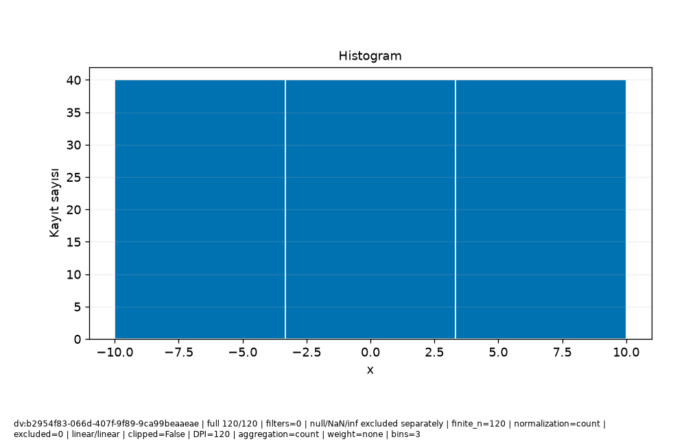

# Veri\_Ufku · Bilimsel rapor

Protokol: exploratory
Keşifsel inceleme; analiz birimi, seçim ve test kullanımını kayıtlı sonuçlarla değerlendirin.

Güncellik: Seçilen dataset/run için daha yeni kayıt bulunmadı; dış kaynağın canlı tazeliği doğrulanmadı.

Test kullanım defteri: []
Model seçim protokolü: kayıtlı method/model-card alanlarına bakın; alan yoksa not_recorded.

## Araştırma sorusu

**text**

```text
Soruyu ve analiz birimini kullanıcı olarak açıklayın.
```
**evidence**

```text
Kullanıcı metni; doğrulanmış hesap değildir.
```

## Yorum ve sınırlamalar

**text**

```text
Bulguyu yorumdan ayırın; nedensel çıkarım varsayımlarını açıkça yazın.
```
**evidence**

```text
Kullanıcı metni; doğrulanmış hesap değildir.
```

## Kaynakça


## method

**record_id**

```text
result:36508203-6601-4b0d-b98d-80d3138df523
```
**capability_id**

```text
model.regression
```
**dataset_versions**

```text
[
  "dv:b2954f83-066d-407f-9f89-9ca99beaaeae"
]
```
**run_id**

```text
run:772adb92-6aa7-47cd-bff7-681c46334b1d
```
**evidence**

```text
Kayıtlı alan projeksiyonu; yeni hesap veya otomatik yorum değildir.
```
**data**

```text
{
  "spec": {
    "availability": {
      "col:28c207ff-bc7d-4dc3-bc9d-9ed50528dd70": {
        "note": "Önceden bilinir",
        "offset_seconds": 0
      }
    },
    "baseline": "auto",
    "entity_use": "new",
    "folds": 3,
    "horizon_seconds": 0,
    "method": "auto",
    "prediction_moment": "Ölçüm öncesi",
    "seed": 42,
    "structure": "independent",
    "test_fraction": 0.2,
    "validation_fraction": 0.2
  },
  "model_card": {
    "baseline": {
      "comparison": [
        {
          "metrics": [
            {
              "averaging": "per_record",
              "coverage": "all eligible records in this evaluation partition",
              "direction": "minimize",
              "metric": "mae",
              "n": 24,
              "scope": "validation",
              "status": "valid",
              "value": 15.105042016806722
            },
            {
              "averaging": "per_record",
              "coverage": "all eligible records in this evaluation partition",
              "direction": "minimize",
              "metric": "rmse",
              "n": 24,
              "scope": "validation",
              "status": "valid",
              "value": 17.131074485116738
            },
            {
              "averaging": "per_record",
              "coverage": "all eligible records in this evaluation partition",
              "direction": "maximize",
              "metric": "r2",
              "n": 24,
              "scope": "validation",
              "status": "valid",
              "value": -0.07031033705694889
            }
          ],
          "scope": "validation"
        },
        {
          "metrics": [
            {
              "averaging": "per_record",
              "coverage": "all eligible records in this evaluation partition",
              "direction": "minimize",
              "metric": "mae",
              "n": 32,
              "scope": "cv:1",
              "status": "valid",
              "value": 16.085215336134453
            },
            {
              "averaging": "per_record",
              "coverage": "all eligible records in this evaluation partition",
              "direction": "minimize",
              "metric": "rmse",
              "n": 32,
              "scope": "cv:1",
              "status": "valid",
              "value": 17.78349866194151
            },
            {
              "averaging": "per_record",
              "coverage": "all eligible records in this evaluation partition",
              "direction": "maximize",
              "metric": "r2",
              "n": 32,
              "scope": "cv:1",
              "status": "valid",
              "value": -0.08216532968157875
            }
          ],
          "scope": "cv:1"
        },
        {
          "metrics": [
            {
              "averaging": "per_record",
              "coverage": "all eligible records in this evaluation partition",
              "direction": "minimize",
              "metric": "mae",
              "n": 32,
              "scope": "cv:2",
              "status": "valid",
              "value": 14.063484768907566
            },
            {
              "averaging": "per_record",
              "coverage": "all eligible records in this evaluation partition",
              "direction": "minimize",
              "metric": "rmse",
              "n": 32,
              "scope": "cv:2",
              "status": "valid",
              "value": 16.834420290258713
            },
            {
              "averaging": "per_record",
              "coverage": "all eligible records in this evaluation partition",
              "direction": "maximize",
              "metric": "r2",
              "n": 32,
              "scope": "cv:2",
              "status": "valid",
              "value": -0.000592538052601066
            }
          ],
          "scope": "cv:2"
        },
        {
          "metrics": [
            {
              "averaging": "per_record",
              "coverage": "all eligible records in this evaluation partition",
              "direction": "minimize",
              "metric": "mae",
              "n": 32,
              "scope": "cv:3",
              "status": "valid",
              "value": 16.882878151260506
            },
            {
              "averaging": "per_record",
              "coverage": "all eligible records in this evaluation partition",
              "direction": "minimize",
              "metric": "rmse",
              "n": 32,
              "scope": "cv:3",
              "status": "valid",
              "value": 19.037369544238533
            },
            {
              "averaging": "per_record",
              "coverage": "all eligible records in this evaluation partition",
              "direction": "maximize",
              "metric": "r2",
              "n": 32,
              "scope": "cv:3",
              "status": "valid",
              "value": -0.084358201283397
            }
          ],
          "scope": "cv:3"
        }
      ],
      "limitation": "Final koşuda yeniden baseline seçimi yapılmaz; geliştirme koşusu kartına bakın.",
      "strategy": "mean"
    },
    "candidate_selection": {
      "parameters": {
        "alpha": 1.0,
        "candidates": [
          "baseline",
          "linear",
          "ridge",
          "forest"
        ],
        "depth": 8,
        "trees": 50,
        "unit": "TL"
      },
      "rule": "minimum development CV mean MAE; ties follow candidate order",
      "selected": "linear"
    },
    "columns": [
      {
        "id": "col:28c207ff-bc7d-4dc3-bc9d-9ed50528dd70",
        "name": "x",
        "original_name": "x",
        "type": "Float64"
      },
      {
        "id": "col:98953dc5-c83b-4398-8f5c-88530ae5feab",
        "name": "y",
        "original_name": "y",
        "type": "Float64"
      }
    ],
    "dataset_version": "dv:b2954f83-066d-407f-9f89-9ca99beaaeae",
    "decision": null,
    "estimator": "LinearRegression",
    "features": [
      {
        "id": "col:28c207ff-bc7d-4dc3-bc9d-9ed50528dd70",
        "name": "x",
        "type": "Float64",
        "unit": ""
      }
    ],
    "fit_row_ids": [
      "row:6a5bce0c-1fd4-4ca4-b4e4-0b09578fe3cf",
      "row:a6d56e8c-d737-466e-89b0-007abc8827a8",
      "row:29d10365-7c93-4917-acc6-e67ec6c95429",
      "row:1b778eaa-c9ba-49b2-8110-0ed4bbb719c2",
      "row:2328b9fa-de1e-4f8a-b34b-d361944a6a0d",
      "row:6af7a211-58b8-4a34-bdd9-19170fc9932a",
      "row:31eb5fbb-4958-4705-a6e3-f49857ac1b91",
      "row:65803386-ae08-4ce4-95e3-fca729cb19e6",
      "row:726eba3c-21e4-41b4-8cbd-0c1d65b6e950",
      "row:4f99bf0f-e377-49a4-86db-77de8e0f0e6f",
      "row:6e18142b-91bd-42af-8038-3623de1636e2",
      "row:e1c88ea1-9e5f-4fdb-b82c-2992b09fa199",
      "row:c3b26a79-9887-4b53-8ab6-f7c4b27214e2",
      "row:688a1091-bcc4-4463-adb4-ccb46454ac56",
      "row:ddce861d-6ce6-4243-8161-294aa50c5d0b",
      "row:7c9e8bb2-c230-4ad2-8218-c618df85eb01",
      "row:b54cfac2-1ade-4cd5-9207-a88d02e92c95",
      "row:a51063bf-053e-416b-b0d6-428795c7f344",
      "row:a5177108-049b-44d5-a254-389a8f569366",
      "row:231a9291-70ab-4880-8df3-d57b4f7fa51f",
      "row:71f36428-720e-4829-8c77-e576fceb0d7e",
      "row:4c44e9cd-b8fa-4e55-b4f7-55f9c9a00683",
      "row:a0341c37-8fbf-41a3-af6b-eaffd85b8641",
      "row:7b572b60-e4f5-4050-b430-a73a6592197a",
      "row:49ec898c-b1bf-4563-a33d-7baccec6b3e3",
      "row:e4125fd9-9787-40d9-ae4b-2e7fdb191e5f",
      "row:6b843994-fcb7-4049-96c3-0e189ce1c58d",
      "row:d91e71b8-9b20-48f0-9371-1af5c0900cbc",
      "row:0a7a5474-8c0c-4f25-88d8-6ed906ab89d2",
      "row:3b0a1d58-af81-44e8-8d78-419f4ac1f525",
      "row:ec8ba8ad-40bc-4c6d-be06-74816c97798c",
      "row:4353e136-5436-4ac1-8473-fe316b7980c0",
      "row:498fa846-4c5e-4ce8-9fee-9701308b96e7",
      "row:86c6bdbe-0417-41ee-a3f5-22badec7b802",
      "row:30642a9c-d656-406e-a228-1b24c3a572cf",
      "row:97852b98-ab19-49c3-9824-88c96c50543f",
      "row:c46c3dd1-4036-42c5-ac63-e81d60910cf3",
      "row:0ec08ec5-6269-4eb8-8ef1-dc979cf42edb",
      "row:433226a9-39ad-4d94-9eba-177f2c772ba8",
      "row:2282121a-618e-4492-a1b8-bd79d759e8c8",
      "row:55a7a11f-0503-4f65-b699-18c6341f8a8a",
      "row:ed231448-8517-463a-a9b0-cb655a5b2783",
      "row:4cd1ca0c-df68-43dd-a206-c074b07fe1bb",
      "row:df94469d-0df9-4d9d-9413-378af6ca2b80",
      "row:bb98b51a-b49b-47de-b086-4bfc249f7e06",
      "row:895890ba-43b7-4f43-b811-22fb63de611a",
      "row:8dc47c09-5fcd-4531-b871-4a6c93af184b",
      "row:0c60019b-b833-45ac-87cd-495fefdd253f",
      "row:3c9d333a-1d17-407c-9d46-a637a8d85214",
      "row:73eb5ed6-e34b-480e-86cb-54f282bd41a9",
      "row:4ae6b946-43b6-4188-9988-5c06a2214bbb",
      "row:5c64220e-ec8d-4fdb-b54f-d21a13fb882d",
      "row:dbe42591-1c08-4092-9f8b-6c2ca4ca16cb",
      "row:3cc62e16-5056-4d6f-a0a8-46d9aefb7b4e",
      "row:988fae22-5503-4e4e-be11-25270bbafc89",
      "row:01254194-6376-43bd-9e07-e6caf1cd64da",
      "row:53fe4982-bf1b-4c7f-994b-1c92f805d78c",
      "row:01653a76-6210-4c0a-807c-7237a1b0cc99",
      "row:55822ac1-e0e4-4a46-8a5d-91fd771c6270",
      "row:7cb3d55e-7202-4729-a6da-eca2382b6758",
      "row:cb6e8d44-74d4-40b7-ba7b-ec8035efa853",
      "row:3b3822f1-6aa1-45be-8588-360d778802c8",
      "row:8fe20bf6-0df4-4ccb-8244-d9cc6a7b2c54",
      "row:ce287955-8932-42be-be6c-f22ebeb98c68",
      "row:eefa8952-8085-4677-a5bf-fb5ce888e42b",
      "row:5a069843-2d8a-4d8c-9075-2d3f9abd7540",
      "row:8b7132cd-66a4-42dc-89df-9168978aebd0",
      "row:afdb501e-4d12-47ea-aab0-aea1d0a31dbf",
      "row:1285c01e-bc26-46e0-a039-bf1555056d84",
      "row:d220c33b-ae03-4fa1-85a0-529b84bd6ff2",
      "row:7980da0a-392f-42a4-ab02-0e0fdcbf6055",
      "row:1f25a6c5-91bf-492e-9962-0dff743890b0"
    ],
    "fit_scope": "development_train; validation previously used for selection",
    "fitted_preprocessing": {
      "1": {
        "kind": "impute_numeric",
        "statistics": [
          1.344537815126051
        ]
      },
      "2": {
        "kind": "standard_scale",
        "mean": [
          0.6092436974789925
        ],
        "scale": [
          5.948272597687973
        ]
      }
    },
    "importance": {
      "limitation": "İlişkili değişkenler önemi paylaşır/gizler; negatif önem mümkün. Nedensellik değildir; final test kullanılmadı.",
      "metric": "negative_MAE",
      "repeats": 3,
      "row_ids": [
        "row:1cc15c31-2d22-42b8-aae6-6d07643c8d35",
        "row:a8a3b4b0-b173-464d-9b7f-67258e3f9b2c",
        "row:57ed73fa-94b8-4538-bf7a-c38f45a05534",
        "row:79e33371-5144-4fc2-a53f-7a2a7cd2adfa",
        "row:15dd2320-5d73-49e0-b52c-63e95db17ff3",
        "row:a22ca1c6-be9b-4cc4-83bc-2b05c31c555a",
        "row:5b674459-a8d0-42c9-8de1-113aefc1c791",
        "row:d9567fa3-3766-46c1-abe5-c514dc54b2db",
        "row:1d5ae5bb-47b8-41af-8591-eddcc767eb10",
        "row:06537baf-46b5-438d-8583-83b0c20e173e",
        "row:c87df406-3042-4fa5-8143-60ff72ae6fa6",
        "row:2e97bef5-cea8-4487-be70-c865d66c8760",
        "row:e12a9e69-e331-47c9-85c1-c81b9b9de751",
        "row:39fbc83b-5bd7-41f8-a1d8-3e14926d5be1",
        "row:21ce652e-d92c-46ce-b696-fe8f24cd8412",
        "row:f62b2bf3-a153-4a6f-866a-5029d73decb3",
        "row:88acca33-ad41-4c4c-966d-8a9d00ad44c5",
        "row:3b1c5822-1f4b-407b-b642-94463f7b241a",
        "row:4d200d62-6b13-44dc-b90f-d18ec920194b",
        "row:253a3b64-e43c-4faa-b4bb-11aba2e4bfc4",
        "row:a0792b44-2760-49ac-b256-ac8f4835be6d",
        "row:a7f76267-5ec8-4298-8250-e22d01083f2a",
        "row:fccb1385-dfa0-4613-9737-2be9726777be",
        "row:6067e4fd-bed1-4a6a-913e-8d5e5ca8f1cf"
      ],
      "scope": "validation; exploratory; already used for model/threshold selection",
      "seed": 42,
      "status": "available",
      "values": [
        {
          "column_id": "col:28c207ff-bc7d-4dc3-bc9d-9ed50528dd70",
          "mean": 19.523809523809522,
          "name": "x",
          "std": 2.038091850261204
        }
      ]
    },
    "label_order": [],
    "limitations": "Katsayı ve önemler nedensel etki değildir. İlişkili özellikler önemi paylaşabilir veya gizleyebilir. Yeni veri dağılımı değişebilir; olasılık kesinlik veya kalibrasyon garantisi değildir. Küme ve anomali adayları gerçek sınıf/veri hatası değildir; otomatik silme yok.",
    "method": null,
    "metrics": [
      {
        "evaluation_n": 24,
        "metrics": [
          {
            "averaging": "per_record",
            "coverage": "all eligible records in this evaluation partition",
            "direction": "minimize",
            "metric": "mae",
            "n": 24,
            "scope": "validation",
            "status": "valid",
            "value": 4.810966440042345e-15
          },
          {
            "averaging": "per_record",
            "coverage": "all eligible records in this evaluation partition",
            "direction": "minimize",
            "metric": "rmse",
            "n": 24,
            "scope": "validation",
            "status": "valid",
            "value": 5.582114810376975e-15
          },
          {
            "averaging": "per_record",
            "coverage": "all eligible records in this evaluation partition",
            "direction": "maximize",
            "metric": "r2",
            "n": 24,
            "scope": "validation",
            "status": "valid",
            "value": 1.0
          }
        ],
        "scope": "validation",
        "status": "valid",
        "train_n": 72
      },
      {
        "evaluation_n": 32,
        "metrics": [
          {
            "averaging": "per_record",
            "coverage": "all eligible records in this evaluation partition",
            "direction": "minimize",
            "metric": "mae",
            "n": 32,
            "scope": "cv:1",
            "status": "valid",
            "value": 1.3877787807814457e-15
          },
          {
            "averaging": "per_record",
            "coverage": "all eligible records in this evaluation partition",
            "direction": "minimize",
            "metric": "rmse",
            "n": 32,
            "scope": "cv:1",
            "status": "valid",
            "value": 2.1413206232596582e-15
          },
          {
            "averaging": "per_record",
            "coverage": "all eligible records in this evaluation partition",
            "direction": "maximize",
            "metric": "r2",
            "n": 32,
            "scope": "cv:1",
            "status": "valid",
            "value": 1.0
          }
        ],
        "scope": "cv:1",
        "status": "valid",
        "train_n": 64
      },
      {
        "evaluation_n": 32,
        "metrics": [
          {
            "averaging": "per_record",
            "coverage": "all eligible records in this evaluation partition",
            "direction": "minimize",
            "metric": "mae",
            "n": 32,
            "scope": "cv:2",
            "status": "valid",
            "value": 5.828670879282072e-15
          },
          {
            "averaging": "per_record",
            "coverage": "all eligible records in this evaluation partition",
            "direction": "minimize",
            "metric": "rmse",
            "n": 32,
            "scope": "cv:2",
            "status": "valid",
            "value": 7.320740245935003e-15
          },
          {
            "averaging": "per_record",
            "coverage": "all eligible records in this evaluation partition",
            "direction": "maximize",
            "metric": "r2",
            "n": 32,
            "scope": "cv:2",
            "status": "valid",
            "value": 1.0
          }
        ],
        "scope": "cv:2",
        "status": "valid",
        "train_n": 64
      },
      {
        "evaluation_n": 32,
        "metrics": [
          {
            "averaging": "per_record",
            "coverage": "all eligible records in this evaluation partition",
            "direction": "minimize",
            "metric": "mae",
            "n": 32,
            "scope": "cv:3",
            "status": "valid",
            "value": 1.915134717478395e-15
          },
          {
            "averaging": "per_record",
            "coverage": "all eligible records in this evaluation partition",
            "direction": "minimize",
            "metric": "rmse",
            "n": 32,
            "scope": "cv:3",
            "status": "valid",
            "value": 2.687565378447544e-15
          },
          {
            "averaging": "per_record",
            "coverage": "all eligible records in this evaluation partition",
            "direction": "maximize",
            "metric": "r2",
            "n": 32,
            "scope": "cv:3",
            "status": "valid",
            "value": 1.0
          }
        ],
        "scope": "cv:3",
        "status": "valid",
        "train_n": 64
      }
    ],
    "preparation_spec": {
      "allow_identifiers": false,
      "categorical_imputation": "most_frequent",
      "date_features": true,
      "encoding": "onehot",
      "family": "linear",
      "features": [
        "col:28c207ff-bc7d-4dc3-bc9d-9ed50528dd70"
      ],
      "group": "",
      "history_action": "review",
      "history_note": "",
      "invalid_numeric": "reject",
      "numeric_imputation": "median",
      "precision": "reject",
      "prediction_context": "",
      "purpose": "regression",
      "scaling": "standard",
      "selection": "none",
      "source_version": "dv:b2954f83-066d-407f-9f89-9ca99beaaeae",
      "target": "col:98953dc5-c83b-4398-8f5c-88530ae5feab",
      "time": ""
    },
    "preprocessing": {
      "category_vocabulary": null,
      "column_lineage": [
        {
          "category_map": [],
          "input_column_id": "col:28c207ff-bc7d-4dc3-bc9d-9ed50528dd70",
          "names_status": "structurally_known",
          "output_names": [
            "f_28c207ffbc7d4dc3bc9d9ed50528dd70__numeric"
          ],
          "selected_after_fit": "all_planned",
          "source_dtype": "Float64",
          "source_name": "x"
        }
      ],
      "estimator_family": "linear",
      "feature_selection_mask": null,
      "fit_state": "not_fitted",
      "fitted_parameters": {},
      "schema": "PreparationPlan/v1",
      "steps": [
        {
          "input_column_ids": [
            "col:28c207ff-bc7d-4dc3-bc9d-9ed50528dd70"
          ],
          "kind": "numeric",
          "learned_scope": "row_local",
          "output_names": [
            "f_28c207ffbc7d4dc3bc9d9ed50528dd70__numeric"
          ],
          "parameters": {
            "nonfinite": "reject",
            "precision": "reject"
          },
          "reason": "Kimlik ölçüm değildir; Float64 kaybı gelecekte açık politika ile denetlenir.",
          "state": "planned"
        },
        {
          "input_column_ids": [
            "col:28c207ff-bc7d-4dc3-bc9d-9ed50528dd70"
          ],
          "kind": "impute_numeric",
          "learned_scope": "training_fold",
          "output_names": [
            "f_28c207ffbc7d4dc3bc9d9ed50528dd70__numeric"
          ],
          "parameters": {
            "all_missing": "error",
            "strategy": "median"
          },
          "reason": "Seçilen doldurma değeri yalnız eğitim katında öğrenilir; test/validation ortalaması kullanılmaz.",
          "state": "planned"
        },
        {
          "input_column_ids": [
            "col:28c207ff-bc7d-4dc3-bc9d-9ed50528dd70"
          ],
          "kind": "standard_scale",
          "learned_scope": "training_fold",
          "output_names": [
            "f_28c207ffbc7d4dc3bc9d9ed50528dd70__numeric"
          ],
          "parameters": {
            "explicit_override": false
          },
          "reason": "Uzaklıklar ve düzenlileştirilmiş doğrusal modeller ölçüm ölçeğine duyarlıdır; eğitim katında standardizasyon planlandı.",
          "state": "planned"
        }
      ],
      "training_dependency": "Requires a validated split/fold protocol in Phase16; no training performed",
      "version_id": "ml-pipeline:eea14db5-a619-403e-acb6-8f286dafceeb"
    },
    "probability_supported": false,
    "purpose": "regression",
    "run_id": "run:772adb92-6aa7-47cd-bff7-681c46334b1d",
    "schema": "ModelCard/v1",
    "seed": 42,
    "snapshot_fingerprint": {
      "sha256": "2539417c26ef4af19e77750b3d851c5206d8276433d5f73029c18d24ed75e639",
      "size": 11599
    },
    "split": {
      "invalid_folds": [],
      "membership": {
        "development": [
          "row:01254194-6376-43bd-9e07-e6caf1cd64da",
          "row:01653a76-6210-4c0a-807c-7237a1b0cc99",
          "row:06537baf-46b5-438d-8583-83b0c20e173e",
          "row:0a7a5474-8c0c-4f25-88d8-6ed906ab89d2",
          "row:0c60019b-b833-45ac-87cd-495fefdd253f",
          "row:0ec08ec5-6269-4eb8-8ef1-dc979cf42edb",
          "row:1285c01e-bc26-46e0-a039-bf1555056d84",
          "row:15dd2320-5d73-49e0-b52c-63e95db17ff3",
          "row:1b778eaa-c9ba-49b2-8110-0ed4bbb719c2",
          "row:1cc15c31-2d22-42b8-aae6-6d07643c8d35",
          "row:1d5ae5bb-47b8-41af-8591-eddcc767eb10",
          "row:1f25a6c5-91bf-492e-9962-0dff743890b0",
          "row:21ce652e-d92c-46ce-b696-fe8f24cd8412",
          "row:2282121a-618e-4492-a1b8-bd79d759e8c8",
          "row:231a9291-70ab-4880-8df3-d57b4f7fa51f",
          "row:2328b9fa-de1e-4f8a-b34b-d361944a6a0d",
          "row:253a3b64-e43c-4faa-b4bb-11aba2e4bfc4",
          "row:29d10365-7c93-4917-acc6-e67ec6c95429",
          "row:2e97bef5-cea8-4487-be70-c865d66c8760",
          "row:30642a9c-d656-406e-a228-1b24c3a572cf",
          "row:31eb5fbb-4958-4705-a6e3-f49857ac1b91",
          "row:39fbc83b-5bd7-41f8-a1d8-3e14926d5be1",
          "row:3b0a1d58-af81-44e8-8d78-419f4ac1f525",
          "row:3b1c5822-1f4b-407b-b642-94463f7b241a",
          "row:3b3822f1-6aa1-45be-8588-360d778802c8",
          "row:3c9d333a-1d17-407c-9d46-a637a8d85214",
          "row:3cc62e16-5056-4d6f-a0a8-46d9aefb7b4e",
          "row:433226a9-39ad-4d94-9eba-177f2c772ba8",
          "row:4353e136-5436-4ac1-8473-fe316b7980c0",
          "row:498fa846-4c5e-4ce8-9fee-9701308b96e7",
          "row:49ec898c-b1bf-4563-a33d-7baccec6b3e3",
          "row:4ae6b946-43b6-4188-9988-5c06a2214bbb",
          "row:4c44e9cd-b8fa-4e55-b4f7-55f9c9a00683",
          "row:4cd1ca0c-df68-43dd-a206-c074b07fe1bb",
          "row:4d200d62-6b13-44dc-b90f-d18ec920194b",
          "row:4f99bf0f-e377-49a4-86db-77de8e0f0e6f",
          "row:53fe4982-bf1b-4c7f-994b-1c92f805d78c",
          "row:55822ac1-e0e4-4a46-8a5d-91fd771c6270",
          "row:55a7a11f-0503-4f65-b699-18c6341f8a8a",
          "row:57ed73fa-94b8-4538-bf7a-c38f45a05534",
          "row:5a069843-2d8a-4d8c-9075-2d3f9abd7540",
          "row:5b674459-a8d0-42c9-8de1-113aefc1c791",
          "row:5c64220e-ec8d-4fdb-b54f-d21a13fb882d",
          "row:6067e4fd-bed1-4a6a-913e-8d5e5ca8f1cf",
          "row:65803386-ae08-4ce4-95e3-fca729cb19e6",
          "row:688a1091-bcc4-4463-adb4-ccb46454ac56",
          "row:6a5bce0c-1fd4-4ca4-b4e4-0b09578fe3cf",
          "row:6af7a211-58b8-4a34-bdd9-19170fc9932a",
          "row:6b843994-fcb7-4049-96c3-0e189ce1c58d",
          "row:6e18142b-91bd-42af-8038-3623de1636e2",
          "row:71f36428-720e-4829-8c77-e576fceb0d7e",
          "row:726eba3c-21e4-41b4-8cbd-0c1d65b6e950",
          "row:73eb5ed6-e34b-480e-86cb-54f282bd41a9",
          "row:7980da0a-392f-42a4-ab02-0e0fdcbf6055",
          "row:79e33371-5144-4fc2-a53f-7a2a7cd2adfa",
          "row:7b572b60-e4f5-4050-b430-a73a6592197a",
          "row:7c9e8bb2-c230-4ad2-8218-c618df85eb01",
          "row:7cb3d55e-7202-4729-a6da-eca2382b6758",
          "row:86c6bdbe-0417-41ee-a3f5-22badec7b802",
          "row:88acca33-ad41-4c4c-966d-8a9d00ad44c5",
          "row:895890ba-43b7-4f43-b811-22fb63de611a",
          "row:8b7132cd-66a4-42dc-89df-9168978aebd0",
          "row:8dc47c09-5fcd-4531-b871-4a6c93af184b",
          "row:8fe20bf6-0df4-4ccb-8244-d9cc6a7b2c54",
          "row:97852b98-ab19-49c3-9824-88c96c50543f",
          "row:988fae22-5503-4e4e-be11-25270bbafc89",
          "row:a0341c37-8fbf-41a3-af6b-eaffd85b8641",
          "row:a0792b44-2760-49ac-b256-ac8f4835be6d",
          "row:a22ca1c6-be9b-4cc4-83bc-2b05c31c555a",
          "row:a51063bf-053e-416b-b0d6-428795c7f344",
          "row:a5177108-049b-44d5-a254-389a8f569366",
          "row:a6d56e8c-d737-466e-89b0-007abc8827a8",
          "row:a7f76267-5ec8-4298-8250-e22d01083f2a",
          "row:a8a3b4b0-b173-464d-9b7f-67258e3f9b2c",
          "row:afdb501e-4d12-47ea-aab0-aea1d0a31dbf",
          "row:b54cfac2-1ade-4cd5-9207-a88d02e92c95",
          "row:bb98b51a-b49b-47de-b086-4bfc249f7e06",
          "row:c3b26a79-9887-4b53-8ab6-f7c4b27214e2",
          "row:c46c3dd1-4036-42c5-ac63-e81d60910cf3",
          "row:c87df406-3042-4fa5-8143-60ff72ae6fa6",
          "row:cb6e8d44-74d4-40b7-ba7b-ec8035efa853",
          "row:ce287955-8932-42be-be6c-f22ebeb98c68",
          "row:d220c33b-ae03-4fa1-85a0-529b84bd6ff2",
          "row:d91e71b8-9b20-48f0-9371-1af5c0900cbc",
          "row:d9567fa3-3766-46c1-abe5-c514dc54b2db",
          "row:dbe42591-1c08-4092-9f8b-6c2ca4ca16cb",
          "row:ddce861d-6ce6-4243-8161-294aa50c5d0b",
          "row:df94469d-0df9-4d9d-9413-378af6ca2b80",
          "row:e12a9e69-e331-47c9-85c1-c81b9b9de751",
          "row:e1c88ea1-9e5f-4fdb-b82c-2992b09fa199",
          "row:e4125fd9-9787-40d9-ae4b-2e7fdb191e5f",
          "row:ec8ba8ad-40bc-4c6d-be06-74816c97798c",
          "row:ed231448-8517-463a-a9b0-cb655a5b2783",
          "row:eefa8952-8085-4677-a5bf-fb5ce888e42b",
          "row:f62b2bf3-a153-4a6f-866a-5029d73decb3",
          "row:fccb1385-dfa0-4613-9737-2be9726777be"
        ],
        "folds": [
          {
            "status": "valid",
            "train": [
              "row:01254194-6376-43bd-9e07-e6caf1cd64da",
              "row:01653a76-6210-4c0a-807c-7237a1b0cc99",
              "row:0a7a5474-8c0c-4f25-88d8-6ed906ab89d2",
              "row:0c60019b-b833-45ac-87cd-495fefdd253f",
              "row:0ec08ec5-6269-4eb8-8ef1-dc979cf42edb",
              "row:1285c01e-bc26-46e0-a039-bf1555056d84",
              "row:1f25a6c5-91bf-492e-9962-0dff743890b0",
              "row:2282121a-618e-4492-a1b8-bd79d759e8c8",
              "row:231a9291-70ab-4880-8df3-d57b4f7fa51f",
              "row:30642a9c-d656-406e-a228-1b24c3a572cf",
              "row:3b0a1d58-af81-44e8-8d78-419f4ac1f525",
              "row:3b3822f1-6aa1-45be-8588-360d778802c8",
              "row:3c9d333a-1d17-407c-9d46-a637a8d85214",
              "row:3cc62e16-5056-4d6f-a0a8-46d9aefb7b4e",
              "row:433226a9-39ad-4d94-9eba-177f2c772ba8",
              "row:4353e136-5436-4ac1-8473-fe316b7980c0",
              "row:498fa846-4c5e-4ce8-9fee-9701308b96e7",
              "row:49ec898c-b1bf-4563-a33d-7baccec6b3e3",
              "row:4ae6b946-43b6-4188-9988-5c06a2214bbb",
              "row:4c44e9cd-b8fa-4e55-b4f7-55f9c9a00683",
              "row:4cd1ca0c-df68-43dd-a206-c074b07fe1bb",
              "row:4f99bf0f-e377-49a4-86db-77de8e0f0e6f",
              "row:53fe4982-bf1b-4c7f-994b-1c92f805d78c",
              "row:55822ac1-e0e4-4a46-8a5d-91fd771c6270",
              "row:55a7a11f-0503-4f65-b699-18c6341f8a8a",
              "row:5a069843-2d8a-4d8c-9075-2d3f9abd7540",
              "row:5c64220e-ec8d-4fdb-b54f-d21a13fb882d",
              "row:688a1091-bcc4-4463-adb4-ccb46454ac56",
              "row:6b843994-fcb7-4049-96c3-0e189ce1c58d",
              "row:6e18142b-91bd-42af-8038-3623de1636e2",
              "row:71f36428-720e-4829-8c77-e576fceb0d7e",
              "row:726eba3c-21e4-41b4-8cbd-0c1d65b6e950",
              "row:73eb5ed6-e34b-480e-86cb-54f282bd41a9",
              "row:7980da0a-392f-42a4-ab02-0e0fdcbf6055",
              "row:7b572b60-e4f5-4050-b430-a73a6592197a",
              "row:7c9e8bb2-c230-4ad2-8218-c618df85eb01",
              "row:7cb3d55e-7202-4729-a6da-eca2382b6758",
              "row:86c6bdbe-0417-41ee-a3f5-22badec7b802",
              "row:895890ba-43b7-4f43-b811-22fb63de611a",
              "row:8b7132cd-66a4-42dc-89df-9168978aebd0",
              "row:8dc47c09-5fcd-4531-b871-4a6c93af184b",
              "row:8fe20bf6-0df4-4ccb-8244-d9cc6a7b2c54",
              "row:97852b98-ab19-49c3-9824-88c96c50543f",
              "row:988fae22-5503-4e4e-be11-25270bbafc89",
              "row:a0341c37-8fbf-41a3-af6b-eaffd85b8641",
              "row:a51063bf-053e-416b-b0d6-428795c7f344",
              "row:a5177108-049b-44d5-a254-389a8f569366",
              "row:afdb501e-4d12-47ea-aab0-aea1d0a31dbf",
              "row:b54cfac2-1ade-4cd5-9207-a88d02e92c95",
              "row:bb98b51a-b49b-47de-b086-4bfc249f7e06",
              "row:c3b26a79-9887-4b53-8ab6-f7c4b27214e2",
              "row:c46c3dd1-4036-42c5-ac63-e81d60910cf3",
              "row:cb6e8d44-74d4-40b7-ba7b-ec8035efa853",
              "row:ce287955-8932-42be-be6c-f22ebeb98c68",
              "row:d220c33b-ae03-4fa1-85a0-529b84bd6ff2",
              "row:d91e71b8-9b20-48f0-9371-1af5c0900cbc",
              "row:dbe42591-1c08-4092-9f8b-6c2ca4ca16cb",
              "row:ddce861d-6ce6-4243-8161-294aa50c5d0b",
              "row:df94469d-0df9-4d9d-9413-378af6ca2b80",
              "row:e1c88ea1-9e5f-4fdb-b82c-2992b09fa199",
              "row:e4125fd9-9787-40d9-ae4b-2e7fdb191e5f",
              "row:ec8ba8ad-40bc-4c6d-be06-74816c97798c",
              "row:ed231448-8517-463a-a9b0-cb655a5b2783",
              "row:eefa8952-8085-4677-a5bf-fb5ce888e42b"
            ],
            "validation": [
              "row:06537baf-46b5-438d-8583-83b0c20e173e",
              "row:15dd2320-5d73-49e0-b52c-63e95db17ff3",
              "row:1b778eaa-c9ba-49b2-8110-0ed4bbb719c2",
              "row:1cc15c31-2d22-42b8-aae6-6d07643c8d35",
              "row:1d5ae5bb-47b8-41af-8591-eddcc767eb10",
              "row:21ce652e-d92c-46ce-b696-fe8f24cd8412",
              "row:2328b9fa-de1e-4f8a-b34b-d361944a6a0d",
              "row:253a3b64-e43c-4faa-b4bb-11aba2e4bfc4",
              "row:29d10365-7c93-4917-acc6-e67ec6c95429",
              "row:2e97bef5-cea8-4487-be70-c865d66c8760",
              "row:31eb5fbb-4958-4705-a6e3-f49857ac1b91",
              "row:39fbc83b-5bd7-41f8-a1d8-3e14926d5be1",
              "row:3b1c5822-1f4b-407b-b642-94463f7b241a",
              "row:4d200d62-6b13-44dc-b90f-d18ec920194b",
              "row:57ed73fa-94b8-4538-bf7a-c38f45a05534",
              "row:5b674459-a8d0-42c9-8de1-113aefc1c791",
              "row:6067e4fd-bed1-4a6a-913e-8d5e5ca8f1cf",
              "row:65803386-ae08-4ce4-95e3-fca729cb19e6",
              "row:6a5bce0c-1fd4-4ca4-b4e4-0b09578fe3cf",
              "row:6af7a211-58b8-4a34-bdd9-19170fc9932a",
              "row:79e33371-5144-4fc2-a53f-7a2a7cd2adfa",
              "row:88acca33-ad41-4c4c-966d-8a9d00ad44c5",
              "row:a0792b44-2760-49ac-b256-ac8f4835be6d",
              "row:a22ca1c6-be9b-4cc4-83bc-2b05c31c555a",
              "row:a6d56e8c-d737-466e-89b0-007abc8827a8",
              "row:a7f76267-5ec8-4298-8250-e22d01083f2a",
              "row:a8a3b4b0-b173-464d-9b7f-67258e3f9b2c",
              "row:c87df406-3042-4fa5-8143-60ff72ae6fa6",
              "row:d9567fa3-3766-46c1-abe5-c514dc54b2db",
              "row:e12a9e69-e331-47c9-85c1-c81b9b9de751",
              "row:f62b2bf3-a153-4a6f-866a-5029d73decb3",
              "row:fccb1385-dfa0-4613-9737-2be9726777be"
            ]
          },
          {
            "status": "valid",
            "train": [
              "row:01254194-6376-43bd-9e07-e6caf1cd64da",
              "row:01653a76-6210-4c0a-807c-7237a1b0cc99",
              "row:06537baf-46b5-438d-8583-83b0c20e173e",
              "row:0c60019b-b833-45ac-87cd-495fefdd253f",
              "row:1285c01e-bc26-46e0-a039-bf1555056d84",
              "row:15dd2320-5d73-49e0-b52c-63e95db17ff3",
              "row:1b778eaa-c9ba-49b2-8110-0ed4bbb719c2",
              "row:1cc15c31-2d22-42b8-aae6-6d07643c8d35",
              "row:1d5ae5bb-47b8-41af-8591-eddcc767eb10",
              "row:1f25a6c5-91bf-492e-9962-0dff743890b0",
              "row:21ce652e-d92c-46ce-b696-fe8f24cd8412",
              "row:2328b9fa-de1e-4f8a-b34b-d361944a6a0d",
              "row:253a3b64-e43c-4faa-b4bb-11aba2e4bfc4",
              "row:29d10365-7c93-4917-acc6-e67ec6c95429",
              "row:2e97bef5-cea8-4487-be70-c865d66c8760",
              "row:31eb5fbb-4958-4705-a6e3-f49857ac1b91",
              "row:39fbc83b-5bd7-41f8-a1d8-3e14926d5be1",
              "row:3b1c5822-1f4b-407b-b642-94463f7b241a",
              "row:3b3822f1-6aa1-45be-8588-360d778802c8",
              "row:3c9d333a-1d17-407c-9d46-a637a8d85214",
              "row:3cc62e16-5056-4d6f-a0a8-46d9aefb7b4e",
              "row:4ae6b946-43b6-4188-9988-5c06a2214bbb",
              "row:4cd1ca0c-df68-43dd-a206-c074b07fe1bb",
              "row:4d200d62-6b13-44dc-b90f-d18ec920194b",
              "row:53fe4982-bf1b-4c7f-994b-1c92f805d78c",
              "row:55822ac1-e0e4-4a46-8a5d-91fd771c6270",
              "row:55a7a11f-0503-4f65-b699-18c6341f8a8a",
              "row:57ed73fa-94b8-4538-bf7a-c38f45a05534",
              "row:5a069843-2d8a-4d8c-9075-2d3f9abd7540",
              "row:5b674459-a8d0-42c9-8de1-113aefc1c791",
              "row:5c64220e-ec8d-4fdb-b54f-d21a13fb882d",
              "row:6067e4fd-bed1-4a6a-913e-8d5e5ca8f1cf",
              "row:65803386-ae08-4ce4-95e3-fca729cb19e6",
              "row:6a5bce0c-1fd4-4ca4-b4e4-0b09578fe3cf",
              "row:6af7a211-58b8-4a34-bdd9-19170fc9932a",
              "row:73eb5ed6-e34b-480e-86cb-54f282bd41a9",
              "row:7980da0a-392f-42a4-ab02-0e0fdcbf6055",
              "row:79e33371-5144-4fc2-a53f-7a2a7cd2adfa",
              "row:7cb3d55e-7202-4729-a6da-eca2382b6758",
              "row:88acca33-ad41-4c4c-966d-8a9d00ad44c5",
              "row:895890ba-43b7-4f43-b811-22fb63de611a",
              "row:8b7132cd-66a4-42dc-89df-9168978aebd0",
              "row:8dc47c09-5fcd-4531-b871-4a6c93af184b",
              "row:8fe20bf6-0df4-4ccb-8244-d9cc6a7b2c54",
              "row:988fae22-5503-4e4e-be11-25270bbafc89",
              "row:a0792b44-2760-49ac-b256-ac8f4835be6d",
              "row:a22ca1c6-be9b-4cc4-83bc-2b05c31c555a",
              "row:a6d56e8c-d737-466e-89b0-007abc8827a8",
              "row:a7f76267-5ec8-4298-8250-e22d01083f2a",
              "row:a8a3b4b0-b173-464d-9b7f-67258e3f9b2c",
              "row:afdb501e-4d12-47ea-aab0-aea1d0a31dbf",
              "row:bb98b51a-b49b-47de-b086-4bfc249f7e06",
              "row:c87df406-3042-4fa5-8143-60ff72ae6fa6",
              "row:cb6e8d44-74d4-40b7-ba7b-ec8035efa853",
              "row:ce287955-8932-42be-be6c-f22ebeb98c68",
              "row:d220c33b-ae03-4fa1-85a0-529b84bd6ff2",
              "row:d9567fa3-3766-46c1-abe5-c514dc54b2db",
              "row:dbe42591-1c08-4092-9f8b-6c2ca4ca16cb",
              "row:df94469d-0df9-4d9d-9413-378af6ca2b80",
              "row:e12a9e69-e331-47c9-85c1-c81b9b9de751",
              "row:ed231448-8517-463a-a9b0-cb655a5b2783",
              "row:eefa8952-8085-4677-a5bf-fb5ce888e42b",
              "row:f62b2bf3-a153-4a6f-866a-5029d73decb3",
              "row:fccb1385-dfa0-4613-9737-2be9726777be"
            ],
            "validation": [
              "row:0a7a5474-8c0c-4f25-88d8-6ed906ab89d2",
              "row:0ec08ec5-6269-4eb8-8ef1-dc979cf42edb",
              "row:2282121a-618e-4492-a1b8-bd79d759e8c8",
              "row:231a9291-70ab-4880-8df3-d57b4f7fa51f",
              "row:30642a9c-d656-406e-a228-1b24c3a572cf",
              "row:3b0a1d58-af81-44e8-8d78-419f4ac1f525",
              "row:433226a9-39ad-4d94-9eba-177f2c772ba8",
              "row:4353e136-5436-4ac1-8473-fe316b7980c0",
              "row:498fa846-4c5e-4ce8-9fee-9701308b96e7",
              "row:49ec898c-b1bf-4563-a33d-7baccec6b3e3",
              "row:4c44e9cd-b8fa-4e55-b4f7-55f9c9a00683",
              "row:4f99bf0f-e377-49a4-86db-77de8e0f0e6f",
              "row:688a1091-bcc4-4463-adb4-ccb46454ac56",
              "row:6b843994-fcb7-4049-96c3-0e189ce1c58d",
              "row:6e18142b-91bd-42af-8038-3623de1636e2",
              "row:71f36428-720e-4829-8c77-e576fceb0d7e",
              "row:726eba3c-21e4-41b4-8cbd-0c1d65b6e950",
              "row:7b572b60-e4f5-4050-b430-a73a6592197a",
              "row:7c9e8bb2-c230-4ad2-8218-c618df85eb01",
              "row:86c6bdbe-0417-41ee-a3f5-22badec7b802",
              "row:97852b98-ab19-49c3-9824-88c96c50543f",
              "row:a0341c37-8fbf-41a3-af6b-eaffd85b8641",
              "row:a51063bf-053e-416b-b0d6-428795c7f344",
              "row:a5177108-049b-44d5-a254-389a8f569366",
              "row:b54cfac2-1ade-4cd5-9207-a88d02e92c95",
              "row:c3b26a79-9887-4b53-8ab6-f7c4b27214e2",
              "row:c46c3dd1-4036-42c5-ac63-e81d60910cf3",
              "row:d91e71b8-9b20-48f0-9371-1af5c0900cbc",
              "row:ddce861d-6ce6-4243-8161-294aa50c5d0b",
              "row:e1c88ea1-9e5f-4fdb-b82c-2992b09fa199",
              "row:e4125fd9-9787-40d9-ae4b-2e7fdb191e5f",
              "row:ec8ba8ad-40bc-4c6d-be06-74816c97798c"
            ]
          },
          {
            "status": "valid",
            "train": [
              "row:06537baf-46b5-438d-8583-83b0c20e173e",
              "row:0a7a5474-8c0c-4f25-88d8-6ed906ab89d2",
              "row:0ec08ec5-6269-4eb8-8ef1-dc979cf42edb",
              "row:15dd2320-5d73-49e0-b52c-63e95db17ff3",
              "row:1b778eaa-c9ba-49b2-8110-0ed4bbb719c2",
              "row:1cc15c31-2d22-42b8-aae6-6d07643c8d35",
              "row:1d5ae5bb-47b8-41af-8591-eddcc767eb10",
              "row:21ce652e-d92c-46ce-b696-fe8f24cd8412",
              "row:2282121a-618e-4492-a1b8-bd79d759e8c8",
              "row:231a9291-70ab-4880-8df3-d57b4f7fa51f",
              "row:2328b9fa-de1e-4f8a-b34b-d361944a6a0d",
              "row:253a3b64-e43c-4faa-b4bb-11aba2e4bfc4",
              "row:29d10365-7c93-4917-acc6-e67ec6c95429",
              "row:2e97bef5-cea8-4487-be70-c865d66c8760",
              "row:30642a9c-d656-406e-a228-1b24c3a572cf",
              "row:31eb5fbb-4958-4705-a6e3-f49857ac1b91",
              "row:39fbc83b-5bd7-41f8-a1d8-3e14926d5be1",
              "row:3b0a1d58-af81-44e8-8d78-419f4ac1f525",
              "row:3b1c5822-1f4b-407b-b642-94463f7b241a",
              "row:433226a9-39ad-4d94-9eba-177f2c772ba8",
              "row:4353e136-5436-4ac1-8473-fe316b7980c0",
              "row:498fa846-4c5e-4ce8-9fee-9701308b96e7",
              "row:49ec898c-b1bf-4563-a33d-7baccec6b3e3",
              "row:4c44e9cd-b8fa-4e55-b4f7-55f9c9a00683",
              "row:4d200d62-6b13-44dc-b90f-d18ec920194b",
              "row:4f99bf0f-e377-49a4-86db-77de8e0f0e6f",
              "row:57ed73fa-94b8-4538-bf7a-c38f45a05534",
              "row:5b674459-a8d0-42c9-8de1-113aefc1c791",
              "row:6067e4fd-bed1-4a6a-913e-8d5e5ca8f1cf",
              "row:65803386-ae08-4ce4-95e3-fca729cb19e6",
              "row:688a1091-bcc4-4463-adb4-ccb46454ac56",
              "row:6a5bce0c-1fd4-4ca4-b4e4-0b09578fe3cf",
              "row:6af7a211-58b8-4a34-bdd9-19170fc9932a",
              "row:6b843994-fcb7-4049-96c3-0e189ce1c58d",
              "row:6e18142b-91bd-42af-8038-3623de1636e2",
              "row:71f36428-720e-4829-8c77-e576fceb0d7e",
              "row:726eba3c-21e4-41b4-8cbd-0c1d65b6e950",
              "row:79e33371-5144-4fc2-a53f-7a2a7cd2adfa",
              "row:7b572b60-e4f5-4050-b430-a73a6592197a",
              "row:7c9e8bb2-c230-4ad2-8218-c618df85eb01",
              "row:86c6bdbe-0417-41ee-a3f5-22badec7b802",
              "row:88acca33-ad41-4c4c-966d-8a9d00ad44c5",
              "row:97852b98-ab19-49c3-9824-88c96c50543f",
              "row:a0341c37-8fbf-41a3-af6b-eaffd85b8641",
              "row:a0792b44-2760-49ac-b256-ac8f4835be6d",
              "row:a22ca1c6-be9b-4cc4-83bc-2b05c31c555a",
              "row:a51063bf-053e-416b-b0d6-428795c7f344",
              "row:a5177108-049b-44d5-a254-389a8f569366",
              "row:a6d56e8c-d737-466e-89b0-007abc8827a8",
              "row:a7f76267-5ec8-4298-8250-e22d01083f2a",
              "row:a8a3b4b0-b173-464d-9b7f-67258e3f9b2c",
              "row:b54cfac2-1ade-4cd5-9207-a88d02e92c95",
              "row:c3b26a79-9887-4b53-8ab6-f7c4b27214e2",
              "row:c46c3dd1-4036-42c5-ac63-e81d60910cf3",
              "row:c87df406-3042-4fa5-8143-60ff72ae6fa6",
              "row:d91e71b8-9b20-48f0-9371-1af5c0900cbc",
              "row:d9567fa3-3766-46c1-abe5-c514dc54b2db",
              "row:ddce861d-6ce6-4243-8161-294aa50c5d0b",
              "row:e12a9e69-e331-47c9-85c1-c81b9b9de751",
              "row:e1c88ea1-9e5f-4fdb-b82c-2992b09fa199",
              "row:e4125fd9-9787-40d9-ae4b-2e7fdb191e5f",
              "row:ec8ba8ad-40bc-4c6d-be06-74816c97798c",
              "row:f62b2bf3-a153-4a6f-866a-5029d73decb3",
              "row:fccb1385-dfa0-4613-9737-2be9726777be"
            ],
            "validation": [
              "row:01254194-6376-43bd-9e07-e6caf1cd64da",
              "row:01653a76-6210-4c0a-807c-7237a1b0cc99",
              "row:0c60019b-b833-45ac-87cd-495fefdd253f",
              "row:1285c01e-bc26-46e0-a039-bf1555056d84",
              "row:1f25a6c5-91bf-492e-9962-0dff743890b0",
              "row:3b3822f1-6aa1-45be-8588-360d778802c8",
              "row:3c9d333a-1d17-407c-9d46-a637a8d85214",
              "row:3cc62e16-5056-4d6f-a0a8-46d9aefb7b4e",
              "row:4ae6b946-43b6-4188-9988-5c06a2214bbb",
              "row:4cd1ca0c-df68-43dd-a206-c074b07fe1bb",
              "row:53fe4982-bf1b-4c7f-994b-1c92f805d78c",
              "row:55822ac1-e0e4-4a46-8a5d-91fd771c6270",
              "row:55a7a11f-0503-4f65-b699-18c6341f8a8a",
              "row:5a069843-2d8a-4d8c-9075-2d3f9abd7540",
              "row:5c64220e-ec8d-4fdb-b54f-d21a13fb882d",
              "row:73eb5ed6-e34b-480e-86cb-54f282bd41a9",
              "row:7980da0a-392f-42a4-ab02-0e0fdcbf6055",
              "row:7cb3d55e-7202-4729-a6da-eca2382b6758",
              "row:895890ba-43b7-4f43-b811-22fb63de611a",
              "row:8b7132cd-66a4-42dc-89df-9168978aebd0",
              "row:8dc47c09-5fcd-4531-b871-4a6c93af184b",
              "row:8fe20bf6-0df4-4ccb-8244-d9cc6a7b2c54",
              "row:988fae22-5503-4e4e-be11-25270bbafc89",
              "row:afdb501e-4d12-47ea-aab0-aea1d0a31dbf",
              "row:bb98b51a-b49b-47de-b086-4bfc249f7e06",
              "row:cb6e8d44-74d4-40b7-ba7b-ec8035efa853",
              "row:ce287955-8932-42be-be6c-f22ebeb98c68",
              "row:d220c33b-ae03-4fa1-85a0-529b84bd6ff2",
              "row:dbe42591-1c08-4092-9f8b-6c2ca4ca16cb",
              "row:df94469d-0df9-4d9d-9413-378af6ca2b80",
              "row:ed231448-8517-463a-a9b0-cb655a5b2783",
              "row:eefa8952-8085-4677-a5bf-fb5ce888e42b"
            ]
          }
        ],
        "purged": [],
        "test": [
          "row:025e0b59-854d-4e55-b3dc-6c7bd3f0965f",
          "row:06799f24-6bba-4233-93b5-0d3cbee24afb",
          "row:2afe8701-54dd-410f-ba6f-4c80967eec74",
          "row:2d2cfa82-249e-42cb-9bce-47828fc7cd8a",
          "row:2dfe19cd-0894-458d-bb11-8d8a259d35b7",
          "row:433b0cc6-1490-4291-a6bd-bf31d7bdafc6",
          "row:56050457-ed21-4281-828d-369d6c5ee88f",
          "row:5fa6f54c-fcca-44f7-8fb1-47fb63d148e6",
          "row:67ebbf72-47e6-4782-aff1-a52c96f17b86",
          "row:79062279-836d-4b89-98cb-cee6931b4a0e",
          "row:82888483-b189-426f-8de1-91fb5b84cc13",
          "row:82e6d470-ea04-487d-b0af-fa3bc8e209ae",
          "row:8fe98719-b0a1-4075-ac62-1aa1f0f7c6a0",
          "row:a6b64814-cfe8-4f11-99b1-98a59bd8709d",
          "row:b63183d5-5c24-4646-9f35-d736a7494f05",
          "row:baf1e674-aa04-4bf3-ad85-3ff89fbb7b8a",
          "row:be01deb5-f0aa-45f7-8b37-62e5988ae7eb",
          "row:c624185b-56f7-4532-88ea-f88665cbc6e1",
          "row:c7a438f1-7fcd-450c-870a-96544a756090",
          "row:c7c978bf-f7bf-44d2-a471-c9878805373e",
          "row:c92ab950-60bd-4d1d-b185-3d1bc34135b5",
          "row:c9e8ae42-be66-4553-9728-dca49378cec8",
          "row:ec9a8ad1-734c-4573-897b-2c39b3f0c38d",
          "row:f2575a9d-6875-4f9c-a19f-5d45df792e71"
        ],
        "train": [
          "row:01254194-6376-43bd-9e07-e6caf1cd64da",
          "row:01653a76-6210-4c0a-807c-7237a1b0cc99",
          "row:0a7a5474-8c0c-4f25-88d8-6ed906ab89d2",
          "row:0c60019b-b833-45ac-87cd-495fefdd253f",
          "row:0ec08ec5-6269-4eb8-8ef1-dc979cf42edb",
          "row:1285c01e-bc26-46e0-a039-bf1555056d84",
          "row:1b778eaa-c9ba-49b2-8110-0ed4bbb719c2",
          "row:1f25a6c5-91bf-492e-9962-0dff743890b0",
          "row:2282121a-618e-4492-a1b8-bd79d759e8c8",
          "row:231a9291-70ab-4880-8df3-d57b4f7fa51f",
          "row:2328b9fa-de1e-4f8a-b34b-d361944a6a0d",
          "row:29d10365-7c93-4917-acc6-e67ec6c95429",
          "row:30642a9c-d656-406e-a228-1b24c3a572cf",
          "row:31eb5fbb-4958-4705-a6e3-f49857ac1b91",
          "row:3b0a1d58-af81-44e8-8d78-419f4ac1f525",
          "row:3b3822f1-6aa1-45be-8588-360d778802c8",
          "row:3c9d333a-1d17-407c-9d46-a637a8d85214",
          "row:3cc62e16-5056-4d6f-a0a8-46d9aefb7b4e",
          "row:433226a9-39ad-4d94-9eba-177f2c772ba8",
          "row:4353e136-5436-4ac1-8473-fe316b7980c0",
          "row:498fa846-4c5e-4ce8-9fee-9701308b96e7",
          "row:49ec898c-b1bf-4563-a33d-7baccec6b3e3",
          "row:4ae6b946-43b6-4188-9988-5c06a2214bbb",
          "row:4c44e9cd-b8fa-4e55-b4f7-55f9c9a00683",
          "row:4cd1ca0c-df68-43dd-a206-c074b07fe1bb",
          "row:4f99bf0f-e377-49a4-86db-77de8e0f0e6f",
          "row:53fe4982-bf1b-4c7f-994b-1c92f805d78c",
          "row:55822ac1-e0e4-4a46-8a5d-91fd771c6270",
          "row:55a7a11f-0503-4f65-b699-18c6341f8a8a",
          "row:5a069843-2d8a-4d8c-9075-2d3f9abd7540",
          "row:5c64220e-ec8d-4fdb-b54f-d21a13fb882d",
          "row:65803386-ae08-4ce4-95e3-fca729cb19e6",
          "row:688a1091-bcc4-4463-adb4-ccb46454ac56",
          "row:6a5bce0c-1fd4-4ca4-b4e4-0b09578fe3cf",
          "row:6af7a211-58b8-4a34-bdd9-19170fc9932a",
          "row:6b843994-fcb7-4049-96c3-0e189ce1c58d",
          "row:6e18142b-91bd-42af-8038-3623de1636e2",
          "row:71f36428-720e-4829-8c77-e576fceb0d7e",
          "row:726eba3c-21e4-41b4-8cbd-0c1d65b6e950",
          "row:73eb5ed6-e34b-480e-86cb-54f282bd41a9",
          "row:7980da0a-392f-42a4-ab02-0e0fdcbf6055",
          "row:7b572b60-e4f5-4050-b430-a73a6592197a",
          "row:7c9e8bb2-c230-4ad2-8218-c618df85eb01",
          "row:7cb3d55e-7202-4729-a6da-eca2382b6758",
          "row:86c6bdbe-0417-41ee-a3f5-22badec7b802",
          "row:895890ba-43b7-4f43-b811-22fb63de611a",
          "row:8b7132cd-66a4-42dc-89df-9168978aebd0",
          "row:8dc47c09-5fcd-4531-b871-4a6c93af184b",
          "row:8fe20bf6-0df4-4ccb-8244-d9cc6a7b2c54",
          "row:97852b98-ab19-49c3-9824-88c96c50543f",
          "row:988fae22-5503-4e4e-be11-25270bbafc89",
          "row:a0341c37-8fbf-41a3-af6b-eaffd85b8641",
          "row:a51063bf-053e-416b-b0d6-428795c7f344",
          "row:a5177108-049b-44d5-a254-389a8f569366",
          "row:a6d56e8c-d737-466e-89b0-007abc8827a8",
          "row:afdb501e-4d12-47ea-aab0-aea1d0a31dbf",
          "row:b54cfac2-1ade-4cd5-9207-a88d02e92c95",
          "row:bb98b51a-b49b-47de-b086-4bfc249f7e06",
          "row:c3b26a79-9887-4b53-8ab6-f7c4b27214e2",
          "row:c46c3dd1-4036-42c5-ac63-e81d60910cf3",
          "row:cb6e8d44-74d4-40b7-ba7b-ec8035efa853",
          "row:ce287955-8932-42be-be6c-f22ebeb98c68",
          "row:d220c33b-ae03-4fa1-85a0-529b84bd6ff2",
          "row:d91e71b8-9b20-48f0-9371-1af5c0900cbc",
          "row:dbe42591-1c08-4092-9f8b-6c2ca4ca16cb",
          "row:ddce861d-6ce6-4243-8161-294aa50c5d0b",
          "row:df94469d-0df9-4d9d-9413-378af6ca2b80",
          "row:e1c88ea1-9e5f-4fdb-b82c-2992b09fa199",
          "row:e4125fd9-9787-40d9-ae4b-2e7fdb191e5f",
          "row:ec8ba8ad-40bc-4c6d-be06-74816c97798c",
          "row:ed231448-8517-463a-a9b0-cb655a5b2783",
          "row:eefa8952-8085-4677-a5bf-fb5ce888e42b"
        ],
        "validation": [
          "row:06537baf-46b5-438d-8583-83b0c20e173e",
          "row:15dd2320-5d73-49e0-b52c-63e95db17ff3",
          "row:1cc15c31-2d22-42b8-aae6-6d07643c8d35",
          "row:1d5ae5bb-47b8-41af-8591-eddcc767eb10",
          "row:21ce652e-d92c-46ce-b696-fe8f24cd8412",
          "row:253a3b64-e43c-4faa-b4bb-11aba2e4bfc4",
          "row:2e97bef5-cea8-4487-be70-c865d66c8760",
          "row:39fbc83b-5bd7-41f8-a1d8-3e14926d5be1",
          "row:3b1c5822-1f4b-407b-b642-94463f7b241a",
          "row:4d200d62-6b13-44dc-b90f-d18ec920194b",
          "row:57ed73fa-94b8-4538-bf7a-c38f45a05534",
          "row:5b674459-a8d0-42c9-8de1-113aefc1c791",
          "row:6067e4fd-bed1-4a6a-913e-8d5e5ca8f1cf",
          "row:79e33371-5144-4fc2-a53f-7a2a7cd2adfa",
          "row:88acca33-ad41-4c4c-966d-8a9d00ad44c5",
          "row:a0792b44-2760-49ac-b256-ac8f4835be6d",
          "row:a22ca1c6-be9b-4cc4-83bc-2b05c31c555a",
          "row:a7f76267-5ec8-4298-8250-e22d01083f2a",
          "row:a8a3b4b0-b173-464d-9b7f-67258e3f9b2c",
          "row:c87df406-3042-4fa5-8143-60ff72ae6fa6",
          "row:d9567fa3-3766-46c1-abe5-c514dc54b2db",
          "row:e12a9e69-e331-47c9-85c1-c81b9b9de751",
          "row:f62b2bf3-a153-4a6f-866a-5029d73decb3",
          "row:fccb1385-dfa0-4613-9737-2be9726777be"
        ]
      },
      "method": "random",
      "protocol_id": "protocol:9151066c6b5496ef58fcd8ee6b3cbd5be3c5bb0e713a581f6e8244d8abfb0b88",
      "schema": "ValidationPlan/v1",
      "split_id": "split:560bfe9db8a6021f2df414efb411e16a69530d4b3785c680bae7940d5f97c426"
    },
    "target": {
      "id": "col:98953dc5-c83b-4398-8f5c-88530ae5feab",
      "name": "y",
      "original_name": "y",
      "type": "Float64",
      "unit": "TL"
    },
    "threshold": null,
    "versions": {
      "numpy": "2.5.3",
      "polars": "2.0.0",
      "python": "3.13.15",
      "scikit-learn": "1.9.1",
      "scipy": "1.18.0",
      "skops": "0.16.0",
      "veri-ufku": "0.1.0"
    }
  },
  "status": "completed",
  "cv_summary": [
    {
      "aggregation": "unweighted fold mean; not pooled record error",
      "ddof": 1,
      "direction": "minimize",
      "invalid_folds": 0,
      "mean": 3.0438614591806376e-15,
      "metric": "mae",
      "scope": "development_cv",
      "standard_deviation": 2.4260871172953877e-15,
      "valid_folds": 3
    },
    {
      "aggregation": "unweighted fold mean; not pooled record error",
      "ddof": 1,
      "direction": "minimize",
      "invalid_folds": 0,
      "mean": 4.049875415880735e-15,
      "metric": "rmse",
      "scope": "development_cv",
      "standard_deviation": 2.845788710622596e-15,
      "valid_folds": 3
    },
    {
      "aggregation": "unweighted fold mean; not pooled record error",
      "ddof": 1,
      "direction": "maximize",
      "invalid_folds": 0,
      "mean": 1.0,
      "metric": "r2",
      "scope": "development_cv",
      "standard_deviation": 0.0,
      "valid_folds": 3
    }
  ],
  "plan": {
    "invalid_folds": [],
    "membership": {
      "development": [
        "row:01254194-6376-43bd-9e07-e6caf1cd64da",
        "row:01653a76-6210-4c0a-807c-7237a1b0cc99",
        "row:06537baf-46b5-438d-8583-83b0c20e173e",
        "row:0a7a5474-8c0c-4f25-88d8-6ed906ab89d2",
        "row:0c60019b-b833-45ac-87cd-495fefdd253f",
        "row:0ec08ec5-6269-4eb8-8ef1-dc979cf42edb",
        "row:1285c01e-bc26-46e0-a039-bf1555056d84",
        "row:15dd2320-5d73-49e0-b52c-63e95db17ff3",
        "row:1b778eaa-c9ba-49b2-8110-0ed4bbb719c2",
        "row:1cc15c31-2d22-42b8-aae6-6d07643c8d35",
        "row:1d5ae5bb-47b8-41af-8591-eddcc767eb10",
        "row:1f25a6c5-91bf-492e-9962-0dff743890b0",
        "row:21ce652e-d92c-46ce-b696-fe8f24cd8412",
        "row:2282121a-618e-4492-a1b8-bd79d759e8c8",
        "row:231a9291-70ab-4880-8df3-d57b4f7fa51f",
        "row:2328b9fa-de1e-4f8a-b34b-d361944a6a0d",
        "row:253a3b64-e43c-4faa-b4bb-11aba2e4bfc4",
        "row:29d10365-7c93-4917-acc6-e67ec6c95429",
        "row:2e97bef5-cea8-4487-be70-c865d66c8760",
        "row:30642a9c-d656-406e-a228-1b24c3a572cf",
        "row:31eb5fbb-4958-4705-a6e3-f49857ac1b91",
        "row:39fbc83b-5bd7-41f8-a1d8-3e14926d5be1",
        "row:3b0a1d58-af81-44e8-8d78-419f4ac1f525",
        "row:3b1c5822-1f4b-407b-b642-94463f7b241a",
        "row:3b3822f1-6aa1-45be-8588-360d778802c8",
        "row:3c9d333a-1d17-407c-9d46-a637a8d85214",
        "row:3cc62e16-5056-4d6f-a0a8-46d9aefb7b4e",
        "row:433226a9-39ad-4d94-9eba-177f2c772ba8",
        "row:4353e136-5436-4ac1-8473-fe316b7980c0",
        "row:498fa846-4c5e-4ce8-9fee-9701308b96e7",
        "row:49ec898c-b1bf-4563-a33d-7baccec6b3e3",
        "row:4ae6b946-43b6-4188-9988-5c06a2214bbb",
        "row:4c44e9cd-b8fa-4e55-b4f7-55f9c9a00683",
        "row:4cd1ca0c-df68-43dd-a206-c074b07fe1bb",
        "row:4d200d62-6b13-44dc-b90f-d18ec920194b",
        "row:4f99bf0f-e377-49a4-86db-77de8e0f0e6f",
        "row:53fe4982-bf1b-4c7f-994b-1c92f805d78c",
        "row:55822ac1-e0e4-4a46-8a5d-91fd771c6270",
        "row:55a7a11f-0503-4f65-b699-18c6341f8a8a",
        "row:57ed73fa-94b8-4538-bf7a-c38f45a05534",
        "row:5a069843-2d8a-4d8c-9075-2d3f9abd7540",
        "row:5b674459-a8d0-42c9-8de1-113aefc1c791",
        "row:5c64220e-ec8d-4fdb-b54f-d21a13fb882d",
        "row:6067e4fd-bed1-4a6a-913e-8d5e5ca8f1cf",
        "row:65803386-ae08-4ce4-95e3-fca729cb19e6",
        "row:688a1091-bcc4-4463-adb4-ccb46454ac56",
        "row:6a5bce0c-1fd4-4ca4-b4e4-0b09578fe3cf",
        "row:6af7a211-58b8-4a34-bdd9-19170fc9932a",
        "row:6b843994-fcb7-4049-96c3-0e189ce1c58d",
        "row:6e18142b-91bd-42af-8038-3623de1636e2",
        "row:71f36428-720e-4829-8c77-e576fceb0d7e",
        "row:726eba3c-21e4-41b4-8cbd-0c1d65b6e950",
        "row:73eb5ed6-e34b-480e-86cb-54f282bd41a9",
        "row:7980da0a-392f-42a4-ab02-0e0fdcbf6055",
        "row:79e33371-5144-4fc2-a53f-7a2a7cd2adfa",
        "row:7b572b60-e4f5-4050-b430-a73a6592197a",
        "row:7c9e8bb2-c230-4ad2-8218-c618df85eb01",
        "row:7cb3d55e-7202-4729-a6da-eca2382b6758",
        "row:86c6bdbe-0417-41ee-a3f5-22badec7b802",
        "row:88acca33-ad41-4c4c-966d-8a9d00ad44c5",
        "row:895890ba-43b7-4f43-b811-22fb63de611a",
        "row:8b7132cd-66a4-42dc-89df-9168978aebd0",
        "row:8dc47c09-5fcd-4531-b871-4a6c93af184b",
        "row:8fe20bf6-0df4-4ccb-8244-d9cc6a7b2c54",
        "row:97852b98-ab19-49c3-9824-88c96c50543f",
        "row:988fae22-5503-4e4e-be11-25270bbafc89",
        "row:a0341c37-8fbf-41a3-af6b-eaffd85b8641",
        "row:a0792b44-2760-49ac-b256-ac8f4835be6d",
        "row:a22ca1c6-be9b-4cc4-83bc-2b05c31c555a",
        "row:a51063bf-053e-416b-b0d6-428795c7f344",
        "row:a5177108-049b-44d5-a254-389a8f569366",
        "row:a6d56e8c-d737-466e-89b0-007abc8827a8",
        "row:a7f76267-5ec8-4298-8250-e22d01083f2a",
        "row:a8a3b4b0-b173-464d-9b7f-67258e3f9b2c",
        "row:afdb501e-4d12-47ea-aab0-aea1d0a31dbf",
        "row:b54cfac2-1ade-4cd5-9207-a88d02e92c95",
        "row:bb98b51a-b49b-47de-b086-4bfc249f7e06",
        "row:c3b26a79-9887-4b53-8ab6-f7c4b27214e2",
        "row:c46c3dd1-4036-42c5-ac63-e81d60910cf3",
        "row:c87df406-3042-4fa5-8143-60ff72ae6fa6",
        "row:cb6e8d44-74d4-40b7-ba7b-ec8035efa853",
        "row:ce287955-8932-42be-be6c-f22ebeb98c68",
        "row:d220c33b-ae03-4fa1-85a0-529b84bd6ff2",
        "row:d91e71b8-9b20-48f0-9371-1af5c0900cbc",
        "row:d9567fa3-3766-46c1-abe5-c514dc54b2db",
        "row:dbe42591-1c08-4092-9f8b-6c2ca4ca16cb",
        "row:ddce861d-6ce6-4243-8161-294aa50c5d0b",
        "row:df94469d-0df9-4d9d-9413-378af6ca2b80",
        "row:e12a9e69-e331-47c9-85c1-c81b9b9de751",
        "row:e1c88ea1-9e5f-4fdb-b82c-2992b09fa199",
        "row:e4125fd9-9787-40d9-ae4b-2e7fdb191e5f",
        "row:ec8ba8ad-40bc-4c6d-be06-74816c97798c",
        "row:ed231448-8517-463a-a9b0-cb655a5b2783",
        "row:eefa8952-8085-4677-a5bf-fb5ce888e42b",
        "row:f62b2bf3-a153-4a6f-866a-5029d73decb3",
        "row:fccb1385-dfa0-4613-9737-2be9726777be"
      ],
      "folds": [
        {
          "status": "valid",
          "train": [
            "row:01254194-6376-43bd-9e07-e6caf1cd64da",
            "row:01653a76-6210-4c0a-807c-7237a1b0cc99",
            "row:0a7a5474-8c0c-4f25-88d8-6ed906ab89d2",
            "row:0c60019b-b833-45ac-87cd-495fefdd253f",
            "row:0ec08ec5-6269-4eb8-8ef1-dc979cf42edb",
            "row:1285c01e-bc26-46e0-a039-bf1555056d84",
            "row:1f25a6c5-91bf-492e-9962-0dff743890b0",
            "row:2282121a-618e-4492-a1b8-bd79d759e8c8",
            "row:231a9291-70ab-4880-8df3-d57b4f7fa51f",
            "row:30642a9c-d656-406e-a228-1b24c3a572cf",
            "row:3b0a1d58-af81-44e8-8d78-419f4ac1f525",
            "row:3b3822f1-6aa1-45be-8588-360d778802c8",
            "row:3c9d333a-1d17-407c-9d46-a637a8d85214",
            "row:3cc62e16-5056-4d6f-a0a8-46d9aefb7b4e",
            "row:433226a9-39ad-4d94-9eba-177f2c772ba8",
            "row:4353e136-5436-4ac1-8473-fe316b7980c0",
            "row:498fa846-4c5e-4ce8-9fee-9701308b96e7",
            "row:49ec898c-b1bf-4563-a33d-7baccec6b3e3",
            "row:4ae6b946-43b6-4188-9988-5c06a2214bbb",
            "row:4c44e9cd-b8fa-4e55-b4f7-55f9c9a00683",
            "row:4cd1ca0c-df68-43dd-a206-c074b07fe1bb",
            "row:4f99bf0f-e377-49a4-86db-77de8e0f0e6f",
            "row:53fe4982-bf1b-4c7f-994b-1c92f805d78c",
            "row:55822ac1-e0e4-4a46-8a5d-91fd771c6270",
            "row:55a7a11f-0503-4f65-b699-18c6341f8a8a",
            "row:5a069843-2d8a-4d8c-9075-2d3f9abd7540",
            "row:5c64220e-ec8d-4fdb-b54f-d21a13fb882d",
            "row:688a1091-bcc4-4463-adb4-ccb46454ac56",
            "row:6b843994-fcb7-4049-96c3-0e189ce1c58d",
            "row:6e18142b-91bd-42af-8038-3623de1636e2",
            "row:71f36428-720e-4829-8c77-e576fceb0d7e",
            "row:726eba3c-21e4-41b4-8cbd-0c1d65b6e950",
            "row:73eb5ed6-e34b-480e-86cb-54f282bd41a9",
            "row:7980da0a-392f-42a4-ab02-0e0fdcbf6055",
            "row:7b572b60-e4f5-4050-b430-a73a6592197a",
            "row:7c9e8bb2-c230-4ad2-8218-c618df85eb01",
            "row:7cb3d55e-7202-4729-a6da-eca2382b6758",
            "row:86c6bdbe-0417-41ee-a3f5-22badec7b802",
            "row:895890ba-43b7-4f43-b811-22fb63de611a",
            "row:8b7132cd-66a4-42dc-89df-9168978aebd0",
            "row:8dc47c09-5fcd-4531-b871-4a6c93af184b",
            "row:8fe20bf6-0df4-4ccb-8244-d9cc6a7b2c54",
            "row:97852b98-ab19-49c3-9824-88c96c50543f",
            "row:988fae22-5503-4e4e-be11-25270bbafc89",
            "row:a0341c37-8fbf-41a3-af6b-eaffd85b8641",
            "row:a51063bf-053e-416b-b0d6-428795c7f344",
            "row:a5177108-049b-44d5-a254-389a8f569366",
            "row:afdb501e-4d12-47ea-aab0-aea1d0a31dbf",
            "row:b54cfac2-1ade-4cd5-9207-a88d02e92c95",
            "row:bb98b51a-b49b-47de-b086-4bfc249f7e06",
            "row:c3b26a79-9887-4b53-8ab6-f7c4b27214e2",
            "row:c46c3dd1-4036-42c5-ac63-e81d60910cf3",
            "row:cb6e8d44-74d4-40b7-ba7b-ec8035efa853",
            "row:ce287955-8932-42be-be6c-f22ebeb98c68",
            "row:d220c33b-ae03-4fa1-85a0-529b84bd6ff2",
            "row:d91e71b8-9b20-48f0-9371-1af5c0900cbc",
            "row:dbe42591-1c08-4092-9f8b-6c2ca4ca16cb",
            "row:ddce861d-6ce6-4243-8161-294aa50c5d0b",
            "row:df94469d-0df9-4d9d-9413-378af6ca2b80",
            "row:e1c88ea1-9e5f-4fdb-b82c-2992b09fa199",
            "row:e4125fd9-9787-40d9-ae4b-2e7fdb191e5f",
            "row:ec8ba8ad-40bc-4c6d-be06-74816c97798c",
            "row:ed231448-8517-463a-a9b0-cb655a5b2783",
            "row:eefa8952-8085-4677-a5bf-fb5ce888e42b"
          ],
          "validation": [
            "row:06537baf-46b5-438d-8583-83b0c20e173e",
            "row:15dd2320-5d73-49e0-b52c-63e95db17ff3",
            "row:1b778eaa-c9ba-49b2-8110-0ed4bbb719c2",
            "row:1cc15c31-2d22-42b8-aae6-6d07643c8d35",
            "row:1d5ae5bb-47b8-41af-8591-eddcc767eb10",
            "row:21ce652e-d92c-46ce-b696-fe8f24cd8412",
            "row:2328b9fa-de1e-4f8a-b34b-d361944a6a0d",
            "row:253a3b64-e43c-4faa-b4bb-11aba2e4bfc4",
            "row:29d10365-7c93-4917-acc6-e67ec6c95429",
            "row:2e97bef5-cea8-4487-be70-c865d66c8760",
            "row:31eb5fbb-4958-4705-a6e3-f49857ac1b91",
            "row:39fbc83b-5bd7-41f8-a1d8-3e14926d5be1",
            "row:3b1c5822-1f4b-407b-b642-94463f7b241a",
            "row:4d200d62-6b13-44dc-b90f-d18ec920194b",
            "row:57ed73fa-94b8-4538-bf7a-c38f45a05534",
            "row:5b674459-a8d0-42c9-8de1-113aefc1c791",
            "row:6067e4fd-bed1-4a6a-913e-8d5e5ca8f1cf",
            "row:65803386-ae08-4ce4-95e3-fca729cb19e6",
            "row:6a5bce0c-1fd4-4ca4-b4e4-0b09578fe3cf",
            "row:6af7a211-58b8-4a34-bdd9-19170fc9932a",
            "row:79e33371-5144-4fc2-a53f-7a2a7cd2adfa",
            "row:88acca33-ad41-4c4c-966d-8a9d00ad44c5",
            "row:a0792b44-2760-49ac-b256-ac8f4835be6d",
            "row:a22ca1c6-be9b-4cc4-83bc-2b05c31c555a",
            "row:a6d56e8c-d737-466e-89b0-007abc8827a8",
            "row:a7f76267-5ec8-4298-8250-e22d01083f2a",
            "row:a8a3b4b0-b173-464d-9b7f-67258e3f9b2c",
            "row:c87df406-3042-4fa5-8143-60ff72ae6fa6",
            "row:d9567fa3-3766-46c1-abe5-c514dc54b2db",
            "row:e12a9e69-e331-47c9-85c1-c81b9b9de751",
            "row:f62b2bf3-a153-4a6f-866a-5029d73decb3",
            "row:fccb1385-dfa0-4613-9737-2be9726777be"
          ]
        },
        {
          "status": "valid",
          "train": [
            "row:01254194-6376-43bd-9e07-e6caf1cd64da",
            "row:01653a76-6210-4c0a-807c-7237a1b0cc99",
            "row:06537baf-46b5-438d-8583-83b0c20e173e",
            "row:0c60019b-b833-45ac-87cd-495fefdd253f",
            "row:1285c01e-bc26-46e0-a039-bf1555056d84",
            "row:15dd2320-5d73-49e0-b52c-63e95db17ff3",
            "row:1b778eaa-c9ba-49b2-8110-0ed4bbb719c2",
            "row:1cc15c31-2d22-42b8-aae6-6d07643c8d35",
            "row:1d5ae5bb-47b8-41af-8591-eddcc767eb10",
            "row:1f25a6c5-91bf-492e-9962-0dff743890b0",
            "row:21ce652e-d92c-46ce-b696-fe8f24cd8412",
            "row:2328b9fa-de1e-4f8a-b34b-d361944a6a0d",
            "row:253a3b64-e43c-4faa-b4bb-11aba2e4bfc4",
            "row:29d10365-7c93-4917-acc6-e67ec6c95429",
            "row:2e97bef5-cea8-4487-be70-c865d66c8760",
            "row:31eb5fbb-4958-4705-a6e3-f49857ac1b91",
            "row:39fbc83b-5bd7-41f8-a1d8-3e14926d5be1",
            "row:3b1c5822-1f4b-407b-b642-94463f7b241a",
            "row:3b3822f1-6aa1-45be-8588-360d778802c8",
            "row:3c9d333a-1d17-407c-9d46-a637a8d85214",
            "row:3cc62e16-5056-4d6f-a0a8-46d9aefb7b4e",
            "row:4ae6b946-43b6-4188-9988-5c06a2214bbb",
            "row:4cd1ca0c-df68-43dd-a206-c074b07fe1bb",
            "row:4d200d62-6b13-44dc-b90f-d18ec920194b",
            "row:53fe4982-bf1b-4c7f-994b-1c92f805d78c",
            "row:55822ac1-e0e4-4a46-8a5d-91fd771c6270",
            "row:55a7a11f-0503-4f65-b699-18c6341f8a8a",
            "row:57ed73fa-94b8-4538-bf7a-c38f45a05534",
            "row:5a069843-2d8a-4d8c-9075-2d3f9abd7540",
            "row:5b674459-a8d0-42c9-8de1-113aefc1c791",
            "row:5c64220e-ec8d-4fdb-b54f-d21a13fb882d",
            "row:6067e4fd-bed1-4a6a-913e-8d5e5ca8f1cf",
            "row:65803386-ae08-4ce4-95e3-fca729cb19e6",
            "row:6a5bce0c-1fd4-4ca4-b4e4-0b09578fe3cf",
            "row:6af7a211-58b8-4a34-bdd9-19170fc9932a",
            "row:73eb5ed6-e34b-480e-86cb-54f282bd41a9",
            "row:7980da0a-392f-42a4-ab02-0e0fdcbf6055",
            "row:79e33371-5144-4fc2-a53f-7a2a7cd2adfa",
            "row:7cb3d55e-7202-4729-a6da-eca2382b6758",
            "row:88acca33-ad41-4c4c-966d-8a9d00ad44c5",
            "row:895890ba-43b7-4f43-b811-22fb63de611a",
            "row:8b7132cd-66a4-42dc-89df-9168978aebd0",
            "row:8dc47c09-5fcd-4531-b871-4a6c93af184b",
            "row:8fe20bf6-0df4-4ccb-8244-d9cc6a7b2c54",
            "row:988fae22-5503-4e4e-be11-25270bbafc89",
            "row:a0792b44-2760-49ac-b256-ac8f4835be6d",
            "row:a22ca1c6-be9b-4cc4-83bc-2b05c31c555a",
            "row:a6d56e8c-d737-466e-89b0-007abc8827a8",
            "row:a7f76267-5ec8-4298-8250-e22d01083f2a",
            "row:a8a3b4b0-b173-464d-9b7f-67258e3f9b2c",
            "row:afdb501e-4d12-47ea-aab0-aea1d0a31dbf",
            "row:bb98b51a-b49b-47de-b086-4bfc249f7e06",
            "row:c87df406-3042-4fa5-8143-60ff72ae6fa6",
            "row:cb6e8d44-74d4-40b7-ba7b-ec8035efa853",
            "row:ce287955-8932-42be-be6c-f22ebeb98c68",
            "row:d220c33b-ae03-4fa1-85a0-529b84bd6ff2",
            "row:d9567fa3-3766-46c1-abe5-c514dc54b2db",
            "row:dbe42591-1c08-4092-9f8b-6c2ca4ca16cb",
            "row:df94469d-0df9-4d9d-9413-378af6ca2b80",
            "row:e12a9e69-e331-47c9-85c1-c81b9b9de751",
            "row:ed231448-8517-463a-a9b0-cb655a5b2783",
            "row:eefa8952-8085-4677-a5bf-fb5ce888e42b",
            "row:f62b2bf3-a153-4a6f-866a-5029d73decb3",
            "row:fccb1385-dfa0-4613-9737-2be9726777be"
          ],
          "validation": [
            "row:0a7a5474-8c0c-4f25-88d8-6ed906ab89d2",
            "row:0ec08ec5-6269-4eb8-8ef1-dc979cf42edb",
            "row:2282121a-618e-4492-a1b8-bd79d759e8c8",
            "row:231a9291-70ab-4880-8df3-d57b4f7fa51f",
            "row:30642a9c-d656-406e-a228-1b24c3a572cf",
            "row:3b0a1d58-af81-44e8-8d78-419f4ac1f525",
            "row:433226a9-39ad-4d94-9eba-177f2c772ba8",
            "row:4353e136-5436-4ac1-8473-fe316b7980c0",
            "row:498fa846-4c5e-4ce8-9fee-9701308b96e7",
            "row:49ec898c-b1bf-4563-a33d-7baccec6b3e3",
            "row:4c44e9cd-b8fa-4e55-b4f7-55f9c9a00683",
            "row:4f99bf0f-e377-49a4-86db-77de8e0f0e6f",
            "row:688a1091-bcc4-4463-adb4-ccb46454ac56",
            "row:6b843994-fcb7-4049-96c3-0e189ce1c58d",
            "row:6e18142b-91bd-42af-8038-3623de1636e2",
            "row:71f36428-720e-4829-8c77-e576fceb0d7e",
            "row:726eba3c-21e4-41b4-8cbd-0c1d65b6e950",
            "row:7b572b60-e4f5-4050-b430-a73a6592197a",
            "row:7c9e8bb2-c230-4ad2-8218-c618df85eb01",
            "row:86c6bdbe-0417-41ee-a3f5-22badec7b802",
            "row:97852b98-ab19-49c3-9824-88c96c50543f",
            "row:a0341c37-8fbf-41a3-af6b-eaffd85b8641",
            "row:a51063bf-053e-416b-b0d6-428795c7f344",
            "row:a5177108-049b-44d5-a254-389a8f569366",
            "row:b54cfac2-1ade-4cd5-9207-a88d02e92c95",
            "row:c3b26a79-9887-4b53-8ab6-f7c4b27214e2",
            "row:c46c3dd1-4036-42c5-ac63-e81d60910cf3",
            "row:d91e71b8-9b20-48f0-9371-1af5c0900cbc",
            "row:ddce861d-6ce6-4243-8161-294aa50c5d0b",
            "row:e1c88ea1-9e5f-4fdb-b82c-2992b09fa199",
            "row:e4125fd9-9787-40d9-ae4b-2e7fdb191e5f",
            "row:ec8ba8ad-40bc-4c6d-be06-74816c97798c"
          ]
        },
        {
          "status": "valid",
          "train": [
            "row:06537baf-46b5-438d-8583-83b0c20e173e",
            "row:0a7a5474-8c0c-4f25-88d8-6ed906ab89d2",
            "row:0ec08ec5-6269-4eb8-8ef1-dc979cf42edb",
            "row:15dd2320-5d73-49e0-b52c-63e95db17ff3",
            "row:1b778eaa-c9ba-49b2-8110-0ed4bbb719c2",
            "row:1cc15c31-2d22-42b8-aae6-6d07643c8d35",
            "row:1d5ae5bb-47b8-41af-8591-eddcc767eb10",
            "row:21ce652e-d92c-46ce-b696-fe8f24cd8412",
            "row:2282121a-618e-4492-a1b8-bd79d759e8c8",
            "row:231a9291-70ab-4880-8df3-d57b4f7fa51f",
            "row:2328b9fa-de1e-4f8a-b34b-d361944a6a0d",
            "row:253a3b64-e43c-4faa-b4bb-11aba2e4bfc4",
            "row:29d10365-7c93-4917-acc6-e67ec6c95429",
            "row:2e97bef5-cea8-4487-be70-c865d66c8760",
            "row:30642a9c-d656-406e-a228-1b24c3a572cf",
            "row:31eb5fbb-4958-4705-a6e3-f49857ac1b91",
            "row:39fbc83b-5bd7-41f8-a1d8-3e14926d5be1",
            "row:3b0a1d58-af81-44e8-8d78-419f4ac1f525",
            "row:3b1c5822-1f4b-407b-b642-94463f7b241a",
            "row:433226a9-39ad-4d94-9eba-177f2c772ba8",
            "row:4353e136-5436-4ac1-8473-fe316b7980c0",
            "row:498fa846-4c5e-4ce8-9fee-9701308b96e7",
            "row:49ec898c-b1bf-4563-a33d-7baccec6b3e3",
            "row:4c44e9cd-b8fa-4e55-b4f7-55f9c9a00683",
            "row:4d200d62-6b13-44dc-b90f-d18ec920194b",
            "row:4f99bf0f-e377-49a4-86db-77de8e0f0e6f",
            "row:57ed73fa-94b8-4538-bf7a-c38f45a05534",
            "row:5b674459-a8d0-42c9-8de1-113aefc1c791",
            "row:6067e4fd-bed1-4a6a-913e-8d5e5ca8f1cf",
            "row:65803386-ae08-4ce4-95e3-fca729cb19e6",
            "row:688a1091-bcc4-4463-adb4-ccb46454ac56",
            "row:6a5bce0c-1fd4-4ca4-b4e4-0b09578fe3cf",
            "row:6af7a211-58b8-4a34-bdd9-19170fc9932a",
            "row:6b843994-fcb7-4049-96c3-0e189ce1c58d",
            "row:6e18142b-91bd-42af-8038-3623de1636e2",
            "row:71f36428-720e-4829-8c77-e576fceb0d7e",
            "row:726eba3c-21e4-41b4-8cbd-0c1d65b6e950",
            "row:79e33371-5144-4fc2-a53f-7a2a7cd2adfa",
            "row:7b572b60-e4f5-4050-b430-a73a6592197a",
            "row:7c9e8bb2-c230-4ad2-8218-c618df85eb01",
            "row:86c6bdbe-0417-41ee-a3f5-22badec7b802",
            "row:88acca33-ad41-4c4c-966d-8a9d00ad44c5",
            "row:97852b98-ab19-49c3-9824-88c96c50543f",
            "row:a0341c37-8fbf-41a3-af6b-eaffd85b8641",
            "row:a0792b44-2760-49ac-b256-ac8f4835be6d",
            "row:a22ca1c6-be9b-4cc4-83bc-2b05c31c555a",
            "row:a51063bf-053e-416b-b0d6-428795c7f344",
            "row:a5177108-049b-44d5-a254-389a8f569366",
            "row:a6d56e8c-d737-466e-89b0-007abc8827a8",
            "row:a7f76267-5ec8-4298-8250-e22d01083f2a",
            "row:a8a3b4b0-b173-464d-9b7f-67258e3f9b2c",
            "row:b54cfac2-1ade-4cd5-9207-a88d02e92c95",
            "row:c3b26a79-9887-4b53-8ab6-f7c4b27214e2",
            "row:c46c3dd1-4036-42c5-ac63-e81d60910cf3",
            "row:c87df406-3042-4fa5-8143-60ff72ae6fa6",
            "row:d91e71b8-9b20-48f0-9371-1af5c0900cbc",
            "row:d9567fa3-3766-46c1-abe5-c514dc54b2db",
            "row:ddce861d-6ce6-4243-8161-294aa50c5d0b",
            "row:e12a9e69-e331-47c9-85c1-c81b9b9de751",
            "row:e1c88ea1-9e5f-4fdb-b82c-2992b09fa199",
            "row:e4125fd9-9787-40d9-ae4b-2e7fdb191e5f",
            "row:ec8ba8ad-40bc-4c6d-be06-74816c97798c",
            "row:f62b2bf3-a153-4a6f-866a-5029d73decb3",
            "row:fccb1385-dfa0-4613-9737-2be9726777be"
          ],
          "validation": [
            "row:01254194-6376-43bd-9e07-e6caf1cd64da",
            "row:01653a76-6210-4c0a-807c-7237a1b0cc99",
            "row:0c60019b-b833-45ac-87cd-495fefdd253f",
            "row:1285c01e-bc26-46e0-a039-bf1555056d84",
            "row:1f25a6c5-91bf-492e-9962-0dff743890b0",
            "row:3b3822f1-6aa1-45be-8588-360d778802c8",
            "row:3c9d333a-1d17-407c-9d46-a637a8d85214",
            "row:3cc62e16-5056-4d6f-a0a8-46d9aefb7b4e",
            "row:4ae6b946-43b6-4188-9988-5c06a2214bbb",
            "row:4cd1ca0c-df68-43dd-a206-c074b07fe1bb",
            "row:53fe4982-bf1b-4c7f-994b-1c92f805d78c",
            "row:55822ac1-e0e4-4a46-8a5d-91fd771c6270",
            "row:55a7a11f-0503-4f65-b699-18c6341f8a8a",
            "row:5a069843-2d8a-4d8c-9075-2d3f9abd7540",
            "row:5c64220e-ec8d-4fdb-b54f-d21a13fb882d",
            "row:73eb5ed6-e34b-480e-86cb-54f282bd41a9",
            "row:7980da0a-392f-42a4-ab02-0e0fdcbf6055",
            "row:7cb3d55e-7202-4729-a6da-eca2382b6758",
            "row:895890ba-43b7-4f43-b811-22fb63de611a",
            "row:8b7132cd-66a4-42dc-89df-9168978aebd0",
            "row:8dc47c09-5fcd-4531-b871-4a6c93af184b",
            "row:8fe20bf6-0df4-4ccb-8244-d9cc6a7b2c54",
            "row:988fae22-5503-4e4e-be11-25270bbafc89",
            "row:afdb501e-4d12-47ea-aab0-aea1d0a31dbf",
            "row:bb98b51a-b49b-47de-b086-4bfc249f7e06",
            "row:cb6e8d44-74d4-40b7-ba7b-ec8035efa853",
            "row:ce287955-8932-42be-be6c-f22ebeb98c68",
            "row:d220c33b-ae03-4fa1-85a0-529b84bd6ff2",
            "row:dbe42591-1c08-4092-9f8b-6c2ca4ca16cb",
            "row:df94469d-0df9-4d9d-9413-378af6ca2b80",
            "row:ed231448-8517-463a-a9b0-cb655a5b2783",
            "row:eefa8952-8085-4677-a5bf-fb5ce888e42b"
          ]
        }
      ],
      "purged": [],
      "test": [
        "row:025e0b59-854d-4e55-b3dc-6c7bd3f0965f",
        "row:06799f24-6bba-4233-93b5-0d3cbee24afb",
        "row:2afe8701-54dd-410f-ba6f-4c80967eec74",
        "row:2d2cfa82-249e-42cb-9bce-47828fc7cd8a",
        "row:2dfe19cd-0894-458d-bb11-8d8a259d35b7",
        "row:433b0cc6-1490-4291-a6bd-bf31d7bdafc6",
        "row:56050457-ed21-4281-828d-369d6c5ee88f",
        "row:5fa6f54c-fcca-44f7-8fb1-47fb63d148e6",
        "row:67ebbf72-47e6-4782-aff1-a52c96f17b86",
        "row:79062279-836d-4b89-98cb-cee6931b4a0e",
        "row:82888483-b189-426f-8de1-91fb5b84cc13",
        "row:82e6d470-ea04-487d-b0af-fa3bc8e209ae",
        "row:8fe98719-b0a1-4075-ac62-1aa1f0f7c6a0",
        "row:a6b64814-cfe8-4f11-99b1-98a59bd8709d",
        "row:b63183d5-5c24-4646-9f35-d736a7494f05",
        "row:baf1e674-aa04-4bf3-ad85-3ff89fbb7b8a",
        "row:be01deb5-f0aa-45f7-8b37-62e5988ae7eb",
        "row:c624185b-56f7-4532-88ea-f88665cbc6e1",
        "row:c7a438f1-7fcd-450c-870a-96544a756090",
        "row:c7c978bf-f7bf-44d2-a471-c9878805373e",
        "row:c92ab950-60bd-4d1d-b185-3d1bc34135b5",
        "row:c9e8ae42-be66-4553-9728-dca49378cec8",
        "row:ec9a8ad1-734c-4573-897b-2c39b3f0c38d",
        "row:f2575a9d-6875-4f9c-a19f-5d45df792e71"
      ],
      "train": [
        "row:01254194-6376-43bd-9e07-e6caf1cd64da",
        "row:01653a76-6210-4c0a-807c-7237a1b0cc99",
        "row:0a7a5474-8c0c-4f25-88d8-6ed906ab89d2",
        "row:0c60019b-b833-45ac-87cd-495fefdd253f",
        "row:0ec08ec5-6269-4eb8-8ef1-dc979cf42edb",
        "row:1285c01e-bc26-46e0-a039-bf1555056d84",
        "row:1b778eaa-c9ba-49b2-8110-0ed4bbb719c2",
        "row:1f25a6c5-91bf-492e-9962-0dff743890b0",
        "row:2282121a-618e-4492-a1b8-bd79d759e8c8",
        "row:231a9291-70ab-4880-8df3-d57b4f7fa51f",
        "row:2328b9fa-de1e-4f8a-b34b-d361944a6a0d",
        "row:29d10365-7c93-4917-acc6-e67ec6c95429",
        "row:30642a9c-d656-406e-a228-1b24c3a572cf",
        "row:31eb5fbb-4958-4705-a6e3-f49857ac1b91",
        "row:3b0a1d58-af81-44e8-8d78-419f4ac1f525",
        "row:3b3822f1-6aa1-45be-8588-360d778802c8",
        "row:3c9d333a-1d17-407c-9d46-a637a8d85214",
        "row:3cc62e16-5056-4d6f-a0a8-46d9aefb7b4e",
        "row:433226a9-39ad-4d94-9eba-177f2c772ba8",
        "row:4353e136-5436-4ac1-8473-fe316b7980c0",
        "row:498fa846-4c5e-4ce8-9fee-9701308b96e7",
        "row:49ec898c-b1bf-4563-a33d-7baccec6b3e3",
        "row:4ae6b946-43b6-4188-9988-5c06a2214bbb",
        "row:4c44e9cd-b8fa-4e55-b4f7-55f9c9a00683",
        "row:4cd1ca0c-df68-43dd-a206-c074b07fe1bb",
        "row:4f99bf0f-e377-49a4-86db-77de8e0f0e6f",
        "row:53fe4982-bf1b-4c7f-994b-1c92f805d78c",
        "row:55822ac1-e0e4-4a46-8a5d-91fd771c6270",
        "row:55a7a11f-0503-4f65-b699-18c6341f8a8a",
        "row:5a069843-2d8a-4d8c-9075-2d3f9abd7540",
        "row:5c64220e-ec8d-4fdb-b54f-d21a13fb882d",
        "row:65803386-ae08-4ce4-95e3-fca729cb19e6",
        "row:688a1091-bcc4-4463-adb4-ccb46454ac56",
        "row:6a5bce0c-1fd4-4ca4-b4e4-0b09578fe3cf",
        "row:6af7a211-58b8-4a34-bdd9-19170fc9932a",
        "row:6b843994-fcb7-4049-96c3-0e189ce1c58d",
        "row:6e18142b-91bd-42af-8038-3623de1636e2",
        "row:71f36428-720e-4829-8c77-e576fceb0d7e",
        "row:726eba3c-21e4-41b4-8cbd-0c1d65b6e950",
        "row:73eb5ed6-e34b-480e-86cb-54f282bd41a9",
        "row:7980da0a-392f-42a4-ab02-0e0fdcbf6055",
        "row:7b572b60-e4f5-4050-b430-a73a6592197a",
        "row:7c9e8bb2-c230-4ad2-8218-c618df85eb01",
        "row:7cb3d55e-7202-4729-a6da-eca2382b6758",
        "row:86c6bdbe-0417-41ee-a3f5-22badec7b802",
        "row:895890ba-43b7-4f43-b811-22fb63de611a",
        "row:8b7132cd-66a4-42dc-89df-9168978aebd0",
        "row:8dc47c09-5fcd-4531-b871-4a6c93af184b",
        "row:8fe20bf6-0df4-4ccb-8244-d9cc6a7b2c54",
        "row:97852b98-ab19-49c3-9824-88c96c50543f",
        "row:988fae22-5503-4e4e-be11-25270bbafc89",
        "row:a0341c37-8fbf-41a3-af6b-eaffd85b8641",
        "row:a51063bf-053e-416b-b0d6-428795c7f344",
        "row:a5177108-049b-44d5-a254-389a8f569366",
        "row:a6d56e8c-d737-466e-89b0-007abc8827a8",
        "row:afdb501e-4d12-47ea-aab0-aea1d0a31dbf",
        "row:b54cfac2-1ade-4cd5-9207-a88d02e92c95",
        "row:bb98b51a-b49b-47de-b086-4bfc249f7e06",
        "row:c3b26a79-9887-4b53-8ab6-f7c4b27214e2",
        "row:c46c3dd1-4036-42c5-ac63-e81d60910cf3",
        "row:cb6e8d44-74d4-40b7-ba7b-ec8035efa853",
        "row:ce287955-8932-42be-be6c-f22ebeb98c68",
        "row:d220c33b-ae03-4fa1-85a0-529b84bd6ff2",
        "row:d91e71b8-9b20-48f0-9371-1af5c0900cbc",
        "row:dbe42591-1c08-4092-9f8b-6c2ca4ca16cb",
        "row:ddce861d-6ce6-4243-8161-294aa50c5d0b",
        "row:df94469d-0df9-4d9d-9413-378af6ca2b80",
        "row:e1c88ea1-9e5f-4fdb-b82c-2992b09fa199",
        "row:e4125fd9-9787-40d9-ae4b-2e7fdb191e5f",
        "row:ec8ba8ad-40bc-4c6d-be06-74816c97798c",
        "row:ed231448-8517-463a-a9b0-cb655a5b2783",
        "row:eefa8952-8085-4677-a5bf-fb5ce888e42b"
      ],
      "validation": [
        "row:06537baf-46b5-438d-8583-83b0c20e173e",
        "row:15dd2320-5d73-49e0-b52c-63e95db17ff3",
        "row:1cc15c31-2d22-42b8-aae6-6d07643c8d35",
        "row:1d5ae5bb-47b8-41af-8591-eddcc767eb10",
        "row:21ce652e-d92c-46ce-b696-fe8f24cd8412",
        "row:253a3b64-e43c-4faa-b4bb-11aba2e4bfc4",
        "row:2e97bef5-cea8-4487-be70-c865d66c8760",
        "row:39fbc83b-5bd7-41f8-a1d8-3e14926d5be1",
        "row:3b1c5822-1f4b-407b-b642-94463f7b241a",
        "row:4d200d62-6b13-44dc-b90f-d18ec920194b",
        "row:57ed73fa-94b8-4538-bf7a-c38f45a05534",
        "row:5b674459-a8d0-42c9-8de1-113aefc1c791",
        "row:6067e4fd-bed1-4a6a-913e-8d5e5ca8f1cf",
        "row:79e33371-5144-4fc2-a53f-7a2a7cd2adfa",
        "row:88acca33-ad41-4c4c-966d-8a9d00ad44c5",
        "row:a0792b44-2760-49ac-b256-ac8f4835be6d",
        "row:a22ca1c6-be9b-4cc4-83bc-2b05c31c555a",
        "row:a7f76267-5ec8-4298-8250-e22d01083f2a",
        "row:a8a3b4b0-b173-464d-9b7f-67258e3f9b2c",
        "row:c87df406-3042-4fa5-8143-60ff72ae6fa6",
        "row:d9567fa3-3766-46c1-abe5-c514dc54b2db",
        "row:e12a9e69-e331-47c9-85c1-c81b9b9de751",
        "row:f62b2bf3-a153-4a6f-866a-5029d73decb3",
        "row:fccb1385-dfa0-4613-9737-2be9726777be"
      ]
    },
    "method": "random",
    "protocol_id": "protocol:9151066c6b5496ef58fcd8ee6b3cbd5be3c5bb0e713a581f6e8244d8abfb0b88",
    "schema": "ValidationPlan/v1",
    "split_id": "split:560bfe9db8a6021f2df414efb411e16a69530d4b3785c680bae7940d5f97c426"
  },
  "evaluations": [
    {
      "baseline_center": null,
      "elapsed_seconds": 0.0038924309992580675,
      "evaluation_n": 24,
      "fit_row_ids": [
        "row:6a5bce0c-1fd4-4ca4-b4e4-0b09578fe3cf",
        "row:a6d56e8c-d737-466e-89b0-007abc8827a8",
        "row:29d10365-7c93-4917-acc6-e67ec6c95429",
        "row:1b778eaa-c9ba-49b2-8110-0ed4bbb719c2",
        "row:2328b9fa-de1e-4f8a-b34b-d361944a6a0d",
        "row:6af7a211-58b8-4a34-bdd9-19170fc9932a",
        "row:31eb5fbb-4958-4705-a6e3-f49857ac1b91",
        "row:65803386-ae08-4ce4-95e3-fca729cb19e6",
        "row:726eba3c-21e4-41b4-8cbd-0c1d65b6e950",
        "row:4f99bf0f-e377-49a4-86db-77de8e0f0e6f",
        "row:6e18142b-91bd-42af-8038-3623de1636e2",
        "row:e1c88ea1-9e5f-4fdb-b82c-2992b09fa199",
        "row:c3b26a79-9887-4b53-8ab6-f7c4b27214e2",
        "row:688a1091-bcc4-4463-adb4-ccb46454ac56",
        "row:ddce861d-6ce6-4243-8161-294aa50c5d0b",
        "row:7c9e8bb2-c230-4ad2-8218-c618df85eb01",
        "row:b54cfac2-1ade-4cd5-9207-a88d02e92c95",
        "row:a51063bf-053e-416b-b0d6-428795c7f344",
        "row:a5177108-049b-44d5-a254-389a8f569366",
        "row:231a9291-70ab-4880-8df3-d57b4f7fa51f",
        "row:71f36428-720e-4829-8c77-e576fceb0d7e",
        "row:4c44e9cd-b8fa-4e55-b4f7-55f9c9a00683",
        "row:a0341c37-8fbf-41a3-af6b-eaffd85b8641",
        "row:7b572b60-e4f5-4050-b430-a73a6592197a",
        "row:49ec898c-b1bf-4563-a33d-7baccec6b3e3",
        "row:e4125fd9-9787-40d9-ae4b-2e7fdb191e5f",
        "row:6b843994-fcb7-4049-96c3-0e189ce1c58d",
        "row:d91e71b8-9b20-48f0-9371-1af5c0900cbc",
        "row:0a7a5474-8c0c-4f25-88d8-6ed906ab89d2",
        "row:3b0a1d58-af81-44e8-8d78-419f4ac1f525",
        "row:ec8ba8ad-40bc-4c6d-be06-74816c97798c",
        "row:4353e136-5436-4ac1-8473-fe316b7980c0",
        "row:498fa846-4c5e-4ce8-9fee-9701308b96e7",
        "row:86c6bdbe-0417-41ee-a3f5-22badec7b802",
        "row:30642a9c-d656-406e-a228-1b24c3a572cf",
        "row:97852b98-ab19-49c3-9824-88c96c50543f",
        "row:c46c3dd1-4036-42c5-ac63-e81d60910cf3",
        "row:0ec08ec5-6269-4eb8-8ef1-dc979cf42edb",
        "row:433226a9-39ad-4d94-9eba-177f2c772ba8",
        "row:2282121a-618e-4492-a1b8-bd79d759e8c8",
        "row:55a7a11f-0503-4f65-b699-18c6341f8a8a",
        "row:ed231448-8517-463a-a9b0-cb655a5b2783",
        "row:4cd1ca0c-df68-43dd-a206-c074b07fe1bb",
        "row:df94469d-0df9-4d9d-9413-378af6ca2b80",
        "row:bb98b51a-b49b-47de-b086-4bfc249f7e06",
        "row:895890ba-43b7-4f43-b811-22fb63de611a",
        "row:8dc47c09-5fcd-4531-b871-4a6c93af184b",
        "row:0c60019b-b833-45ac-87cd-495fefdd253f",
        "row:3c9d333a-1d17-407c-9d46-a637a8d85214",
        "row:73eb5ed6-e34b-480e-86cb-54f282bd41a9",
        "row:4ae6b946-43b6-4188-9988-5c06a2214bbb",
        "row:5c64220e-ec8d-4fdb-b54f-d21a13fb882d",
        "row:dbe42591-1c08-4092-9f8b-6c2ca4ca16cb",
        "row:3cc62e16-5056-4d6f-a0a8-46d9aefb7b4e",
        "row:988fae22-5503-4e4e-be11-25270bbafc89",
        "row:01254194-6376-43bd-9e07-e6caf1cd64da",
        "row:53fe4982-bf1b-4c7f-994b-1c92f805d78c",
        "row:01653a76-6210-4c0a-807c-7237a1b0cc99",
        "row:55822ac1-e0e4-4a46-8a5d-91fd771c6270",
        "row:7cb3d55e-7202-4729-a6da-eca2382b6758",
        "row:cb6e8d44-74d4-40b7-ba7b-ec8035efa853",
        "row:3b3822f1-6aa1-45be-8588-360d778802c8",
        "row:8fe20bf6-0df4-4ccb-8244-d9cc6a7b2c54",
        "row:ce287955-8932-42be-be6c-f22ebeb98c68",
        "row:eefa8952-8085-4677-a5bf-fb5ce888e42b",
        "row:5a069843-2d8a-4d8c-9075-2d3f9abd7540",
        "row:8b7132cd-66a4-42dc-89df-9168978aebd0",
        "row:afdb501e-4d12-47ea-aab0-aea1d0a31dbf",
        "row:1285c01e-bc26-46e0-a039-bf1555056d84",
        "row:d220c33b-ae03-4fa1-85a0-529b84bd6ff2",
        "row:7980da0a-392f-42a4-ab02-0e0fdcbf6055",
        "row:1f25a6c5-91bf-492e-9962-0dff743890b0"
      ],
      "fitted_parameters": {
        "1": {
          "kind": "impute_numeric",
          "statistics": [
            1.344537815126051
          ]
        },
        "2": {
          "kind": "standard_scale",
          "mean": [
            0.6092436974789925
          ],
          "scale": [
            5.948272597687973
          ]
        }
      },
      "metrics": [
        {
          "averaging": "per_record",
          "coverage": "all eligible records in this evaluation partition",
          "direction": "minimize",
          "metric": "mae",
          "n": 24,
          "scope": "validation",
          "status": "valid",
          "value": 4.810966440042345e-15
        },
        {
          "averaging": "per_record",
          "coverage": "all eligible records in this evaluation partition",
          "direction": "minimize",
          "metric": "rmse",
          "n": 24,
          "scope": "validation",
          "status": "valid",
          "value": 5.582114810376975e-15
        },
        {
          "averaging": "per_record",
          "coverage": "all eligible records in this evaluation partition",
          "direction": "maximize",
          "metric": "r2",
          "n": 24,
          "scope": "validation",
          "status": "valid",
          "value": 1.0
        }
      ],
      "prediction_coverage": {
        "displayed": 24,
        "sampling": "evenly spaced partition positions; not a random fit sample",
        "total": 24
      },
      "predictions": [
        {
          "actual": 28.932773109243705,
          "predicted": 28.93277310924371,
          "residual": -3.552713678800501e-15,
          "row_id": "row:1cc15c31-2d22-42b8-aae6-6d07643c8d35"
        },
        {
          "actual": -12.411764705882355,
          "predicted": -12.411764705882362,
          "residual": 7.105427357601002e-15,
          "row_id": "row:a8a3b4b0-b173-464d-9b7f-67258e3f9b2c"
        },
        {
          "actual": -8.3781512605042,
          "predicted": -8.378151260504207,
          "residual": 7.105427357601002e-15,
          "row_id": "row:57ed73fa-94b8-4538-bf7a-c38f45a05534"
        },
        {
          "actual": 2.714285714285719,
          "predicted": 2.714285714285716,
          "residual": 2.6645352591003757e-15,
          "row_id": "row:79e33371-5144-4fc2-a53f-7a2a7cd2adfa"
        },
        {
          "actual": -1.319327731092434,
          "predicted": -1.3193277310924376,
          "residual": 3.552713678800501e-15,
          "row_id": "row:15dd2320-5d73-49e0-b52c-63e95db17ff3"
        },
        {
          "actual": -11.403361344537814,
          "predicted": -11.403361344537824,
          "residual": 1.0658141036401503e-14,
          "row_id": "row:a22ca1c6-be9b-4cc4-83bc-2b05c31c555a"
        },
        {
          "actual": 6.747899159663866,
          "predicted": 6.7478991596638656,
          "residual": 8.881784197001252e-16,
          "row_id": "row:5b674459-a8d0-42c9-8de1-113aefc1c791"
        },
        {
          "actual": -16.445378151260503,
          "predicted": -16.44537815126051,
          "residual": 7.105427357601002e-15,
          "row_id": "row:d9567fa3-3766-46c1-abe5-c514dc54b2db"
        },
        {
          "actual": -1.823529411764703,
          "predicted": -1.8235294117647065,
          "residual": 3.552713678800501e-15,
          "row_id": "row:1d5ae5bb-47b8-41af-8591-eddcc767eb10"
        },
        {
          "actual": 5.23529411764706,
          "predicted": 5.235294117647058,
          "residual": 1.7763568394002505e-15,
          "row_id": "row:06537baf-46b5-438d-8583-83b0c20e173e"
        },
        {
          "actual": 27.92436974789916,
          "predicted": 27.924369747899167,
          "residual": -7.105427357601002e-15,
          "row_id": "row:c87df406-3042-4fa5-8143-60ff72ae6fa6"
        },
        {
          "actual": -5.857142857142858,
          "predicted": -5.857142857142861,
          "residual": 3.552713678800501e-15,
          "row_id": "row:2e97bef5-cea8-4487-be70-c865d66c8760"
        },
        {
          "actual": 11.789915966386559,
          "predicted": 11.789915966386559,
          "residual": 0.0,
          "row_id": "row:e12a9e69-e331-47c9-85c1-c81b9b9de751"
        },
        {
          "actual": 15.31932773109244,
          "predicted": 15.319327731092441,
          "residual": -1.7763568394002505e-15,
          "row_id": "row:39fbc83b-5bd7-41f8-a1d8-3e14926d5be1"
        },
        {
          "actual": 33.97478991596638,
          "predicted": 33.97478991596639,
          "residual": -7.105427357601002e-15,
          "row_id": "row:21ce652e-d92c-46ce-b696-fe8f24cd8412"
        },
        {
          "actual": 1.7058823529411793,
          "predicted": 1.7058823529411766,
          "residual": 2.6645352591003757e-15,
          "row_id": "row:f62b2bf3-a153-4a6f-866a-5029d73decb3"
        },
        {
          "actual": -7.87394957983193,
          "predicted": -7.873949579831933,
          "residual": 3.552713678800501e-15,
          "row_id": "row:88acca33-ad41-4c4c-966d-8a9d00ad44c5"
        },
        {
          "actual": -20.478991596638654,
          "predicted": -20.478991596638664,
          "residual": 1.0658141036401503e-14,
          "row_id": "row:3b1c5822-1f4b-407b-b642-94463f7b241a"
        },
        {
          "actual": 2.2100840336134464,
          "predicted": 2.2100840336134437,
          "residual": 2.6645352591003757e-15,
          "row_id": "row:4d200d62-6b13-44dc-b90f-d18ec920194b"
        },
        {
          "actual": 20.361344537815132,
          "predicted": 20.361344537815135,
          "residual": -3.552713678800501e-15,
          "row_id": "row:253a3b64-e43c-4faa-b4bb-11aba2e4bfc4"
        },
        {
          "actual": 27.420168067226893,
          "predicted": 27.420168067226896,
          "residual": -3.552713678800501e-15,
          "row_id": "row:a0792b44-2760-49ac-b256-ac8f4835be6d"
        },
        {
          "actual": -6.865546218487394,
          "predicted": -6.865546218487401,
          "residual": 7.105427357601002e-15,
          "row_id": "row:a7f76267-5ec8-4298-8250-e22d01083f2a"
        },
        {
          "actual": -18.46218487394958,
          "predicted": -18.46218487394959,
          "residual": 7.105427357601002e-15,
          "row_id": "row:fccb1385-dfa0-4613-9737-2be9726777be"
        },
        {
          "actual": 33.470588235294116,
          "predicted": 33.47058823529412,
          "residual": -7.105427357601002e-15,
          "row_id": "row:6067e4fd-bed1-4a6a-913e-8d5e5ca8f1cf"
        }
      ],
      "scope": "validation",
      "status": "valid",
      "train_n": 72
    },
    {
      "baseline_center": null,
      "elapsed_seconds": 0.003765817000385141,
      "evaluation_n": 32,
      "fit_row_ids": [
        "row:01653a76-6210-4c0a-807c-7237a1b0cc99",
        "row:cb6e8d44-74d4-40b7-ba7b-ec8035efa853",
        "row:e4125fd9-9787-40d9-ae4b-2e7fdb191e5f",
        "row:4f99bf0f-e377-49a4-86db-77de8e0f0e6f",
        "row:ec8ba8ad-40bc-4c6d-be06-74816c97798c",
        "row:b54cfac2-1ade-4cd5-9207-a88d02e92c95",
        "row:0a7a5474-8c0c-4f25-88d8-6ed906ab89d2",
        "row:7b572b60-e4f5-4050-b430-a73a6592197a",
        "row:d220c33b-ae03-4fa1-85a0-529b84bd6ff2",
        "row:688a1091-bcc4-4463-adb4-ccb46454ac56",
        "row:6b843994-fcb7-4049-96c3-0e189ce1c58d",
        "row:231a9291-70ab-4880-8df3-d57b4f7fa51f",
        "row:8b7132cd-66a4-42dc-89df-9168978aebd0",
        "row:7cb3d55e-7202-4729-a6da-eca2382b6758",
        "row:3b3822f1-6aa1-45be-8588-360d778802c8",
        "row:49ec898c-b1bf-4563-a33d-7baccec6b3e3",
        "row:4c44e9cd-b8fa-4e55-b4f7-55f9c9a00683",
        "row:a5177108-049b-44d5-a254-389a8f569366",
        "row:53fe4982-bf1b-4c7f-994b-1c92f805d78c",
        "row:4ae6b946-43b6-4188-9988-5c06a2214bbb",
        "row:7c9e8bb2-c230-4ad2-8218-c618df85eb01",
        "row:c3b26a79-9887-4b53-8ab6-f7c4b27214e2",
        "row:498fa846-4c5e-4ce8-9fee-9701308b96e7",
        "row:01254194-6376-43bd-9e07-e6caf1cd64da",
        "row:d91e71b8-9b20-48f0-9371-1af5c0900cbc",
        "row:895890ba-43b7-4f43-b811-22fb63de611a",
        "row:0ec08ec5-6269-4eb8-8ef1-dc979cf42edb",
        "row:6e18142b-91bd-42af-8038-3623de1636e2",
        "row:55a7a11f-0503-4f65-b699-18c6341f8a8a",
        "row:ddce861d-6ce6-4243-8161-294aa50c5d0b",
        "row:0c60019b-b833-45ac-87cd-495fefdd253f",
        "row:e1c88ea1-9e5f-4fdb-b82c-2992b09fa199",
        "row:433226a9-39ad-4d94-9eba-177f2c772ba8",
        "row:1f25a6c5-91bf-492e-9962-0dff743890b0",
        "row:55822ac1-e0e4-4a46-8a5d-91fd771c6270",
        "row:c46c3dd1-4036-42c5-ac63-e81d60910cf3",
        "row:30642a9c-d656-406e-a228-1b24c3a572cf",
        "row:73eb5ed6-e34b-480e-86cb-54f282bd41a9",
        "row:8dc47c09-5fcd-4531-b871-4a6c93af184b",
        "row:dbe42591-1c08-4092-9f8b-6c2ca4ca16cb",
        "row:afdb501e-4d12-47ea-aab0-aea1d0a31dbf",
        "row:4cd1ca0c-df68-43dd-a206-c074b07fe1bb",
        "row:4353e136-5436-4ac1-8473-fe316b7980c0",
        "row:3cc62e16-5056-4d6f-a0a8-46d9aefb7b4e",
        "row:2282121a-618e-4492-a1b8-bd79d759e8c8",
        "row:ed231448-8517-463a-a9b0-cb655a5b2783",
        "row:726eba3c-21e4-41b4-8cbd-0c1d65b6e950",
        "row:1285c01e-bc26-46e0-a039-bf1555056d84",
        "row:ce287955-8932-42be-be6c-f22ebeb98c68",
        "row:3b0a1d58-af81-44e8-8d78-419f4ac1f525",
        "row:bb98b51a-b49b-47de-b086-4bfc249f7e06",
        "row:71f36428-720e-4829-8c77-e576fceb0d7e",
        "row:988fae22-5503-4e4e-be11-25270bbafc89",
        "row:5a069843-2d8a-4d8c-9075-2d3f9abd7540",
        "row:3c9d333a-1d17-407c-9d46-a637a8d85214",
        "row:86c6bdbe-0417-41ee-a3f5-22badec7b802",
        "row:eefa8952-8085-4677-a5bf-fb5ce888e42b",
        "row:8fe20bf6-0df4-4ccb-8244-d9cc6a7b2c54",
        "row:a0341c37-8fbf-41a3-af6b-eaffd85b8641",
        "row:5c64220e-ec8d-4fdb-b54f-d21a13fb882d",
        "row:a51063bf-053e-416b-b0d6-428795c7f344",
        "row:7980da0a-392f-42a4-ab02-0e0fdcbf6055",
        "row:df94469d-0df9-4d9d-9413-378af6ca2b80",
        "row:97852b98-ab19-49c3-9824-88c96c50543f"
      ],
      "fitted_parameters": {
        "1": {
          "kind": "impute_numeric",
          "statistics": [
            1.6806722689075633
          ]
        },
        "2": {
          "kind": "standard_scale",
          "mean": [
            0.7878151260504211
          ],
          "scale": [
            5.891265382167167
          ]
        }
      },
      "metrics": [
        {
          "averaging": "per_record",
          "coverage": "all eligible records in this evaluation partition",
          "direction": "minimize",
          "metric": "mae",
          "n": 32,
          "scope": "cv:1",
          "status": "valid",
          "value": 1.3877787807814457e-15
        },
        {
          "averaging": "per_record",
          "coverage": "all eligible records in this evaluation partition",
          "direction": "minimize",
          "metric": "rmse",
          "n": 32,
          "scope": "cv:1",
          "status": "valid",
          "value": 2.1413206232596582e-15
        },
        {
          "averaging": "per_record",
          "coverage": "all eligible records in this evaluation partition",
          "direction": "maximize",
          "metric": "r2",
          "n": 32,
          "scope": "cv:1",
          "status": "valid",
          "value": 1.0
        }
      ],
      "prediction_coverage": {
        "displayed": 32,
        "sampling": "evenly spaced partition positions; not a random fit sample",
        "total": 32
      },
      "predictions": [
        {
          "actual": -1.823529411764703,
          "predicted": -1.823529411764703,
          "residual": 0.0,
          "row_id": "row:1d5ae5bb-47b8-41af-8591-eddcc767eb10"
        },
        {
          "actual": 15.31932773109244,
          "predicted": 15.31932773109244,
          "residual": 0.0,
          "row_id": "row:39fbc83b-5bd7-41f8-a1d8-3e14926d5be1"
        },
        {
          "actual": 25.403361344537814,
          "predicted": 25.403361344537814,
          "residual": 0.0,
          "row_id": "row:a6d56e8c-d737-466e-89b0-007abc8827a8"
        },
        {
          "actual": 5.23529411764706,
          "predicted": 5.23529411764706,
          "residual": 0.0,
          "row_id": "row:06537baf-46b5-438d-8583-83b0c20e173e"
        },
        {
          "actual": 32.46218487394958,
          "predicted": 32.46218487394959,
          "residual": -7.105427357601002e-15,
          "row_id": "row:1b778eaa-c9ba-49b2-8110-0ed4bbb719c2"
        },
        {
          "actual": -7.87394957983193,
          "predicted": -7.8739495798319314,
          "residual": 1.7763568394002505e-15,
          "row_id": "row:88acca33-ad41-4c4c-966d-8a9d00ad44c5"
        },
        {
          "actual": -18.46218487394958,
          "predicted": -18.46218487394958,
          "residual": 0.0,
          "row_id": "row:fccb1385-dfa0-4613-9737-2be9726777be"
        },
        {
          "actual": 11.789915966386559,
          "predicted": 11.789915966386559,
          "residual": 0.0,
          "row_id": "row:e12a9e69-e331-47c9-85c1-c81b9b9de751"
        },
        {
          "actual": -20.478991596638654,
          "predicted": -20.478991596638657,
          "residual": 3.552713678800501e-15,
          "row_id": "row:3b1c5822-1f4b-407b-b642-94463f7b241a"
        },
        {
          "actual": 1.7058823529411793,
          "predicted": 1.7058823529411793,
          "residual": 0.0,
          "row_id": "row:f62b2bf3-a153-4a6f-866a-5029d73decb3"
        },
        {
          "actual": -14.932773109243698,
          "predicted": -14.932773109243696,
          "residual": -1.7763568394002505e-15,
          "row_id": "row:31eb5fbb-4958-4705-a6e3-f49857ac1b91"
        },
        {
          "actual": -5.857142857142858,
          "predicted": -5.857142857142856,
          "residual": -1.7763568394002505e-15,
          "row_id": "row:2e97bef5-cea8-4487-be70-c865d66c8760"
        },
        {
          "actual": 33.97478991596638,
          "predicted": 33.97478991596638,
          "residual": 0.0,
          "row_id": "row:21ce652e-d92c-46ce-b696-fe8f24cd8412"
        },
        {
          "actual": -1.319327731092434,
          "predicted": -1.319327731092434,
          "residual": 0.0,
          "row_id": "row:15dd2320-5d73-49e0-b52c-63e95db17ff3"
        },
        {
          "actual": 24.899159663865554,
          "predicted": 24.899159663865554,
          "residual": 0.0,
          "row_id": "row:29d10365-7c93-4917-acc6-e67ec6c95429"
        },
        {
          "actual": 27.420168067226893,
          "predicted": 27.42016806722689,
          "residual": 3.552713678800501e-15,
          "row_id": "row:a0792b44-2760-49ac-b256-ac8f4835be6d"
        },
        {
          "actual": -16.445378151260503,
          "predicted": -16.445378151260506,
          "residual": 3.552713678800501e-15,
          "row_id": "row:d9567fa3-3766-46c1-abe5-c514dc54b2db"
        },
        {
          "actual": -14.428571428571427,
          "predicted": -14.428571428571425,
          "residual": -1.7763568394002505e-15,
          "row_id": "row:2328b9fa-de1e-4f8a-b34b-d361944a6a0d"
        },
        {
          "actual": 2.2100840336134464,
          "predicted": 2.2100840336134473,
          "residual": -8.881784197001252e-16,
          "row_id": "row:4d200d62-6b13-44dc-b90f-d18ec920194b"
        },
        {
          "actual": 0.19327731092437261,
          "predicted": 0.1932773109243744,
          "residual": -1.7763568394002505e-15,
          "row_id": "row:6af7a211-58b8-4a34-bdd9-19170fc9932a"
        },
        {
          "actual": 27.92436974789916,
          "predicted": 27.924369747899163,
          "residual": -3.552713678800501e-15,
          "row_id": "row:c87df406-3042-4fa5-8143-60ff72ae6fa6"
        },
        {
          "actual": -6.865546218487394,
          "predicted": -6.865546218487394,
          "residual": 0.0,
          "row_id": "row:a7f76267-5ec8-4298-8250-e22d01083f2a"
        },
        {
          "actual": 33.470588235294116,
          "predicted": 33.470588235294116,
          "residual": 0.0,
          "row_id": "row:6067e4fd-bed1-4a6a-913e-8d5e5ca8f1cf"
        },
        {
          "actual": 6.747899159663866,
          "predicted": 6.747899159663866,
          "residual": 0.0,
          "row_id": "row:5b674459-a8d0-42c9-8de1-113aefc1c791"
        },
        {
          "actual": -4.344537815126049,
          "predicted": -4.344537815126051,
          "residual": 1.7763568394002505e-15,
          "row_id": "row:65803386-ae08-4ce4-95e3-fca729cb19e6"
        },
        {
          "actual": -8.3781512605042,
          "predicted": -8.378151260504202,
          "residual": 1.7763568394002505e-15,
          "row_id": "row:57ed73fa-94b8-4538-bf7a-c38f45a05534"
        },
        {
          "actual": -12.411764705882355,
          "predicted": -12.411764705882353,
          "residual": -1.7763568394002505e-15,
          "row_id": "row:a8a3b4b0-b173-464d-9b7f-67258e3f9b2c"
        },
        {
          "actual": -11.403361344537814,
          "predicted": -11.403361344537812,
          "residual": -1.7763568394002505e-15,
          "row_id": "row:a22ca1c6-be9b-4cc4-83bc-2b05c31c555a"
        },
        {
          "actual": 28.932773109243705,
          "predicted": 28.932773109243705,
          "residual": 0.0,
          "row_id": "row:1cc15c31-2d22-42b8-aae6-6d07643c8d35"
        },
        {
          "actual": 20.361344537815132,
          "predicted": 20.361344537815135,
          "residual": -3.552713678800501e-15,
          "row_id": "row:253a3b64-e43c-4faa-b4bb-11aba2e4bfc4"
        },
        {
          "actual": -12.915966386554622,
          "predicted": -12.91596638655462,
          "residual": -1.7763568394002505e-15,
          "row_id": "row:6a5bce0c-1fd4-4ca4-b4e4-0b09578fe3cf"
        },
        {
          "actual": 2.714285714285719,
          "predicted": 2.7142857142857197,
          "residual": -8.881784197001252e-16,
          "row_id": "row:79e33371-5144-4fc2-a53f-7a2a7cd2adfa"
        }
      ],
      "scope": "cv:1",
      "status": "valid",
      "train_n": 64
    },
    {
      "baseline_center": null,
      "elapsed_seconds": 0.0024876419993233867,
      "evaluation_n": 32,
      "fit_row_ids": [
        "row:1d5ae5bb-47b8-41af-8591-eddcc767eb10",
        "row:01653a76-6210-4c0a-807c-7237a1b0cc99",
        "row:cb6e8d44-74d4-40b7-ba7b-ec8035efa853",
        "row:39fbc83b-5bd7-41f8-a1d8-3e14926d5be1",
        "row:a6d56e8c-d737-466e-89b0-007abc8827a8",
        "row:06537baf-46b5-438d-8583-83b0c20e173e",
        "row:1b778eaa-c9ba-49b2-8110-0ed4bbb719c2",
        "row:88acca33-ad41-4c4c-966d-8a9d00ad44c5",
        "row:d220c33b-ae03-4fa1-85a0-529b84bd6ff2",
        "row:fccb1385-dfa0-4613-9737-2be9726777be",
        "row:e12a9e69-e331-47c9-85c1-c81b9b9de751",
        "row:8b7132cd-66a4-42dc-89df-9168978aebd0",
        "row:7cb3d55e-7202-4729-a6da-eca2382b6758",
        "row:3b1c5822-1f4b-407b-b642-94463f7b241a",
        "row:3b3822f1-6aa1-45be-8588-360d778802c8",
        "row:f62b2bf3-a153-4a6f-866a-5029d73decb3",
        "row:31eb5fbb-4958-4705-a6e3-f49857ac1b91",
        "row:53fe4982-bf1b-4c7f-994b-1c92f805d78c",
        "row:2e97bef5-cea8-4487-be70-c865d66c8760",
        "row:21ce652e-d92c-46ce-b696-fe8f24cd8412",
        "row:4ae6b946-43b6-4188-9988-5c06a2214bbb",
        "row:15dd2320-5d73-49e0-b52c-63e95db17ff3",
        "row:01254194-6376-43bd-9e07-e6caf1cd64da",
        "row:29d10365-7c93-4917-acc6-e67ec6c95429",
        "row:a0792b44-2760-49ac-b256-ac8f4835be6d",
        "row:895890ba-43b7-4f43-b811-22fb63de611a",
        "row:d9567fa3-3766-46c1-abe5-c514dc54b2db",
        "row:2328b9fa-de1e-4f8a-b34b-d361944a6a0d",
        "row:55a7a11f-0503-4f65-b699-18c6341f8a8a",
        "row:0c60019b-b833-45ac-87cd-495fefdd253f",
        "row:1f25a6c5-91bf-492e-9962-0dff743890b0",
        "row:55822ac1-e0e4-4a46-8a5d-91fd771c6270",
        "row:4d200d62-6b13-44dc-b90f-d18ec920194b",
        "row:6af7a211-58b8-4a34-bdd9-19170fc9932a",
        "row:73eb5ed6-e34b-480e-86cb-54f282bd41a9",
        "row:8dc47c09-5fcd-4531-b871-4a6c93af184b",
        "row:dbe42591-1c08-4092-9f8b-6c2ca4ca16cb",
        "row:afdb501e-4d12-47ea-aab0-aea1d0a31dbf",
        "row:4cd1ca0c-df68-43dd-a206-c074b07fe1bb",
        "row:3cc62e16-5056-4d6f-a0a8-46d9aefb7b4e",
        "row:c87df406-3042-4fa5-8143-60ff72ae6fa6",
        "row:ed231448-8517-463a-a9b0-cb655a5b2783",
        "row:a7f76267-5ec8-4298-8250-e22d01083f2a",
        "row:6067e4fd-bed1-4a6a-913e-8d5e5ca8f1cf",
        "row:5b674459-a8d0-42c9-8de1-113aefc1c791",
        "row:1285c01e-bc26-46e0-a039-bf1555056d84",
        "row:65803386-ae08-4ce4-95e3-fca729cb19e6",
        "row:57ed73fa-94b8-4538-bf7a-c38f45a05534",
        "row:ce287955-8932-42be-be6c-f22ebeb98c68",
        "row:bb98b51a-b49b-47de-b086-4bfc249f7e06",
        "row:a8a3b4b0-b173-464d-9b7f-67258e3f9b2c",
        "row:a22ca1c6-be9b-4cc4-83bc-2b05c31c555a",
        "row:1cc15c31-2d22-42b8-aae6-6d07643c8d35",
        "row:988fae22-5503-4e4e-be11-25270bbafc89",
        "row:5a069843-2d8a-4d8c-9075-2d3f9abd7540",
        "row:3c9d333a-1d17-407c-9d46-a637a8d85214",
        "row:253a3b64-e43c-4faa-b4bb-11aba2e4bfc4",
        "row:eefa8952-8085-4677-a5bf-fb5ce888e42b",
        "row:8fe20bf6-0df4-4ccb-8244-d9cc6a7b2c54",
        "row:6a5bce0c-1fd4-4ca4-b4e4-0b09578fe3cf",
        "row:5c64220e-ec8d-4fdb-b54f-d21a13fb882d",
        "row:7980da0a-392f-42a4-ab02-0e0fdcbf6055",
        "row:df94469d-0df9-4d9d-9413-378af6ca2b80",
        "row:79e33371-5144-4fc2-a53f-7a2a7cd2adfa"
      ],
      "fitted_parameters": {
        "1": {
          "kind": "impute_numeric",
          "statistics": [
            -0.3361344537815123
          ]
        },
        "2": {
          "kind": "standard_scale",
          "mean": [
            0.28886554621848815
          ],
          "scale": [
            6.007556262639732
          ]
        }
      },
      "metrics": [
        {
          "averaging": "per_record",
          "coverage": "all eligible records in this evaluation partition",
          "direction": "minimize",
          "metric": "mae",
          "n": 32,
          "scope": "cv:2",
          "status": "valid",
          "value": 5.828670879282072e-15
        },
        {
          "averaging": "per_record",
          "coverage": "all eligible records in this evaluation partition",
          "direction": "minimize",
          "metric": "rmse",
          "n": 32,
          "scope": "cv:2",
          "status": "valid",
          "value": 7.320740245935003e-15
        },
        {
          "averaging": "per_record",
          "coverage": "all eligible records in this evaluation partition",
          "direction": "maximize",
          "metric": "r2",
          "n": 32,
          "scope": "cv:2",
          "status": "valid",
          "value": 1.0
        }
      ],
      "prediction_coverage": {
        "displayed": 32,
        "sampling": "evenly spaced partition positions; not a random fit sample",
        "total": 32
      },
      "predictions": [
        {
          "actual": 34.478991596638664,
          "predicted": 34.47899159663867,
          "residual": -7.105427357601002e-15,
          "row_id": "row:e4125fd9-9787-40d9-ae4b-2e7fdb191e5f"
        },
        {
          "actual": 25.90756302521009,
          "predicted": 25.907563025210095,
          "residual": -3.552713678800501e-15,
          "row_id": "row:4f99bf0f-e377-49a4-86db-77de8e0f0e6f"
        },
        {
          "actual": -10.899159663865547,
          "predicted": -10.899159663865559,
          "residual": 1.2434497875801753e-14,
          "row_id": "row:ec8ba8ad-40bc-4c6d-be06-74816c97798c"
        },
        {
          "actual": 16.327731092436977,
          "predicted": 16.327731092436984,
          "residual": -7.105427357601002e-15,
          "row_id": "row:b54cfac2-1ade-4cd5-9207-a88d02e92c95"
        },
        {
          "actual": -11.907563025210084,
          "predicted": -11.90756302521009,
          "residual": 5.329070518200751e-15,
          "row_id": "row:0a7a5474-8c0c-4f25-88d8-6ed906ab89d2"
        },
        {
          "actual": 3.722689075630253,
          "predicted": 3.7226890756302504,
          "residual": 2.6645352591003757e-15,
          "row_id": "row:7b572b60-e4f5-4050-b430-a73a6592197a"
        },
        {
          "actual": -6.361344537815125,
          "predicted": -6.36134453781513,
          "residual": 5.329070518200751e-15,
          "row_id": "row:688a1091-bcc4-4463-adb4-ccb46454ac56"
        },
        {
          "actual": -10.394957983193276,
          "predicted": -10.394957983193285,
          "residual": 8.881784197001252e-15,
          "row_id": "row:6b843994-fcb7-4049-96c3-0e189ce1c58d"
        },
        {
          "actual": -8.882352941176471,
          "predicted": -8.882352941176476,
          "residual": 5.329070518200751e-15,
          "row_id": "row:231a9291-70ab-4880-8df3-d57b4f7fa51f"
        },
        {
          "actual": 11.285714285714286,
          "predicted": 11.285714285714288,
          "residual": -1.7763568394002505e-15,
          "row_id": "row:49ec898c-b1bf-4563-a33d-7baccec6b3e3"
        },
        {
          "actual": -3.3361344537815114,
          "predicted": -3.336134453781515,
          "residual": 3.552713678800501e-15,
          "row_id": "row:4c44e9cd-b8fa-4e55-b4f7-55f9c9a00683"
        },
        {
          "actual": -5.352941176470587,
          "predicted": -5.352941176470596,
          "residual": 8.881784197001252e-15,
          "row_id": "row:a5177108-049b-44d5-a254-389a8f569366"
        },
        {
          "actual": 13.302521008403366,
          "predicted": 13.302521008403367,
          "residual": -1.7763568394002505e-15,
          "row_id": "row:7c9e8bb2-c230-4ad2-8218-c618df85eb01"
        },
        {
          "actual": 10.78151260504202,
          "predicted": 10.781512605042021,
          "residual": -1.7763568394002505e-15,
          "row_id": "row:c3b26a79-9887-4b53-8ab6-f7c4b27214e2"
        },
        {
          "actual": 18.848739495798327,
          "predicted": 18.84873949579833,
          "residual": -3.552713678800501e-15,
          "row_id": "row:498fa846-4c5e-4ce8-9fee-9701308b96e7"
        },
        {
          "actual": -13.42016806722689,
          "predicted": -13.420168067226902,
          "residual": 1.2434497875801753e-14,
          "row_id": "row:d91e71b8-9b20-48f0-9371-1af5c0900cbc"
        },
        {
          "actual": 19.352941176470594,
          "predicted": 19.352941176470594,
          "residual": 0.0,
          "row_id": "row:0ec08ec5-6269-4eb8-8ef1-dc979cf42edb"
        },
        {
          "actual": -21.48739495798319,
          "predicted": -21.487394957983206,
          "residual": 1.4210854715202004e-14,
          "row_id": "row:6e18142b-91bd-42af-8038-3623de1636e2"
        },
        {
          "actual": 35.991596638655466,
          "predicted": 35.99159663865547,
          "residual": -7.105427357601002e-15,
          "row_id": "row:ddce861d-6ce6-4243-8161-294aa50c5d0b"
        },
        {
          "actual": 15.823529411764707,
          "predicted": 15.82352941176471,
          "residual": -3.552713678800501e-15,
          "row_id": "row:e1c88ea1-9e5f-4fdb-b82c-2992b09fa199"
        },
        {
          "actual": 32.96638655462185,
          "predicted": 32.96638655462186,
          "residual": -1.4210854715202004e-14,
          "row_id": "row:433226a9-39ad-4d94-9eba-177f2c772ba8"
        },
        {
          "actual": 17.33613445378152,
          "predicted": 17.336134453781522,
          "residual": -3.552713678800501e-15,
          "row_id": "row:c46c3dd1-4036-42c5-ac63-e81d60910cf3"
        },
        {
          "actual": 17.840336134453786,
          "predicted": 17.84033613445379,
          "residual": -3.552713678800501e-15,
          "row_id": "row:30642a9c-d656-406e-a228-1b24c3a572cf"
        },
        {
          "actual": 6.243697478991599,
          "predicted": 6.2436974789915975,
          "residual": 1.7763568394002505e-15,
          "row_id": "row:4353e136-5436-4ac1-8473-fe316b7980c0"
        },
        {
          "actual": 5.739495798319332,
          "predicted": 5.73949579831933,
          "residual": 1.7763568394002505e-15,
          "row_id": "row:2282121a-618e-4492-a1b8-bd79d759e8c8"
        },
        {
          "actual": 8.764705882352946,
          "predicted": 8.764705882352946,
          "residual": 0.0,
          "row_id": "row:726eba3c-21e4-41b4-8cbd-0c1d65b6e950"
        },
        {
          "actual": -22.495798319327733,
          "predicted": -22.495798319327747,
          "residual": 1.4210854715202004e-14,
          "row_id": "row:3b0a1d58-af81-44e8-8d78-419f4ac1f525"
        },
        {
          "actual": -21.99159663865546,
          "predicted": -21.991596638655473,
          "residual": 1.4210854715202004e-14,
          "row_id": "row:71f36428-720e-4829-8c77-e576fceb0d7e"
        },
        {
          "actual": 14.3109243697479,
          "predicted": 14.310924369747902,
          "residual": -1.7763568394002505e-15,
          "row_id": "row:86c6bdbe-0417-41ee-a3f5-22badec7b802"
        },
        {
          "actual": 7.252100840336139,
          "predicted": 7.252100840336138,
          "residual": 8.881784197001252e-16,
          "row_id": "row:a0341c37-8fbf-41a3-af6b-eaffd85b8641"
        },
        {
          "actual": 30.445378151260506,
          "predicted": 30.445378151260513,
          "residual": -7.105427357601002e-15,
          "row_id": "row:a51063bf-053e-416b-b0d6-428795c7f344"
        },
        {
          "actual": 28.428571428571438,
          "predicted": 28.428571428571445,
          "residual": -7.105427357601002e-15,
          "row_id": "row:97852b98-ab19-49c3-9824-88c96c50543f"
        }
      ],
      "scope": "cv:2",
      "status": "valid",
      "train_n": 64
    },
    {
      "baseline_center": null,
      "elapsed_seconds": 0.0030504370006383397,
      "evaluation_n": 32,
      "fit_row_ids": [
        "row:1d5ae5bb-47b8-41af-8591-eddcc767eb10",
        "row:e4125fd9-9787-40d9-ae4b-2e7fdb191e5f",
        "row:39fbc83b-5bd7-41f8-a1d8-3e14926d5be1",
        "row:4f99bf0f-e377-49a4-86db-77de8e0f0e6f",
        "row:ec8ba8ad-40bc-4c6d-be06-74816c97798c",
        "row:b54cfac2-1ade-4cd5-9207-a88d02e92c95",
        "row:0a7a5474-8c0c-4f25-88d8-6ed906ab89d2",
        "row:a6d56e8c-d737-466e-89b0-007abc8827a8",
        "row:06537baf-46b5-438d-8583-83b0c20e173e",
        "row:1b778eaa-c9ba-49b2-8110-0ed4bbb719c2",
        "row:88acca33-ad41-4c4c-966d-8a9d00ad44c5",
        "row:7b572b60-e4f5-4050-b430-a73a6592197a",
        "row:fccb1385-dfa0-4613-9737-2be9726777be",
        "row:688a1091-bcc4-4463-adb4-ccb46454ac56",
        "row:6b843994-fcb7-4049-96c3-0e189ce1c58d",
        "row:e12a9e69-e331-47c9-85c1-c81b9b9de751",
        "row:231a9291-70ab-4880-8df3-d57b4f7fa51f",
        "row:3b1c5822-1f4b-407b-b642-94463f7b241a",
        "row:49ec898c-b1bf-4563-a33d-7baccec6b3e3",
        "row:4c44e9cd-b8fa-4e55-b4f7-55f9c9a00683",
        "row:f62b2bf3-a153-4a6f-866a-5029d73decb3",
        "row:a5177108-049b-44d5-a254-389a8f569366",
        "row:31eb5fbb-4958-4705-a6e3-f49857ac1b91",
        "row:2e97bef5-cea8-4487-be70-c865d66c8760",
        "row:21ce652e-d92c-46ce-b696-fe8f24cd8412",
        "row:15dd2320-5d73-49e0-b52c-63e95db17ff3",
        "row:7c9e8bb2-c230-4ad2-8218-c618df85eb01",
        "row:c3b26a79-9887-4b53-8ab6-f7c4b27214e2",
        "row:498fa846-4c5e-4ce8-9fee-9701308b96e7",
        "row:d91e71b8-9b20-48f0-9371-1af5c0900cbc",
        "row:29d10365-7c93-4917-acc6-e67ec6c95429",
        "row:a0792b44-2760-49ac-b256-ac8f4835be6d",
        "row:d9567fa3-3766-46c1-abe5-c514dc54b2db",
        "row:0ec08ec5-6269-4eb8-8ef1-dc979cf42edb",
        "row:6e18142b-91bd-42af-8038-3623de1636e2",
        "row:2328b9fa-de1e-4f8a-b34b-d361944a6a0d",
        "row:ddce861d-6ce6-4243-8161-294aa50c5d0b",
        "row:e1c88ea1-9e5f-4fdb-b82c-2992b09fa199",
        "row:433226a9-39ad-4d94-9eba-177f2c772ba8",
        "row:4d200d62-6b13-44dc-b90f-d18ec920194b",
        "row:c46c3dd1-4036-42c5-ac63-e81d60910cf3",
        "row:6af7a211-58b8-4a34-bdd9-19170fc9932a",
        "row:30642a9c-d656-406e-a228-1b24c3a572cf",
        "row:4353e136-5436-4ac1-8473-fe316b7980c0",
        "row:c87df406-3042-4fa5-8143-60ff72ae6fa6",
        "row:2282121a-618e-4492-a1b8-bd79d759e8c8",
        "row:a7f76267-5ec8-4298-8250-e22d01083f2a",
        "row:6067e4fd-bed1-4a6a-913e-8d5e5ca8f1cf",
        "row:5b674459-a8d0-42c9-8de1-113aefc1c791",
        "row:726eba3c-21e4-41b4-8cbd-0c1d65b6e950",
        "row:65803386-ae08-4ce4-95e3-fca729cb19e6",
        "row:57ed73fa-94b8-4538-bf7a-c38f45a05534",
        "row:3b0a1d58-af81-44e8-8d78-419f4ac1f525",
        "row:a8a3b4b0-b173-464d-9b7f-67258e3f9b2c",
        "row:71f36428-720e-4829-8c77-e576fceb0d7e",
        "row:a22ca1c6-be9b-4cc4-83bc-2b05c31c555a",
        "row:1cc15c31-2d22-42b8-aae6-6d07643c8d35",
        "row:86c6bdbe-0417-41ee-a3f5-22badec7b802",
        "row:253a3b64-e43c-4faa-b4bb-11aba2e4bfc4",
        "row:6a5bce0c-1fd4-4ca4-b4e4-0b09578fe3cf",
        "row:a0341c37-8fbf-41a3-af6b-eaffd85b8641",
        "row:a51063bf-053e-416b-b0d6-428795c7f344",
        "row:79e33371-5144-4fc2-a53f-7a2a7cd2adfa",
        "row:97852b98-ab19-49c3-9824-88c96c50543f"
      ],
      "fitted_parameters": {
        "1": {
          "kind": "impute_numeric",
          "statistics": [
            -0.504201680672268
          ]
        },
        "2": {
          "kind": "standard_scale",
          "mean": [
            -0.3466386554621841
          ],
          "scale": [
            5.676226055105291
          ]
        }
      },
      "metrics": [
        {
          "averaging": "per_record",
          "coverage": "all eligible records in this evaluation partition",
          "direction": "minimize",
          "metric": "mae",
          "n": 32,
          "scope": "cv:3",
          "status": "valid",
          "value": 1.915134717478395e-15
        },
        {
          "averaging": "per_record",
          "coverage": "all eligible records in this evaluation partition",
          "direction": "minimize",
          "metric": "rmse",
          "n": 32,
          "scope": "cv:3",
          "status": "valid",
          "value": 2.687565378447544e-15
        },
        {
          "averaging": "per_record",
          "coverage": "all eligible records in this evaluation partition",
          "direction": "maximize",
          "metric": "r2",
          "n": 32,
          "scope": "cv:3",
          "status": "valid",
          "value": 1.0
        }
      ],
      "prediction_coverage": {
        "displayed": 32,
        "sampling": "evenly spaced partition positions; not a random fit sample",
        "total": 32
      },
      "predictions": [
        {
          "actual": -16.949579831932773,
          "predicted": -16.949579831932773,
          "residual": 0.0,
          "row_id": "row:01653a76-6210-4c0a-807c-7237a1b0cc99"
        },
        {
          "actual": -15.436974789915965,
          "predicted": -15.436974789915968,
          "residual": 3.552713678800501e-15,
          "row_id": "row:cb6e8d44-74d4-40b7-ba7b-ec8035efa853"
        },
        {
          "actual": 36.49579831932773,
          "predicted": 36.49579831932773,
          "residual": 0.0,
          "row_id": "row:d220c33b-ae03-4fa1-85a0-529b84bd6ff2"
        },
        {
          "actual": 26.41176470588236,
          "predicted": 26.411764705882362,
          "residual": -3.552713678800501e-15,
          "row_id": "row:8b7132cd-66a4-42dc-89df-9168978aebd0"
        },
        {
          "actual": 19.85714285714286,
          "predicted": 19.85714285714286,
          "residual": 0.0,
          "row_id": "row:7cb3d55e-7202-4729-a6da-eca2382b6758"
        },
        {
          "actual": 22.378151260504204,
          "predicted": 22.378151260504207,
          "residual": -3.552713678800501e-15,
          "row_id": "row:3b3822f1-6aa1-45be-8588-360d778802c8"
        },
        {
          "actual": 10.277310924369752,
          "predicted": 10.277310924369752,
          "residual": 0.0,
          "row_id": "row:53fe4982-bf1b-4c7f-994b-1c92f805d78c"
        },
        {
          "actual": -19.47058823529412,
          "predicted": -19.47058823529412,
          "residual": 0.0,
          "row_id": "row:4ae6b946-43b6-4188-9988-5c06a2214bbb"
        },
        {
          "actual": -9.386554621848738,
          "predicted": -9.386554621848742,
          "residual": 3.552713678800501e-15,
          "row_id": "row:01254194-6376-43bd-9e07-e6caf1cd64da"
        },
        {
          "actual": -18.96638655462185,
          "predicted": -18.966386554621845,
          "residual": -3.552713678800501e-15,
          "row_id": "row:895890ba-43b7-4f43-b811-22fb63de611a"
        },
        {
          "actual": -3.8403361344537803,
          "predicted": -3.840336134453781,
          "residual": 8.881784197001252e-16,
          "row_id": "row:55a7a11f-0503-4f65-b699-18c6341f8a8a"
        },
        {
          "actual": -19.974789915966387,
          "predicted": -19.974789915966387,
          "residual": 0.0,
          "row_id": "row:0c60019b-b833-45ac-87cd-495fefdd253f"
        },
        {
          "actual": 24.39495798319328,
          "predicted": 24.394957983193283,
          "residual": -3.552713678800501e-15,
          "row_id": "row:1f25a6c5-91bf-492e-9962-0dff743890b0"
        },
        {
          "actual": 4.2268907563025255,
          "predicted": 4.226890756302525,
          "residual": 8.881784197001252e-16,
          "row_id": "row:55822ac1-e0e4-4a46-8a5d-91fd771c6270"
        },
        {
          "actual": 7.756302521008406,
          "predicted": 7.756302521008406,
          "residual": 0.0,
          "row_id": "row:73eb5ed6-e34b-480e-86cb-54f282bd41a9"
        },
        {
          "actual": 35.4873949579832,
          "predicted": 35.4873949579832,
          "residual": 0.0,
          "row_id": "row:8dc47c09-5fcd-4531-b871-4a6c93af184b"
        },
        {
          "actual": 16.831932773109244,
          "predicted": 16.831932773109248,
          "residual": -3.552713678800501e-15,
          "row_id": "row:dbe42591-1c08-4092-9f8b-6c2ca4ca16cb"
        },
        {
          "actual": 23.890756302521012,
          "predicted": 23.890756302521016,
          "residual": -3.552713678800501e-15,
          "row_id": "row:afdb501e-4d12-47ea-aab0-aea1d0a31dbf"
        },
        {
          "actual": -2.3277310924369736,
          "predicted": -2.3277310924369745,
          "residual": 8.881784197001252e-16,
          "row_id": "row:4cd1ca0c-df68-43dd-a206-c074b07fe1bb"
        },
        {
          "actual": 1.2016806722689068,
          "predicted": 1.201680672268906,
          "residual": 8.881784197001252e-16,
          "row_id": "row:3cc62e16-5056-4d6f-a0a8-46d9aefb7b4e"
        },
        {
          "actual": 14.815126050420172,
          "predicted": 14.815126050420172,
          "residual": 0.0,
          "row_id": "row:ed231448-8517-463a-a9b0-cb655a5b2783"
        },
        {
          "actual": 29.94117647058824,
          "predicted": 29.941176470588243,
          "residual": -3.552713678800501e-15,
          "row_id": "row:1285c01e-bc26-46e0-a039-bf1555056d84"
        },
        {
          "actual": 34.98319327731093,
          "predicted": 34.98319327731093,
          "residual": 0.0,
          "row_id": "row:ce287955-8932-42be-be6c-f22ebeb98c68"
        },
        {
          "actual": 3.218487394957986,
          "predicted": 3.218487394957985,
          "residual": 8.881784197001252e-16,
          "row_id": "row:bb98b51a-b49b-47de-b086-4bfc249f7e06"
        },
        {
          "actual": 26.915966386554626,
          "predicted": 26.91596638655463,
          "residual": -3.552713678800501e-15,
          "row_id": "row:988fae22-5503-4e4e-be11-25270bbafc89"
        },
        {
          "actual": 20.8655462184874,
          "predicted": 20.865546218487403,
          "residual": -3.552713678800501e-15,
          "row_id": "row:5a069843-2d8a-4d8c-9075-2d3f9abd7540"
        },
        {
          "actual": 31.45378151260505,
          "predicted": 31.453781512605055,
          "residual": -3.552713678800501e-15,
          "row_id": "row:3c9d333a-1d17-407c-9d46-a637a8d85214"
        },
        {
          "actual": 18.344537815126053,
          "predicted": 18.344537815126056,
          "residual": -3.552713678800501e-15,
          "row_id": "row:eefa8952-8085-4677-a5bf-fb5ce888e42b"
        },
        {
          "actual": 37.0,
          "predicted": 37.00000000000001,
          "residual": -7.105427357601002e-15,
          "row_id": "row:8fe20bf6-0df4-4ccb-8244-d9cc6a7b2c54"
        },
        {
          "actual": 12.798319327731093,
          "predicted": 12.798319327731093,
          "residual": 0.0,
          "row_id": "row:5c64220e-ec8d-4fdb-b54f-d21a13fb882d"
        },
        {
          "actual": -15.941176470588232,
          "predicted": -15.941176470588232,
          "residual": 0.0,
          "row_id": "row:7980da0a-392f-42a4-ab02-0e0fdcbf6055"
        },
        {
          "actual": 23.386554621848745,
          "predicted": 23.38655462184875,
          "residual": -3.552713678800501e-15,
          "row_id": "row:df94469d-0df9-4d9d-9413-378af6ca2b80"
        }
      ],
      "scope": "cv:3",
      "status": "valid",
      "train_n": 64
    }
  ],
  "data_access_at": "2026-10-16T11:09:44.570662+00:00",
  "evaluated_at": "2026-10-16T11:09:44.719836+00:00"
}
```
**narrative**

```text
[
  "Kayıtlı bulgu: cv_summary/0/ddof = 1 · kaynak result:36508203-6601-4b0d-b98d-80d3138df523/cv_summary/0/ddof",
  "Kayıtlı bulgu: cv_summary/0/invalid_folds = 0 · kaynak result:36508203-6601-4b0d-b98d-80d3138df523/cv_summary/0/invalid_folds",
  "Kayıtlı bulgu: cv_summary/0/mean = 3.0438614591806376e-15 · kaynak result:36508203-6601-4b0d-b98d-80d3138df523/cv_summary/0/mean",
  "Kayıtlı bulgu: cv_summary/0/standard_deviation = 2.4260871172953877e-15 · kaynak result:36508203-6601-4b0d-b98d-80d3138df523/cv_summary/0/standard_deviation",
  "Kayıtlı bulgu: cv_summary/0/valid_folds = 3 · kaynak result:36508203-6601-4b0d-b98d-80d3138df523/cv_summary/0/valid_folds",
  "Kayıtlı bulgu: cv_summary/1/ddof = 1 · kaynak result:36508203-6601-4b0d-b98d-80d3138df523/cv_summary/1/ddof",
  "Kayıtlı bulgu: cv_summary/1/invalid_folds = 0 · kaynak result:36508203-6601-4b0d-b98d-80d3138df523/cv_summary/1/invalid_folds",
  "Kayıtlı bulgu: cv_summary/1/mean = 4.049875415880735e-15 · kaynak result:36508203-6601-4b0d-b98d-80d3138df523/cv_summary/1/mean",
  "Kayıtlı bulgu: cv_summary/1/standard_deviation = 2.845788710622596e-15 · kaynak result:36508203-6601-4b0d-b98d-80d3138df523/cv_summary/1/standard_deviation",
  "Kayıtlı bulgu: cv_summary/1/valid_folds = 3 · kaynak result:36508203-6601-4b0d-b98d-80d3138df523/cv_summary/1/valid_folds",
  "Kayıtlı bulgu: cv_summary/2/ddof = 1 · kaynak result:36508203-6601-4b0d-b98d-80d3138df523/cv_summary/2/ddof",
  "Kayıtlı bulgu: cv_summary/2/invalid_folds = 0 · kaynak result:36508203-6601-4b0d-b98d-80d3138df523/cv_summary/2/invalid_folds",
  "Kayıtlı bulgu: cv_summary/2/mean = 1.0 · kaynak result:36508203-6601-4b0d-b98d-80d3138df523/cv_summary/2/mean",
  "Kayıtlı bulgu: cv_summary/2/standard_deviation = 0.0 · kaynak result:36508203-6601-4b0d-b98d-80d3138df523/cv_summary/2/standard_deviation",
  "Kayıtlı bulgu: cv_summary/2/valid_folds = 3 · kaynak result:36508203-6601-4b0d-b98d-80d3138df523/cv_summary/2/valid_folds"
]
```
**narrative_scope**

```text
İlk40 numeric alanın birebir değeri; bütün kayıtlı ayrıntılar data alanında. İstatistiksel yorum/hesap yapılmaz.
```
**field_references**

```text
{
  "spec": "result:36508203-6601-4b0d-b98d-80d3138df523/spec",
  "model_card": "result:36508203-6601-4b0d-b98d-80d3138df523/model_card",
  "status": "result:36508203-6601-4b0d-b98d-80d3138df523/status",
  "cv_summary": "result:36508203-6601-4b0d-b98d-80d3138df523/cv_summary",
  "plan": "result:36508203-6601-4b0d-b98d-80d3138df523/plan",
  "evaluations": "result:36508203-6601-4b0d-b98d-80d3138df523/evaluations",
  "data_access_at": "result:36508203-6601-4b0d-b98d-80d3138df523/data_access_at",
  "evaluated_at": "result:36508203-6601-4b0d-b98d-80d3138df523/evaluated_at"
}
```

## model-card

**record_id**

```text
result:36508203-6601-4b0d-b98d-80d3138df523
```
**capability_id**

```text
model.regression
```
**dataset_versions**

```text
[
  "dv:b2954f83-066d-407f-9f89-9ca99beaaeae"
]
```
**run_id**

```text
run:772adb92-6aa7-47cd-bff7-681c46334b1d
```
**evidence**

```text
Kayıtlı alan projeksiyonu; yeni hesap veya otomatik yorum değildir.
```
**data**

```text
{
  "model_card": {
    "baseline": {
      "comparison": [
        {
          "metrics": [
            {
              "averaging": "per_record",
              "coverage": "all eligible records in this evaluation partition",
              "direction": "minimize",
              "metric": "mae",
              "n": 24,
              "scope": "validation",
              "status": "valid",
              "value": 15.105042016806722
            },
            {
              "averaging": "per_record",
              "coverage": "all eligible records in this evaluation partition",
              "direction": "minimize",
              "metric": "rmse",
              "n": 24,
              "scope": "validation",
              "status": "valid",
              "value": 17.131074485116738
            },
            {
              "averaging": "per_record",
              "coverage": "all eligible records in this evaluation partition",
              "direction": "maximize",
              "metric": "r2",
              "n": 24,
              "scope": "validation",
              "status": "valid",
              "value": -0.07031033705694889
            }
          ],
          "scope": "validation"
        },
        {
          "metrics": [
            {
              "averaging": "per_record",
              "coverage": "all eligible records in this evaluation partition",
              "direction": "minimize",
              "metric": "mae",
              "n": 32,
              "scope": "cv:1",
              "status": "valid",
              "value": 16.085215336134453
            },
            {
              "averaging": "per_record",
              "coverage": "all eligible records in this evaluation partition",
              "direction": "minimize",
              "metric": "rmse",
              "n": 32,
              "scope": "cv:1",
              "status": "valid",
              "value": 17.78349866194151
            },
            {
              "averaging": "per_record",
              "coverage": "all eligible records in this evaluation partition",
              "direction": "maximize",
              "metric": "r2",
              "n": 32,
              "scope": "cv:1",
              "status": "valid",
              "value": -0.08216532968157875
            }
          ],
          "scope": "cv:1"
        },
        {
          "metrics": [
            {
              "averaging": "per_record",
              "coverage": "all eligible records in this evaluation partition",
              "direction": "minimize",
              "metric": "mae",
              "n": 32,
              "scope": "cv:2",
              "status": "valid",
              "value": 14.063484768907566
            },
            {
              "averaging": "per_record",
              "coverage": "all eligible records in this evaluation partition",
              "direction": "minimize",
              "metric": "rmse",
              "n": 32,
              "scope": "cv:2",
              "status": "valid",
              "value": 16.834420290258713
            },
            {
              "averaging": "per_record",
              "coverage": "all eligible records in this evaluation partition",
              "direction": "maximize",
              "metric": "r2",
              "n": 32,
              "scope": "cv:2",
              "status": "valid",
              "value": -0.000592538052601066
            }
          ],
          "scope": "cv:2"
        },
        {
          "metrics": [
            {
              "averaging": "per_record",
              "coverage": "all eligible records in this evaluation partition",
              "direction": "minimize",
              "metric": "mae",
              "n": 32,
              "scope": "cv:3",
              "status": "valid",
              "value": 16.882878151260506
            },
            {
              "averaging": "per_record",
              "coverage": "all eligible records in this evaluation partition",
              "direction": "minimize",
              "metric": "rmse",
              "n": 32,
              "scope": "cv:3",
              "status": "valid",
              "value": 19.037369544238533
            },
            {
              "averaging": "per_record",
              "coverage": "all eligible records in this evaluation partition",
              "direction": "maximize",
              "metric": "r2",
              "n": 32,
              "scope": "cv:3",
              "status": "valid",
              "value": -0.084358201283397
            }
          ],
          "scope": "cv:3"
        }
      ],
      "limitation": "Final koşuda yeniden baseline seçimi yapılmaz; geliştirme koşusu kartına bakın.",
      "strategy": "mean"
    },
    "candidate_selection": {
      "parameters": {
        "alpha": 1.0,
        "candidates": [
          "baseline",
          "linear",
          "ridge",
          "forest"
        ],
        "depth": 8,
        "trees": 50,
        "unit": "TL"
      },
      "rule": "minimum development CV mean MAE; ties follow candidate order",
      "selected": "linear"
    },
    "columns": [
      {
        "id": "col:28c207ff-bc7d-4dc3-bc9d-9ed50528dd70",
        "name": "x",
        "original_name": "x",
        "type": "Float64"
      },
      {
        "id": "col:98953dc5-c83b-4398-8f5c-88530ae5feab",
        "name": "y",
        "original_name": "y",
        "type": "Float64"
      }
    ],
    "dataset_version": "dv:b2954f83-066d-407f-9f89-9ca99beaaeae",
    "decision": null,
    "estimator": "LinearRegression",
    "features": [
      {
        "id": "col:28c207ff-bc7d-4dc3-bc9d-9ed50528dd70",
        "name": "x",
        "type": "Float64",
        "unit": ""
      }
    ],
    "fit_row_ids": [
      "row:6a5bce0c-1fd4-4ca4-b4e4-0b09578fe3cf",
      "row:a6d56e8c-d737-466e-89b0-007abc8827a8",
      "row:29d10365-7c93-4917-acc6-e67ec6c95429",
      "row:1b778eaa-c9ba-49b2-8110-0ed4bbb719c2",
      "row:2328b9fa-de1e-4f8a-b34b-d361944a6a0d",
      "row:6af7a211-58b8-4a34-bdd9-19170fc9932a",
      "row:31eb5fbb-4958-4705-a6e3-f49857ac1b91",
      "row:65803386-ae08-4ce4-95e3-fca729cb19e6",
      "row:726eba3c-21e4-41b4-8cbd-0c1d65b6e950",
      "row:4f99bf0f-e377-49a4-86db-77de8e0f0e6f",
      "row:6e18142b-91bd-42af-8038-3623de1636e2",
      "row:e1c88ea1-9e5f-4fdb-b82c-2992b09fa199",
      "row:c3b26a79-9887-4b53-8ab6-f7c4b27214e2",
      "row:688a1091-bcc4-4463-adb4-ccb46454ac56",
      "row:ddce861d-6ce6-4243-8161-294aa50c5d0b",
      "row:7c9e8bb2-c230-4ad2-8218-c618df85eb01",
      "row:b54cfac2-1ade-4cd5-9207-a88d02e92c95",
      "row:a51063bf-053e-416b-b0d6-428795c7f344",
      "row:a5177108-049b-44d5-a254-389a8f569366",
      "row:231a9291-70ab-4880-8df3-d57b4f7fa51f",
      "row:71f36428-720e-4829-8c77-e576fceb0d7e",
      "row:4c44e9cd-b8fa-4e55-b4f7-55f9c9a00683",
      "row:a0341c37-8fbf-41a3-af6b-eaffd85b8641",
      "row:7b572b60-e4f5-4050-b430-a73a6592197a",
      "row:49ec898c-b1bf-4563-a33d-7baccec6b3e3",
      "row:e4125fd9-9787-40d9-ae4b-2e7fdb191e5f",
      "row:6b843994-fcb7-4049-96c3-0e189ce1c58d",
      "row:d91e71b8-9b20-48f0-9371-1af5c0900cbc",
      "row:0a7a5474-8c0c-4f25-88d8-6ed906ab89d2",
      "row:3b0a1d58-af81-44e8-8d78-419f4ac1f525",
      "row:ec8ba8ad-40bc-4c6d-be06-74816c97798c",
      "row:4353e136-5436-4ac1-8473-fe316b7980c0",
      "row:498fa846-4c5e-4ce8-9fee-9701308b96e7",
      "row:86c6bdbe-0417-41ee-a3f5-22badec7b802",
      "row:30642a9c-d656-406e-a228-1b24c3a572cf",
      "row:97852b98-ab19-49c3-9824-88c96c50543f",
      "row:c46c3dd1-4036-42c5-ac63-e81d60910cf3",
      "row:0ec08ec5-6269-4eb8-8ef1-dc979cf42edb",
      "row:433226a9-39ad-4d94-9eba-177f2c772ba8",
      "row:2282121a-618e-4492-a1b8-bd79d759e8c8",
      "row:55a7a11f-0503-4f65-b699-18c6341f8a8a",
      "row:ed231448-8517-463a-a9b0-cb655a5b2783",
      "row:4cd1ca0c-df68-43dd-a206-c074b07fe1bb",
      "row:df94469d-0df9-4d9d-9413-378af6ca2b80",
      "row:bb98b51a-b49b-47de-b086-4bfc249f7e06",
      "row:895890ba-43b7-4f43-b811-22fb63de611a",
      "row:8dc47c09-5fcd-4531-b871-4a6c93af184b",
      "row:0c60019b-b833-45ac-87cd-495fefdd253f",
      "row:3c9d333a-1d17-407c-9d46-a637a8d85214",
      "row:73eb5ed6-e34b-480e-86cb-54f282bd41a9",
      "row:4ae6b946-43b6-4188-9988-5c06a2214bbb",
      "row:5c64220e-ec8d-4fdb-b54f-d21a13fb882d",
      "row:dbe42591-1c08-4092-9f8b-6c2ca4ca16cb",
      "row:3cc62e16-5056-4d6f-a0a8-46d9aefb7b4e",
      "row:988fae22-5503-4e4e-be11-25270bbafc89",
      "row:01254194-6376-43bd-9e07-e6caf1cd64da",
      "row:53fe4982-bf1b-4c7f-994b-1c92f805d78c",
      "row:01653a76-6210-4c0a-807c-7237a1b0cc99",
      "row:55822ac1-e0e4-4a46-8a5d-91fd771c6270",
      "row:7cb3d55e-7202-4729-a6da-eca2382b6758",
      "row:cb6e8d44-74d4-40b7-ba7b-ec8035efa853",
      "row:3b3822f1-6aa1-45be-8588-360d778802c8",
      "row:8fe20bf6-0df4-4ccb-8244-d9cc6a7b2c54",
      "row:ce287955-8932-42be-be6c-f22ebeb98c68",
      "row:eefa8952-8085-4677-a5bf-fb5ce888e42b",
      "row:5a069843-2d8a-4d8c-9075-2d3f9abd7540",
      "row:8b7132cd-66a4-42dc-89df-9168978aebd0",
      "row:afdb501e-4d12-47ea-aab0-aea1d0a31dbf",
      "row:1285c01e-bc26-46e0-a039-bf1555056d84",
      "row:d220c33b-ae03-4fa1-85a0-529b84bd6ff2",
      "row:7980da0a-392f-42a4-ab02-0e0fdcbf6055",
      "row:1f25a6c5-91bf-492e-9962-0dff743890b0"
    ],
    "fit_scope": "development_train; validation previously used for selection",
    "fitted_preprocessing": {
      "1": {
        "kind": "impute_numeric",
        "statistics": [
          1.344537815126051
        ]
      },
      "2": {
        "kind": "standard_scale",
        "mean": [
          0.6092436974789925
        ],
        "scale": [
          5.948272597687973
        ]
      }
    },
    "importance": {
      "limitation": "İlişkili değişkenler önemi paylaşır/gizler; negatif önem mümkün. Nedensellik değildir; final test kullanılmadı.",
      "metric": "negative_MAE",
      "repeats": 3,
      "row_ids": [
        "row:1cc15c31-2d22-42b8-aae6-6d07643c8d35",
        "row:a8a3b4b0-b173-464d-9b7f-67258e3f9b2c",
        "row:57ed73fa-94b8-4538-bf7a-c38f45a05534",
        "row:79e33371-5144-4fc2-a53f-7a2a7cd2adfa",
        "row:15dd2320-5d73-49e0-b52c-63e95db17ff3",
        "row:a22ca1c6-be9b-4cc4-83bc-2b05c31c555a",
        "row:5b674459-a8d0-42c9-8de1-113aefc1c791",
        "row:d9567fa3-3766-46c1-abe5-c514dc54b2db",
        "row:1d5ae5bb-47b8-41af-8591-eddcc767eb10",
        "row:06537baf-46b5-438d-8583-83b0c20e173e",
        "row:c87df406-3042-4fa5-8143-60ff72ae6fa6",
        "row:2e97bef5-cea8-4487-be70-c865d66c8760",
        "row:e12a9e69-e331-47c9-85c1-c81b9b9de751",
        "row:39fbc83b-5bd7-41f8-a1d8-3e14926d5be1",
        "row:21ce652e-d92c-46ce-b696-fe8f24cd8412",
        "row:f62b2bf3-a153-4a6f-866a-5029d73decb3",
        "row:88acca33-ad41-4c4c-966d-8a9d00ad44c5",
        "row:3b1c5822-1f4b-407b-b642-94463f7b241a",
        "row:4d200d62-6b13-44dc-b90f-d18ec920194b",
        "row:253a3b64-e43c-4faa-b4bb-11aba2e4bfc4",
        "row:a0792b44-2760-49ac-b256-ac8f4835be6d",
        "row:a7f76267-5ec8-4298-8250-e22d01083f2a",
        "row:fccb1385-dfa0-4613-9737-2be9726777be",
        "row:6067e4fd-bed1-4a6a-913e-8d5e5ca8f1cf"
      ],
      "scope": "validation; exploratory; already used for model/threshold selection",
      "seed": 42,
      "status": "available",
      "values": [
        {
          "column_id": "col:28c207ff-bc7d-4dc3-bc9d-9ed50528dd70",
          "mean": 19.523809523809522,
          "name": "x",
          "std": 2.038091850261204
        }
      ]
    },
    "label_order": [],
    "limitations": "Katsayı ve önemler nedensel etki değildir. İlişkili özellikler önemi paylaşabilir veya gizleyebilir. Yeni veri dağılımı değişebilir; olasılık kesinlik veya kalibrasyon garantisi değildir. Küme ve anomali adayları gerçek sınıf/veri hatası değildir; otomatik silme yok.",
    "method": null,
    "metrics": [
      {
        "evaluation_n": 24,
        "metrics": [
          {
            "averaging": "per_record",
            "coverage": "all eligible records in this evaluation partition",
            "direction": "minimize",
            "metric": "mae",
            "n": 24,
            "scope": "validation",
            "status": "valid",
            "value": 4.810966440042345e-15
          },
          {
            "averaging": "per_record",
            "coverage": "all eligible records in this evaluation partition",
            "direction": "minimize",
            "metric": "rmse",
            "n": 24,
            "scope": "validation",
            "status": "valid",
            "value": 5.582114810376975e-15
          },
          {
            "averaging": "per_record",
            "coverage": "all eligible records in this evaluation partition",
            "direction": "maximize",
            "metric": "r2",
            "n": 24,
            "scope": "validation",
            "status": "valid",
            "value": 1.0
          }
        ],
        "scope": "validation",
        "status": "valid",
        "train_n": 72
      },
      {
        "evaluation_n": 32,
        "metrics": [
          {
            "averaging": "per_record",
            "coverage": "all eligible records in this evaluation partition",
            "direction": "minimize",
            "metric": "mae",
            "n": 32,
            "scope": "cv:1",
            "status": "valid",
            "value": 1.3877787807814457e-15
          },
          {
            "averaging": "per_record",
            "coverage": "all eligible records in this evaluation partition",
            "direction": "minimize",
            "metric": "rmse",
            "n": 32,
            "scope": "cv:1",
            "status": "valid",
            "value": 2.1413206232596582e-15
          },
          {
            "averaging": "per_record",
            "coverage": "all eligible records in this evaluation partition",
            "direction": "maximize",
            "metric": "r2",
            "n": 32,
            "scope": "cv:1",
            "status": "valid",
            "value": 1.0
          }
        ],
        "scope": "cv:1",
        "status": "valid",
        "train_n": 64
      },
      {
        "evaluation_n": 32,
        "metrics": [
          {
            "averaging": "per_record",
            "coverage": "all eligible records in this evaluation partition",
            "direction": "minimize",
            "metric": "mae",
            "n": 32,
            "scope": "cv:2",
            "status": "valid",
            "value": 5.828670879282072e-15
          },
          {
            "averaging": "per_record",
            "coverage": "all eligible records in this evaluation partition",
            "direction": "minimize",
            "metric": "rmse",
            "n": 32,
            "scope": "cv:2",
            "status": "valid",
            "value": 7.320740245935003e-15
          },
          {
            "averaging": "per_record",
            "coverage": "all eligible records in this evaluation partition",
            "direction": "maximize",
            "metric": "r2",
            "n": 32,
            "scope": "cv:2",
            "status": "valid",
            "value": 1.0
          }
        ],
        "scope": "cv:2",
        "status": "valid",
        "train_n": 64
      },
      {
        "evaluation_n": 32,
        "metrics": [
          {
            "averaging": "per_record",
            "coverage": "all eligible records in this evaluation partition",
            "direction": "minimize",
            "metric": "mae",
            "n": 32,
            "scope": "cv:3",
            "status": "valid",
            "value": 1.915134717478395e-15
          },
          {
            "averaging": "per_record",
            "coverage": "all eligible records in this evaluation partition",
            "direction": "minimize",
            "metric": "rmse",
            "n": 32,
            "scope": "cv:3",
            "status": "valid",
            "value": 2.687565378447544e-15
          },
          {
            "averaging": "per_record",
            "coverage": "all eligible records in this evaluation partition",
            "direction": "maximize",
            "metric": "r2",
            "n": 32,
            "scope": "cv:3",
            "status": "valid",
            "value": 1.0
          }
        ],
        "scope": "cv:3",
        "status": "valid",
        "train_n": 64
      }
    ],
    "preparation_spec": {
      "allow_identifiers": false,
      "categorical_imputation": "most_frequent",
      "date_features": true,
      "encoding": "onehot",
      "family": "linear",
      "features": [
        "col:28c207ff-bc7d-4dc3-bc9d-9ed50528dd70"
      ],
      "group": "",
      "history_action": "review",
      "history_note": "",
      "invalid_numeric": "reject",
      "numeric_imputation": "median",
      "precision": "reject",
      "prediction_context": "",
      "purpose": "regression",
      "scaling": "standard",
      "selection": "none",
      "source_version": "dv:b2954f83-066d-407f-9f89-9ca99beaaeae",
      "target": "col:98953dc5-c83b-4398-8f5c-88530ae5feab",
      "time": ""
    },
    "preprocessing": {
      "category_vocabulary": null,
      "column_lineage": [
        {
          "category_map": [],
          "input_column_id": "col:28c207ff-bc7d-4dc3-bc9d-9ed50528dd70",
          "names_status": "structurally_known",
          "output_names": [
            "f_28c207ffbc7d4dc3bc9d9ed50528dd70__numeric"
          ],
          "selected_after_fit": "all_planned",
          "source_dtype": "Float64",
          "source_name": "x"
        }
      ],
      "estimator_family": "linear",
      "feature_selection_mask": null,
      "fit_state": "not_fitted",
      "fitted_parameters": {},
      "schema": "PreparationPlan/v1",
      "steps": [
        {
          "input_column_ids": [
            "col:28c207ff-bc7d-4dc3-bc9d-9ed50528dd70"
          ],
          "kind": "numeric",
          "learned_scope": "row_local",
          "output_names": [
            "f_28c207ffbc7d4dc3bc9d9ed50528dd70__numeric"
          ],
          "parameters": {
            "nonfinite": "reject",
            "precision": "reject"
          },
          "reason": "Kimlik ölçüm değildir; Float64 kaybı gelecekte açık politika ile denetlenir.",
          "state": "planned"
        },
        {
          "input_column_ids": [
            "col:28c207ff-bc7d-4dc3-bc9d-9ed50528dd70"
          ],
          "kind": "impute_numeric",
          "learned_scope": "training_fold",
          "output_names": [
            "f_28c207ffbc7d4dc3bc9d9ed50528dd70__numeric"
          ],
          "parameters": {
            "all_missing": "error",
            "strategy": "median"
          },
          "reason": "Seçilen doldurma değeri yalnız eğitim katında öğrenilir; test/validation ortalaması kullanılmaz.",
          "state": "planned"
        },
        {
          "input_column_ids": [
            "col:28c207ff-bc7d-4dc3-bc9d-9ed50528dd70"
          ],
          "kind": "standard_scale",
          "learned_scope": "training_fold",
          "output_names": [
            "f_28c207ffbc7d4dc3bc9d9ed50528dd70__numeric"
          ],
          "parameters": {
            "explicit_override": false
          },
          "reason": "Uzaklıklar ve düzenlileştirilmiş doğrusal modeller ölçüm ölçeğine duyarlıdır; eğitim katında standardizasyon planlandı.",
          "state": "planned"
        }
      ],
      "training_dependency": "Requires a validated split/fold protocol in Phase16; no training performed",
      "version_id": "ml-pipeline:eea14db5-a619-403e-acb6-8f286dafceeb"
    },
    "probability_supported": false,
    "purpose": "regression",
    "run_id": "run:772adb92-6aa7-47cd-bff7-681c46334b1d",
    "schema": "ModelCard/v1",
    "seed": 42,
    "snapshot_fingerprint": {
      "sha256": "2539417c26ef4af19e77750b3d851c5206d8276433d5f73029c18d24ed75e639",
      "size": 11599
    },
    "split": {
      "invalid_folds": [],
      "membership": {
        "development": [
          "row:01254194-6376-43bd-9e07-e6caf1cd64da",
          "row:01653a76-6210-4c0a-807c-7237a1b0cc99",
          "row:06537baf-46b5-438d-8583-83b0c20e173e",
          "row:0a7a5474-8c0c-4f25-88d8-6ed906ab89d2",
          "row:0c60019b-b833-45ac-87cd-495fefdd253f",
          "row:0ec08ec5-6269-4eb8-8ef1-dc979cf42edb",
          "row:1285c01e-bc26-46e0-a039-bf1555056d84",
          "row:15dd2320-5d73-49e0-b52c-63e95db17ff3",
          "row:1b778eaa-c9ba-49b2-8110-0ed4bbb719c2",
          "row:1cc15c31-2d22-42b8-aae6-6d07643c8d35",
          "row:1d5ae5bb-47b8-41af-8591-eddcc767eb10",
          "row:1f25a6c5-91bf-492e-9962-0dff743890b0",
          "row:21ce652e-d92c-46ce-b696-fe8f24cd8412",
          "row:2282121a-618e-4492-a1b8-bd79d759e8c8",
          "row:231a9291-70ab-4880-8df3-d57b4f7fa51f",
          "row:2328b9fa-de1e-4f8a-b34b-d361944a6a0d",
          "row:253a3b64-e43c-4faa-b4bb-11aba2e4bfc4",
          "row:29d10365-7c93-4917-acc6-e67ec6c95429",
          "row:2e97bef5-cea8-4487-be70-c865d66c8760",
          "row:30642a9c-d656-406e-a228-1b24c3a572cf",
          "row:31eb5fbb-4958-4705-a6e3-f49857ac1b91",
          "row:39fbc83b-5bd7-41f8-a1d8-3e14926d5be1",
          "row:3b0a1d58-af81-44e8-8d78-419f4ac1f525",
          "row:3b1c5822-1f4b-407b-b642-94463f7b241a",
          "row:3b3822f1-6aa1-45be-8588-360d778802c8",
          "row:3c9d333a-1d17-407c-9d46-a637a8d85214",
          "row:3cc62e16-5056-4d6f-a0a8-46d9aefb7b4e",
          "row:433226a9-39ad-4d94-9eba-177f2c772ba8",
          "row:4353e136-5436-4ac1-8473-fe316b7980c0",
          "row:498fa846-4c5e-4ce8-9fee-9701308b96e7",
          "row:49ec898c-b1bf-4563-a33d-7baccec6b3e3",
          "row:4ae6b946-43b6-4188-9988-5c06a2214bbb",
          "row:4c44e9cd-b8fa-4e55-b4f7-55f9c9a00683",
          "row:4cd1ca0c-df68-43dd-a206-c074b07fe1bb",
          "row:4d200d62-6b13-44dc-b90f-d18ec920194b",
          "row:4f99bf0f-e377-49a4-86db-77de8e0f0e6f",
          "row:53fe4982-bf1b-4c7f-994b-1c92f805d78c",
          "row:55822ac1-e0e4-4a46-8a5d-91fd771c6270",
          "row:55a7a11f-0503-4f65-b699-18c6341f8a8a",
          "row:57ed73fa-94b8-4538-bf7a-c38f45a05534",
          "row:5a069843-2d8a-4d8c-9075-2d3f9abd7540",
          "row:5b674459-a8d0-42c9-8de1-113aefc1c791",
          "row:5c64220e-ec8d-4fdb-b54f-d21a13fb882d",
          "row:6067e4fd-bed1-4a6a-913e-8d5e5ca8f1cf",
          "row:65803386-ae08-4ce4-95e3-fca729cb19e6",
          "row:688a1091-bcc4-4463-adb4-ccb46454ac56",
          "row:6a5bce0c-1fd4-4ca4-b4e4-0b09578fe3cf",
          "row:6af7a211-58b8-4a34-bdd9-19170fc9932a",
          "row:6b843994-fcb7-4049-96c3-0e189ce1c58d",
          "row:6e18142b-91bd-42af-8038-3623de1636e2",
          "row:71f36428-720e-4829-8c77-e576fceb0d7e",
          "row:726eba3c-21e4-41b4-8cbd-0c1d65b6e950",
          "row:73eb5ed6-e34b-480e-86cb-54f282bd41a9",
          "row:7980da0a-392f-42a4-ab02-0e0fdcbf6055",
          "row:79e33371-5144-4fc2-a53f-7a2a7cd2adfa",
          "row:7b572b60-e4f5-4050-b430-a73a6592197a",
          "row:7c9e8bb2-c230-4ad2-8218-c618df85eb01",
          "row:7cb3d55e-7202-4729-a6da-eca2382b6758",
          "row:86c6bdbe-0417-41ee-a3f5-22badec7b802",
          "row:88acca33-ad41-4c4c-966d-8a9d00ad44c5",
          "row:895890ba-43b7-4f43-b811-22fb63de611a",
          "row:8b7132cd-66a4-42dc-89df-9168978aebd0",
          "row:8dc47c09-5fcd-4531-b871-4a6c93af184b",
          "row:8fe20bf6-0df4-4ccb-8244-d9cc6a7b2c54",
          "row:97852b98-ab19-49c3-9824-88c96c50543f",
          "row:988fae22-5503-4e4e-be11-25270bbafc89",
          "row:a0341c37-8fbf-41a3-af6b-eaffd85b8641",
          "row:a0792b44-2760-49ac-b256-ac8f4835be6d",
          "row:a22ca1c6-be9b-4cc4-83bc-2b05c31c555a",
          "row:a51063bf-053e-416b-b0d6-428795c7f344",
          "row:a5177108-049b-44d5-a254-389a8f569366",
          "row:a6d56e8c-d737-466e-89b0-007abc8827a8",
          "row:a7f76267-5ec8-4298-8250-e22d01083f2a",
          "row:a8a3b4b0-b173-464d-9b7f-67258e3f9b2c",
          "row:afdb501e-4d12-47ea-aab0-aea1d0a31dbf",
          "row:b54cfac2-1ade-4cd5-9207-a88d02e92c95",
          "row:bb98b51a-b49b-47de-b086-4bfc249f7e06",
          "row:c3b26a79-9887-4b53-8ab6-f7c4b27214e2",
          "row:c46c3dd1-4036-42c5-ac63-e81d60910cf3",
          "row:c87df406-3042-4fa5-8143-60ff72ae6fa6",
          "row:cb6e8d44-74d4-40b7-ba7b-ec8035efa853",
          "row:ce287955-8932-42be-be6c-f22ebeb98c68",
          "row:d220c33b-ae03-4fa1-85a0-529b84bd6ff2",
          "row:d91e71b8-9b20-48f0-9371-1af5c0900cbc",
          "row:d9567fa3-3766-46c1-abe5-c514dc54b2db",
          "row:dbe42591-1c08-4092-9f8b-6c2ca4ca16cb",
          "row:ddce861d-6ce6-4243-8161-294aa50c5d0b",
          "row:df94469d-0df9-4d9d-9413-378af6ca2b80",
          "row:e12a9e69-e331-47c9-85c1-c81b9b9de751",
          "row:e1c88ea1-9e5f-4fdb-b82c-2992b09fa199",
          "row:e4125fd9-9787-40d9-ae4b-2e7fdb191e5f",
          "row:ec8ba8ad-40bc-4c6d-be06-74816c97798c",
          "row:ed231448-8517-463a-a9b0-cb655a5b2783",
          "row:eefa8952-8085-4677-a5bf-fb5ce888e42b",
          "row:f62b2bf3-a153-4a6f-866a-5029d73decb3",
          "row:fccb1385-dfa0-4613-9737-2be9726777be"
        ],
        "folds": [
          {
            "status": "valid",
            "train": [
              "row:01254194-6376-43bd-9e07-e6caf1cd64da",
              "row:01653a76-6210-4c0a-807c-7237a1b0cc99",
              "row:0a7a5474-8c0c-4f25-88d8-6ed906ab89d2",
              "row:0c60019b-b833-45ac-87cd-495fefdd253f",
              "row:0ec08ec5-6269-4eb8-8ef1-dc979cf42edb",
              "row:1285c01e-bc26-46e0-a039-bf1555056d84",
              "row:1f25a6c5-91bf-492e-9962-0dff743890b0",
              "row:2282121a-618e-4492-a1b8-bd79d759e8c8",
              "row:231a9291-70ab-4880-8df3-d57b4f7fa51f",
              "row:30642a9c-d656-406e-a228-1b24c3a572cf",
              "row:3b0a1d58-af81-44e8-8d78-419f4ac1f525",
              "row:3b3822f1-6aa1-45be-8588-360d778802c8",
              "row:3c9d333a-1d17-407c-9d46-a637a8d85214",
              "row:3cc62e16-5056-4d6f-a0a8-46d9aefb7b4e",
              "row:433226a9-39ad-4d94-9eba-177f2c772ba8",
              "row:4353e136-5436-4ac1-8473-fe316b7980c0",
              "row:498fa846-4c5e-4ce8-9fee-9701308b96e7",
              "row:49ec898c-b1bf-4563-a33d-7baccec6b3e3",
              "row:4ae6b946-43b6-4188-9988-5c06a2214bbb",
              "row:4c44e9cd-b8fa-4e55-b4f7-55f9c9a00683",
              "row:4cd1ca0c-df68-43dd-a206-c074b07fe1bb",
              "row:4f99bf0f-e377-49a4-86db-77de8e0f0e6f",
              "row:53fe4982-bf1b-4c7f-994b-1c92f805d78c",
              "row:55822ac1-e0e4-4a46-8a5d-91fd771c6270",
              "row:55a7a11f-0503-4f65-b699-18c6341f8a8a",
              "row:5a069843-2d8a-4d8c-9075-2d3f9abd7540",
              "row:5c64220e-ec8d-4fdb-b54f-d21a13fb882d",
              "row:688a1091-bcc4-4463-adb4-ccb46454ac56",
              "row:6b843994-fcb7-4049-96c3-0e189ce1c58d",
              "row:6e18142b-91bd-42af-8038-3623de1636e2",
              "row:71f36428-720e-4829-8c77-e576fceb0d7e",
              "row:726eba3c-21e4-41b4-8cbd-0c1d65b6e950",
              "row:73eb5ed6-e34b-480e-86cb-54f282bd41a9",
              "row:7980da0a-392f-42a4-ab02-0e0fdcbf6055",
              "row:7b572b60-e4f5-4050-b430-a73a6592197a",
              "row:7c9e8bb2-c230-4ad2-8218-c618df85eb01",
              "row:7cb3d55e-7202-4729-a6da-eca2382b6758",
              "row:86c6bdbe-0417-41ee-a3f5-22badec7b802",
              "row:895890ba-43b7-4f43-b811-22fb63de611a",
              "row:8b7132cd-66a4-42dc-89df-9168978aebd0",
              "row:8dc47c09-5fcd-4531-b871-4a6c93af184b",
              "row:8fe20bf6-0df4-4ccb-8244-d9cc6a7b2c54",
              "row:97852b98-ab19-49c3-9824-88c96c50543f",
              "row:988fae22-5503-4e4e-be11-25270bbafc89",
              "row:a0341c37-8fbf-41a3-af6b-eaffd85b8641",
              "row:a51063bf-053e-416b-b0d6-428795c7f344",
              "row:a5177108-049b-44d5-a254-389a8f569366",
              "row:afdb501e-4d12-47ea-aab0-aea1d0a31dbf",
              "row:b54cfac2-1ade-4cd5-9207-a88d02e92c95",
              "row:bb98b51a-b49b-47de-b086-4bfc249f7e06",
              "row:c3b26a79-9887-4b53-8ab6-f7c4b27214e2",
              "row:c46c3dd1-4036-42c5-ac63-e81d60910cf3",
              "row:cb6e8d44-74d4-40b7-ba7b-ec8035efa853",
              "row:ce287955-8932-42be-be6c-f22ebeb98c68",
              "row:d220c33b-ae03-4fa1-85a0-529b84bd6ff2",
              "row:d91e71b8-9b20-48f0-9371-1af5c0900cbc",
              "row:dbe42591-1c08-4092-9f8b-6c2ca4ca16cb",
              "row:ddce861d-6ce6-4243-8161-294aa50c5d0b",
              "row:df94469d-0df9-4d9d-9413-378af6ca2b80",
              "row:e1c88ea1-9e5f-4fdb-b82c-2992b09fa199",
              "row:e4125fd9-9787-40d9-ae4b-2e7fdb191e5f",
              "row:ec8ba8ad-40bc-4c6d-be06-74816c97798c",
              "row:ed231448-8517-463a-a9b0-cb655a5b2783",
              "row:eefa8952-8085-4677-a5bf-fb5ce888e42b"
            ],
            "validation": [
              "row:06537baf-46b5-438d-8583-83b0c20e173e",
              "row:15dd2320-5d73-49e0-b52c-63e95db17ff3",
              "row:1b778eaa-c9ba-49b2-8110-0ed4bbb719c2",
              "row:1cc15c31-2d22-42b8-aae6-6d07643c8d35",
              "row:1d5ae5bb-47b8-41af-8591-eddcc767eb10",
              "row:21ce652e-d92c-46ce-b696-fe8f24cd8412",
              "row:2328b9fa-de1e-4f8a-b34b-d361944a6a0d",
              "row:253a3b64-e43c-4faa-b4bb-11aba2e4bfc4",
              "row:29d10365-7c93-4917-acc6-e67ec6c95429",
              "row:2e97bef5-cea8-4487-be70-c865d66c8760",
              "row:31eb5fbb-4958-4705-a6e3-f49857ac1b91",
              "row:39fbc83b-5bd7-41f8-a1d8-3e14926d5be1",
              "row:3b1c5822-1f4b-407b-b642-94463f7b241a",
              "row:4d200d62-6b13-44dc-b90f-d18ec920194b",
              "row:57ed73fa-94b8-4538-bf7a-c38f45a05534",
              "row:5b674459-a8d0-42c9-8de1-113aefc1c791",
              "row:6067e4fd-bed1-4a6a-913e-8d5e5ca8f1cf",
              "row:65803386-ae08-4ce4-95e3-fca729cb19e6",
              "row:6a5bce0c-1fd4-4ca4-b4e4-0b09578fe3cf",
              "row:6af7a211-58b8-4a34-bdd9-19170fc9932a",
              "row:79e33371-5144-4fc2-a53f-7a2a7cd2adfa",
              "row:88acca33-ad41-4c4c-966d-8a9d00ad44c5",
              "row:a0792b44-2760-49ac-b256-ac8f4835be6d",
              "row:a22ca1c6-be9b-4cc4-83bc-2b05c31c555a",
              "row:a6d56e8c-d737-466e-89b0-007abc8827a8",
              "row:a7f76267-5ec8-4298-8250-e22d01083f2a",
              "row:a8a3b4b0-b173-464d-9b7f-67258e3f9b2c",
              "row:c87df406-3042-4fa5-8143-60ff72ae6fa6",
              "row:d9567fa3-3766-46c1-abe5-c514dc54b2db",
              "row:e12a9e69-e331-47c9-85c1-c81b9b9de751",
              "row:f62b2bf3-a153-4a6f-866a-5029d73decb3",
              "row:fccb1385-dfa0-4613-9737-2be9726777be"
            ]
          },
          {
            "status": "valid",
            "train": [
              "row:01254194-6376-43bd-9e07-e6caf1cd64da",
              "row:01653a76-6210-4c0a-807c-7237a1b0cc99",
              "row:06537baf-46b5-438d-8583-83b0c20e173e",
              "row:0c60019b-b833-45ac-87cd-495fefdd253f",
              "row:1285c01e-bc26-46e0-a039-bf1555056d84",
              "row:15dd2320-5d73-49e0-b52c-63e95db17ff3",
              "row:1b778eaa-c9ba-49b2-8110-0ed4bbb719c2",
              "row:1cc15c31-2d22-42b8-aae6-6d07643c8d35",
              "row:1d5ae5bb-47b8-41af-8591-eddcc767eb10",
              "row:1f25a6c5-91bf-492e-9962-0dff743890b0",
              "row:21ce652e-d92c-46ce-b696-fe8f24cd8412",
              "row:2328b9fa-de1e-4f8a-b34b-d361944a6a0d",
              "row:253a3b64-e43c-4faa-b4bb-11aba2e4bfc4",
              "row:29d10365-7c93-4917-acc6-e67ec6c95429",
              "row:2e97bef5-cea8-4487-be70-c865d66c8760",
              "row:31eb5fbb-4958-4705-a6e3-f49857ac1b91",
              "row:39fbc83b-5bd7-41f8-a1d8-3e14926d5be1",
              "row:3b1c5822-1f4b-407b-b642-94463f7b241a",
              "row:3b3822f1-6aa1-45be-8588-360d778802c8",
              "row:3c9d333a-1d17-407c-9d46-a637a8d85214",
              "row:3cc62e16-5056-4d6f-a0a8-46d9aefb7b4e",
              "row:4ae6b946-43b6-4188-9988-5c06a2214bbb",
              "row:4cd1ca0c-df68-43dd-a206-c074b07fe1bb",
              "row:4d200d62-6b13-44dc-b90f-d18ec920194b",
              "row:53fe4982-bf1b-4c7f-994b-1c92f805d78c",
              "row:55822ac1-e0e4-4a46-8a5d-91fd771c6270",
              "row:55a7a11f-0503-4f65-b699-18c6341f8a8a",
              "row:57ed73fa-94b8-4538-bf7a-c38f45a05534",
              "row:5a069843-2d8a-4d8c-9075-2d3f9abd7540",
              "row:5b674459-a8d0-42c9-8de1-113aefc1c791",
              "row:5c64220e-ec8d-4fdb-b54f-d21a13fb882d",
              "row:6067e4fd-bed1-4a6a-913e-8d5e5ca8f1cf",
              "row:65803386-ae08-4ce4-95e3-fca729cb19e6",
              "row:6a5bce0c-1fd4-4ca4-b4e4-0b09578fe3cf",
              "row:6af7a211-58b8-4a34-bdd9-19170fc9932a",
              "row:73eb5ed6-e34b-480e-86cb-54f282bd41a9",
              "row:7980da0a-392f-42a4-ab02-0e0fdcbf6055",
              "row:79e33371-5144-4fc2-a53f-7a2a7cd2adfa",
              "row:7cb3d55e-7202-4729-a6da-eca2382b6758",
              "row:88acca33-ad41-4c4c-966d-8a9d00ad44c5",
              "row:895890ba-43b7-4f43-b811-22fb63de611a",
              "row:8b7132cd-66a4-42dc-89df-9168978aebd0",
              "row:8dc47c09-5fcd-4531-b871-4a6c93af184b",
              "row:8fe20bf6-0df4-4ccb-8244-d9cc6a7b2c54",
              "row:988fae22-5503-4e4e-be11-25270bbafc89",
              "row:a0792b44-2760-49ac-b256-ac8f4835be6d",
              "row:a22ca1c6-be9b-4cc4-83bc-2b05c31c555a",
              "row:a6d56e8c-d737-466e-89b0-007abc8827a8",
              "row:a7f76267-5ec8-4298-8250-e22d01083f2a",
              "row:a8a3b4b0-b173-464d-9b7f-67258e3f9b2c",
              "row:afdb501e-4d12-47ea-aab0-aea1d0a31dbf",
              "row:bb98b51a-b49b-47de-b086-4bfc249f7e06",
              "row:c87df406-3042-4fa5-8143-60ff72ae6fa6",
              "row:cb6e8d44-74d4-40b7-ba7b-ec8035efa853",
              "row:ce287955-8932-42be-be6c-f22ebeb98c68",
              "row:d220c33b-ae03-4fa1-85a0-529b84bd6ff2",
              "row:d9567fa3-3766-46c1-abe5-c514dc54b2db",
              "row:dbe42591-1c08-4092-9f8b-6c2ca4ca16cb",
              "row:df94469d-0df9-4d9d-9413-378af6ca2b80",
              "row:e12a9e69-e331-47c9-85c1-c81b9b9de751",
              "row:ed231448-8517-463a-a9b0-cb655a5b2783",
              "row:eefa8952-8085-4677-a5bf-fb5ce888e42b",
              "row:f62b2bf3-a153-4a6f-866a-5029d73decb3",
              "row:fccb1385-dfa0-4613-9737-2be9726777be"
            ],
            "validation": [
              "row:0a7a5474-8c0c-4f25-88d8-6ed906ab89d2",
              "row:0ec08ec5-6269-4eb8-8ef1-dc979cf42edb",
              "row:2282121a-618e-4492-a1b8-bd79d759e8c8",
              "row:231a9291-70ab-4880-8df3-d57b4f7fa51f",
              "row:30642a9c-d656-406e-a228-1b24c3a572cf",
              "row:3b0a1d58-af81-44e8-8d78-419f4ac1f525",
              "row:433226a9-39ad-4d94-9eba-177f2c772ba8",
              "row:4353e136-5436-4ac1-8473-fe316b7980c0",
              "row:498fa846-4c5e-4ce8-9fee-9701308b96e7",
              "row:49ec898c-b1bf-4563-a33d-7baccec6b3e3",
              "row:4c44e9cd-b8fa-4e55-b4f7-55f9c9a00683",
              "row:4f99bf0f-e377-49a4-86db-77de8e0f0e6f",
              "row:688a1091-bcc4-4463-adb4-ccb46454ac56",
              "row:6b843994-fcb7-4049-96c3-0e189ce1c58d",
              "row:6e18142b-91bd-42af-8038-3623de1636e2",
              "row:71f36428-720e-4829-8c77-e576fceb0d7e",
              "row:726eba3c-21e4-41b4-8cbd-0c1d65b6e950",
              "row:7b572b60-e4f5-4050-b430-a73a6592197a",
              "row:7c9e8bb2-c230-4ad2-8218-c618df85eb01",
              "row:86c6bdbe-0417-41ee-a3f5-22badec7b802",
              "row:97852b98-ab19-49c3-9824-88c96c50543f",
              "row:a0341c37-8fbf-41a3-af6b-eaffd85b8641",
              "row:a51063bf-053e-416b-b0d6-428795c7f344",
              "row:a5177108-049b-44d5-a254-389a8f569366",
              "row:b54cfac2-1ade-4cd5-9207-a88d02e92c95",
              "row:c3b26a79-9887-4b53-8ab6-f7c4b27214e2",
              "row:c46c3dd1-4036-42c5-ac63-e81d60910cf3",
              "row:d91e71b8-9b20-48f0-9371-1af5c0900cbc",
              "row:ddce861d-6ce6-4243-8161-294aa50c5d0b",
              "row:e1c88ea1-9e5f-4fdb-b82c-2992b09fa199",
              "row:e4125fd9-9787-40d9-ae4b-2e7fdb191e5f",
              "row:ec8ba8ad-40bc-4c6d-be06-74816c97798c"
            ]
          },
          {
            "status": "valid",
            "train": [
              "row:06537baf-46b5-438d-8583-83b0c20e173e",
              "row:0a7a5474-8c0c-4f25-88d8-6ed906ab89d2",
              "row:0ec08ec5-6269-4eb8-8ef1-dc979cf42edb",
              "row:15dd2320-5d73-49e0-b52c-63e95db17ff3",
              "row:1b778eaa-c9ba-49b2-8110-0ed4bbb719c2",
              "row:1cc15c31-2d22-42b8-aae6-6d07643c8d35",
              "row:1d5ae5bb-47b8-41af-8591-eddcc767eb10",
              "row:21ce652e-d92c-46ce-b696-fe8f24cd8412",
              "row:2282121a-618e-4492-a1b8-bd79d759e8c8",
              "row:231a9291-70ab-4880-8df3-d57b4f7fa51f",
              "row:2328b9fa-de1e-4f8a-b34b-d361944a6a0d",
              "row:253a3b64-e43c-4faa-b4bb-11aba2e4bfc4",
              "row:29d10365-7c93-4917-acc6-e67ec6c95429",
              "row:2e97bef5-cea8-4487-be70-c865d66c8760",
              "row:30642a9c-d656-406e-a228-1b24c3a572cf",
              "row:31eb5fbb-4958-4705-a6e3-f49857ac1b91",
              "row:39fbc83b-5bd7-41f8-a1d8-3e14926d5be1",
              "row:3b0a1d58-af81-44e8-8d78-419f4ac1f525",
              "row:3b1c5822-1f4b-407b-b642-94463f7b241a",
              "row:433226a9-39ad-4d94-9eba-177f2c772ba8",
              "row:4353e136-5436-4ac1-8473-fe316b7980c0",
              "row:498fa846-4c5e-4ce8-9fee-9701308b96e7",
              "row:49ec898c-b1bf-4563-a33d-7baccec6b3e3",
              "row:4c44e9cd-b8fa-4e55-b4f7-55f9c9a00683",
              "row:4d200d62-6b13-44dc-b90f-d18ec920194b",
              "row:4f99bf0f-e377-49a4-86db-77de8e0f0e6f",
              "row:57ed73fa-94b8-4538-bf7a-c38f45a05534",
              "row:5b674459-a8d0-42c9-8de1-113aefc1c791",
              "row:6067e4fd-bed1-4a6a-913e-8d5e5ca8f1cf",
              "row:65803386-ae08-4ce4-95e3-fca729cb19e6",
              "row:688a1091-bcc4-4463-adb4-ccb46454ac56",
              "row:6a5bce0c-1fd4-4ca4-b4e4-0b09578fe3cf",
              "row:6af7a211-58b8-4a34-bdd9-19170fc9932a",
              "row:6b843994-fcb7-4049-96c3-0e189ce1c58d",
              "row:6e18142b-91bd-42af-8038-3623de1636e2",
              "row:71f36428-720e-4829-8c77-e576fceb0d7e",
              "row:726eba3c-21e4-41b4-8cbd-0c1d65b6e950",
              "row:79e33371-5144-4fc2-a53f-7a2a7cd2adfa",
              "row:7b572b60-e4f5-4050-b430-a73a6592197a",
              "row:7c9e8bb2-c230-4ad2-8218-c618df85eb01",
              "row:86c6bdbe-0417-41ee-a3f5-22badec7b802",
              "row:88acca33-ad41-4c4c-966d-8a9d00ad44c5",
              "row:97852b98-ab19-49c3-9824-88c96c50543f",
              "row:a0341c37-8fbf-41a3-af6b-eaffd85b8641",
              "row:a0792b44-2760-49ac-b256-ac8f4835be6d",
              "row:a22ca1c6-be9b-4cc4-83bc-2b05c31c555a",
              "row:a51063bf-053e-416b-b0d6-428795c7f344",
              "row:a5177108-049b-44d5-a254-389a8f569366",
              "row:a6d56e8c-d737-466e-89b0-007abc8827a8",
              "row:a7f76267-5ec8-4298-8250-e22d01083f2a",
              "row:a8a3b4b0-b173-464d-9b7f-67258e3f9b2c",
              "row:b54cfac2-1ade-4cd5-9207-a88d02e92c95",
              "row:c3b26a79-9887-4b53-8ab6-f7c4b27214e2",
              "row:c46c3dd1-4036-42c5-ac63-e81d60910cf3",
              "row:c87df406-3042-4fa5-8143-60ff72ae6fa6",
              "row:d91e71b8-9b20-48f0-9371-1af5c0900cbc",
              "row:d9567fa3-3766-46c1-abe5-c514dc54b2db",
              "row:ddce861d-6ce6-4243-8161-294aa50c5d0b",
              "row:e12a9e69-e331-47c9-85c1-c81b9b9de751",
              "row:e1c88ea1-9e5f-4fdb-b82c-2992b09fa199",
              "row:e4125fd9-9787-40d9-ae4b-2e7fdb191e5f",
              "row:ec8ba8ad-40bc-4c6d-be06-74816c97798c",
              "row:f62b2bf3-a153-4a6f-866a-5029d73decb3",
              "row:fccb1385-dfa0-4613-9737-2be9726777be"
            ],
            "validation": [
              "row:01254194-6376-43bd-9e07-e6caf1cd64da",
              "row:01653a76-6210-4c0a-807c-7237a1b0cc99",
              "row:0c60019b-b833-45ac-87cd-495fefdd253f",
              "row:1285c01e-bc26-46e0-a039-bf1555056d84",
              "row:1f25a6c5-91bf-492e-9962-0dff743890b0",
              "row:3b3822f1-6aa1-45be-8588-360d778802c8",
              "row:3c9d333a-1d17-407c-9d46-a637a8d85214",
              "row:3cc62e16-5056-4d6f-a0a8-46d9aefb7b4e",
              "row:4ae6b946-43b6-4188-9988-5c06a2214bbb",
              "row:4cd1ca0c-df68-43dd-a206-c074b07fe1bb",
              "row:53fe4982-bf1b-4c7f-994b-1c92f805d78c",
              "row:55822ac1-e0e4-4a46-8a5d-91fd771c6270",
              "row:55a7a11f-0503-4f65-b699-18c6341f8a8a",
              "row:5a069843-2d8a-4d8c-9075-2d3f9abd7540",
              "row:5c64220e-ec8d-4fdb-b54f-d21a13fb882d",
              "row:73eb5ed6-e34b-480e-86cb-54f282bd41a9",
              "row:7980da0a-392f-42a4-ab02-0e0fdcbf6055",
              "row:7cb3d55e-7202-4729-a6da-eca2382b6758",
              "row:895890ba-43b7-4f43-b811-22fb63de611a",
              "row:8b7132cd-66a4-42dc-89df-9168978aebd0",
              "row:8dc47c09-5fcd-4531-b871-4a6c93af184b",
              "row:8fe20bf6-0df4-4ccb-8244-d9cc6a7b2c54",
              "row:988fae22-5503-4e4e-be11-25270bbafc89",
              "row:afdb501e-4d12-47ea-aab0-aea1d0a31dbf",
              "row:bb98b51a-b49b-47de-b086-4bfc249f7e06",
              "row:cb6e8d44-74d4-40b7-ba7b-ec8035efa853",
              "row:ce287955-8932-42be-be6c-f22ebeb98c68",
              "row:d220c33b-ae03-4fa1-85a0-529b84bd6ff2",
              "row:dbe42591-1c08-4092-9f8b-6c2ca4ca16cb",
              "row:df94469d-0df9-4d9d-9413-378af6ca2b80",
              "row:ed231448-8517-463a-a9b0-cb655a5b2783",
              "row:eefa8952-8085-4677-a5bf-fb5ce888e42b"
            ]
          }
        ],
        "purged": [],
        "test": [
          "row:025e0b59-854d-4e55-b3dc-6c7bd3f0965f",
          "row:06799f24-6bba-4233-93b5-0d3cbee24afb",
          "row:2afe8701-54dd-410f-ba6f-4c80967eec74",
          "row:2d2cfa82-249e-42cb-9bce-47828fc7cd8a",
          "row:2dfe19cd-0894-458d-bb11-8d8a259d35b7",
          "row:433b0cc6-1490-4291-a6bd-bf31d7bdafc6",
          "row:56050457-ed21-4281-828d-369d6c5ee88f",
          "row:5fa6f54c-fcca-44f7-8fb1-47fb63d148e6",
          "row:67ebbf72-47e6-4782-aff1-a52c96f17b86",
          "row:79062279-836d-4b89-98cb-cee6931b4a0e",
          "row:82888483-b189-426f-8de1-91fb5b84cc13",
          "row:82e6d470-ea04-487d-b0af-fa3bc8e209ae",
          "row:8fe98719-b0a1-4075-ac62-1aa1f0f7c6a0",
          "row:a6b64814-cfe8-4f11-99b1-98a59bd8709d",
          "row:b63183d5-5c24-4646-9f35-d736a7494f05",
          "row:baf1e674-aa04-4bf3-ad85-3ff89fbb7b8a",
          "row:be01deb5-f0aa-45f7-8b37-62e5988ae7eb",
          "row:c624185b-56f7-4532-88ea-f88665cbc6e1",
          "row:c7a438f1-7fcd-450c-870a-96544a756090",
          "row:c7c978bf-f7bf-44d2-a471-c9878805373e",
          "row:c92ab950-60bd-4d1d-b185-3d1bc34135b5",
          "row:c9e8ae42-be66-4553-9728-dca49378cec8",
          "row:ec9a8ad1-734c-4573-897b-2c39b3f0c38d",
          "row:f2575a9d-6875-4f9c-a19f-5d45df792e71"
        ],
        "train": [
          "row:01254194-6376-43bd-9e07-e6caf1cd64da",
          "row:01653a76-6210-4c0a-807c-7237a1b0cc99",
          "row:0a7a5474-8c0c-4f25-88d8-6ed906ab89d2",
          "row:0c60019b-b833-45ac-87cd-495fefdd253f",
          "row:0ec08ec5-6269-4eb8-8ef1-dc979cf42edb",
          "row:1285c01e-bc26-46e0-a039-bf1555056d84",
          "row:1b778eaa-c9ba-49b2-8110-0ed4bbb719c2",
          "row:1f25a6c5-91bf-492e-9962-0dff743890b0",
          "row:2282121a-618e-4492-a1b8-bd79d759e8c8",
          "row:231a9291-70ab-4880-8df3-d57b4f7fa51f",
          "row:2328b9fa-de1e-4f8a-b34b-d361944a6a0d",
          "row:29d10365-7c93-4917-acc6-e67ec6c95429",
          "row:30642a9c-d656-406e-a228-1b24c3a572cf",
          "row:31eb5fbb-4958-4705-a6e3-f49857ac1b91",
          "row:3b0a1d58-af81-44e8-8d78-419f4ac1f525",
          "row:3b3822f1-6aa1-45be-8588-360d778802c8",
          "row:3c9d333a-1d17-407c-9d46-a637a8d85214",
          "row:3cc62e16-5056-4d6f-a0a8-46d9aefb7b4e",
          "row:433226a9-39ad-4d94-9eba-177f2c772ba8",
          "row:4353e136-5436-4ac1-8473-fe316b7980c0",
          "row:498fa846-4c5e-4ce8-9fee-9701308b96e7",
          "row:49ec898c-b1bf-4563-a33d-7baccec6b3e3",
          "row:4ae6b946-43b6-4188-9988-5c06a2214bbb",
          "row:4c44e9cd-b8fa-4e55-b4f7-55f9c9a00683",
          "row:4cd1ca0c-df68-43dd-a206-c074b07fe1bb",
          "row:4f99bf0f-e377-49a4-86db-77de8e0f0e6f",
          "row:53fe4982-bf1b-4c7f-994b-1c92f805d78c",
          "row:55822ac1-e0e4-4a46-8a5d-91fd771c6270",
          "row:55a7a11f-0503-4f65-b699-18c6341f8a8a",
          "row:5a069843-2d8a-4d8c-9075-2d3f9abd7540",
          "row:5c64220e-ec8d-4fdb-b54f-d21a13fb882d",
          "row:65803386-ae08-4ce4-95e3-fca729cb19e6",
          "row:688a1091-bcc4-4463-adb4-ccb46454ac56",
          "row:6a5bce0c-1fd4-4ca4-b4e4-0b09578fe3cf",
          "row:6af7a211-58b8-4a34-bdd9-19170fc9932a",
          "row:6b843994-fcb7-4049-96c3-0e189ce1c58d",
          "row:6e18142b-91bd-42af-8038-3623de1636e2",
          "row:71f36428-720e-4829-8c77-e576fceb0d7e",
          "row:726eba3c-21e4-41b4-8cbd-0c1d65b6e950",
          "row:73eb5ed6-e34b-480e-86cb-54f282bd41a9",
          "row:7980da0a-392f-42a4-ab02-0e0fdcbf6055",
          "row:7b572b60-e4f5-4050-b430-a73a6592197a",
          "row:7c9e8bb2-c230-4ad2-8218-c618df85eb01",
          "row:7cb3d55e-7202-4729-a6da-eca2382b6758",
          "row:86c6bdbe-0417-41ee-a3f5-22badec7b802",
          "row:895890ba-43b7-4f43-b811-22fb63de611a",
          "row:8b7132cd-66a4-42dc-89df-9168978aebd0",
          "row:8dc47c09-5fcd-4531-b871-4a6c93af184b",
          "row:8fe20bf6-0df4-4ccb-8244-d9cc6a7b2c54",
          "row:97852b98-ab19-49c3-9824-88c96c50543f",
          "row:988fae22-5503-4e4e-be11-25270bbafc89",
          "row:a0341c37-8fbf-41a3-af6b-eaffd85b8641",
          "row:a51063bf-053e-416b-b0d6-428795c7f344",
          "row:a5177108-049b-44d5-a254-389a8f569366",
          "row:a6d56e8c-d737-466e-89b0-007abc8827a8",
          "row:afdb501e-4d12-47ea-aab0-aea1d0a31dbf",
          "row:b54cfac2-1ade-4cd5-9207-a88d02e92c95",
          "row:bb98b51a-b49b-47de-b086-4bfc249f7e06",
          "row:c3b26a79-9887-4b53-8ab6-f7c4b27214e2",
          "row:c46c3dd1-4036-42c5-ac63-e81d60910cf3",
          "row:cb6e8d44-74d4-40b7-ba7b-ec8035efa853",
          "row:ce287955-8932-42be-be6c-f22ebeb98c68",
          "row:d220c33b-ae03-4fa1-85a0-529b84bd6ff2",
          "row:d91e71b8-9b20-48f0-9371-1af5c0900cbc",
          "row:dbe42591-1c08-4092-9f8b-6c2ca4ca16cb",
          "row:ddce861d-6ce6-4243-8161-294aa50c5d0b",
          "row:df94469d-0df9-4d9d-9413-378af6ca2b80",
          "row:e1c88ea1-9e5f-4fdb-b82c-2992b09fa199",
          "row:e4125fd9-9787-40d9-ae4b-2e7fdb191e5f",
          "row:ec8ba8ad-40bc-4c6d-be06-74816c97798c",
          "row:ed231448-8517-463a-a9b0-cb655a5b2783",
          "row:eefa8952-8085-4677-a5bf-fb5ce888e42b"
        ],
        "validation": [
          "row:06537baf-46b5-438d-8583-83b0c20e173e",
          "row:15dd2320-5d73-49e0-b52c-63e95db17ff3",
          "row:1cc15c31-2d22-42b8-aae6-6d07643c8d35",
          "row:1d5ae5bb-47b8-41af-8591-eddcc767eb10",
          "row:21ce652e-d92c-46ce-b696-fe8f24cd8412",
          "row:253a3b64-e43c-4faa-b4bb-11aba2e4bfc4",
          "row:2e97bef5-cea8-4487-be70-c865d66c8760",
          "row:39fbc83b-5bd7-41f8-a1d8-3e14926d5be1",
          "row:3b1c5822-1f4b-407b-b642-94463f7b241a",
          "row:4d200d62-6b13-44dc-b90f-d18ec920194b",
          "row:57ed73fa-94b8-4538-bf7a-c38f45a05534",
          "row:5b674459-a8d0-42c9-8de1-113aefc1c791",
          "row:6067e4fd-bed1-4a6a-913e-8d5e5ca8f1cf",
          "row:79e33371-5144-4fc2-a53f-7a2a7cd2adfa",
          "row:88acca33-ad41-4c4c-966d-8a9d00ad44c5",
          "row:a0792b44-2760-49ac-b256-ac8f4835be6d",
          "row:a22ca1c6-be9b-4cc4-83bc-2b05c31c555a",
          "row:a7f76267-5ec8-4298-8250-e22d01083f2a",
          "row:a8a3b4b0-b173-464d-9b7f-67258e3f9b2c",
          "row:c87df406-3042-4fa5-8143-60ff72ae6fa6",
          "row:d9567fa3-3766-46c1-abe5-c514dc54b2db",
          "row:e12a9e69-e331-47c9-85c1-c81b9b9de751",
          "row:f62b2bf3-a153-4a6f-866a-5029d73decb3",
          "row:fccb1385-dfa0-4613-9737-2be9726777be"
        ]
      },
      "method": "random",
      "protocol_id": "protocol:9151066c6b5496ef58fcd8ee6b3cbd5be3c5bb0e713a581f6e8244d8abfb0b88",
      "schema": "ValidationPlan/v1",
      "split_id": "split:560bfe9db8a6021f2df414efb411e16a69530d4b3785c680bae7940d5f97c426"
    },
    "target": {
      "id": "col:98953dc5-c83b-4398-8f5c-88530ae5feab",
      "name": "y",
      "original_name": "y",
      "type": "Float64",
      "unit": "TL"
    },
    "threshold": null,
    "versions": {
      "numpy": "2.5.3",
      "polars": "2.0.0",
      "python": "3.13.15",
      "scikit-learn": "1.9.1",
      "scipy": "1.18.0",
      "skops": "0.16.0",
      "veri-ufku": "0.1.0"
    }
  }
}
```
**narrative**

```text
[
  "Bu blokta şablonun desteklediği sayısal alan yok; kayıtlı ayrıntılara bakın. Yeni metrik hesaplanmadı."
]
```
**narrative_scope**

```text
İlk40 numeric alanın birebir değeri; bütün kayıtlı ayrıntılar data alanında. İstatistiksel yorum/hesap yapılmaz.
```
**field_references**

```text
{
  "model_card": "result:36508203-6601-4b0d-b98d-80d3138df523/model_card"
}
```

## result

**record_id**

```text
result:36508203-6601-4b0d-b98d-80d3138df523
```
**capability_id**

```text
model.regression
```
**dataset_versions**

```text
[
  "dv:b2954f83-066d-407f-9f89-9ca99beaaeae"
]
```
**run_id**

```text
run:772adb92-6aa7-47cd-bff7-681c46334b1d
```
**evidence**

```text
Kayıtlı alan projeksiyonu; yeni hesap veya otomatik yorum değildir.
```
**data**

```text
{
  "spec": {
    "availability": {
      "col:28c207ff-bc7d-4dc3-bc9d-9ed50528dd70": {
        "note": "Önceden bilinir",
        "offset_seconds": 0
      }
    },
    "baseline": "auto",
    "entity_use": "new",
    "folds": 3,
    "horizon_seconds": 0,
    "method": "auto",
    "prediction_moment": "Ölçüm öncesi",
    "seed": 42,
    "structure": "independent",
    "test_fraction": 0.2,
    "validation_fraction": 0.2
  },
  "model_card": {
    "baseline": {
      "comparison": [
        {
          "metrics": [
            {
              "averaging": "per_record",
              "coverage": "all eligible records in this evaluation partition",
              "direction": "minimize",
              "metric": "mae",
              "n": 24,
              "scope": "validation",
              "status": "valid",
              "value": 15.105042016806722
            },
            {
              "averaging": "per_record",
              "coverage": "all eligible records in this evaluation partition",
              "direction": "minimize",
              "metric": "rmse",
              "n": 24,
              "scope": "validation",
              "status": "valid",
              "value": 17.131074485116738
            },
            {
              "averaging": "per_record",
              "coverage": "all eligible records in this evaluation partition",
              "direction": "maximize",
              "metric": "r2",
              "n": 24,
              "scope": "validation",
              "status": "valid",
              "value": -0.07031033705694889
            }
          ],
          "scope": "validation"
        },
        {
          "metrics": [
            {
              "averaging": "per_record",
              "coverage": "all eligible records in this evaluation partition",
              "direction": "minimize",
              "metric": "mae",
              "n": 32,
              "scope": "cv:1",
              "status": "valid",
              "value": 16.085215336134453
            },
            {
              "averaging": "per_record",
              "coverage": "all eligible records in this evaluation partition",
              "direction": "minimize",
              "metric": "rmse",
              "n": 32,
              "scope": "cv:1",
              "status": "valid",
              "value": 17.78349866194151
            },
            {
              "averaging": "per_record",
              "coverage": "all eligible records in this evaluation partition",
              "direction": "maximize",
              "metric": "r2",
              "n": 32,
              "scope": "cv:1",
              "status": "valid",
              "value": -0.08216532968157875
            }
          ],
          "scope": "cv:1"
        },
        {
          "metrics": [
            {
              "averaging": "per_record",
              "coverage": "all eligible records in this evaluation partition",
              "direction": "minimize",
              "metric": "mae",
              "n": 32,
              "scope": "cv:2",
              "status": "valid",
              "value": 14.063484768907566
            },
            {
              "averaging": "per_record",
              "coverage": "all eligible records in this evaluation partition",
              "direction": "minimize",
              "metric": "rmse",
              "n": 32,
              "scope": "cv:2",
              "status": "valid",
              "value": 16.834420290258713
            },
            {
              "averaging": "per_record",
              "coverage": "all eligible records in this evaluation partition",
              "direction": "maximize",
              "metric": "r2",
              "n": 32,
              "scope": "cv:2",
              "status": "valid",
              "value": -0.000592538052601066
            }
          ],
          "scope": "cv:2"
        },
        {
          "metrics": [
            {
              "averaging": "per_record",
              "coverage": "all eligible records in this evaluation partition",
              "direction": "minimize",
              "metric": "mae",
              "n": 32,
              "scope": "cv:3",
              "status": "valid",
              "value": 16.882878151260506
            },
            {
              "averaging": "per_record",
              "coverage": "all eligible records in this evaluation partition",
              "direction": "minimize",
              "metric": "rmse",
              "n": 32,
              "scope": "cv:3",
              "status": "valid",
              "value": 19.037369544238533
            },
            {
              "averaging": "per_record",
              "coverage": "all eligible records in this evaluation partition",
              "direction": "maximize",
              "metric": "r2",
              "n": 32,
              "scope": "cv:3",
              "status": "valid",
              "value": -0.084358201283397
            }
          ],
          "scope": "cv:3"
        }
      ],
      "limitation": "Final koşuda yeniden baseline seçimi yapılmaz; geliştirme koşusu kartına bakın.",
      "strategy": "mean"
    },
    "candidate_selection": {
      "parameters": {
        "alpha": 1.0,
        "candidates": [
          "baseline",
          "linear",
          "ridge",
          "forest"
        ],
        "depth": 8,
        "trees": 50,
        "unit": "TL"
      },
      "rule": "minimum development CV mean MAE; ties follow candidate order",
      "selected": "linear"
    },
    "columns": [
      {
        "id": "col:28c207ff-bc7d-4dc3-bc9d-9ed50528dd70",
        "name": "x",
        "original_name": "x",
        "type": "Float64"
      },
      {
        "id": "col:98953dc5-c83b-4398-8f5c-88530ae5feab",
        "name": "y",
        "original_name": "y",
        "type": "Float64"
      }
    ],
    "dataset_version": "dv:b2954f83-066d-407f-9f89-9ca99beaaeae",
    "decision": null,
    "estimator": "LinearRegression",
    "features": [
      {
        "id": "col:28c207ff-bc7d-4dc3-bc9d-9ed50528dd70",
        "name": "x",
        "type": "Float64",
        "unit": ""
      }
    ],
    "fit_row_ids": [
      "row:6a5bce0c-1fd4-4ca4-b4e4-0b09578fe3cf",
      "row:a6d56e8c-d737-466e-89b0-007abc8827a8",
      "row:29d10365-7c93-4917-acc6-e67ec6c95429",
      "row:1b778eaa-c9ba-49b2-8110-0ed4bbb719c2",
      "row:2328b9fa-de1e-4f8a-b34b-d361944a6a0d",
      "row:6af7a211-58b8-4a34-bdd9-19170fc9932a",
      "row:31eb5fbb-4958-4705-a6e3-f49857ac1b91",
      "row:65803386-ae08-4ce4-95e3-fca729cb19e6",
      "row:726eba3c-21e4-41b4-8cbd-0c1d65b6e950",
      "row:4f99bf0f-e377-49a4-86db-77de8e0f0e6f",
      "row:6e18142b-91bd-42af-8038-3623de1636e2",
      "row:e1c88ea1-9e5f-4fdb-b82c-2992b09fa199",
      "row:c3b26a79-9887-4b53-8ab6-f7c4b27214e2",
      "row:688a1091-bcc4-4463-adb4-ccb46454ac56",
      "row:ddce861d-6ce6-4243-8161-294aa50c5d0b",
      "row:7c9e8bb2-c230-4ad2-8218-c618df85eb01",
      "row:b54cfac2-1ade-4cd5-9207-a88d02e92c95",
      "row:a51063bf-053e-416b-b0d6-428795c7f344",
      "row:a5177108-049b-44d5-a254-389a8f569366",
      "row:231a9291-70ab-4880-8df3-d57b4f7fa51f",
      "row:71f36428-720e-4829-8c77-e576fceb0d7e",
      "row:4c44e9cd-b8fa-4e55-b4f7-55f9c9a00683",
      "row:a0341c37-8fbf-41a3-af6b-eaffd85b8641",
      "row:7b572b60-e4f5-4050-b430-a73a6592197a",
      "row:49ec898c-b1bf-4563-a33d-7baccec6b3e3",
      "row:e4125fd9-9787-40d9-ae4b-2e7fdb191e5f",
      "row:6b843994-fcb7-4049-96c3-0e189ce1c58d",
      "row:d91e71b8-9b20-48f0-9371-1af5c0900cbc",
      "row:0a7a5474-8c0c-4f25-88d8-6ed906ab89d2",
      "row:3b0a1d58-af81-44e8-8d78-419f4ac1f525",
      "row:ec8ba8ad-40bc-4c6d-be06-74816c97798c",
      "row:4353e136-5436-4ac1-8473-fe316b7980c0",
      "row:498fa846-4c5e-4ce8-9fee-9701308b96e7",
      "row:86c6bdbe-0417-41ee-a3f5-22badec7b802",
      "row:30642a9c-d656-406e-a228-1b24c3a572cf",
      "row:97852b98-ab19-49c3-9824-88c96c50543f",
      "row:c46c3dd1-4036-42c5-ac63-e81d60910cf3",
      "row:0ec08ec5-6269-4eb8-8ef1-dc979cf42edb",
      "row:433226a9-39ad-4d94-9eba-177f2c772ba8",
      "row:2282121a-618e-4492-a1b8-bd79d759e8c8",
      "row:55a7a11f-0503-4f65-b699-18c6341f8a8a",
      "row:ed231448-8517-463a-a9b0-cb655a5b2783",
      "row:4cd1ca0c-df68-43dd-a206-c074b07fe1bb",
      "row:df94469d-0df9-4d9d-9413-378af6ca2b80",
      "row:bb98b51a-b49b-47de-b086-4bfc249f7e06",
      "row:895890ba-43b7-4f43-b811-22fb63de611a",
      "row:8dc47c09-5fcd-4531-b871-4a6c93af184b",
      "row:0c60019b-b833-45ac-87cd-495fefdd253f",
      "row:3c9d333a-1d17-407c-9d46-a637a8d85214",
      "row:73eb5ed6-e34b-480e-86cb-54f282bd41a9",
      "row:4ae6b946-43b6-4188-9988-5c06a2214bbb",
      "row:5c64220e-ec8d-4fdb-b54f-d21a13fb882d",
      "row:dbe42591-1c08-4092-9f8b-6c2ca4ca16cb",
      "row:3cc62e16-5056-4d6f-a0a8-46d9aefb7b4e",
      "row:988fae22-5503-4e4e-be11-25270bbafc89",
      "row:01254194-6376-43bd-9e07-e6caf1cd64da",
      "row:53fe4982-bf1b-4c7f-994b-1c92f805d78c",
      "row:01653a76-6210-4c0a-807c-7237a1b0cc99",
      "row:55822ac1-e0e4-4a46-8a5d-91fd771c6270",
      "row:7cb3d55e-7202-4729-a6da-eca2382b6758",
      "row:cb6e8d44-74d4-40b7-ba7b-ec8035efa853",
      "row:3b3822f1-6aa1-45be-8588-360d778802c8",
      "row:8fe20bf6-0df4-4ccb-8244-d9cc6a7b2c54",
      "row:ce287955-8932-42be-be6c-f22ebeb98c68",
      "row:eefa8952-8085-4677-a5bf-fb5ce888e42b",
      "row:5a069843-2d8a-4d8c-9075-2d3f9abd7540",
      "row:8b7132cd-66a4-42dc-89df-9168978aebd0",
      "row:afdb501e-4d12-47ea-aab0-aea1d0a31dbf",
      "row:1285c01e-bc26-46e0-a039-bf1555056d84",
      "row:d220c33b-ae03-4fa1-85a0-529b84bd6ff2",
      "row:7980da0a-392f-42a4-ab02-0e0fdcbf6055",
      "row:1f25a6c5-91bf-492e-9962-0dff743890b0"
    ],
    "fit_scope": "development_train; validation previously used for selection",
    "fitted_preprocessing": {
      "1": {
        "kind": "impute_numeric",
        "statistics": [
          1.344537815126051
        ]
      },
      "2": {
        "kind": "standard_scale",
        "mean": [
          0.6092436974789925
        ],
        "scale": [
          5.948272597687973
        ]
      }
    },
    "importance": {
      "limitation": "İlişkili değişkenler önemi paylaşır/gizler; negatif önem mümkün. Nedensellik değildir; final test kullanılmadı.",
      "metric": "negative_MAE",
      "repeats": 3,
      "row_ids": [
        "row:1cc15c31-2d22-42b8-aae6-6d07643c8d35",
        "row:a8a3b4b0-b173-464d-9b7f-67258e3f9b2c",
        "row:57ed73fa-94b8-4538-bf7a-c38f45a05534",
        "row:79e33371-5144-4fc2-a53f-7a2a7cd2adfa",
        "row:15dd2320-5d73-49e0-b52c-63e95db17ff3",
        "row:a22ca1c6-be9b-4cc4-83bc-2b05c31c555a",
        "row:5b674459-a8d0-42c9-8de1-113aefc1c791",
        "row:d9567fa3-3766-46c1-abe5-c514dc54b2db",
        "row:1d5ae5bb-47b8-41af-8591-eddcc767eb10",
        "row:06537baf-46b5-438d-8583-83b0c20e173e",
        "row:c87df406-3042-4fa5-8143-60ff72ae6fa6",
        "row:2e97bef5-cea8-4487-be70-c865d66c8760",
        "row:e12a9e69-e331-47c9-85c1-c81b9b9de751",
        "row:39fbc83b-5bd7-41f8-a1d8-3e14926d5be1",
        "row:21ce652e-d92c-46ce-b696-fe8f24cd8412",
        "row:f62b2bf3-a153-4a6f-866a-5029d73decb3",
        "row:88acca33-ad41-4c4c-966d-8a9d00ad44c5",
        "row:3b1c5822-1f4b-407b-b642-94463f7b241a",
        "row:4d200d62-6b13-44dc-b90f-d18ec920194b",
        "row:253a3b64-e43c-4faa-b4bb-11aba2e4bfc4",
        "row:a0792b44-2760-49ac-b256-ac8f4835be6d",
        "row:a7f76267-5ec8-4298-8250-e22d01083f2a",
        "row:fccb1385-dfa0-4613-9737-2be9726777be",
        "row:6067e4fd-bed1-4a6a-913e-8d5e5ca8f1cf"
      ],
      "scope": "validation; exploratory; already used for model/threshold selection",
      "seed": 42,
      "status": "available",
      "values": [
        {
          "column_id": "col:28c207ff-bc7d-4dc3-bc9d-9ed50528dd70",
          "mean": 19.523809523809522,
          "name": "x",
          "std": 2.038091850261204
        }
      ]
    },
    "label_order": [],
    "limitations": "Katsayı ve önemler nedensel etki değildir. İlişkili özellikler önemi paylaşabilir veya gizleyebilir. Yeni veri dağılımı değişebilir; olasılık kesinlik veya kalibrasyon garantisi değildir. Küme ve anomali adayları gerçek sınıf/veri hatası değildir; otomatik silme yok.",
    "method": null,
    "metrics": [
      {
        "evaluation_n": 24,
        "metrics": [
          {
            "averaging": "per_record",
            "coverage": "all eligible records in this evaluation partition",
            "direction": "minimize",
            "metric": "mae",
            "n": 24,
            "scope": "validation",
            "status": "valid",
            "value": 4.810966440042345e-15
          },
          {
            "averaging": "per_record",
            "coverage": "all eligible records in this evaluation partition",
            "direction": "minimize",
            "metric": "rmse",
            "n": 24,
            "scope": "validation",
            "status": "valid",
            "value": 5.582114810376975e-15
          },
          {
            "averaging": "per_record",
            "coverage": "all eligible records in this evaluation partition",
            "direction": "maximize",
            "metric": "r2",
            "n": 24,
            "scope": "validation",
            "status": "valid",
            "value": 1.0
          }
        ],
        "scope": "validation",
        "status": "valid",
        "train_n": 72
      },
      {
        "evaluation_n": 32,
        "metrics": [
          {
            "averaging": "per_record",
            "coverage": "all eligible records in this evaluation partition",
            "direction": "minimize",
            "metric": "mae",
            "n": 32,
            "scope": "cv:1",
            "status": "valid",
            "value": 1.3877787807814457e-15
          },
          {
            "averaging": "per_record",
            "coverage": "all eligible records in this evaluation partition",
            "direction": "minimize",
            "metric": "rmse",
            "n": 32,
            "scope": "cv:1",
            "status": "valid",
            "value": 2.1413206232596582e-15
          },
          {
            "averaging": "per_record",
            "coverage": "all eligible records in this evaluation partition",
            "direction": "maximize",
            "metric": "r2",
            "n": 32,
            "scope": "cv:1",
            "status": "valid",
            "value": 1.0
          }
        ],
        "scope": "cv:1",
        "status": "valid",
        "train_n": 64
      },
      {
        "evaluation_n": 32,
        "metrics": [
          {
            "averaging": "per_record",
            "coverage": "all eligible records in this evaluation partition",
            "direction": "minimize",
            "metric": "mae",
            "n": 32,
            "scope": "cv:2",
            "status": "valid",
            "value": 5.828670879282072e-15
          },
          {
            "averaging": "per_record",
            "coverage": "all eligible records in this evaluation partition",
            "direction": "minimize",
            "metric": "rmse",
            "n": 32,
            "scope": "cv:2",
            "status": "valid",
            "value": 7.320740245935003e-15
          },
          {
            "averaging": "per_record",
            "coverage": "all eligible records in this evaluation partition",
            "direction": "maximize",
            "metric": "r2",
            "n": 32,
            "scope": "cv:2",
            "status": "valid",
            "value": 1.0
          }
        ],
        "scope": "cv:2",
        "status": "valid",
        "train_n": 64
      },
      {
        "evaluation_n": 32,
        "metrics": [
          {
            "averaging": "per_record",
            "coverage": "all eligible records in this evaluation partition",
            "direction": "minimize",
            "metric": "mae",
            "n": 32,
            "scope": "cv:3",
            "status": "valid",
            "value": 1.915134717478395e-15
          },
          {
            "averaging": "per_record",
            "coverage": "all eligible records in this evaluation partition",
            "direction": "minimize",
            "metric": "rmse",
            "n": 32,
            "scope": "cv:3",
            "status": "valid",
            "value": 2.687565378447544e-15
          },
          {
            "averaging": "per_record",
            "coverage": "all eligible records in this evaluation partition",
            "direction": "maximize",
            "metric": "r2",
            "n": 32,
            "scope": "cv:3",
            "status": "valid",
            "value": 1.0
          }
        ],
        "scope": "cv:3",
        "status": "valid",
        "train_n": 64
      }
    ],
    "preparation_spec": {
      "allow_identifiers": false,
      "categorical_imputation": "most_frequent",
      "date_features": true,
      "encoding": "onehot",
      "family": "linear",
      "features": [
        "col:28c207ff-bc7d-4dc3-bc9d-9ed50528dd70"
      ],
      "group": "",
      "history_action": "review",
      "history_note": "",
      "invalid_numeric": "reject",
      "numeric_imputation": "median",
      "precision": "reject",
      "prediction_context": "",
      "purpose": "regression",
      "scaling": "standard",
      "selection": "none",
      "source_version": "dv:b2954f83-066d-407f-9f89-9ca99beaaeae",
      "target": "col:98953dc5-c83b-4398-8f5c-88530ae5feab",
      "time": ""
    },
    "preprocessing": {
      "category_vocabulary": null,
      "column_lineage": [
        {
          "category_map": [],
          "input_column_id": "col:28c207ff-bc7d-4dc3-bc9d-9ed50528dd70",
          "names_status": "structurally_known",
          "output_names": [
            "f_28c207ffbc7d4dc3bc9d9ed50528dd70__numeric"
          ],
          "selected_after_fit": "all_planned",
          "source_dtype": "Float64",
          "source_name": "x"
        }
      ],
      "estimator_family": "linear",
      "feature_selection_mask": null,
      "fit_state": "not_fitted",
      "fitted_parameters": {},
      "schema": "PreparationPlan/v1",
      "steps": [
        {
          "input_column_ids": [
            "col:28c207ff-bc7d-4dc3-bc9d-9ed50528dd70"
          ],
          "kind": "numeric",
          "learned_scope": "row_local",
          "output_names": [
            "f_28c207ffbc7d4dc3bc9d9ed50528dd70__numeric"
          ],
          "parameters": {
            "nonfinite": "reject",
            "precision": "reject"
          },
          "reason": "Kimlik ölçüm değildir; Float64 kaybı gelecekte açık politika ile denetlenir.",
          "state": "planned"
        },
        {
          "input_column_ids": [
            "col:28c207ff-bc7d-4dc3-bc9d-9ed50528dd70"
          ],
          "kind": "impute_numeric",
          "learned_scope": "training_fold",
          "output_names": [
            "f_28c207ffbc7d4dc3bc9d9ed50528dd70__numeric"
          ],
          "parameters": {
            "all_missing": "error",
            "strategy": "median"
          },
          "reason": "Seçilen doldurma değeri yalnız eğitim katında öğrenilir; test/validation ortalaması kullanılmaz.",
          "state": "planned"
        },
        {
          "input_column_ids": [
            "col:28c207ff-bc7d-4dc3-bc9d-9ed50528dd70"
          ],
          "kind": "standard_scale",
          "learned_scope": "training_fold",
          "output_names": [
            "f_28c207ffbc7d4dc3bc9d9ed50528dd70__numeric"
          ],
          "parameters": {
            "explicit_override": false
          },
          "reason": "Uzaklıklar ve düzenlileştirilmiş doğrusal modeller ölçüm ölçeğine duyarlıdır; eğitim katında standardizasyon planlandı.",
          "state": "planned"
        }
      ],
      "training_dependency": "Requires a validated split/fold protocol in Phase16; no training performed",
      "version_id": "ml-pipeline:eea14db5-a619-403e-acb6-8f286dafceeb"
    },
    "probability_supported": false,
    "purpose": "regression",
    "run_id": "run:772adb92-6aa7-47cd-bff7-681c46334b1d",
    "schema": "ModelCard/v1",
    "seed": 42,
    "snapshot_fingerprint": {
      "sha256": "2539417c26ef4af19e77750b3d851c5206d8276433d5f73029c18d24ed75e639",
      "size": 11599
    },
    "split": {
      "invalid_folds": [],
      "membership": {
        "development": [
          "row:01254194-6376-43bd-9e07-e6caf1cd64da",
          "row:01653a76-6210-4c0a-807c-7237a1b0cc99",
          "row:06537baf-46b5-438d-8583-83b0c20e173e",
          "row:0a7a5474-8c0c-4f25-88d8-6ed906ab89d2",
          "row:0c60019b-b833-45ac-87cd-495fefdd253f",
          "row:0ec08ec5-6269-4eb8-8ef1-dc979cf42edb",
          "row:1285c01e-bc26-46e0-a039-bf1555056d84",
          "row:15dd2320-5d73-49e0-b52c-63e95db17ff3",
          "row:1b778eaa-c9ba-49b2-8110-0ed4bbb719c2",
          "row:1cc15c31-2d22-42b8-aae6-6d07643c8d35",
          "row:1d5ae5bb-47b8-41af-8591-eddcc767eb10",
          "row:1f25a6c5-91bf-492e-9962-0dff743890b0",
          "row:21ce652e-d92c-46ce-b696-fe8f24cd8412",
          "row:2282121a-618e-4492-a1b8-bd79d759e8c8",
          "row:231a9291-70ab-4880-8df3-d57b4f7fa51f",
          "row:2328b9fa-de1e-4f8a-b34b-d361944a6a0d",
          "row:253a3b64-e43c-4faa-b4bb-11aba2e4bfc4",
          "row:29d10365-7c93-4917-acc6-e67ec6c95429",
          "row:2e97bef5-cea8-4487-be70-c865d66c8760",
          "row:30642a9c-d656-406e-a228-1b24c3a572cf",
          "row:31eb5fbb-4958-4705-a6e3-f49857ac1b91",
          "row:39fbc83b-5bd7-41f8-a1d8-3e14926d5be1",
          "row:3b0a1d58-af81-44e8-8d78-419f4ac1f525",
          "row:3b1c5822-1f4b-407b-b642-94463f7b241a",
          "row:3b3822f1-6aa1-45be-8588-360d778802c8",
          "row:3c9d333a-1d17-407c-9d46-a637a8d85214",
          "row:3cc62e16-5056-4d6f-a0a8-46d9aefb7b4e",
          "row:433226a9-39ad-4d94-9eba-177f2c772ba8",
          "row:4353e136-5436-4ac1-8473-fe316b7980c0",
          "row:498fa846-4c5e-4ce8-9fee-9701308b96e7",
          "row:49ec898c-b1bf-4563-a33d-7baccec6b3e3",
          "row:4ae6b946-43b6-4188-9988-5c06a2214bbb",
          "row:4c44e9cd-b8fa-4e55-b4f7-55f9c9a00683",
          "row:4cd1ca0c-df68-43dd-a206-c074b07fe1bb",
          "row:4d200d62-6b13-44dc-b90f-d18ec920194b",
          "row:4f99bf0f-e377-49a4-86db-77de8e0f0e6f",
          "row:53fe4982-bf1b-4c7f-994b-1c92f805d78c",
          "row:55822ac1-e0e4-4a46-8a5d-91fd771c6270",
          "row:55a7a11f-0503-4f65-b699-18c6341f8a8a",
          "row:57ed73fa-94b8-4538-bf7a-c38f45a05534",
          "row:5a069843-2d8a-4d8c-9075-2d3f9abd7540",
          "row:5b674459-a8d0-42c9-8de1-113aefc1c791",
          "row:5c64220e-ec8d-4fdb-b54f-d21a13fb882d",
          "row:6067e4fd-bed1-4a6a-913e-8d5e5ca8f1cf",
          "row:65803386-ae08-4ce4-95e3-fca729cb19e6",
          "row:688a1091-bcc4-4463-adb4-ccb46454ac56",
          "row:6a5bce0c-1fd4-4ca4-b4e4-0b09578fe3cf",
          "row:6af7a211-58b8-4a34-bdd9-19170fc9932a",
          "row:6b843994-fcb7-4049-96c3-0e189ce1c58d",
          "row:6e18142b-91bd-42af-8038-3623de1636e2",
          "row:71f36428-720e-4829-8c77-e576fceb0d7e",
          "row:726eba3c-21e4-41b4-8cbd-0c1d65b6e950",
          "row:73eb5ed6-e34b-480e-86cb-54f282bd41a9",
          "row:7980da0a-392f-42a4-ab02-0e0fdcbf6055",
          "row:79e33371-5144-4fc2-a53f-7a2a7cd2adfa",
          "row:7b572b60-e4f5-4050-b430-a73a6592197a",
          "row:7c9e8bb2-c230-4ad2-8218-c618df85eb01",
          "row:7cb3d55e-7202-4729-a6da-eca2382b6758",
          "row:86c6bdbe-0417-41ee-a3f5-22badec7b802",
          "row:88acca33-ad41-4c4c-966d-8a9d00ad44c5",
          "row:895890ba-43b7-4f43-b811-22fb63de611a",
          "row:8b7132cd-66a4-42dc-89df-9168978aebd0",
          "row:8dc47c09-5fcd-4531-b871-4a6c93af184b",
          "row:8fe20bf6-0df4-4ccb-8244-d9cc6a7b2c54",
          "row:97852b98-ab19-49c3-9824-88c96c50543f",
          "row:988fae22-5503-4e4e-be11-25270bbafc89",
          "row:a0341c37-8fbf-41a3-af6b-eaffd85b8641",
          "row:a0792b44-2760-49ac-b256-ac8f4835be6d",
          "row:a22ca1c6-be9b-4cc4-83bc-2b05c31c555a",
          "row:a51063bf-053e-416b-b0d6-428795c7f344",
          "row:a5177108-049b-44d5-a254-389a8f569366",
          "row:a6d56e8c-d737-466e-89b0-007abc8827a8",
          "row:a7f76267-5ec8-4298-8250-e22d01083f2a",
          "row:a8a3b4b0-b173-464d-9b7f-67258e3f9b2c",
          "row:afdb501e-4d12-47ea-aab0-aea1d0a31dbf",
          "row:b54cfac2-1ade-4cd5-9207-a88d02e92c95",
          "row:bb98b51a-b49b-47de-b086-4bfc249f7e06",
          "row:c3b26a79-9887-4b53-8ab6-f7c4b27214e2",
          "row:c46c3dd1-4036-42c5-ac63-e81d60910cf3",
          "row:c87df406-3042-4fa5-8143-60ff72ae6fa6",
          "row:cb6e8d44-74d4-40b7-ba7b-ec8035efa853",
          "row:ce287955-8932-42be-be6c-f22ebeb98c68",
          "row:d220c33b-ae03-4fa1-85a0-529b84bd6ff2",
          "row:d91e71b8-9b20-48f0-9371-1af5c0900cbc",
          "row:d9567fa3-3766-46c1-abe5-c514dc54b2db",
          "row:dbe42591-1c08-4092-9f8b-6c2ca4ca16cb",
          "row:ddce861d-6ce6-4243-8161-294aa50c5d0b",
          "row:df94469d-0df9-4d9d-9413-378af6ca2b80",
          "row:e12a9e69-e331-47c9-85c1-c81b9b9de751",
          "row:e1c88ea1-9e5f-4fdb-b82c-2992b09fa199",
          "row:e4125fd9-9787-40d9-ae4b-2e7fdb191e5f",
          "row:ec8ba8ad-40bc-4c6d-be06-74816c97798c",
          "row:ed231448-8517-463a-a9b0-cb655a5b2783",
          "row:eefa8952-8085-4677-a5bf-fb5ce888e42b",
          "row:f62b2bf3-a153-4a6f-866a-5029d73decb3",
          "row:fccb1385-dfa0-4613-9737-2be9726777be"
        ],
        "folds": [
          {
            "status": "valid",
            "train": [
              "row:01254194-6376-43bd-9e07-e6caf1cd64da",
              "row:01653a76-6210-4c0a-807c-7237a1b0cc99",
              "row:0a7a5474-8c0c-4f25-88d8-6ed906ab89d2",
              "row:0c60019b-b833-45ac-87cd-495fefdd253f",
              "row:0ec08ec5-6269-4eb8-8ef1-dc979cf42edb",
              "row:1285c01e-bc26-46e0-a039-bf1555056d84",
              "row:1f25a6c5-91bf-492e-9962-0dff743890b0",
              "row:2282121a-618e-4492-a1b8-bd79d759e8c8",
              "row:231a9291-70ab-4880-8df3-d57b4f7fa51f",
              "row:30642a9c-d656-406e-a228-1b24c3a572cf",
              "row:3b0a1d58-af81-44e8-8d78-419f4ac1f525",
              "row:3b3822f1-6aa1-45be-8588-360d778802c8",
              "row:3c9d333a-1d17-407c-9d46-a637a8d85214",
              "row:3cc62e16-5056-4d6f-a0a8-46d9aefb7b4e",
              "row:433226a9-39ad-4d94-9eba-177f2c772ba8",
              "row:4353e136-5436-4ac1-8473-fe316b7980c0",
              "row:498fa846-4c5e-4ce8-9fee-9701308b96e7",
              "row:49ec898c-b1bf-4563-a33d-7baccec6b3e3",
              "row:4ae6b946-43b6-4188-9988-5c06a2214bbb",
              "row:4c44e9cd-b8fa-4e55-b4f7-55f9c9a00683",
              "row:4cd1ca0c-df68-43dd-a206-c074b07fe1bb",
              "row:4f99bf0f-e377-49a4-86db-77de8e0f0e6f",
              "row:53fe4982-bf1b-4c7f-994b-1c92f805d78c",
              "row:55822ac1-e0e4-4a46-8a5d-91fd771c6270",
              "row:55a7a11f-0503-4f65-b699-18c6341f8a8a",
              "row:5a069843-2d8a-4d8c-9075-2d3f9abd7540",
              "row:5c64220e-ec8d-4fdb-b54f-d21a13fb882d",
              "row:688a1091-bcc4-4463-adb4-ccb46454ac56",
              "row:6b843994-fcb7-4049-96c3-0e189ce1c58d",
              "row:6e18142b-91bd-42af-8038-3623de1636e2",
              "row:71f36428-720e-4829-8c77-e576fceb0d7e",
              "row:726eba3c-21e4-41b4-8cbd-0c1d65b6e950",
              "row:73eb5ed6-e34b-480e-86cb-54f282bd41a9",
              "row:7980da0a-392f-42a4-ab02-0e0fdcbf6055",
              "row:7b572b60-e4f5-4050-b430-a73a6592197a",
              "row:7c9e8bb2-c230-4ad2-8218-c618df85eb01",
              "row:7cb3d55e-7202-4729-a6da-eca2382b6758",
              "row:86c6bdbe-0417-41ee-a3f5-22badec7b802",
              "row:895890ba-43b7-4f43-b811-22fb63de611a",
              "row:8b7132cd-66a4-42dc-89df-9168978aebd0",
              "row:8dc47c09-5fcd-4531-b871-4a6c93af184b",
              "row:8fe20bf6-0df4-4ccb-8244-d9cc6a7b2c54",
              "row:97852b98-ab19-49c3-9824-88c96c50543f",
              "row:988fae22-5503-4e4e-be11-25270bbafc89",
              "row:a0341c37-8fbf-41a3-af6b-eaffd85b8641",
              "row:a51063bf-053e-416b-b0d6-428795c7f344",
              "row:a5177108-049b-44d5-a254-389a8f569366",
              "row:afdb501e-4d12-47ea-aab0-aea1d0a31dbf",
              "row:b54cfac2-1ade-4cd5-9207-a88d02e92c95",
              "row:bb98b51a-b49b-47de-b086-4bfc249f7e06",
              "row:c3b26a79-9887-4b53-8ab6-f7c4b27214e2",
              "row:c46c3dd1-4036-42c5-ac63-e81d60910cf3",
              "row:cb6e8d44-74d4-40b7-ba7b-ec8035efa853",
              "row:ce287955-8932-42be-be6c-f22ebeb98c68",
              "row:d220c33b-ae03-4fa1-85a0-529b84bd6ff2",
              "row:d91e71b8-9b20-48f0-9371-1af5c0900cbc",
              "row:dbe42591-1c08-4092-9f8b-6c2ca4ca16cb",
              "row:ddce861d-6ce6-4243-8161-294aa50c5d0b",
              "row:df94469d-0df9-4d9d-9413-378af6ca2b80",
              "row:e1c88ea1-9e5f-4fdb-b82c-2992b09fa199",
              "row:e4125fd9-9787-40d9-ae4b-2e7fdb191e5f",
              "row:ec8ba8ad-40bc-4c6d-be06-74816c97798c",
              "row:ed231448-8517-463a-a9b0-cb655a5b2783",
              "row:eefa8952-8085-4677-a5bf-fb5ce888e42b"
            ],
            "validation": [
              "row:06537baf-46b5-438d-8583-83b0c20e173e",
              "row:15dd2320-5d73-49e0-b52c-63e95db17ff3",
              "row:1b778eaa-c9ba-49b2-8110-0ed4bbb719c2",
              "row:1cc15c31-2d22-42b8-aae6-6d07643c8d35",
              "row:1d5ae5bb-47b8-41af-8591-eddcc767eb10",
              "row:21ce652e-d92c-46ce-b696-fe8f24cd8412",
              "row:2328b9fa-de1e-4f8a-b34b-d361944a6a0d",
              "row:253a3b64-e43c-4faa-b4bb-11aba2e4bfc4",
              "row:29d10365-7c93-4917-acc6-e67ec6c95429",
              "row:2e97bef5-cea8-4487-be70-c865d66c8760",
              "row:31eb5fbb-4958-4705-a6e3-f49857ac1b91",
              "row:39fbc83b-5bd7-41f8-a1d8-3e14926d5be1",
              "row:3b1c5822-1f4b-407b-b642-94463f7b241a",
              "row:4d200d62-6b13-44dc-b90f-d18ec920194b",
              "row:57ed73fa-94b8-4538-bf7a-c38f45a05534",
              "row:5b674459-a8d0-42c9-8de1-113aefc1c791",
              "row:6067e4fd-bed1-4a6a-913e-8d5e5ca8f1cf",
              "row:65803386-ae08-4ce4-95e3-fca729cb19e6",
              "row:6a5bce0c-1fd4-4ca4-b4e4-0b09578fe3cf",
              "row:6af7a211-58b8-4a34-bdd9-19170fc9932a",
              "row:79e33371-5144-4fc2-a53f-7a2a7cd2adfa",
              "row:88acca33-ad41-4c4c-966d-8a9d00ad44c5",
              "row:a0792b44-2760-49ac-b256-ac8f4835be6d",
              "row:a22ca1c6-be9b-4cc4-83bc-2b05c31c555a",
              "row:a6d56e8c-d737-466e-89b0-007abc8827a8",
              "row:a7f76267-5ec8-4298-8250-e22d01083f2a",
              "row:a8a3b4b0-b173-464d-9b7f-67258e3f9b2c",
              "row:c87df406-3042-4fa5-8143-60ff72ae6fa6",
              "row:d9567fa3-3766-46c1-abe5-c514dc54b2db",
              "row:e12a9e69-e331-47c9-85c1-c81b9b9de751",
              "row:f62b2bf3-a153-4a6f-866a-5029d73decb3",
              "row:fccb1385-dfa0-4613-9737-2be9726777be"
            ]
          },
          {
            "status": "valid",
            "train": [
              "row:01254194-6376-43bd-9e07-e6caf1cd64da",
              "row:01653a76-6210-4c0a-807c-7237a1b0cc99",
              "row:06537baf-46b5-438d-8583-83b0c20e173e",
              "row:0c60019b-b833-45ac-87cd-495fefdd253f",
              "row:1285c01e-bc26-46e0-a039-bf1555056d84",
              "row:15dd2320-5d73-49e0-b52c-63e95db17ff3",
              "row:1b778eaa-c9ba-49b2-8110-0ed4bbb719c2",
              "row:1cc15c31-2d22-42b8-aae6-6d07643c8d35",
              "row:1d5ae5bb-47b8-41af-8591-eddcc767eb10",
              "row:1f25a6c5-91bf-492e-9962-0dff743890b0",
              "row:21ce652e-d92c-46ce-b696-fe8f24cd8412",
              "row:2328b9fa-de1e-4f8a-b34b-d361944a6a0d",
              "row:253a3b64-e43c-4faa-b4bb-11aba2e4bfc4",
              "row:29d10365-7c93-4917-acc6-e67ec6c95429",
              "row:2e97bef5-cea8-4487-be70-c865d66c8760",
              "row:31eb5fbb-4958-4705-a6e3-f49857ac1b91",
              "row:39fbc83b-5bd7-41f8-a1d8-3e14926d5be1",
              "row:3b1c5822-1f4b-407b-b642-94463f7b241a",
              "row:3b3822f1-6aa1-45be-8588-360d778802c8",
              "row:3c9d333a-1d17-407c-9d46-a637a8d85214",
              "row:3cc62e16-5056-4d6f-a0a8-46d9aefb7b4e",
              "row:4ae6b946-43b6-4188-9988-5c06a2214bbb",
              "row:4cd1ca0c-df68-43dd-a206-c074b07fe1bb",
              "row:4d200d62-6b13-44dc-b90f-d18ec920194b",
              "row:53fe4982-bf1b-4c7f-994b-1c92f805d78c",
              "row:55822ac1-e0e4-4a46-8a5d-91fd771c6270",
              "row:55a7a11f-0503-4f65-b699-18c6341f8a8a",
              "row:57ed73fa-94b8-4538-bf7a-c38f45a05534",
              "row:5a069843-2d8a-4d8c-9075-2d3f9abd7540",
              "row:5b674459-a8d0-42c9-8de1-113aefc1c791",
              "row:5c64220e-ec8d-4fdb-b54f-d21a13fb882d",
              "row:6067e4fd-bed1-4a6a-913e-8d5e5ca8f1cf",
              "row:65803386-ae08-4ce4-95e3-fca729cb19e6",
              "row:6a5bce0c-1fd4-4ca4-b4e4-0b09578fe3cf",
              "row:6af7a211-58b8-4a34-bdd9-19170fc9932a",
              "row:73eb5ed6-e34b-480e-86cb-54f282bd41a9",
              "row:7980da0a-392f-42a4-ab02-0e0fdcbf6055",
              "row:79e33371-5144-4fc2-a53f-7a2a7cd2adfa",
              "row:7cb3d55e-7202-4729-a6da-eca2382b6758",
              "row:88acca33-ad41-4c4c-966d-8a9d00ad44c5",
              "row:895890ba-43b7-4f43-b811-22fb63de611a",
              "row:8b7132cd-66a4-42dc-89df-9168978aebd0",
              "row:8dc47c09-5fcd-4531-b871-4a6c93af184b",
              "row:8fe20bf6-0df4-4ccb-8244-d9cc6a7b2c54",
              "row:988fae22-5503-4e4e-be11-25270bbafc89",
              "row:a0792b44-2760-49ac-b256-ac8f4835be6d",
              "row:a22ca1c6-be9b-4cc4-83bc-2b05c31c555a",
              "row:a6d56e8c-d737-466e-89b0-007abc8827a8",
              "row:a7f76267-5ec8-4298-8250-e22d01083f2a",
              "row:a8a3b4b0-b173-464d-9b7f-67258e3f9b2c",
              "row:afdb501e-4d12-47ea-aab0-aea1d0a31dbf",
              "row:bb98b51a-b49b-47de-b086-4bfc249f7e06",
              "row:c87df406-3042-4fa5-8143-60ff72ae6fa6",
              "row:cb6e8d44-74d4-40b7-ba7b-ec8035efa853",
              "row:ce287955-8932-42be-be6c-f22ebeb98c68",
              "row:d220c33b-ae03-4fa1-85a0-529b84bd6ff2",
              "row:d9567fa3-3766-46c1-abe5-c514dc54b2db",
              "row:dbe42591-1c08-4092-9f8b-6c2ca4ca16cb",
              "row:df94469d-0df9-4d9d-9413-378af6ca2b80",
              "row:e12a9e69-e331-47c9-85c1-c81b9b9de751",
              "row:ed231448-8517-463a-a9b0-cb655a5b2783",
              "row:eefa8952-8085-4677-a5bf-fb5ce888e42b",
              "row:f62b2bf3-a153-4a6f-866a-5029d73decb3",
              "row:fccb1385-dfa0-4613-9737-2be9726777be"
            ],
            "validation": [
              "row:0a7a5474-8c0c-4f25-88d8-6ed906ab89d2",
              "row:0ec08ec5-6269-4eb8-8ef1-dc979cf42edb",
              "row:2282121a-618e-4492-a1b8-bd79d759e8c8",
              "row:231a9291-70ab-4880-8df3-d57b4f7fa51f",
              "row:30642a9c-d656-406e-a228-1b24c3a572cf",
              "row:3b0a1d58-af81-44e8-8d78-419f4ac1f525",
              "row:433226a9-39ad-4d94-9eba-177f2c772ba8",
              "row:4353e136-5436-4ac1-8473-fe316b7980c0",
              "row:498fa846-4c5e-4ce8-9fee-9701308b96e7",
              "row:49ec898c-b1bf-4563-a33d-7baccec6b3e3",
              "row:4c44e9cd-b8fa-4e55-b4f7-55f9c9a00683",
              "row:4f99bf0f-e377-49a4-86db-77de8e0f0e6f",
              "row:688a1091-bcc4-4463-adb4-ccb46454ac56",
              "row:6b843994-fcb7-4049-96c3-0e189ce1c58d",
              "row:6e18142b-91bd-42af-8038-3623de1636e2",
              "row:71f36428-720e-4829-8c77-e576fceb0d7e",
              "row:726eba3c-21e4-41b4-8cbd-0c1d65b6e950",
              "row:7b572b60-e4f5-4050-b430-a73a6592197a",
              "row:7c9e8bb2-c230-4ad2-8218-c618df85eb01",
              "row:86c6bdbe-0417-41ee-a3f5-22badec7b802",
              "row:97852b98-ab19-49c3-9824-88c96c50543f",
              "row:a0341c37-8fbf-41a3-af6b-eaffd85b8641",
              "row:a51063bf-053e-416b-b0d6-428795c7f344",
              "row:a5177108-049b-44d5-a254-389a8f569366",
              "row:b54cfac2-1ade-4cd5-9207-a88d02e92c95",
              "row:c3b26a79-9887-4b53-8ab6-f7c4b27214e2",
              "row:c46c3dd1-4036-42c5-ac63-e81d60910cf3",
              "row:d91e71b8-9b20-48f0-9371-1af5c0900cbc",
              "row:ddce861d-6ce6-4243-8161-294aa50c5d0b",
              "row:e1c88ea1-9e5f-4fdb-b82c-2992b09fa199",
              "row:e4125fd9-9787-40d9-ae4b-2e7fdb191e5f",
              "row:ec8ba8ad-40bc-4c6d-be06-74816c97798c"
            ]
          },
          {
            "status": "valid",
            "train": [
              "row:06537baf-46b5-438d-8583-83b0c20e173e",
              "row:0a7a5474-8c0c-4f25-88d8-6ed906ab89d2",
              "row:0ec08ec5-6269-4eb8-8ef1-dc979cf42edb",
              "row:15dd2320-5d73-49e0-b52c-63e95db17ff3",
              "row:1b778eaa-c9ba-49b2-8110-0ed4bbb719c2",
              "row:1cc15c31-2d22-42b8-aae6-6d07643c8d35",
              "row:1d5ae5bb-47b8-41af-8591-eddcc767eb10",
              "row:21ce652e-d92c-46ce-b696-fe8f24cd8412",
              "row:2282121a-618e-4492-a1b8-bd79d759e8c8",
              "row:231a9291-70ab-4880-8df3-d57b4f7fa51f",
              "row:2328b9fa-de1e-4f8a-b34b-d361944a6a0d",
              "row:253a3b64-e43c-4faa-b4bb-11aba2e4bfc4",
              "row:29d10365-7c93-4917-acc6-e67ec6c95429",
              "row:2e97bef5-cea8-4487-be70-c865d66c8760",
              "row:30642a9c-d656-406e-a228-1b24c3a572cf",
              "row:31eb5fbb-4958-4705-a6e3-f49857ac1b91",
              "row:39fbc83b-5bd7-41f8-a1d8-3e14926d5be1",
              "row:3b0a1d58-af81-44e8-8d78-419f4ac1f525",
              "row:3b1c5822-1f4b-407b-b642-94463f7b241a",
              "row:433226a9-39ad-4d94-9eba-177f2c772ba8",
              "row:4353e136-5436-4ac1-8473-fe316b7980c0",
              "row:498fa846-4c5e-4ce8-9fee-9701308b96e7",
              "row:49ec898c-b1bf-4563-a33d-7baccec6b3e3",
              "row:4c44e9cd-b8fa-4e55-b4f7-55f9c9a00683",
              "row:4d200d62-6b13-44dc-b90f-d18ec920194b",
              "row:4f99bf0f-e377-49a4-86db-77de8e0f0e6f",
              "row:57ed73fa-94b8-4538-bf7a-c38f45a05534",
              "row:5b674459-a8d0-42c9-8de1-113aefc1c791",
              "row:6067e4fd-bed1-4a6a-913e-8d5e5ca8f1cf",
              "row:65803386-ae08-4ce4-95e3-fca729cb19e6",
              "row:688a1091-bcc4-4463-adb4-ccb46454ac56",
              "row:6a5bce0c-1fd4-4ca4-b4e4-0b09578fe3cf",
              "row:6af7a211-58b8-4a34-bdd9-19170fc9932a",
              "row:6b843994-fcb7-4049-96c3-0e189ce1c58d",
              "row:6e18142b-91bd-42af-8038-3623de1636e2",
              "row:71f36428-720e-4829-8c77-e576fceb0d7e",
              "row:726eba3c-21e4-41b4-8cbd-0c1d65b6e950",
              "row:79e33371-5144-4fc2-a53f-7a2a7cd2adfa",
              "row:7b572b60-e4f5-4050-b430-a73a6592197a",
              "row:7c9e8bb2-c230-4ad2-8218-c618df85eb01",
              "row:86c6bdbe-0417-41ee-a3f5-22badec7b802",
              "row:88acca33-ad41-4c4c-966d-8a9d00ad44c5",
              "row:97852b98-ab19-49c3-9824-88c96c50543f",
              "row:a0341c37-8fbf-41a3-af6b-eaffd85b8641",
              "row:a0792b44-2760-49ac-b256-ac8f4835be6d",
              "row:a22ca1c6-be9b-4cc4-83bc-2b05c31c555a",
              "row:a51063bf-053e-416b-b0d6-428795c7f344",
              "row:a5177108-049b-44d5-a254-389a8f569366",
              "row:a6d56e8c-d737-466e-89b0-007abc8827a8",
              "row:a7f76267-5ec8-4298-8250-e22d01083f2a",
              "row:a8a3b4b0-b173-464d-9b7f-67258e3f9b2c",
              "row:b54cfac2-1ade-4cd5-9207-a88d02e92c95",
              "row:c3b26a79-9887-4b53-8ab6-f7c4b27214e2",
              "row:c46c3dd1-4036-42c5-ac63-e81d60910cf3",
              "row:c87df406-3042-4fa5-8143-60ff72ae6fa6",
              "row:d91e71b8-9b20-48f0-9371-1af5c0900cbc",
              "row:d9567fa3-3766-46c1-abe5-c514dc54b2db",
              "row:ddce861d-6ce6-4243-8161-294aa50c5d0b",
              "row:e12a9e69-e331-47c9-85c1-c81b9b9de751",
              "row:e1c88ea1-9e5f-4fdb-b82c-2992b09fa199",
              "row:e4125fd9-9787-40d9-ae4b-2e7fdb191e5f",
              "row:ec8ba8ad-40bc-4c6d-be06-74816c97798c",
              "row:f62b2bf3-a153-4a6f-866a-5029d73decb3",
              "row:fccb1385-dfa0-4613-9737-2be9726777be"
            ],
            "validation": [
              "row:01254194-6376-43bd-9e07-e6caf1cd64da",
              "row:01653a76-6210-4c0a-807c-7237a1b0cc99",
              "row:0c60019b-b833-45ac-87cd-495fefdd253f",
              "row:1285c01e-bc26-46e0-a039-bf1555056d84",
              "row:1f25a6c5-91bf-492e-9962-0dff743890b0",
              "row:3b3822f1-6aa1-45be-8588-360d778802c8",
              "row:3c9d333a-1d17-407c-9d46-a637a8d85214",
              "row:3cc62e16-5056-4d6f-a0a8-46d9aefb7b4e",
              "row:4ae6b946-43b6-4188-9988-5c06a2214bbb",
              "row:4cd1ca0c-df68-43dd-a206-c074b07fe1bb",
              "row:53fe4982-bf1b-4c7f-994b-1c92f805d78c",
              "row:55822ac1-e0e4-4a46-8a5d-91fd771c6270",
              "row:55a7a11f-0503-4f65-b699-18c6341f8a8a",
              "row:5a069843-2d8a-4d8c-9075-2d3f9abd7540",
              "row:5c64220e-ec8d-4fdb-b54f-d21a13fb882d",
              "row:73eb5ed6-e34b-480e-86cb-54f282bd41a9",
              "row:7980da0a-392f-42a4-ab02-0e0fdcbf6055",
              "row:7cb3d55e-7202-4729-a6da-eca2382b6758",
              "row:895890ba-43b7-4f43-b811-22fb63de611a",
              "row:8b7132cd-66a4-42dc-89df-9168978aebd0",
              "row:8dc47c09-5fcd-4531-b871-4a6c93af184b",
              "row:8fe20bf6-0df4-4ccb-8244-d9cc6a7b2c54",
              "row:988fae22-5503-4e4e-be11-25270bbafc89",
              "row:afdb501e-4d12-47ea-aab0-aea1d0a31dbf",
              "row:bb98b51a-b49b-47de-b086-4bfc249f7e06",
              "row:cb6e8d44-74d4-40b7-ba7b-ec8035efa853",
              "row:ce287955-8932-42be-be6c-f22ebeb98c68",
              "row:d220c33b-ae03-4fa1-85a0-529b84bd6ff2",
              "row:dbe42591-1c08-4092-9f8b-6c2ca4ca16cb",
              "row:df94469d-0df9-4d9d-9413-378af6ca2b80",
              "row:ed231448-8517-463a-a9b0-cb655a5b2783",
              "row:eefa8952-8085-4677-a5bf-fb5ce888e42b"
            ]
          }
        ],
        "purged": [],
        "test": [
          "row:025e0b59-854d-4e55-b3dc-6c7bd3f0965f",
          "row:06799f24-6bba-4233-93b5-0d3cbee24afb",
          "row:2afe8701-54dd-410f-ba6f-4c80967eec74",
          "row:2d2cfa82-249e-42cb-9bce-47828fc7cd8a",
          "row:2dfe19cd-0894-458d-bb11-8d8a259d35b7",
          "row:433b0cc6-1490-4291-a6bd-bf31d7bdafc6",
          "row:56050457-ed21-4281-828d-369d6c5ee88f",
          "row:5fa6f54c-fcca-44f7-8fb1-47fb63d148e6",
          "row:67ebbf72-47e6-4782-aff1-a52c96f17b86",
          "row:79062279-836d-4b89-98cb-cee6931b4a0e",
          "row:82888483-b189-426f-8de1-91fb5b84cc13",
          "row:82e6d470-ea04-487d-b0af-fa3bc8e209ae",
          "row:8fe98719-b0a1-4075-ac62-1aa1f0f7c6a0",
          "row:a6b64814-cfe8-4f11-99b1-98a59bd8709d",
          "row:b63183d5-5c24-4646-9f35-d736a7494f05",
          "row:baf1e674-aa04-4bf3-ad85-3ff89fbb7b8a",
          "row:be01deb5-f0aa-45f7-8b37-62e5988ae7eb",
          "row:c624185b-56f7-4532-88ea-f88665cbc6e1",
          "row:c7a438f1-7fcd-450c-870a-96544a756090",
          "row:c7c978bf-f7bf-44d2-a471-c9878805373e",
          "row:c92ab950-60bd-4d1d-b185-3d1bc34135b5",
          "row:c9e8ae42-be66-4553-9728-dca49378cec8",
          "row:ec9a8ad1-734c-4573-897b-2c39b3f0c38d",
          "row:f2575a9d-6875-4f9c-a19f-5d45df792e71"
        ],
        "train": [
          "row:01254194-6376-43bd-9e07-e6caf1cd64da",
          "row:01653a76-6210-4c0a-807c-7237a1b0cc99",
          "row:0a7a5474-8c0c-4f25-88d8-6ed906ab89d2",
          "row:0c60019b-b833-45ac-87cd-495fefdd253f",
          "row:0ec08ec5-6269-4eb8-8ef1-dc979cf42edb",
          "row:1285c01e-bc26-46e0-a039-bf1555056d84",
          "row:1b778eaa-c9ba-49b2-8110-0ed4bbb719c2",
          "row:1f25a6c5-91bf-492e-9962-0dff743890b0",
          "row:2282121a-618e-4492-a1b8-bd79d759e8c8",
          "row:231a9291-70ab-4880-8df3-d57b4f7fa51f",
          "row:2328b9fa-de1e-4f8a-b34b-d361944a6a0d",
          "row:29d10365-7c93-4917-acc6-e67ec6c95429",
          "row:30642a9c-d656-406e-a228-1b24c3a572cf",
          "row:31eb5fbb-4958-4705-a6e3-f49857ac1b91",
          "row:3b0a1d58-af81-44e8-8d78-419f4ac1f525",
          "row:3b3822f1-6aa1-45be-8588-360d778802c8",
          "row:3c9d333a-1d17-407c-9d46-a637a8d85214",
          "row:3cc62e16-5056-4d6f-a0a8-46d9aefb7b4e",
          "row:433226a9-39ad-4d94-9eba-177f2c772ba8",
          "row:4353e136-5436-4ac1-8473-fe316b7980c0",
          "row:498fa846-4c5e-4ce8-9fee-9701308b96e7",
          "row:49ec898c-b1bf-4563-a33d-7baccec6b3e3",
          "row:4ae6b946-43b6-4188-9988-5c06a2214bbb",
          "row:4c44e9cd-b8fa-4e55-b4f7-55f9c9a00683",
          "row:4cd1ca0c-df68-43dd-a206-c074b07fe1bb",
          "row:4f99bf0f-e377-49a4-86db-77de8e0f0e6f",
          "row:53fe4982-bf1b-4c7f-994b-1c92f805d78c",
          "row:55822ac1-e0e4-4a46-8a5d-91fd771c6270",
          "row:55a7a11f-0503-4f65-b699-18c6341f8a8a",
          "row:5a069843-2d8a-4d8c-9075-2d3f9abd7540",
          "row:5c64220e-ec8d-4fdb-b54f-d21a13fb882d",
          "row:65803386-ae08-4ce4-95e3-fca729cb19e6",
          "row:688a1091-bcc4-4463-adb4-ccb46454ac56",
          "row:6a5bce0c-1fd4-4ca4-b4e4-0b09578fe3cf",
          "row:6af7a211-58b8-4a34-bdd9-19170fc9932a",
          "row:6b843994-fcb7-4049-96c3-0e189ce1c58d",
          "row:6e18142b-91bd-42af-8038-3623de1636e2",
          "row:71f36428-720e-4829-8c77-e576fceb0d7e",
          "row:726eba3c-21e4-41b4-8cbd-0c1d65b6e950",
          "row:73eb5ed6-e34b-480e-86cb-54f282bd41a9",
          "row:7980da0a-392f-42a4-ab02-0e0fdcbf6055",
          "row:7b572b60-e4f5-4050-b430-a73a6592197a",
          "row:7c9e8bb2-c230-4ad2-8218-c618df85eb01",
          "row:7cb3d55e-7202-4729-a6da-eca2382b6758",
          "row:86c6bdbe-0417-41ee-a3f5-22badec7b802",
          "row:895890ba-43b7-4f43-b811-22fb63de611a",
          "row:8b7132cd-66a4-42dc-89df-9168978aebd0",
          "row:8dc47c09-5fcd-4531-b871-4a6c93af184b",
          "row:8fe20bf6-0df4-4ccb-8244-d9cc6a7b2c54",
          "row:97852b98-ab19-49c3-9824-88c96c50543f",
          "row:988fae22-5503-4e4e-be11-25270bbafc89",
          "row:a0341c37-8fbf-41a3-af6b-eaffd85b8641",
          "row:a51063bf-053e-416b-b0d6-428795c7f344",
          "row:a5177108-049b-44d5-a254-389a8f569366",
          "row:a6d56e8c-d737-466e-89b0-007abc8827a8",
          "row:afdb501e-4d12-47ea-aab0-aea1d0a31dbf",
          "row:b54cfac2-1ade-4cd5-9207-a88d02e92c95",
          "row:bb98b51a-b49b-47de-b086-4bfc249f7e06",
          "row:c3b26a79-9887-4b53-8ab6-f7c4b27214e2",
          "row:c46c3dd1-4036-42c5-ac63-e81d60910cf3",
          "row:cb6e8d44-74d4-40b7-ba7b-ec8035efa853",
          "row:ce287955-8932-42be-be6c-f22ebeb98c68",
          "row:d220c33b-ae03-4fa1-85a0-529b84bd6ff2",
          "row:d91e71b8-9b20-48f0-9371-1af5c0900cbc",
          "row:dbe42591-1c08-4092-9f8b-6c2ca4ca16cb",
          "row:ddce861d-6ce6-4243-8161-294aa50c5d0b",
          "row:df94469d-0df9-4d9d-9413-378af6ca2b80",
          "row:e1c88ea1-9e5f-4fdb-b82c-2992b09fa199",
          "row:e4125fd9-9787-40d9-ae4b-2e7fdb191e5f",
          "row:ec8ba8ad-40bc-4c6d-be06-74816c97798c",
          "row:ed231448-8517-463a-a9b0-cb655a5b2783",
          "row:eefa8952-8085-4677-a5bf-fb5ce888e42b"
        ],
        "validation": [
          "row:06537baf-46b5-438d-8583-83b0c20e173e",
          "row:15dd2320-5d73-49e0-b52c-63e95db17ff3",
          "row:1cc15c31-2d22-42b8-aae6-6d07643c8d35",
          "row:1d5ae5bb-47b8-41af-8591-eddcc767eb10",
          "row:21ce652e-d92c-46ce-b696-fe8f24cd8412",
          "row:253a3b64-e43c-4faa-b4bb-11aba2e4bfc4",
          "row:2e97bef5-cea8-4487-be70-c865d66c8760",
          "row:39fbc83b-5bd7-41f8-a1d8-3e14926d5be1",
          "row:3b1c5822-1f4b-407b-b642-94463f7b241a",
          "row:4d200d62-6b13-44dc-b90f-d18ec920194b",
          "row:57ed73fa-94b8-4538-bf7a-c38f45a05534",
          "row:5b674459-a8d0-42c9-8de1-113aefc1c791",
          "row:6067e4fd-bed1-4a6a-913e-8d5e5ca8f1cf",
          "row:79e33371-5144-4fc2-a53f-7a2a7cd2adfa",
          "row:88acca33-ad41-4c4c-966d-8a9d00ad44c5",
          "row:a0792b44-2760-49ac-b256-ac8f4835be6d",
          "row:a22ca1c6-be9b-4cc4-83bc-2b05c31c555a",
          "row:a7f76267-5ec8-4298-8250-e22d01083f2a",
          "row:a8a3b4b0-b173-464d-9b7f-67258e3f9b2c",
          "row:c87df406-3042-4fa5-8143-60ff72ae6fa6",
          "row:d9567fa3-3766-46c1-abe5-c514dc54b2db",
          "row:e12a9e69-e331-47c9-85c1-c81b9b9de751",
          "row:f62b2bf3-a153-4a6f-866a-5029d73decb3",
          "row:fccb1385-dfa0-4613-9737-2be9726777be"
        ]
      },
      "method": "random",
      "protocol_id": "protocol:9151066c6b5496ef58fcd8ee6b3cbd5be3c5bb0e713a581f6e8244d8abfb0b88",
      "schema": "ValidationPlan/v1",
      "split_id": "split:560bfe9db8a6021f2df414efb411e16a69530d4b3785c680bae7940d5f97c426"
    },
    "target": {
      "id": "col:98953dc5-c83b-4398-8f5c-88530ae5feab",
      "name": "y",
      "original_name": "y",
      "type": "Float64",
      "unit": "TL"
    },
    "threshold": null,
    "versions": {
      "numpy": "2.5.3",
      "polars": "2.0.0",
      "python": "3.13.15",
      "scikit-learn": "1.9.1",
      "scipy": "1.18.0",
      "skops": "0.16.0",
      "veri-ufku": "0.1.0"
    }
  },
  "status": "completed",
  "cv_summary": [
    {
      "aggregation": "unweighted fold mean; not pooled record error",
      "ddof": 1,
      "direction": "minimize",
      "invalid_folds": 0,
      "mean": 3.0438614591806376e-15,
      "metric": "mae",
      "scope": "development_cv",
      "standard_deviation": 2.4260871172953877e-15,
      "valid_folds": 3
    },
    {
      "aggregation": "unweighted fold mean; not pooled record error",
      "ddof": 1,
      "direction": "minimize",
      "invalid_folds": 0,
      "mean": 4.049875415880735e-15,
      "metric": "rmse",
      "scope": "development_cv",
      "standard_deviation": 2.845788710622596e-15,
      "valid_folds": 3
    },
    {
      "aggregation": "unweighted fold mean; not pooled record error",
      "ddof": 1,
      "direction": "maximize",
      "invalid_folds": 0,
      "mean": 1.0,
      "metric": "r2",
      "scope": "development_cv",
      "standard_deviation": 0.0,
      "valid_folds": 3
    }
  ],
  "plan": {
    "invalid_folds": [],
    "membership": {
      "development": [
        "row:01254194-6376-43bd-9e07-e6caf1cd64da",
        "row:01653a76-6210-4c0a-807c-7237a1b0cc99",
        "row:06537baf-46b5-438d-8583-83b0c20e173e",
        "row:0a7a5474-8c0c-4f25-88d8-6ed906ab89d2",
        "row:0c60019b-b833-45ac-87cd-495fefdd253f",
        "row:0ec08ec5-6269-4eb8-8ef1-dc979cf42edb",
        "row:1285c01e-bc26-46e0-a039-bf1555056d84",
        "row:15dd2320-5d73-49e0-b52c-63e95db17ff3",
        "row:1b778eaa-c9ba-49b2-8110-0ed4bbb719c2",
        "row:1cc15c31-2d22-42b8-aae6-6d07643c8d35",
        "row:1d5ae5bb-47b8-41af-8591-eddcc767eb10",
        "row:1f25a6c5-91bf-492e-9962-0dff743890b0",
        "row:21ce652e-d92c-46ce-b696-fe8f24cd8412",
        "row:2282121a-618e-4492-a1b8-bd79d759e8c8",
        "row:231a9291-70ab-4880-8df3-d57b4f7fa51f",
        "row:2328b9fa-de1e-4f8a-b34b-d361944a6a0d",
        "row:253a3b64-e43c-4faa-b4bb-11aba2e4bfc4",
        "row:29d10365-7c93-4917-acc6-e67ec6c95429",
        "row:2e97bef5-cea8-4487-be70-c865d66c8760",
        "row:30642a9c-d656-406e-a228-1b24c3a572cf",
        "row:31eb5fbb-4958-4705-a6e3-f49857ac1b91",
        "row:39fbc83b-5bd7-41f8-a1d8-3e14926d5be1",
        "row:3b0a1d58-af81-44e8-8d78-419f4ac1f525",
        "row:3b1c5822-1f4b-407b-b642-94463f7b241a",
        "row:3b3822f1-6aa1-45be-8588-360d778802c8",
        "row:3c9d333a-1d17-407c-9d46-a637a8d85214",
        "row:3cc62e16-5056-4d6f-a0a8-46d9aefb7b4e",
        "row:433226a9-39ad-4d94-9eba-177f2c772ba8",
        "row:4353e136-5436-4ac1-8473-fe316b7980c0",
        "row:498fa846-4c5e-4ce8-9fee-9701308b96e7",
        "row:49ec898c-b1bf-4563-a33d-7baccec6b3e3",
        "row:4ae6b946-43b6-4188-9988-5c06a2214bbb",
        "row:4c44e9cd-b8fa-4e55-b4f7-55f9c9a00683",
        "row:4cd1ca0c-df68-43dd-a206-c074b07fe1bb",
        "row:4d200d62-6b13-44dc-b90f-d18ec920194b",
        "row:4f99bf0f-e377-49a4-86db-77de8e0f0e6f",
        "row:53fe4982-bf1b-4c7f-994b-1c92f805d78c",
        "row:55822ac1-e0e4-4a46-8a5d-91fd771c6270",
        "row:55a7a11f-0503-4f65-b699-18c6341f8a8a",
        "row:57ed73fa-94b8-4538-bf7a-c38f45a05534",
        "row:5a069843-2d8a-4d8c-9075-2d3f9abd7540",
        "row:5b674459-a8d0-42c9-8de1-113aefc1c791",
        "row:5c64220e-ec8d-4fdb-b54f-d21a13fb882d",
        "row:6067e4fd-bed1-4a6a-913e-8d5e5ca8f1cf",
        "row:65803386-ae08-4ce4-95e3-fca729cb19e6",
        "row:688a1091-bcc4-4463-adb4-ccb46454ac56",
        "row:6a5bce0c-1fd4-4ca4-b4e4-0b09578fe3cf",
        "row:6af7a211-58b8-4a34-bdd9-19170fc9932a",
        "row:6b843994-fcb7-4049-96c3-0e189ce1c58d",
        "row:6e18142b-91bd-42af-8038-3623de1636e2",
        "row:71f36428-720e-4829-8c77-e576fceb0d7e",
        "row:726eba3c-21e4-41b4-8cbd-0c1d65b6e950",
        "row:73eb5ed6-e34b-480e-86cb-54f282bd41a9",
        "row:7980da0a-392f-42a4-ab02-0e0fdcbf6055",
        "row:79e33371-5144-4fc2-a53f-7a2a7cd2adfa",
        "row:7b572b60-e4f5-4050-b430-a73a6592197a",
        "row:7c9e8bb2-c230-4ad2-8218-c618df85eb01",
        "row:7cb3d55e-7202-4729-a6da-eca2382b6758",
        "row:86c6bdbe-0417-41ee-a3f5-22badec7b802",
        "row:88acca33-ad41-4c4c-966d-8a9d00ad44c5",
        "row:895890ba-43b7-4f43-b811-22fb63de611a",
        "row:8b7132cd-66a4-42dc-89df-9168978aebd0",
        "row:8dc47c09-5fcd-4531-b871-4a6c93af184b",
        "row:8fe20bf6-0df4-4ccb-8244-d9cc6a7b2c54",
        "row:97852b98-ab19-49c3-9824-88c96c50543f",
        "row:988fae22-5503-4e4e-be11-25270bbafc89",
        "row:a0341c37-8fbf-41a3-af6b-eaffd85b8641",
        "row:a0792b44-2760-49ac-b256-ac8f4835be6d",
        "row:a22ca1c6-be9b-4cc4-83bc-2b05c31c555a",
        "row:a51063bf-053e-416b-b0d6-428795c7f344",
        "row:a5177108-049b-44d5-a254-389a8f569366",
        "row:a6d56e8c-d737-466e-89b0-007abc8827a8",
        "row:a7f76267-5ec8-4298-8250-e22d01083f2a",
        "row:a8a3b4b0-b173-464d-9b7f-67258e3f9b2c",
        "row:afdb501e-4d12-47ea-aab0-aea1d0a31dbf",
        "row:b54cfac2-1ade-4cd5-9207-a88d02e92c95",
        "row:bb98b51a-b49b-47de-b086-4bfc249f7e06",
        "row:c3b26a79-9887-4b53-8ab6-f7c4b27214e2",
        "row:c46c3dd1-4036-42c5-ac63-e81d60910cf3",
        "row:c87df406-3042-4fa5-8143-60ff72ae6fa6",
        "row:cb6e8d44-74d4-40b7-ba7b-ec8035efa853",
        "row:ce287955-8932-42be-be6c-f22ebeb98c68",
        "row:d220c33b-ae03-4fa1-85a0-529b84bd6ff2",
        "row:d91e71b8-9b20-48f0-9371-1af5c0900cbc",
        "row:d9567fa3-3766-46c1-abe5-c514dc54b2db",
        "row:dbe42591-1c08-4092-9f8b-6c2ca4ca16cb",
        "row:ddce861d-6ce6-4243-8161-294aa50c5d0b",
        "row:df94469d-0df9-4d9d-9413-378af6ca2b80",
        "row:e12a9e69-e331-47c9-85c1-c81b9b9de751",
        "row:e1c88ea1-9e5f-4fdb-b82c-2992b09fa199",
        "row:e4125fd9-9787-40d9-ae4b-2e7fdb191e5f",
        "row:ec8ba8ad-40bc-4c6d-be06-74816c97798c",
        "row:ed231448-8517-463a-a9b0-cb655a5b2783",
        "row:eefa8952-8085-4677-a5bf-fb5ce888e42b",
        "row:f62b2bf3-a153-4a6f-866a-5029d73decb3",
        "row:fccb1385-dfa0-4613-9737-2be9726777be"
      ],
      "folds": [
        {
          "status": "valid",
          "train": [
            "row:01254194-6376-43bd-9e07-e6caf1cd64da",
            "row:01653a76-6210-4c0a-807c-7237a1b0cc99",
            "row:0a7a5474-8c0c-4f25-88d8-6ed906ab89d2",
            "row:0c60019b-b833-45ac-87cd-495fefdd253f",
            "row:0ec08ec5-6269-4eb8-8ef1-dc979cf42edb",
            "row:1285c01e-bc26-46e0-a039-bf1555056d84",
            "row:1f25a6c5-91bf-492e-9962-0dff743890b0",
            "row:2282121a-618e-4492-a1b8-bd79d759e8c8",
            "row:231a9291-70ab-4880-8df3-d57b4f7fa51f",
            "row:30642a9c-d656-406e-a228-1b24c3a572cf",
            "row:3b0a1d58-af81-44e8-8d78-419f4ac1f525",
            "row:3b3822f1-6aa1-45be-8588-360d778802c8",
            "row:3c9d333a-1d17-407c-9d46-a637a8d85214",
            "row:3cc62e16-5056-4d6f-a0a8-46d9aefb7b4e",
            "row:433226a9-39ad-4d94-9eba-177f2c772ba8",
            "row:4353e136-5436-4ac1-8473-fe316b7980c0",
            "row:498fa846-4c5e-4ce8-9fee-9701308b96e7",
            "row:49ec898c-b1bf-4563-a33d-7baccec6b3e3",
            "row:4ae6b946-43b6-4188-9988-5c06a2214bbb",
            "row:4c44e9cd-b8fa-4e55-b4f7-55f9c9a00683",
            "row:4cd1ca0c-df68-43dd-a206-c074b07fe1bb",
            "row:4f99bf0f-e377-49a4-86db-77de8e0f0e6f",
            "row:53fe4982-bf1b-4c7f-994b-1c92f805d78c",
            "row:55822ac1-e0e4-4a46-8a5d-91fd771c6270",
            "row:55a7a11f-0503-4f65-b699-18c6341f8a8a",
            "row:5a069843-2d8a-4d8c-9075-2d3f9abd7540",
            "row:5c64220e-ec8d-4fdb-b54f-d21a13fb882d",
            "row:688a1091-bcc4-4463-adb4-ccb46454ac56",
            "row:6b843994-fcb7-4049-96c3-0e189ce1c58d",
            "row:6e18142b-91bd-42af-8038-3623de1636e2",
            "row:71f36428-720e-4829-8c77-e576fceb0d7e",
            "row:726eba3c-21e4-41b4-8cbd-0c1d65b6e950",
            "row:73eb5ed6-e34b-480e-86cb-54f282bd41a9",
            "row:7980da0a-392f-42a4-ab02-0e0fdcbf6055",
            "row:7b572b60-e4f5-4050-b430-a73a6592197a",
            "row:7c9e8bb2-c230-4ad2-8218-c618df85eb01",
            "row:7cb3d55e-7202-4729-a6da-eca2382b6758",
            "row:86c6bdbe-0417-41ee-a3f5-22badec7b802",
            "row:895890ba-43b7-4f43-b811-22fb63de611a",
            "row:8b7132cd-66a4-42dc-89df-9168978aebd0",
            "row:8dc47c09-5fcd-4531-b871-4a6c93af184b",
            "row:8fe20bf6-0df4-4ccb-8244-d9cc6a7b2c54",
            "row:97852b98-ab19-49c3-9824-88c96c50543f",
            "row:988fae22-5503-4e4e-be11-25270bbafc89",
            "row:a0341c37-8fbf-41a3-af6b-eaffd85b8641",
            "row:a51063bf-053e-416b-b0d6-428795c7f344",
            "row:a5177108-049b-44d5-a254-389a8f569366",
            "row:afdb501e-4d12-47ea-aab0-aea1d0a31dbf",
            "row:b54cfac2-1ade-4cd5-9207-a88d02e92c95",
            "row:bb98b51a-b49b-47de-b086-4bfc249f7e06",
            "row:c3b26a79-9887-4b53-8ab6-f7c4b27214e2",
            "row:c46c3dd1-4036-42c5-ac63-e81d60910cf3",
            "row:cb6e8d44-74d4-40b7-ba7b-ec8035efa853",
            "row:ce287955-8932-42be-be6c-f22ebeb98c68",
            "row:d220c33b-ae03-4fa1-85a0-529b84bd6ff2",
            "row:d91e71b8-9b20-48f0-9371-1af5c0900cbc",
            "row:dbe42591-1c08-4092-9f8b-6c2ca4ca16cb",
            "row:ddce861d-6ce6-4243-8161-294aa50c5d0b",
            "row:df94469d-0df9-4d9d-9413-378af6ca2b80",
            "row:e1c88ea1-9e5f-4fdb-b82c-2992b09fa199",
            "row:e4125fd9-9787-40d9-ae4b-2e7fdb191e5f",
            "row:ec8ba8ad-40bc-4c6d-be06-74816c97798c",
            "row:ed231448-8517-463a-a9b0-cb655a5b2783",
            "row:eefa8952-8085-4677-a5bf-fb5ce888e42b"
          ],
          "validation": [
            "row:06537baf-46b5-438d-8583-83b0c20e173e",
            "row:15dd2320-5d73-49e0-b52c-63e95db17ff3",
            "row:1b778eaa-c9ba-49b2-8110-0ed4bbb719c2",
            "row:1cc15c31-2d22-42b8-aae6-6d07643c8d35",
            "row:1d5ae5bb-47b8-41af-8591-eddcc767eb10",
            "row:21ce652e-d92c-46ce-b696-fe8f24cd8412",
            "row:2328b9fa-de1e-4f8a-b34b-d361944a6a0d",
            "row:253a3b64-e43c-4faa-b4bb-11aba2e4bfc4",
            "row:29d10365-7c93-4917-acc6-e67ec6c95429",
            "row:2e97bef5-cea8-4487-be70-c865d66c8760",
            "row:31eb5fbb-4958-4705-a6e3-f49857ac1b91",
            "row:39fbc83b-5bd7-41f8-a1d8-3e14926d5be1",
            "row:3b1c5822-1f4b-407b-b642-94463f7b241a",
            "row:4d200d62-6b13-44dc-b90f-d18ec920194b",
            "row:57ed73fa-94b8-4538-bf7a-c38f45a05534",
            "row:5b674459-a8d0-42c9-8de1-113aefc1c791",
            "row:6067e4fd-bed1-4a6a-913e-8d5e5ca8f1cf",
            "row:65803386-ae08-4ce4-95e3-fca729cb19e6",
            "row:6a5bce0c-1fd4-4ca4-b4e4-0b09578fe3cf",
            "row:6af7a211-58b8-4a34-bdd9-19170fc9932a",
            "row:79e33371-5144-4fc2-a53f-7a2a7cd2adfa",
            "row:88acca33-ad41-4c4c-966d-8a9d00ad44c5",
            "row:a0792b44-2760-49ac-b256-ac8f4835be6d",
            "row:a22ca1c6-be9b-4cc4-83bc-2b05c31c555a",
            "row:a6d56e8c-d737-466e-89b0-007abc8827a8",
            "row:a7f76267-5ec8-4298-8250-e22d01083f2a",
            "row:a8a3b4b0-b173-464d-9b7f-67258e3f9b2c",
            "row:c87df406-3042-4fa5-8143-60ff72ae6fa6",
            "row:d9567fa3-3766-46c1-abe5-c514dc54b2db",
            "row:e12a9e69-e331-47c9-85c1-c81b9b9de751",
            "row:f62b2bf3-a153-4a6f-866a-5029d73decb3",
            "row:fccb1385-dfa0-4613-9737-2be9726777be"
          ]
        },
        {
          "status": "valid",
          "train": [
            "row:01254194-6376-43bd-9e07-e6caf1cd64da",
            "row:01653a76-6210-4c0a-807c-7237a1b0cc99",
            "row:06537baf-46b5-438d-8583-83b0c20e173e",
            "row:0c60019b-b833-45ac-87cd-495fefdd253f",
            "row:1285c01e-bc26-46e0-a039-bf1555056d84",
            "row:15dd2320-5d73-49e0-b52c-63e95db17ff3",
            "row:1b778eaa-c9ba-49b2-8110-0ed4bbb719c2",
            "row:1cc15c31-2d22-42b8-aae6-6d07643c8d35",
            "row:1d5ae5bb-47b8-41af-8591-eddcc767eb10",
            "row:1f25a6c5-91bf-492e-9962-0dff743890b0",
            "row:21ce652e-d92c-46ce-b696-fe8f24cd8412",
            "row:2328b9fa-de1e-4f8a-b34b-d361944a6a0d",
            "row:253a3b64-e43c-4faa-b4bb-11aba2e4bfc4",
            "row:29d10365-7c93-4917-acc6-e67ec6c95429",
            "row:2e97bef5-cea8-4487-be70-c865d66c8760",
            "row:31eb5fbb-4958-4705-a6e3-f49857ac1b91",
            "row:39fbc83b-5bd7-41f8-a1d8-3e14926d5be1",
            "row:3b1c5822-1f4b-407b-b642-94463f7b241a",
            "row:3b3822f1-6aa1-45be-8588-360d778802c8",
            "row:3c9d333a-1d17-407c-9d46-a637a8d85214",
            "row:3cc62e16-5056-4d6f-a0a8-46d9aefb7b4e",
            "row:4ae6b946-43b6-4188-9988-5c06a2214bbb",
            "row:4cd1ca0c-df68-43dd-a206-c074b07fe1bb",
            "row:4d200d62-6b13-44dc-b90f-d18ec920194b",
            "row:53fe4982-bf1b-4c7f-994b-1c92f805d78c",
            "row:55822ac1-e0e4-4a46-8a5d-91fd771c6270",
            "row:55a7a11f-0503-4f65-b699-18c6341f8a8a",
            "row:57ed73fa-94b8-4538-bf7a-c38f45a05534",
            "row:5a069843-2d8a-4d8c-9075-2d3f9abd7540",
            "row:5b674459-a8d0-42c9-8de1-113aefc1c791",
            "row:5c64220e-ec8d-4fdb-b54f-d21a13fb882d",
            "row:6067e4fd-bed1-4a6a-913e-8d5e5ca8f1cf",
            "row:65803386-ae08-4ce4-95e3-fca729cb19e6",
            "row:6a5bce0c-1fd4-4ca4-b4e4-0b09578fe3cf",
            "row:6af7a211-58b8-4a34-bdd9-19170fc9932a",
            "row:73eb5ed6-e34b-480e-86cb-54f282bd41a9",
            "row:7980da0a-392f-42a4-ab02-0e0fdcbf6055",
            "row:79e33371-5144-4fc2-a53f-7a2a7cd2adfa",
            "row:7cb3d55e-7202-4729-a6da-eca2382b6758",
            "row:88acca33-ad41-4c4c-966d-8a9d00ad44c5",
            "row:895890ba-43b7-4f43-b811-22fb63de611a",
            "row:8b7132cd-66a4-42dc-89df-9168978aebd0",
            "row:8dc47c09-5fcd-4531-b871-4a6c93af184b",
            "row:8fe20bf6-0df4-4ccb-8244-d9cc6a7b2c54",
            "row:988fae22-5503-4e4e-be11-25270bbafc89",
            "row:a0792b44-2760-49ac-b256-ac8f4835be6d",
            "row:a22ca1c6-be9b-4cc4-83bc-2b05c31c555a",
            "row:a6d56e8c-d737-466e-89b0-007abc8827a8",
            "row:a7f76267-5ec8-4298-8250-e22d01083f2a",
            "row:a8a3b4b0-b173-464d-9b7f-67258e3f9b2c",
            "row:afdb501e-4d12-47ea-aab0-aea1d0a31dbf",
            "row:bb98b51a-b49b-47de-b086-4bfc249f7e06",
            "row:c87df406-3042-4fa5-8143-60ff72ae6fa6",
            "row:cb6e8d44-74d4-40b7-ba7b-ec8035efa853",
            "row:ce287955-8932-42be-be6c-f22ebeb98c68",
            "row:d220c33b-ae03-4fa1-85a0-529b84bd6ff2",
            "row:d9567fa3-3766-46c1-abe5-c514dc54b2db",
            "row:dbe42591-1c08-4092-9f8b-6c2ca4ca16cb",
            "row:df94469d-0df9-4d9d-9413-378af6ca2b80",
            "row:e12a9e69-e331-47c9-85c1-c81b9b9de751",
            "row:ed231448-8517-463a-a9b0-cb655a5b2783",
            "row:eefa8952-8085-4677-a5bf-fb5ce888e42b",
            "row:f62b2bf3-a153-4a6f-866a-5029d73decb3",
            "row:fccb1385-dfa0-4613-9737-2be9726777be"
          ],
          "validation": [
            "row:0a7a5474-8c0c-4f25-88d8-6ed906ab89d2",
            "row:0ec08ec5-6269-4eb8-8ef1-dc979cf42edb",
            "row:2282121a-618e-4492-a1b8-bd79d759e8c8",
            "row:231a9291-70ab-4880-8df3-d57b4f7fa51f",
            "row:30642a9c-d656-406e-a228-1b24c3a572cf",
            "row:3b0a1d58-af81-44e8-8d78-419f4ac1f525",
            "row:433226a9-39ad-4d94-9eba-177f2c772ba8",
            "row:4353e136-5436-4ac1-8473-fe316b7980c0",
            "row:498fa846-4c5e-4ce8-9fee-9701308b96e7",
            "row:49ec898c-b1bf-4563-a33d-7baccec6b3e3",
            "row:4c44e9cd-b8fa-4e55-b4f7-55f9c9a00683",
            "row:4f99bf0f-e377-49a4-86db-77de8e0f0e6f",
            "row:688a1091-bcc4-4463-adb4-ccb46454ac56",
            "row:6b843994-fcb7-4049-96c3-0e189ce1c58d",
            "row:6e18142b-91bd-42af-8038-3623de1636e2",
            "row:71f36428-720e-4829-8c77-e576fceb0d7e",
            "row:726eba3c-21e4-41b4-8cbd-0c1d65b6e950",
            "row:7b572b60-e4f5-4050-b430-a73a6592197a",
            "row:7c9e8bb2-c230-4ad2-8218-c618df85eb01",
            "row:86c6bdbe-0417-41ee-a3f5-22badec7b802",
            "row:97852b98-ab19-49c3-9824-88c96c50543f",
            "row:a0341c37-8fbf-41a3-af6b-eaffd85b8641",
            "row:a51063bf-053e-416b-b0d6-428795c7f344",
            "row:a5177108-049b-44d5-a254-389a8f569366",
            "row:b54cfac2-1ade-4cd5-9207-a88d02e92c95",
            "row:c3b26a79-9887-4b53-8ab6-f7c4b27214e2",
            "row:c46c3dd1-4036-42c5-ac63-e81d60910cf3",
            "row:d91e71b8-9b20-48f0-9371-1af5c0900cbc",
            "row:ddce861d-6ce6-4243-8161-294aa50c5d0b",
            "row:e1c88ea1-9e5f-4fdb-b82c-2992b09fa199",
            "row:e4125fd9-9787-40d9-ae4b-2e7fdb191e5f",
            "row:ec8ba8ad-40bc-4c6d-be06-74816c97798c"
          ]
        },
        {
          "status": "valid",
          "train": [
            "row:06537baf-46b5-438d-8583-83b0c20e173e",
            "row:0a7a5474-8c0c-4f25-88d8-6ed906ab89d2",
            "row:0ec08ec5-6269-4eb8-8ef1-dc979cf42edb",
            "row:15dd2320-5d73-49e0-b52c-63e95db17ff3",
            "row:1b778eaa-c9ba-49b2-8110-0ed4bbb719c2",
            "row:1cc15c31-2d22-42b8-aae6-6d07643c8d35",
            "row:1d5ae5bb-47b8-41af-8591-eddcc767eb10",
            "row:21ce652e-d92c-46ce-b696-fe8f24cd8412",
            "row:2282121a-618e-4492-a1b8-bd79d759e8c8",
            "row:231a9291-70ab-4880-8df3-d57b4f7fa51f",
            "row:2328b9fa-de1e-4f8a-b34b-d361944a6a0d",
            "row:253a3b64-e43c-4faa-b4bb-11aba2e4bfc4",
            "row:29d10365-7c93-4917-acc6-e67ec6c95429",
            "row:2e97bef5-cea8-4487-be70-c865d66c8760",
            "row:30642a9c-d656-406e-a228-1b24c3a572cf",
            "row:31eb5fbb-4958-4705-a6e3-f49857ac1b91",
            "row:39fbc83b-5bd7-41f8-a1d8-3e14926d5be1",
            "row:3b0a1d58-af81-44e8-8d78-419f4ac1f525",
            "row:3b1c5822-1f4b-407b-b642-94463f7b241a",
            "row:433226a9-39ad-4d94-9eba-177f2c772ba8",
            "row:4353e136-5436-4ac1-8473-fe316b7980c0",
            "row:498fa846-4c5e-4ce8-9fee-9701308b96e7",
            "row:49ec898c-b1bf-4563-a33d-7baccec6b3e3",
            "row:4c44e9cd-b8fa-4e55-b4f7-55f9c9a00683",
            "row:4d200d62-6b13-44dc-b90f-d18ec920194b",
            "row:4f99bf0f-e377-49a4-86db-77de8e0f0e6f",
            "row:57ed73fa-94b8-4538-bf7a-c38f45a05534",
            "row:5b674459-a8d0-42c9-8de1-113aefc1c791",
            "row:6067e4fd-bed1-4a6a-913e-8d5e5ca8f1cf",
            "row:65803386-ae08-4ce4-95e3-fca729cb19e6",
            "row:688a1091-bcc4-4463-adb4-ccb46454ac56",
            "row:6a5bce0c-1fd4-4ca4-b4e4-0b09578fe3cf",
            "row:6af7a211-58b8-4a34-bdd9-19170fc9932a",
            "row:6b843994-fcb7-4049-96c3-0e189ce1c58d",
            "row:6e18142b-91bd-42af-8038-3623de1636e2",
            "row:71f36428-720e-4829-8c77-e576fceb0d7e",
            "row:726eba3c-21e4-41b4-8cbd-0c1d65b6e950",
            "row:79e33371-5144-4fc2-a53f-7a2a7cd2adfa",
            "row:7b572b60-e4f5-4050-b430-a73a6592197a",
            "row:7c9e8bb2-c230-4ad2-8218-c618df85eb01",
            "row:86c6bdbe-0417-41ee-a3f5-22badec7b802",
            "row:88acca33-ad41-4c4c-966d-8a9d00ad44c5",
            "row:97852b98-ab19-49c3-9824-88c96c50543f",
            "row:a0341c37-8fbf-41a3-af6b-eaffd85b8641",
            "row:a0792b44-2760-49ac-b256-ac8f4835be6d",
            "row:a22ca1c6-be9b-4cc4-83bc-2b05c31c555a",
            "row:a51063bf-053e-416b-b0d6-428795c7f344",
            "row:a5177108-049b-44d5-a254-389a8f569366",
            "row:a6d56e8c-d737-466e-89b0-007abc8827a8",
            "row:a7f76267-5ec8-4298-8250-e22d01083f2a",
            "row:a8a3b4b0-b173-464d-9b7f-67258e3f9b2c",
            "row:b54cfac2-1ade-4cd5-9207-a88d02e92c95",
            "row:c3b26a79-9887-4b53-8ab6-f7c4b27214e2",
            "row:c46c3dd1-4036-42c5-ac63-e81d60910cf3",
            "row:c87df406-3042-4fa5-8143-60ff72ae6fa6",
            "row:d91e71b8-9b20-48f0-9371-1af5c0900cbc",
            "row:d9567fa3-3766-46c1-abe5-c514dc54b2db",
            "row:ddce861d-6ce6-4243-8161-294aa50c5d0b",
            "row:e12a9e69-e331-47c9-85c1-c81b9b9de751",
            "row:e1c88ea1-9e5f-4fdb-b82c-2992b09fa199",
            "row:e4125fd9-9787-40d9-ae4b-2e7fdb191e5f",
            "row:ec8ba8ad-40bc-4c6d-be06-74816c97798c",
            "row:f62b2bf3-a153-4a6f-866a-5029d73decb3",
            "row:fccb1385-dfa0-4613-9737-2be9726777be"
          ],
          "validation": [
            "row:01254194-6376-43bd-9e07-e6caf1cd64da",
            "row:01653a76-6210-4c0a-807c-7237a1b0cc99",
            "row:0c60019b-b833-45ac-87cd-495fefdd253f",
            "row:1285c01e-bc26-46e0-a039-bf1555056d84",
            "row:1f25a6c5-91bf-492e-9962-0dff743890b0",
            "row:3b3822f1-6aa1-45be-8588-360d778802c8",
            "row:3c9d333a-1d17-407c-9d46-a637a8d85214",
            "row:3cc62e16-5056-4d6f-a0a8-46d9aefb7b4e",
            "row:4ae6b946-43b6-4188-9988-5c06a2214bbb",
            "row:4cd1ca0c-df68-43dd-a206-c074b07fe1bb",
            "row:53fe4982-bf1b-4c7f-994b-1c92f805d78c",
            "row:55822ac1-e0e4-4a46-8a5d-91fd771c6270",
            "row:55a7a11f-0503-4f65-b699-18c6341f8a8a",
            "row:5a069843-2d8a-4d8c-9075-2d3f9abd7540",
            "row:5c64220e-ec8d-4fdb-b54f-d21a13fb882d",
            "row:73eb5ed6-e34b-480e-86cb-54f282bd41a9",
            "row:7980da0a-392f-42a4-ab02-0e0fdcbf6055",
            "row:7cb3d55e-7202-4729-a6da-eca2382b6758",
            "row:895890ba-43b7-4f43-b811-22fb63de611a",
            "row:8b7132cd-66a4-42dc-89df-9168978aebd0",
            "row:8dc47c09-5fcd-4531-b871-4a6c93af184b",
            "row:8fe20bf6-0df4-4ccb-8244-d9cc6a7b2c54",
            "row:988fae22-5503-4e4e-be11-25270bbafc89",
            "row:afdb501e-4d12-47ea-aab0-aea1d0a31dbf",
            "row:bb98b51a-b49b-47de-b086-4bfc249f7e06",
            "row:cb6e8d44-74d4-40b7-ba7b-ec8035efa853",
            "row:ce287955-8932-42be-be6c-f22ebeb98c68",
            "row:d220c33b-ae03-4fa1-85a0-529b84bd6ff2",
            "row:dbe42591-1c08-4092-9f8b-6c2ca4ca16cb",
            "row:df94469d-0df9-4d9d-9413-378af6ca2b80",
            "row:ed231448-8517-463a-a9b0-cb655a5b2783",
            "row:eefa8952-8085-4677-a5bf-fb5ce888e42b"
          ]
        }
      ],
      "purged": [],
      "test": [
        "row:025e0b59-854d-4e55-b3dc-6c7bd3f0965f",
        "row:06799f24-6bba-4233-93b5-0d3cbee24afb",
        "row:2afe8701-54dd-410f-ba6f-4c80967eec74",
        "row:2d2cfa82-249e-42cb-9bce-47828fc7cd8a",
        "row:2dfe19cd-0894-458d-bb11-8d8a259d35b7",
        "row:433b0cc6-1490-4291-a6bd-bf31d7bdafc6",
        "row:56050457-ed21-4281-828d-369d6c5ee88f",
        "row:5fa6f54c-fcca-44f7-8fb1-47fb63d148e6",
        "row:67ebbf72-47e6-4782-aff1-a52c96f17b86",
        "row:79062279-836d-4b89-98cb-cee6931b4a0e",
        "row:82888483-b189-426f-8de1-91fb5b84cc13",
        "row:82e6d470-ea04-487d-b0af-fa3bc8e209ae",
        "row:8fe98719-b0a1-4075-ac62-1aa1f0f7c6a0",
        "row:a6b64814-cfe8-4f11-99b1-98a59bd8709d",
        "row:b63183d5-5c24-4646-9f35-d736a7494f05",
        "row:baf1e674-aa04-4bf3-ad85-3ff89fbb7b8a",
        "row:be01deb5-f0aa-45f7-8b37-62e5988ae7eb",
        "row:c624185b-56f7-4532-88ea-f88665cbc6e1",
        "row:c7a438f1-7fcd-450c-870a-96544a756090",
        "row:c7c978bf-f7bf-44d2-a471-c9878805373e",
        "row:c92ab950-60bd-4d1d-b185-3d1bc34135b5",
        "row:c9e8ae42-be66-4553-9728-dca49378cec8",
        "row:ec9a8ad1-734c-4573-897b-2c39b3f0c38d",
        "row:f2575a9d-6875-4f9c-a19f-5d45df792e71"
      ],
      "train": [
        "row:01254194-6376-43bd-9e07-e6caf1cd64da",
        "row:01653a76-6210-4c0a-807c-7237a1b0cc99",
        "row:0a7a5474-8c0c-4f25-88d8-6ed906ab89d2",
        "row:0c60019b-b833-45ac-87cd-495fefdd253f",
        "row:0ec08ec5-6269-4eb8-8ef1-dc979cf42edb",
        "row:1285c01e-bc26-46e0-a039-bf1555056d84",
        "row:1b778eaa-c9ba-49b2-8110-0ed4bbb719c2",
        "row:1f25a6c5-91bf-492e-9962-0dff743890b0",
        "row:2282121a-618e-4492-a1b8-bd79d759e8c8",
        "row:231a9291-70ab-4880-8df3-d57b4f7fa51f",
        "row:2328b9fa-de1e-4f8a-b34b-d361944a6a0d",
        "row:29d10365-7c93-4917-acc6-e67ec6c95429",
        "row:30642a9c-d656-406e-a228-1b24c3a572cf",
        "row:31eb5fbb-4958-4705-a6e3-f49857ac1b91",
        "row:3b0a1d58-af81-44e8-8d78-419f4ac1f525",
        "row:3b3822f1-6aa1-45be-8588-360d778802c8",
        "row:3c9d333a-1d17-407c-9d46-a637a8d85214",
        "row:3cc62e16-5056-4d6f-a0a8-46d9aefb7b4e",
        "row:433226a9-39ad-4d94-9eba-177f2c772ba8",
        "row:4353e136-5436-4ac1-8473-fe316b7980c0",
        "row:498fa846-4c5e-4ce8-9fee-9701308b96e7",
        "row:49ec898c-b1bf-4563-a33d-7baccec6b3e3",
        "row:4ae6b946-43b6-4188-9988-5c06a2214bbb",
        "row:4c44e9cd-b8fa-4e55-b4f7-55f9c9a00683",
        "row:4cd1ca0c-df68-43dd-a206-c074b07fe1bb",
        "row:4f99bf0f-e377-49a4-86db-77de8e0f0e6f",
        "row:53fe4982-bf1b-4c7f-994b-1c92f805d78c",
        "row:55822ac1-e0e4-4a46-8a5d-91fd771c6270",
        "row:55a7a11f-0503-4f65-b699-18c6341f8a8a",
        "row:5a069843-2d8a-4d8c-9075-2d3f9abd7540",
        "row:5c64220e-ec8d-4fdb-b54f-d21a13fb882d",
        "row:65803386-ae08-4ce4-95e3-fca729cb19e6",
        "row:688a1091-bcc4-4463-adb4-ccb46454ac56",
        "row:6a5bce0c-1fd4-4ca4-b4e4-0b09578fe3cf",
        "row:6af7a211-58b8-4a34-bdd9-19170fc9932a",
        "row:6b843994-fcb7-4049-96c3-0e189ce1c58d",
        "row:6e18142b-91bd-42af-8038-3623de1636e2",
        "row:71f36428-720e-4829-8c77-e576fceb0d7e",
        "row:726eba3c-21e4-41b4-8cbd-0c1d65b6e950",
        "row:73eb5ed6-e34b-480e-86cb-54f282bd41a9",
        "row:7980da0a-392f-42a4-ab02-0e0fdcbf6055",
        "row:7b572b60-e4f5-4050-b430-a73a6592197a",
        "row:7c9e8bb2-c230-4ad2-8218-c618df85eb01",
        "row:7cb3d55e-7202-4729-a6da-eca2382b6758",
        "row:86c6bdbe-0417-41ee-a3f5-22badec7b802",
        "row:895890ba-43b7-4f43-b811-22fb63de611a",
        "row:8b7132cd-66a4-42dc-89df-9168978aebd0",
        "row:8dc47c09-5fcd-4531-b871-4a6c93af184b",
        "row:8fe20bf6-0df4-4ccb-8244-d9cc6a7b2c54",
        "row:97852b98-ab19-49c3-9824-88c96c50543f",
        "row:988fae22-5503-4e4e-be11-25270bbafc89",
        "row:a0341c37-8fbf-41a3-af6b-eaffd85b8641",
        "row:a51063bf-053e-416b-b0d6-428795c7f344",
        "row:a5177108-049b-44d5-a254-389a8f569366",
        "row:a6d56e8c-d737-466e-89b0-007abc8827a8",
        "row:afdb501e-4d12-47ea-aab0-aea1d0a31dbf",
        "row:b54cfac2-1ade-4cd5-9207-a88d02e92c95",
        "row:bb98b51a-b49b-47de-b086-4bfc249f7e06",
        "row:c3b26a79-9887-4b53-8ab6-f7c4b27214e2",
        "row:c46c3dd1-4036-42c5-ac63-e81d60910cf3",
        "row:cb6e8d44-74d4-40b7-ba7b-ec8035efa853",
        "row:ce287955-8932-42be-be6c-f22ebeb98c68",
        "row:d220c33b-ae03-4fa1-85a0-529b84bd6ff2",
        "row:d91e71b8-9b20-48f0-9371-1af5c0900cbc",
        "row:dbe42591-1c08-4092-9f8b-6c2ca4ca16cb",
        "row:ddce861d-6ce6-4243-8161-294aa50c5d0b",
        "row:df94469d-0df9-4d9d-9413-378af6ca2b80",
        "row:e1c88ea1-9e5f-4fdb-b82c-2992b09fa199",
        "row:e4125fd9-9787-40d9-ae4b-2e7fdb191e5f",
        "row:ec8ba8ad-40bc-4c6d-be06-74816c97798c",
        "row:ed231448-8517-463a-a9b0-cb655a5b2783",
        "row:eefa8952-8085-4677-a5bf-fb5ce888e42b"
      ],
      "validation": [
        "row:06537baf-46b5-438d-8583-83b0c20e173e",
        "row:15dd2320-5d73-49e0-b52c-63e95db17ff3",
        "row:1cc15c31-2d22-42b8-aae6-6d07643c8d35",
        "row:1d5ae5bb-47b8-41af-8591-eddcc767eb10",
        "row:21ce652e-d92c-46ce-b696-fe8f24cd8412",
        "row:253a3b64-e43c-4faa-b4bb-11aba2e4bfc4",
        "row:2e97bef5-cea8-4487-be70-c865d66c8760",
        "row:39fbc83b-5bd7-41f8-a1d8-3e14926d5be1",
        "row:3b1c5822-1f4b-407b-b642-94463f7b241a",
        "row:4d200d62-6b13-44dc-b90f-d18ec920194b",
        "row:57ed73fa-94b8-4538-bf7a-c38f45a05534",
        "row:5b674459-a8d0-42c9-8de1-113aefc1c791",
        "row:6067e4fd-bed1-4a6a-913e-8d5e5ca8f1cf",
        "row:79e33371-5144-4fc2-a53f-7a2a7cd2adfa",
        "row:88acca33-ad41-4c4c-966d-8a9d00ad44c5",
        "row:a0792b44-2760-49ac-b256-ac8f4835be6d",
        "row:a22ca1c6-be9b-4cc4-83bc-2b05c31c555a",
        "row:a7f76267-5ec8-4298-8250-e22d01083f2a",
        "row:a8a3b4b0-b173-464d-9b7f-67258e3f9b2c",
        "row:c87df406-3042-4fa5-8143-60ff72ae6fa6",
        "row:d9567fa3-3766-46c1-abe5-c514dc54b2db",
        "row:e12a9e69-e331-47c9-85c1-c81b9b9de751",
        "row:f62b2bf3-a153-4a6f-866a-5029d73decb3",
        "row:fccb1385-dfa0-4613-9737-2be9726777be"
      ]
    },
    "method": "random",
    "protocol_id": "protocol:9151066c6b5496ef58fcd8ee6b3cbd5be3c5bb0e713a581f6e8244d8abfb0b88",
    "schema": "ValidationPlan/v1",
    "split_id": "split:560bfe9db8a6021f2df414efb411e16a69530d4b3785c680bae7940d5f97c426"
  },
  "evaluations": [
    {
      "baseline_center": null,
      "elapsed_seconds": 0.0038924309992580675,
      "evaluation_n": 24,
      "fit_row_ids": [
        "row:6a5bce0c-1fd4-4ca4-b4e4-0b09578fe3cf",
        "row:a6d56e8c-d737-466e-89b0-007abc8827a8",
        "row:29d10365-7c93-4917-acc6-e67ec6c95429",
        "row:1b778eaa-c9ba-49b2-8110-0ed4bbb719c2",
        "row:2328b9fa-de1e-4f8a-b34b-d361944a6a0d",
        "row:6af7a211-58b8-4a34-bdd9-19170fc9932a",
        "row:31eb5fbb-4958-4705-a6e3-f49857ac1b91",
        "row:65803386-ae08-4ce4-95e3-fca729cb19e6",
        "row:726eba3c-21e4-41b4-8cbd-0c1d65b6e950",
        "row:4f99bf0f-e377-49a4-86db-77de8e0f0e6f",
        "row:6e18142b-91bd-42af-8038-3623de1636e2",
        "row:e1c88ea1-9e5f-4fdb-b82c-2992b09fa199",
        "row:c3b26a79-9887-4b53-8ab6-f7c4b27214e2",
        "row:688a1091-bcc4-4463-adb4-ccb46454ac56",
        "row:ddce861d-6ce6-4243-8161-294aa50c5d0b",
        "row:7c9e8bb2-c230-4ad2-8218-c618df85eb01",
        "row:b54cfac2-1ade-4cd5-9207-a88d02e92c95",
        "row:a51063bf-053e-416b-b0d6-428795c7f344",
        "row:a5177108-049b-44d5-a254-389a8f569366",
        "row:231a9291-70ab-4880-8df3-d57b4f7fa51f",
        "row:71f36428-720e-4829-8c77-e576fceb0d7e",
        "row:4c44e9cd-b8fa-4e55-b4f7-55f9c9a00683",
        "row:a0341c37-8fbf-41a3-af6b-eaffd85b8641",
        "row:7b572b60-e4f5-4050-b430-a73a6592197a",
        "row:49ec898c-b1bf-4563-a33d-7baccec6b3e3",
        "row:e4125fd9-9787-40d9-ae4b-2e7fdb191e5f",
        "row:6b843994-fcb7-4049-96c3-0e189ce1c58d",
        "row:d91e71b8-9b20-48f0-9371-1af5c0900cbc",
        "row:0a7a5474-8c0c-4f25-88d8-6ed906ab89d2",
        "row:3b0a1d58-af81-44e8-8d78-419f4ac1f525",
        "row:ec8ba8ad-40bc-4c6d-be06-74816c97798c",
        "row:4353e136-5436-4ac1-8473-fe316b7980c0",
        "row:498fa846-4c5e-4ce8-9fee-9701308b96e7",
        "row:86c6bdbe-0417-41ee-a3f5-22badec7b802",
        "row:30642a9c-d656-406e-a228-1b24c3a572cf",
        "row:97852b98-ab19-49c3-9824-88c96c50543f",
        "row:c46c3dd1-4036-42c5-ac63-e81d60910cf3",
        "row:0ec08ec5-6269-4eb8-8ef1-dc979cf42edb",
        "row:433226a9-39ad-4d94-9eba-177f2c772ba8",
        "row:2282121a-618e-4492-a1b8-bd79d759e8c8",
        "row:55a7a11f-0503-4f65-b699-18c6341f8a8a",
        "row:ed231448-8517-463a-a9b0-cb655a5b2783",
        "row:4cd1ca0c-df68-43dd-a206-c074b07fe1bb",
        "row:df94469d-0df9-4d9d-9413-378af6ca2b80",
        "row:bb98b51a-b49b-47de-b086-4bfc249f7e06",
        "row:895890ba-43b7-4f43-b811-22fb63de611a",
        "row:8dc47c09-5fcd-4531-b871-4a6c93af184b",
        "row:0c60019b-b833-45ac-87cd-495fefdd253f",
        "row:3c9d333a-1d17-407c-9d46-a637a8d85214",
        "row:73eb5ed6-e34b-480e-86cb-54f282bd41a9",
        "row:4ae6b946-43b6-4188-9988-5c06a2214bbb",
        "row:5c64220e-ec8d-4fdb-b54f-d21a13fb882d",
        "row:dbe42591-1c08-4092-9f8b-6c2ca4ca16cb",
        "row:3cc62e16-5056-4d6f-a0a8-46d9aefb7b4e",
        "row:988fae22-5503-4e4e-be11-25270bbafc89",
        "row:01254194-6376-43bd-9e07-e6caf1cd64da",
        "row:53fe4982-bf1b-4c7f-994b-1c92f805d78c",
        "row:01653a76-6210-4c0a-807c-7237a1b0cc99",
        "row:55822ac1-e0e4-4a46-8a5d-91fd771c6270",
        "row:7cb3d55e-7202-4729-a6da-eca2382b6758",
        "row:cb6e8d44-74d4-40b7-ba7b-ec8035efa853",
        "row:3b3822f1-6aa1-45be-8588-360d778802c8",
        "row:8fe20bf6-0df4-4ccb-8244-d9cc6a7b2c54",
        "row:ce287955-8932-42be-be6c-f22ebeb98c68",
        "row:eefa8952-8085-4677-a5bf-fb5ce888e42b",
        "row:5a069843-2d8a-4d8c-9075-2d3f9abd7540",
        "row:8b7132cd-66a4-42dc-89df-9168978aebd0",
        "row:afdb501e-4d12-47ea-aab0-aea1d0a31dbf",
        "row:1285c01e-bc26-46e0-a039-bf1555056d84",
        "row:d220c33b-ae03-4fa1-85a0-529b84bd6ff2",
        "row:7980da0a-392f-42a4-ab02-0e0fdcbf6055",
        "row:1f25a6c5-91bf-492e-9962-0dff743890b0"
      ],
      "fitted_parameters": {
        "1": {
          "kind": "impute_numeric",
          "statistics": [
            1.344537815126051
          ]
        },
        "2": {
          "kind": "standard_scale",
          "mean": [
            0.6092436974789925
          ],
          "scale": [
            5.948272597687973
          ]
        }
      },
      "metrics": [
        {
          "averaging": "per_record",
          "coverage": "all eligible records in this evaluation partition",
          "direction": "minimize",
          "metric": "mae",
          "n": 24,
          "scope": "validation",
          "status": "valid",
          "value": 4.810966440042345e-15
        },
        {
          "averaging": "per_record",
          "coverage": "all eligible records in this evaluation partition",
          "direction": "minimize",
          "metric": "rmse",
          "n": 24,
          "scope": "validation",
          "status": "valid",
          "value": 5.582114810376975e-15
        },
        {
          "averaging": "per_record",
          "coverage": "all eligible records in this evaluation partition",
          "direction": "maximize",
          "metric": "r2",
          "n": 24,
          "scope": "validation",
          "status": "valid",
          "value": 1.0
        }
      ],
      "prediction_coverage": {
        "displayed": 24,
        "sampling": "evenly spaced partition positions; not a random fit sample",
        "total": 24
      },
      "predictions": [
        {
          "actual": 28.932773109243705,
          "predicted": 28.93277310924371,
          "residual": -3.552713678800501e-15,
          "row_id": "row:1cc15c31-2d22-42b8-aae6-6d07643c8d35"
        },
        {
          "actual": -12.411764705882355,
          "predicted": -12.411764705882362,
          "residual": 7.105427357601002e-15,
          "row_id": "row:a8a3b4b0-b173-464d-9b7f-67258e3f9b2c"
        },
        {
          "actual": -8.3781512605042,
          "predicted": -8.378151260504207,
          "residual": 7.105427357601002e-15,
          "row_id": "row:57ed73fa-94b8-4538-bf7a-c38f45a05534"
        },
        {
          "actual": 2.714285714285719,
          "predicted": 2.714285714285716,
          "residual": 2.6645352591003757e-15,
          "row_id": "row:79e33371-5144-4fc2-a53f-7a2a7cd2adfa"
        },
        {
          "actual": -1.319327731092434,
          "predicted": -1.3193277310924376,
          "residual": 3.552713678800501e-15,
          "row_id": "row:15dd2320-5d73-49e0-b52c-63e95db17ff3"
        },
        {
          "actual": -11.403361344537814,
          "predicted": -11.403361344537824,
          "residual": 1.0658141036401503e-14,
          "row_id": "row:a22ca1c6-be9b-4cc4-83bc-2b05c31c555a"
        },
        {
          "actual": 6.747899159663866,
          "predicted": 6.7478991596638656,
          "residual": 8.881784197001252e-16,
          "row_id": "row:5b674459-a8d0-42c9-8de1-113aefc1c791"
        },
        {
          "actual": -16.445378151260503,
          "predicted": -16.44537815126051,
          "residual": 7.105427357601002e-15,
          "row_id": "row:d9567fa3-3766-46c1-abe5-c514dc54b2db"
        },
        {
          "actual": -1.823529411764703,
          "predicted": -1.8235294117647065,
          "residual": 3.552713678800501e-15,
          "row_id": "row:1d5ae5bb-47b8-41af-8591-eddcc767eb10"
        },
        {
          "actual": 5.23529411764706,
          "predicted": 5.235294117647058,
          "residual": 1.7763568394002505e-15,
          "row_id": "row:06537baf-46b5-438d-8583-83b0c20e173e"
        },
        {
          "actual": 27.92436974789916,
          "predicted": 27.924369747899167,
          "residual": -7.105427357601002e-15,
          "row_id": "row:c87df406-3042-4fa5-8143-60ff72ae6fa6"
        },
        {
          "actual": -5.857142857142858,
          "predicted": -5.857142857142861,
          "residual": 3.552713678800501e-15,
          "row_id": "row:2e97bef5-cea8-4487-be70-c865d66c8760"
        },
        {
          "actual": 11.789915966386559,
          "predicted": 11.789915966386559,
          "residual": 0.0,
          "row_id": "row:e12a9e69-e331-47c9-85c1-c81b9b9de751"
        },
        {
          "actual": 15.31932773109244,
          "predicted": 15.319327731092441,
          "residual": -1.7763568394002505e-15,
          "row_id": "row:39fbc83b-5bd7-41f8-a1d8-3e14926d5be1"
        },
        {
          "actual": 33.97478991596638,
          "predicted": 33.97478991596639,
          "residual": -7.105427357601002e-15,
          "row_id": "row:21ce652e-d92c-46ce-b696-fe8f24cd8412"
        },
        {
          "actual": 1.7058823529411793,
          "predicted": 1.7058823529411766,
          "residual": 2.6645352591003757e-15,
          "row_id": "row:f62b2bf3-a153-4a6f-866a-5029d73decb3"
        },
        {
          "actual": -7.87394957983193,
          "predicted": -7.873949579831933,
          "residual": 3.552713678800501e-15,
          "row_id": "row:88acca33-ad41-4c4c-966d-8a9d00ad44c5"
        },
        {
          "actual": -20.478991596638654,
          "predicted": -20.478991596638664,
          "residual": 1.0658141036401503e-14,
          "row_id": "row:3b1c5822-1f4b-407b-b642-94463f7b241a"
        },
        {
          "actual": 2.2100840336134464,
          "predicted": 2.2100840336134437,
          "residual": 2.6645352591003757e-15,
          "row_id": "row:4d200d62-6b13-44dc-b90f-d18ec920194b"
        },
        {
          "actual": 20.361344537815132,
          "predicted": 20.361344537815135,
          "residual": -3.552713678800501e-15,
          "row_id": "row:253a3b64-e43c-4faa-b4bb-11aba2e4bfc4"
        },
        {
          "actual": 27.420168067226893,
          "predicted": 27.420168067226896,
          "residual": -3.552713678800501e-15,
          "row_id": "row:a0792b44-2760-49ac-b256-ac8f4835be6d"
        },
        {
          "actual": -6.865546218487394,
          "predicted": -6.865546218487401,
          "residual": 7.105427357601002e-15,
          "row_id": "row:a7f76267-5ec8-4298-8250-e22d01083f2a"
        },
        {
          "actual": -18.46218487394958,
          "predicted": -18.46218487394959,
          "residual": 7.105427357601002e-15,
          "row_id": "row:fccb1385-dfa0-4613-9737-2be9726777be"
        },
        {
          "actual": 33.470588235294116,
          "predicted": 33.47058823529412,
          "residual": -7.105427357601002e-15,
          "row_id": "row:6067e4fd-bed1-4a6a-913e-8d5e5ca8f1cf"
        }
      ],
      "scope": "validation",
      "status": "valid",
      "train_n": 72
    },
    {
      "baseline_center": null,
      "elapsed_seconds": 0.003765817000385141,
      "evaluation_n": 32,
      "fit_row_ids": [
        "row:01653a76-6210-4c0a-807c-7237a1b0cc99",
        "row:cb6e8d44-74d4-40b7-ba7b-ec8035efa853",
        "row:e4125fd9-9787-40d9-ae4b-2e7fdb191e5f",
        "row:4f99bf0f-e377-49a4-86db-77de8e0f0e6f",
        "row:ec8ba8ad-40bc-4c6d-be06-74816c97798c",
        "row:b54cfac2-1ade-4cd5-9207-a88d02e92c95",
        "row:0a7a5474-8c0c-4f25-88d8-6ed906ab89d2",
        "row:7b572b60-e4f5-4050-b430-a73a6592197a",
        "row:d220c33b-ae03-4fa1-85a0-529b84bd6ff2",
        "row:688a1091-bcc4-4463-adb4-ccb46454ac56",
        "row:6b843994-fcb7-4049-96c3-0e189ce1c58d",
        "row:231a9291-70ab-4880-8df3-d57b4f7fa51f",
        "row:8b7132cd-66a4-42dc-89df-9168978aebd0",
        "row:7cb3d55e-7202-4729-a6da-eca2382b6758",
        "row:3b3822f1-6aa1-45be-8588-360d778802c8",
        "row:49ec898c-b1bf-4563-a33d-7baccec6b3e3",
        "row:4c44e9cd-b8fa-4e55-b4f7-55f9c9a00683",
        "row:a5177108-049b-44d5-a254-389a8f569366",
        "row:53fe4982-bf1b-4c7f-994b-1c92f805d78c",
        "row:4ae6b946-43b6-4188-9988-5c06a2214bbb",
        "row:7c9e8bb2-c230-4ad2-8218-c618df85eb01",
        "row:c3b26a79-9887-4b53-8ab6-f7c4b27214e2",
        "row:498fa846-4c5e-4ce8-9fee-9701308b96e7",
        "row:01254194-6376-43bd-9e07-e6caf1cd64da",
        "row:d91e71b8-9b20-48f0-9371-1af5c0900cbc",
        "row:895890ba-43b7-4f43-b811-22fb63de611a",
        "row:0ec08ec5-6269-4eb8-8ef1-dc979cf42edb",
        "row:6e18142b-91bd-42af-8038-3623de1636e2",
        "row:55a7a11f-0503-4f65-b699-18c6341f8a8a",
        "row:ddce861d-6ce6-4243-8161-294aa50c5d0b",
        "row:0c60019b-b833-45ac-87cd-495fefdd253f",
        "row:e1c88ea1-9e5f-4fdb-b82c-2992b09fa199",
        "row:433226a9-39ad-4d94-9eba-177f2c772ba8",
        "row:1f25a6c5-91bf-492e-9962-0dff743890b0",
        "row:55822ac1-e0e4-4a46-8a5d-91fd771c6270",
        "row:c46c3dd1-4036-42c5-ac63-e81d60910cf3",
        "row:30642a9c-d656-406e-a228-1b24c3a572cf",
        "row:73eb5ed6-e34b-480e-86cb-54f282bd41a9",
        "row:8dc47c09-5fcd-4531-b871-4a6c93af184b",
        "row:dbe42591-1c08-4092-9f8b-6c2ca4ca16cb",
        "row:afdb501e-4d12-47ea-aab0-aea1d0a31dbf",
        "row:4cd1ca0c-df68-43dd-a206-c074b07fe1bb",
        "row:4353e136-5436-4ac1-8473-fe316b7980c0",
        "row:3cc62e16-5056-4d6f-a0a8-46d9aefb7b4e",
        "row:2282121a-618e-4492-a1b8-bd79d759e8c8",
        "row:ed231448-8517-463a-a9b0-cb655a5b2783",
        "row:726eba3c-21e4-41b4-8cbd-0c1d65b6e950",
        "row:1285c01e-bc26-46e0-a039-bf1555056d84",
        "row:ce287955-8932-42be-be6c-f22ebeb98c68",
        "row:3b0a1d58-af81-44e8-8d78-419f4ac1f525",
        "row:bb98b51a-b49b-47de-b086-4bfc249f7e06",
        "row:71f36428-720e-4829-8c77-e576fceb0d7e",
        "row:988fae22-5503-4e4e-be11-25270bbafc89",
        "row:5a069843-2d8a-4d8c-9075-2d3f9abd7540",
        "row:3c9d333a-1d17-407c-9d46-a637a8d85214",
        "row:86c6bdbe-0417-41ee-a3f5-22badec7b802",
        "row:eefa8952-8085-4677-a5bf-fb5ce888e42b",
        "row:8fe20bf6-0df4-4ccb-8244-d9cc6a7b2c54",
        "row:a0341c37-8fbf-41a3-af6b-eaffd85b8641",
        "row:5c64220e-ec8d-4fdb-b54f-d21a13fb882d",
        "row:a51063bf-053e-416b-b0d6-428795c7f344",
        "row:7980da0a-392f-42a4-ab02-0e0fdcbf6055",
        "row:df94469d-0df9-4d9d-9413-378af6ca2b80",
        "row:97852b98-ab19-49c3-9824-88c96c50543f"
      ],
      "fitted_parameters": {
        "1": {
          "kind": "impute_numeric",
          "statistics": [
            1.6806722689075633
          ]
        },
        "2": {
          "kind": "standard_scale",
          "mean": [
            0.7878151260504211
          ],
          "scale": [
            5.891265382167167
          ]
        }
      },
      "metrics": [
        {
          "averaging": "per_record",
          "coverage": "all eligible records in this evaluation partition",
          "direction": "minimize",
          "metric": "mae",
          "n": 32,
          "scope": "cv:1",
          "status": "valid",
          "value": 1.3877787807814457e-15
        },
        {
          "averaging": "per_record",
          "coverage": "all eligible records in this evaluation partition",
          "direction": "minimize",
          "metric": "rmse",
          "n": 32,
          "scope": "cv:1",
          "status": "valid",
          "value": 2.1413206232596582e-15
        },
        {
          "averaging": "per_record",
          "coverage": "all eligible records in this evaluation partition",
          "direction": "maximize",
          "metric": "r2",
          "n": 32,
          "scope": "cv:1",
          "status": "valid",
          "value": 1.0
        }
      ],
      "prediction_coverage": {
        "displayed": 32,
        "sampling": "evenly spaced partition positions; not a random fit sample",
        "total": 32
      },
      "predictions": [
        {
          "actual": -1.823529411764703,
          "predicted": -1.823529411764703,
          "residual": 0.0,
          "row_id": "row:1d5ae5bb-47b8-41af-8591-eddcc767eb10"
        },
        {
          "actual": 15.31932773109244,
          "predicted": 15.31932773109244,
          "residual": 0.0,
          "row_id": "row:39fbc83b-5bd7-41f8-a1d8-3e14926d5be1"
        },
        {
          "actual": 25.403361344537814,
          "predicted": 25.403361344537814,
          "residual": 0.0,
          "row_id": "row:a6d56e8c-d737-466e-89b0-007abc8827a8"
        },
        {
          "actual": 5.23529411764706,
          "predicted": 5.23529411764706,
          "residual": 0.0,
          "row_id": "row:06537baf-46b5-438d-8583-83b0c20e173e"
        },
        {
          "actual": 32.46218487394958,
          "predicted": 32.46218487394959,
          "residual": -7.105427357601002e-15,
          "row_id": "row:1b778eaa-c9ba-49b2-8110-0ed4bbb719c2"
        },
        {
          "actual": -7.87394957983193,
          "predicted": -7.8739495798319314,
          "residual": 1.7763568394002505e-15,
          "row_id": "row:88acca33-ad41-4c4c-966d-8a9d00ad44c5"
        },
        {
          "actual": -18.46218487394958,
          "predicted": -18.46218487394958,
          "residual": 0.0,
          "row_id": "row:fccb1385-dfa0-4613-9737-2be9726777be"
        },
        {
          "actual": 11.789915966386559,
          "predicted": 11.789915966386559,
          "residual": 0.0,
          "row_id": "row:e12a9e69-e331-47c9-85c1-c81b9b9de751"
        },
        {
          "actual": -20.478991596638654,
          "predicted": -20.478991596638657,
          "residual": 3.552713678800501e-15,
          "row_id": "row:3b1c5822-1f4b-407b-b642-94463f7b241a"
        },
        {
          "actual": 1.7058823529411793,
          "predicted": 1.7058823529411793,
          "residual": 0.0,
          "row_id": "row:f62b2bf3-a153-4a6f-866a-5029d73decb3"
        },
        {
          "actual": -14.932773109243698,
          "predicted": -14.932773109243696,
          "residual": -1.7763568394002505e-15,
          "row_id": "row:31eb5fbb-4958-4705-a6e3-f49857ac1b91"
        },
        {
          "actual": -5.857142857142858,
          "predicted": -5.857142857142856,
          "residual": -1.7763568394002505e-15,
          "row_id": "row:2e97bef5-cea8-4487-be70-c865d66c8760"
        },
        {
          "actual": 33.97478991596638,
          "predicted": 33.97478991596638,
          "residual": 0.0,
          "row_id": "row:21ce652e-d92c-46ce-b696-fe8f24cd8412"
        },
        {
          "actual": -1.319327731092434,
          "predicted": -1.319327731092434,
          "residual": 0.0,
          "row_id": "row:15dd2320-5d73-49e0-b52c-63e95db17ff3"
        },
        {
          "actual": 24.899159663865554,
          "predicted": 24.899159663865554,
          "residual": 0.0,
          "row_id": "row:29d10365-7c93-4917-acc6-e67ec6c95429"
        },
        {
          "actual": 27.420168067226893,
          "predicted": 27.42016806722689,
          "residual": 3.552713678800501e-15,
          "row_id": "row:a0792b44-2760-49ac-b256-ac8f4835be6d"
        },
        {
          "actual": -16.445378151260503,
          "predicted": -16.445378151260506,
          "residual": 3.552713678800501e-15,
          "row_id": "row:d9567fa3-3766-46c1-abe5-c514dc54b2db"
        },
        {
          "actual": -14.428571428571427,
          "predicted": -14.428571428571425,
          "residual": -1.7763568394002505e-15,
          "row_id": "row:2328b9fa-de1e-4f8a-b34b-d361944a6a0d"
        },
        {
          "actual": 2.2100840336134464,
          "predicted": 2.2100840336134473,
          "residual": -8.881784197001252e-16,
          "row_id": "row:4d200d62-6b13-44dc-b90f-d18ec920194b"
        },
        {
          "actual": 0.19327731092437261,
          "predicted": 0.1932773109243744,
          "residual": -1.7763568394002505e-15,
          "row_id": "row:6af7a211-58b8-4a34-bdd9-19170fc9932a"
        },
        {
          "actual": 27.92436974789916,
          "predicted": 27.924369747899163,
          "residual": -3.552713678800501e-15,
          "row_id": "row:c87df406-3042-4fa5-8143-60ff72ae6fa6"
        },
        {
          "actual": -6.865546218487394,
          "predicted": -6.865546218487394,
          "residual": 0.0,
          "row_id": "row:a7f76267-5ec8-4298-8250-e22d01083f2a"
        },
        {
          "actual": 33.470588235294116,
          "predicted": 33.470588235294116,
          "residual": 0.0,
          "row_id": "row:6067e4fd-bed1-4a6a-913e-8d5e5ca8f1cf"
        },
        {
          "actual": 6.747899159663866,
          "predicted": 6.747899159663866,
          "residual": 0.0,
          "row_id": "row:5b674459-a8d0-42c9-8de1-113aefc1c791"
        },
        {
          "actual": -4.344537815126049,
          "predicted": -4.344537815126051,
          "residual": 1.7763568394002505e-15,
          "row_id": "row:65803386-ae08-4ce4-95e3-fca729cb19e6"
        },
        {
          "actual": -8.3781512605042,
          "predicted": -8.378151260504202,
          "residual": 1.7763568394002505e-15,
          "row_id": "row:57ed73fa-94b8-4538-bf7a-c38f45a05534"
        },
        {
          "actual": -12.411764705882355,
          "predicted": -12.411764705882353,
          "residual": -1.7763568394002505e-15,
          "row_id": "row:a8a3b4b0-b173-464d-9b7f-67258e3f9b2c"
        },
        {
          "actual": -11.403361344537814,
          "predicted": -11.403361344537812,
          "residual": -1.7763568394002505e-15,
          "row_id": "row:a22ca1c6-be9b-4cc4-83bc-2b05c31c555a"
        },
        {
          "actual": 28.932773109243705,
          "predicted": 28.932773109243705,
          "residual": 0.0,
          "row_id": "row:1cc15c31-2d22-42b8-aae6-6d07643c8d35"
        },
        {
          "actual": 20.361344537815132,
          "predicted": 20.361344537815135,
          "residual": -3.552713678800501e-15,
          "row_id": "row:253a3b64-e43c-4faa-b4bb-11aba2e4bfc4"
        },
        {
          "actual": -12.915966386554622,
          "predicted": -12.91596638655462,
          "residual": -1.7763568394002505e-15,
          "row_id": "row:6a5bce0c-1fd4-4ca4-b4e4-0b09578fe3cf"
        },
        {
          "actual": 2.714285714285719,
          "predicted": 2.7142857142857197,
          "residual": -8.881784197001252e-16,
          "row_id": "row:79e33371-5144-4fc2-a53f-7a2a7cd2adfa"
        }
      ],
      "scope": "cv:1",
      "status": "valid",
      "train_n": 64
    },
    {
      "baseline_center": null,
      "elapsed_seconds": 0.0024876419993233867,
      "evaluation_n": 32,
      "fit_row_ids": [
        "row:1d5ae5bb-47b8-41af-8591-eddcc767eb10",
        "row:01653a76-6210-4c0a-807c-7237a1b0cc99",
        "row:cb6e8d44-74d4-40b7-ba7b-ec8035efa853",
        "row:39fbc83b-5bd7-41f8-a1d8-3e14926d5be1",
        "row:a6d56e8c-d737-466e-89b0-007abc8827a8",
        "row:06537baf-46b5-438d-8583-83b0c20e173e",
        "row:1b778eaa-c9ba-49b2-8110-0ed4bbb719c2",
        "row:88acca33-ad41-4c4c-966d-8a9d00ad44c5",
        "row:d220c33b-ae03-4fa1-85a0-529b84bd6ff2",
        "row:fccb1385-dfa0-4613-9737-2be9726777be",
        "row:e12a9e69-e331-47c9-85c1-c81b9b9de751",
        "row:8b7132cd-66a4-42dc-89df-9168978aebd0",
        "row:7cb3d55e-7202-4729-a6da-eca2382b6758",
        "row:3b1c5822-1f4b-407b-b642-94463f7b241a",
        "row:3b3822f1-6aa1-45be-8588-360d778802c8",
        "row:f62b2bf3-a153-4a6f-866a-5029d73decb3",
        "row:31eb5fbb-4958-4705-a6e3-f49857ac1b91",
        "row:53fe4982-bf1b-4c7f-994b-1c92f805d78c",
        "row:2e97bef5-cea8-4487-be70-c865d66c8760",
        "row:21ce652e-d92c-46ce-b696-fe8f24cd8412",
        "row:4ae6b946-43b6-4188-9988-5c06a2214bbb",
        "row:15dd2320-5d73-49e0-b52c-63e95db17ff3",
        "row:01254194-6376-43bd-9e07-e6caf1cd64da",
        "row:29d10365-7c93-4917-acc6-e67ec6c95429",
        "row:a0792b44-2760-49ac-b256-ac8f4835be6d",
        "row:895890ba-43b7-4f43-b811-22fb63de611a",
        "row:d9567fa3-3766-46c1-abe5-c514dc54b2db",
        "row:2328b9fa-de1e-4f8a-b34b-d361944a6a0d",
        "row:55a7a11f-0503-4f65-b699-18c6341f8a8a",
        "row:0c60019b-b833-45ac-87cd-495fefdd253f",
        "row:1f25a6c5-91bf-492e-9962-0dff743890b0",
        "row:55822ac1-e0e4-4a46-8a5d-91fd771c6270",
        "row:4d200d62-6b13-44dc-b90f-d18ec920194b",
        "row:6af7a211-58b8-4a34-bdd9-19170fc9932a",
        "row:73eb5ed6-e34b-480e-86cb-54f282bd41a9",
        "row:8dc47c09-5fcd-4531-b871-4a6c93af184b",
        "row:dbe42591-1c08-4092-9f8b-6c2ca4ca16cb",
        "row:afdb501e-4d12-47ea-aab0-aea1d0a31dbf",
        "row:4cd1ca0c-df68-43dd-a206-c074b07fe1bb",
        "row:3cc62e16-5056-4d6f-a0a8-46d9aefb7b4e",
        "row:c87df406-3042-4fa5-8143-60ff72ae6fa6",
        "row:ed231448-8517-463a-a9b0-cb655a5b2783",
        "row:a7f76267-5ec8-4298-8250-e22d01083f2a",
        "row:6067e4fd-bed1-4a6a-913e-8d5e5ca8f1cf",
        "row:5b674459-a8d0-42c9-8de1-113aefc1c791",
        "row:1285c01e-bc26-46e0-a039-bf1555056d84",
        "row:65803386-ae08-4ce4-95e3-fca729cb19e6",
        "row:57ed73fa-94b8-4538-bf7a-c38f45a05534",
        "row:ce287955-8932-42be-be6c-f22ebeb98c68",
        "row:bb98b51a-b49b-47de-b086-4bfc249f7e06",
        "row:a8a3b4b0-b173-464d-9b7f-67258e3f9b2c",
        "row:a22ca1c6-be9b-4cc4-83bc-2b05c31c555a",
        "row:1cc15c31-2d22-42b8-aae6-6d07643c8d35",
        "row:988fae22-5503-4e4e-be11-25270bbafc89",
        "row:5a069843-2d8a-4d8c-9075-2d3f9abd7540",
        "row:3c9d333a-1d17-407c-9d46-a637a8d85214",
        "row:253a3b64-e43c-4faa-b4bb-11aba2e4bfc4",
        "row:eefa8952-8085-4677-a5bf-fb5ce888e42b",
        "row:8fe20bf6-0df4-4ccb-8244-d9cc6a7b2c54",
        "row:6a5bce0c-1fd4-4ca4-b4e4-0b09578fe3cf",
        "row:5c64220e-ec8d-4fdb-b54f-d21a13fb882d",
        "row:7980da0a-392f-42a4-ab02-0e0fdcbf6055",
        "row:df94469d-0df9-4d9d-9413-378af6ca2b80",
        "row:79e33371-5144-4fc2-a53f-7a2a7cd2adfa"
      ],
      "fitted_parameters": {
        "1": {
          "kind": "impute_numeric",
          "statistics": [
            -0.3361344537815123
          ]
        },
        "2": {
          "kind": "standard_scale",
          "mean": [
            0.28886554621848815
          ],
          "scale": [
            6.007556262639732
          ]
        }
      },
      "metrics": [
        {
          "averaging": "per_record",
          "coverage": "all eligible records in this evaluation partition",
          "direction": "minimize",
          "metric": "mae",
          "n": 32,
          "scope": "cv:2",
          "status": "valid",
          "value": 5.828670879282072e-15
        },
        {
          "averaging": "per_record",
          "coverage": "all eligible records in this evaluation partition",
          "direction": "minimize",
          "metric": "rmse",
          "n": 32,
          "scope": "cv:2",
          "status": "valid",
          "value": 7.320740245935003e-15
        },
        {
          "averaging": "per_record",
          "coverage": "all eligible records in this evaluation partition",
          "direction": "maximize",
          "metric": "r2",
          "n": 32,
          "scope": "cv:2",
          "status": "valid",
          "value": 1.0
        }
      ],
      "prediction_coverage": {
        "displayed": 32,
        "sampling": "evenly spaced partition positions; not a random fit sample",
        "total": 32
      },
      "predictions": [
        {
          "actual": 34.478991596638664,
          "predicted": 34.47899159663867,
          "residual": -7.105427357601002e-15,
          "row_id": "row:e4125fd9-9787-40d9-ae4b-2e7fdb191e5f"
        },
        {
          "actual": 25.90756302521009,
          "predicted": 25.907563025210095,
          "residual": -3.552713678800501e-15,
          "row_id": "row:4f99bf0f-e377-49a4-86db-77de8e0f0e6f"
        },
        {
          "actual": -10.899159663865547,
          "predicted": -10.899159663865559,
          "residual": 1.2434497875801753e-14,
          "row_id": "row:ec8ba8ad-40bc-4c6d-be06-74816c97798c"
        },
        {
          "actual": 16.327731092436977,
          "predicted": 16.327731092436984,
          "residual": -7.105427357601002e-15,
          "row_id": "row:b54cfac2-1ade-4cd5-9207-a88d02e92c95"
        },
        {
          "actual": -11.907563025210084,
          "predicted": -11.90756302521009,
          "residual": 5.329070518200751e-15,
          "row_id": "row:0a7a5474-8c0c-4f25-88d8-6ed906ab89d2"
        },
        {
          "actual": 3.722689075630253,
          "predicted": 3.7226890756302504,
          "residual": 2.6645352591003757e-15,
          "row_id": "row:7b572b60-e4f5-4050-b430-a73a6592197a"
        },
        {
          "actual": -6.361344537815125,
          "predicted": -6.36134453781513,
          "residual": 5.329070518200751e-15,
          "row_id": "row:688a1091-bcc4-4463-adb4-ccb46454ac56"
        },
        {
          "actual": -10.394957983193276,
          "predicted": -10.394957983193285,
          "residual": 8.881784197001252e-15,
          "row_id": "row:6b843994-fcb7-4049-96c3-0e189ce1c58d"
        },
        {
          "actual": -8.882352941176471,
          "predicted": -8.882352941176476,
          "residual": 5.329070518200751e-15,
          "row_id": "row:231a9291-70ab-4880-8df3-d57b4f7fa51f"
        },
        {
          "actual": 11.285714285714286,
          "predicted": 11.285714285714288,
          "residual": -1.7763568394002505e-15,
          "row_id": "row:49ec898c-b1bf-4563-a33d-7baccec6b3e3"
        },
        {
          "actual": -3.3361344537815114,
          "predicted": -3.336134453781515,
          "residual": 3.552713678800501e-15,
          "row_id": "row:4c44e9cd-b8fa-4e55-b4f7-55f9c9a00683"
        },
        {
          "actual": -5.352941176470587,
          "predicted": -5.352941176470596,
          "residual": 8.881784197001252e-15,
          "row_id": "row:a5177108-049b-44d5-a254-389a8f569366"
        },
        {
          "actual": 13.302521008403366,
          "predicted": 13.302521008403367,
          "residual": -1.7763568394002505e-15,
          "row_id": "row:7c9e8bb2-c230-4ad2-8218-c618df85eb01"
        },
        {
          "actual": 10.78151260504202,
          "predicted": 10.781512605042021,
          "residual": -1.7763568394002505e-15,
          "row_id": "row:c3b26a79-9887-4b53-8ab6-f7c4b27214e2"
        },
        {
          "actual": 18.848739495798327,
          "predicted": 18.84873949579833,
          "residual": -3.552713678800501e-15,
          "row_id": "row:498fa846-4c5e-4ce8-9fee-9701308b96e7"
        },
        {
          "actual": -13.42016806722689,
          "predicted": -13.420168067226902,
          "residual": 1.2434497875801753e-14,
          "row_id": "row:d91e71b8-9b20-48f0-9371-1af5c0900cbc"
        },
        {
          "actual": 19.352941176470594,
          "predicted": 19.352941176470594,
          "residual": 0.0,
          "row_id": "row:0ec08ec5-6269-4eb8-8ef1-dc979cf42edb"
        },
        {
          "actual": -21.48739495798319,
          "predicted": -21.487394957983206,
          "residual": 1.4210854715202004e-14,
          "row_id": "row:6e18142b-91bd-42af-8038-3623de1636e2"
        },
        {
          "actual": 35.991596638655466,
          "predicted": 35.99159663865547,
          "residual": -7.105427357601002e-15,
          "row_id": "row:ddce861d-6ce6-4243-8161-294aa50c5d0b"
        },
        {
          "actual": 15.823529411764707,
          "predicted": 15.82352941176471,
          "residual": -3.552713678800501e-15,
          "row_id": "row:e1c88ea1-9e5f-4fdb-b82c-2992b09fa199"
        },
        {
          "actual": 32.96638655462185,
          "predicted": 32.96638655462186,
          "residual": -1.4210854715202004e-14,
          "row_id": "row:433226a9-39ad-4d94-9eba-177f2c772ba8"
        },
        {
          "actual": 17.33613445378152,
          "predicted": 17.336134453781522,
          "residual": -3.552713678800501e-15,
          "row_id": "row:c46c3dd1-4036-42c5-ac63-e81d60910cf3"
        },
        {
          "actual": 17.840336134453786,
          "predicted": 17.84033613445379,
          "residual": -3.552713678800501e-15,
          "row_id": "row:30642a9c-d656-406e-a228-1b24c3a572cf"
        },
        {
          "actual": 6.243697478991599,
          "predicted": 6.2436974789915975,
          "residual": 1.7763568394002505e-15,
          "row_id": "row:4353e136-5436-4ac1-8473-fe316b7980c0"
        },
        {
          "actual": 5.739495798319332,
          "predicted": 5.73949579831933,
          "residual": 1.7763568394002505e-15,
          "row_id": "row:2282121a-618e-4492-a1b8-bd79d759e8c8"
        },
        {
          "actual": 8.764705882352946,
          "predicted": 8.764705882352946,
          "residual": 0.0,
          "row_id": "row:726eba3c-21e4-41b4-8cbd-0c1d65b6e950"
        },
        {
          "actual": -22.495798319327733,
          "predicted": -22.495798319327747,
          "residual": 1.4210854715202004e-14,
          "row_id": "row:3b0a1d58-af81-44e8-8d78-419f4ac1f525"
        },
        {
          "actual": -21.99159663865546,
          "predicted": -21.991596638655473,
          "residual": 1.4210854715202004e-14,
          "row_id": "row:71f36428-720e-4829-8c77-e576fceb0d7e"
        },
        {
          "actual": 14.3109243697479,
          "predicted": 14.310924369747902,
          "residual": -1.7763568394002505e-15,
          "row_id": "row:86c6bdbe-0417-41ee-a3f5-22badec7b802"
        },
        {
          "actual": 7.252100840336139,
          "predicted": 7.252100840336138,
          "residual": 8.881784197001252e-16,
          "row_id": "row:a0341c37-8fbf-41a3-af6b-eaffd85b8641"
        },
        {
          "actual": 30.445378151260506,
          "predicted": 30.445378151260513,
          "residual": -7.105427357601002e-15,
          "row_id": "row:a51063bf-053e-416b-b0d6-428795c7f344"
        },
        {
          "actual": 28.428571428571438,
          "predicted": 28.428571428571445,
          "residual": -7.105427357601002e-15,
          "row_id": "row:97852b98-ab19-49c3-9824-88c96c50543f"
        }
      ],
      "scope": "cv:2",
      "status": "valid",
      "train_n": 64
    },
    {
      "baseline_center": null,
      "elapsed_seconds": 0.0030504370006383397,
      "evaluation_n": 32,
      "fit_row_ids": [
        "row:1d5ae5bb-47b8-41af-8591-eddcc767eb10",
        "row:e4125fd9-9787-40d9-ae4b-2e7fdb191e5f",
        "row:39fbc83b-5bd7-41f8-a1d8-3e14926d5be1",
        "row:4f99bf0f-e377-49a4-86db-77de8e0f0e6f",
        "row:ec8ba8ad-40bc-4c6d-be06-74816c97798c",
        "row:b54cfac2-1ade-4cd5-9207-a88d02e92c95",
        "row:0a7a5474-8c0c-4f25-88d8-6ed906ab89d2",
        "row:a6d56e8c-d737-466e-89b0-007abc8827a8",
        "row:06537baf-46b5-438d-8583-83b0c20e173e",
        "row:1b778eaa-c9ba-49b2-8110-0ed4bbb719c2",
        "row:88acca33-ad41-4c4c-966d-8a9d00ad44c5",
        "row:7b572b60-e4f5-4050-b430-a73a6592197a",
        "row:fccb1385-dfa0-4613-9737-2be9726777be",
        "row:688a1091-bcc4-4463-adb4-ccb46454ac56",
        "row:6b843994-fcb7-4049-96c3-0e189ce1c58d",
        "row:e12a9e69-e331-47c9-85c1-c81b9b9de751",
        "row:231a9291-70ab-4880-8df3-d57b4f7fa51f",
        "row:3b1c5822-1f4b-407b-b642-94463f7b241a",
        "row:49ec898c-b1bf-4563-a33d-7baccec6b3e3",
        "row:4c44e9cd-b8fa-4e55-b4f7-55f9c9a00683",
        "row:f62b2bf3-a153-4a6f-866a-5029d73decb3",
        "row:a5177108-049b-44d5-a254-389a8f569366",
        "row:31eb5fbb-4958-4705-a6e3-f49857ac1b91",
        "row:2e97bef5-cea8-4487-be70-c865d66c8760",
        "row:21ce652e-d92c-46ce-b696-fe8f24cd8412",
        "row:15dd2320-5d73-49e0-b52c-63e95db17ff3",
        "row:7c9e8bb2-c230-4ad2-8218-c618df85eb01",
        "row:c3b26a79-9887-4b53-8ab6-f7c4b27214e2",
        "row:498fa846-4c5e-4ce8-9fee-9701308b96e7",
        "row:d91e71b8-9b20-48f0-9371-1af5c0900cbc",
        "row:29d10365-7c93-4917-acc6-e67ec6c95429",
        "row:a0792b44-2760-49ac-b256-ac8f4835be6d",
        "row:d9567fa3-3766-46c1-abe5-c514dc54b2db",
        "row:0ec08ec5-6269-4eb8-8ef1-dc979cf42edb",
        "row:6e18142b-91bd-42af-8038-3623de1636e2",
        "row:2328b9fa-de1e-4f8a-b34b-d361944a6a0d",
        "row:ddce861d-6ce6-4243-8161-294aa50c5d0b",
        "row:e1c88ea1-9e5f-4fdb-b82c-2992b09fa199",
        "row:433226a9-39ad-4d94-9eba-177f2c772ba8",
        "row:4d200d62-6b13-44dc-b90f-d18ec920194b",
        "row:c46c3dd1-4036-42c5-ac63-e81d60910cf3",
        "row:6af7a211-58b8-4a34-bdd9-19170fc9932a",
        "row:30642a9c-d656-406e-a228-1b24c3a572cf",
        "row:4353e136-5436-4ac1-8473-fe316b7980c0",
        "row:c87df406-3042-4fa5-8143-60ff72ae6fa6",
        "row:2282121a-618e-4492-a1b8-bd79d759e8c8",
        "row:a7f76267-5ec8-4298-8250-e22d01083f2a",
        "row:6067e4fd-bed1-4a6a-913e-8d5e5ca8f1cf",
        "row:5b674459-a8d0-42c9-8de1-113aefc1c791",
        "row:726eba3c-21e4-41b4-8cbd-0c1d65b6e950",
        "row:65803386-ae08-4ce4-95e3-fca729cb19e6",
        "row:57ed73fa-94b8-4538-bf7a-c38f45a05534",
        "row:3b0a1d58-af81-44e8-8d78-419f4ac1f525",
        "row:a8a3b4b0-b173-464d-9b7f-67258e3f9b2c",
        "row:71f36428-720e-4829-8c77-e576fceb0d7e",
        "row:a22ca1c6-be9b-4cc4-83bc-2b05c31c555a",
        "row:1cc15c31-2d22-42b8-aae6-6d07643c8d35",
        "row:86c6bdbe-0417-41ee-a3f5-22badec7b802",
        "row:253a3b64-e43c-4faa-b4bb-11aba2e4bfc4",
        "row:6a5bce0c-1fd4-4ca4-b4e4-0b09578fe3cf",
        "row:a0341c37-8fbf-41a3-af6b-eaffd85b8641",
        "row:a51063bf-053e-416b-b0d6-428795c7f344",
        "row:79e33371-5144-4fc2-a53f-7a2a7cd2adfa",
        "row:97852b98-ab19-49c3-9824-88c96c50543f"
      ],
      "fitted_parameters": {
        "1": {
          "kind": "impute_numeric",
          "statistics": [
            -0.504201680672268
          ]
        },
        "2": {
          "kind": "standard_scale",
          "mean": [
            -0.3466386554621841
          ],
          "scale": [
            5.676226055105291
          ]
        }
      },
      "metrics": [
        {
          "averaging": "per_record",
          "coverage": "all eligible records in this evaluation partition",
          "direction": "minimize",
          "metric": "mae",
          "n": 32,
          "scope": "cv:3",
          "status": "valid",
          "value": 1.915134717478395e-15
        },
        {
          "averaging": "per_record",
          "coverage": "all eligible records in this evaluation partition",
          "direction": "minimize",
          "metric": "rmse",
          "n": 32,
          "scope": "cv:3",
          "status": "valid",
          "value": 2.687565378447544e-15
        },
        {
          "averaging": "per_record",
          "coverage": "all eligible records in this evaluation partition",
          "direction": "maximize",
          "metric": "r2",
          "n": 32,
          "scope": "cv:3",
          "status": "valid",
          "value": 1.0
        }
      ],
      "prediction_coverage": {
        "displayed": 32,
        "sampling": "evenly spaced partition positions; not a random fit sample",
        "total": 32
      },
      "predictions": [
        {
          "actual": -16.949579831932773,
          "predicted": -16.949579831932773,
          "residual": 0.0,
          "row_id": "row:01653a76-6210-4c0a-807c-7237a1b0cc99"
        },
        {
          "actual": -15.436974789915965,
          "predicted": -15.436974789915968,
          "residual": 3.552713678800501e-15,
          "row_id": "row:cb6e8d44-74d4-40b7-ba7b-ec8035efa853"
        },
        {
          "actual": 36.49579831932773,
          "predicted": 36.49579831932773,
          "residual": 0.0,
          "row_id": "row:d220c33b-ae03-4fa1-85a0-529b84bd6ff2"
        },
        {
          "actual": 26.41176470588236,
          "predicted": 26.411764705882362,
          "residual": -3.552713678800501e-15,
          "row_id": "row:8b7132cd-66a4-42dc-89df-9168978aebd0"
        },
        {
          "actual": 19.85714285714286,
          "predicted": 19.85714285714286,
          "residual": 0.0,
          "row_id": "row:7cb3d55e-7202-4729-a6da-eca2382b6758"
        },
        {
          "actual": 22.378151260504204,
          "predicted": 22.378151260504207,
          "residual": -3.552713678800501e-15,
          "row_id": "row:3b3822f1-6aa1-45be-8588-360d778802c8"
        },
        {
          "actual": 10.277310924369752,
          "predicted": 10.277310924369752,
          "residual": 0.0,
          "row_id": "row:53fe4982-bf1b-4c7f-994b-1c92f805d78c"
        },
        {
          "actual": -19.47058823529412,
          "predicted": -19.47058823529412,
          "residual": 0.0,
          "row_id": "row:4ae6b946-43b6-4188-9988-5c06a2214bbb"
        },
        {
          "actual": -9.386554621848738,
          "predicted": -9.386554621848742,
          "residual": 3.552713678800501e-15,
          "row_id": "row:01254194-6376-43bd-9e07-e6caf1cd64da"
        },
        {
          "actual": -18.96638655462185,
          "predicted": -18.966386554621845,
          "residual": -3.552713678800501e-15,
          "row_id": "row:895890ba-43b7-4f43-b811-22fb63de611a"
        },
        {
          "actual": -3.8403361344537803,
          "predicted": -3.840336134453781,
          "residual": 8.881784197001252e-16,
          "row_id": "row:55a7a11f-0503-4f65-b699-18c6341f8a8a"
        },
        {
          "actual": -19.974789915966387,
          "predicted": -19.974789915966387,
          "residual": 0.0,
          "row_id": "row:0c60019b-b833-45ac-87cd-495fefdd253f"
        },
        {
          "actual": 24.39495798319328,
          "predicted": 24.394957983193283,
          "residual": -3.552713678800501e-15,
          "row_id": "row:1f25a6c5-91bf-492e-9962-0dff743890b0"
        },
        {
          "actual": 4.2268907563025255,
          "predicted": 4.226890756302525,
          "residual": 8.881784197001252e-16,
          "row_id": "row:55822ac1-e0e4-4a46-8a5d-91fd771c6270"
        },
        {
          "actual": 7.756302521008406,
          "predicted": 7.756302521008406,
          "residual": 0.0,
          "row_id": "row:73eb5ed6-e34b-480e-86cb-54f282bd41a9"
        },
        {
          "actual": 35.4873949579832,
          "predicted": 35.4873949579832,
          "residual": 0.0,
          "row_id": "row:8dc47c09-5fcd-4531-b871-4a6c93af184b"
        },
        {
          "actual": 16.831932773109244,
          "predicted": 16.831932773109248,
          "residual": -3.552713678800501e-15,
          "row_id": "row:dbe42591-1c08-4092-9f8b-6c2ca4ca16cb"
        },
        {
          "actual": 23.890756302521012,
          "predicted": 23.890756302521016,
          "residual": -3.552713678800501e-15,
          "row_id": "row:afdb501e-4d12-47ea-aab0-aea1d0a31dbf"
        },
        {
          "actual": -2.3277310924369736,
          "predicted": -2.3277310924369745,
          "residual": 8.881784197001252e-16,
          "row_id": "row:4cd1ca0c-df68-43dd-a206-c074b07fe1bb"
        },
        {
          "actual": 1.2016806722689068,
          "predicted": 1.201680672268906,
          "residual": 8.881784197001252e-16,
          "row_id": "row:3cc62e16-5056-4d6f-a0a8-46d9aefb7b4e"
        },
        {
          "actual": 14.815126050420172,
          "predicted": 14.815126050420172,
          "residual": 0.0,
          "row_id": "row:ed231448-8517-463a-a9b0-cb655a5b2783"
        },
        {
          "actual": 29.94117647058824,
          "predicted": 29.941176470588243,
          "residual": -3.552713678800501e-15,
          "row_id": "row:1285c01e-bc26-46e0-a039-bf1555056d84"
        },
        {
          "actual": 34.98319327731093,
          "predicted": 34.98319327731093,
          "residual": 0.0,
          "row_id": "row:ce287955-8932-42be-be6c-f22ebeb98c68"
        },
        {
          "actual": 3.218487394957986,
          "predicted": 3.218487394957985,
          "residual": 8.881784197001252e-16,
          "row_id": "row:bb98b51a-b49b-47de-b086-4bfc249f7e06"
        },
        {
          "actual": 26.915966386554626,
          "predicted": 26.91596638655463,
          "residual": -3.552713678800501e-15,
          "row_id": "row:988fae22-5503-4e4e-be11-25270bbafc89"
        },
        {
          "actual": 20.8655462184874,
          "predicted": 20.865546218487403,
          "residual": -3.552713678800501e-15,
          "row_id": "row:5a069843-2d8a-4d8c-9075-2d3f9abd7540"
        },
        {
          "actual": 31.45378151260505,
          "predicted": 31.453781512605055,
          "residual": -3.552713678800501e-15,
          "row_id": "row:3c9d333a-1d17-407c-9d46-a637a8d85214"
        },
        {
          "actual": 18.344537815126053,
          "predicted": 18.344537815126056,
          "residual": -3.552713678800501e-15,
          "row_id": "row:eefa8952-8085-4677-a5bf-fb5ce888e42b"
        },
        {
          "actual": 37.0,
          "predicted": 37.00000000000001,
          "residual": -7.105427357601002e-15,
          "row_id": "row:8fe20bf6-0df4-4ccb-8244-d9cc6a7b2c54"
        },
        {
          "actual": 12.798319327731093,
          "predicted": 12.798319327731093,
          "residual": 0.0,
          "row_id": "row:5c64220e-ec8d-4fdb-b54f-d21a13fb882d"
        },
        {
          "actual": -15.941176470588232,
          "predicted": -15.941176470588232,
          "residual": 0.0,
          "row_id": "row:7980da0a-392f-42a4-ab02-0e0fdcbf6055"
        },
        {
          "actual": 23.386554621848745,
          "predicted": 23.38655462184875,
          "residual": -3.552713678800501e-15,
          "row_id": "row:df94469d-0df9-4d9d-9413-378af6ca2b80"
        }
      ],
      "scope": "cv:3",
      "status": "valid",
      "train_n": 64
    }
  ],
  "data_access_at": "2026-10-16T11:09:44.570662+00:00",
  "evaluated_at": "2026-10-16T11:09:44.719836+00:00"
}
```
**narrative**

```text
[
  "Kayıtlı bulgu: cv_summary/0/ddof = 1 · kaynak result:36508203-6601-4b0d-b98d-80d3138df523/cv_summary/0/ddof",
  "Kayıtlı bulgu: cv_summary/0/invalid_folds = 0 · kaynak result:36508203-6601-4b0d-b98d-80d3138df523/cv_summary/0/invalid_folds",
  "Kayıtlı bulgu: cv_summary/0/mean = 3.0438614591806376e-15 · kaynak result:36508203-6601-4b0d-b98d-80d3138df523/cv_summary/0/mean",
  "Kayıtlı bulgu: cv_summary/0/standard_deviation = 2.4260871172953877e-15 · kaynak result:36508203-6601-4b0d-b98d-80d3138df523/cv_summary/0/standard_deviation",
  "Kayıtlı bulgu: cv_summary/0/valid_folds = 3 · kaynak result:36508203-6601-4b0d-b98d-80d3138df523/cv_summary/0/valid_folds",
  "Kayıtlı bulgu: cv_summary/1/ddof = 1 · kaynak result:36508203-6601-4b0d-b98d-80d3138df523/cv_summary/1/ddof",
  "Kayıtlı bulgu: cv_summary/1/invalid_folds = 0 · kaynak result:36508203-6601-4b0d-b98d-80d3138df523/cv_summary/1/invalid_folds",
  "Kayıtlı bulgu: cv_summary/1/mean = 4.049875415880735e-15 · kaynak result:36508203-6601-4b0d-b98d-80d3138df523/cv_summary/1/mean",
  "Kayıtlı bulgu: cv_summary/1/standard_deviation = 2.845788710622596e-15 · kaynak result:36508203-6601-4b0d-b98d-80d3138df523/cv_summary/1/standard_deviation",
  "Kayıtlı bulgu: cv_summary/1/valid_folds = 3 · kaynak result:36508203-6601-4b0d-b98d-80d3138df523/cv_summary/1/valid_folds",
  "Kayıtlı bulgu: cv_summary/2/ddof = 1 · kaynak result:36508203-6601-4b0d-b98d-80d3138df523/cv_summary/2/ddof",
  "Kayıtlı bulgu: cv_summary/2/invalid_folds = 0 · kaynak result:36508203-6601-4b0d-b98d-80d3138df523/cv_summary/2/invalid_folds",
  "Kayıtlı bulgu: cv_summary/2/mean = 1.0 · kaynak result:36508203-6601-4b0d-b98d-80d3138df523/cv_summary/2/mean",
  "Kayıtlı bulgu: cv_summary/2/standard_deviation = 0.0 · kaynak result:36508203-6601-4b0d-b98d-80d3138df523/cv_summary/2/standard_deviation",
  "Kayıtlı bulgu: cv_summary/2/valid_folds = 3 · kaynak result:36508203-6601-4b0d-b98d-80d3138df523/cv_summary/2/valid_folds"
]
```
**narrative_scope**

```text
İlk40 numeric alanın birebir değeri; bütün kayıtlı ayrıntılar data alanında. İstatistiksel yorum/hesap yapılmaz.
```
**field_references**

```text
{
  "spec": "result:36508203-6601-4b0d-b98d-80d3138df523/spec",
  "model_card": "result:36508203-6601-4b0d-b98d-80d3138df523/model_card",
  "status": "result:36508203-6601-4b0d-b98d-80d3138df523/status",
  "cv_summary": "result:36508203-6601-4b0d-b98d-80d3138df523/cv_summary",
  "plan": "result:36508203-6601-4b0d-b98d-80d3138df523/plan",
  "evaluations": "result:36508203-6601-4b0d-b98d-80d3138df523/evaluations",
  "data_access_at": "result:36508203-6601-4b0d-b98d-80d3138df523/data_access_at",
  "evaluated_at": "result:36508203-6601-4b0d-b98d-80d3138df523/evaluated_at"
}
```

## uncertainty

**record_id**

```text
result:36508203-6601-4b0d-b98d-80d3138df523
```
**capability_id**

```text
model.regression
```
**dataset_versions**

```text
[
  "dv:b2954f83-066d-407f-9f89-9ca99beaaeae"
]
```
**run_id**

```text
run:772adb92-6aa7-47cd-bff7-681c46334b1d
```
**evidence**

```text
Kayıtlı alan projeksiyonu; yeni hesap veya otomatik yorum değildir.
```
**data**

```text
{
  "status": "not_recorded"
}
```
**narrative**

```text
[
  "Bu blokta şablonun desteklediği sayısal alan yok; kayıtlı ayrıntılara bakın. Yeni metrik hesaplanmadı."
]
```
**narrative_scope**

```text
İlk40 numeric alanın birebir değeri; bütün kayıtlı ayrıntılar data alanında. İstatistiksel yorum/hesap yapılmaz.
```
**field_references**

```text
{
  "status": "result:36508203-6601-4b0d-b98d-80d3138df523/status"
}
```

## diagnostic

**record_id**

```text
result:36508203-6601-4b0d-b98d-80d3138df523
```
**capability_id**

```text
model.regression
```
**dataset_versions**

```text
[
  "dv:b2954f83-066d-407f-9f89-9ca99beaaeae"
]
```
**run_id**

```text
run:772adb92-6aa7-47cd-bff7-681c46334b1d
```
**evidence**

```text
Kayıtlı alan projeksiyonu; yeni hesap veya otomatik yorum değildir.
```
**data**

```text
{
  "status": "not_recorded"
}
```
**narrative**

```text
[
  "Bu blokta şablonun desteklediği sayısal alan yok; kayıtlı ayrıntılara bakın. Yeni metrik hesaplanmadı."
]
```
**narrative_scope**

```text
İlk40 numeric alanın birebir değeri; bütün kayıtlı ayrıntılar data alanında. İstatistiksel yorum/hesap yapılmaz.
```
**field_references**

```text
{
  "status": "result:36508203-6601-4b0d-b98d-80d3138df523/status"
}
```

## Varsayım

**text**

```text
Model fit ve seçim kapsamı ile sınırlı değerlendirme.
```
**evidence**

```text
Kullanıcı metni; doğrulanmış hesap değildir.
```

## Eğitim kaynağı dağılımı

**record_id**

```text
result:008e22b0-fd99-4cb5-91ba-465799b717b6
```
**capability_id**

```text
chart.histogram
```
**dataset_versions**

```text
[
  "dv:b2954f83-066d-407f-9f89-9ca99beaaeae"
]
```
**run_id**

```text
not_recorded
```
**evidence**

```text
Kayıtlı alan projeksiyonu; yeni hesap veya otomatik yorum değildir.
```
**data**

```text
{
  "spec": {
    "advanced": false,
    "aggregation": "count",
    "annotation": "",
    "bandwidth": "scott",
    "bandwidth_factor": 1.0,
    "bins": 3,
    "bounds": [],
    "bubble_encoding": "area",
    "category_order": [],
    "cluster_method": "average",
    "columns": [],
    "confidence": 0.95,
    "correlation": "pearson",
    "dpi": 120,
    "entity": "",
    "facet": "",
    "facet_scale": "shared",
    "font": "DejaVu Sans",
    "font_size": 11,
    "funnel_unit": "people",
    "geo_classification": "equal",
    "geo_crs": "",
    "geo_denominator": "",
    "geo_measure": "",
    "geo_measure_mode": "count",
    "geo_thresholds": [],
    "geometry": "",
    "grid_bins": 40,
    "group": "",
    "heatmap_order": "input",
    "heatmap_scale": "raw",
    "height": 650,
    "kind": "histogram",
    "legend": true,
    "linthresh": 1.0,
    "missing_category": "include",
    "normalization": "count",
    "null_policy": "exclude_nonfinite; category_null_separate; missing_null_only",
    "palette": "accessible",
    "parent": "",
    "point_limit": 10000,
    "precision": "reject",
    "purpose": "distribution",
    "radar_scale": "minmax",
    "sample_rows": 10000,
    "scatter_mode": "systematic",
    "schema_version": 1,
    "scope": "view",
    "size": "",
    "target": "",
    "title": "",
    "top_n": 20,
    "uncertainty": "ci",
    "view": {},
    "waterfall_role": "",
    "weight": "",
    "weight_type": "none",
    "width": 1000,
    "x": "col:28c207ff-bc7d-4dc3-bc9d-9ed50528dd70",
    "xlabel": "",
    "xscale": "linear",
    "xunit": "",
    "y": "",
    "ylabel": "",
    "yscale": "linear",
    "yunit": ""
  },
  "warnings": [],
  "details": {
    "aggregation": "count",
    "bin_edges": [
      -10.0,
      -3.333333333333333,
      3.333333333333334,
      10.0
    ],
    "bin_rule": "left closed/right open; final right closed",
    "display": {
      "annotation": "",
      "bounds": [],
      "clipped": false,
      "export_dpi": 120,
      "font": "DejaVu Sans",
      "font_size": 11,
      "linthresh": 1.0,
      "palette": "accessible",
      "xscale": "linear",
      "yscale": "linear"
    },
    "excluded_rows": 0,
    "exclusions": {
      "col:28c207ff-bc7d-4dc3-bc9d-9ed50528dd70": {
        "nan": 0,
        "negative_infinity": 0,
        "null": 0,
        "positive_infinity": 0
      }
    },
    "included_n": 120,
    "normalization": "count",
    "other_categories": 0,
    "other_rows": 0,
    "precision_loss_values": 0
  },
  "dataset_n": 120,
  "population_n": 120,
  "used_n": 120,
  "scope": "full",
  "filters": [],
  "summary": [
    {
      "column_count": 2,
      "column_id": "col:28c207ff-bc7d-4dc3-bc9d-9ed50528dd70",
      "column_name": "x",
      "counts": {
        "empty_string": 0,
        "nan": 0,
        "negative_infinity": 0,
        "null": 0,
        "positive_infinity": 0,
        "valid": 120
      },
      "dataset_rows": 120,
      "dataset_version": "dv:b2954f83-066d-407f-9f89-9ca99beaaeae",
      "date_range": null,
      "examples": [
        "-10.0",
        "-9.831932773109244",
        "-9.663865546218487",
        "-9.495798319327731",
        "-9.327731092436975"
      ],
      "filters": [],
      "frequencies": [
        {
          "count": 1,
          "value": "-10.0"
        },
        {
          "count": 1,
          "value": "-9.831932773109244"
        },
        {
          "count": 1,
          "value": "-9.663865546218487"
        },
        {
          "count": 1,
          "value": "-9.495798319327731"
        },
        {
          "count": 1,
          "value": "-9.327731092436975"
        },
        {
          "count": 1,
          "value": "-9.159663865546218"
        },
        {
          "count": 1,
          "value": "-8.991596638655462"
        },
        {
          "count": 1,
          "value": "-8.823529411764707"
        },
        {
          "count": 1,
          "value": "-8.655462184873949"
        },
        {
          "count": 1,
          "value": "-8.487394957983193"
        },
        {
          "count": 1,
          "value": "-8.319327731092436"
        },
        {
          "count": 1,
          "value": "-8.15126050420168"
        },
        {
          "count": 1,
          "value": "-7.983193277310924"
        },
        {
          "count": 1,
          "value": "-7.815126050420168"
        },
        {
          "count": 1,
          "value": "-7.647058823529411"
        },
        {
          "count": 1,
          "value": "-7.4789915966386555"
        },
        {
          "count": 1,
          "value": "-7.310924369747899"
        },
        {
          "count": 1,
          "value": "-7.142857142857142"
        },
        {
          "count": 1,
          "value": "-6.974789915966387"
        },
        {
          "count": 1,
          "value": "-6.80672268907563"
        }
      ],
      "frequency_other_count": 100,
      "null_rate": 0.0,
      "numeric": {
        "arithmetic": "Decimal precision80; sqrt rounded half-even",
        "ddof": 1,
        "exclusions": "null, NaN, +infinity, -infinity",
        "finite_n": 120,
        "maximum": "10",
        "mean": "8.14163551391781462977329889933268229166666666666666666666666666534E-16",
        "median": "8.8817841970012523233890533447265625E-16",
        "minimum": "-10",
        "quantile_method": "linear h=(n-1)*q",
        "quantiles": {
          "0.05": "-9.00000000000000000000000000000000000000000000000000",
          "0.25": "-4.9999999999999993338661852249060757458209991455078125",
          "0.5": "8.8817841970012523233890533447265625E-16",
          "0.75": "5.000000000000001776356839400250464677810668945312500",
          "0.95": "9.00000000000000017763568394002504646778106689453125"
        },
        "std": "5.8462276070339790544271037264853676434839086437545619525880970189476647725779493",
        "suppressed": false
      },
      "parent_scope": "full",
      "physical_type": "Float64",
      "population_n": 120,
      "provenance": {
        "capability_id": "dataset.profile",
        "column_lineage_ref": "col:28c207ff-bc7d-4dc3-bc9d-9ed50528dd70",
        "config_revision": 0,
        "created_at": "2026-10-16T11:09:44.839686+00:00",
        "dataset_versions": [
          "dv:b2954f83-066d-407f-9f89-9ca99beaaeae"
        ],
        "environment": [
          [
            "polars",
            "2.0.0"
          ],
          [
            "arithmetic",
            "Decimal precision80"
          ]
        ],
        "exclusions": [
          "null",
          "NaN",
          "+infinity",
          "-infinity"
        ],
        "filters": [],
        "learning_content_version": "6",
        "method_version": 1,
        "parameters_hash": "c74ea3095380457b7ee8b93f6f02bc2823dbe144bf95f2c009d55458a58b698c",
        "provenance_id": "prov:1e9cbc7a-d2bd-4d92-8672-062143c0c83a",
        "row_lineage_ref": "snapshots/cc1745e6-f552-4faf-8999-5363d8848c64.parquet",
        "scope": "full",
        "seed": null,
        "seed_reason": "Tam tarama; örnekleme yok",
        "source_snapshot_ids": [
          "snapshot:177a3b99-a3d5-44d7-ac22-db06d3fc9f85"
        ]
      },
      "representative_sample": null,
      "role": "measurement",
      "role_proposal": "measurement",
      "role_reason": "Sayısal fiziksel tür; kimlik veya kategori ise rolü düzeltin.",
      "sampling_method": "none",
      "scope": "full",
      "snapshot_fingerprint": {
        "sha256": "2539417c26ef4af19e77750b3d851c5206d8276433d5f73029c18d24ed75e639",
        "size": 11599
      },
      "target": "view",
      "unique": 120,
      "unique_matching": 120,
      "unique_method": "exact non-null; NaN collapsed; +/-inf separate; -0=+0",
      "unique_offset": 0,
      "unique_query": "",
      "unique_values": [
        {
          "count": 1,
          "value": "-10.0"
        },
        {
          "count": 1,
          "value": "-9.831932773109244"
        },
        {
          "count": 1,
          "value": "-9.663865546218487"
        },
        {
          "count": 1,
          "value": "-9.495798319327731"
        },
        {
          "count": 1,
          "value": "-9.327731092436975"
        },
        {
          "count": 1,
          "value": "-9.159663865546218"
        },
        {
          "count": 1,
          "value": "-8.991596638655462"
        },
        {
          "count": 1,
          "value": "-8.823529411764707"
        },
        {
          "count": 1,
          "value": "-8.655462184873949"
        },
        {
          "count": 1,
          "value": "-8.487394957983193"
        },
        {
          "count": 1,
          "value": "-8.319327731092436"
        },
        {
          "count": 1,
          "value": "-8.15126050420168"
        },
        {
          "count": 1,
          "value": "-7.983193277310924"
        },
        {
          "count": 1,
          "value": "-7.815126050420168"
        },
        {
          "count": 1,
          "value": "-7.647058823529411"
        },
        {
          "count": 1,
          "value": "-7.4789915966386555"
        },
        {
          "count": 1,
          "value": "-7.310924369747899"
        },
        {
          "count": 1,
          "value": "-7.142857142857142"
        },
        {
          "count": 1,
          "value": "-6.974789915966387"
        },
        {
          "count": 1,
          "value": "-6.80672268907563"
        },
        {
          "count": 1,
          "value": "-6.6386554621848735"
        },
        {
          "count": 1,
          "value": "-6.470588235294118"
        },
        {
          "count": 1,
          "value": "-6.302521008403361"
        },
        {
          "count": 1,
          "value": "-6.134453781512605"
        },
        {
          "count": 1,
          "value": "-5.966386554621849"
        },
        {
          "count": 1,
          "value": "-5.798319327731092"
        },
        {
          "count": 1,
          "value": "-5.630252100840336"
        },
        {
          "count": 1,
          "value": "-5.462184873949579"
        },
        {
          "count": 1,
          "value": "-5.294117647058823"
        },
        {
          "count": 1,
          "value": "-5.126050420168067"
        },
        {
          "count": 1,
          "value": "-4.95798319327731"
        },
        {
          "count": 1,
          "value": "-4.7899159663865545"
        },
        {
          "count": 1,
          "value": "-4.621848739495798"
        },
        {
          "count": 1,
          "value": "-4.453781512605041"
        },
        {
          "count": 1,
          "value": "-4.285714285714286"
        },
        {
          "count": 1,
          "value": "-4.117647058823529"
        },
        {
          "count": 1,
          "value": "-3.9495798319327724"
        },
        {
          "count": 1,
          "value": "-3.7815126050420167"
        },
        {
          "count": 1,
          "value": "-3.61344537815126"
        },
        {
          "count": 1,
          "value": "-3.4453781512605035"
        },
        {
          "count": 1,
          "value": "-3.277310924369747"
        },
        {
          "count": 1,
          "value": "-3.109243697478991"
        },
        {
          "count": 1,
          "value": "-2.9411764705882346"
        },
        {
          "count": 1,
          "value": "-2.773109243697478"
        },
        {
          "count": 1,
          "value": "-2.6050420168067223"
        },
        {
          "count": 1,
          "value": "-2.4369747899159657"
        },
        {
          "count": 1,
          "value": "-2.268907563025209"
        },
        {
          "count": 1,
          "value": "-2.1008403361344534"
        },
        {
          "count": 1,
          "value": "-1.9327731092436977"
        },
        {
          "count": 1,
          "value": "-1.7647058823529402"
        },
        {
          "count": 1,
          "value": "-1.5966386554621845"
        },
        {
          "count": 1,
          "value": "-1.428571428571427"
        },
        {
          "count": 1,
          "value": "-1.2605042016806713"
        },
        {
          "count": 1,
          "value": "-1.0924369747899156"
        },
        {
          "count": 1,
          "value": "-0.9243697478991582"
        },
        {
          "count": 1,
          "value": "-0.7563025210084025"
        },
        {
          "count": 1,
          "value": "-0.5882352941176467"
        },
        {
          "count": 1,
          "value": "-0.42016806722688926"
        },
        {
          "count": 1,
          "value": "-0.25210084033613356"
        },
        {
          "count": 1,
          "value": "-0.08403361344537785"
        },
        {
          "count": 1,
          "value": "0.08403361344537963"
        },
        {
          "count": 1,
          "value": "0.25210084033613533"
        },
        {
          "count": 1,
          "value": "0.42016806722689104"
        },
        {
          "count": 1,
          "value": "0.5882352941176485"
        },
        {
          "count": 1,
          "value": "0.7563025210084042"
        },
        {
          "count": 1,
          "value": "0.9243697478991599"
        },
        {
          "count": 1,
          "value": "1.0924369747899174"
        },
        {
          "count": 1,
          "value": "1.2605042016806731"
        },
        {
          "count": 1,
          "value": "1.4285714285714288"
        },
        {
          "count": 1,
          "value": "1.5966386554621863"
        },
        {
          "count": 1,
          "value": "1.764705882352942"
        },
        {
          "count": 1,
          "value": "1.9327731092436977"
        },
        {
          "count": 1,
          "value": "2.100840336134455"
        },
        {
          "count": 1,
          "value": "2.268907563025211"
        },
        {
          "count": 1,
          "value": "2.4369747899159666"
        },
        {
          "count": 1,
          "value": "2.605042016806724"
        },
        {
          "count": 1,
          "value": "2.77310924369748"
        },
        {
          "count": 1,
          "value": "2.9411764705882355"
        },
        {
          "count": 1,
          "value": "3.109243697478993"
        },
        {
          "count": 1,
          "value": "3.2773109243697487"
        },
        {
          "count": 1,
          "value": "3.445378151260506"
        },
        {
          "count": 1,
          "value": "3.613445378151262"
        },
        {
          "count": 1,
          "value": "3.7815126050420176"
        },
        {
          "count": 1,
          "value": "3.949579831932775"
        },
        {
          "count": 1,
          "value": "4.117647058823531"
        },
        {
          "count": 1,
          "value": "4.2857142857142865"
        },
        {
          "count": 1,
          "value": "4.453781512605044"
        },
        {
          "count": 1,
          "value": "4.6218487394958"
        },
        {
          "count": 1,
          "value": "4.789915966386555"
        },
        {
          "count": 1,
          "value": "4.957983193277313"
        },
        {
          "count": 1,
          "value": "5.1260504201680686"
        },
        {
          "count": 1,
          "value": "5.294117647058824"
        },
        {
          "count": 1,
          "value": "5.462184873949582"
        },
        {
          "count": 1,
          "value": "5.6302521008403374"
        },
        {
          "count": 1,
          "value": "5.798319327731093"
        },
        {
          "count": 1,
          "value": "5.966386554621851"
        },
        {
          "count": 1,
          "value": "6.134453781512605"
        },
        {
          "count": 1,
          "value": "6.302521008403364"
        },
        {
          "count": 1,
          "value": "6.4705882352941195"
        },
        {
          "count": 1,
          "value": "6.638655462184875"
        },
        {
          "count": 1,
          "value": "6.806722689075631"
        },
        {
          "count": 1,
          "value": "6.974789915966387"
        },
        {
          "count": 1,
          "value": "7.142857142857146"
        },
        {
          "count": 1,
          "value": "7.310924369747902"
        },
        {
          "count": 1,
          "value": "7.478991596638657"
        },
        {
          "count": 1,
          "value": "7.647058823529413"
        },
        {
          "count": 1,
          "value": "7.815126050420169"
        },
        {
          "count": 1,
          "value": "7.983193277310924"
        },
        {
          "count": 1,
          "value": "8.151260504201684"
        },
        {
          "count": 1,
          "value": "8.31932773109244"
        },
        {
          "count": 1,
          "value": "8.487394957983195"
        },
        {
          "count": 1,
          "value": "8.65546218487395"
        },
        {
          "count": 1,
          "value": "8.823529411764707"
        },
        {
          "count": 1,
          "value": "8.991596638655462"
        },
        {
          "count": 1,
          "value": "9.159663865546221"
        },
        {
          "count": 1,
          "value": "9.327731092436977"
        },
        {
          "count": 1,
          "value": "9.495798319327733"
        },
        {
          "count": 1,
          "value": "9.663865546218489"
        },
        {
          "count": 1,
          "value": "9.831932773109244"
        },
        {
          "count": 1,
          "value": "10.0"
        }
      ],
      "used_n": 120,
      "warnings": []
    }
  ],
  "render": {
    "accessibility": {
      "correlation_encoding": "BrBG diverging + numeric values when <=10 columns",
      "group_encoding": "bar hatch / line dash+marker / scatter marker",
      "numeric_alternative": "points and membership table",
      "palette": "Okabe-Ito subset"
    },
    "axes_rect": [
      130.00000000000003,
      97.5,
      950.0000000000001,
      494.0
    ],
    "bounds": [
      -11.0,
      11.0,
      0.0,
      42.0
    ],
    "display": {
      "annotation": "",
      "bounds": [],
      "clipped": false,
      "export_dpi": 120,
      "font": "DejaVu Sans",
      "font_size": 11,
      "linthresh": 1.0,
      "palette": "accessible",
      "xscale": "linear",
      "yscale": "linear"
    },
    "facets": 1,
    "height": 650,
    "highlight": [],
    "hit_regions": [
      {
        "bottom": 494.0,
        "left": 167.2727272727273,
        "point_id": 0,
        "right": 415.75757575757586,
        "top": 116.38095238095241
      },
      {
        "bottom": 494.0,
        "left": 415.75757575757586,
        "point_id": 1,
        "right": 664.2424242424244,
        "top": 116.38095238095241
      },
      {
        "bottom": 494.0,
        "left": 664.2424242424244,
        "point_id": 2,
        "right": 912.727272727273,
        "top": 116.38095238095241
      }
    ],
    "panel_axes": [
      {
        "bounds": [
          -11.0,
          11.0,
          0.0,
          42.0
        ],
        "index": 0
      }
    ],
    "pixels": [
      {
        "point_id": 0,
        "x": 291.5151515151516,
        "y": 116.38095238095241
      },
      {
        "point_id": 1,
        "x": 540.0000000000001,
        "y": 116.38095238095241
      },
      {
        "point_id": 2,
        "x": 788.4848484848487,
        "y": 116.38095238095241
      }
    ],
    "selection_context": {},
    "view_bounds": [],
    "width": 1000
  }
}
```
**narrative**

```text
[
  "Bu blokta şablonun desteklediği sayısal alan yok; kayıtlı ayrıntılara bakın. Yeni metrik hesaplanmadı."
]
```
**narrative_scope**

```text
İlk40 numeric alanın birebir değeri; bütün kayıtlı ayrıntılar data alanında. İstatistiksel yorum/hesap yapılmaz.
```
**field_references**

```text
{
  "spec": "result:008e22b0-fd99-4cb5-91ba-465799b717b6/spec",
  "warnings": "result:008e22b0-fd99-4cb5-91ba-465799b717b6/warnings",
  "details": "result:008e22b0-fd99-4cb5-91ba-465799b717b6/details",
  "dataset_n": "result:008e22b0-fd99-4cb5-91ba-465799b717b6/dataset_n",
  "population_n": "result:008e22b0-fd99-4cb5-91ba-465799b717b6/population_n",
  "used_n": "result:008e22b0-fd99-4cb5-91ba-465799b717b6/used_n",
  "scope": "result:008e22b0-fd99-4cb5-91ba-465799b717b6/scope",
  "filters": "result:008e22b0-fd99-4cb5-91ba-465799b717b6/filters",
  "summary": "result:008e22b0-fd99-4cb5-91ba-465799b717b6/summary",
  "render": "result:008e22b0-fd99-4cb5-91ba-465799b717b6/render"
}
```
**caption**

```text
Üç bin; n/filtre bilgisi native kayıtla bağlı.
```

[figure-9.svg](figure-9.svg)
[figure-9.pdf](figure-9.pdf)

## Sınırlamalar
Bulgular seçilen immutable kayıtların değerleridir; bu rapor analiz/modeli yeniden hesaplamaz.
Keşifsel/doğrulayıcı sınıfı kullanıcı beyanıdır; confirmatory seçmek tasarımın geçerliliğini kanıtlamaz.
Kullanıcı notu/yorum/varsayım manuel metindir; doğrulanmış sayısal bulgu veya nedensel etki diye etiketlenmez.
Eksik metrik, belirsizlik veya tanılama üretilmez; not_recorded olarak görünür.
Redaction desen ve açık ColumnId seçimine dayanır; anonimlik veya bütün serbest metindeki sırları bulma garantisi değildir.
Statik grafikte örnekleme/filtre/caption bağlamı korunur; kaynak değişimi eski raporu güncel kanıt yapmaz.
Markdown/HTML/PDF bağımsız dosyada attachment bağlantıları yalnız paketle aynı dizine açıldığında çalışır; ZIP taşınabilir tam teslimdir.
PDF yerel A4 Türkçe font kullanır; HTML/Markdown/PDF düzenleri birebir aynı değildir. DOCX/local LLM/remote service desteklenmiyor.
